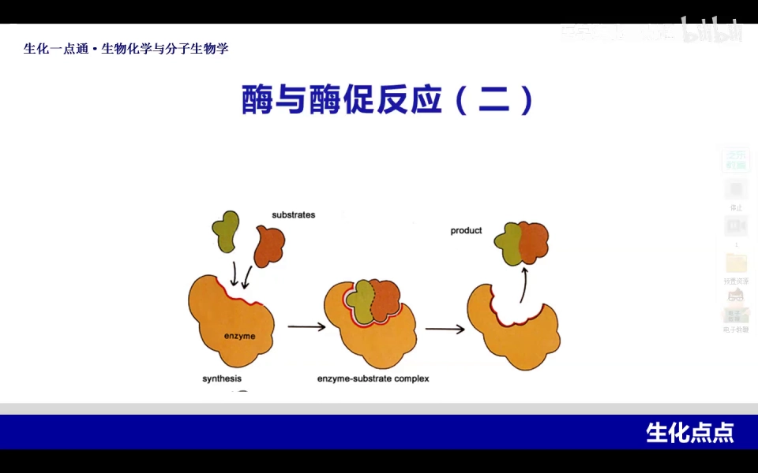
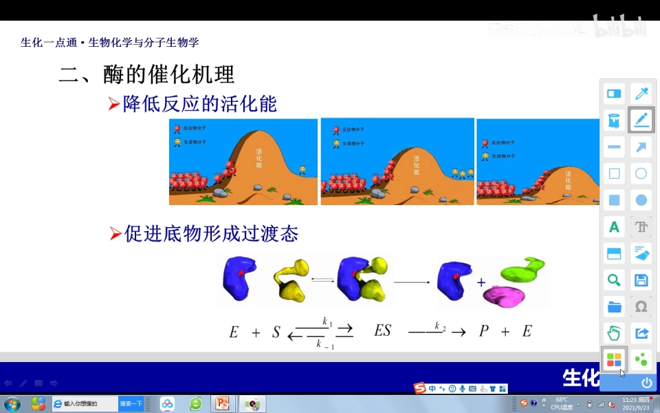
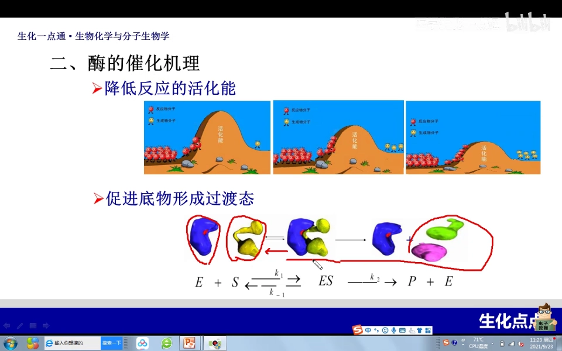
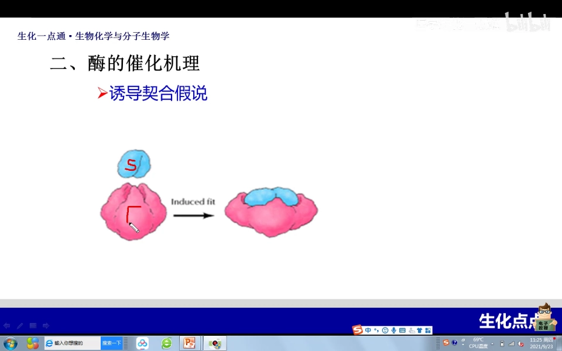
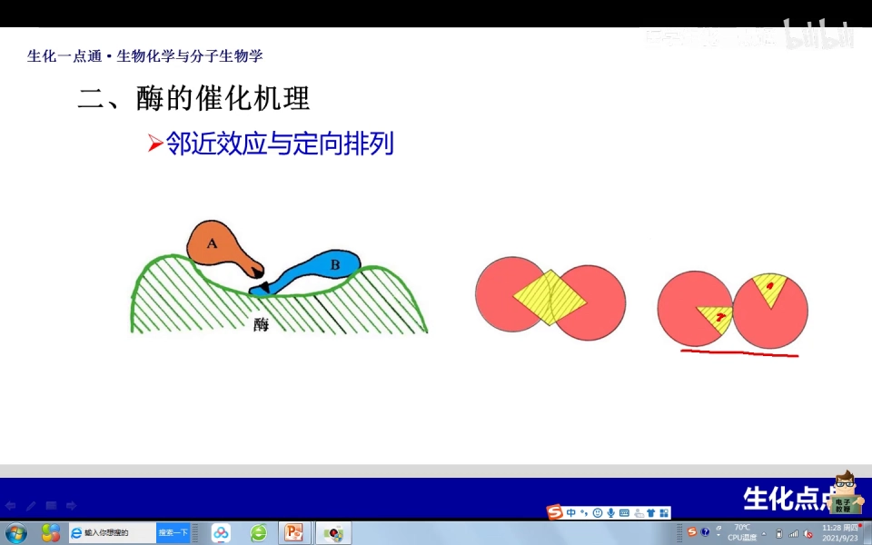
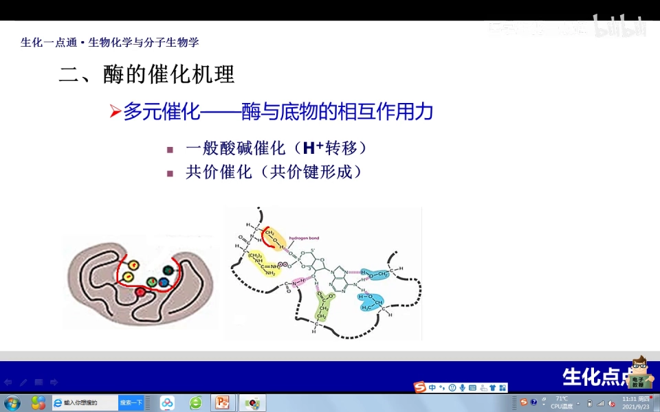
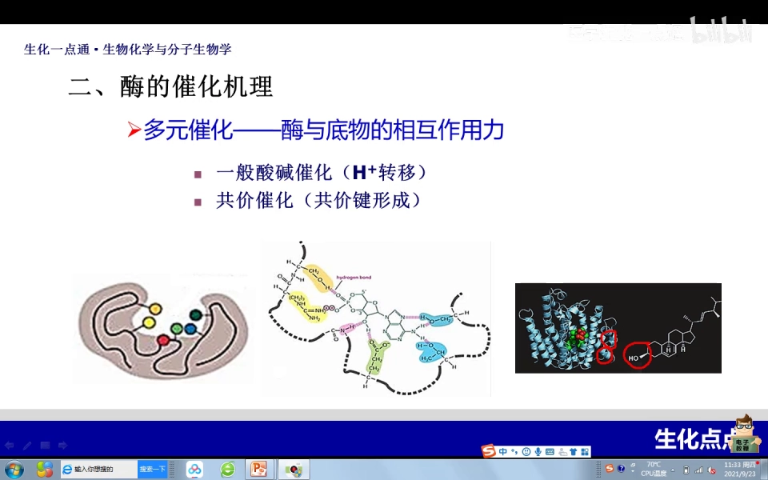

# 酶只降低活化能门槛不改变平衡常数：四种催化假说

> 视频来源：[7 酶的催化原理](https://www.bilibili.com/video/BV1qk4y1F7dR/)（Bilibili · 医学生化一点通 · 约 20 分钟）。本文按该视频的逐窗口字幕与画面整理，内容均可在原视频中核查。
> 导读：这支课从"酶和一般催化剂有什么同与不同"讲起，用三幅山坡图把活化能讲成一道门槛，再交代教材上解释催化机理的四种假说——诱导契合、邻近效应与定向排列、表面效应、多元催化。它给出的最实用的一句判断是：酶只降低门槛，不改变平衡常数。本文不讨论米氏方程的推导。

## 本讲要解决的核心问题（SCQA）

**背景**：酶是生物催化剂。所有催化剂都能加快反应，教材也常说酶"极大地降低活化能"。

**冲突**：如果酶只是"加能量"，那它就该能推动本来不能发生的反应，甚至改变反应终点。但事实不是这样：酶只加速**热力学上允许**的反应，反应前后自身的质和量也不变。同时，酶又比一般催化剂快得多，这个"多得多"从哪来？

**疑问**：酶和一般催化剂到底哪里相同、哪里不同？"降低活化能"具体是降低了什么？教材上那几种解释催化机理的假说，各自在说什么？

**回答（中心思想）**：酶和一般催化剂的**共同点**是：反应前后质和量不变、**不改变平衡常数**、只能加速热力学允许的反应，且都靠**降低活化能**提高速率。**不同点**是酶效率更高、有高度特异性、可调节、不稳定、反应条件温和。活化能是一道**门槛**：门槛越低，能越过去的底物分子越多，反应越快——酶比一般催化剂强，就在于它把门槛降得**更低**。降低门槛的具体方式，教材用四种假说解释：**诱导契合、邻近效应与定向排列、表面效应（疏水口袋）、多元催化**。

---

## 一、酶与一般催化剂：三条相同，五条不同

### 1.1 相同点：不改变平衡常数，只加速允许的反应

视频开篇先划共同点 [【跳转到 00:00】](https://www.bilibili.com/video/BV1qk4y1F7dR/?t=0)：

1. **催化前后质和量不变**：催化剂参与了过程，但结束时原样回来。
2. **不可能改变原有反应本身的平衡常数**：这是最容易被忽略、也最该记住的一条。
3. **只能加速热力学原理上允许的化学反应**：$\Delta G > 0$ 的反应，再好的酶也推不动。

而所有催化剂提高速率的原理都是同一个：**降低反应的活化能** [【跳转到 00:25】](https://www.bilibili.com/video/BV1qk4y1F7dR/?t=25)。

把这三条放在一起，就得到本讲的核心区分：

- **热力学**管"能不能、到哪儿"——由 $\Delta G$ 与平衡常数决定，催化剂不碰；
- **动力学**管"多快"——由活化能决定，催化剂专攻这里。

所以"酶把反应加快 $10^8$ 倍"和"酶不改变平衡常数"这两句话并不矛盾，它们说的是两个不同的量。

### 1.2 不同点：效率、特异性、可调节性、稳定性、反应条件

酶毕竟是活细胞产生的催化剂，有五条特性 [【跳转到 00:25】](https://www.bilibili.com/video/BV1qk4y1F7dR/?t=25)：

- **高度的催化效率**：能更快地加快反应；
- **高度的特异性**：不是所有反应都用同一种酶，不同的酶针对不同的反应起作用；
- **可调节性**：酶在活细胞内会随体内外环境改变而改变活性 [【跳转到 00:50】](https://www.bilibili.com/video/BV1qk4y1F7dR/?t=50)；
- **不稳定性**：酶的本质是蛋白质，因此也受蛋白那些理化因素的影响；
- **反应条件温和**：与体外一般催化剂相比，体内酶在正常温度、正常压力、正常 pH 下工作 [【跳转到 01:15】](https://www.bilibili.com/video/BV1qk4y1F7dR/?t=75)。

这张总览图给出了后面所有讨论的舞台：底物（substrates）进入酶的活性部位，形成**酶-底物复合物**（enzyme-substrate complex），产物（product）释放后酶恢复原状——"质和量不变"在图上就是最后那个空着的活性部位。

### 1.3 特异性有三个严格程度

视频重点解析了特异性，因为它最能体现"酶选底物"这件事 [【跳转到 01:40】](https://www.bilibili.com/video/BV1qk4y1F7dR/?t=100)。按严格程度从高到低，可以分成三层：

| 类型 | 要求 | 例子 |
| --- | --- | --- |
| 绝对特异性 | 对底物的整个空间结构都有很高要求，其他底物进不了活性中心 | 只认一种底物 |
| 相对特异性 | 只要求底物的部分结构符合活性中心，不管这部分连着什么样的主体 | 只认肽键这类共价键 |
| 立体异构特异性 | 还要求立体构象符合，只选其中一种异构体 | 只认 L 型或只认 D 型 |

其中相对特异性的说法很形象 [【跳转到 02:25】](https://www.bilibili.com/video/BV1qk4y1F7dR/?t=145)：酶只追求底物中**部分结构**符合活性中心的要求，至于这两个特异性结构所连接的是什么主体，可以不加顾忌——只要具备这个空间构象，就能当底物。立体异构特异性则更严格：一种物质可能有三维空间上不同的构型（如 L 型/D 型、左旋/右旋），酶只选择其中一种 [【跳转到 03:15】](https://www.bilibili.com/video/BV1qk4y1F7dR/?t=195)。

---

## 二、活化能就是那道门槛

### 2.1 三幅山坡图：门槛越低，越过去的分子越多

怎么体会"降低活化能"？视频用三幅图说明 [【跳转到 04:04】](https://www.bilibili.com/video/BV1qk4y1F7dR/?t=244)。

底物要转变成产物，是一个巨大的变化，需要能级的变化；转变所需的**最低能量**就叫**活化能**——必须迈过这个门槛，才能发生本质的改变 [【跳转到 04:29】](https://www.bilibili.com/video/BV1qk4y1F7dR/?t=269)。

三幅图对应三种情形：

1. **没有任何催化剂**：这个过程也有，但发生的程度很低 [【跳转到 04:54】](https://www.bilibili.com/video/BV1qk4y1F7dR/?t=294)——山坡很高，只有极少数能量特别高的底物分子能翻过去。
2. **加入一般催化剂**：催化剂的作用是把所需跨越的门槛（活化能）降低；门槛降低后，更多底物分子能越过门槛转变成产物，我们看到的就是反应加速了 [【跳转到 05:12】](https://www.bilibili.com/video/BV1qk4y1F7dR/?t=312)。
3. **加入酶**：酶比一般催化剂具有高度的催化效率，就在于它能把门槛**降得更低**，让绝大部分底物分子都能轻而易举地越过门槛成为产物 [【跳转到 05:37】](https://www.bilibili.com/video/BV1qk4y1F7dR/?t=337)。

注意三幅图里**山坡两侧的起点和终点高度没有变**——变的只是中间那道坎。这就是"不改变平衡常数"的图形表达。

### 2.2 过渡态不是终点站：三种反应构成混合体系

降低活化能的具体做法，是**促进底物更多、更快地形成过渡态** [【跳转到 06:02】](https://www.bilibili.com/video/BV1qk4y1F7dR/?t=362)。同一张幻灯片下半部分给出了一个常被忽略的要点：酶和底物**并不是一步到位**变成产物的。

$$E + S \rightleftharpoons ES \rightarrow P + E$$

**过渡态**是相当活跃、极易被改变的状态，所以它有两种趋向 [【跳转到 06:45】](https://www.bilibili.com/video/BV1qk4y1F7dR/?t=405)：

- 积极地转变成相应产物，然后把酶重新释放出来；
- 或者**再翻回去**，重新释放底物和酶。

所以过渡态**不是百分之百**能转变成产物的 [【跳转到 07:10】](https://www.bilibili.com/video/BV1qk4y1F7dR/?t=430)。现实中其实同时存在三种反应，构成一个混合体系 [【跳转到 08:00】](https://www.bilibili.com/video/BV1qk4y1F7dR/?t=480)：

1. 酶与底物结合形成过渡态（合成反应）；
2. 过渡态（酶-底物中间复合物）继续转变生成产物（分解反应）——这是我们希望的；
3. 过渡态中间复合物再分解回酶和底物——这是"白干"的那部分。

酶的作用就是**极大、极快地促进过渡态的形成，让它更多更快地转变成产物**。这也解释了为什么单纯"结合得紧"不够：如果酶把复合物抓得太死、却不促进它往下走，反应反而被卡住。

---

## 三、四种催化假说：教材怎么解释"门槛为什么被降低"

理解了本质之后，教材对催化机理的解释用的是几种假说 [【跳转到 08:25】](https://www.bilibili.com/video/BV1qk4y1F7dR/?t=505)。视频作者的态度很实用：**不必把精力放在假说本身，而是借助假说理解酶的工作方式**。

### 3.1 诱导契合：双方都要变形

**诱导契合**指酶和底物两种分子在相互靠近的过程中，**彼此都要适应对方的要求，都要做出改变** [【跳转到 08:48】](https://www.bilibili.com/video/BV1qk4y1F7dR/?t=528)。

图上可以看到：酶和底物分别存在时，它们的空间结构似乎有一定吻合度，但**并不完全吻合**；随着相互靠近，两者都发生了空间结构的改变，结果是形成稳定的酶-底物中间复合物，也就是二者形成了过渡态 [【跳转到 09:13】](https://www.bilibili.com/video/BV1qk4y1F7dR/?t=553)。

如果这个过程更快、形成的过渡态更多，反应就更容易发生，看起来就是反应提速了 [【跳转到 09:38】](https://www.bilibili.com/video/BV1qk4y1F7dR/?t=578)。一句话记忆：**酶和底物相互诱导、相互变形，最后完美结合**，因为相互适应了 [【跳转到 10:03】](https://www.bilibili.com/video/BV1qk4y1F7dR/?t=603)。

### 3.2 邻近效应与定向排列：把两个底物变成"邻居"并摆正

第二种学说包含两件事 [【跳转到 10:20】](https://www.bilibili.com/video/BV1qk4y1F7dR/?t=620)。

**邻近效应**：如果没有酶，A 和 B 两个微小的底物分子必须碰撞在一起才有可能反应，而在整个细胞里、体液中这个几率非常小 [【跳转到 10:45】](https://www.bilibili.com/video/BV1qk4y1F7dR/?t=645)。有酶时就不一样了：借助酶这个大平台，A 底物先找到酶上合适的位置结合，B 底物也找到它能结合的位点；二者都结合在同一个酶分子上之后，A 和 B 的空间位置就已经很近了 [【跳转到 11:10】](https://www.bilibili.com/video/BV1qk4y1F7dR/?t=670)。**邻近效应就是借助酶这个平台把两个底物的距离拉近，让它们成为邻居。**

**定向排列**：A 和 B 虽然相遇了，但如果碰撞的方位不对，也不会发生反应 [【跳转到 11:35】](https://www.bilibili.com/video/BV1qk4y1F7dR/?t=695)。图上右边那种碰撞，两者能反应的那一面没有碰在一起，最后又分开，没有任何结果；而左边那种碰撞，正好是能发生改变的那一面碰在一起，反应就能发生 [【跳转到 12:17】](https://www.bilibili.com/video/BV1qk4y1F7dR/?t=737)。所以**定向排列指两种底物分子碰撞时必须采取正确的空间位置、进行定方向的碰撞**。

两者叠加的效果 [【跳转到 12:42】](https://www.bilibili.com/video/BV1qk4y1F7dR/?t=762)：底物结合到酶这个平台上之后，不仅位置关系拉近了，而且它们碰撞的面肯定是正确的——**一碰撞就有效果**。这里要记住"有比较"这个前提：是"有酶"相对于"没有酶"能促进 A 和 B 形成更多中间复合过渡态 [【跳转到 11:35】](https://www.bilibili.com/video/BV1qk4y1F7dR/?t=695)。

### 3.3 表面效应：疏水口袋把水挡在外面

第三种假说要从**活性中心**的位置去理解 [【跳转到 13:06】](https://www.bilibili.com/video/BV1qk4y1F7dR/?t=786)。活性中心内含有许多**疏水性氨基酸残基**；疏水性残基在水溶液中一定要避开水分子，于是采取凹陷下去的方式。所以在体液的这种水环境中，酶的活性中心如果有很多疏水性残基，它就会下陷形成凹陷——这就是所谓的**疏水性的口袋**，像衣服口袋一样，而且整个口袋内部环境都是疏水的 [【跳转到 13:31】](https://www.bilibili.com/video/BV1qk4y1F7dR/?t=811)。

当底物到达之后，酶和底物就可以在活性中心的位置紧密接触，有助于反应发生，而**水分子的干扰不存在** [【跳转到 13:56】](https://www.bilibili.com/video/BV1qk4y1F7dR/?t=836)。这就是表面效应。

### 3.4 多元催化：一般酸碱催化 + 共价催化

第四种假说重在理解"多元"二字：**底物和酶分子之间的相互作用力是多种多样的** [【跳转到 14:08】](https://www.bilibili.com/video/BV1qk4y1F7dR/?t=848)。经常提到的有两种：

- **一般酸碱催化**：建立在广义酸与广义碱的基础上，一定要涉及**质子的位置移动**；
- **共价催化**：形成了**共价键** [【跳转到 14:33】](https://www.bilibili.com/video/BV1qk4y1F7dR/?t=873)。

这张图把"多元"画得很清楚：左边是酶的活性中心，里面许多氨基酸残基，有的是**结合基团**，有的是**催化基团**，这些带颜色的球形颗粒代表它的**必需基团**；右边用结构式把这些必需基团展开，可以看到底物到达活性中心后，实质上发生的是**底物中的化学基团与必需基团之间各种化学力量的相互作用** [【跳转到 15:23】](https://www.bilibili.com/video/BV1qk4y1F7dR/?t=923)。

两种力量的区分标准很简单 [【跳转到 15:48】](https://www.bilibili.com/video/BV1qk4y1F7dR/?t=948)：

- 如果这个力量来自一个酸性基团和一个碱性基团之间**质子的转移**，就是一般酸碱催化。比如氨基酸残基里有很多碱性基团（如组氨酸），底物分子那侧正好是酸性的，二者就能靠酸碱之间微弱的力量形成一般酸碱催化——**关键抓住氢离子转移**。
- 如果这个力量来自**电子的转移**，就会形成共价键，这种力量比较强大，就是共价催化 [【跳转到 16:27】](https://www.bilibili.com/video/BV1qk4y1F7dR/?t=987)。

所以多元催化可以这样体会：酶和底物相互靠近时，实际是**借助各种力量**才能结合起来、形成过渡态，这些力量包括一般酸碱催化的力量、共价催化的力量，也可能还有其他力量 [【跳转到 17:17】](https://www.bilibili.com/video/BV1qk4y1F7dR/?t=1037)。总而言之，多元催化的本质也在于通过力量让酶和底物更快、更好地形成过渡态，提高反应发生的速度 [【跳转到 17:42】](https://www.bilibili.com/video/BV1qk4y1F7dR/?t=1062)。

---

## 四、回到本质：活性中心里发生的只是化学基团之间的作用

四种假说讲完，视频最后做了一次"跳出细节"的收束 [【跳转到 17:52】](https://www.bilibili.com/video/BV1qk4y1F7dR/?t=1072)。

**活性中心**的定义：酶的整个空间结构中，能够结合底物、把底物变成产物的那个抽象的空间 [【跳转到 18:17】](https://www.bilibili.com/video/BV1qk4y1F7dR/?t=1097)。

**活性中心里发生的事**：底物分子上的基团与酶活性中心这些必需氨基酸残基上的基团之间形成了各种力量 [【跳转到 18:27】](https://www.bilibili.com/video/BV1qk4y1F7dR/?t=1107)。在它们的原子与原子、基团与基团之间形成了这么多力量，正是由于各种力量才把它们拉在一起、形成过渡态 [【跳转到 18:52】](https://www.bilibili.com/video/BV1qk4y1F7dR/?t=1132)。

作者给了一个很实用的学习建议 [【跳转到 19:03】](https://www.bilibili.com/video/BV1qk4y1F7dR/?t=1143)：这个结构会发生轻微的位移改变，原因肯定是旁边的化学基团给了它特殊的作用；所以**不用拘泥于教材上讲的那些机制描述，不要钻到细节里**，要跳出来看酶催化的本质——酶是蛋白质也好、底物也好，其实都是化学分子，它们之间必定是靠分子中的一些基团和结构去相互作用 [【跳转到 19:25】](https://www.bilibili.com/video/BV1qk4y1F7dR/?t=1165)。

---

## 小结

- 酶与一般催化剂的**三条相同点**：催化前后质和量不变、不改变平衡常数、只能加速热力学允许的反应；共同原理都是降低活化能。
- 酶的**五条特性**：高效率、高特异性、可调节、不稳定（本质是蛋白质）、反应条件温和。
- 特异性分三个严格程度：绝对特异性 > 立体异构特异性 > 相对特异性（只认底物的某一部分结构或某种键）。
- **活化能是一道门槛**：门槛越低，能越过去的底物分子越多，反应越快；酶比一般催化剂强，就在于把门槛降得更低。三幅山坡图里，变的只是中间的坎，两侧起点与终点高度不变。
- **过渡态不是终点站**：$E + S \rightleftharpoons ES \rightarrow P + E$，过渡态既可能变产物，也可能翻回去释放底物；现实中三种反应共存。
- **四种假说**：诱导契合（双方变形）、邻近效应与定向排列（拉近 + 摆正）、表面效应（疏水口袋隔水）、多元催化（一般酸碱催化 + 共价催化等多种力量并用）。
- 一句话收束：活性中心里发生的，只是**化学基团之间的相互作用**；假说是帮助理解的语言，不是需要背诵的教条。

## 关键术语速查

| 术语 | 一句话解释 |
| --- | --- |
| 活化能 | 底物转变成产物所需的最低能量，相当于必须迈过的门槛 |
| 平衡常数 | 反应终点的位置，催化剂不改变它 |
| 过渡态 | 酶-底物中间复合物的高能、极活跃状态，可能变产物也可能退回底物 |
| 酶-底物复合物 ES | 酶与底物暂时结合形成的中间物，是催化的必经环节 |
| 绝对特异性 | 对底物整体空间结构要求很高，只认一种底物 |
| 相对特异性 | 只要求底物的一部分结构或某类化学键符合活性中心 |
| 立体异构特异性 | 只选择某一种立体异构体（如 L 型而不要 D 型） |
| 诱导契合 | 酶与底物相互靠近时双方构象都改变，最终完美互补 |
| 邻近效应 | 酶把多个底物拉到同一分子上，提高局部有效浓度 |
| 定向排列 | 底物在酶上以正确取向碰撞，避免"撞了但撞错面" |
| 表面效应 | 活性中心是疏水口袋，把水挡在外面使底物紧密接触 |
| 多元催化 | 一般酸碱催化、共价催化等多种力量共同作用形成过渡态 |
| 一般酸碱催化 | 通过质子转移（酸碱基团间）起催化作用 |
| 共价催化 | 通过电子转移形成共价键，借助共价中间物加快反应 |
| 必需基团 | 活性中心里直接参与结合或催化的那些残基侧链基团 |