# 酶靠稳定过渡态降低活化能：七类催化机制与催化残基

> 视频来源：[生物化学 3.1 酶的催化机制](https://www.bilibili.com/video/BV1xY411P7cm/)（Bilibili · Max-胡 · 约 26 分钟）。本文按该视频的逐窗口字幕与画面整理，内容均可在原视频中核查。
> 导读：这支课把"酶为什么快"拆成三层——先分清 ΔG 与活化能两个量，再用一个"铁丝酶"思想实验讲清过渡态稳定学说，最后把七类化学机制（邻近定向诱导、广义酸碱、静电、金属、共价、底物形变、自由基）逐一落到具体的催化残基与真实酶例上。本文不涉及米氏方程的推导。

## 本讲要解决的核心问题（SCQA）

**背景**：蛋白质能结合配体，酶是其中会把化学反应用力"催"起来的一类。教材常说酶"降低活化能、加快反应速率"。

**冲突**：但"降低活化能"这句话很容易被误读成酶给反应"加了能量"或"改变了反应方向"。同时，一个活性部位里往往只有几个残基真正参与化学步骤，其余只是把底物"抓住"——这两件事在结构上看不出区别。

**疑问**：反应到底慢在哪一步？酶降低的究竟是能量图景上的哪个量？它具体用哪几种化学手段做到？这些手段又分别由哪些催化残基承担？

**回答（中心思想）**：反应慢，是因为底物必须先翻过一座能量山，山顶是**过渡态**，山脚到山顶的高度是**活化能**（记作 $\Delta G^\ddagger$）。酶做的事不是搬走终点，也不是改变 $\Delta G$ 与平衡位置，而是**稳定过渡态**——把山顶压低。压低山顶的具体手段有七类：邻近、定向与诱导，广义酸碱催化，静电催化，金属催化，共价催化，底物形变，自由基催化。每一类手段都要由活性部位上具体的**催化残基**（或它招募的金属离子、辅酶）来执行。

---

## 一、先分清两个量：ΔG 决定方向，活化能决定快慢

### 1.1 酶不改变自由能变化，也不改变平衡位置

视频开篇就把这条边界划清楚了：酶的催化机制**归根到底是通过降低活化能来加快反应速率**，而酶**不会改变反应的自由能变化**，也就是**不会改变反应本来的平衡位置** [【跳转到 01:48】](https://www.bilibili.com/video/BV1xY411P7cm/?t=108)。

这句话值得拆成两半来记：

- **热力学量（$\Delta G$）**：底物与产物之间的自由能差，决定反应往哪边走、平衡时两边各占多少。催化剂动不了它。
- **动力学量（活化能 $\Delta G^\ddagger$）**：底物要变成产物必须先爬过的高度，决定反应有多快。酶动的是它。

两者互不干涉，这就是"酶能让反应快一千万倍，却不能让一个本来不能发生的反应发生"的原因。

### 1.2 过渡态是山顶，活化能是山脚到山顶的高度

所谓**过渡态**，指反应物在生成产物之前必须先达到的那个特定高能状态 [【跳转到 01:23】](https://www.bilibili.com/video/BV1xY411P7cm/?t=83)。在自由能-反应进程图上，它是一个**峰**而不是一个可以停留的**谷**：分子在峰顶只存在极短的一瞬，键正在断裂与形成之间。

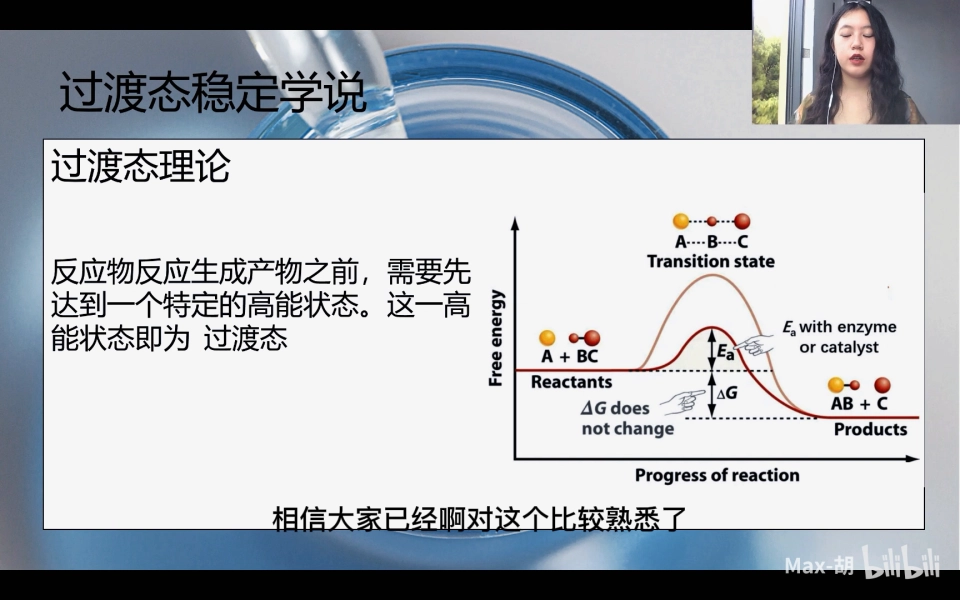

这张幻灯片把三个量放在同一张图上，值得逐项对照：

- 横轴是**反应进程**，纵轴是**自由能**；
- 中间的高峰标注为 **Transition state（过渡态）**，峰顶画的 $A\cdots B\cdots C$ 表示旧键将断未断、新键将成未成；
- 从反应物水平线到峰顶的箭头是 $E_a$，旁边还有一条更矮的虚线箭头写着 **$E_a$ with enzyme or catalyst**——酶压低的就是这一支；
- 图中间明确写着 **$\Delta G$ does not change**：反应物与产物两条水平线的高度差，加不加酶都一样。

---

## 二、过渡态稳定学说：一个"铁丝酶"的思想实验

### 2.1 三种假设，三种结局

**过渡态稳定学说**（transition-state stabilization）一句话概括：酶能稳定反应过程中所经历的过渡态，从而实现降低活化能的目的 [【跳转到 02:26】](https://www.bilibili.com/video/BV1xY411P7cm/?t=146)。

为了讲清"稳定过渡态"和"结合底物"的差别，视频设计了一个假想的**铁丝酶**：它催化"铁丝断开"这个反应。铁丝断开需要先把弯折处弯到高能状态（相当于过渡态），然后才断成两截（产物）。下面三种假设对应三种结局：

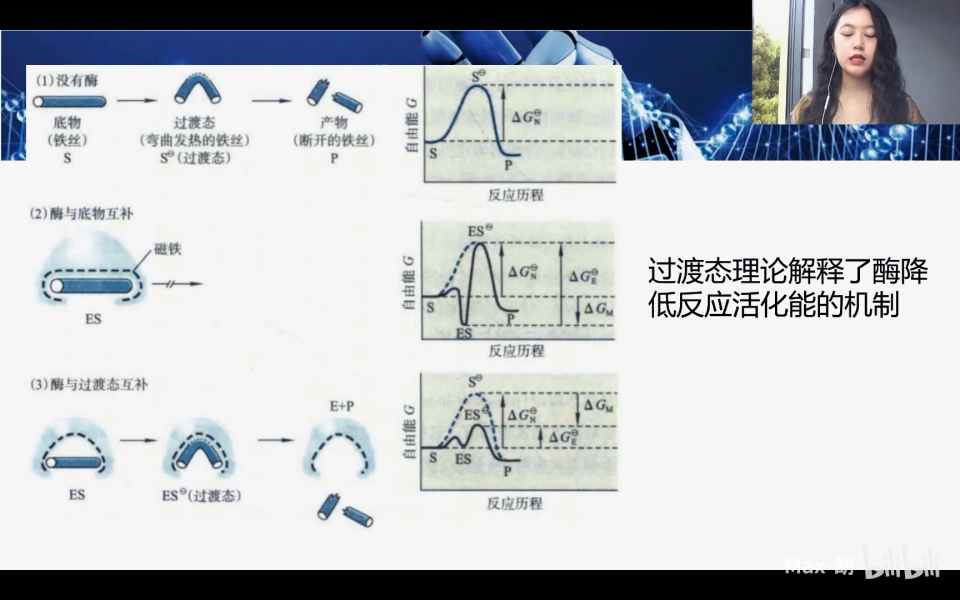

1. **没有酶**：只能靠加热或弯折，让弯折处达到高能状态，铁丝才能断 [【跳转到 03:16】](https://www.bilibili.com/video/BV1xY411P7cm/?t=196)。对应图上第一行——要爬完整个高峰。
2. **酶与底物互补、但不与过渡态互补**：酶会把底物**稳定在原本的状态**，反而不让它经历过渡态，底物能量升不上去，也就变不成产物 [【跳转到 03:41】](https://www.bilibili.com/video/BV1xY411P7cm/?t=221)。这是本讲最重要的一课：**结合得越紧不等于催化得越好**。如果酶的结合能全部用来抓住底物，它就成了"陷阱"而不是"催化剂"。
3. **酶与过渡态互补**：酶诱导铁丝进入过渡态，并把它稳定在高能水平；随后高能过渡态自发向低能态转化，变成产物（断开的铁丝）[【跳转到 04:06】](https://www.bilibili.com/video/BV1xY411P7cm/?t=246)。

第 3 种情形才是真正的催化：酶让"底物 → 中间态"这一步更容易，并且把中间物稳定在高能水平，使它不至于"误入歧途" [【跳转到 04:56】](https://www.bilibili.com/video/BV1xY411P7cm/?t=296)。用能量图的语言说：酶的结合能**主要用来补偿过渡态那一侧**，于是峰被削矮，而反应物与产物两端的高度不变。

### 2.2 两个实验证据：过渡态类似物抑制剂与抗体酶

一个学说要站得住，得有独立证据。视频给了两条 [【跳转到 05:34】](https://www.bilibili.com/video/BV1xY411P7cm/?t=334)：

**证据一：过渡态类似物是强抑制剂。** 如果酶真的"更爱过渡态"，那么一个结构上模仿过渡态、但不会被转化的分子，就应该被酶紧紧抓住。事实正是如此：过渡态类似物可以作为酶的一种**不可逆抑制剂**（除非该酶的催化机制本身就是共价催化），抑制效果明显 [【跳转到 05:59】](https://www.bilibili.com/video/BV1xY411P7cm/?t=359)。原因在于酶对过渡态的亲和力高于对底物的亲和力——在铁丝酶里，酶对铁丝底物的亲和力较低，对铁丝过渡态的亲和力更高。

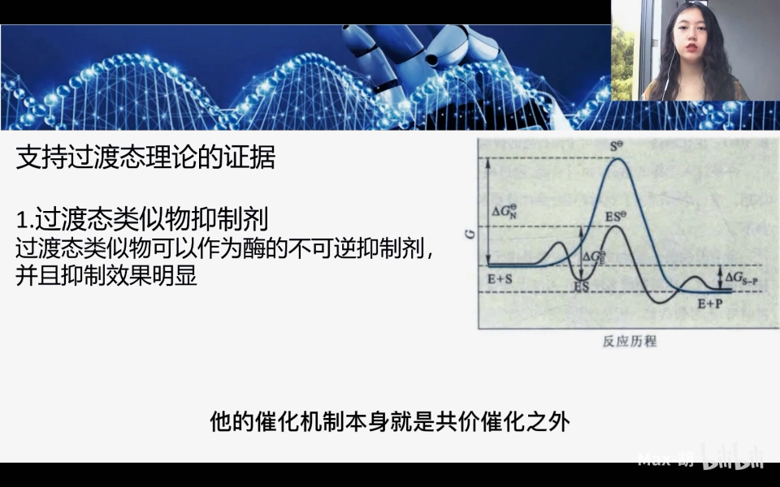

**证据二：抗体酶。** 用过渡态类似物作抗原去免疫动物，动物产生的抗体再去结合原本的底物，可以达到类似酶的效果 [【跳转到 06:24】](https://www.bilibili.com/video/BV1xY411P7cm/?t=384)。逻辑是：抗原与抗体在结构上必须有一定互补性才能结合，所以抗原-抗体相互作用在几何上近似于过渡态与酶的相互作用；以过渡态类似物作抗原诱导出的抗体，就保留了过渡态类似物的形状，相当于铁丝酶的第三行 [【跳转到 07:14】](https://www.bilibili.com/video/BV1xY411P7cm/?t=434)。

---

## 三、七类化学机制：酶用什么手段稳定过渡态

"稳定过渡态"是目标，实现目标需要具体化学手段。视频把稳定过渡态的化学机制列为七项 [【跳转到 07:44】](https://www.bilibili.com/video/BV1xY411P7cm/?t=464)：

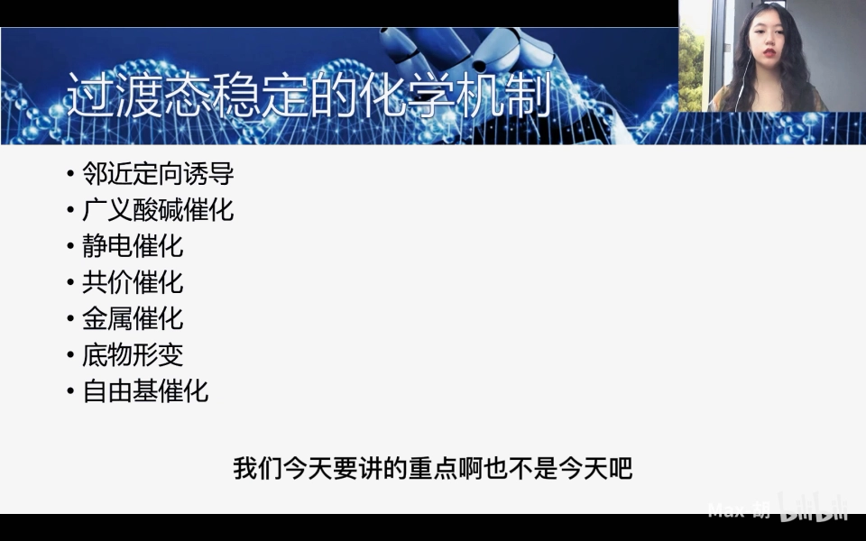

其中自由基催化只存在于一小部分酶中，但因为性质特殊被单独拿出来讲。下面按视频顺序逐一说明。

### 3.1 邻近、定向与诱导：把两个底物"摆好"

在没有酶时，两个底物在溶液中自由扩散，运动方向与取向都是任意的。而两个底物要反应，**先要碰撞，碰撞时还要有正确的取向** [【跳转到 08:59】](https://www.bilibili.com/video/BV1xY411P7cm/?t=539)。于是无酶时速率很低，原因有两个：相遇概率低；相遇了也不一定能采取正确取向。

酶同时解决这两个问题 [【跳转到 09:24】](https://www.bilibili.com/video/BV1xY411P7cm/?t=564)：它把底物结合到内部，使**局部底物浓度**大幅提高（相当于把分子间反应变成近似的分子内反应）；同时酶自身的形状与理化性质（如氨基酸的带电性质）迫使底物只能采取某几种特定取向，从而提高了"正确碰撞构象"的概率 [【跳转到 10:14】](https://www.bilibili.com/video/BV1xY411P7cm/?t=614)。

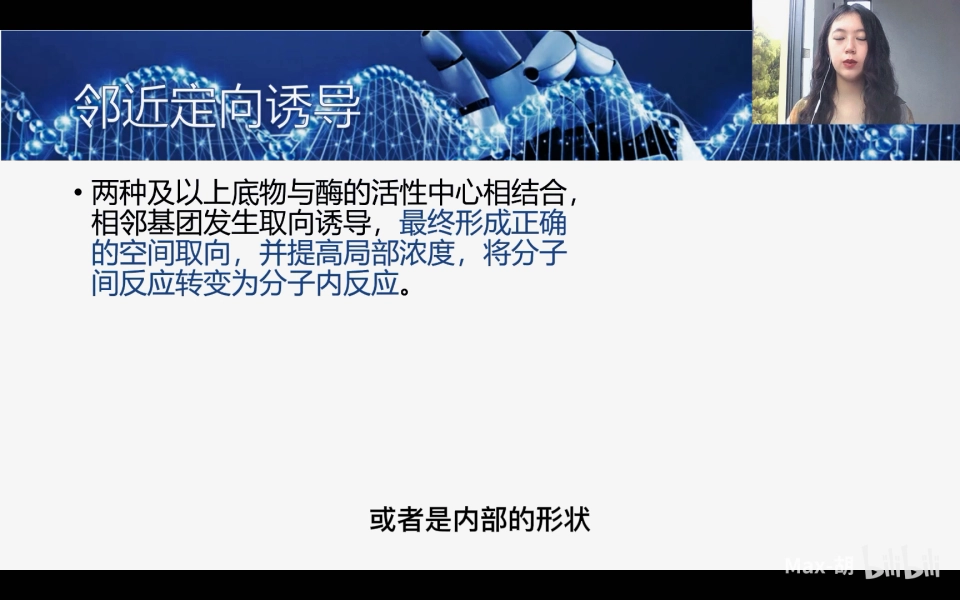

这张幻灯片把三件事压进一句话里，正好对应"邻近（提高局部浓度）+ 定向（取向诱导）+ 诱导（构象调整）"三个词：**两种及以上底物与酶的活性中心相结合，相邻基团发生取向诱导，最终形成正确的空间取向，并提高局部浓度，将分子间反应转变为分子内反应。**

### 3.2 广义酸碱催化：靠质子的给出与接受

按酸碱质子理论：**凡是给出质子（H⁺）的物质都是酸，凡是接受质子的物质都是碱**。酶的**广义酸碱催化**就是酶通过给出或接受质子来起催化作用 [【跳转到 10:51】](https://www.bilibili.com/video/BV1xY411P7cm/?t=651)：

- 酶作为**质子供体** → 广义酸催化；
- 酶作为**质子受体** → 广义碱催化。

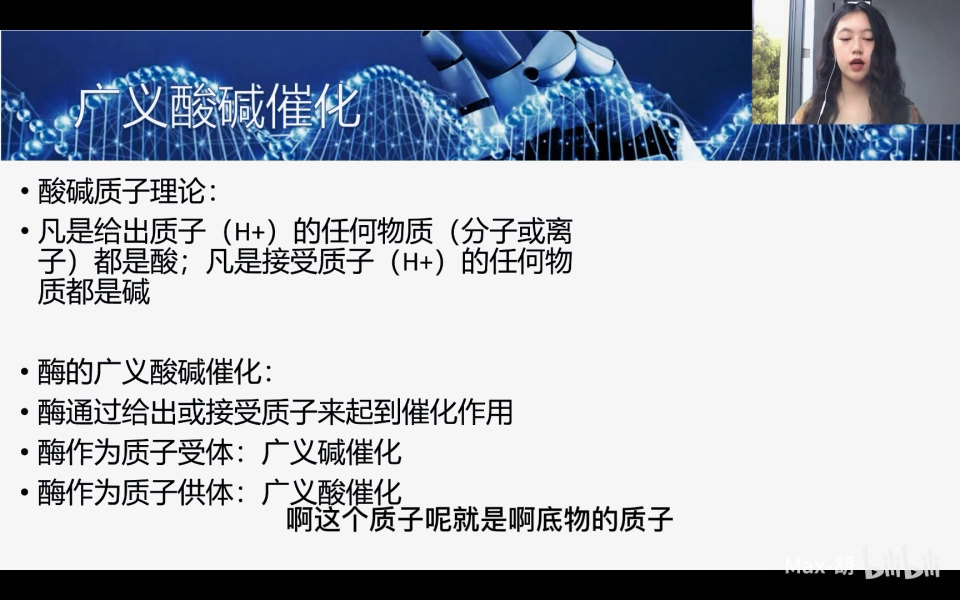

**谁来干这件事？** 一般是侧链带有可解离氢、或带有可解离氨基/羧基的残基 [【跳转到 11:48】](https://www.bilibili.com/video/BV1xY411P7cm/?t=708)。幻灯片上列出的常客是：Cys、Ser、Thr、Asp、Glu、Arg、Lys、His，以及游离的氨基和羧基。

**为什么能稳定过渡态？** 两个作用 [【跳转到 12:13】](https://www.bilibili.com/video/BV1xY411P7cm/?t=733)：一是**屏蔽电荷**，减少过渡态中的静电排斥力；二是**激活亲核基团或亲电基团**。

**为什么偏偏是组氨酸？** 要给出或接受质子，pH 必须位于该基团 pKa 附近 [【跳转到 12:38】](https://www.bilibili.com/video/BV1xY411P7cm/?t=758)。组氨酸侧链咪唑基的 pKa 在 6 附近，而 6 附近最接近人体等动物的生理 pH，所以在正常生理条件下它**既能接受质子也能给出质子**，无论作为缓冲基团还是催化基团都非常重要 [【跳转到 13:03】](https://www.bilibili.com/video/BV1xY411P7cm/?t=783)。

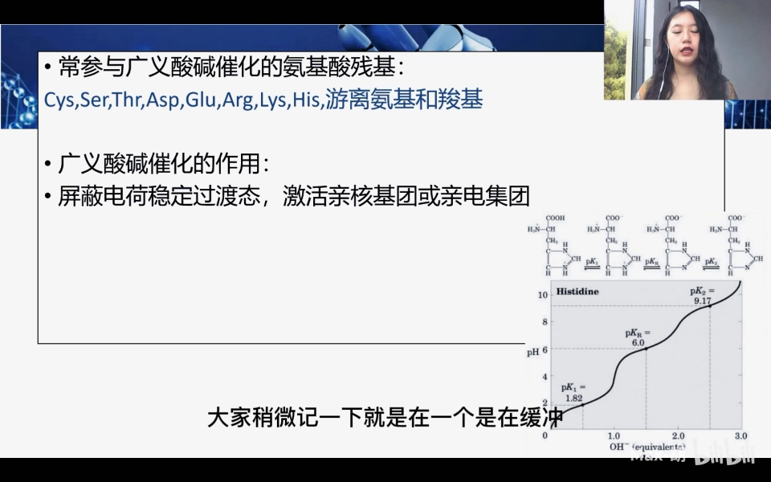

右侧的组氨酸滴定曲线很能说明问题：三个 pKa 分别标在 1.82、6.0、9.17，其中 **6.0 恰好落在生理 pH 附近**——这就是组氨酸被反复选作酸碱催化残基的结构原因。

### 3.3 静电催化：用活性中心的电荷中和过渡态的相反电荷

**静电催化**的定义只有一句：利用酶活性中心所带的电荷，去中和过渡态底物的相反电荷，从而稳定过渡态 [【跳转到 15:08】](https://www.bilibili.com/video/BV1xY411P7cm/?t=908)。常参与的残基是带电荷的那些：Asp、Glu、Arg、Lys，以及游离的氨基和羧基。

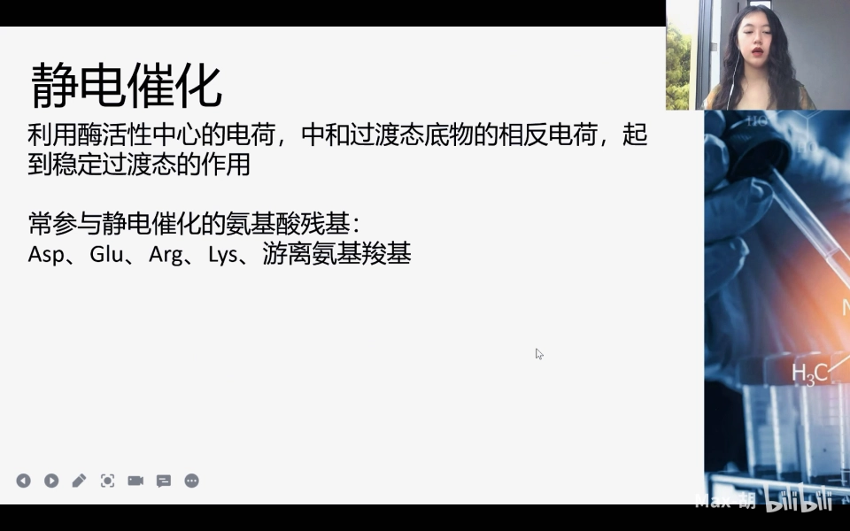

这里有个容易被忽略的区分：**同样是酸性残基，也可能不干酸碱催化的活**。溶菌酶中起广义酸碱催化的是 35 号谷氨酸（Glu35），它通过给出侧链羧基上的氢离子来催化，断裂细菌细胞壁糖链中的糖苷键，从而溶解细胞壁、起到抗菌作用 [【跳转到 14:18】](https://www.bilibili.com/video/BV1xY411P7cm/?t=858)；而下面的天冬氨酸残基（Asp52）**主要不是**广义酸碱催化——它一直处于电离状态，催化过程中不给出也不接受质子，只是靠自身带的负电荷去稳定过渡态中带正电的部分，属于**静电催化** [【跳转到 14:43】](https://www.bilibili.com/video/BV1xY411P7cm/?t=883)。

### 3.4 金属催化：金属离子是活性部位的一部分

金属离子本身性质特殊，在催化中能起丰富的作用 [【跳转到 15:52】](https://www.bilibili.com/video/BV1xY411P7cm/?t=952)。幻灯片把它的作用归成四条：

- 吸引底物的负电荷，起到**定向**作用；
- **屏蔽过渡态负电荷**，稳定过渡态；
- 作为**电子受体或电子供体**，参与氧化还原反应；
- **增强亲核基团的亲核性**。

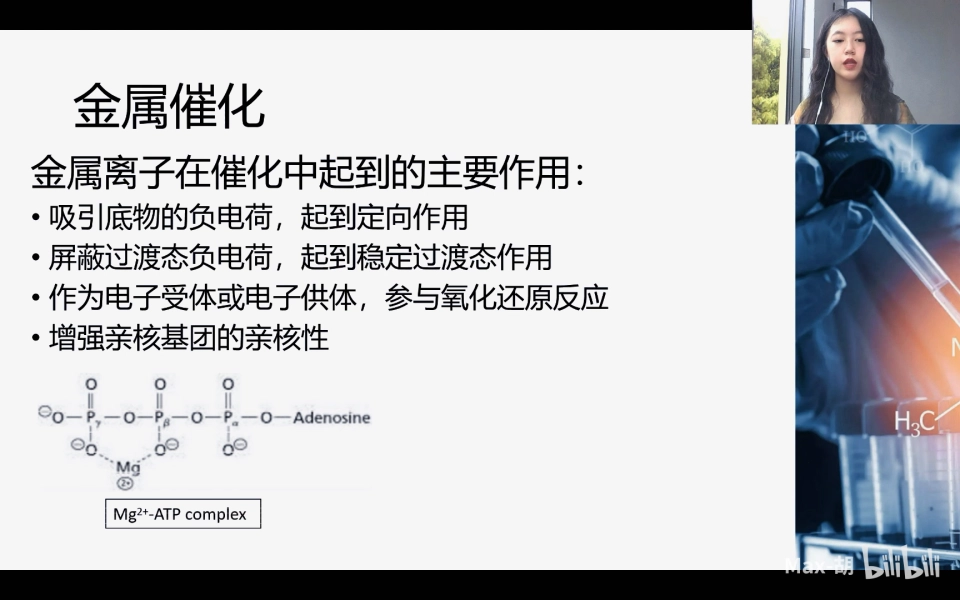

三个例子分别对应不同作用：

**例一：激酶的镁离子（屏蔽负电荷）。** 激酶几乎都需要镁离子来激活。激酶以 ATP 为底物，把 ATP 的 γ-磷酸基团转移到其他底物上完成磷酸化 [【跳转到 16:17】](https://www.bilibili.com/video/BV1xY411P7cm/?t=977)。催化时要攻击 γ 与 β 之间的高能磷酸键，而这两个磷酸基团之间的强烈负电荷排斥会妨碍攻击；镁离子正是屏蔽这对负电荷 [【跳转到 16:42】](https://www.bilibili.com/video/BV1xY411P7cm/?t=1002)。所以严格说，激酶真正的底物不是 ATP 本身，而是**镁离子与 ATP 形成的复合物** [【跳转到 17:07】](https://www.bilibili.com/video/BV1xY411P7cm/?t=1027)。

**例二：细胞色素（传递电子）。** 细胞色素在许多氧化还原反应中作为电子传递体：一方面作为电子受体从前一个化合物或蛋白那里接受电子，另一方面把电子提供给下游的酶或蛋白 [【跳转到 17:32】](https://www.bilibili.com/video/BV1xY411P7cm/?t=1052)；在线粒体呼吸链中，它就是这样帮助实现氧化磷酸化的 [【跳转到 17:57】](https://www.bilibili.com/video/BV1xY411P7cm/?t=1077)。

**例三：碳酸酐酶的锌离子（增强亲核性）。** 锌离子在这里的作用是增强亲核基团的亲和性：它促进水分子电离，产生具有很强亲核性的氢氧根，氢氧根再去攻击二氧化碳，使 CO₂ 变成碳酸氢根 [【跳转到 18:22】](https://www.bilibili.com/video/BV1xY411P7cm/?t=1102)。

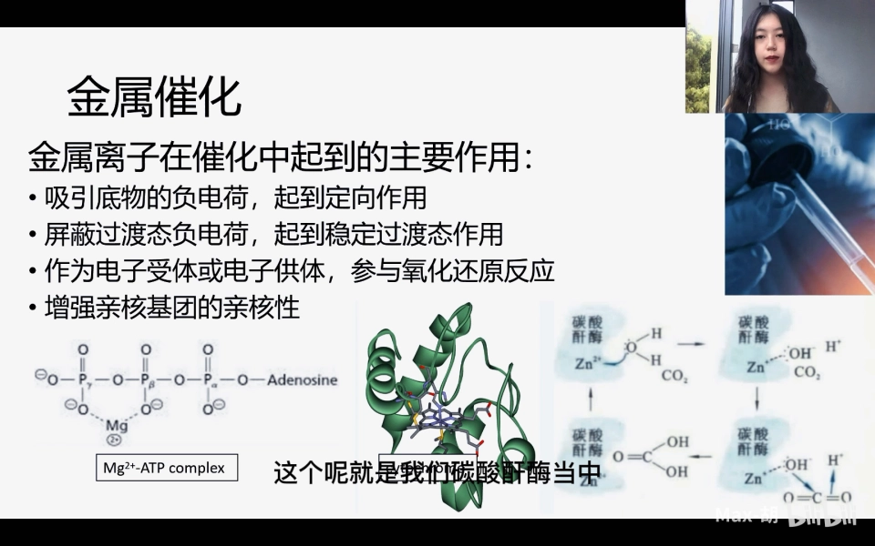

右侧的循环图把"增强亲核性"画成了闭环：碳酸酐酶结合 Zn²⁺，Zn²⁺ 极化水分子使其失去质子生成 Zn–OH⁻，氢氧根攻击 CO₂ 生成碳酸氢根，随后水分子重新结合、循环继续。

### 3.5 共价催化：换一条活化能更低的路线

**共价催化**就是酶与底物形成一个**共价中间物**，从而完全改变反应途径，进入一个全新的图形；而这个新途径所需的活化能**远远低于**原有过程 [【跳转到 18:52】](https://www.bilibili.com/video/BV1xY411P7cm/?t=1132)。

按共价键形成的方式分两类：酶具有亲核基团 → **亲核催化**；酶或其辅基具有亲电基团 → **亲电催化** [【跳转到 19:17】](https://www.bilibili.com/video/BV1xY411P7cm/?t=1157)。

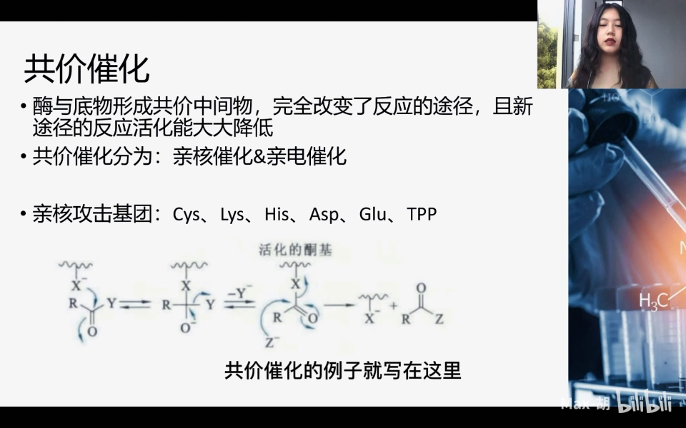

亲核攻击的常见基团是 Cys、Lys、His、Asp、Glu 以及 TPP。下方的反应式画出了完整过程 [【跳转到 19:42】](https://www.bilibili.com/video/BV1xY411P7cm/?t=1182)：酶上的亲核基团先攻击底物，形成共价中间物；随后底物的另一部分（或另一个底物分子）再对酶与底物之间的连接键做一次亲核攻击，把酶释放出来，底物就此变成产物。

**一个必须记住的细节**：无论亲核还是亲电催化，从底物到产物的全过程都要发生**两次**攻击——一次是酶攻击底物，一次是底物（或另一个底物分子）攻击酶-底物共价键 [【跳转到 20:57】](https://www.bilibili.com/video/BV1xY411P7cm/?t=1257)。

**为什么亲电催化常要借助辅酶？** 酶本身是蛋白质，氨基酸侧链所具有的**亲电基团比较缺乏** [【跳转到 20:07】](https://www.bilibili.com/video/BV1xY411P7cm/?t=1207)，所以亲电催化一般要通过缺电子的辅酶（如磷酸吡哆醛）或金属离子来提供亲电基团，例如转氨反应中醛基化氨基酸的转化 [【跳转到 20:32】](https://www.bilibili.com/video/BV1xY411P7cm/?t=1232)。

### 3.6 底物形变：诱导契合的能量代价换来了什么

**底物形变**指的是酶诱导底物发生形变，这是诱导契合的主要效应 [【跳转到 21:32】](https://www.bilibili.com/video/BV1xY411P7cm/?t=1292)。要注意的是，虽然名字叫"底物变形"，实际上**酶本身也会发生形变**：底物和酶相互诱导，各自构象改变，使彼此具有更高的亲和力 [【跳转到 21:57】](https://www.bilibili.com/video/BV1xY411P7cm/?t=1317)。

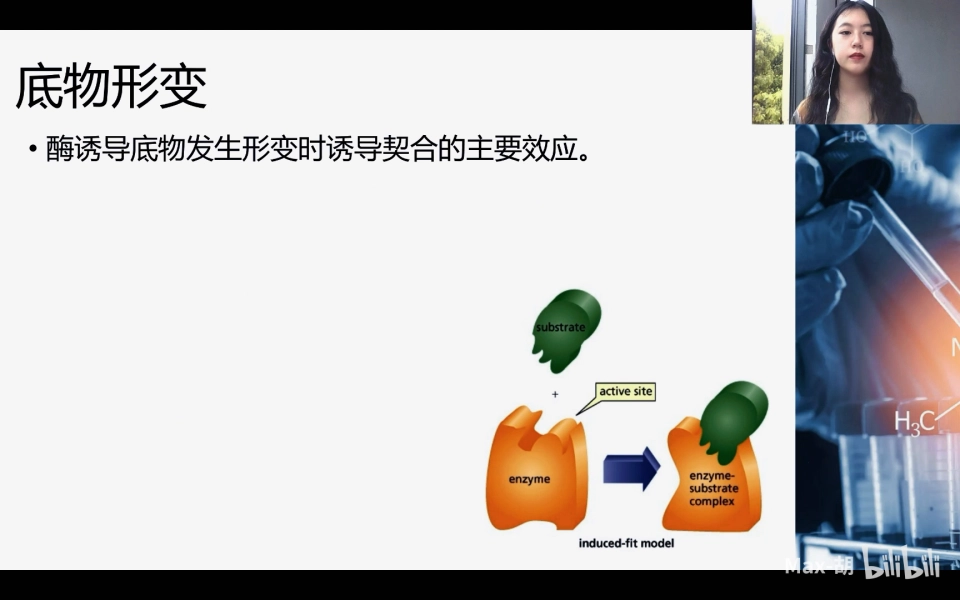

从能量角度看，把底物掰成接近过渡态的构象本身要花能量，但这笔能量花得值：底物被扭曲后的形状更接近过渡态，翻过山顶剩下的高度就小了。

### 3.7 自由基催化：少数派的强力手段

**自由基催化**通过在酶蛋白或其辅基上产生自由基，利用自由基的高反应性去和底物反应 [【跳转到 22:10】](https://www.bilibili.com/video/BV1xY411P7cm/?t=1330)。它在一般酶中不常见，但性质特殊，因此单独列出。

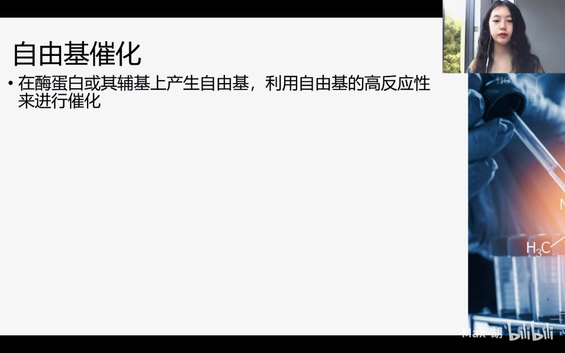

视频给了两个例子：

**例一：5'-脱氧腺苷钴胺素。** 它在**奇数碳脂肪酸代谢**中很重要 [【跳转到 22:35】](https://www.bilibili.com/video/BV1xY411P7cm/?t=1355)。钴胺素其实就是**维生素 B12**，在体内许多重要反应中起关键作用；B12 缺乏会导致恶性贫血以及脂肪酸消化功能异常等症状 [【跳转到 23:00】](https://www.bilibili.com/video/BV1xY411P7cm/?t=1380)。它的催化方式是：把 5'-脱氧腺苷与钴胺素之间的连接断开，产生一个自由基，用这个高反应性的自由基去攻击底物，使底物发生一系列共价键改变，完成**基团转移** [【跳转到 23:38】](https://www.bilibili.com/video/BV1xY411P7cm/?t=1418)。

**例二：核糖核苷酸还原酶（RNR）。** 它涉及 DNA 合成，一旦出问题后果严重；按生物门类可分为 class I、II、III 三种，但三者都不约而同地用**自由基机制**还原核糖核苷酸 [【跳转到 24:19】](https://www.bilibili.com/video/BV1xY411P7cm/?t=1459)。真核生物的机制是在酶的**酪氨酸残基**上产生自由基去攻击底物；上面的铁硫蛋白中的**半胱氨酸残基**则负责稳定这个酪氨酸自由基 [【跳转到 25:09】](https://www.bilibili.com/video/BV1xY411P7cm/?t=1509)。

---

## 四、催化残基是怎么被找出来的

七类机制都要落到具体残基上。那么"哪个残基在干活"这个结论从哪来？视频开头给了方法框架 [【跳转到 00:22】](https://www.bilibili.com/video/BV1xY411P7cm/?t=22)：先测定酶作为蛋白质的性质（肽链立体结构与高级结构），再研究它的催化功能。具体分三步：

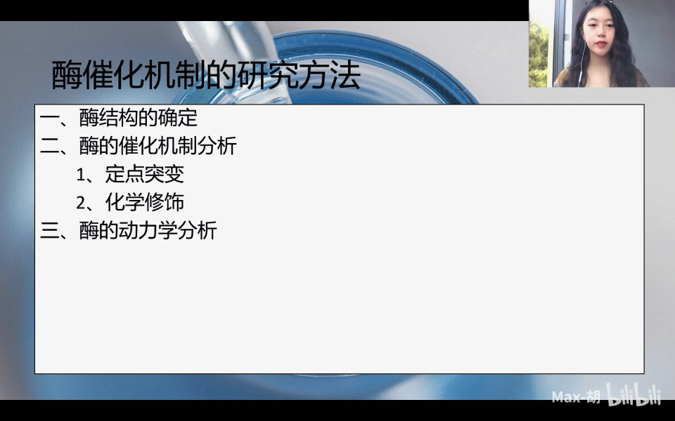

1. **酶结构的确定**：测定肽链的立体结构与高级结构，知道活性部位长什么样。
2. **催化机制分析**，两条路 [【跳转到 00:47】](https://www.bilibili.com/video/BV1xY411P7cm/?t=47)：
   - **定点突变**：在基因层面改掉某个残基，再反推这个位置对酶的作用产生了什么影响；
   - **化学修饰**：直接在蛋白质水平上改变化学基团。两者本质相同——都是"动一个点，看功能掉多少"。
3. **酶的动力学分析**：测定动力学曲线，再结合动力学知识判断机制。

这套逻辑正是"催化残基"这个概念的操作定义：**改掉它，催化活性显著下降，而底物结合基本不受影响**——那它就是催化残基；反之若只影响结合，则是结合残基。

---

## 小结

- 酶降低的是**活化能 $\Delta G^\ddagger$**（山脚到山顶的高度），不是**自由能变化 $\Delta G$**（两端的高度差）；因此酶加快速率却不改变平衡位置。
- **过渡态**是反应进程图上的峰，不是可以停留的谷；酶通过**稳定过渡态**削低峰顶。
- "铁丝酶"思想实验的关键一课：**与底物互补而不与过渡态互补的酶，会把底物卡住而不是催化它**。结合能要花在过渡态那一侧才有效。
- 两条独立证据支持过渡态稳定学说：**过渡态类似物是强抑制剂**、**用过渡态类似物免疫可以得到抗体酶**。
- 七类化学机制：邻近定向诱导、广义酸碱催化、静电催化、金属催化、共价催化、底物形变、自由基催化；它们不是互斥选项，真实酶往往同时用几种。
- 催化残基的判定靠**定点突变 / 化学修饰 + 动力学分析**：改一个点，看活性掉多少。
- 具体残基例：溶菌酶 **Glu35 做酸碱催化、Asp52 做静电催化**；**组氨酸**因咪唑基 pKa≈6 成为最常用的酸碱催化残基；激酶的**镁离子**屏蔽 ATP 上 γ 与 β 磷酸的负电荷；碳酸酐酶的**锌离子**促进水分子电离生成亲核的氢氧根。

## 关键术语速查

| 术语 | 一句话解释 |
| --- | --- |
| 过渡态 | 反应物转变为产物前必须达到的特定高能状态，位于自由能曲线的峰顶 |
| 活化能 $\Delta G^\ddagger$ | 从反应物到过渡态所需越过的能量高度，决定反应速率 |
| 自由能变化 $\Delta G$ | 反应物与产物之间的自由能差，决定反应方向与平衡位置，酶不改变它 |
| 过渡态稳定学说 | 酶通过结合并稳定过渡态、而非稳定底物，来降低活化能 |
| 过渡态类似物 | 结构模仿过渡态但不被转化的分子，因与酶结合更紧而成为强抑制剂 |
| 抗体酶 | 用过渡态类似物作抗原诱导出的、具有催化活性的抗体 |
| 邻近定向诱导 | 酶把多个底物拉到同一活性中心并摆正取向，提高局部浓度与正确碰撞概率 |
| 广义酸碱催化 | 酶以质子供体或受体的身份参与反应，分别称广义酸催化与广义碱催化 |
| 静电催化 | 用活性中心的电荷中和过渡态上的相反电荷以稳定过渡态 |
| 金属催化 | 金属离子通过定向、屏蔽负电荷、传递电子或增强亲核性参与催化 |
| 共价催化 | 酶与底物形成共价中间物，改走一条活化能更低的途径；分亲核与亲电两类 |
| 底物形变 | 酶诱导底物（以及自身）构象改变，使底物更接近过渡态形状 |
| 自由基催化 | 在酶蛋白或辅基上产生自由基，利用其高反应性催化反应 |
| 催化残基 | 直接参与化学步骤的活性部位残基，突变后活性显著下降 |
| 定点突变 | 在基因层面替换某个残基，用来判定该残基的功能角色 |