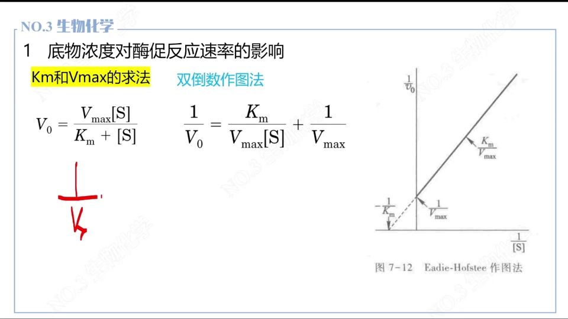
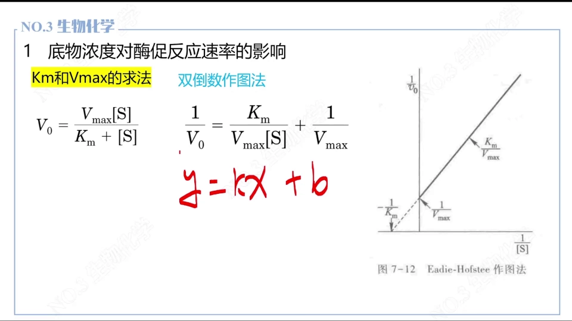
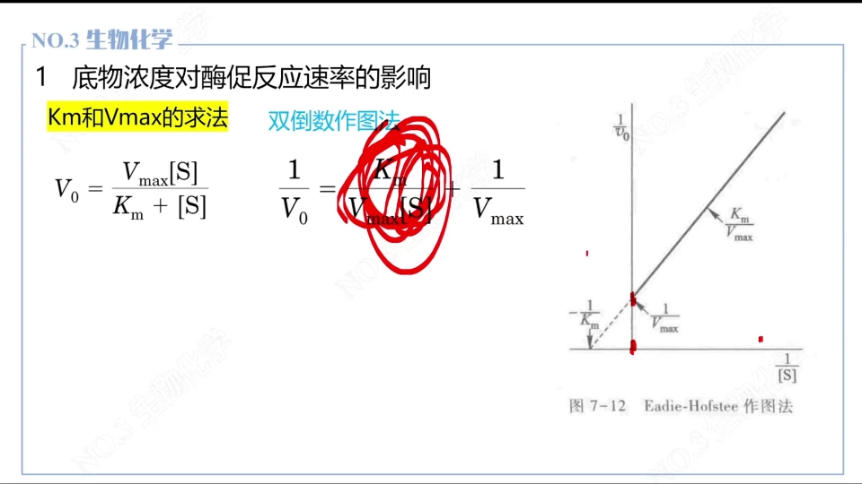
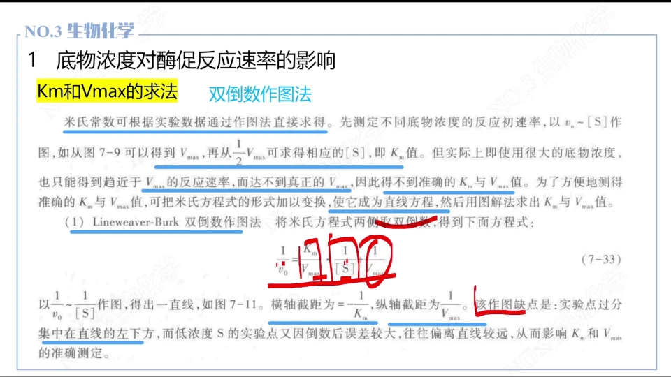
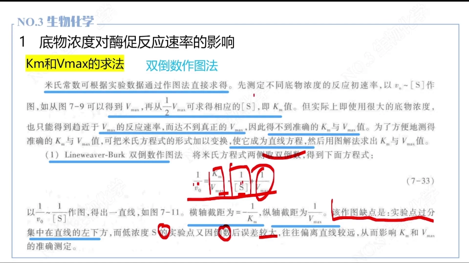
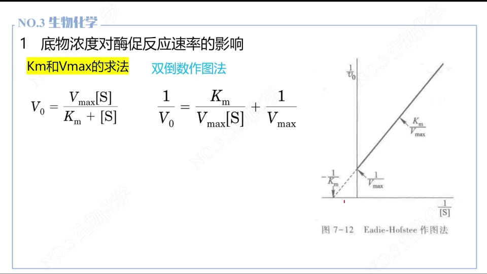

# 双倒数作图法：把米氏方程拉成直线，以及它的三个陷阱

> 视频来源：[56．生物化学 -- 第七章—双倒数作图法](https://www.bilibili.com/video/BV1s64y1E7w6/)（Bilibili · Number3生物化学 · 约 11 分钟）。本文按该视频的逐窗口字幕与画面整理，公式与结论均可在原视频中核查。
> 导读：这是一节短课，只回答两个问题——为什么要把米氏方程取倒数变成直线，以及这条直线有什么不可靠的地方。它把双倒数作图法的斜率、两个截距一步步推出来，然后用"底物浓度取太小/取太大"两种极端情况演示了误差从哪里来。米氏方程本身的推导不在本文范围。

## 本讲要解决的核心问题（SCQA）

**背景**：要测一个酶的 $K_m$ 和 $V_{max}$，理论上只要测一系列底物浓度下的初速度 $v_0$，再画出 $v_0$ 对 $[S]$ 的曲线，读出渐近线 $V_{max}$ 和半饱和点 $K_m$ 就行了。

**冲突**：但这条曲线是双曲线，靠手画很难画准，渐近线更是"只能趋近、永远达不到"。用这样一张图去读 $V_{max}$，误差不可控。

**疑问**：有没有一种办法，既能高效地读出 $K_m$ 和 $V_{max}$，又不必去画那条难画的双曲线？

**回答（中心思想）**：把米氏方程两边取倒数，就把它变成了一条**直线** $y=kx+b$：以 $1/v_0$ 对 $1/[S]$ 作图，**纵轴截距是 $1/V_{max}$，横轴截距是 $-1/K_m$，斜率是 $K_m/V_{max}$**。直线比双曲线好画、好读、好外推，这就是双倒数作图法（Lineweaver-Burk 作图）。但这条直线有三个陷阱：**实验点挤在直线左下方**、**低底物浓度的倒数会把误差放大**、**极端的底物浓度会让截距跑得极远甚至斜率失真**。所以它是"方便"的工具，不是"完美"的工具。

---

## 一、为什么要取倒数：把双曲线换成直线

视频开篇就把动机说得很直白 [【跳转到 00:00】](https://www.bilibili.com/video/BV1s64y1E7w6/?t=0)：在几种作图法里，考评最高的还是双倒数作图法，它的原理和应用都必须会。

那么为什么不直接用米氏方程？因为要得到准确的 $V_{max}$ 和 $K_m$，首先得有一张准确、合规的图像——也就是双曲线和它的渐近线。而这条曲线如果用手来画，问题很多 [【跳转到 00:25】](https://www.bilibili.com/video/BV1s64y1E7w6/?t=25)：

- 双曲线的弯曲程度不好把握，画歪一点，渐近线就偏；
- 用官方的话说，**会有很多不可控的误差**。

而画一条直线，是"小学同学都会做"的事 [【跳转到 00:50】](https://www.bilibili.com/video/BV1s64y1E7w6/?t=50)。直线上的点，读数准确率也更高。为了更准确、更方便，就有了双倒数作图法。

---

## 二、推导：三步把方程变成 $y=kx+b$

### 2.1 两边取倒数

米氏方程是

$$
v_0 = \frac{V_{max}[S]}{K_m+[S]}
$$

两边同时取倒数 [【跳转到 02:05】](https://www.bilibili.com/video/BV1s64y1E7w6/?t=125)：

$$
\frac{1}{v_0} = \frac{K_m+[S]}{V_{max}[S]}
$$

### 2.2 拆成两项

把分子拆开，其中一项里的 $[S]$ 与分母的 $[S]$ 约掉 [【跳转到 02:30】](https://www.bilibili.com/video/BV1s64y1E7w6/?t=150)：

$$
\frac{1}{v_0} = \frac{K_m}{V_{max}}\cdot\frac{1}{[S]} + \frac{1}{V_{max}}
$$

### 2.3 对照一次函数

现在把它和初中就学过的一次函数对照 [【跳转到 01:15】](https://www.bilibili.com/video/BV1s64y1E7w6/?t=75)：

$$
y = kx + b
$$

- 纵轴 $y$ 是 $1/v_0$；
- 横轴 $x$ 是 $1/[S]$；
- 斜率 $k$ 是 $K_m/V_{max}$；
- 截距 $b$ 是 $1/V_{max}$。

### 2.4 两个截距怎么求：分别取零

视频用"分别取零"的办法求出两个截距，这也是最不容易记错的方式 [【跳转到 03:20】](https://www.bilibili.com/video/BV1s64y1E7w6/?t=200)：

**求横轴截距**：让 $y$ 也就是 $1/v_0$ 等于零。

$$
0 = \frac{K_m}{V_{max}}\cdot\frac{1}{[S]} + \frac{1}{V_{max}}
$$

两边同乘 $V_{max}$，左边变成 $-1$，右边剩下 $K_m/[S]$；再两边同乘 $1/K_m$，就得到

$$
\frac{1}{[S]} = -\frac{1}{K_m}
$$

**求纵轴截距**：让 $x$ 也就是 $1/[S]$ 等于零。此时斜率那一项里"零乘任何数都是零"，整项消失 [【跳转到 05:00】](https://www.bilibili.com/video/BV1s64y1E7w6/?t=300)：

$$
\frac{1}{v_0} = \frac{1}{V_{max}}
$$

把四个要素列成表：

| 图像要素 | 对应的量 | 怎么读 |
| --- | --- | --- |
| 纵轴 | $1/v_0$ | 由实验测得的初速度取倒数 |
| 横轴 | $1/[S]$ | 由设定的底物浓度取倒数 |
| 斜率 | $K_m/V_{max}$ | 直线的倾斜程度 |
| 纵轴截距 | $1/V_{max}$ | 直线与纵轴交点，取倒数得 $V_{max}$ |
| 横轴截距 | $-1/K_m$ | 直线与横轴交点（负值），取绝对值再取倒数得 $K_m$ |

---

## 三、教材为什么也要绕这一圈

视频翻了教材原文 [【跳转到 05:44】](https://www.bilibili.com/video/BV1s64y1E7w6/?t=344)：米氏常数可根据实验数据通过作图直接求得——先测定不同底物浓度的反应初速度，以 $v_0$ 对 $[S]$ 作图，从图 7-9 可以得到 $V_{max}$，再从 $\tfrac{1}{2}V_{max}$ 可求得相应的 $[S]$，即 $K_m$ 值。

但教材紧接着承认了问题：**实际上即使用很大的底物浓度，也只能得到趋近于 $V_{max}$ 的反应速率，而达不到真正的 $V_{max}$，因此得不到准确的 $K_m$ 与 $V_{max}$ 值** [【跳转到 06:09】](https://www.bilibili.com/video/BV1s64y1E7w6/?t=369)。

这就是双倒数法的立足点：把方程变成直线方程，再用图解法求出 $K_m$ 与 $V_{max}$。视频对此的评价是"书上这个处理还是很舒服的"——斜率、横轴截距、纵轴截距都摆在明面上，照着作图就都有了。

---

## 四、三个陷阱

教材把缺点写在正文里，视频逐条展开 [【跳转到 06:34】](https://www.bilibili.com/video/BV1s64y1E7w6/?t=394)。

### 4.1 陷阱一：实验点挤在直线的左下方

因为横轴是 $1/[S]$，底物浓度越大，$1/[S]$ 越靠近原点。而我们实验时用的底物浓度往往偏大，于是所有点都挤在图的左下方一小块区域里 [【跳转到 06:59】](https://www.bilibili.com/video/BV1s64y1E7w6/?t=419)。

问题在于：你真正要读的是**两个截距**，而截距在离这些点很远的地方。用一小簇挤在一起的点去外推远处的截距，误差自然被放大。

### 4.2 陷阱二：低底物浓度的倒数会放大误差

第二个问题更隐蔽：**低浓度的点取倒数后误差较大** [【跳转到 07:18】](https://www.bilibili.com/video/BV1s64y1E7w6/?t=438)。

道理很简单：底物浓度本身就低，测出来的速率误差就大，甚至测不准；再取倒数，相当于把这个误差**放大**了。所以低浓度点在图上往往偏离直线较远。

视频用具体数字演示了这种"跑远"有多夸张 [【跳转到 07:43】](https://www.bilibili.com/video/BV1s64y1E7w6/?t=463)：如果 $[S]=0.01$，它的倒数是 100；如果 $[S]=0.001$，倒数是 1000。也就是说，底物浓度每小一个数量级，横轴上的点就往右跑十倍，离我们真正想要的那段直线越来越远。

### 4.3 陷阱三：两种极端取值都会让结果失真

那么底物浓度取什么范围才好？视频给的答案是：**理论上取在 $K_m$ 附近效果更好** [【跳转到 08:33】](https://www.bilibili.com/video/BV1s64y1E7w6/?t=513)。

如果走极端，两个方向都会出问题：

- **底物浓度太小**：那些点的倒数很大，两个截距点会被"拉"得越来越靠近左下角，两点挨得越近，读出来的误差就越大 [【跳转到 08:58】](https://www.bilibili.com/video/BV1s64y1E7w6/?t=538)。
- **底物浓度太大**：斜率会变得不合适，画出来的直线被"无限往上拉"，斜率很大，$K_m$ 反而求不出来 [【跳转到 09:23】](https://www.bilibili.com/video/BV1s64y1E7w6/?t=563)。

视频最后的提醒很直接 [【跳转到 10:13】](https://www.bilibili.com/video/BV1s64y1E7w6/?t=613)：双倒数图像**并不是很完美**，考试时一定要注意它的缺点，这些不足的地方要背会——有时候会出选择题。

---

## 小结

- 双倒数作图法的动机是**把难画的双曲线换成好画的直线**：双曲线的渐近线只能趋近、达不到，手画误差不可控。
- 取倒数并拆项后得到 $\dfrac{1}{v_0} = \dfrac{K_m}{V_{max}}\cdot\dfrac{1}{[S]} + \dfrac{1}{V_{max}}$，即 $y=kx+b$。
- 图像四要素：纵轴 $1/v_0$、横轴 $1/[S]$、斜率 $K_m/V_{max}$、纵轴截距 $1/V_{max}$、横轴截距 $-1/K_m$。
- 教材承认 $V_{max}$ 实际达不到，所以要用直线化方法去"外推"出 $K_m$ 与 $V_{max}$。
- 三个陷阱：**点挤在左下方**、**低浓度取倒数放大误差**、**极端底物浓度让截距/斜率失真**；底物浓度取在 $K_m$ 附近最稳妥。

## 关键术语速查

| 术语 | 一句话解释 |
| --- | --- |
| 双倒数作图法 | 以 $1/v_0$ 对 $1/[S]$ 作图求 $K_m$ 与 $V_{max}$ 的方法，又称 Lineweaver-Burk 作图 |
| 线性化 | 把非线性方程通过变量变换改写成直线方程，便于作图读数 |
| 纵轴截距 | 等于 $1/V_{max}$，取倒数即得 $V_{max}$ |
| 横轴截距 | 等于 $-1/K_m$，取绝对值再取倒数即得 $K_m$ |
| 斜率 | 等于 $K_m/V_{max}$ |
| 倒数放大误差 | 低底物浓度下测量误差经取倒数后被放大，使数据点偏离直线 |