# 米氏方程的两条推导路线：快速平衡与稳态假设

> 视频来源：[53．生物化学 -- 第七章—米氏方程推导](https://www.bilibili.com/video/BV1pj411E7nN/)（Bilibili · Number3生物化学 · 约 47 分钟）。本文按该视频的逐窗口字幕与画面整理，公式与结论均可在原视频中核查。
> 导读：这支课不讲"背公式然后套用"，而是把米氏方程从头推两遍：先按教材的快速平衡法推一遍，再按 Briggs-Haldane 的稳态法推一遍，中间逐条交代每一个假设为什么必须成立。它最有价值的地方，是把"$K_m$ 到底是不是解离常数"这件事讲清楚了。抑制剂的类型与别构调节不在本文范围。

## 本讲要解决的核心问题（SCQA）

**背景**：酶促反应的初速度随底物浓度升高而升高，但升到一定程度就饱和了，画出来是一条双曲线。这条曲线的方程人人会背：

$$
v_0 = \frac{V_{max}[S]}{K_m + [S]}
$$

**冲突**：这个式子看起来只是一个代数结果，可教材讲完它之后，紧接着又换了一套推导重讲一遍——先是 Michaelis 和 Menten 1913 年的"快速平衡"，再是 Briggs 和 Haldane 1925 年的"稳态"。同一个方程，为什么要推两次？

**疑问**：米氏方程究竟是怎么推出来的？每一步依赖哪些前提？两次推导的差别到底在哪里，为什么第二次的 $K_m$ 含义变了？

**回答（中心思想）**：米氏方程建立在**中间复合物学说**之上：酶先与底物结合成 $ES$，再由 $ES$ 释放产物。推导必须同时接受四个前提——**只测初速度**（产物逆反应可忽略）、**底物浓度远大于酶浓度**（可用 $[S]$ 代替 $[S_0]$）、**$ES\to P+E$ 是限速步**、以及**单底物、无别构**。在这四个前提下，快速平衡法额外要求 $k_2 \ll k_{-1}$，把 $ES$ 的分解只看作解离，得到的常数是真正的解离常数 $K_s$；稳态法把 $k_2$ 加回来，只要求 $ES$ 的生成速率等于分解速率，得到的常数是 $K_m = (k_{-1}+k_2)/k_1$。**两者的方程形式完全一样，但 $K_m$ 一般不等于 $K_s$**——只有当 $k_2$ 远小于 $k_{-1}$ 时，$K_m$ 才退化成解离常数。

---

## 一、先看清现象：速率—底物曲线为什么是一条双曲线

### 1.1 中间复合物学说：酶要先"抱住"底物

1903 年，V. C. R. Henri 用蔗糖酶水解蔗糖做实验，在酶浓度不变的情况下测了一系列不同底物浓度下的反应速率，把速率对底物浓度作图，得到一条正相关曲线 [【跳转到 00:00】](https://www.bilibili.com/video/BV1pj411E7nN/?t=0)。这条曲线分三段：

- 底物浓度很低时，速率与底物浓度近似成正比，表现为**一级反应**；
- 底物浓度继续增加，速率不再按比例上升，表现为**混合级反应**；
- 底物浓度相当高时，速率几乎不再变化，达到最大值 $V_{max}$，表现为**零级反应**。

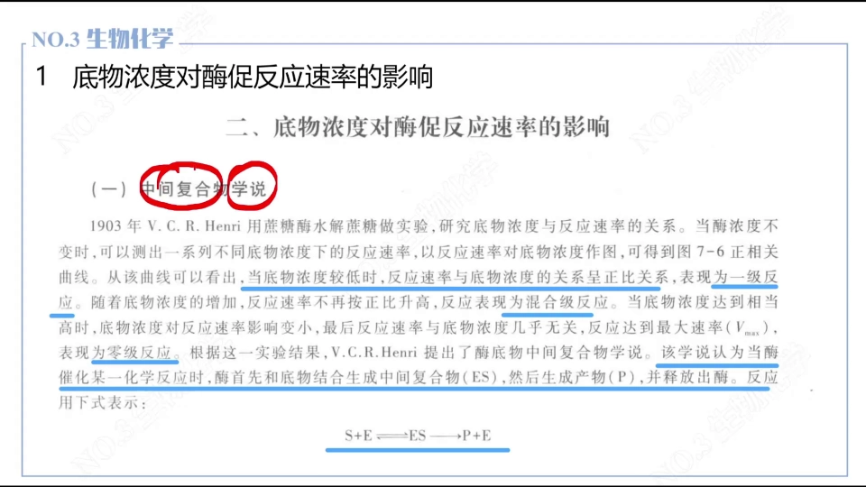

为了解释这条曲线，Henri 提出**中间复合物学说**：酶催化某一化学反应时，酶首先和底物结合生成中间复合物 $ES$，然后生成产物 $P$，并释放出酶 [【跳转到 04:04】](https://www.bilibili.com/video/BV1pj411E7nN/?t=244)：

$$
E + S \rightleftharpoons ES \longrightarrow P + E
$$

这个学说之所以能解释三段曲线，是因为它把"速率"和"$ES$ 的多少"绑在了一起：底物少，能形成的 $ES$ 就少，速率低；底物多，$ES$ 越来越多，速率升高；等到酶全部被底物占满，$ES$ 不再增加，速率也就不再上升 [【跳转到 05:19】](https://www.bilibili.com/video/BV1pj411E7nN/?t=319)。

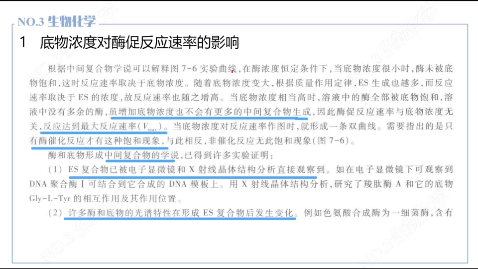

视频里特别点了一句：**只有酶催化的反应才有这种饱和现象，非催化反应没有** [【跳转到 06:09】](https://www.bilibili.com/video/BV1pj411E7nN/?t=369)。原因很直白——饱和来自"酶的活性位点数量有限"，而不是来自底物本身。

### 1.2 中间体不是假想：两类实验证据

中间复合物学说后来被实验证实，视频提到教材 245 页列了五种证据，其中两种最典型 [【跳转到 07:49】](https://www.bilibili.com/video/BV1pj411E7nN/?t=469)：

1. **直接看到**：$ES$ 复合物已被电子显微镜和 X 射线晶体结构分析直接观察到。例如电子显微镜下可观察到 DNA 聚合酶 I 结合到它合成的 DNA 模板上；X 射线晶体结构分析研究了羧肽酶 A 与底物 Gly-L-Tyr 的相互作用。
2. **光谱变化**：许多酶和底物在形成 $ES$ 复合物后，光谱特性会发生变化。例如色氨酸合成酶。

> 视频提醒：这一块会出选择题，比如"下列哪一项**不能**说明中间复合物学说"。所以五种证据不必逐字背，但要能分辨哪条属于、哪条不属于 [【跳转到 08:14】](https://www.bilibili.com/video/BV1pj411E7nN/?t=494)。

---

## 二、推导之前：四个前提与一个容易混淆的概念

### 2.1 速率常数不是平衡常数

推导里会反复用到 $k_1$、$k_{-1}$、$k_2$。视频先花了几分钟专门澄清：**速率常数不是平衡常数** [【跳转到 11:09】](https://www.bilibili.com/video/BV1pj411E7nN/?t=669)。

对一个一般的反应 $A + B \to C + D$，如果速率常数是 $k$，那么反应速度等于速率常数乘以反应物浓度的相应次幂：

$$
v = k[A][B]
$$

所以速率常数的意义是"**单位浓度下的反应速度**" [【跳转到 12:49】](https://www.bilibili.com/video/BV1pj411E7nN/?t=769)。而平衡常数是正、逆速率常数之比。两者的量纲、意义都不同，只是数值上由同一组 $k$ 决定。

有了这个工具，$ES$ 的解离常数就可以写成"逆反应速率常数比正反应速率常数"：

$$
K_s = \frac{k_{-1}}{k_1} = \frac{[E][S]}{[ES]}
$$

反过来，用正反应比逆反应，得到的就是平衡常数 $K$ [【跳转到 14:04】](https://www.bilibili.com/video/BV1pj411E7nN/?t=844)。

### 2.2 四条假设

教材在推导前明确列了假设，视频逐条解释 [【跳转到 15:19】](https://www.bilibili.com/video/BV1pj411E7nN/?t=919)：

| 假设 | 内容 | 为什么必须这样 |
| --- | --- | --- |
| 1 | 不考虑 $E+P \to ES$ 这一逆反应 | 反应初期产物浓度 $[P]$ 趋于零，逆反应几乎不发生；因此米氏方程**只适用于测定初速度** |
| 2 | 底物浓度 $[S]$ 用初始浓度 $[S_0]$ 计算 | 要求底物浓度远大于酶浓度，否则被酶结合掉的那部分 $S$ 不能忽略 |
| 3 | 第二步 $ES \to P+E$ 是限速步骤 | 即 $k_2 \ll k_{-1}$，$ES$ 分解生成产物的速度不足以破坏 $E$ 与 $ES$ 之间的快速平衡 |
| 4 | 单底物酶促反应 | 多底物体系、别构酶（多亚基）都不适用 |

第二、三条假设是后面两条推导路线分岔的地方，值得单独说清楚。

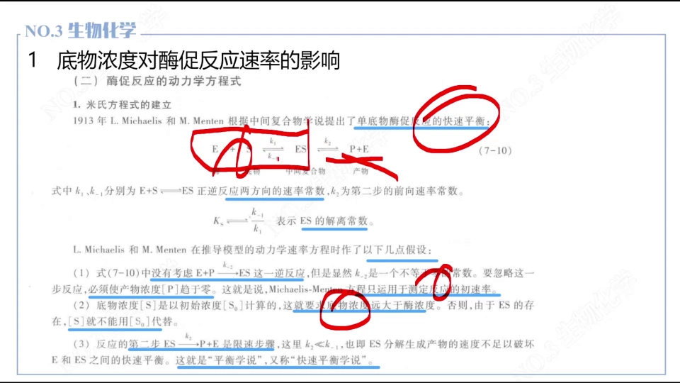

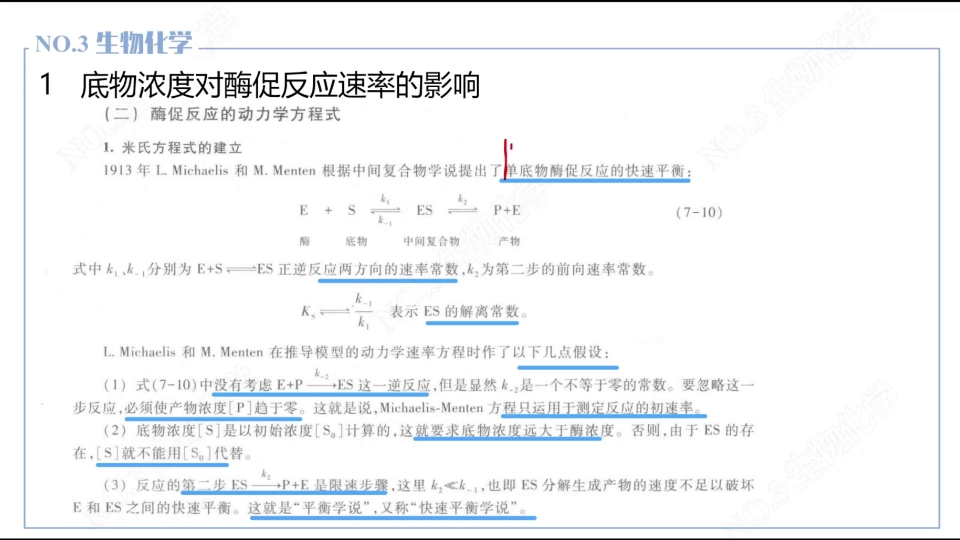

### 2.3 底物过量：为什么可以用 $[S]$ 代替 $[S_0]$

假设 2 是初学者最容易滑过去的一条。视频用一个具体数字讲明白了 [【跳转到 17:24】](https://www.bilibili.com/video/BV1pj411E7nN/?t=1044)：

假设体系里有 10000 个底物、10 个酶。酶和底物结合成 $ES$ 会消耗掉 10 个底物，剩下 9990 个。9990 与 10000 相比，误差只有千分之一，完全可以近似为 10000——所以反应前后都可以用同一个 $[S]$ 来代表底物浓度。

反过来，如果底物只有 100 个、酶也有 100 个，一结合底物就没了，"反应前后底物不变"这个前提直接崩塌，公式也就不成立 [【跳转到 18:39】](https://www.bilibili.com/video/BV1pj411E7nN/?t=1119)。

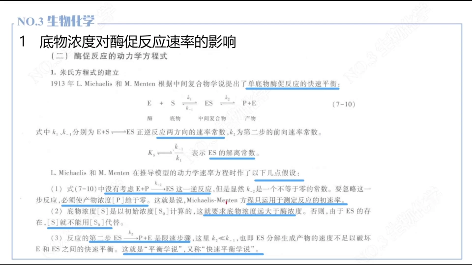

---

## 三、快速平衡法：把 $k_2$ 丢掉

### 3.1 平衡条件

快速平衡法的核心一句话：**$E+S$ 生成 $ES$ 的速度，等于 $ES$ 分解为 $E+S$ 的速度** [【跳转到 21:34】](https://www.bilibili.com/video/BV1pj411E7nN/?t=1294)。用速率常数写出来就是：

$$
k_1[E][S] = k_{-1}[ES]
$$

注意右边只有 $k_{-1}$ 这一项——因为假设 3 规定 $k_2 \ll k_{-1}$，$ES$ 走向产物的那条路被当作可忽略。

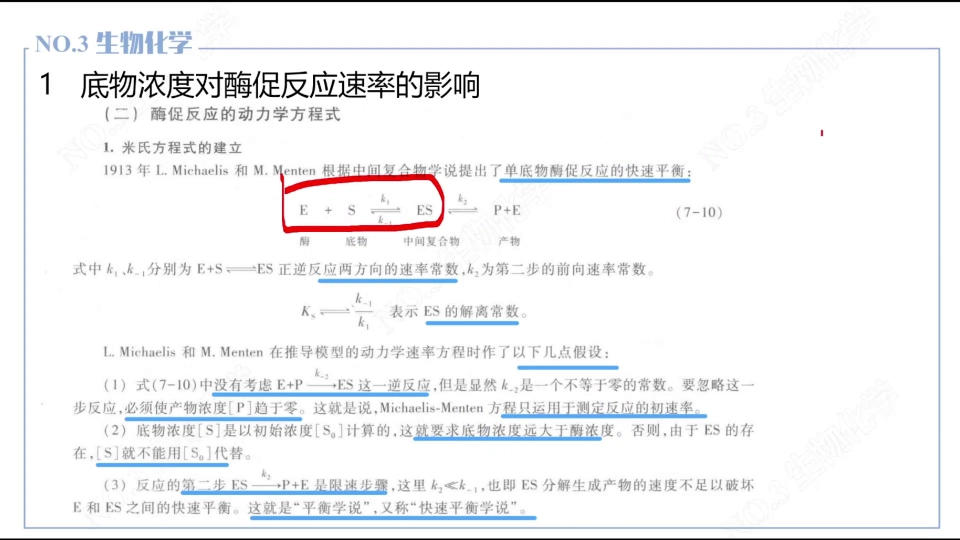

### 3.2 用总酶量替换游离酶

游离酶 $[E]$ 是测不出来的，但总酶量 $[E_0]$ 是已知的。二者关系很简单：

$$
[E] = [E_0] - [ES]
$$

把它代进平衡式，整理后得到 $ES$ 的表达式 [【跳转到 23:39】](https://www.bilibili.com/video/BV1pj411E7nN/?t=1419)：

$$
\frac{\left([E_0]-[ES]\right)[S]}{[ES]} = K_s
\quad\Longrightarrow\quad
[ES] = \frac{[E_0][S]}{K_s + [S]}
$$

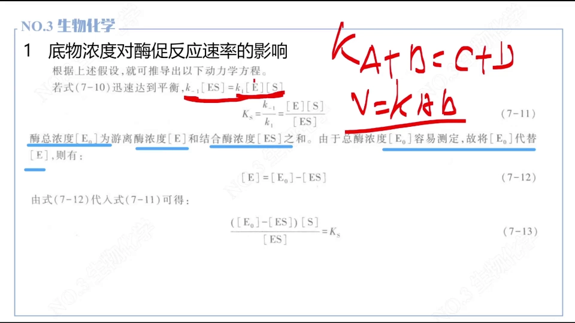

### 3.3 得到方程

初速度取决于 $ES$ 的分解，所以 $v_0 = k_2[ES]$；当底物浓度很高、酶被底物饱和时，$[E_0] = [ES]$，此时达到最大速率 $V_{max} = k_2[E_0]$。把 $[E_0]$ 用 $V_{max}/k_2$ 替换掉，就得到 [【跳转到 26:39】](https://www.bilibili.com/video/BV1pj411E7nN/?t=1599)：

$$
v_0 = k_2[ES] = \frac{k_2[E_0][S]}{K_s+[S]}
\quad\Longrightarrow\quad
v_0 = \frac{V_{max}[S]}{K_s + [S]}
$$

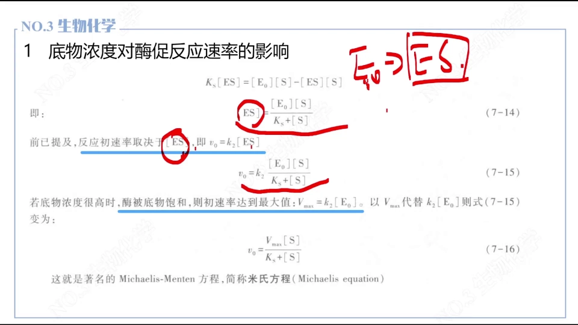

注意这里的常数写的是 $K_s$，它是 $ES$ 的**解离常数**，不是 $K_m$。这是快速平衡法与稳态法唯一的实质差别。

---

## 四、稳态法：把 $k_2$ 加回来

### 4.1 为什么快速平衡法"不太合理"

视频在这里停下来讲了一段很重要的判断 [【跳转到 30:55】](https://www.bilibili.com/video/BV1pj411E7nN/?t=1855)：快速平衡法最要命的假设是 $k_2 \ll k_{-1}$，而这一步恰恰是**限速步、是关键步骤**。

如果 $k_2$ 真的远小于 $k_{-1}$，那就意味着 $ES$ 大部分时候只是结合了又散开，很少真正变成产物——这样的酶谈不上"高效"。而酶之所以是酶，就在于 $ES$ 形成后会**随即、迅速**转变成产物并释放酶。所以把 $k_2$ 丢掉，等于把酶的高效性丢掉了。

### 4.2 Briggs-Haldane 的修正：用稳态代替平衡态

1925 年，G. E. Briggs 和 J. B. S. Haldane 提出：$ES$ 形成后会迅速转变成产物，所以 $k_2$ 远大于 $k_{-1}$，快速平衡不一定成立。他们保留了前两条假设，改用**稳态模型** [【跳转到 33:25】](https://www.bilibili.com/video/BV1pj411E7nN/?t=2005)：

- **生成**：只有 $k_1$ 一个方向（$k_{-2}$ 仍因产物少而忽略）；
- **分解**：$k_{-1}$ 与 $k_2$ 两个方向都要算。

所谓稳态，就是 $ES$ 的生成速率与分解速率相等，络合物浓度保持不变 [【跳转到 35:55】](https://www.bilibili.com/video/BV1pj411E7nN/?t=2155)：

$$
k_1\left([E_T]-[ES]\right)[S] = (k_{-1}+k_2)[ES]
$$

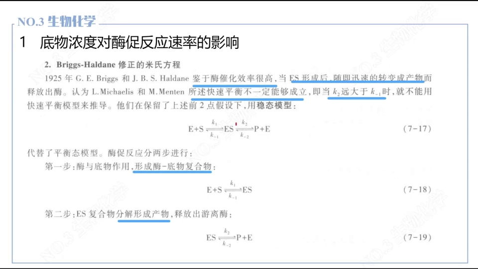

### 4.3 得到 $K_m$：一个新常数

把上式移项整理，令左边那团常数等于 $K_m$ [【跳转到 40:02】](https://www.bilibili.com/video/BV1pj411E7nN/?t=2402)：

$$
K_m = \frac{k_{-1}+k_2}{k_1}
$$

于是 $[ES] = \dfrac{[E_T][S]}{K_m+[S]}$，再代入 $v_0 = k_2[ES]$ 与 $V_{max}=k_2[E_T]$，得到的方程形式与快速平衡法**完全一样**：

$$
v_0 = \frac{V_{max}[S]}{K_m + [S]}
$$

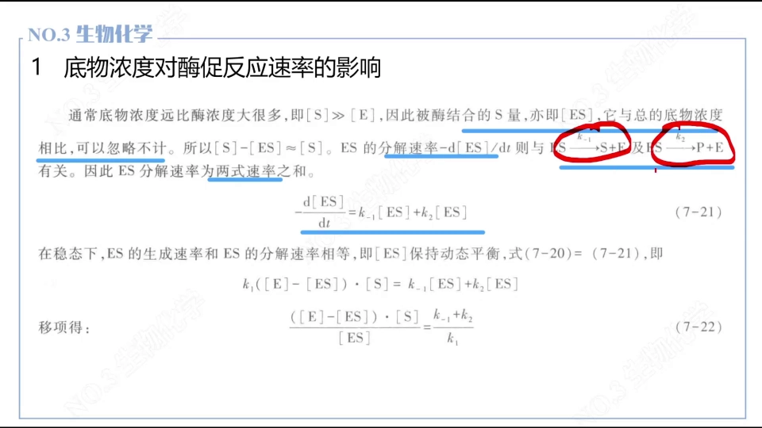

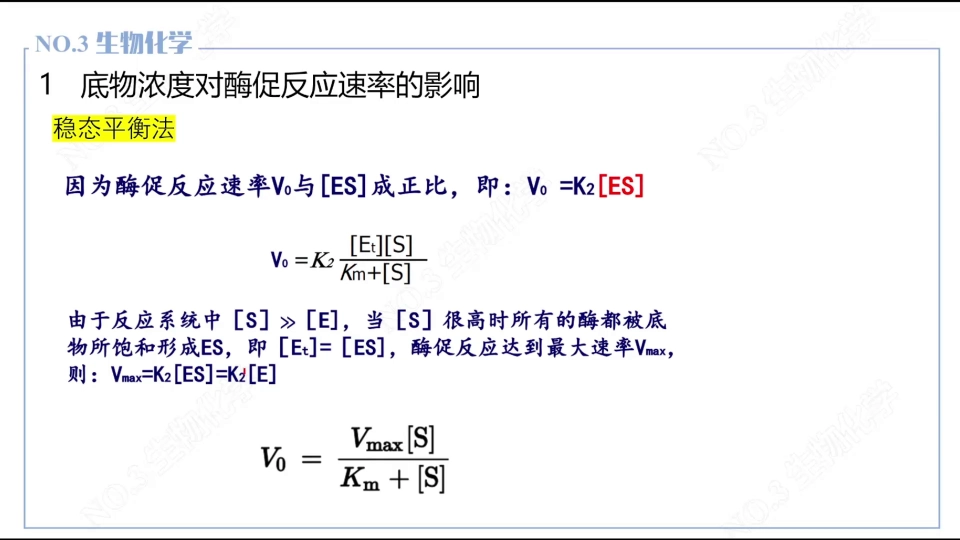

### 4.4 教材的符号陷阱：$E$ 一会儿是游离酶，一会儿是总酶

视频专门提醒了教材里一个容易把人看蒙的地方 [【跳转到 37:10】](https://www.bilibili.com/video/BV1pj411E7nN/?t=2230)：在快速平衡法的推导里，$[E]$ 代表**游离酶**浓度，所以有 $[E]=[E_0]-[ES]$；到了稳态法那一段，教材里的 $[E]$ 却变成了**总酶浓度**（相当于前面的 $[E_0]$ 或 $[E_T]$）。

同一个字母两种含义，是很多人自己看教材时卡住的原因。视频的建议是：**看上下文**——凡是出现"$[E]-[ES]$"的地方，那个 $[E]$ 就是总酶量；凡是单独出现、用来和 $[S]$ 相乘的 $[E]$，就是游离酶。

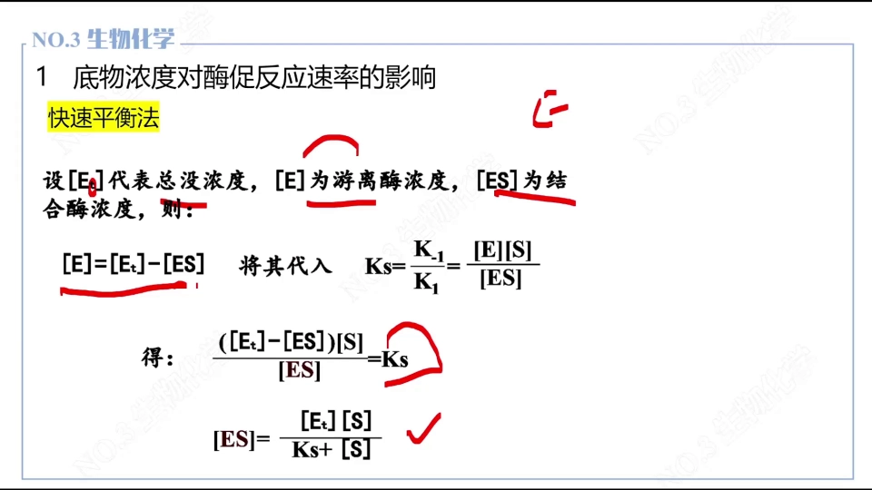

---

## 五、两条路线对照

| 对照项 | 快速平衡法（Michaelis-Menten, 1913） | 稳态法（Briggs-Haldane, 1925） |
| --- | --- | --- |
| 核心假设 | $ES$ 的生成与解离快速达到平衡，$k_2 \ll k_{-1}$ | $ES$ 的生成速率等于分解速率，不要求 $k_2 \ll k_{-1}$ |
| 分解项 | 只有 $k_{-1}$ | $k_{-1} + k_2$ |
| 得到的常数 | $K_s = k_{-1}/k_1$，是真正的解离常数 | $K_m = (k_{-1}+k_2)/k_1$，是复合常数 |
| 方程形式 | $v_0 = V_{max}[S]/(K_s+[S])$ | $v_0 = V_{max}[S]/(K_m+[S])$ |
| 适用性 | 只适合 $k_2$ 很小的酶 | 更普遍，是现代教材采用的版本 |

一句话记住区别：**稳态法只是把快速平衡法丢掉的那一项 $k_2$ 加了回来**，所以 $K_m$ 一定大于等于 $K_s$；只有当 $k_2 \ll k_{-1}$ 时，两者才近似相等 [【跳转到 41:17】](https://www.bilibili.com/video/BV1pj411E7nN/?t=2477)。

这也直接回答了"$K_m$ 是不是亲和力"这个问题：$K_m$ 只有在 $k_2 \ll k_{-1}$ 的场合才能当作解离常数、当作亲和力的倒数来读；一般情况下它混入了催化步骤的贡献，不能直接等同于结合亲和力。

---

## 小结

- 米氏方程的地基是**中间复合物学说**：酶先结合底物成 $ES$，再由 $ES$ 放出产物；饱和现象正来自"酶的数量有限"。
- 推导依赖四个前提：只测**初速度**、底物**远过量**、$ES\to P+E$ 是**限速步**、**单底物**且非别构。前提不成立，公式就不成立。
- **快速平衡法**把 $ES$ 的分解只看作解离，得到 $v_0 = V_{max}[S]/(K_s+[S])$，$K_s$ 是真正的解离常数。
- **稳态法**把 $k_2$ 加回来，得到同样形式的方程，但常数变成 $K_m=(k_{-1}+k_2)/k_1$。
- 因此 **$K_m$ 一般不是解离常数**，只有在 $k_2 \ll k_{-1}$ 时才近似等于 $K_s$。
- 教材里 $[E]$ 的两种含义（游离酶 / 总酶）是常见卡点，靠上下文判断。

## 关键术语速查

| 术语 | 一句话解释 |
| --- | --- |
| 中间复合物 $ES$ | 酶与底物结合形成的复合物，是酶催化的必经中间态 |
| 初速度 $v_0$ | 反应刚开始、产物还很少时的速率，米氏方程只对它成立 |
| 快速平衡假设 | 认为 $E+S\rightleftharpoons ES$ 时刻处于平衡，且 $k_2 \ll k_{-1}$ |
| 稳态假设 | 认为 $ES$ 的生成速率等于分解速率，其浓度保持恒定 |
| $K_s$ | $ES$ 的解离常数，$k_{-1}/k_1$，越小表示结合越紧 |
| $K_m$ | 米氏常数，$(k_{-1}+k_2)/k_1$，是复合常数，不必然等于解离常数 |
| $V_{max}$ | 酶被底物完全饱和时的最大速率，$V_{max}=k_2[E_0]$ |
| 限速步 | 整个反应中最慢、决定总速率的那一步，这里是 $ES\to P+E$ |