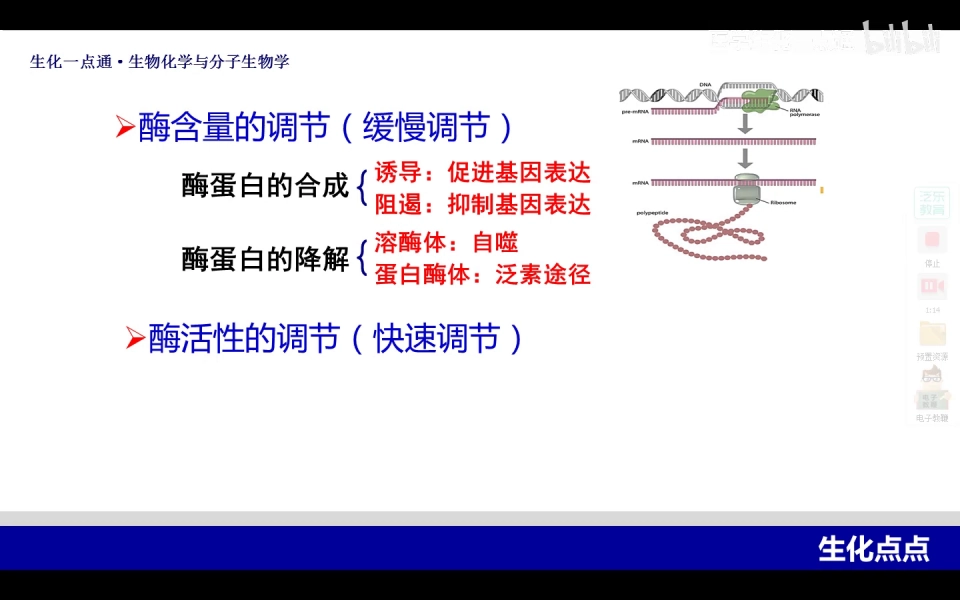
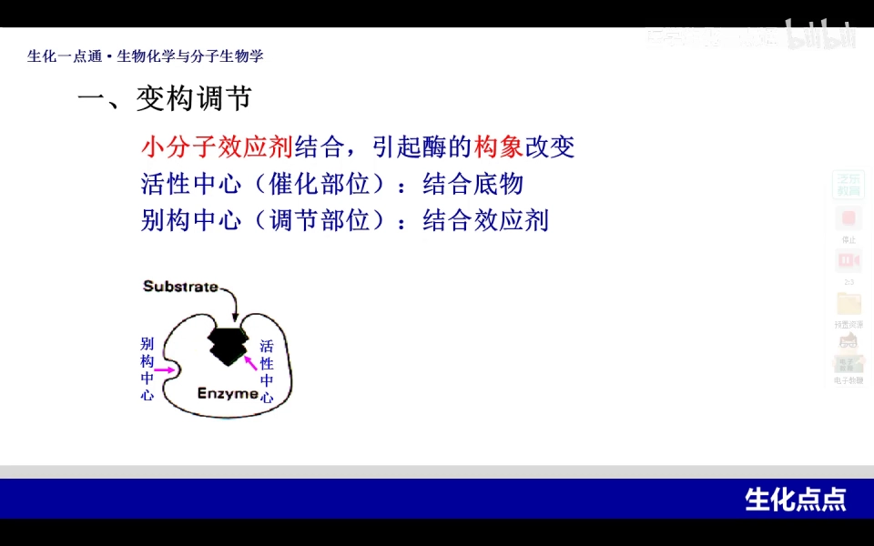
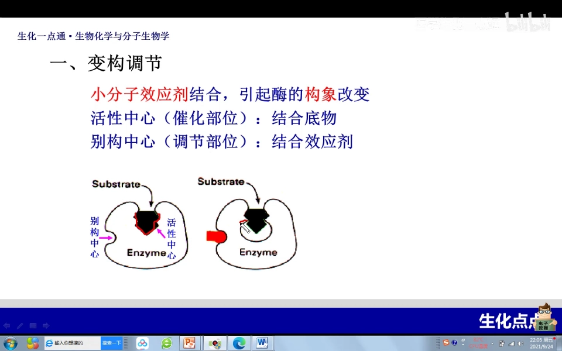
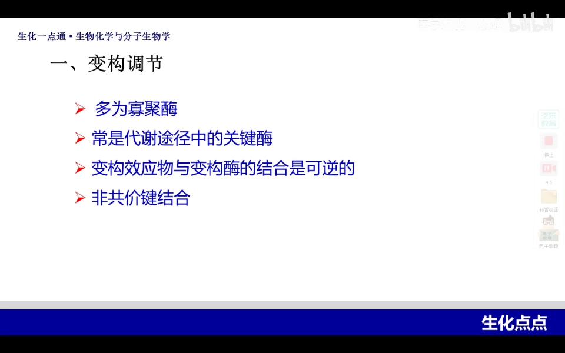
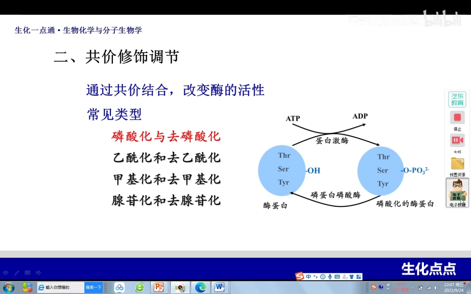
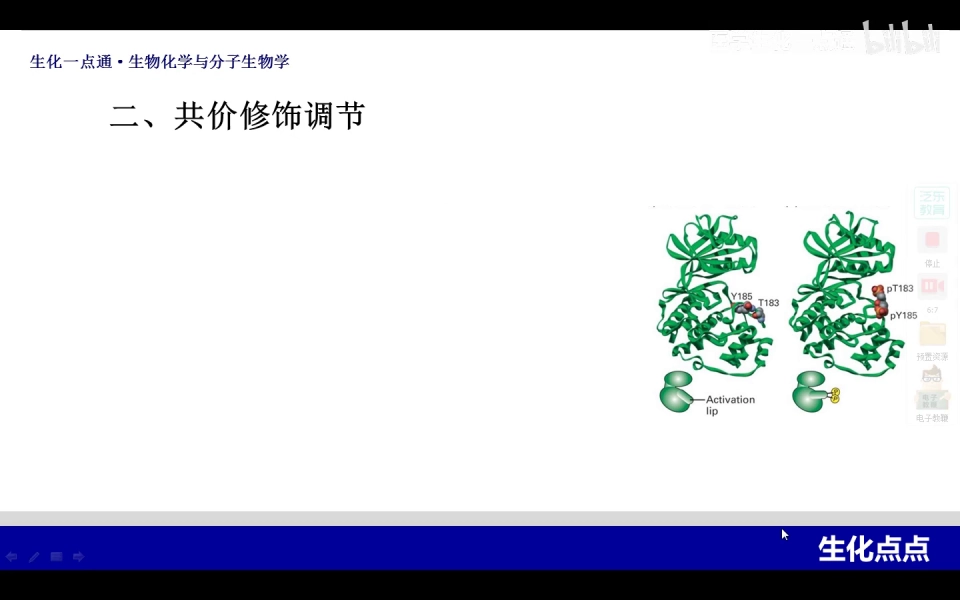
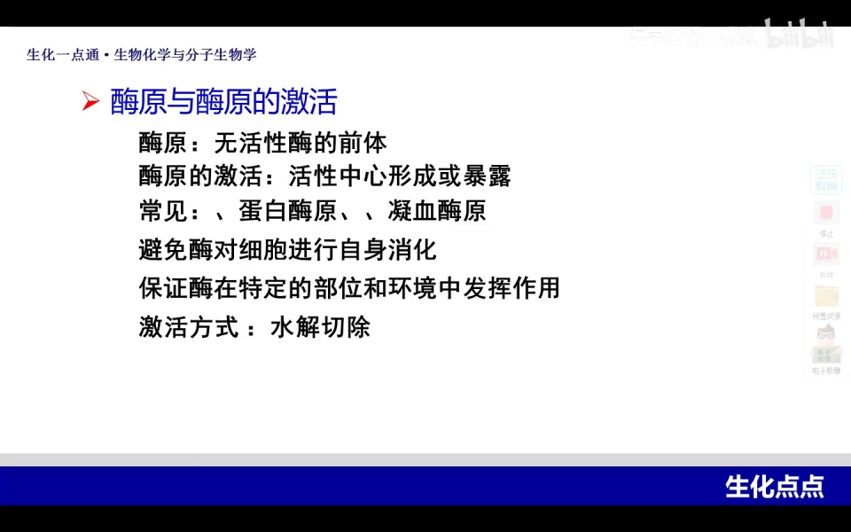
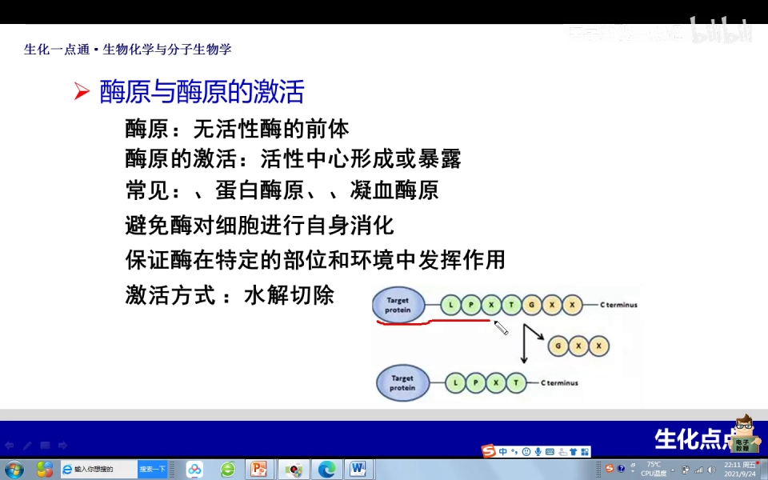

# 变构调节、共价修饰与酶原激活：酶活性的三条快速开关

> 视频来源：[9 酶的调节](https://www.bilibili.com/video/BV1M8411i77f/)（Bilibili · 医学生化一点通）｜时长约 9 分钟
> 简要导读：这支视频用一条主干（含量调节 vs 活性调节）把「变构调节」「共价修饰」「酶原激活」三件事串起来，每件事都配了同一套图：谁是开关、开关拨动后结构怎么变、动力学上留下什么痕迹。本文按这条主干重排。别构模型（MWC / KNF）的细节见同系列 2.2.3，本文只在需要时引用。

## 本讲要解决的核心问题（SCQA）

**背景**：细胞里的酶不是一直开着的。同一条代谢通路，有的酶要随时开关，有的酶要慢慢增减。

**冲突**：既然是「调节」，就必然有好几套机制并存。它们快慢不同、可逆性不同、留下的实验痕迹也不同，混在一起谈很容易乱。

**疑问**：酶到底能从哪几个层面被调节？「快速调节」具体有哪几种？每种机制在结构上做了什么、在动力学上又留下了什么可测的痕迹？

**回答（中心思想）**：**酶可以从「含量」和「活性」两个层面被调节，含量调节慢、活性调节快。** 活性调节又分三条路——变构调节（非共价、可逆、改构象）、共价修饰（共价、单向、加/去基团）、酶原激活（水解切除一段肽链）。三者都是「改构象或改结构」，只是改法不同。

## 一、主干：含量调节慢，活性调节快

讲者开篇就把调节分成两支，判据是**时间尺度**：

- **酶含量的调节 = 缓慢调节**。酶的本质是蛋白质，所以含量调节就是对酶这个蛋白质做「量的调节」，分合成与降解两种策略。
- **酶活性的调节 = 快速调节**。已有的酶分子不动数量，只动活性。

### 1.1 含量调节：合成与降解两条腿

**合成端**从基因水平出发，在转录环节下手：

- **诱导**：促进酶蛋白基因的表达，合成增加；
- **阻遏**：抑制酶蛋白基因的表达，合成降低。

**降解端**是把酶蛋白降解成氨基酸，也是量的控制。讲者提到后面会学到的两条降解途径：**溶酶体（自噬）途径**和**蛋白酶体（泛素）途径**。

[【跳转到 00:50】](https://www.bilibili.com/video/BV1M8411i77f/?t=50)

[【跳转到 00:00】](https://www.bilibili.com/video/BV1M8411i77f/?t=0)

### 1.2 活性调节：变构与化学修饰

快速调节有两条主线，各自还有别名，讲者特意点出别名的对应关系，因为它们在不同教材里混着用：

| 主线 | 别名 | 结合方式 |
| --- | --- | --- |
| 变构调节 | 别构调节 | 非共价、可逆 |
| 化学修饰调节 | 共价修饰调节 | 共价 |

下面三节分别展开。

[【跳转到 01:15】](https://www.bilibili.com/video/BV1M8411i77f/?t=75)

## 二、变构调节：小分子结合在「别的地方」，却改变了活性中心

### 2.1 机制：两个中心，各管一件事

变构调节的定义是：**小分子物质作为效应剂结合到酶上，引起酶的空间构象改变**，从而改变酶的活性状态。

要做到这一点，这类酶必须有两个功能不同的部位：

- **活性中心（催化部位）**：结合底物，负责催化；
- **别构中心（调节部位）**：结合效应剂，负责调节。

[【跳转到 01:40】](https://www.bilibili.com/video/BV1M8411i77f/?t=100)

### 2.2 构象改变如何变成活性改变

效应剂结合到别构中心之后，酶的空间结构发生改变，**尤其是原来活性中心的空间结构被改变了**。结果就是底物进入之后无法和活性中心完美结合，酶的活性受到抑制——这个例子里的小分子是作为**抑制剂**使用的。

反过来也有：小分子结合后使酶形成正确的构象，活性提高，这就是**激活剂**。

讲者强调这种结合的性质：**非共价键之间的可逆结合**。所以变构调节是可以随时拨回去的开关，不是一次性破坏。

[【跳转到 02:30】](https://www.bilibili.com/video/BV1M8411i77f/?t=150)

### 2.3 四个特点与一条曲线

讲者把变构调节的特点归成四条：

1. **多为寡聚酶**——变构酶大多数由亚基构成，本质是四级结构的蛋白质；
2. **常是代谢途径中的关键酶**——只有关键酶被调节，整条通路才有意义；
3. **效应物与变构酶的结合是可逆的**；
4. **是非共价键结合**，不是牢固的共价键。

还有一条不在列表里、但后果最直接的：**动力学上，变构酶给出的是 S 型曲线，而不是普通酶的双曲线，所以它不再符合米氏方程的描述。**

[【跳转到 03:44】](https://www.bilibili.com/video/BV1M8411i77f/?t=224)

这一点值得停下来想一秒：前面学的 $V_{\max}$、$K_m$ 那一套，前提是双曲线；变构酶一旦变成 S 形，$K_m$ 这个「半饱和浓度」的读法就不再是同一个意思了。S 形曲线的定量判读（Hill 系数）与 MWC / KNF 两个模型的分歧，同系列 2.2.3 已经展开，这里不重复。

## 三、共价修饰：加一个基团，改一次活性

### 3.1 「共价」两个字是关键

共价修饰调节的定义是：**酶和一些小分子化学基团之间形成共价键，酶的活性被改变**。和变构调节相比，它的开关是「接上去 / 拆下来」，而不是「结合 / 解离」。

最常见的修饰基团是**磷酸基团**。

### 3.2 磷酸化与去磷酸化：一对单向反应

酶蛋白的氨基酸残基里，有带羟基的**丝氨酸、苏氨酸、酪氨酸**，磷酸化就发生在这些羟基上。这个过程不能自发进行，需要两种酶各管一个方向：

- **蛋白激酶**：把 ATP 分子中的末端磷酸基团加到羟基的氧原子上——这是**磷酸化修饰**；
- **磷蛋白磷酸酶**：把磷酸基团水解掉，让羟基回到原来的状态——这是**去磷酸化**。

关键在于：**磷酸化和去磷酸化是两个单向不可逆的反应**。所以这个开关不是「一个反应来回走」，而是「两条单行道各走一边」。

至于磷酸化之后酶是被激活还是失活，**要看具体的酶，是不一样的**。

[【跳转到 05:14】](https://www.bilibili.com/video/BV1M8411i77f/?t=314)

### 3.3 不止磷酸化

磷酸化/去磷酸化是最常见的类型，但不是唯一的。讲者还列了：

- 乙酰化与去乙酰化
- 甲基化与去甲基化
- 腺苷化与去腺苷化

### 3.4 结构上发生了什么：一个真实例子

讲者用一张结构图说明后果：左边是没有磷酸化的、有活性的酶；右边是已经加上**两个磷酸基团**的酶（图中标在 T183 与 Y185 两个位点附近），酶的活性就失去了。

[【跳转到 06:12】](https://www.bilibili.com/video/BV1M8411i77f/?t=372)

### 3.5 共价修饰的三个特点

1. **酶以两种存在方式切换**：活性型 / 非活性型（或高活性型 / 低活性型），两者之间的转变就是小分子基团的添加与去除。
2. **添加和去除都要靠另外的酶催化**，而且是**单向不可逆**的酶促反应——蛋白激酶和磷蛋白磷酸酶就是这一对。
3. **力量强大且可放大**：磷酸基团的添加、共价键的形成改变了酶分子的组成；它的原动力来自信号分子的调控，一旦受到激素控制，就是一个**逐级放大的级联反应**。

[【跳转到 07:02】](https://www.bilibili.com/video/BV1M8411i77f/?t=422)

## 四、酶原激活：把「安全锁」切掉

### 4.1 什么是酶原

**酶原是没有活性的酶的前体物质。** 而**酶原的激活过程，就是活性中心形成或者暴露的过程**。

常见的例子有两类：**消化道的蛋白酶原**和**血液系统的凝血酶原**。

[【跳转到 07:52】](https://www.bilibili.com/video/BV1M8411i77f/?t=472)

### 4.2 为什么要以酶原形式存在

讲者给的理由是「对机体自身细胞的一种保护」，具体两条：

- **避免酶对细胞自身进行消化**——消化蛋白酶如果一开始就有活性，会先把分泌它的细胞消化掉；
- **保证酶在特定的部位和环境中发挥作用**——到了该工作的地方再打开。

### 4.3 激活的本质：水解切除一段肽链

**激活方式是水解切除。** 本质是在原有的、没有活性的肽链基础上，水解去除几个氨基酸残基；去除之后，剩余的肽链再进行正确的空间结构折叠，形成真正有活性的酶。

[【跳转到 08:25】](https://www.bilibili.com/video/BV1M8411i77f/?t=505)

讲者把它归到**翻译后修饰水平的水解切除**——注意这和前面共价修饰的区别：共价修饰是「加/去一个小基团，肽链不变」，酶原激活是「切掉一段肽链，肽链变短」。

[【跳转到 08:50】](https://www.bilibili.com/video/BV1M8411i77f/?t=530)

## 五、三条开关摆在一起看

把三条快速调节放在同一张表里，差别一目了然：

| 维度 | 变构调节 | 共价修饰 | 酶原激活 |
| --- | --- | --- | --- |
| 动了什么 | 结合效应剂，改变构象 | 共价连接一个小基团 | 水解切除一段肽链 |
| 化学键 | 非共价 | 共价 | 肽键（水解） |
| 可逆性 | 可逆，随时解离 | 单向不可逆，靠反向的酶拨回 | 基本不可逆 |
| 动力学痕迹 | S 型曲线，不符合米氏方程 | 活性型/非活性型两态切换 | 活性从「无」到「有」 |
| 典型例子 | 寡聚的关键酶 | 磷酸化/去磷酸化 | 蛋白酶原、凝血酶原 |

三者有一个共同点：**都不是改变酶的数量，而是改变已有酶分子的状态。** 这正是「快速调节」的含义——不用等转录翻译，几秒到几分钟就能拨动。

## 小结

- 酶调节分两层：**含量调节慢**（诱导/阻遏、溶酶体与蛋白酶体降解），**活性调节快**（变构、共价修饰）。
- **变构调节**：效应剂结合别构中心，非共价、可逆地改变构象，进而改变活性中心；变构酶多为寡聚酶、常是关键酶，动力学上给 S 型曲线，不再符合米氏方程。
- **共价修饰**：最常见是磷酸化/去磷酸化，由蛋白激酶与磷蛋白磷酸酶分别催化，两个方向都是单向不可逆；此外还有乙酰化、甲基化、腺苷化等。
- 共价修饰让酶以活性型/非活性型两种方式存在，受信号分子调控，可逐级放大。
- **酶原激活**：无活性前体经水解切除一段肽链、再折叠出活性中心；目的是避免自身消化、保证在正确部位发挥作用。
- 三条开关的共同点是改状态不改数量，这正是「快速」的来源。

## 关键术语速查

| 术语 | 一句话解释 |
| --- | --- |
| 诱导 / 阻遏 | 促进 / 抑制酶蛋白基因表达，从而增减酶的合成量 |
| 变构调节（别构调节） | 小分子效应剂结合别构中心，非共价可逆地改变构象，改变酶活性 |
| 活性中心（催化部位） | 结合底物、执行催化的部位 |
| 别构中心（调节部位） | 结合效应剂的部位，与活性中心分开 |
| 效应剂 | 结合别构中心、改变酶活性的小分子；提高活性为激活剂，降低活性为抑制剂 |
| 共价修饰调节 | 酶与小分子基团形成共价键，从而改变活性，如磷酸化/去磷酸化 |
| 蛋白激酶 / 磷蛋白磷酸酶 | 分别负责加上 / 水解磷酸基团，两个方向都是单向不可逆反应 |
| 级联反应 | 受激素等信号触发、逐级放大的酶促反应链 |
| 酶原 | 没有活性的酶的前体物质 |
| 酶原激活 | 通过水解切除一段肽链，使活性中心形成或暴露的过程 |