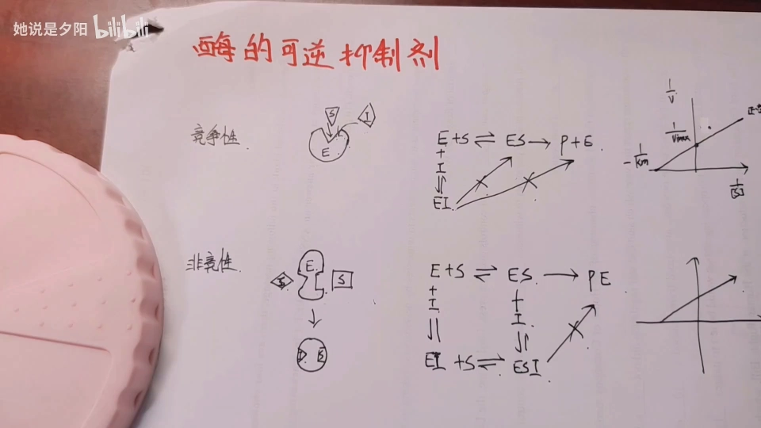
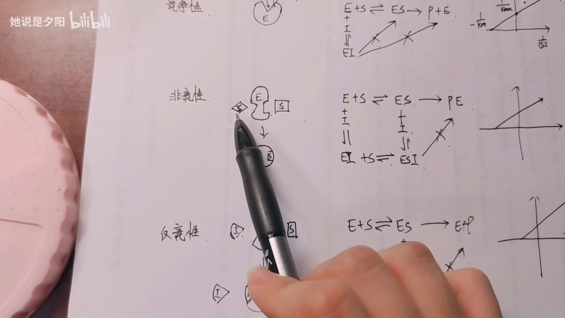
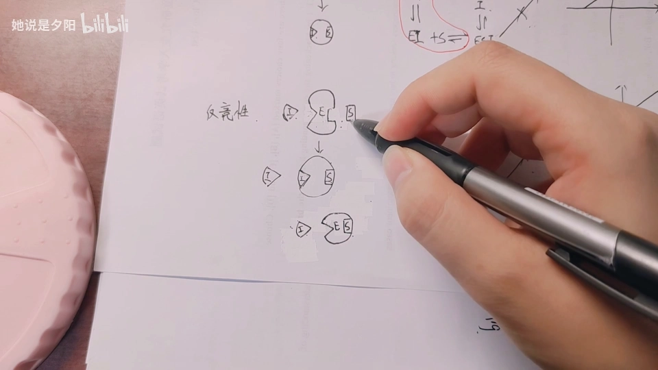
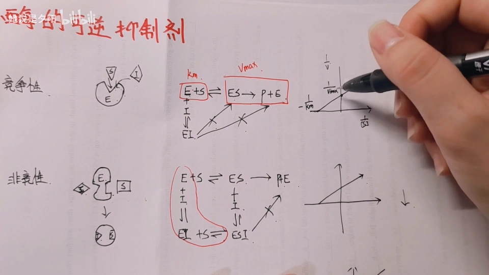
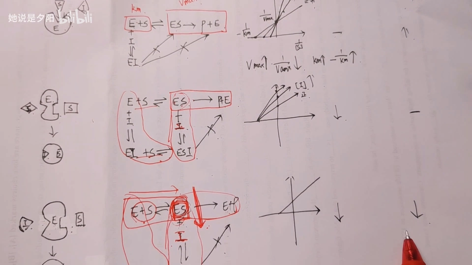
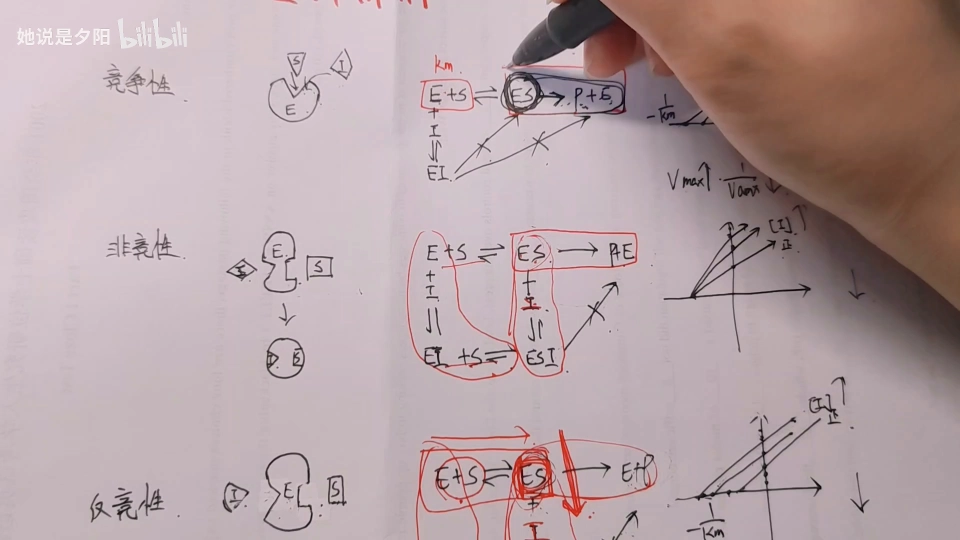
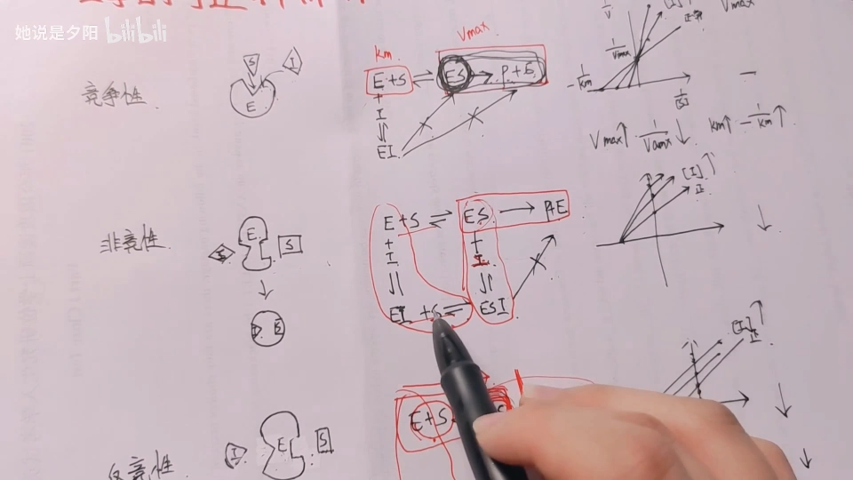

# 竞争性、非竞争性与反竞争性抑制：三种可逆抑制如何改写 Vmax 与 Km

> 视频来源：[酶的可逆抑制作用原理，竞争性抑制剂，非竞争性抑制剂，反竞争性抑制剂，米氏方程对Vmax,Km的影响](https://www.bilibili.com/video/BV1iH4y1D7pD/)（Bilibili · 12路顺风）｜时长约 18 分钟
> 简要导读：讲者用手写笔记把三种可逆抑制的「结合路线图」和「双倒数图」并排画在一张纸上，逐个推 Vmax 与 Km 往哪边走。本文按这条线索重排，并在最后给出一套不靠背口诀的判读方法。米氏方程的推导与 Km、kcat 的定义见同系列 3.2.2，本文直接引用。

## 本讲要解决的核心问题（SCQA）

**背景**：你已经知道酶促反应可以用米氏方程描述，也知道 $V_{\max}$ 是最大反应速率、$K_m$ 是酶的特征性常数、与底物亲和力成反比。

**冲突**：一旦往体系里加抑制剂，曲线就变了。可是「变」有很多种变法：有的只让曲线右移，有的只让曲线压低，有的两者一起动。光看一条米氏曲线，很难说清抑制剂到底动的是哪一步。

**疑问**：三种可逆抑制剂分别结合在哪个环节？它们各自把 $V_{\max}$ 和 $K_m$ 推向哪个方向？在双倒数图上又长什么样？

**回答（中心思想）**：**抑制剂结合在哪一步，就只改那一步对应的参数。** 只要盯住「$E+S$ 结合」和「$ES \to P$ 产物生成」这两个环节，$V_{\max}$ 与 $K_m$ 的变化方向就能推出来，不必死记；反过来，双倒数图上截距怎么动，也只是这两件事的几何投影。

## 一、先分清可逆与不可逆：能不能被「洗掉」

讲者开篇就把抑制剂分成两类，判据不是「抑制得强不强」，而是**结合方式**。

- **不可逆抑制剂**与酶形成共价结合，抑制一旦发生就很难逆转。
- **可逆抑制剂**破坏的是酶分子中的**非共价键**作用，结合松散、可逆。

这个差别可以直接拿实验来验证：用**透析、超滤或者凝胶过滤**处理被抑制的酶液——

| 处理方式 | 可逆抑制 | 不可逆抑制 |
| --- | --- | --- |
| 透析 / 超滤 / 凝胶过滤 | 抑制剂能被除去，酶活性恢复 | 抑制剂除不掉，活性不恢复 |

[【跳转到 00:15】](https://www.bilibili.com/video/BV1iH4y1D7pD/?t=15)

这条判据很朴素，但它提醒了一件事：**「抑制」是一个机制问题，不是一个数字问题。** 后面所有 $V_{\max}$、$K_m$ 的变化，都是在「可逆」这个前提下讨论的。

## 二、三种可逆抑制：区别只在「谁能结合 I」

可逆抑制剂分三型：**竞争型、非竞争型、反竞争型**。讲者反复强调，三者的差别不在抑制强度，而在**抑制剂 $I$ 允许跟哪个状态的酶结合**。

[【跳转到 00:53】](https://www.bilibili.com/video/BV1iH4y1D7pD/?t=53)

### 2.1 竞争性抑制：和底物抢同一个位点

竞争型抑制剂结合的就是**底物的那个结合位点**，靠和底物竞争来占据它。一旦抑制剂占住位点，底物进不来，也就无法生成产物。所以抑制剂的浓度越大，抑制效果越明显。

用路线图写出来是：

$$
E + S \rightleftharpoons ES \to P + E \qquad E + I \rightleftharpoons EI
$$

注意这里只有 $EI$，**没有 $ESI$**——抑制剂和底物不能同时待在一个酶上，因为它们抢的是同一个位置。

[【跳转到 01:12】](https://www.bilibili.com/video/BV1iH4y1D7pD/?t=72)

### 2.2 非竞争性抑制：另有一个位点，两边都能结合

非竞争型的抑制剂不再和底物抢位点，酶分子上**另外还有一个专门结合抑制剂的位点**。于是它有两条路都能走到同一个终点：

- 酶先和抑制剂结合成 $EI$，这个复合物**仍然可以再结合底物**，形成 $EIS$；
- 酶先和底物结合成 $ES$，这个复合物**也仍然可以再结合抑制剂**，同样形成 $EIS$。

关键在最后一步：**$EIS$ 这个三元复合物不再能生成产物。** 讲者的说法是，它「完全不管底物结不结合，只要酶和抑制剂结合了，就无法再生成产物」。

[【跳转到 02:03】](https://www.bilibili.com/video/BV1iH4y1D7pD/?t=123)

### 2.3 反竞争性抑制：只有「酶-底物复合物」才认抑制剂

反竞争型最容易和非竞争型搞混，讲者用「少了哪一步」来区分：反竞争型的路线图上，**$E + I \to EI$ 这一步是没有的**。

也就是说：

- 游离的酶**不和**反竞争型抑制剂反应；
- 必须先形成 $ES$，构象变了，抑制剂才认得它，结合成 $EIS$；
- $EIS$ 同样不能生成产物。

讲者的比喻是「目标很明确」：非竞争型从第一步、第二步都能下手，反竞争型**只掐住 $ES \to P$ 这一步**。

[【跳转到 03:08】](https://www.bilibili.com/video/BV1iH4y1D7pD/?t=188)

## 三、$V_{\max}$ 和 $K_m$ 到底在说什么

在推参数之前，讲者先回到定义，因为后面全靠这两个定义做判断。

**$V_{\max}$ 是酶促反应达到的最大反应速率。** 在一定的酶浓度下，同一个酶对同一个底物，$V_{\max}$ 是一个常数；换了别的底物，$V_{\max}$ 会随之改变。它反映的是**$ES$ 复合物生成产物这一步**的速率。

**$K_m$ 是酶的一种特征性常数。** 它的大小与酶的性质有关，**与酶的浓度无关**，因此可以用来判断酶与底物的亲和力——而且两者是**反比**关系：

$$
\text{亲和力越大} \;\Longleftrightarrow\; K_m \text{ 越小}
$$

[【跳转到 07:07】](https://www.bilibili.com/video/BV1iH4y1D7pD/?t=427)

有了这两句，后面的推理就变成了纯粹的「看哪一步被动了」。

[【跳转到 05:52】](https://www.bilibili.com/video/BV1iH4y1D7pD/?t=352)

## 四、逐个推：三种抑制对 $V_{\max}$ 与 $K_m$ 的影响

### 4.1 竞争性：$V_{\max}$ 不变，$K_m$ 增大

**看 $V_{\max}$**：竞争型抑制剂只从第一步（$E+S$ 结合）下手，**$ES \to P$ 这一步完全没有被影响**。既然产物生成这一步没被动，$V_{\max}$ 就不变。

**看 $K_m$**：抑制剂和底物抢同一个位点，酶与底物的亲和力被拉低，所以 $K_m$ **增大**。

[【跳转到 07:47】](https://www.bilibili.com/video/BV1iH4y1D7pD/?t=467)

### 4.2 非竞争性：$V_{\max}$ 降低，$K_m$ 不变

**看 $V_{\max}$**：抑制剂影响的是 $ES$ 复合物生成产物这一步，$EIS$ 产不出产物，所以 $V_{\max}$ **降低**。

**看 $K_m$**：抑制剂不影响 $E+S$ 的结合——$EI$ 依然能和底物结合，所以对亲和力没有影响，$K_m$ **不变**。

讲者在这里特别提醒：这一步「从方程式不好看，从图上好看」，因为 $EI$ 还能继续结合 $S$，说明抑制剂没有堵住底物的路。

[【跳转到 10:46】](https://www.bilibili.com/video/BV1iH4y1D7pD/?t=646)

### 4.3 反竞争性：$V_{\max}$ 降低，$K_m$ 减小

**看 $V_{\max}$**：反竞争型直接作用于 $ES \to P$ 这一步，$V_{\max}$ **降低**。

**看 $K_m$**：这一条最绕，讲者的推理是——抑制剂把 $ES$ 不断「抽走」变成 $EIS$，$ES$ 变少了，反应就加快向右进行（结合是可逆的），于是酶与底物的亲和力反而**增强**，$K_m$ **减小**。

[【跳转到 12:54】](https://www.bilibili.com/video/BV1iH4y1D7pD/?t=774)

于是三型的结果可以排成一张表：

| 抑制类型 | 抑制剂能结合 | $V_{\max}$ | $K_m$ | 亲和力 |
| --- | --- | --- | --- | --- |
| 竞争性 | 游离酶 $E$ | 不变 | 增大 | 降低 |
| 非竞争性 | $E$ 和 $ES$ 都能 | 降低 | 不变 | 不变 |
| 反竞争性 | 只有 $ES$ | 降低 | 减小 | 升高 |

## 五、换一张图看同一件事：双倒数图

米氏方程取倒数，就得到双倒数（Lineweaver-Burk）作图：

$$
\frac{1}{v} = \frac{K_m}{V_{\max}}\cdot\frac{1}{[S]} + \frac{1}{V_{\max}}
$$

两个截距把两个参数直接暴露出来：

- **纵轴截距** $= \dfrac{1}{V_{\max}}$
- **横轴截距** $= -\dfrac{1}{K_m}$

所以「$V_{\max}$ 变不变」等价于「纵轴截距动不动」，「$K_m$ 变大还是变小」等价于「横轴截距往左还是往右」。

[【跳转到 09:26】](https://www.bilibili.com/video/BV1iH4y1D7pD/?t=566)

### 5.1 竞争性：绕纵轴交点旋转

$V_{\max}$ 不变，纵轴截距就不动；$K_m$ 增大，$-\frac{1}{K_m}$ 往右移（更靠近原点）。表现为**一组直线交于纵轴同一点，随抑制剂浓度增加横轴截距右移**。

### 5.2 非竞争性：纵轴截距上移，横轴截距不动

$V_{\max}$ 降低，$\frac{1}{V_{\max}}$ 上升，纵轴截距往上走；$K_m$ 不变，横轴截距原地不动。

### 5.3 反竞争性：整体平行上移

$V_{\max}$ 降低使纵轴截距上移，$K_m$ 减小使 $-\frac{1}{K_m}$ 也往左移。讲者的描述是「平移地往上」——**直线整体平行移动**，斜率保持不变。

## 六、不背口诀的判读法：先问「哪一步被动」

讲者最后给了一套比背表格更稳的推法，值得单独拎出来。

**第一步，判 $V_{\max}$：只看 $ES \to P$ 这一步。**

不要去看「抑制剂结合后复合物会不会变少、反应会不会往回流」，**单纯只考虑 $ES$ 生成产物这一步**是否被影响。被影响，$V_{\max}$ 就降低；没被影响，$V_{\max}$ 就不变。按这个规则：竞争型没被动（不变），非竞争型和反竞争型都被动了（降低）。

**第二步，判 $K_m$：只看 $E + S$ 的结合。**

- 竞争型：抑制剂占着底物位点，亲和力下降，$K_m$ 增大；
- 非竞争型：不管抑制剂在不在，酶都能和底物结合，亲和力不变，$K_m$ 不变；
- 反竞争型：只有 $ES$ 会被抑制剂结合走，反应被推着向右，亲和力升高，$K_m$ 减小。

讲者还补了一个「字面意思」的记法：竞争 → 亲和力降；非竞争 → 不变；反竞争 → 亲和力升。

[【跳转到 15:24】](https://www.bilibili.com/video/BV1iH4y1D7pD/?t=924)

## 七、这套推法的边界：图上的截距只是「表观读数」

讲者的整套推理有一个隐含前提，值得初学者明确说出来：

- 双倒数图上的截距，是把**一组实测的 $( [S], v )$ 点**按米氏方程拟合出来的**表观参数**。图上「纵轴截距不动」，说的是**拟合出的表观 $V_{\max}$ 没变**，不是「抑制剂没有碰过 $ES \to P$ 这一步」。
- 反过来，**机制**（抑制剂能结合 $E$、$ES$ 还是两者都行）是从**结合实验**里定出来的：能不能被透析洗掉、$EI$ 还能不能结合底物、$EIS$ 还能不能产生产物。

所以正确的顺序是：**先用结合关系画出路线图，再由路线图预测参数往哪边走，最后拿双倒数图去核对。** 反过来只从图上截距反推机制，一旦 $K_m$ 和 $V_{\max}$ 同时变化，就没有唯一答案了。本讲只讨论三种「纯」的情形，正是为了让「哪一步被动 → 哪个参数动」这条对应关系先立住。

## 小结

- 可逆与不可逆的分界是**结合方式**：非共价、能被透析/超滤/凝胶过滤洗掉的是可逆抑制。
- 三种可逆抑制的差别只在**抑制剂允许结合哪个状态的酶**：竞争型只认游离酶，非竞争型两边都认，反竞争型只认 $ES$。
- $V_{\max}$ 反映 $ES \to P$ 这一步；$K_m$ 与亲和力成反比，且与酶浓度无关。
- 结果：竞争型 $V_{\max}$ 不变、$K_m$ 增大；非竞争型 $V_{\max}$ 降低、$K_m$ 不变；反竞争型两者都降低。
- 双倒数图上：纵轴截距 $=1/V_{\max}$，横轴截距 $=-1/K_m$，所以竞争型绕纵轴交点旋转、非竞争型纵轴上移、反竞争型整体平行上移。
- 判读顺序是「先看哪一步被动，再读参数」，而不是「先背表格」。
- 图上的截距是拟合出的表观参数，机制要靠结合关系来确定，两者不能互相替代。

## 关键术语速查

| 术语 | 一句话解释 |
| --- | --- |
| 不可逆抑制剂 | 与酶形成共价结合，透析、超滤也除不掉，活性不恢复 |
| 可逆抑制剂 | 靠非共价键结合，可被透析、超滤、凝胶过滤除去，活性可恢复 |
| 竞争性抑制 | 抑制剂与底物抢同一个结合位点，只能结合游离酶 $E$ |
| 非竞争性抑制 | 抑制剂结合另一个位点，$E$ 和 $ES$ 都能结合，形成的 $EIS$ 不产生产物 |
| 反竞争性抑制 | 抑制剂只结合 $ES$ 复合物，游离酶不反应 |
| $V_{\max}$ | 最大反应速率，一定酶浓度下对特定底物是常数，反映 $ES \to P$ 这一步 |
| $K_m$ | 酶的特征性常数，与酶浓度无关，与底物亲和力成反比 |
| 双倒数图 | 把米氏方程取倒数作图，纵轴截距 $1/V_{\max}$、横轴截距 $-1/K_m$ |