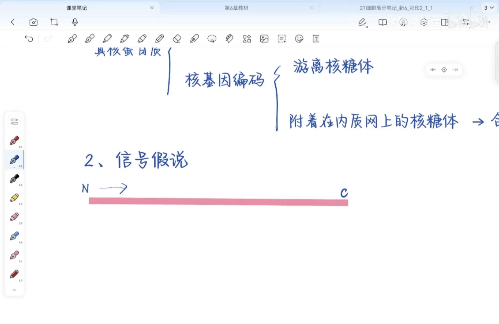
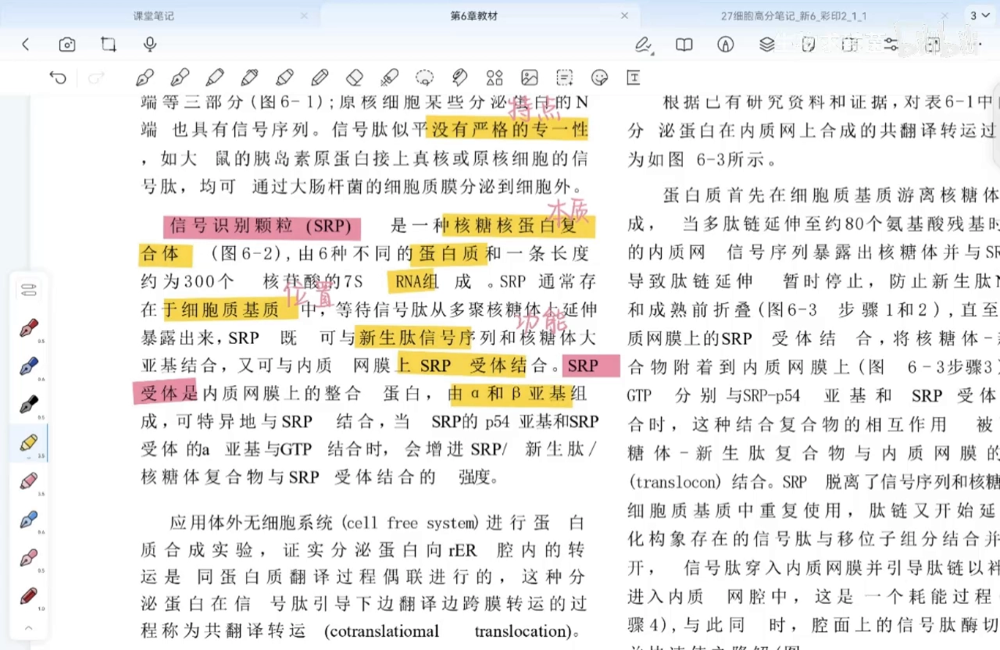
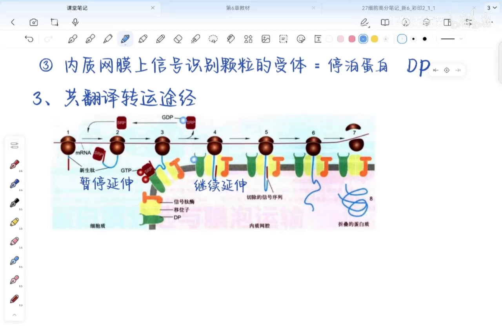
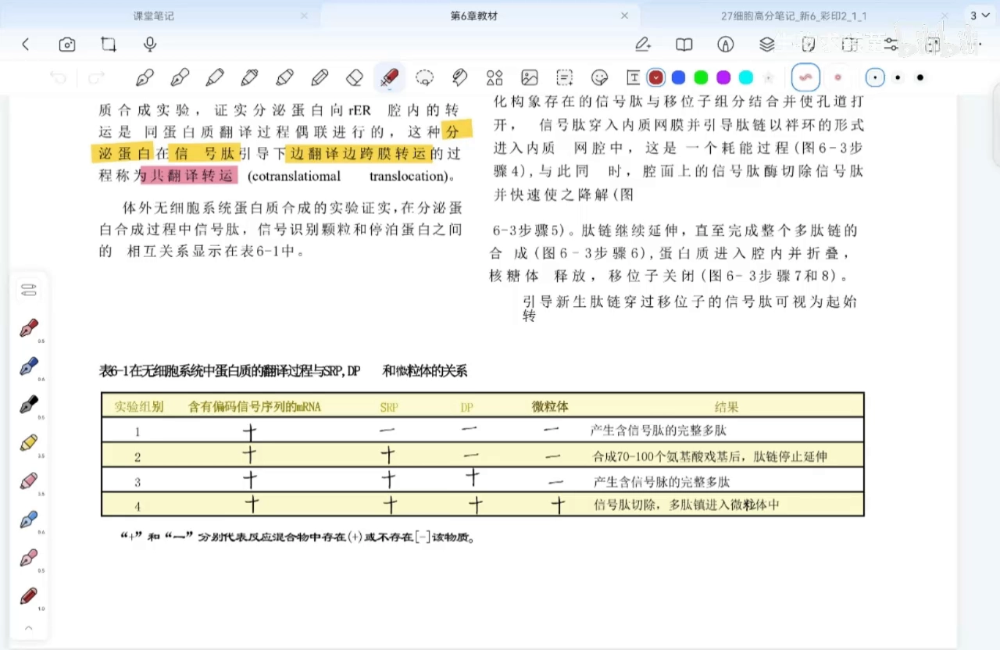
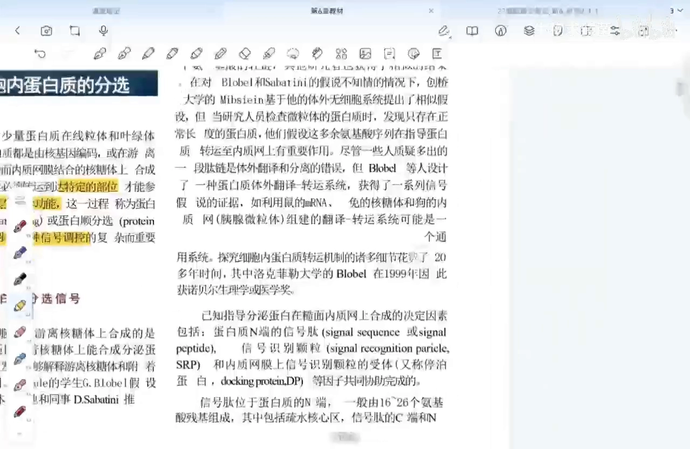

# 信号假说与共翻译转运：一段 N 端信号肽如何把蛋白送进内质网

> 视频来源：[蛋白质分选-细胞生物学](https://www.bilibili.com/video/BV1zQMK63EXv/)（Bilibili · 生物求臻菌）｜时长约 26 分钟
> 简要导读：这是一节按教材（翟中和《细胞生物学》第六章第一节）逐句讲的课，讲者先用白板画出「信号假说」的骨架，再对着课本的八步图逐格拆解，最后用无细胞系统那张经典表格把每个因子「证」了一遍。本文按「框架—假说—三要素—八步—证据」重排，适合第一次接触蛋白质分选的人。核输入、线粒体与叶绿体分选见同小节另外两篇。

## 本讲要解决的核心问题（SCQA）

**背景**：蛋白质都在核糖体上合成，但它们的去处完全不同：有的留在细胞质，有的进内质网、高尔基体，最后被分泌到细胞外，有的进溶酶体、装到细胞膜上。

**冲突**：核糖体本身不带「目的地」信息。同一个核糖体，凭什么有时候停在细胞质里翻译，有时候又贴到糙面内质网上翻译？

**疑问**：细胞究竟靠什么决定一条新生肽链的去向？这个决定发生在翻译之前、之中，还是之后？决定之后，肽链又是怎么穿过内质网膜的？

**回答（中心思想）**：[【跳转到 00:00】](https://www.bilibili.com/video/BV1zQMK63EXv/?t=0)

**决定去向的是肽链自己的序列，不是核糖体。** 分泌蛋白、膜蛋白、溶酶体蛋白的 N 端带一段约 16~26 个氨基酸的**信号肽**；它一露出核糖体就被**信号识别颗粒（SRP）**抓住，整个「核糖体—mRNA—新生肽」复合体被拖到内质网膜上的**SRP 受体（停泊蛋白 DP）**，再交给**移位子**通道。因为这一切发生在翻译还没结束时，所以叫**共翻译转运**——边翻译、边过膜。

## 一、先搭框架：蛋白从哪来，决定它大致去哪

讲者开篇先做分类，判据是**合成位置**：

- **半自主性细胞器自己合成**：线粒体和叶绿体有自己的一套蛋白质合成系统，能造一部分自己的蛋白；
- **核基因编码**：绝大多数蛋白质属于这一类。DNA 转录成 mRNA，mRNA 再由核糖体翻译成蛋白质。

核基因编码的这批蛋白，还可以按**核糖体的类型**再分一次：

| 核糖体 | 合成的蛋白 | 之后的路 |
| --- | --- | --- |
| 游离核糖体（在细胞质基质中） | 胞内蛋白 | 留在细胞质，或运往线粒体、叶绿体、过氧化物酶体、细胞核 |
| 附着在糙面内质网上的核糖体 | 分泌蛋白、膜蛋白、溶酶体蛋白 | 边合成边进内质网腔，再经高尔基体分选 |

糙面内质网的主要功能之一就是合成分泌蛋白。但这里立刻冒出一个问题：**蛋白质合成好之后，细胞怎么知道它要送到哪里？** 是核糖体决定的，还是肽链的序列决定的？

[【跳转到 02:30】](https://www.bilibili.com/video/BV1zQMK63EXv/?t=150)



## 二、信号假说：N 端那一小段序列，就是「身份 ID」

科学家们研究出的、被广泛接受的答案是**信号假说**。它的内容可以画成一条肽链：肽链有 N 端和 C 端，合成方向是从 N 端到 C 端，所以 **N 端最先被翻译出来**。信号假说主张：

> 肽链的 N 端有一小段序列，叫**信号序列**；它能被一种**结合因子**识别，结合因子识别到这段「身份 ID」后，就把整条肽链带到内质网上。

这个假说涉及三个决定性因素，讲者特意用「取名」帮人记忆：

1. **信号肽 = 信号序列**。本质就是肽链上的一小段多肽，作用是「发出信号」，让结合因子来识别。
2. **信号识别颗粒（SRP，signal recognition particle）**。就是上面说的结合因子，名字本身已经把功能说完了：识别信号的颗粒。
3. **内质网膜上信号识别颗粒的受体**，又名**停泊蛋白（DP，docking protein）**。位置在内质网膜上，功能是与 SRP 结合。

「停泊」这个别名来自 docking（码头）：SRP 像一艘船，船上载着肽链、核糖体和 mRNA，内质网是码头，停泊蛋白就是码头上允许它靠岸的那个蛋白。把三个名字连起来读，整个过程的逻辑就出来了。

[【跳转到 08:20】](https://www.bilibili.com/video/BV1zQMK63EXv/?t=500)

[【跳转到 04:10】](https://www.bilibili.com/video/BV1zQMK63EXv/?t=250)

### 2.1 三个因素的「考点版」定义

讲者随后回到课本，把三个名词按「位置—组成—功能」拆开，这套拆法也正好是名词解释的答题模板：

**信号肽**

- 位置：蛋白质的 **N 端**（因为合成从 N 端开始，它最先被翻译出来）；
- 组成：一个**疏水核心**，加上 C 端和 N 端两侧（课本给的常见长度是 16~26 个氨基酸残基）；
- 特点：**没有严格的专一性**。把任何一种生物（原核或真核）的信号肽接到一条原本没有信号肽的肽链上，这条肽链也会被运送到细胞外——所以信号肽不像「物种专用的钥匙」，更像一张通用通行证。这一点在生物工程里可以直接拿来用。

**信号识别颗粒（SRP）**

- 本质：**核糖核蛋白复合体**，由 6 种蛋白质和一条长约 300 个核苷酸的 7S RNA 组成；
- 位置：通常存在于细胞质基质中，等信号肽从核糖体上伸出来；
- 功能：既能与新生肽的信号序列、核糖体大亚基结合，也能与内质网膜上的 SRP 受体结合。

**SRP 受体（停泊蛋白 DP）**

- 组成：内质网膜上的整合蛋白，由 **α 亚基和 β 亚基**组成；
- 功能：特异性地与 SRP 结合；
- 一个细节：当 SRP 的 **P54 亚基**与受体的 α 亚基、以及 **GTP** 结合时，这个复合体的结合强度会进一步增强——这就是后面「GTP 水解 → SRP 脱离」那一步的伏笔。

[【跳转到 17:04】](https://www.bilibili.com/video/BV1zQMK63EXv/?t=1024)



## 三、共翻译转运：八个步骤，一次翻译就过一次膜

关键判断在这一步：信号肽一旦暴露就被 SRP 识别，说明此时肽链**还没有翻译完**，可能只翻译了一个开头。也就是说，转运和翻译是同时进行的——这就是**共翻译转运途径**。

课本那张图分了八步，讲者强调：图里那条红色的是 mRNA、褐色的是核糖体，但**从头到尾是同一个核糖体**在往前走。

| 步骤 | 发生了什么 | 关键角色 |
| --- | --- | --- |
| 1 | 核糖体翻译出多肽链，信号肽露出来，被 SRP 识别并结合，**肽链延伸暂停** | 信号肽、SRP |
| 2 | SRP 带着「核糖体—mRNA—新生肽」复合体结合到内质网膜上的 SRP 受体 | DP |
| 3 | GTP 结合到 SRP 与 DP 上，复合体结合更紧，防止脱落 | GTP |
| 4 | GTP 水解为 GDP，SRP 脱离并可循环使用；肽链恢复延伸，信号肽与**移位子**结合，通道打开 | 移位子 |
| 5 | 信号肽酶切除并降解信号肽 | 信号肽酶 |
| 6 | 剩余肽链在腔内继续延伸至翻译完成 | — |
| 7 | 核糖体脱离 mRNA，肽链折叠 | — |
| 8 | 核糖体释放，移位子关闭 | — |

[【跳转到 10:00】](https://www.bilibili.com/video/BV1zQMK63EXv/?t=600)



### 3.1 为什么非要「暂停」一下

这一步最容易被当成流程细节背过去，其实它有明确的生理理由。讲者给了两条：

- **防止新生肽的 N 端受损**：肽链含很多疏水氨基酸，处在细胞质的水环境里很容易聚集；一旦聚集成团，就容易被蛋白酶识别并降解。SRP 相当于一个**保护夹**，把新生肽的 N 端护住。
- **防止「成熟前折叠」**：肽链如果在错误的时间、错误的位置折叠，就可能折叠错误。暂停延伸保证了它进入内质网腔之后再折叠。

所以「暂停」不是拖延，而是**给正确折叠争取一个正确的场所**。

[【跳转到 09:35】](https://www.bilibili.com/video/BV1zQMK63EXv/?t=575)

[【跳转到 20:54】](https://www.bilibili.com/video/BV1zQMK63EXv/?t=1254)

### 3.2 移位子：肽链穿膜的那道门

移位子（translocon）是糙面内质网膜上的一个通道，第五章讲内质网时已经出现过。它的工作方式是：信号肽与移位子结合后，相当于给出一个「开门」信号，通道打开，肽链以**环状**的形式穿入内质网膜、进入腔内。这是一个**耗能**过程。

[【跳转到 13:00】](https://www.bilibili.com/video/BV1zQMK63EXv/?t=780)

讲者也提到，步骤怎么切分并不唯一：高分笔记把前两步并成一步，于是变成七步；答题时只要把要点答到，分几步都可以。

## 四、证据：无细胞系统 + 微粒体，把每个因子单独「关掉」看结果

整套机制不是靠推理得来的，而是靠体外实验一步步拆出来的。讲者最后回到课本的经典实验，并解释了实验材料：

- **微粒体**：细胞破碎后，残缺的内质网会自己封闭成小囊泡，它保留了内质网蛋白质合成与加工的功能。所以做体外翻译实验时，常用微粒体来代表「有内质网膜的一方」。
- **无细胞系统（cell-free system）**：把翻译所需的东西放到试管里，再逐个加入或去掉 SRP、DP、微粒体，看产物变成什么样。

课本表 6-1 的四组结果，正好构成一条完整的证据链：

| 组别 | 含信号序列的 mRNA | SRP | DP（SRP 受体） | 微粒体 | 结果 |
| --- | --- | --- | --- | --- | --- |
| 1 | + | − | − | − | 产生含信号肽的完整多肽 |
| 2 | + | + | − | − | 合成 70~100 个氨基酸后，肽链停止延伸 |
| 3 | + | + | + | − | 产生含信号肽的完整多肽 |
| 4 | + | + | + | + | 信号肽被切除，多肽链进入微粒体 |

怎么读这张表：

- 第 1 组说明**没有 SRP，翻译就能一路做完**，产物带着信号肽——SRP 不是翻译的必需品，而是「改道」的必需品。
- 第 2 组说明**SRP 单独就能让翻译停在信号肽刚出来的位置**，这就是「暂停延伸」的直接证据。
- 第 3 组说明**加了 DP，暂停被解除**：SRP 与 DP 结合后 GTP 水解、SRP 脱离，翻译又能继续。产物仍然带信号肽，因为还没有膜、没有信号肽酶。
- 第 4 组说明**只有加上微粒体（含移位子和信号肽酶），信号肽才被切除、肽链才真正进入囊泡内**。

换句话说：**SRP 负责「拦」，DP 负责「放」，微粒体负责「进」和「剪」**。四组对照把四个角色的分工钉死了。

[【跳转到 23:41】](https://www.bilibili.com/video/BV1zQMK63EXv/?t=1421)



### 4.1 这段历史值得记一句

课本在讲这段时提到：Blobel 和 Sabatini 提出信号假说时并不被所有人接受；Blobel 等人用大鼠 mRNA、犬胰微粒体搭建的体外翻译—转运系统，拿到了支持信号假说的系列证据，Blobel 因此在 1999 年获得诺贝尔生理学或医学奖。这解释了为什么教科书的叙述顺序是「假说 → 三要素 → 八步 → 体外实验」：**先有可检验的假说，再用可拆解的系统逐条验证**。

[【跳转到 15:27】](https://www.bilibili.com/video/BV1zQMK63EXv/?t=927)



## 五、把这一节压缩成一条线

蛋白质分选 = 合成好的蛋白被送到特定部位、参与结构组装并发挥功能的过程，它由多种信号和多种因子共同调控。本节只处理其中一条主干：

```
核基因编码 → 游离核糖体开始翻译
   → N 端信号肽露出 → SRP 结合 → 翻译暂停
   → SRP 停靠到内质网膜上的 DP
   → GTP 水解、SRP 离开 → 翻译恢复
   → 信号肽插入移位子 → 肽链进入内质网腔
   → 信号肽酶切除信号肽 → 肽链在腔内折叠
   → 进入高尔基体，走向分泌、溶酶体或细胞膜
```

[【跳转到 25:46】](https://www.bilibili.com/video/BV1zQMK63EXv/?t=1546)

## 小结

- **去向由序列决定，不由核糖体决定**。N 端的信号肽是「身份 ID」，核糖体只是执行者。
- **信号肽的三个要点**：位于 N 端、含疏水核心、没有严格的物种专一性（16~26 个氨基酸残基是常见长度）。
- **SRP 是核糖核蛋白复合体**（6 种蛋白 + 7S RNA），它同时能抓信号肽和 SRP 受体；SRP 受体（停泊蛋白）由 α、β 亚基组成，GTP 结合会加固这对相互作用。
- **共翻译转运 = 边翻译边过膜**，八个步骤的核心是「暂停—停靠—开孔—穿膜—剪切—完成」。
- **暂停有明确目的**：保护新生肽 N 端不被降解，并防止它在错误的时间折叠。
- **证据来自无细胞系统**：通过加/不加 SRP、DP、微粒体，把「拦、放、进、剪」四个动作分别归因。

## 关键术语速查

| 术语 | 一句话解释 |
| --- | --- |
| 蛋白质分选 | 合成好的蛋白被运送到特定部位、参与结构组装并发挥功能的过程 |
| 信号肽（信号序列） | 位于蛋白 N 端的一段短肽，起「目的地标签」作用，常见长度 16~26 个残基 |
| 信号识别颗粒（SRP） | 由 6 种蛋白和 7S RNA 组成的核糖核蛋白复合体，识别信号肽并使翻译暂停 |
| 停泊蛋白（DP / SRP 受体） | 内质网膜上的整合蛋白（α、β 亚基），与 SRP 结合，把复合体锚定到膜上 |
| 移位子（translocon） | 内质网膜上的蛋白通道，肽链经它穿膜进入内质网腔，过程耗能 |
| 信号肽酶 | 肽链进入腔内后切除信号肽的酶 |
| 共翻译转运 | 边翻译边跨膜转运，分泌蛋白进入内质网的典型方式 |
| 微粒体 | 细胞破碎后由残缺内质网自行封闭成的小囊泡，保留内质网的合成与加工功能 |
| 无细胞系统 | 在试管中重建翻译反应的实验体系，用于逐个增减因子、判断其功能 |