# 核孔、核定位信号与 Ran 梯度：蛋白如何单向进出细胞核

> 视频来源：[细胞生物学解码 27 蛋白质如何进入细胞核核孔钥匙与 Ran GTP 梯度](https://www.bilibili.com/video/BV1jiRpBbEtq/)（Bilibili · MadSciHub中文）｜时长约 43 分钟
> 简要导读：这期把「核质运输」当成一台机器来讲：门（核孔复合体）、钥匙（NLS）、搬运工（importin α/β）、电池（Ran 梯度）四件套，逐件拆完再串成一次完整的 p53 入核。讲法偏类比与推理，适合第一次学核运输的人；文末保留了讲者给的「五段式」答题框架。字幕里的 Ran、importin、RCC1 等术语已按标准写法订正。

## 本讲要解决的核心问题（SCQA）

**背景**：细胞核里存放着基因组。转录因子、组蛋白、剪接因子这些蛋白都在细胞质的核糖体上合成，却必须进入核内才能工作；另一些蛋白（如某些抑癌蛋白）又必须被运出核外才能被调控。

**冲突**：核膜是双层膜，物质不能随便通过。核膜上虽然有核孔，但核孔不是简单的洞——它中间塞着一团蛋白网，小分子能自由扩散，大蛋白却被挡住。更麻烦的是：**网是对称的**，既然能进，按物理就该能出，那单向性从哪来？

**疑问**：核孔到底靠什么区分「谁能过」？蛋白上的什么序列被识别？识别之后谁把它搬过去？又是什么力量保证运输只往一个方向走？

**回答（中心思想）**：[【跳转到 00:00】](https://www.bilibili.com/video/BV1jiRpBbEtq/?t=0)

**核运输是「化学防火墙 + 邮编 + 搬运工 + 化学电池」四件套的组合。** 核孔中央的 FG 重复形成水凝胶网，靠疏水化学而不是孔径大小筛人；蛋白内部的短序列 NLS（碱性）或 NES（疏水）是邮编；importin α 读邮编、importin β 带你过网；核内高 RanGTP、胞质高 RanGDP 的梯度是电池，靠 GTP 水解（**不是 ATP**）保证方向性。

## 一、门：一台 120 兆道尔顿的机器

先给规模感：一个核孔复合体（NPC）约 **120 兆道尔顿**，跟一个核糖体差不多重。但它不造蛋白、不翻译，只干一件事——当门。每个细胞的核膜上镶着 **2000~4000 个**这样的门。

结构上：

- 由大约 **30 种核孔蛋白（nucleoporin）**搭成，约 **500 个蛋白分子**组装成一个孔；
- 呈**八重旋转对称**，像俯视一个八齿齿轮；
- 中央通道约 **40 nm 宽**——在分子尺度上非常大，塞进一个小病毒绰绰有余（有些病毒确实这么干）。

为什么细胞肯花一个核糖体的「预算」去造一扇门？因为门后面是基因组，是细胞里最值钱的信息。核膜本身是双层膜（外核膜、内核膜，中间夹核周腔），外核膜与粗面内质网连通，核周腔与内质网腔连通；核内有染色质、核仁和贴在膜内侧的核纤层。

[【跳转到 01:37】](https://www.bilibili.com/video/BV1jiRpBbEtq/?t=97)

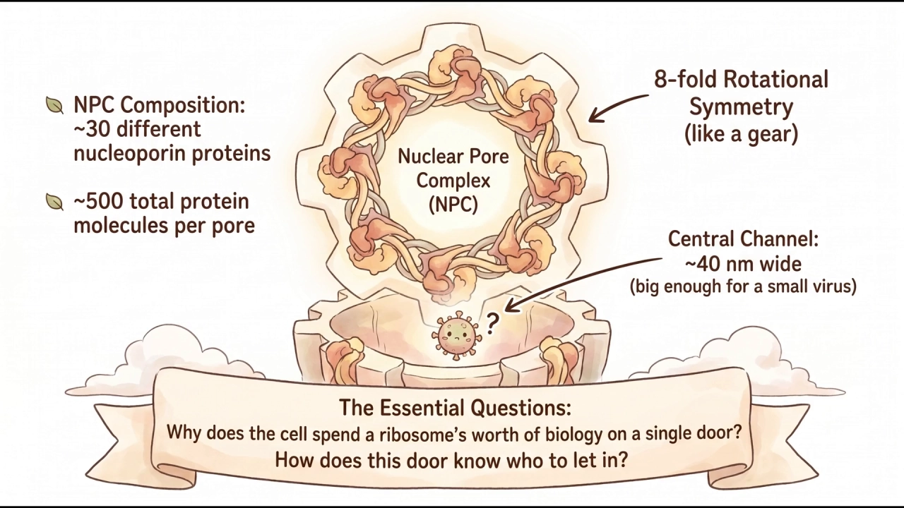

## 二、选择性过滤器：不是闸门，是一张「面条网」

放大到孔中央，会看到几十种核孔蛋白拖着长长的、**完全无折叠的尾巴**伸进通道。这些尾巴整条串着重复的二肽：**苯丙氨酸—甘氨酸（FG）**，所以叫 **FG 重复**。

几百条 FG 尾巴在孔中央缠成一张网。目前最受支持的工作模型是：这张网本质上是一团**水凝胶**，不是实心塞子，也不是一道闸。

于是筛选规则变成**化学的，而不是几何的**：

| 对象 | 结果 | 原因 |
| --- | --- | --- |
| 水、离子、小代谢物（< 约 40 kDa） | 自由扩散通过 | 网对它们几乎不存在 |
| 折叠好的大蛋白（如 60 kDa 转录因子） | 被挡住 | 撞上 FG 网，被粘在错误的方向上 |
| 表面带合适疏水斑块的蛋白（importin 及其货物） | 被放行 | 疏水斑块与 FG 重复做**弱而可逆**的接触，一个松开另一个接上，「融」过去 |

这就是它与经典通道的区别：钾通道是「钥匙孔 + 钥匙」，靠精确形状；核孔是「化学防火墙」，靠表面化学。讲者反复强调一句话：**洞是形状，化学防火墙是功能，这俩不是一回事。**

顺带说明：这是当前的工作模型，确切物理机制仍是活跃研究领域。

[【跳转到 07:18】](https://www.bilibili.com/video/BV1jiRpBbEtq/?t=438)

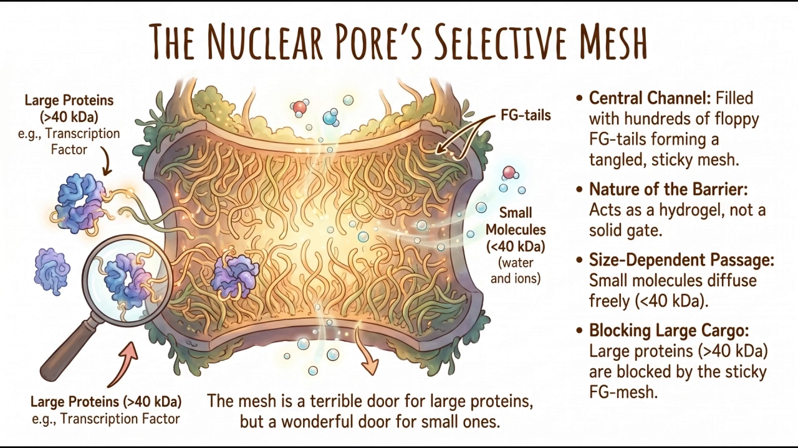

## 三、钥匙：NLS 是一段序列，不是一个蛋白

### 3.1 1984 年的剪贴实验

两位生物学家 Colin Dingwall 和 Ron Laskey 研究一个住在核里的蛋白——**核质素（nucleoplasmin）**。他们把核质素切成小片段，把片段接到本来与核无关的胞质蛋白上，看哪一段能把「乘客」带进核。结果找到一小段**碱性氨基酸**（赖氨酸、精氨酸，带正电）组成的序列。同一时期，研究 **SV40 大 T 抗原**的课题组用同样的剪贴法在病毒蛋白上找到了类似信号。这就是**核定位信号（NLS）**。

[【跳转到 11:25】](https://www.bilibili.com/video/BV1jiRpBbEtq/?t=685)

### 3.2 两种经典写法

- **单体型 NLS**：约 4~8 个残基的短序列，富含赖氨酸（K）和精氨酸（R）。教科书例子来自 SV40 大 T 抗原：**PKKKRKV**（7 个残基，四个 K 加一个 R），本质是「一小撮正电荷」。
- **双分型 NLS**：两小簇碱性残基，中间隔约 10 个残基。核质素用的就是这种。

[【跳转到 12:56】](https://www.bilibili.com/video/BV1jiRpBbEtq/?t=776)

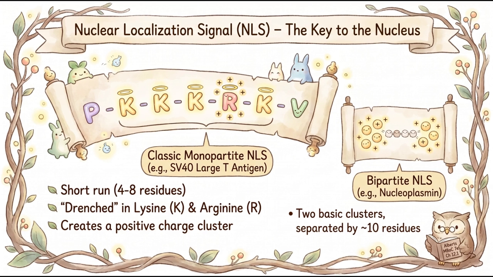

### 3.3 两个最容易错的地方

1. **NLS 不是独立蛋白**，而是货物蛋白**内部**的一段短序列，是它表面的一块「斑」——像信封上印的邮编，而不是单独的快递员。信封（货物）和邮编（NLS）一起走。
2. **NLS 是翻译后才被读的**。核糖体先把整个蛋白造完、折叠好，NLS 露在表面，importin 才来认它。这叫**翻译后输入**——正好与内质网方向的**共翻译**转运相对。

### 3.4 反向信号：NES

出核用的是另一个信号 **NES（核输出信号）**，通常是**富含亮氨酸**的短疏水斑。化学不同、搬运工不同，但基本逻辑一样。一句话记住：

> **NLS 碱性 → 进核；NES 疏水 → 出核。**

给一段肽序列判断去向时，不必背具体序列，看化学性质就够了。

## 四、搬运工：importin α 读邮编，importin β 带你过网

**importin α** 是「阅读器」：它表面有一条弯弯的凹槽，槽内衬着**酸性残基**（天冬氨酸、谷氨酸），正好用负电抱住 NLS 的正电荷。讲者的比喻是「给碱性肽准备的静电插座」。

但 importin α 自己过不了核孔——它没有那种油滑的疏水表面。它是「脑子」，不是「身体」。于是它需要搭档 **importin β**，后者身上才有能与 FG 重复做短暂握手的疏水斑。

三者叠成一个「罗汉」：

```
        importin β   ← 有疏水表面，负责过网
            |
        importin α   ← 酸性凹槽，负责读 NLS
            |
        货物蛋白      ← NLS 露在表面
```

整个复合体靠蛋白—蛋白相互作用粘住，走到核孔，由 importin β 的疏水表面与 FG 重复接触，整体「融」进核内，而且**进去时还是装配好的**。

为什么要把工作拆成两个蛋白？因为一个负责**专一识别**，一个负责**机械通过**。这个分工带来可扩展性：人类约有 6 种 importin α 和几种 β，一种 β 可以搭配多种 α，一种 α 又能带多种货物——几个「快递员」就覆盖了几乎所有核蛋白。

[【跳转到 17:44】](https://www.bilibili.com/video/BV1jiRpBbEtq/?t=1064)

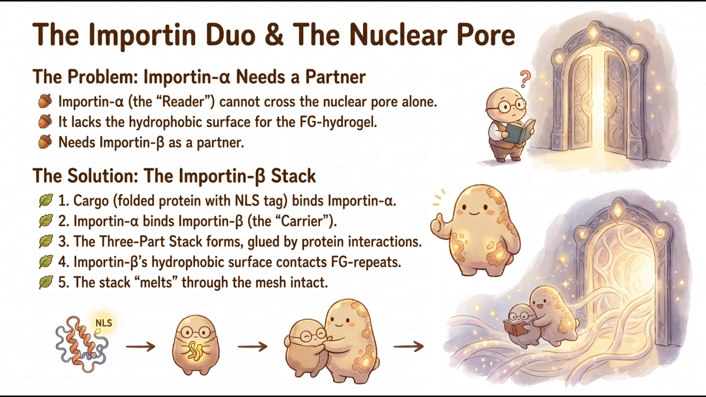

## 五、方向引擎：Ran 是一块化学电池

### 5.1 问题：网是对称的，凭什么只进不出

核孔不是阀门，也不是旋转门。FG 网从胞质一侧和核一侧都伸进孔里，物理上完全对称。刚融进去的三人组，理论上完全可以再融回来。所以**单向性必须由别的东西提供**。

[【跳转到 19:19】](https://www.bilibili.com/video/BV1jiRpBbEtq/?t=1159)

### 5.2 Ran：一个 GTP 酶开关

**Ran** 是一个约 **25 kDa** 的小蛋白，属于 **GTP 酶**：结合 GTP 时是「开」，结合 GDP 时是「关」。它自己水解 GTP 很慢，需要别的蛋白帮忙。

关键在于**分布不对称**：

- **核内几乎全是 RanGTP（开）**；
- **胞质几乎全是 RanGDP（关）**。

这个跨核膜的陡峭梯度就是「电池」。维持它靠两个酶，各自钉死在自己那一边：

| 位置 | 酶 | 作用 | 结果 |
| --- | --- | --- | --- |
| 核内（结合在染色质上） | **RCC1**（RanGEF，鸟苷酸交换因子） | 把 RanGDP 上的 GDP 换成 GTP | 核内 Ran 保持「开」 |
| 胞质 | **RanGAP** | 触发 RanGTP 水解成 RanGDP | 胞质 Ran 保持「关」 |

### 5.3 释放级联：一个 RanGTP 引发多米诺

三人组一进核就遇到 RanGTP，接下来是一串构象变化：

1. **RanGTP 结合 importin β**；
2. importin β 变形，新形状与 importin α 不兼容 → **松开 importin α**；
3. importin α 失去搭档后也变形，新形状抓不住 NLS → **松开货物**；
4. 货物自由，任务完成。

三个分子进来时粘在一起，出来时是三个分开的分子。**只因为一个 RanGTP 握了个手。**

[【跳转到 22:30】](https://www.bilibili.com/video/BV1jiRpBbEtq/?t=1350)

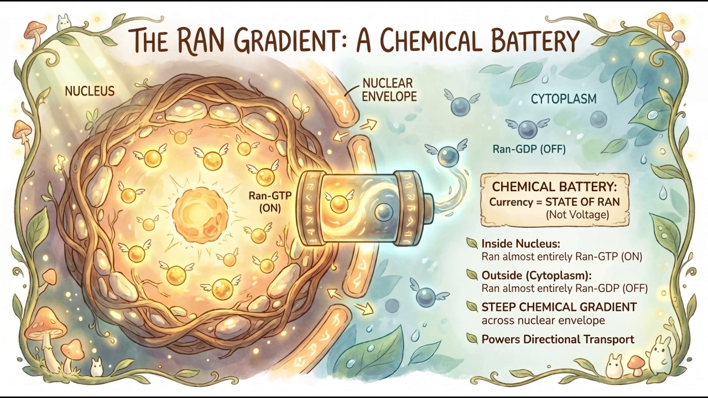

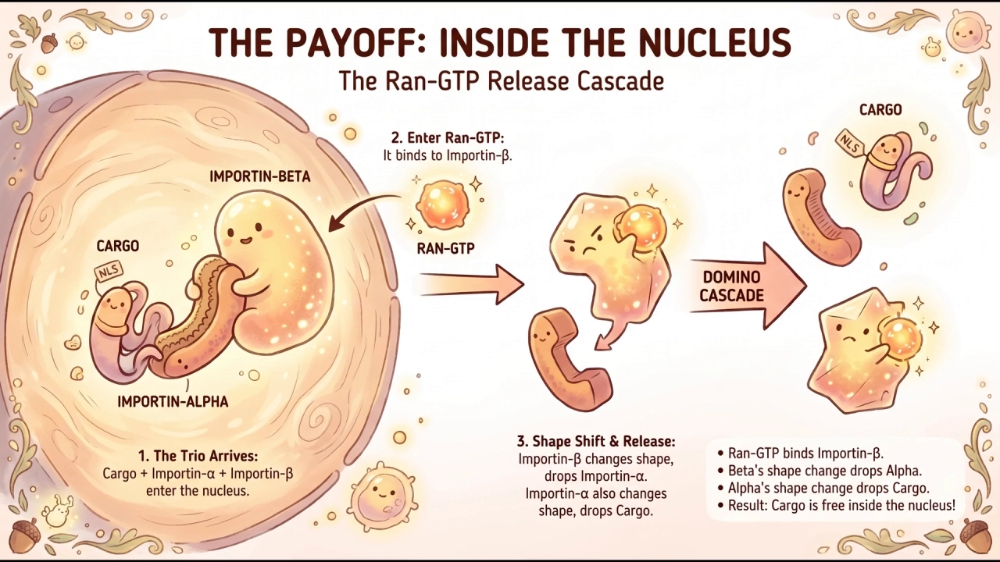

### 5.4 回收与「燃料是 GTP，不是 ATP」

- importin β 拽着 RanGTP 回到胞质，RanGAP 触发水解，RanGDP 掉下来，importin β 空出来接下一单；
- 自由的 RanGDP 由 **NTF2** 送回核内，被 RCC1 重新「充电」成 RanGTP；
- importin α 由专门的输出蛋白 **CAS** 送出去（同样依赖 RanGTP）。

讲者反复强调、并说这是考试最容易丢分的一点：

> **核输入的能量来自 Ran 水解 GTP，不是 ATP。** 酶是 GTP 酶，燃料是 GTP。

### 5.5 输出：同一块电池，反着接

出核用的是**输出蛋白（exportin）**，逻辑正好相反：

- exportin **只有在 RanGTP 在场时才结合货物**，所以结合只发生在核内；
- exportin + 货物 + RanGTP 组成复合体，划出核孔；
- 到胞质后 RanGAP 触发水解，RanGDP 掉下，货物释放。

**一个梯度，两个方向**：RanGTP 在核内「开」——触发输入的**释放**；同样在核内「开」——触发输出的**组装**。

[【跳转到 25:31】](https://www.bilibili.com/video/BV1jiRpBbEtq/?t=1531)

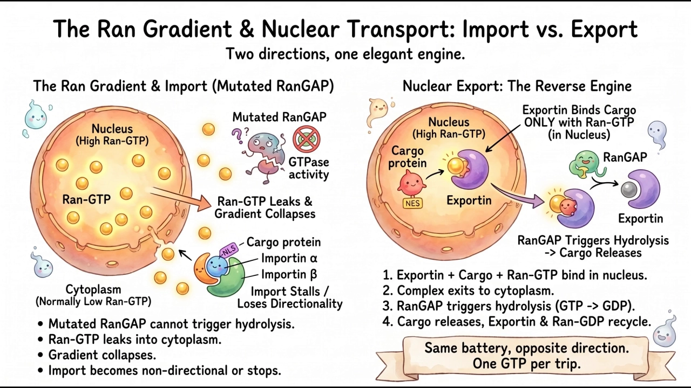

## 六、跑一遍完整流程：p53 的六步通勤

用抑癌蛋白 **p53** 当例子。当 DNA 受损（紫外线、化学应激、复制出错），p53 需要在核内启动靶基因：要么让细胞周期暂停去修复，要么在损伤过重时让细胞凋亡。

1. **合成**：胞质里的核糖体造出完整、折叠好的 p53，一段短碱性序列作为 NLS 露在表面（翻译后输入，不是共翻译）；
2. **装车**：importin α 的酸性凹槽扣住 NLS，importin β 再结合上来，三人组到位；
3. **过门**：三人组停靠核孔，importin β 的疏水表面与 FG 重复短暂接触，复合体融过去；
4. **卸货**：核内 RanGTP 结合 importin β → β 松开 α → α 松开 p53；
5. **干活**：p53 扩散到靶基因的 **p53 响应元件**，招募 RNA 聚合酶，打开基因，细胞周期暂停或凋亡；
6. **回收**：importin β 带 RanGDP 回胞质，RanGAP 触发水解；importin α 由 CAS 送出。

整趟动用的机器：1 个 p53、1 个 importin α、1 个 importin β、核内 1 个 Ran、胞质 1 个 RanGAP、核内 1 个 RCC1，加上一个有 500 个亚基的核孔复合体——就为了一个转录因子。而这件事在每个细胞里每秒钟发生几百次。

[【跳转到 28:14】](https://www.bilibili.com/video/BV1jiRpBbEtq/?t=1694)

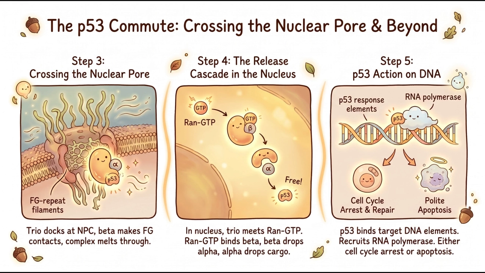

## 七、机器坏了会怎样：癌症、病毒与渐冻症

这套机制之所以重要，是因为它一被破坏就是灾难。

**故事一：癌症与输出蛋白一号。** 很多抑癌蛋白（包括 p53）随时可能被输出机器从核里拽出来，出了核就碰不到基因。在许多癌症里，输出蛋白一号（**XPO1**）表达量升高——癌细胞不突变 p53，只是把它「请出门」。药物**塞利尼索（selinexor，商品名 XPOVIO）**阻断 XPO1，让抑癌蛋白留在核内继续工作；该药 2019 年获 FDA 批准用于多发性骨髓瘤。这是一条从基础机制直接走到临床的路径。

[【跳转到 33:42】](https://www.bilibili.com/video/BV1jiRpBbEtq/?t=2022)

**故事二：病毒劫持。** 多数病毒需要把遗传物质送进核才能复制。它们不凿洞，而是进化出**类似 NLS 的短碱性肽**，让宿主的 importin 把病毒蛋白当成普通货物送进核。HIV、流感都这么干——**偷钥匙比造门省事**。

**故事三：渐冻症。** 肌萎缩侧索硬化（ALS）在欧洲血统人群中最常见的单一遗传原因，是 **C9orf72** 基因的巨大重复扩增。约 2015 年前后，多个课题组独立发现：这段扩增会产生**毒性肽，把核孔堵住**——核孔蛋白被扣押、FG 网被搅乱，核输入与输出双双失灵，神经元失去搬运转录因子的能力，最终死亡。渐冻症至少有一部分是一种**核运输病**，并与某些形式的额颞叶痴呆共享病因。

[【跳转到 31:33】](https://www.bilibili.com/video/BV1jiRpBbEtq/?t=1893)

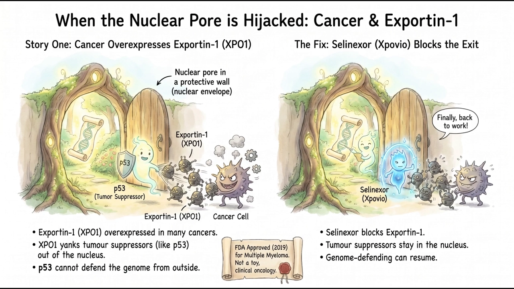

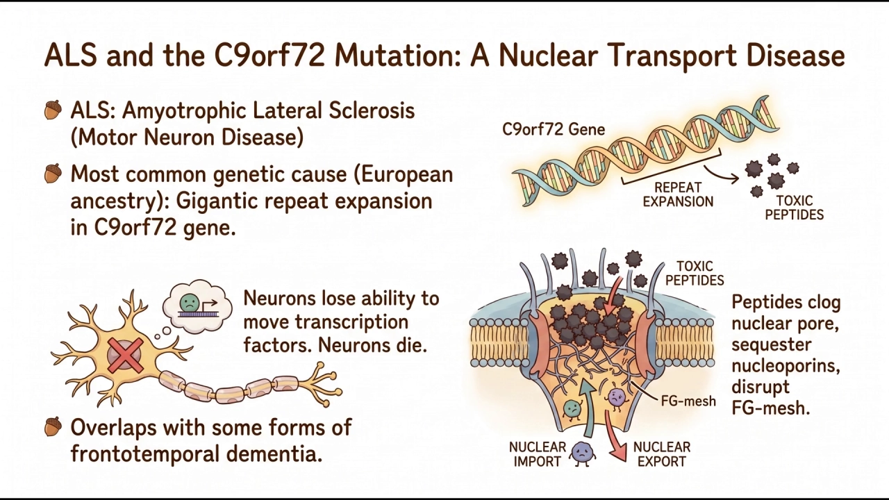

## 八、把门接到更大的图景：生物电如何改写基因表达

讲者最后拉远了一层：核孔不只是细胞内的「公文流转窗口」，它还是细胞感知邻居、感知自身电学环境的入口。

链条是这样的：细胞在质膜两侧维持电压（普通细胞约 -70 mV，肌细胞接近 -90 mV）；邻居通过缝隙连接传来信号或环境变化，电压随之改变；电压变化打开**电压门控钙通道**，钙内流激活 **NFAT、CREB、NF-κB** 等转录因子；这些因子被加上或去掉磷酸基团，原本藏着的 **NLS 暴露出来**；一直等在旁边的 importin α 认出它，整套机器启动；几秒钟后，转录因子就坐在基因上开基因。

也就是说，**电压 → 转录因子 → 入核 → 基因表达**，核孔是这条链上「电变成身份」的那一环。讲者把它与塔夫茨大学 Michael Levin 提出的「解剖编译器」假说联系起来：电压模式编码解剖结构，而细胞把电压模式翻译成基因表达，走的正是这套机器。

[【跳转到 36:01】](https://www.bilibili.com/video/BV1jiRpBbEtq/?t=2161)

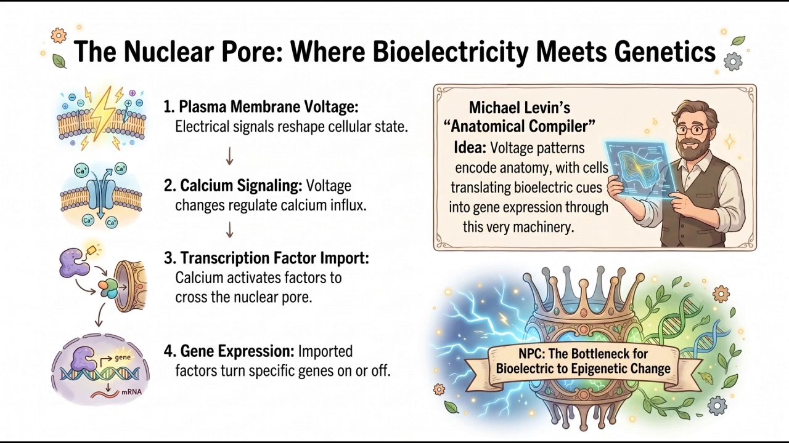

## 九、讲者给的「五段式」答题框架

题目：描述一个带 NLS 的转录因子如何被输入核内，说出涉及的蛋白名称，并解释能量从哪来。

1. **货物与信号**：该转录因子携带 NLS，是其氨基酸链内部的一段短碱性肽，富含赖氨酸与精氨酸；经典例子是 SV40 大 T 抗原的 PKKKRKV。
2. **阅读器**：NLS 被 **importin α** 识别——它有凹的酸性凹槽，靠静电结合碱性 NLS；importin α 再结合 **importin β**，β 才是真正把复合体带过核孔的那个。
3. **过门**：货物 + importin α + importin β 停靠在核孔复合体上，importin β 的疏水表面与中央通道的 FG 重复做短暂、可逆的接触，复合体穿过选择性屏障；缺乏这种化学性质的大蛋白被挡在外面。
4. **释放与定向**：核内 RanGTP 丰富，因为 RCC1 结合在染色质上使核内 Ran 保持 GTP 状态；RanGTP 结合 importin β，诱导构象变化，依次释放 importin α 与货物。
5. **能量**：来自小 GTP 酶 **Ran 水解 GTP**，不是 ATP；importin β–RanGTP 回到胞质后，RanGAP 触发水解，梯度由核内 RCC1 与胞质 RanGAP 维持，这正是定向性的来源。

加分句：RanGDP 随后由 NTF2 送回核内，被 RCC1 重新充电，完成循环。

[【跳转到 41:16】](https://www.bilibili.com/video/BV1jiRpBbEtq/?t=2476)

## 小结

- **门**：核孔复合体约 120 兆道尔顿、约 30 种核孔蛋白、八重对称、中央通道约 40 nm。
- **筛选靠化学不靠孔径**：FG 重复形成水凝胶网，小于约 40 kDa 自由扩散，大蛋白被粘住，只有带合适疏水表面的载体能「融」过去。
- **钥匙**：NLS 是蛋白**内部**的短碱性序列（经典 PKKKRKV），翻译后才被读取；出核用疏水的 NES。
- **搬运工**：importin α 读邮编，importin β 过网，三者叠成复合体整体穿门。
- **电池**：核内 RanGTP／胞质 RanGDP 的梯度由 RCC1 与 RanGAP 维持；RanGTP 触发释放级联，**能量来自 GTP 水解而非 ATP**。
- **输出是同一块电池反接**：exportin 只在 RanGTP 在场时结合货物。
- **机制即病理**：XPO1 过表达与癌症、病毒劫持 NLS、C9orf72 毒性肽堵塞核孔导致 ALS。

## 关键术语速查

| 术语 | 一句话解释 |
| --- | --- |
| 核孔复合体（NPC） | 核膜上约 120 兆道尔顿的运输通道，由约 30 种核孔蛋白、约 500 个分子组成 |
| FG 重复 | 核孔蛋白中苯丙氨酸—甘氨酸的重复序列，形成选择性水凝胶网 |
| NLS（核定位信号） | 蛋白内部的短碱性序列，被 importin α 识别，引导入核 |
| NES（核输出信号） | 富含亮氨酸的短疏水序列，引导蛋白出核 |
| importin α / β | 核输入载体：α 识别 NLS，β 与 FG 重复作用并带复合体过孔 |
| exportin（输出蛋白） | 核输出载体，需 RanGTP 同时在场才结合货物 |
| Ran | 约 25 kDa 的小 GTP 酶，RanGTP 为「开」、RanGDP 为「关」 |
| RCC1（RanGEF） | 核内结合染色质的鸟苷酸交换因子，把 RanGDP 换成 RanGTP |
| RanGAP | 胞质中的酶，触发 RanGTP 水解为 RanGDP |
| NTF2 | 把 RanGDP 送回核内的搬运蛋白 |
| CAS | 专门输出 importin α 的载体 |
| 翻译后输入 | 蛋白完全合成并折叠后，NLS 暴露再被运输（对比共翻译转运） |
| XPO1（输出蛋白一号） | 输出蛋白之一，在多种癌症中过表达；抑制剂塞利尼索已用于临床 |