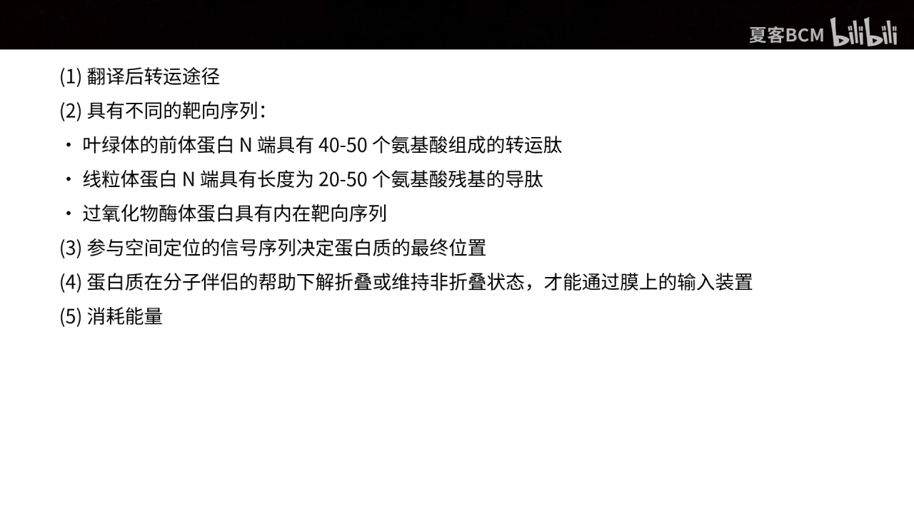
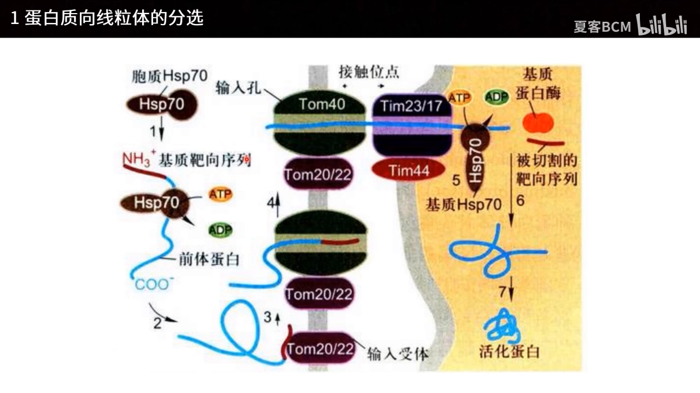
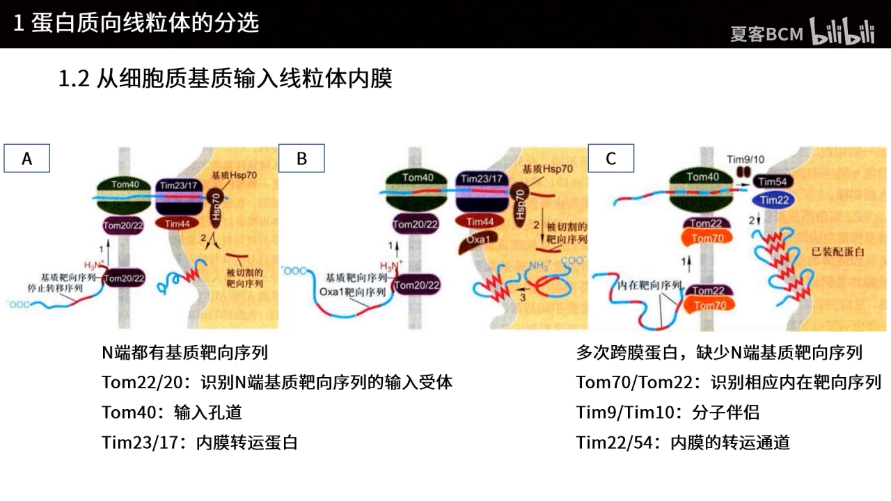
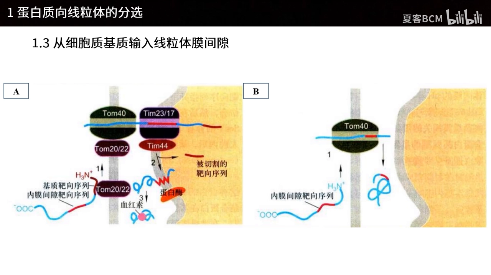
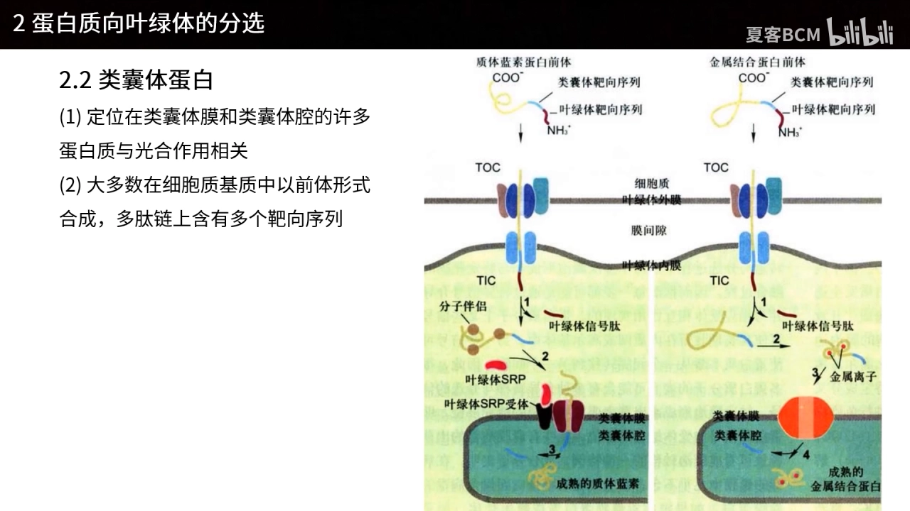

# 线粒体、叶绿体与过氧化物酶体的蛋白分选：导肽、转运肽与内在靶向序列

> 视频来源：[【细胞生物学】第六章丨3.蛋白质向线粒体和叶绿体的分选](https://www.bilibili.com/video/BV1GC411H7xP/)（Bilibili · 夏客BCM）｜时长约 19 分钟
> 简要导读：这是一节配幻灯片的教材串讲，把「翻译后转运」这条路一次走完：先给共性规则，再按线粒体（基质／内膜／膜间隙）、叶绿体（基质／类囊体）、过氧化物酶体逐个拆，每个位置都画了转运通道的示意图。本文保留原讲的顺序与命名（Tom/Tim、TOC/TIC 等），并在开头把「为什么这些细胞器难送」讲清楚。内质网方向的共翻译转运见同小节另一篇。

## 本讲要解决的核心问题（SCQA）

**背景**：核基因编码的蛋白在细胞质基质的游离核糖体上合成。其中一大类要被送进线粒体、叶绿体、过氧化物酶体这些有膜的细胞器。

**冲突**：这些细胞器不是单层膜。线粒体和叶绿体是**双膜**结构，有外膜、内膜、膜间隙、基质（叶绿体还有类囊体膜和类囊体腔）。一个蛋白要去的不是「这个细胞器」，而是「这个细胞器里的某一层」。而且蛋白在细胞质里已经折叠好了，折叠的蛋白过不了膜上的窄通道。

**疑问**：蛋白靠什么信号被认出来？穿过双膜时谁开门、谁提供动力？同一个细胞器里的不同位置，是靠不同的信号区分，还是靠不同的通道区分？

**回答（中心思想）**：[【跳转到 00:00】](https://www.bilibili.com/video/BV1GC411H7xP/?t=0)

**翻译后转运的通用逻辑是「通行证 + 检票口 + 动力」**：N 端（或内部的）靶向序列是通行证，膜上的受体与输入孔道是检票口，分子伴侣水解 ATP 提供动力。**去同一个细胞器的不同位置，靠的是「信号序列的组合」**——一段基质靶向序列决定「进这个细胞器」，附加的停止转移序列、Oxa1 靶向序列或膜间隙靶向序列再决定「停在哪一层」。

## 一、先立五条共性规则

讲者在进入具体途径前，先把这类转运的共同点列成五条，后面所有细节都可以挂在这五条上：

1. **走翻译后转运途径**。蛋白在游离核糖体上完全合成，再被送到细胞器（对比内质网方向的共翻译转运）。
2. **不同细胞器用不同的靶向序列**：
   - 叶绿体前体蛋白：N 端有 **40~50 个氨基酸**组成的**转运肽**，可引导多肽穿过叶绿体膜进入基质或类囊体；
   - 线粒体蛋白：N 端有 **20~50 个氨基酸残基**的**导肽**；
   - 过氧化物酶体蛋白：用的是**内在靶向序列**（在肽链内部，不在 N 端）。
3. **最终位置由「其他参与空间定位的信号序列」决定**。靶向序列只保证进了这个细胞器；停在内膜、外膜、膜间隙还是基质，要看还有没有别的信号。
4. **过膜前必须解折叠或维持非折叠状态**，这需要**分子伴侣**帮忙，否则折叠好的蛋白过不了膜上的输入装置。
5. **输入过程消耗能量**（后文会看到，动力主要来自 ATP 与分子伴侣）。

还有一个特例必须先记住：**过氧化物酶体的基质蛋白不需要先去折叠**，折叠好的蛋白也能通过易位体进入腔内。

[【跳转到 01:34】](https://www.bilibili.com/video/BV1GC411H7xP/?t=94)

## 二、送进线粒体基质：导肽 + 两层 Hsp70 + 两套孔道

### 2.1 导肽长什么样

所有线粒体基质蛋白的 N 端靶向信号序列都有相似的**基序（motif，即保守序列）**：

- 长度 20~50 个氨基酸；
- **富含疏水氨基酸**；
- 带**正电荷的碱性氨基酸**多（精氨酸、赖氨酸）；
- 有带羟基的氨基酸（丝氨酸、苏氨酸）；
- 但**缺少带负电荷的氨基酸**（天冬氨酸、谷氨酸）。

这种组成让导肽容易形成**两亲的 α 螺旋**——一面疏水、一面带正电。这个结构既方便插进膜，也方便被受体识别。讲者特别解释了「基序」这个词：它指 DNA、蛋白质等生物大分子中的保守序列。

[【跳转到 03:04】](https://www.bilibili.com/video/BV1GC411H7xP/?t=184)

### 2.2 七步走完基质输入

以基质蛋白为例，整个过程可以拆成七步：

1. 游离核糖体上合成的前体蛋白与**胞质 Hsp70** 结合，保持未折叠或部分折叠状态；
2. N 端的基质靶向序列与**内外膜接触点附近**的输入受体 **Tom20/22** 结合；
3. 肽链被引入输入孔，穿过**外膜的 Tom40** 与**内膜的 Tim23/17**；
4. 前体蛋白有一段进入基质后，**基质 Hsp70** 结合上去；
5. 基质 Hsp70 **水解 ATP**，驱动蛋白继续输入；
6. 基质靶向序列被**基质蛋白酶**切除，Hsp70 从蛋白上释放；
7. 蛋白折叠成有活性的构象。

[【跳转到 05:42】](https://www.bilibili.com/video/BV1GC411H7xP/?t=342)

这里有两层 Hsp70，分工不同：**胞质 Hsp70 负责「保持松开」**，让蛋白能进孔；**基质 Hsp70 负责「往里拉」**，靠水解 ATP 提供动力。所以「输入耗能」具体耗在哪儿，答案就是这一步。

[【跳转到 03:52】](https://www.bilibili.com/video/BV1GC411H7xP/?t=232)

## 三、停在内膜：三条途径，差别在「有没有附加信号」

同样是核基因编码的蛋白，要去线粒体**内膜**就有三条路。讲者用 A、B、C 标号，逻辑非常清楚：**先看它有没有 N 端基质靶向序列，再看它有没有附加的疏水片段。**

### 3.1 途径 A：基质靶向序列 + 内在停止转移序列

- 蛋白同时具有 N 端基质靶向序列和一段**内在停止转移序列**；
- 前半程和基质蛋白一样：Tom20/22 识别 → Tom40/Tim23/17 通道 → N 端进入基质 → 基质 Hsp70 结合 → 基质蛋白酶切除靶向序列；
- 差别在最后：蛋白完全进入基质后，**停止转移序列**把它拉回并锚定在内膜上，成为内膜蛋白。

### 3.2 途径 B：多一个 Oxa1 靶向序列

- 同样有基质靶向序列和停止转移序列，另外还有一段**内在疏水结构域，即 Oxa1 靶向序列**；
- 前体先进基质、靶向序列被切割，然后通过 **Oxa1 靶向序列与 Oxa1 蛋白**的相互作用装配到内膜上；
- **Oxa1 本身由线粒体基因组编码**，在线粒体基质的核糖体上合成——这是一个很有意思的细节：线粒体自己造的蛋白，反过来帮核基因编码的蛋白插膜。

[【跳转到 07:22】](https://www.bilibili.com/video/BV1GC411H7xP/?t=442)

A 与 B 的共同点：N 端都有基质靶向序列；都用 Tom20/22 作识别受体、Tom40 作外膜孔道、Tim23/17 作内膜通道。**唯一区别就是是否需要 Oxa1。**

### 3.3 途径 C：没有 N 端靶向序列的多次跨膜蛋白

- 这类蛋白是**多次跨膜蛋白**，有多个**内在靶向序列**，却**缺少 N 端基质靶向序列**；
- 于是识别工作换人：**Tom70 与 Tom22** 识别这些内在靶向序列，把蛋白引入 Tom40；
- 进入膜间隙后，**Tim9/Tim10** 充当分子伴侣，协助蛋白在外膜与内膜通道之间传递；
- 最后经内膜通道 **Tim22/Tim54** 插入内膜，成为多次跨膜蛋白。

[【跳转到 11:07】](https://www.bilibili.com/video/BV1GC411H7xP/?t=667)

## 四、停在膜间隙：两条途径，一条「切」出来，一条「直接送」

线粒体膜间隙蛋白的路更短，但同样有两条：

**途径一：先当内膜蛋白，再被切下来。** 蛋白同时有 N 端基质靶向序列和**膜间隙靶向序列**。前半程与内膜途径 A 类似，先定位到内膜；定位后蛋白有一端伸进膜间隙，内膜上的蛋白酶在特定位点、从膜间隙一侧把它切开，蛋白就掉进膜间隙，并与血红素结合。**细胞色素 B2** 走的就是这条路。

[【跳转到 09:02】](https://www.bilibili.com/video/BV1GC411H7xP/?t=542)

**途径二：直接穿外膜。** 蛋白没有 N 端靶向序列，只有膜间隙靶向序列，通过外膜的 **Tom40** 孔道直接被转运到膜间隙。

[【跳转到 11:43】](https://www.bilibili.com/video/BV1GC411H7xP/?t=703)

## 五、叶绿体：多一层膜，就多一套信号

讲者说明叶绿体结构比线粒体更复杂，因此「仅做简单的学习」，但主线仍然完整：**先过 TOC/TIC 进基质，再决定是留在基质还是去类囊体。**

### 5.1 基质蛋白：转运肽 + TOC/TIC + 基质 Hsp70

- 典型代表：所有与**卡尔文循环**有关的酶，以及 **Rubisco 的小亚基**（卡尔文循环又叫光合碳循环或暗反应，是光合作用固定二氧化碳的基本途径）；
- 这些蛋白在细胞质基质合成，前体蛋白带 N 端**基质输入序列**，以**非折叠形式**进入叶绿体基质；
- 输入需要**基质 Hsp70**，并以 **ATP 作为几乎唯一的动力来源**；
- 穿膜通道是叶绿体**外膜移位酶复合物 TOC** 与**内膜移位酶复合物 TIC**。

[【跳转到 12:53】](https://www.bilibili.com/video/BV1GC411H7xP/?t=773)

### 5.2 类囊体蛋白：两条路，一条靠 SRP，一条靠 pH

定位在类囊体膜和类囊体腔的蛋白大多与光合作用有关，同样在细胞质中以前体形式合成，但**多肽链上有多个靶向序列**。讲者用两个例子说明两条途径：

**（1）质体蓝素前体——SRP 依赖途径**

1. 蛋白有 N 端叶绿体靶向序列 + 一段类囊体靶向序列；
2. 先经 **TOC/TIC** 进入基质；
3. 基质蛋白酶切除 N 端靶向序列，**暴露出类囊体靶向序列**；
4. 分子伴侣维持非折叠状态，蛋白在类囊体靶向序列指导下与**叶绿体 SRP** 结合；
5. 叶绿体 SRP 与**叶绿体 SRP 受体**结合，蛋白在转运蛋白 **SecY** 介导下进入类囊体腔；
6. 腔内内切蛋白酶切除类囊体靶向序列，蛋白折叠成熟。

**（2）金属结合蛋白前体——pH 依赖途径**

1. 同样先经 TOC/TIC 进基质，N 端靶向序列被切除；
2. 不同之处：蛋白**在基质中就折叠**，并结合辅因子（金属离子）；
3. 折叠好的蛋白要进类囊体腔，靠两个条件：类囊体靶向序列 N 端的**两个精氨酸残基**，以及**跨类囊体膜的 pH 梯度**——讲者强调这两个条件**缺一不可**；
4. 腔内切除靶向序列，产生成熟构象。

对比这两条路，能看出一条重要规律：**同是进类囊体腔，一个要求蛋白保持非折叠（SRP 途径），一个要求蛋白先折叠好（pH 途径）**。这也解释了为什么「过膜必须解折叠」只能算通用规则，而不是绝对规则——规则之外总有特例。

[【跳转到 14:42】](https://www.bilibili.com/video/BV1GC411H7xP/?t=882)

## 六、过氧化物酶体：唯一的「不用解折叠」

过氧化物酶体的规则与前两者明显不同：

- 引导序列是**内在靶向序列**，不是 N 端的一段前导序列；
- 靶向序列先与**相应的受体**结合，再与过氧化物酶体上的**膜受体**结合，然后通过**易位体**进入腔内；
- **基质蛋白不需要先去折叠**，折叠好的蛋白就能进——这是本节反复强调的特例。

把三类细胞器放在一起看，会发现「通行证」的位置本身就携带信息：**N 端前导序列（线粒体导肽、叶绿体转运肽）意味着「要从头开始穿膜、必须解折叠」；内部靶向序列（过氧化物酶体）意味着「可以被受体带着走、不必解折叠」。**

## 七、一张表把三类细胞器对齐

| 细胞器 | 信号位置与名称 | 长度/特点 | 穿膜装置 | 动力与辅助 |
| --- | --- | --- | --- | --- |
| 线粒体基质 | N 端导肽 | 20~50 aa，疏水 + 碱性 + 羟基，缺酸性，成两亲 α 螺旋 | 外膜 Tom40，内膜 Tim23/17，受体 Tom20/22 | 胞质 Hsp70 保持非折叠；基质 Hsp70 水解 ATP 拉动 |
| 线粒体内膜 | 基质靶向序列 + 停止转移序列 / Oxa1 靶向序列；或内在靶向序列（多次跨膜） | 附加疏水片段决定「停在哪」 | 前两类走 Tom40 + Tim23/17；第三类走 Tom40 + Tim22/54，Tim9/10 辅助 | 同上 |
| 线粒体膜间隙 | 基质靶向序列 + 膜间隙靶向序列；或仅膜间隙靶向序列 | — | 前者先当内膜蛋白再被切开；后者直接经 Tom40 | 蛋白酶切割是关键一步 |
| 叶绿体基质 | N 端转运肽 | 40~50 aa | TOC / TIC | 基质 Hsp70，ATP 为几乎唯一动力 |
| 类囊体腔 | 叶绿体靶向序列 + 类囊体靶向序列 | 多个靶向序列串联 | TOC/TIC 后转 SecY（SRP 途径）或另一种转运蛋白（pH 途径） | SRP 途径需保持非折叠；pH 途径需折叠 + 两个精氨酸 + pH 梯度 |
| 过氧化物酶体基质 | 内在靶向序列 | 在肽链内部 | 受体 → 膜受体 → 易位体 | **不需解折叠** |

[【跳转到 18:27】](https://www.bilibili.com/video/BV1GC411H7xP/?t=1107)

## 小结

- **翻译后转运的三件套**：靶向序列当通行证，膜上受体与孔道当检票口，分子伴侣水解 ATP 当动力。
- **信号决定「进哪个细胞器」，附加信号决定「停在哪一层」**。线粒体内膜的 A/B/C 三条途径就是同一张通行证配不同附加条款。
- **两层 Hsp70 分工不同**：胞质的负责「保持松开」，基质的负责「往里拉」。
- **叶绿体多一层膜，就多一套信号**：先 TOC/TIC 进基质，再由类囊体靶向序列决定去类囊体膜还是腔。
- **过氧化物酶体是明确的特例**：用内部靶向序列，且折叠好的蛋白也能进入。
- 记住两个「反例」比记住规则更有用：金属结合蛋白要**先折叠**才能进类囊体腔；过氧化物酶体基质蛋白**不必解折叠**。

## 关键术语速查

| 术语 | 一句话解释 |
| --- | --- |
| 翻译后转运 | 蛋白在游离核糖体上完全合成后，再被送入细胞器的运输方式 |
| 导肽 | 线粒体蛋白 N 端 20~50 个残基的靶向序列，富含疏水与碱性氨基酸 |
| 转运肽 | 叶绿体前体蛋白 N 端 40~50 个残基的靶向序列 |
| 内在靶向序列 | 位于肽链内部（而非 N 端）的靶向信号，过氧化物酶体蛋白使用 |
| 基序（motif） | 生物大分子中反复出现的保守序列 |
| Tom / Tim | 线粒体外膜（outer membrane）与内膜（inner membrane）的转运蛋白复合物 |
| TOC / TIC | 叶绿体外膜与内膜的移位酶复合物 |
| 分子伴侣（Hsp70） | 帮助蛋白维持非折叠状态或驱动其穿膜的蛋白，常水解 ATP |
| 两亲 α 螺旋 | 一面疏水、一面亲水（此处带正电）的螺旋结构，便于插膜与识别 |
| 类囊体 | 叶绿体内部的膜系统，光合作用的光反应在此进行 |