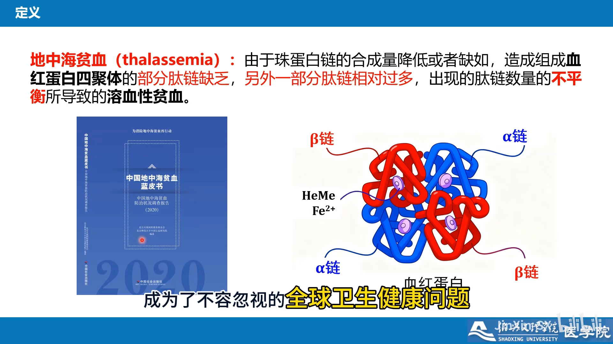
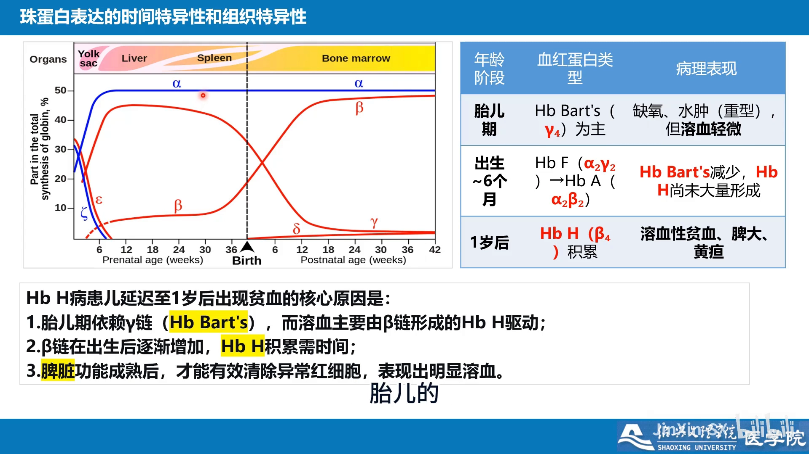
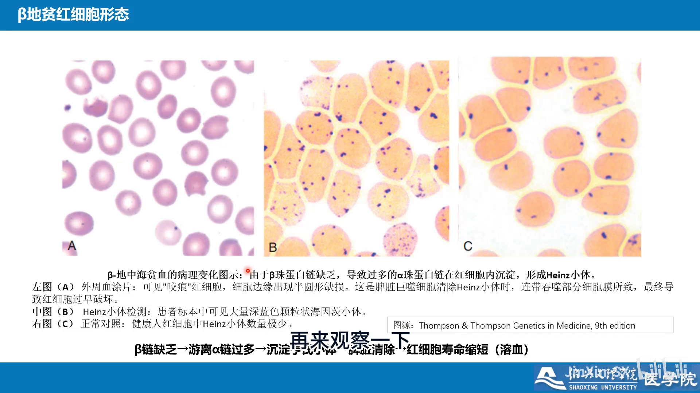
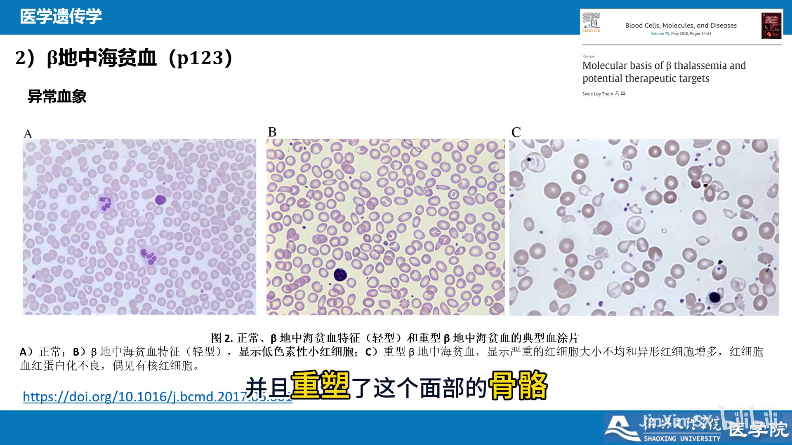
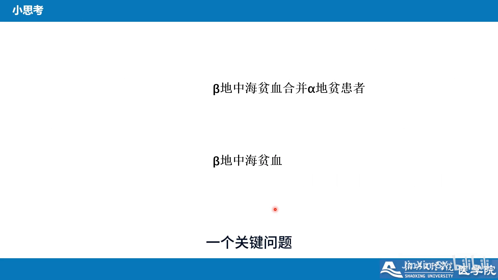
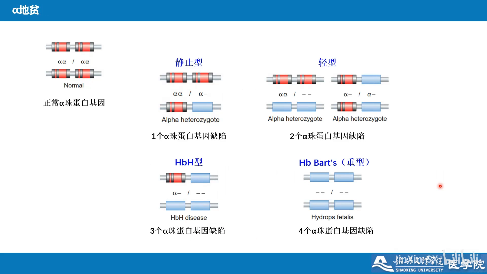
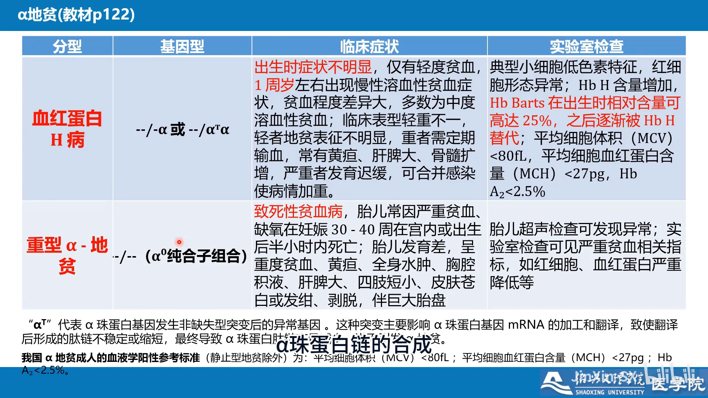
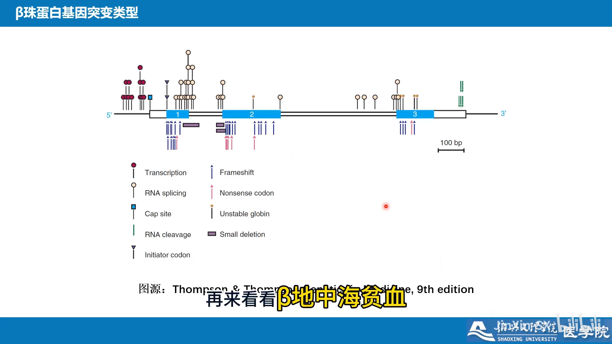

# 血红蛋白的 2:2 装配：亚基配对、化学计量与失衡的代价

> 视频来源：[单基因病-血红蛋白病-地中海贫血发生机制](https://www.bilibili.com/video/BV1EbZhYqE6z/)（Bilibili · JinXin-SX）｜时长约 17 分钟
> 简要导读：这是一节医学遗传学课，讲的是地中海贫血的发生机制。本文不重复「四级结构是什么」（那部分见 [1.2.1 蛋白质结构层级](../../../1_从氨基酸到蛋白链/1.2_蛋白质层级、结构域与功能组织/1.2.1_蛋白质结构层级：二级结构、三级折叠与四级装配/)），而是把同一份材料换一个角度读：**一个四聚体是怎么被"配"出来的、配方错了会发生什么**。贫血的临床分型、诊断与治疗也一并保留，因为它们是这条装配逻辑在病床边的读数。

## 本讲要解决的核心问题（SCQA）

**背景**：血红蛋白（hemoglobin, Hb）是大家最熟悉的多亚基蛋白——它由两条 α 链和两条 β 链组成，即 α₂β₂。你在结构层级那一节已经知道，这种"多条肽链靠非共价键聚在一起"的层次叫四级结构。

**冲突**：可"四级结构"这个定义只交代了结果，没交代过程。它没有回答：为什么偏偏是两条 α 加两条 β，而不是三条 α 加一条 β？如果细胞里 α 链不够了，那多出来的 β 链会去哪儿？更奇怪的是，同样是"缺一条链"，缺 α 和缺 β 会变成两种症状、发病时间都不同的病。

**疑问**：一个复合物的亚基是怎么被"配对"到一起的？谁决定了配几份？配错了、配不齐，后果为什么能严重到致死？

**回答（中心思想）**：复合物的装配由两件事共同决定——**界面上的配对特异性**（哪条链认得哪条链）和**各亚基的可用数量，也就是化学计量**（每条链各供几份）。当某一种亚基供给不足时，另一种亚基并不会闲着，它会退而求其次、和自己配成同源寡聚体；这些"替代装配"的产物在稳定性和功能上都变了。地中海贫血正是这条装配逻辑被打破后的直接后果：**病的严重程度，大致就等于两条链数量失衡的程度**。

---

## 一、血红蛋白是一个 2:2 的异源四聚体，配对不是随意的

先把这个复合物的"配方"定下来。血红蛋白由四个多肽亚基组成：**两条 α 亚基、两条 β 亚基**，每个亚基各带一个血红素（heme），每个血红素可以结合一个氧分子[【跳转到 00:25】](https://www.bilibili.com/video/BV1EbZhYqE6z/?t=25)。

这里有两个要点值得初学者停下来看一眼：

- **每个亚基自己就是一条折叠好的链**。也就是说，α 链、β 链各自都已经有完整的三级结构；它们单独存在时并不具备运输氧的完整功能，只有按 2:2 装配成特定构象的整体，才有完整的生物学活性。这正是四级结构区别于三级结构的地方：功能属于"组装体"，而不属于任何单个零件。
- **配对有方向性**。α 只和 β（或胚胎期的 γ）配，不会随便拉一条链就凑成四聚体。这种选择性来自亚基之间的接触界面——界面互补，才配得上；界面不互补，就配不上。这一点在后面的病理里会成为关键。

所以对血红蛋白来说，"2:2"不是一个可以四舍五入的数字，而是**装配的配方**：两份 α、两份 β，缺一不可，多一也不可。

## 二、化学计量是装配的"配方"：两条链必须等量供应

把配方翻译成细胞里的语言，就是化学计量（stoichiometry）：**各亚基的供给量必须与它们在复合物中的份数相匹配**。血红蛋白要 2:2，那么 α 链和 β 链的合成量就应该大致 1:1。

地中海贫血的分子定义，恰好就是这条要求被破坏：

> 由于珠蛋白链的合成量降低或者缺如，造成组成血红蛋白四聚体的部分肽链缺乏，另外一部分肽链相对过多，出现的肽链数量的不平衡所导致的溶血性贫血[【跳转到 00:50】](https://www.bilibili.com/video/BV1EbZhYqE6z/?t=50)。

注意这句话的重心不在"少了什么"，而在"**不平衡**"。少了 α 链，问题不是"α 不够用"这么简单，而是"β 链多出来了"。课程用一架跷跷板来画这件事：α 那一端变轻，跷跷板就倒向 β 那一端[【跳转到 00:55】](https://www.bilibili.com/video/BV1EbZhYqE6z/?t=55)。

这个视角很值得记住，因为它把"化学计量"从一个抽象名词变成了一个可以判断的物理量：**你不需要知道哪条链缺，只要知道哪一端更重，就能预测后果的严重程度**。后面所有的临床表型，都是这架跷跷板的读数。

## 三、供给失衡时，装配会"换搭档"：β₄ 与 γ₄ 是怎么来的

现在回答那个关键问题：α 链不够了，多出来的 β 链去哪儿？

答案是：**它们自己和自己配**。装配系统并不会因为"找不到 α"就停工，只要有可用的链、界面又允许，就会形成同源寡聚体。于是出现了几种"非标准配方"的血红蛋白：

| 血红蛋白 | 配方 | 出现场合 | 后果 |
| --- | --- | --- | --- |
| HbA（正常成人） | α₂β₂ | 出生 6 个月后为主 | 正常运氧 |
| HbF（胎儿） | α₂γ₂ | 胎儿期 | 从母体血液中高效取氧 |
| Hb Bart's | γ₄ | α 完全缺失的胎儿期 | 对氧亲和力过高，组织取不到氧 |
| HbH | β₄ | α 缺失、β 链开始增多之后 | 不稳定，易沉淀 |

这张表本身就是"装配由可用量和界面共同决定"的最好证据：**同一个 β 亚基，有 α 时配成 α₂β₂，没 α 时配成 β₄**。配方不是被某个"总设计师"指定的，而是被"谁在场、有多少"决定的。

胎儿血红蛋白（HbF）的存在还说明了另一层：**装配的搭档会随发育时间改变**。胎儿的血红蛋白是 α₂γ₂，其中 γ 链和成人的 β 链很相似（都由 146 个氨基酸组成），所以胎儿能通过胎盘从母体血液中有效取氧。等到出生后 γ 链合成逐渐降低、β 链逐渐升高，正常血红蛋白才转为 HbA（α₂β₂）[【跳转到 14:17】](https://www.bilibili.com/video/BV1EbZhYqE6z/?t=857)。

换句话说，**装配是一个有时间轴的过程**：同一套基因产物在不同发育阶段给出不同的"可用链池"，复合物的组成就跟着变。这一点在第九节会解释一个临床上很反直觉的现象——为什么有的重病要等到一岁才发作。

## 四、替代装配的产物，功能已经不一样了

如果 β₄ 和 γ₄ 只是"换个搭档、功能照旧"，那失衡也就不成其为病了。问题在于，**换了搭档，产物的性质就变了**。

以 Hb Bart's（γ₄）为例：它对氧的亲和力非常高，高到无法向组织有效释放氧气，于是造成严重的组织缺氧和胎儿水肿[【跳转到 03:40】](https://www.bilibili.com/video/BV1EbZhYqE6z/?t=220)。这里有一个对初学者特别重要的区分：

- **"能结合氧"和"能运送氧"是两件事**。亲和力过高意味着在肺里抓得住氧，但在组织里放不下氧；对一个运输蛋白来说，这等于失效。
- 所以判断一个复合物装配错误的功能后果，不能只问"它还结合配体吗"，要问"它的结合曲线还落在有用的区间吗"。

HbH（β₄）的问题则是另一类：它**不稳定**，容易沉淀[【跳转到 15:07】](https://www.bilibili.com/video/BV1EbZhYqE6z/?t=907)。这属于装配错误的第二种后果——不是功能参数跑偏，而是产物本身站不住，会聚集。两种后果对应两种病理：一种是"运不动"，一种是"散架并堆积"。

## 五、失衡的后果是一条因果链：游离链 → 沉淀 → Heinz 小体 → 溶血

把上面几节串起来，就得到地中海贫血的核心病理链条。以 β 地贫为例（β 链不足、α 链过剩）：

1. **β 珠蛋白链缺乏**，多余的 α 珠蛋白链没有配对对象；
2. 游离的 α 链在红细胞内**沉淀**，形成一种小体结构；
3. 这种深蓝色颗粒状小体叫 **Heinz 小体**（海因茨小体）[【跳转到 09:36】](https://www.bilibili.com/video/BV1EbZhYqE6z/?t=576)；
4. 脾脏的巨噬细胞来清除这些沉淀，清除时会连带走一部分细胞膜，于是红细胞上留下像被咬了一口的"咬痕"；
5. 膜受损的红细胞**过早破坏**，形成溶血性贫血[【跳转到 10:01】](https://www.bilibili.com/video/BV1EbZhYqE6z/?t=601)。

这条链条解释了为什么"化学计量错误"会表现为贫血：**没有被装配进复合物的零件，是有毒性的**。在正常的装配体系里，多余的亚基通常会被质量控制降解掉；一旦超出这个能力，游离亚基的疏水表面就会互相黏附、沉淀。这是复合物装配问题里最普遍的一类后果，血红蛋白只是最清楚的例子。

血涂片上的形态学改变就是这条链条的读数：正常红细胞中央有淡染区，轻型 β 地贫表现为低色素性小红细胞（中央淡染面积扩大、整体颜色变浅），重型则出现严重的红细胞大小不均和异形红细胞增多[【跳转到 08:41】](https://www.bilibili.com/video/BV1EbZhYqE6z/?t=521)。

## 六、临床严重程度，大致等于失衡程度

如果前面的逻辑成立，就应该能做出一个可检验的预测：**失衡越严重，症状越重**。课程用一个"小思考"来验证它：

> 一个重型 β 地贫患者，和一个 β 地贫合并 α 地贫的患者，谁的症状更严重？

答案是**单纯型 β 地贫更严重**。理由是：β 地贫时 α 链过剩，α 地贫时 α 链不足；两者合并，α 链的过剩被抵消了一部分，跷跷板的失衡反而不如单纯型严重[【跳转到 12:41】](https://www.bilibili.com/video/BV1EbZhYqE6z/?t=761)。

这个推理的价值不在于记住结论，而在于它示范了一种判断方式：**面对一个复合物装配异常，先找出"哪一端过剩"，再估计过剩的量，就能大致预判表型的轻重**。课程把它总结成一句话：地贫的严重程度主要和两类肽链的失衡情况相关，失衡越严重的，症状往往也越严重[【跳转到 13:11】](https://www.bilibili.com/video/BV1EbZhYqE6z/?t=791)。

## 七、α 地贫：缺失型为主，四种分型就是四档化学计量

α 地贫的分子基础主要是**缺失型**：人有四个 α 珠蛋白基因（每条染色体上各两个），可以缺失一个、两个、三个甚至四个。按缺失的基因数量，分成四型[【跳转到 01:51】](https://www.bilibili.com/video/BV1EbZhYqE6z/?t=111)：

- **静止型**（缺 1 个）：通常没有明显症状；
- **轻型**（缺 2 个）：血液学筛查表现为典型的小细胞低色素性贫血；
- **HbH 病 / 中间型**（缺 3 个）：α 链明显不足，过剩的 β 链形成 HbH（β₄）；
- **重型 / Hb Bart's**（缺 4 个）：完全没有 α 链合成，过剩的 γ 链聚合形成 Hb Bart's（γ₄），是致死性的胎儿水肿综合征。

这张分型图之所以好，是因为它把"化学计量"变成了一个**剂量序列**：从缺 1 到缺 4，α 的供给量单调下降，失衡单调加重，表型也单调加重。临床上真正需要关注的是缺 3 个和缺 4 个的两种[【跳转到 02:41】](https://www.bilibili.com/video/BV1EbZhYqE6z/?t=161)。

HbH 病与重型 α 地贫的临床表现、实验室检查可以对照下面这张表来读：

表里有两处细节值得和装配逻辑对上：HbH 病患者出生时症状不明显，要到 1 周岁左右才出现慢性溶血性贫血；而实验室检查里，Hb Bart's 在出生时相对含量可高达 25%，之后逐渐被 HbH 替代。**"哪种替代装配产物占主导"随时间变化**，这正是下一节要解释的。

## 八、β 地贫：点突变为主，同一基因位点上的多种"断供方式"

β 地贫和 α 地贫在基因层面的差别是：它**不以缺失型为主，而以点突变为主**。外显子、内含子、上下游区域都分布着不同的点突变，类型包括转录异常、移码突变、剪接异常、无义突变（提前终止）、不稳定的珠蛋白、起始密码子突变等[【跳转到 10:41】](https://www.bilibili.com/video/BV1EbZhYqE6z/?t=641)。

从"供给量"的角度看，这些突变其实只造成两种后果，用两个符号表示：

- **β⁰**：完全没有 β 珠蛋白产生（供给为零）；
- **β⁺**：β 珠蛋白低于正常水平，但还有一点点（供给减少）。

按后果再分为轻型、中间型和重型。重型通常是 β⁰/β⁰，或其中一条链只有少量产生但低于中间型水平；出生时没有临床症状，要到 3~6 个月才开始进行性贫血加重，严重时出现心肌损害，不加治疗患儿通常在五岁以前死亡[【跳转到 07:07】](https://www.bilibili.com/video/BV1EbZhYqE6z/?t=427)。患儿往往有典型的"地贫面容"：上颌前凸、颧骨隆起、两眼距增宽、鼻梁塌陷，其成因是无效造血和溶血导致的严重骨髓代偿性增生——头面部扁骨的骨髓腔过度膨胀，从内部挤压、侵蚀并重塑了面骨[【跳转到 07:55】](https://www.bilibili.com/video/BV1EbZhYqE6z/?t=475)。

这里有一个概念值得单独拎出来：**同一个基因位点上有那么多种点突变，却对应同一种疾病**，这被称为**等位基因异质性**（allelic heterogeneity）[【跳转到 11:06】](https://www.bilibili.com/video/BV1EbZhYqE6z/?t=666)。对装配问题来说，它的含义是：**不必追问"坏在哪一步"，只要追问"最后供给了多少"**。不同的分子故障，只要把 β 链的供给压到同一档，装配失衡的程度就相同，表型也就相似。

## 九、为什么 HbH 病要等到一岁以后才发作

这是全课最漂亮的一处推理，因为它把"装配"和"时间"接在了一起。

现象是：HbH 病（缺 3 个 α 基因）出生时症状不明显，一般要到一周岁左右才出现慢性溶血性贫血；而同样是重型的 β 地贫，也要到出生后 3~6 个月才出现症状。为什么？

课程给出的解释有三条[【跳转到 13:37】](https://www.bilibili.com/video/BV1EbZhYqE6z/?t=817)：

1. **胎儿期占主导的类 β 链是 γ 链**。α 链不足时，过剩的 γ 链配成 γ₄（Hb Bart's），而这一阶段溶血表现并不明显——虽然 Hb Bart's 氧亲和力过高会造成缺氧和水肿，但溶血本身轻微。
2. **β 链在出生后才逐渐增加**，HbH（β₄）的积累需要时间。也就是说，导致溶血的那个"替代装配产物"，其原料要等出生后才充足。
3. **脾脏功能成熟需要时间**。脾脏是清除 HbH 包含体的主要场所，它的功能要到出生后 6~12 个月左右才完善；随着脾功能增强，对异常红细胞的清除效率逐渐增高，贫血、黄疸、脾大才逐渐明显。

把这三条合起来看，会发现一个对判断复合物表型很通用的框架：**一个装配错误的后果何时显现，取决于三件事——错误的产物什么时候开始生成、它的原料什么时候充足、清除它的系统什么时候上线**。三者都到位，症状才浮出水面。这也解释了为什么"同样是重型"，缺 α 和缺 β 的发病时间不一样：它们依赖的替代装配产物不同（γ₄ 对 β₄），原料的时间曲线也不同。

## 十、诊断、预防与治疗：这些读数在测什么

最后落到临床。理解了装配逻辑，诊断与治疗的每一项都能对应回"失衡"这个量。

**诊断**：先看血液学阳性参考标准，再结合基因检测确诊。我国 α 地贫成人的血液学阳性参考标准（静止型除外）为：平均细胞体积（MCV）< 80 fL、平均细胞血红蛋白含量（MCH）< 27 pg、Hb A₂ < 2.5%[【跳转到 04:11】](https://www.bilibili.com/video/BV1EbZhYqE6z/?t=251)。这些指标测的都是"红细胞里血红蛋白装得够不够、装得对不对"，本质上是装配结果的间接读数。

**预防**：最关键的环节是产前筛查与产前诊断。要重点针对那些可能产下 Hb Bart's 患儿的夫妇——也就是夫妇双方分别是缺失两个基因的轻型和缺失一个基因的静止型患者。HbH 病的产前诊断与选择性流产，需要告知患者所面临的客观情况，并充分尊重父母的意见[【跳转到 04:36】](https://www.bilibili.com/video/BV1EbZhYqE6z/?t=276)。

**治疗**：α 地贫这边重点对象是 HbH 病，一般通过输血治疗，病情恶化才考虑脾切除等手术[【跳转到 05:01】](https://www.bilibili.com/video/BV1EbZhYqE6z/?t=301)。β 地贫这边，重型需要长期输血和去铁治疗，并用铁螯合去除红细胞破坏与输血造成的铁超负荷；想要根治，目前主要是干细胞移植和基因治疗；而最好的办法仍然是做好产前筛查诊断，这依然是预防重型地贫患儿出生的关键[【跳转到 11:48】](https://www.bilibili.com/video/BV1EbZhYqE6z/?t=708)。

顺带说一句 β 地贫的诊断难点：因为不同点突变导致的临床表型异质性较大，诊断时需要综合考虑，不光检测 β 珠蛋白基因本身，还要考虑其他修饰基因[【跳转到 11:23】](https://www.bilibili.com/video/BV1EbZhYqE6z/?t=683)。翻译成装配的语言就是：**最终表型不只由"缺多少 β"决定，还由"剩下那些链怎么被处理"决定**——修饰基因影响的正是后者。

## 小结

- **装配 = 配对特异性 + 化学计量**。界面决定"谁能和谁配"，各亚基的可用量决定"配几份"。血红蛋白的配方是 α₂β₂，缺一不可。
- **失衡的代价不在"缺"，而在"多"**。没有被装配进复合物的游离亚基会沉淀（Heinz 小体），被清除系统连膜一起咬掉，最终表现为溶血。
- **供给不足时装配会换搭档**。有 α 时 β 配成 α₂β₂，没 α 时配成 β₄（HbH），胎儿期则配成 γ₄（Hb Bart's）。配方由"谁在场、有多少"决定，而不是由某个总设计师指定。
- **换搭档会改变功能**。Hb Bart's 氧亲和力过高，抓得住氧却放不下氧；HbH 不稳定、易沉淀。"能结合配体"不等于"功能正常"。
- **表型严重程度 ≈ 失衡程度**。这也解释了为什么 β 地贫合并 α 地贫反而比单纯型 β 地贫轻——两种失衡互相抵消了一部分。
- **装配有时间轴**。HbH 病延迟到一岁后发病，是因为导致溶血的 β₄ 要等 β 链出生后增多才积累，而清除它的脾脏功能也要 6~12 个月才成熟。
- **不同的分子故障可以收敛到同一档供给**。β 地贫的多种点突变（转录、剪接、移码、无义、起始密码子）都归为 β⁰ 或 β⁺ 两档，这就是等位基因异质性。

## 关键术语速查

| 术语 | 一句话解释 |
| --- | --- |
| 化学计量（stoichiometry） | 复合物中各亚基的份数配比；血红蛋白是 2:2，所以两条链必须等量供应 |
| 亚基配对特异性 | 亚基界面互补才能装配；α 与 β/γ 配，不随意与其他链配 |
| 同源寡聚体 | 同一种亚基自己配成的复合物，如 β₄（HbH）、γ₄（Hb Bart's） |
| 异源四聚体 | 由两种不同亚基各两份组成的四聚体，如 α₂β₂ |
| HbA / HbF | 成人血红蛋白 α₂β₂ / 胎儿血红蛋白 α₂γ₂ |
| HbH / Hb Bart's | α 链不足时出现的替代装配产物 β₄ / γ₄ |
| Heinz 小体 | 游离 α 链在红细胞内沉淀形成的深蓝色颗粒小体 |
| 无效造血 | 红细胞在成熟前就被破坏，不能进入外周血有效工作 |
| β⁰ / β⁺ | β 珠蛋白完全缺失 / 低于正常水平但仍有少量 |
| 等位基因异质性 | 同一基因位点上多种不同突变导致同一种疾病 |
| 地贫面容 | 无效造血与溶血导致骨髓代偿性增生，重塑头面部扁骨形成的特殊面容 |