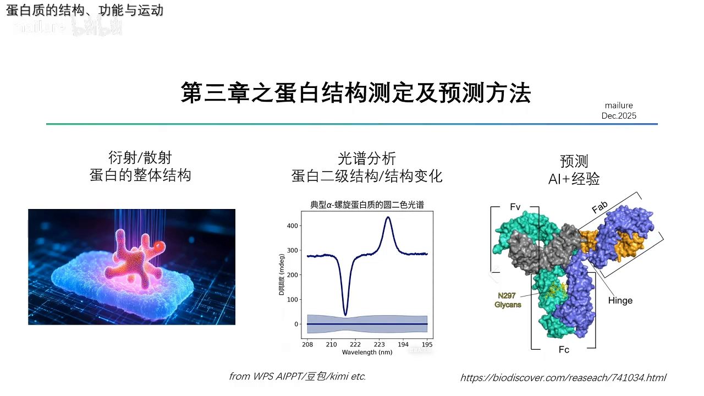
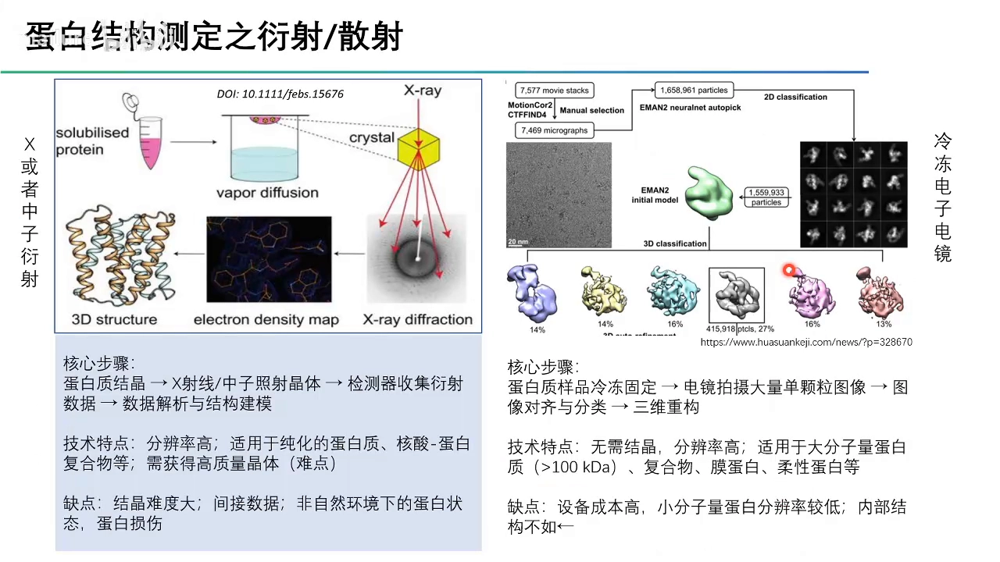
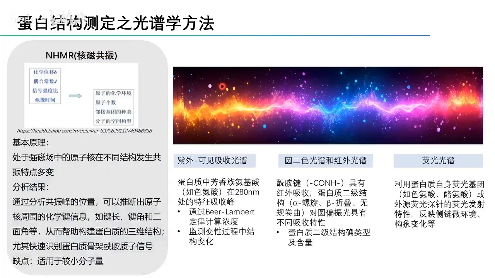
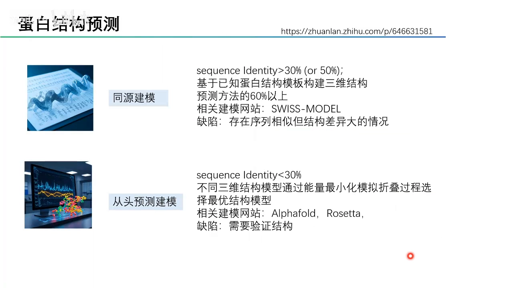

# 蛋白质结构测定方法一览：衍射、冷冻电镜与核磁共振的分工

> 视频来源：[第三章 蛋白质结构测定和预测方法](https://www.bilibili.com/video/BV1j4qrBiEH4)（Bilibili · 生物化学考研笔记）｜时长约 9 分钟
> 导读：这是一份按教材第三章整理的速览笔记，把衍射/散射、冷冻电镜、核磁共振、光谱学与预测五条路线放在一张地图上，每条都给出"测什么、适合谁、卡在哪"。篇幅短，适合作为同节长文的对照表来读。

## 本讲要解决的核心问题（SCQA）

**背景**：教材里"测定蛋白质三维结构的方法"往往被列成一串名词，看起来彼此并列。

**冲突**：这些方法的输出根本不是一个层级的东西——有的给整套原子坐标，有的只给一段二级结构的含量，有的干脆是算出来的模型。

**疑问**：面对一个具体蛋白，应该先想到哪条路线？每条路线的边界在哪里？

**回答（中心思想）**：蛋白质结构测定可以分成三大类——**衍射/散射测整体结构、光谱学测局部结构与构象变化、预测靠经验推算**。整体结构里又有三条实验路线：X 射线（及中子、微晶电子衍射）靠晶体衍射，冷冻电镜靠冷冻固定后的颗粒成像，核磁共振靠强磁场中的共振峰推断原子间的距离。它们的适用对象按分子量大小和"能不能结晶"划出了清晰的分界。

[【跳转到 00:04】](https://www.bilibili.com/video/BV1j4qrBiEH4/?t=4)

[【跳转到 00:24】](https://www.bilibili.com/video/BV1j4qrBiEH4/?t=24)

## 一、衍射与散射：X 射线是主力，中子与微晶电子衍射是补充

X 射线衍射的流程是：蛋白质先结晶，晶体被 X 光照射，X 光经过晶体表面或内部的电子云时发生衍射，探测器收集衍射信息，再通过解析这些数据反推整体结构。

[【跳转到 01:28】](https://www.bilibili.com/video/BV1j4qrBiEH4/?t=88)

它的技术特点是分辨率非常高，适用于纯化的蛋白质或核酸-蛋白质复合物。难点也很明确：必须获得高质量的晶体。很多蛋白结晶非常困难，甚至根本无法结晶；而且结晶是在非自然条件下发生的，得到的结构可能与真实生理状态有差异。此外，从衍射数据反推结构本身耗时耗力，X 光照射也可能造成蛋白损伤，限制数据质量。

[【跳转到 02:08】](https://www.bilibili.com/video/BV1j4qrBiEH4/?t=128)

同属衍射家族的还有两条路线：

- **中子衍射**：中子穿过晶体时与原子核碰撞产生衍射，同样可以反推结构。但中子的产生比 X 射线难得多，应用并不广泛。
- **微晶电子衍射（microED）**：用电子束打微小晶体，本质仍是衍射，只是光源换成了电子。

[【跳转到 02:48】](https://www.bilibili.com/video/BV1j4qrBiEH4/?t=168)

## 二、冷冻电镜：为"结晶不了"的蛋白准备的路线

对于没办法结晶的蛋白，推荐冷冻电子显微镜：把蛋白质样品快速冷冻固定，用电子打到蛋白质上，拍下大量单颗粒图像，再分析这些图像、重构出三维结构。

因为样品是快速冷冻固定的，整个环境模拟生理条件，所以它能拿到生理条件下动态变化的蛋白质的不同结构，也就能分析动态过程。技术特点是：不需要结晶、分辨率也比较高、适用于大分子量的蛋白质（幻灯片标注为 100 kDa 以上，包括复合物、膜蛋白、柔性蛋白）。

缺点同样清楚：设备成本高；对小分子量蛋白分辨率较低；而且它对蛋白质的整体轮廓拍得比较清楚，内部具体的原子分布不如 X 射线清楚，整体分辨率稍逊于 X 射线。

[【跳转到 03:28】](https://www.bilibili.com/video/BV1j4qrBiEH4/?t=208)

## 三、核磁共振：在溶液里推断"谁离谁多远"

核磁共振的原理是：位于强磁场中的原子核，在不同结构里共振特点不同；一个原子在有其他原子存在时，它的共振会发生变化。利用同一个原子出现的不同共振峰，可以推测这个原子附近还有没有其他原子、这些原子离它有多远，从而判断整体的蛋白质骨架结构。

但蛋白越大，同一个原子周围涉及的不同原子和距离就越复杂，很难解析。所以它的缺陷是只适用于较小的分子量。

[【跳转到 04:54】](https://www.bilibili.com/video/BV1j4qrBiEH4/?t=294)

## 四、光谱学：不追求原子坐标，只回答"二级结构和构象变没变"

除了整体结构测定，光谱学方法可以分析蛋白质的部分结构，或者它在不同环境下的结构变化：

- **紫外-可见吸收**：芳香族氨基酸在 280 纳米处有特征吸收峰，可结合 Beer-Lambert 定律测浓度、监测变性过程中的结构变化。
- **圆二色与红外光谱**：酰胺键（-CONH-）有红外吸收；α-螺旋、β-折叠、无规卷曲对圆偏振光的吸收不同，可用来判断二级结构类型与含量。
- **荧光光谱**：利用色氨酸、酪氨酸等自身荧光基团或外源探针的发射特性，反映侧链微环境与构象变化。

这类方法的共同点是：便宜、快、能在溶液里做，但给不出原子坐标，只能告诉你"结构变了没有、变成什么样的大类"。

[【跳转到 05:34】](https://www.bilibili.com/video/BV1j4qrBiEH4/?t=334)

[【跳转到 05:54】](https://www.bilibili.com/video/BV1j4qrBiEH4/?t=354)

## 五、预测：同源建模与从头建模

如果拿不到实验结构，还可以预测，但预测本质上是"依赖经验"：

- **同源建模**：序列与已知结构的蛋白相似性高于 30%（有的标准用 50%），就以已知结构为模板构建三维模型。目前约 60% 的蛋白结构是这样预测出来的，常用工具如 SWISS-MODEL。缺点是确实存在"序列相似度很高但结构差异很大"的情况，准确度没有保障，仍需验证。
- **从头预测建模**：序列相似性低于 30% 时，从一级结构出发，根据不同氨基酸在位置上的倾向性组成二级结构、三级结构，再通过能量最小化模拟折叠过程，选能量最低（通常认为最稳定）的模型。常用工具如 AlphaFold、Rosetta。缺点同样是：毕竟是预测，需要实验结构验证。

[【跳转到 07:43】](https://www.bilibili.com/video/BV1j4qrBiEH4/?t=463)

[【跳转到 06:43】](https://www.bilibili.com/video/BV1j4qrBiEH4/?t=403)

## 六、一张对照表

| 方法 | 测到什么 | 适合的对象 | 主要限制 |
| --- | --- | --- | --- |
| X 射线衍射 | 晶体中所有分子的平均电子密度 → 原子模型 | 纯化蛋白、核酸-蛋白复合物 | 必须得到高质量晶体；非自然条件；可能辐射损伤 |
| 中子衍射 | 同上，对氢原子位置更敏感 | 需要定位氢/质子的体系 | 中子源稀缺，应用不广 |
| 微晶电子衍射 | 微晶的电子衍射 → 原子模型 | 只能长出微米级晶体的样品 | 仍依赖晶体，数据处理特殊 |
| 冷冻电镜 | 冷冻颗粒的投影 → 三维密度 | 大分子量蛋白、复合物、膜蛋白、柔性蛋白 | 设备昂贵；小蛋白分辨率低；内部原子细节不如 X 射线 |
| 核磁共振 | 共振峰位置 → 原子间距离约束 → 结构集合 | 较小分子量的可溶蛋白 | 分子量大时谱峰重叠、距离信息复杂 |
| 光谱学 | 二级结构含量、构象变化 | 溶液中的构象监测、稳定性实验 | 无原子坐标，只给大类信息 |
| 同源/从头预测 | 计算模型 | 无实验结构的蛋白 | 依赖模板或能量函数，需实验验证 |

## 小结

- **先分类再选方法**：整体结构、局部结构、预测是三个层级，不要混着比较。
- **衍射家族靠晶体**：X 射线分辨率最高，中子与微晶电子衍射是特定场景的补充，共同前提是"能结晶"。
- **冷冻电镜靠冷冻固定**：绕开结晶，适合大分子量、复合物、膜蛋白与柔性蛋白，代价是设备成本与小蛋白分辨率。
- **核磁共振靠距离约束**：在溶液里工作，只适合较小蛋白，但能给出动态信息。
- **光谱学只回答"变没变"**：便宜快速，不提供原子坐标。
- **预测是假设不是证据**：同源建模看序列一致性，从头建模看能量，最终都要实验验证。

## 关键术语速查

| 术语 | 一句话解释 |
| --- | --- |
| 衍射 | 波遇到周期性结构后偏离直线传播、形成可记录的图案，是晶体学获取结构信息的来源 |
| 电子密度图 | 由衍射数据计算出的密度分布，原子模型要与之吻合 |
| 单颗粒重构 | 冷冻电镜下把大量颗粒的二维投影对齐、平均、还原成三维密度 |
| 化学位移 | 核磁共振中同一个核在不同化学环境下的共振位置差异，用来推断局部环境 |
| 圆二色光谱 | 利用手性结构对左、右旋圆偏振光吸收不同，快速估计二级结构含量 |
| 同源建模 | 以序列相似的已知结构为模板构建目标蛋白模型 |
| 从头预测 | 不依赖同源模板，靠能量函数与构象搜索预测折叠方式 |

[【跳转到 07:43】](https://www.bilibili.com/video/BV1j4qrBiEH4/?t=463)