# 分子置换：向同源结构借相位，再用旋转与平移把它放进晶胞

> 视频来源：[07 Phasing and Molecular Replacement | Basics of Macromolecular Crystallography](https://www.youtube.com/watch?v=f5tjUX8EP_c)（YouTube 课程录像，约 50 分钟，含课后问答）。本文基于该视频的「图-字幕」演说文稿整理，所有要点均可回看视频核对。
> 导读：这支课把分子置换（molecular replacement, MR）从"黑箱按钮"拆成可理解的三步：为什么需要相位、3+3 搜索在搜什么、搜索模型要修剪到什么程度。本文按课堂顺序展开，并把最容易踩坑的两处——打分阈值与模型偏倚——单独讲清楚。精修与 R-free 的细节见同小节另一篇博客。

**一句话结论：分子置换就是"借相位"——把同源结构当作探针，先用分子内矢量（Patterson 相关）定朝向，再用分子间矢量定位置，得到一个能开始精修的初始相位；成败几乎完全取决于搜索模型与真实结构有多像（经验门槛约 30% 序列一致性 / 1.5 Å RMSD），而最大的风险是"借来的相位把自己的错误证明成真的"（模型偏倚）。**

## 本讲要解决的核心问题（SCQA）

**背景**：你已经长出了晶体、收了衍射数据、完成了积分与缩放，接下来要"解结构"。解结构只有两步：**定相位（phasing）** 和 **精修（refinement）**。

**冲突**：衍射实验能直接给出的只有振幅——强度 $I$ 与振幅的平方成正比；而重建电子密度所需的**相位在实验过程中丢失了**。分子置换是大家默认的第一选择，而且通常被流水线自动跑完，所以你根本"看不见"它；多数人只有在它失败时才开始关心相位。

**疑问**：把同源结构放进晶胞，到底在"搜"什么？软件给出的那些分数怎么读？为什么有时分数很好、结构却修不下去？

**回答（中心思想）**：MR 把一个 6 维搜索拆成 **3+3**：旋转（定朝向）+ 平移（定位置），两者都用 **Patterson 函数**（把相位设为零、用强度代替振幅）来打分。它能不能成功，取决于搜索模型与目标结构的相似度；它最大的隐患是**模型偏倚**——因为密度图里有一半信息来自你借来的那个模型。

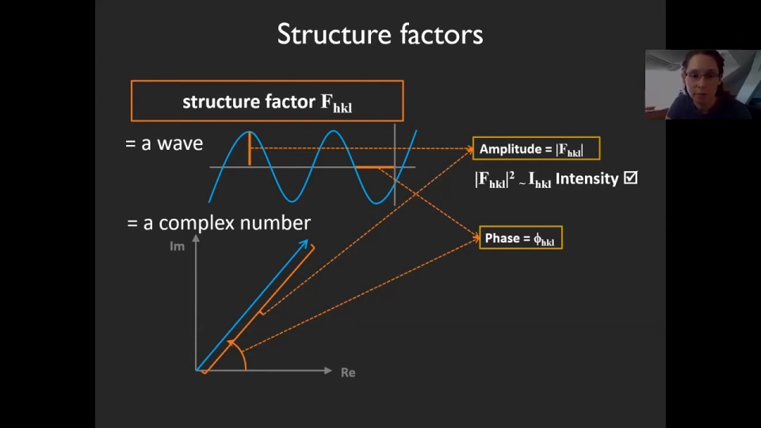

## 一、先把相位问题说清楚

### 1.1 结构因子：一个复数，两半信息

每个衍射点（反射 $hkl$）对应一个**结构因子** $F_{hkl}$。视频用两种等价的方式描述它 [【跳转到 02:06】](https://www.youtube.com/watch?v=f5tjUX8EP_c&t=126)：

- **看作一列波**：振幅就是 $|F_{hkl}|$，相位就是 $\varphi_{hkl}$；
- **看作复数**：在复平面上，模长是振幅，与实轴的夹角是相位。

电子密度是结构因子的傅里叶级数（傅里叶合成）：

$$
\rho(\mathbf{r}) = \frac{1}{V}\sum_{hkl} \lvert F_{hkl} \rvert \, e^{i\varphi_{hkl}} e^{-2\pi i (hx+ky+lz)}
$$

### 1.2 振幅拿得到，相位拿不到

从积分后的强度可以很直接地算出振幅，因为

$$
I_{hkl} \propto \lvert F_{hkl} \rvert^{2}
$$

**这就已经是重建电子密度所需信息的一半了**。但相位无法直接测量，它在实验里丢失——这就是晶体学的核心难题：**相位问题（phase problem）** [【跳转到 04:05】](https://www.youtube.com/watch?v=f5tjUX8EP_c&t=245)。

## 二、Patterson 函数：没有相位也能用的"距离图"

### 2.1 把相位全部设为零

视频提醒：电子密度公式和 **Patterson 函数**的公式长得很像，区别只有两点 [【跳转到 05:40】](https://www.youtube.com/watch?v=f5tjUX8EP_c&t=340)：

- 电子密度需要相位；Patterson 函数**假设所有相位为零**；
- 电子密度用振幅；Patterson 函数用与之对应的**强度**。

结果是：只要你完成了数据积分，**即使完全不知道相位，也能算出一张 Patterson 图**。这正是分子置换能用"只有强度"的实验数据去搜索的原因。

### 2.2 Patterson 图里装的是"原子间矢量"

以四个原子的小分子为例：每一对原子之间的连线（矢量）都会在 Patterson 图里以峰的形式重现，而且**每一对会出现两次**（正向一次、反向一次），所有矢量都从原点出发。所以 [【跳转到 06:36】](https://www.youtube.com/watch?v=f5tjUX8EP_c&t=396)：

- 你得不到原子的绝对位置，只得到**两两之间的关系**；
- **手性（handedness）无法分辨**——这对蛋白质不是大问题，因为蛋白质本来就只有一种手性；
- 若不对称单元里有 $n$ 个原子，Patterson 图里约有 $n^2-n$ 个峰。

### 2.3 蛋白质的 Patterson 图很糊，但能分两类

蛋白质晶体分辨率差、原子多，Patterson 图不会是一个个清晰的峰，而是一团模糊的云。但视频指出一个关键的结构性事实：把晶胞一个接一个排开，原子间矢量可以分成两类 [【跳转到 09:07】](https://www.youtube.com/watch?v=f5tjUX8EP_c&t=547)：

| 类型 | 颜色（视频） | 含义 | 长度 |
| --- | --- | --- | --- |
| 分子内矢量 | 红色箭头 | 同一个蛋白质内部两个原子之间 | 一般**较短** |
| 分子间矢量 | 黄色箭头 | 相邻蛋白质的原子之间 | 一般**较长** |

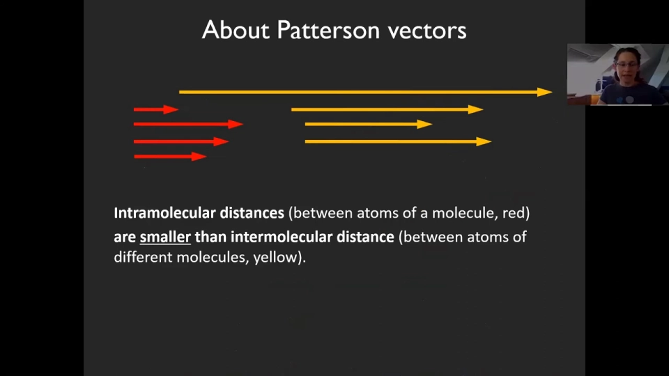

由此得到两条实用判据 [【跳转到 10:07】](https://www.youtube.com/watch?v=f5tjUX8EP_c&t=607)：

- **短于 3.5 Å** 的矢量对分子置换没用，也不具蛋白质特异性——它们可能来自结晶液里的硫酸根、磷酸根等小分子；
- **小于蛋白质平均直径约 75%** 的矢量，可以比较安全地当作分子内矢量——它们只反映分子自身的朝向，与邻居无关；
- 超过这个尺度的矢量属于分子间矢量，携带的是**堆积（packing）与位置**信息。

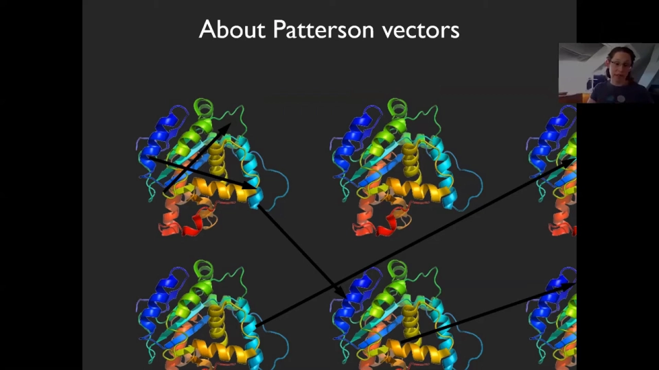

## 三、3+3 搜索：把 6 维问题拆成两个 3 维问题

### 3.1 为什么是 6 维

把搜索模型放进晶胞，需要确定 6 个参数：**3 个旋转自由度**（朝向）和 **3 个平移自由度**（位置）。直接做 6 维搜索的计算量是天文数字，所以标准做法是拆成 **3+3**：先解**旋转问题**（orientation），再解**位置问题**（location）[【跳转到 04:37】](https://www.youtube.com/watch?v=f5tjUX8EP_c&t=277)。

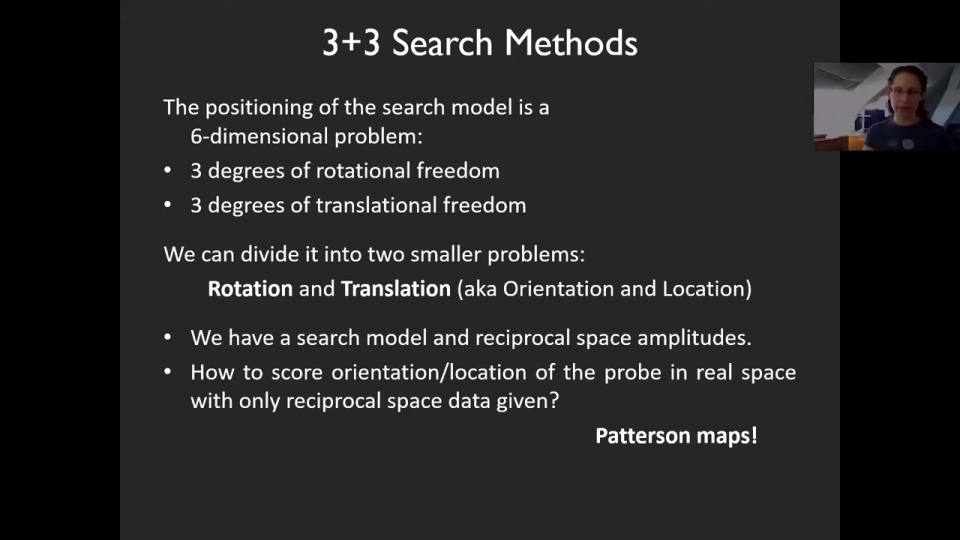

### 3.2 旋转搜索怎么做

思路非常直观 [【跳转到 11:07】](https://www.youtube.com/watch?v=f5tjUX8EP_c&t=667)：

1. 把搜索模型放进一个**大约等于分子内矢量尺度**的盒子里；
2. 对这个盒子做傅里叶变换、丢掉相位、把振幅平方，得到模型自己的 Patterson 图；
3. 把这张图**旋转**，每转一个角度就与实验 Patterson 图算一次相关系数（CC）；
4. 相关系数最大的那些峰，就是候选朝向。

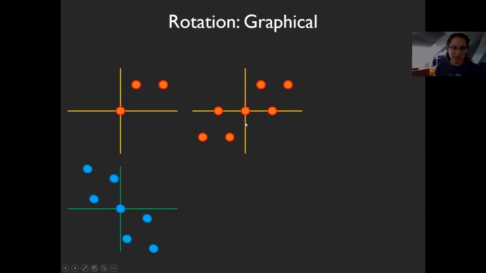

视频强调：如果数据没有误差、搜索模型又完美，相位问题就这么"轻松"解决了——可惜两个前提都不成立 [【跳转到 14:07】](https://www.youtube.com/watch?v=f5tjUX8EP_c&t=847)。

### 3.3 自旋转函数：顺手发现 NCS

如果不对称单元里有多个**相同的**蛋白拷贝，把 Patterson 图旋转后能与自己重合，这种操作叫 **Patterson 自旋转搜索（self-rotation function）**，它告诉你晶胞里可能存在**非晶体学对称（NCS）** [【跳转到 14:38】](https://www.youtube.com/watch?v=f5tjUX8EP_c&t=878)。

如果已经知道 NCS 算子（例如已知是三重轴、晶胞里有三个拷贝），就不必搜满 360°，只在 120° 范围内找即可——这叫 **locked rotation function**，能显著降低搜索噪声 [【跳转到 17:06】](https://www.youtube.com/watch?v=f5tjUX8EP_c&t=1026)。

### 3.4 旋转搜索的实际困难

视频列了几条很"工程"的限制 [【跳转到 15:08】](https://www.youtube.com/watch?v=f5tjUX8EP_c&t=908)：

- Patterson 图存在三维网格上，旋转后网格点不重合，必须**插值**；
- **角度步长要足够细**；结构越大越难——大结构哪怕只转 1°，外圈的原子也会移动很多；
- 只能用**最强的那些峰**参与搜索，弱数据/噪声大时很麻烦；
- 也可以在实空间做旋转搜索，但计算代价太高，所以实际用的是**快速旋转函数**（把 Patterson 图换成它的傅里叶变换再做简化）；Phaser 这类程序还用**最大似然**来补偿各种误差。

## 四、平移搜索：定位置

### 4.1 用分子间矢量找位置

朝向定了，剩下 3 个平移参数。此时起作用的是**分子间矢量**：把搜索模型放到某个位置，生成它的 Patterson，与实验 Patterson 比重叠；平移模型，重叠变好就说明位置更对 [【跳转到 17:28】](https://www.youtube.com/watch?v=f5tjUX8EP_c&t=1048)。

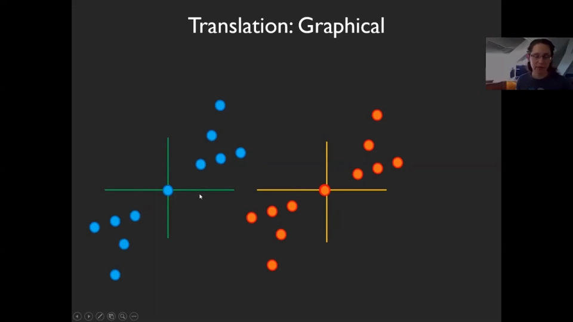

### 4.2 Cheshire cell：第一个探针不必搜满整个晶胞

这是一个初学者很容易忽略、但对理解"为什么 P1 不用做平移搜索"很关键的细节 [【跳转到 20:33】](https://www.youtube.com/watch?v=f5tjUX8EP_c&t=1233)：

- 第一个探针只需要放在 **Cheshire cell** 里；
- 在 **P1**（无任何对称性的空间群）中，原点位置是任意的，所以**不需要平移搜索**，朝向是唯一要紧的事；
- 在**极性空间群**（原点可沿某条线任意选取）中，搜索维度更少，例如只需在二维里搜平移；
- 但**第二个**搜索模型必须放进**整个晶胞**——因为第一个探针一旦放下，原点就相对于反射被固定了；例外是 Bravais 带心的情况。

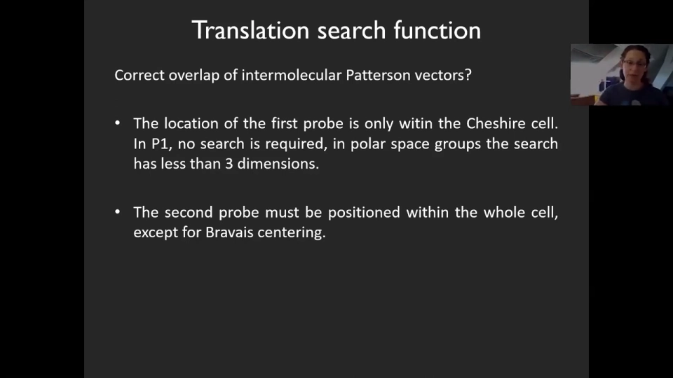

### 4.3 冲突惩罚：两个蛋白不能占同一块空间

平移搜索还会引入**空间冲突惩罚**（hard-sphere / Harada 函数）：如果两个分子叠在一起、原子互相"撞"上，这个解就不可能是对的——晶胞里一个位置同一时间只能被一个蛋白占据 [【跳转到 18:30】](https://www.youtube.com/watch?v=f5tjUX8EP_c&t=1110)。

这里有个值得注意的副作用：**如果你搜索模型外侧多了一段真实结构里没有的 loop，它就可能在晶胞里制造冲突**，让本来正确的解被打低分。这也是后面要讲的"修剪模型"的原因之一。

### 4.4 多解策略：前 10 个旋转解都送进平移搜索

旋转搜索打分最高的解**不一定是正确的**，而且旋转上的小误差会让平移搜索完全找不到解。所以常规做法是**多解（multi-solution）**：把最好的 10 个旋转解全部送进平移搜索，看哪个给出最好的平移结果 [【跳转到 22:29】](https://www.youtube.com/watch?v=f5tjUX8EP_c&t=1349)。

这也解释了为什么在 Phaser 的输出里，**平移函数的 Z 分数（TFZ）比旋转的 Z 分数更重要** [【跳转到 23:01】](https://www.youtube.com/watch?v=f5tjUX8EP_c&t=1381)。

如果卡在"差一点就对了"的状态，可以对搜索模型做**刚体精修（rigid body refinement）**：按结构域分别精修，或对多聚体里各个单体分别精修（例如同源三聚体的三个单体）。这其实已经是精修的第一步 [【跳转到 23:33】](https://www.youtube.com/watch?v=f5tjUX8EP_c&t=1413)。

对于**寡聚体**（两条以上不同链），视频的建议是：一律按多解处理，噪声很大；先放你判断更稳定的那个结构域（通常是螺旋更多的那个），再放第二个。有些超大结构至今没靠分子置换解出来，核糖体就是例子 [【跳转到 24:02】](https://www.youtube.com/watch?v=f5tjUX8EP_c&t=1442)。

### 4.5 六维搜索与演化算法

如果非要做完整的 6 维搜索，搜索空间大到无法用规则网格覆盖，于是有人用**演化搜索算法**（例如 EPMR）：从随机的一组位置与朝向出发，保留最好的、让它们"繁殖"出相近的新解。代价是它不是对搜索空间的离散采样，**结果依赖起点** [【跳转到 25:02】](https://www.youtube.com/watch?v=f5tjUX8EP_c&t=1502)。

计算上还要用**傅里叶变换插值**：把一个刚性探针的傅里叶变换在很细的网格上采样，得到近似连续的结构因子，其他朝向直接插值；平移则用对应的相位移动来体现 [【跳转到 25:54】](https://www.youtube.com/watch?v=f5tjUX8EP_c&t=1554)。

## 五、搜索模型决定成败：30% 与 1.5 Å

### 5.1 Chothia & Lesk 1986 的经验门槛

视频用一句很重的话开头：**做分子置换最关键的事，就是你的搜索模型**，应该把时间精力投在把模型修到最好 [【跳转到 26:53】](https://www.youtube.com/watch?v=f5tjUX8EP_c&t=1613)。

那么"要多像才够"？这个问题在 1986 年由 Chothia 与 Lesk 回答 [【跳转到 27:59】](https://www.youtube.com/watch?v=f5tjUX8EP_c&t=1679)：

$$
\sigma_r = 0.4 \cdot \exp\left(1.87(1-s)\right)
$$

其中 $\sigma_r$ 是主链坐标的均方根偏差（RMSD），$s$ 是序列一致性。

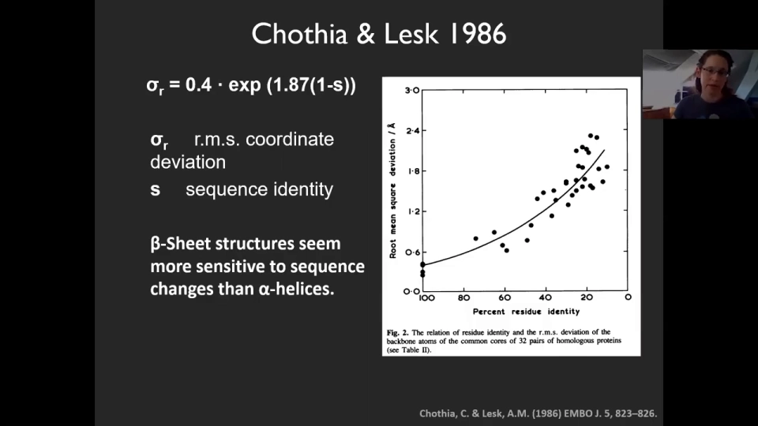

由此得到两条至今仍有效的经验线 [【跳转到 29:26】](https://www.youtube.com/watch?v=f5tjUX8EP_c&t=1766)：

- 搜索模型的 RMSD 不应大于 **1.5 Å**；
- 对应到序列一致性，大约是 **30%**：$\geq 30\%$ 通常能成，**20%–30% 是" twilight zone（暮光区）"**——可能成功，也可能失败，纯属赌博；
- 主要靠螺旋的结构比主要靠 β 片层的结构更容易成功（β 片层对序列变化更敏感）。

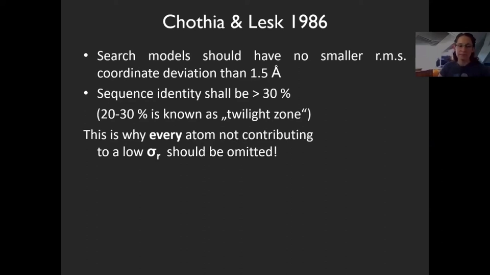

### 5.2 修剪模型：把不像的部分全砍掉

既然 RMSD 是硬指标，那么**凡是不能降低 RMSD 的原子都应当删掉** [【跳转到 29:58】](https://www.youtube.com/watch?v=f5tjUX8EP_c&t=1798)。具体清单：

- 溶剂分子；
- 侧链：可以整体突变成**多聚丙氨酸（polyalanine）模型**，或用 CHAINSAW、SCULPTOR 之类的程序，把与目标不同的侧链裁掉，但**保留氨基酸类型相同的**；
- loop，尤其是很长的 loop；
- B 因子很差或无序的区域；
- 非保守残基。

视频还建议：**准备不止一个模型，全都试一遍**，往往能得到最好的结果 [【跳转到 33:17】](https://www.youtube.com/watch?v=f5tjUX8EP_c&t=1997)。

### 5.3 多结构域怎么办

如果你的模型有多个结构域，先问自己：它们在真实结构里**相对朝向**会和模型一样吗？如果没把握，可以两个结构域**分别独立搜索**；也可以用**简正模式扰动（normal mode perturbation）**，让两个结构域沿物理上合理的方向相对运动 [【跳转到 31:55】](https://www.youtube.com/watch?v=f5tjUX8EP_c&t=1915)。

### 5.4 模型还能从哪来

除了实验结构，视频列了几种来源 [【跳转到 33:50】](https://www.youtube.com/watch?v=f5tjUX8EP_c&t=2030)：

| 来源 | 特点 | 注意 |
| --- | --- | --- |
| 同源建模（SWISS-MODEL、MODELLER、YASARA 等） | 主链偏差通常约 2 Å，有序二级结构区可能更好 | 小结构上已被证明可用 |
| ab initio 模型（如 I-TASSER 一类） | 不预设折叠，计算昂贵 | 更冒险，但确有成功案例 |
| NMR 结构集合 | 天然带构象多样性 | 必须仔细修剪缺乏耦合信息的区域（尤其 loop）；Phaser 可以**整个 ensemble** 一起搜 |

视频还给了一个极端例子：一个流水线里用 Phaser 解出的结构，起始模型只有 **4 个残基**是放对的，最终却长成了约 **100 个残基**的结构。作者强调这不是常规情况，但它说明：**在高分辨率下，搜索模型"对不对"比"大不大"更关键**；而且即便如此，他们用的仍是多聚丙氨酸模型 [【跳转到 30:29】](https://www.youtube.com/watch?v=f5tjUX8EP_c&t=1829)。

## 六、软件与分数怎么读

### 6.1 常见程序的分工

视频快速过了一遍工具谱系 [【跳转到 35:20】](https://www.youtube.com/watch?v=f5tjUX8EP_c&t=2120)：AMoRe（历史悠久但仍在用，简单快速）、Molrep（基于 Patterson，免费，适合组装体）、Phaser（最大似然，适用面广）、Balbes（半流水线，自带大片段库，适合"不确定自己结晶出了什么"的情形）、MR Bump（片段 + 建模 + 精修）、ARCIMBOLDO（ab initio，擅长小结构和螺旋）、AMPLE（ab initio 流水线，擅长卷曲螺旋与螺旋）。

### 6.2 Phaser 的判读阈值

Phaser 是今天最常用的程序，CCP4 与 Phenix 里都有。它虽然做 3+3 搜索，但**并不是直接用 Patterson**，而是用最大似然，能把数据误差、模型完整度、模型相似度都纳入模型 [【跳转到 37:13】](https://www.youtube.com/watch?v=f5tjUX8EP_c&t=2233)。

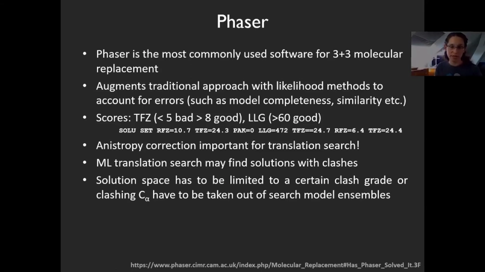

读分数的经验规则 [【跳转到 38:13】](https://www.youtube.com/watch?v=f5tjUX8EP_c&t=2293)：

- **TFZ（平移函数 Z 分数）**：小于 5 通常不好；5–8 可疑；**大于 8 基本可认为解出来了**；
- **LLG（对数似然增益）**：大于 60 好；**单斜晶系大于 40** 即可；
- 两个都是**越大越好**；输出通常在 `sol` 文件里，逐行给出旋转分数、平移分数、冲突数、位移、LLG 等。

视频还提醒两个操作细节：**各向异性校正**对平移搜索非常重要（现在 Phaser 会自动做）；最大似然平移搜索可能找到有冲突的解然后自己把它否掉，这时要么限制允许的冲突程度，要么手动把冲突的 $C_\alpha$ 从搜索模型里去掉。**冲突可以决定 MR 的成败**，所以值得用 COOT 或 PyMOL 打开输出文件亲眼看看 [【跳转到 39:12】](https://www.youtube.com/watch?v=f5tjUX8EP_c&t=2352)。

## 七、最大的陷阱：模型偏倚

### 7.1 分数好，不等于结构对

MR 最常见的两种失败 [【跳转到 41:09】](https://www.youtube.com/watch?v=f5tjUX8EP_c&t=2469)：

1. **平移 NCS（translational NCS）** 会带来很大麻烦；
2. 你要解的是**从未见过的折叠**，根本没有搜索模型——这时只能做 ab initio 建模，或改用实验相位。

还有第三种更隐蔽：**MR 给出很好的分数，结构却修不下去**（R 值不降、建不出模型）。这时视频建议先试 **Jelly body** 或 **morphing**，不行再取实验数据做 **MR-SAD** [【跳转到 41:41】](https://www.youtube.com/watch?v=f5tjUX8EP_c&t=2501)。

### 7.2 为什么会被"骗"：一半信息来自模型

关键在这一点：**密度图里有一半信息（相位）来自你的搜索模型**，所以图天然偏向模型，看起来总是"很像搜索模型"。于是你可能解出了一个**其实不在那里**的东西 [【跳转到 41:41】](https://www.youtube.com/watch?v=f5tjUX8EP_c&t=2501)。

对抗模型偏倚的标准手段是**密度修饰（density modification）**，很多流水线会自动做（例如 ARCIMBOLDO 会自动调用）。视频给了 Prp8 的例子：初始只放下两个搜索模型，1.0σ 下的图很糟；密度修饰之后图大幅改善，出现大片空白的**溶剂区**——这正是你想看到的信号 [【跳转到 42:37】](https://www.youtube.com/watch?v=f5tjUX8EP_c&t=2557)。

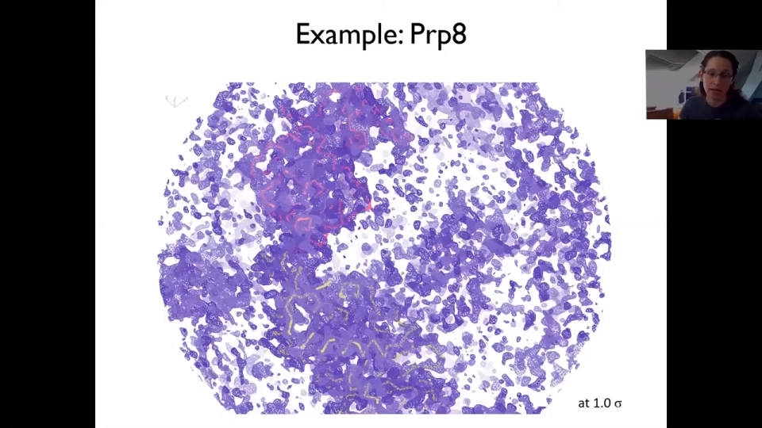

### 7.3 局限清单

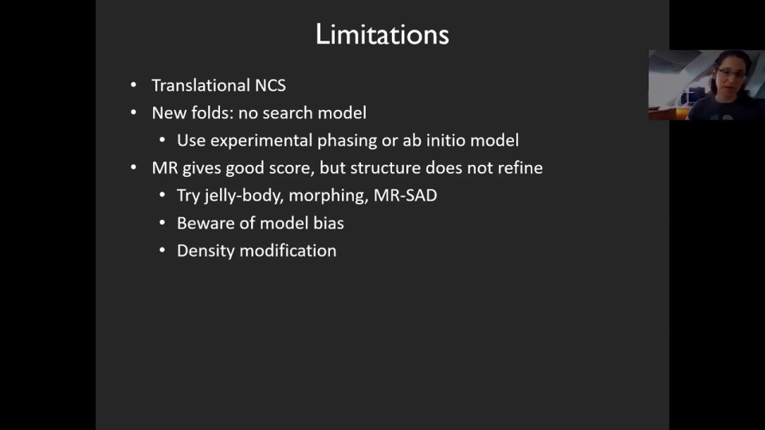

## 八、晶体接触为什么会影响你看到的构象

这一节是把前面几节串起来的一个推论，视频里散落在几处：

- 分子间 Patterson 矢量携带的正是**堆积（packing）与位置**信息 [【跳转到 10:38】](https://www.youtube.com/watch?v=f5tjUX8EP_c&t=638)；
- 平移搜索用**空间冲突惩罚**排除"两个蛋白占同一位置"的解 [【跳转到 18:30】](https://www.youtube.com/watch?v=f5tjUX8EP_c&t=1110)；
- 如果搜索模型外侧多了一段真实结构里没有的 loop，它会在晶胞里**制造冲突**，从而干扰搜索 [【跳转到 18:53】](https://www.youtube.com/watch?v=f5tjUX8EP_c&t=1133)。

合起来就是：**晶格允许哪些构象、不允许哪些构象，会直接体现在你最终拿到的模型里**。所以读一个晶体结构时，看到某个 loop 的走向、某个侧链的朝向，要记得它是在晶格堆积约束下被"选中"的，而不是溶液中唯一的构象。

## 九、实践顺序：视频给出的决策树

课堂最后给了一条很实用的路线 [【跳转到 43:38】](https://www.youtube.com/watch?v=f5tjUX8EP_c&t=2618)：

1. **先跑流水线**，让计算机干活；如果给出的结构能顺利精修、且你确信空间群没错，那就结束了；
2. 不行就**换一个流水线**——它们假设不同、起点不同，值得换参数多试；
3. 还不行就**转手动**：用 Molrep 或 Phaser 手动跑，但前提是**搜索模型准备正确**，这一步绝对关键；
4. 都不行，就**结合实验相位**（下一讲的主题）来拿到初始相位。

## 十、课堂问答里的几个实用问题

课程最后有一段问答，回答的都是初学者真正会遇到的困惑 [【跳转到 45:03】](https://www.youtube.com/watch?v=f5tjUX8EP_c&t=2703)：

**分子置换和同晶置换（isomorphous replacement）是一回事吗？**
不是。两者都是定相位的方法，但除此之外毫无关系：分子置换是拿一个蛋白搜索模型去晶胞里找朝向与位置；同晶置换是把晶体里的部分溶剂换成重原子（下一讲的主题）。

**Molrep 和 Phaser 哪个更精确？**
不存在"通用的精确度"这种说法。你要的只是一个**能开始精修的相位解**，相位误差可以在后续精修里再压下去。所以建议两个都试；而且在整个结构解析流程里，每一步都准备多套程序往往是个好习惯（积分用 DIALS 不满意就换 XDS，精修用 RefMAC 不满意就换 Buster）。

**RFZ、TFZ、LLG 有经验法则吗？**
RFZ 很少看，因为它不如 TFZ 重要。TFZ 大于 8 基本可判定成功，5–8 可疑，小于 5 通常不算成功；LLG 应大于 60，单斜晶胞大于 40 即可，越高越好。

**差值图里配体的密度不完整，密度修饰有用吗？**
有用，而且不只对配体——整段缺失的结构域也能被它补出一些密度。但如果你已经知道配体位置，更直接的做法是先建好其余部分，再做 **omit map** 看那里是否出现密度。另外要记住：**密度修饰主要用在定相位的早期**，一旦 R 值开始下降、进入精修阶段，通常就不再用了。

**同一蛋白、不同配体的一批结构，能用无配体的结构当 MR 模型吗？**
可以，而且这是制药业的典型做法：筛几百个结合化合物时，每一个都用所谓的 **apo 结构**（不含配体）去跑分子置换。蛋白相同时保留全部侧链即可，也可以再试一版 polyalanine 模型。水分子一般去掉，除非你非常确定它在复合物里也结合在同一位置。

**不对称单元里有多个分子，要做几次分子置换？**
先放一个搜索模型，再放另一个——也就是需要两次分子置换。

## 小结

- 结构因子是复数：振幅可从强度算出，**相位在实验里丢失**，这就是相位问题。
- **Patterson 函数**把所有相位设为零、用强度代替振幅，因此只用已测数据就能算；它给出的是**原子间矢量**，每个矢量出现两次，且不分辨手性。
- 蛋白质 Patterson 图可分**分子内矢量**（短、反映朝向）与**分子间矢量**（长、反映堆积与位置）；短于 3.5 Å 的矢量不具蛋白特异性。
- 6 维定位拆成 **3+3**：旋转搜索定朝向（Patterson 相关、自旋转函数找 NCS、locked rotation），平移搜索定位置（Cheshire cell、冲突惩罚、多解、刚体精修）。
- **搜索模型决定成败**：Chothia & Lesk 的经验线是 RMSD $\leq 1.5$ Å、序列一致性 $> 30\%$，20%–30% 为暮光区；修剪、polyalanine、同源建模、NMR ensemble 都是可用手段。
- **分数要会读**：TFZ $>8$ 好、5–8 可疑、$<5$ 不好；LLG $>60$（单斜 $>40$）好；还要检查冲突与各向异性校正。
- **模型偏倚**是最大陷阱：一半信息来自搜索模型，密度图会"证明"你的模型；密度修饰是主要对策。
- 晶格堆积（晶体接触）通过冲突惩罚参与筛选构象，**结构里的构象是晶格允许的那一个**。

## 关键术语速查

| 术语 | 一句话解释 |
| --- | --- |
| 相位问题 | 衍射只测强度，重建密度所需的相位丢失，必须靠 MR 或实验相位获得 |
| 结构因子 $F_{hkl}$ | 每个反射对应的复数，模长是振幅、辐角是相位 |
| Patterson 函数 | 相位全设为零、用强度作系数的傅里叶合成，给出原子间矢量图 |
| 分子内/分子间矢量 | 同一分子内原子间（短，定朝向）与相邻分子间（长，定位置）的矢量 |
| 3+3 搜索 | 把 6 维定位拆成旋转（3）与平移（3）两个子问题 |
| 交叉旋转函数 | 旋转模型 Patterson 与实验 Patterson 求相关，找最佳朝向 |
| 自旋转函数 | Patterson 与自身旋转后的相关，用于发现 NCS |
| Cheshire cell | 放第一个探针所需的最小搜索体积；P1 中无需平移搜索 |
| TFZ / LLG | Phaser 的平移 Z 分数与对数似然增益，越大越可信 |
| 模型偏倚 | 密度图因相位来自搜索模型而偏向该模型，可能"证明"错误解 |
| 密度修饰 | 用溶剂区平坦化等约束改进相位，减轻模型偏倚 |
| 暮光区 | 序列一致性 20%–30% 的区间，MR 可能成功也可能失败 |