# 冷冻电镜原子模型的搭建与修正：分辨率能支持到哪一层

> 视频来源：[王佳伟：冷冻电镜中原子结构模型的搭建和修正-冷冻电镜技术培训系列课程](https://www.bilibili.com/video/BV1Hz4y1y7xJ)（Bilibili · 王佳伟，清华大学）｜时长约 61 分钟
> 导读：这支讲座不讲怎么收数据、怎么重构，专讲重构之后那一步：怎么判断图里哪些是真信号、模型最多能搭到哪一层、搭完怎么证明没有过拟合。本文按"验证 → 搭建 → 精修 → 验收"的顺序整理，适合已经知道三维重构大致流程的初学者。

## 本讲要解决的核心问题（SCQA）

**背景**：拿到一张冷冻电镜密度图，下一步就是搭原子模型，然后拿模型去解释功能、做突变、做药物设计。

**冲突**：图里永远有噪声，而人眼非常擅长"看出"本来不存在的东西；更麻烦的是，分辨率这个数字本身也可能被处理手段"做高"——加个 mask、做个滤波，FSC 曲线就漂亮了。于是很容易出现"模型建在了噪声上"的过拟合。

**疑问**：怎么定量判断图里到底有多少信号？不同分辨率下模型最多能搭到哪一层？搭完之后，又怎么证明自己没有过拟合？

**回答（中心思想）**：整场讲座可以浓缩成一条原则——**信息量守恒**。先用 FSC/SSNR、相位随机化校正、sharpening 等手段定量评估"图里有多少信息"，再按这个信息量决定模型搭到哪一层（结构域、二级结构、侧链、键长键角）；信息不够时必须引入外源先验知识，并明确说明补了多少；最后用 FSCwork/FSCfree 交叉验证证明模型没有超出数据支持的范围。

## 一、先立一个反面教材：过拟合

### 1.1 "皇帝的新衣"

讲者用一张北京"大裤衩"的照片开场：照片里其实什么都没有，但只要你相信"这里应该有个美女"，就能"看到"她 [【跳转到 01:19】](https://www.bilibili.com/video/BV1Hz4y1y7xJ?t=79)。这就是模型搭建里最危险的事——**过拟合**（overfitting）：你根本没看到那个东西，那只是噪声，你却认为它对生物学功能很重要，于是把模型建在了那里 [【跳转到 01:44】](https://www.bilibili.com/video/BV1Hz4y1y7xJ?t=104)。讲座最后他又放了一次这张图，问"现在大家能看见皇帝穿衣服了吗" [【跳转到 61:16】](https://www.bilibili.com/video/BV1Hz4y1y7xJ?t=3676)。

### 1.2 噪声从哪来

我们测到的观测不是纯信号，而是"信号 + 噪声"，就像雾霾遮住了视线 [【跳转到 02:19】](https://www.bilibili.com/video/BV1Hz4y1y7xJ?t=139)。冷冻电镜里至少有四个噪声来源：

1. **低剂量成像**：电子与原子（尤其碳、氢、氧）作用极强，曝光必须短，信噪比因此很低 [【跳转到 03:02】](https://www.bilibili.com/video/BV1Hz4y1y7xJ?t=182)；
2. **取向未知**：单颗粒重构里每个颗粒的取向必须从数据里估出来，估不准就带来误差 [【跳转到 03:27】](https://www.bilibili.com/video/BV1Hz4y1y7xJ?t=207)；
3. **CTF 零点**：衬度传递函数在某些空间频率上趋于零，这些地方的信号等于没有；所以要收一系列不同的离焦值，用另一张图的信号去补这一张的零点 [【跳转到 04:06】](https://www.bilibili.com/video/BV1Hz4y1y7xJ?t=246)；
4. **反问题**：从照片求三维重构是反问题，方程数少于未知数，解不唯一，必须加入先验知识（正则化）才能定解 [【跳转到 04:44】](https://www.bilibili.com/video/BV1Hz4y1y7xJ?t=284)。讲者顺带点出 RELION 名字里的 "RE" 就代表 regularisation。

## 二、定量判断"图里有多少信号"

### 2.1 实空间只能靠眼睛

最直觉的判断是看"期待的特征在不在"：9 埃左右只能看出结构域的轮廓；到 7.4～9 埃能看到一根根圆柱状的螺旋；到 4.8 埃能看到 β 折叠的两条链分开、能看到螺旋的螺距 [【跳转到 06:05】](https://www.bilibili.com/video/BV1Hz4y1y7xJ?t=365)。但这只能算定性判断——你只能说"我觉得这个螺旋看到了"，没法给出数字 [【跳转到 06:40】](https://www.bilibili.com/video/BV1Hz4y1y7xJ?t=400)。

### 2.2 到倒易空间去：Guinier 区与 Wilson 区

定量判断要在倒易空间（傅里叶空间）做。把图做傅里叶变换，每个点是带振幅和相位的矢量 F；低分辨率处振幅大，高分辨率处振幅小，高分辨率信号越多，能看到的细节越多 [【跳转到 07:30】](https://www.bilibili.com/video/BV1Hz4y1y7xJ?t=450)。

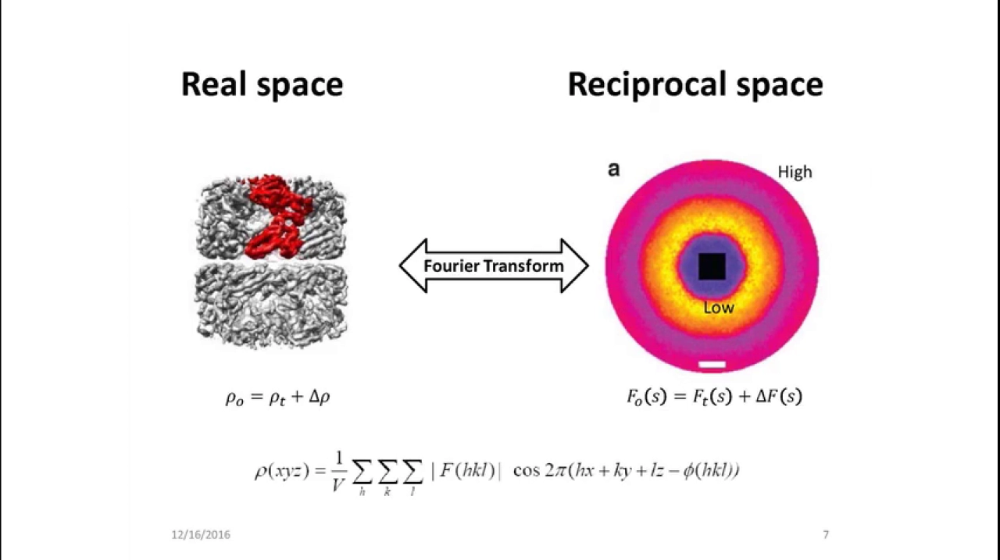

把振幅取模、取对数，以 $1/d^2$ 为横轴作图，就得到理论的 log 信号分布，分两段 [【跳转到 08:33】](https://www.bilibili.com/video/BV1Hz4y1y7xJ?t=513)：

- 低频段（大尺度形状、溶剂、mask 的贡献）是 **Guinier 区**，曲线急剧下降；
- 高频段（二级结构、原子细节）是 **Wilson 区**，几乎是一条直线，只有微弱衰减——因为原子散射因子随分辨率衰减 [【跳转到 09:34】](https://www.bilibili.com/video/BV1Hz4y1y7xJ?t=574)。

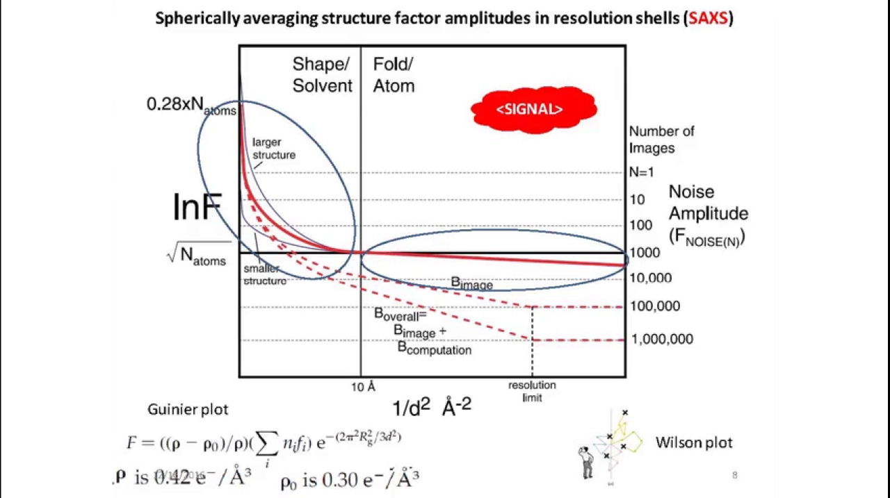

讲者特别提醒：电镜领域常把高频那一段也叫 Guinier plot，这其实是个误解，它在晶体学里叫 Wilson plot [【跳转到 09:29】](https://www.bilibili.com/video/BV1Hz4y1y7xJ?t=569)。实际数据的曲线会因计算误差、低剂量噪声、对位不准等被压低成虚线，我们的目标就是把噪声去掉、把信号恢复回去 [【跳转到 10:08】](https://www.bilibili.com/video/BV1Hz4y1y7xJ?t=608)。

### 2.3 FSC 与 SSNR：为什么分辨率必须用"两半数据"算

讲者纠正了一个常见误解：**"看 FSC 曲线掉到某个阈值（如图中那条 0.143 虚线）就得到分辨率"这个说法本身是不严谨的**。真正在信号处理里判断分辨率的是 **SSNR**（频谱信噪比），只是 SSNR 和 FSC 之间有确定的换算关系，所以大家才直接从 FSC 曲线上读分辨率 [【跳转到 11:49】](https://www.bilibili.com/video/BV1Hz4y1y7xJ?t=709)。

推导很干净：把数据分成独立的两半，两半都含共有信号 $S$，但噪声 $N_1$、$N_2$ 相互独立：

$$
\mathrm{FSC} = \frac{\sum \lvert S \rvert^2}{\sum \lvert S \rvert^2 + \sum \lvert N \rvert^2},
\qquad
\mathrm{SSNR} = \frac{\sum \lvert S \rvert^2}{\sum \lvert N \rvert^2} = \frac{\mathrm{FSC}}{1-\mathrm{FSC}}
$$

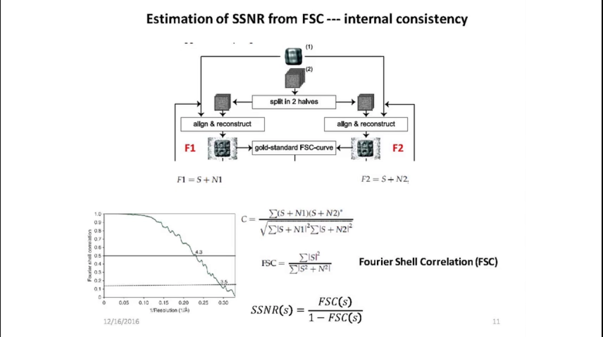

所以 FSC 计算里最要紧的一条是：**两半必须真正独立**。一旦不独立，算出的曲线完全错误，哪怕它显示 2 埃也是假的 [【跳转到 13:24】](https://www.bilibili.com/video/BV1Hz4y1y7xJ?t=804)。

### 2.4 mask 会造出"假分辨率"

实际做 postprocess 时，边界区域全是噪声，大家会加 mask 把它盖掉。但两半数据通常用的是**同一个 mask**，这就打破了独立性，FSC 被抬高，得到一个虚高的分辨率 [【跳转到 14:45】](https://www.bilibili.com/video/BV1Hz4y1y7xJ?t=885)。

校正办法是**相位随机化**（high-resolution substitution）：把两个图在某一分辨率（比如两倍 Nyquist，即 4 埃）以上的高频信息全部换成随机噪声，再同样加 mask、算一次 FSC，记为 $\mathrm{FSC}_n$；然后用真实 FSC（$\mathrm{FSC}_t$）和它组合出真值：

$$
\mathrm{FSC}_{\text{true}} = \frac{\mathrm{FSC}_t - \mathrm{FSC}_n}{1 - \mathrm{FSC}_n}
$$

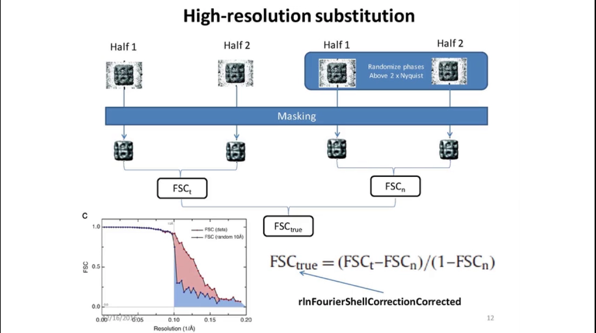

在 RELION 里输出 FSC 时，输出的就是经过这一步校正的 `full-shell correlation corrected` 版本 [【跳转到 16:27】](https://www.bilibili.com/video/BV1Hz4y1y7xJ?t=987)。

### 2.5 sharpening 与 FOM 加权：把信号"提"回来

Wilson 区理论上是一条直线，实际因误差有偏移，所以要拟合一条直线、求出 B 因子，再乘回去做 **B-sharpening** [【跳转到 17:07】](https://www.bilibili.com/video/BV1Hz4y1y7xJ?t=1027)。同时低频和高频的信噪比不同，不能给同样权重，要乘一个随频率变化的 sharpening weight——这个权重就是晶体学里的**品质因子**（figure of merit, FOM），取值 0～1，表示该频率下振幅有多可信 [【跳转到 18:00】](https://www.bilibili.com/video/BV1Hz4y1y7xJ?t=1080)。

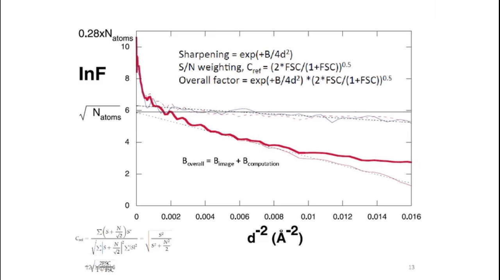

所以大家平常拿到的图，是"既做了 sharpening、又做了 FOM 加权"之后的图 [【跳转到 18:05】](https://www.bilibili.com/video/BV1Hz4y1y7xJ?t=1085)。这也意味着：**图的外观是被处理过的**，判断可信度不能只看它好不好看。

## 三、图本身对不对：取向精度与手性

### 3.1 取向误差：pmax 与取向精度估计

三维重构里最严重的误差来源之一是颗粒取向的确定 [【跳转到 19:05】](https://www.bilibili.com/video/BV1Hz4y1y7xJ?t=1145)。RELION 里每个颗粒有一个 $p_{\max}$（似然分布的最大值），峰越尖说明取向定得越准；还可以随机抽 100 个颗粒，在正确取向附近扰动，直到似然降到 0.01，把角度偏差加起来估计取向误差 [【跳转到 20:21】](https://www.bilibili.com/video/BV1Hz4y1y7xJ?t=1221)。但这套估计是"自洽系统内"的，要真正验证必须引入外部信息。

### 3.2 倾斜对验证：用已知的旋转角当标尺

办法是**倾斜对**（tilt pair）实验：先在 0° 拍一张、挑出颗粒，再把样品转一个已知的 α 角拍第二张、挑出对应颗粒，然后比较两组颗粒的取向差是否正好等于 α [【跳转到 20:59】](https://www.bilibili.com/video/BV1Hz4y1y7xJ?t=1259)。两种呈现方式：

- **FSC 残差图**：把颗粒按取向旋转、投影，与实测图像算差值，差值在正确角度处出现极小值 [【跳转到 21:49】](https://www.bilibili.com/video/BV1Hz4y1y7xJ?t=1309)；
- **取向散点图**：把两组取向差画在极坐标里，如果都集中在一个小圆圈内，说明取向定得准；散得很开就说明误差大，将来图里一定会有伪影 [【跳转到 23:07】](https://www.bilibili.com/video/BV1Hz4y1y7xJ?t=1387)。

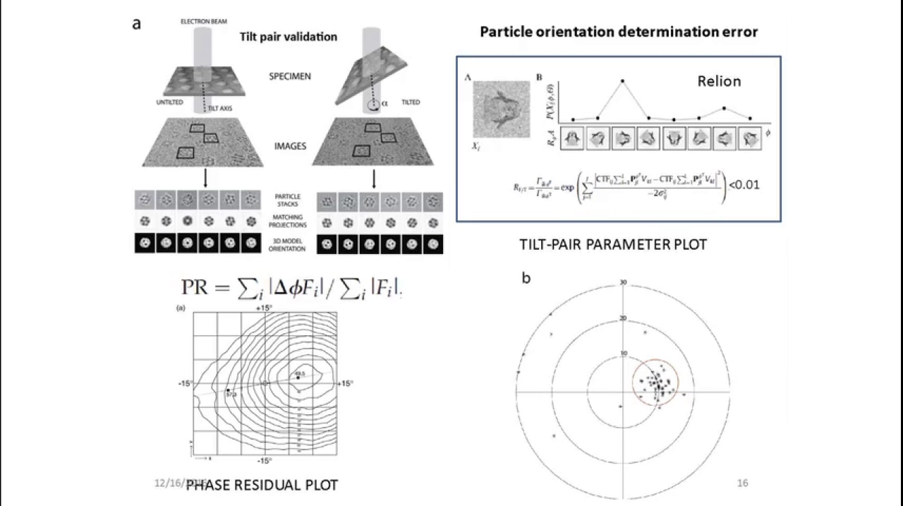

### 3.3 绝对手性：二维投影分不出来的那件事

这是一个容易被忽略的陷阱：把三维图做镜像翻转后再投影，**同样能和照片匹配**。也就是说，二维投影图像本身不包含绝对手性信息 [【跳转到 23:51】](https://www.bilibili.com/video/BV1Hz4y1y7xJ?t=1431)。以前不容易踩坑，是因为初始模型往往来自 PDB 里的 X 射线结构，手性天然正确；如果是全新结构，就必须自己判断。

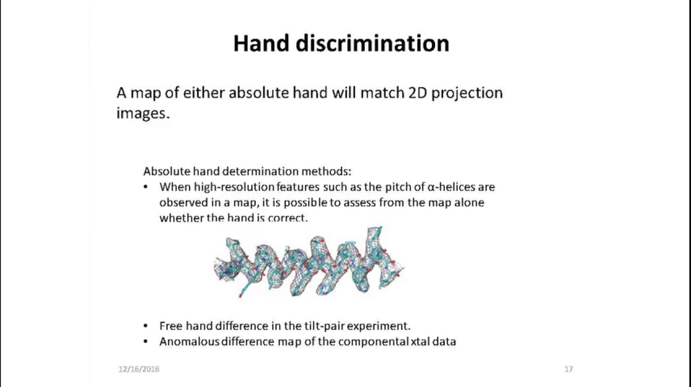

判断手性有三种办法 [【跳转到 24:16】](https://www.bilibili.com/video/BV1Hz4y1y7xJ?t=1456)：

1. 分辨率到 3 埃左右时，直接看螺旋是右手还是左手；
2. 倾斜对实验里的**弗里德尔差值**（Friedel difference）：比较 α 与 −α 两个极小值谁更小。要注意第二张照片已受辐照损伤、信号更弱，差距不一定明显 [【跳转到 25:59】](https://www.bilibili.com/video/BV1Hz4y1y7xJ?t=1559)；
3. 如果结构里有一块已有晶体结构，把它连反常散射数据一起放进去，用反常散射判断这一块的手性，从而定下整张图的手性——这正是小分子晶体学里用铜靶/钼靶两套数据算 Flack 参数的思路 [【跳转到 27:06】](https://www.bilibili.com/video/BV1Hz4y1y7xJ?t=1626)。

手性搞错的代价很大：晶体学里曾有多篇文章因此被撤稿 [【跳转到 25:01】](https://www.bilibili.com/video/BV1Hz4y1y7xJ?t=1501)。

## 四、按信息量搭模型

### 4.1 电镜看到的是电势，不是原子

搭模型之前要清楚一件事：电子束是被原子核与电子云形成的电场偏转的，我们测到的是**电势分布**，不是原子本身 [【跳转到 28:14】](https://www.bilibili.com/video/BV1Hz4y1y7xJ?t=1694)。分辨率不够时，每个原子被近似成独立的中性球体，叠加起来就是一团团"饼状"密度；看到饼状密度，就知道这里该放一个苯环，原子核位置也就定了——这就是搭模型的过程 [【跳转到 29:04】](https://www.bilibili.com/video/BV1Hz4y1y7xJ?t=1744)。

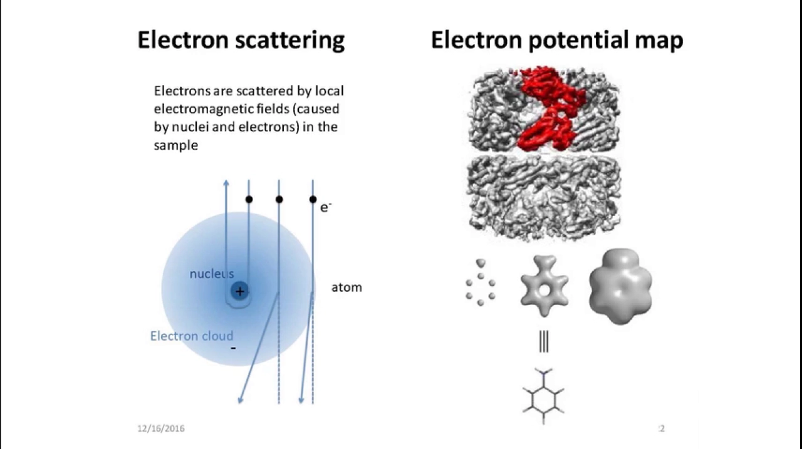

### 4.2 分辨率决定"颗粒度"

讲者把这条讲得非常直白：**图里有多少信息，模型就只能搭到哪一层** [【跳转到 29:37】](https://www.bilibili.com/video/BV1Hz4y1y7xJ?t=1777)。

| 分辨率水平 | 图里能提供的信息 | 模型能搭到哪一层 |
| --- | --- | --- |
| 很低 | 只有一个轮廓或结构域 | 只能做刚体对接，不能动内部 |
| 约 5～9 埃 | 二级结构（螺旋、β 折叠走向） | 二级结构层面，侧链是"胡扯" |
| 近原子（约 3～4 埃） | 侧链密度、主链走向 | 主链 + 侧链，可 de novo |
| 更高 | 键长、键角 | 可脱离外源信息 |

如果图里只能看到一个结构域，你偏要搭到原子分辨率，那就是过拟合 [【跳转到 30:09】](https://www.bilibili.com/video/BV1Hz4y1y7xJ?t=1809)。

### 4.3 低分辨率：刚体对接与柔性对接

在结构域级别，如果该结构域已有 X 射线晶体结构，做法是把它**对接**进去 [【跳转到 31:06】](https://www.bilibili.com/video/BV1Hz4y1y7xJ?t=1866)：

- **刚体对接**（rigid-body docking）：晶体结构原样放进去不动，因为图里没有提供"每个原子怎么动"的信息。常用 Situs、EMFit、UCSF Chimera。
- **柔性对接**（flexible docking）：拟合不好时让结构动起来，但**必须引入外源信息**（结构预测、MD 模拟等），否则就是让模型随机乱动，纯属过拟合 [【跳转到 32:30】](https://www.bilibili.com/video/BV1Hz4y1y7xJ?t=1950)。常用 Situs flex-em、MDFF、Rosetta。

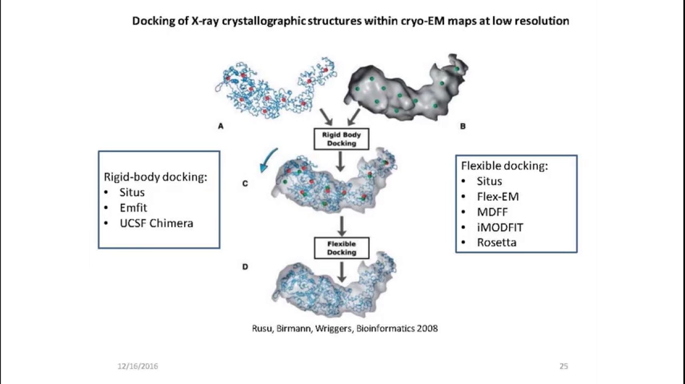

讲者反复强调一个权衡：**外源信息补得越多，图本身的贡献就越小**，最后的模型可能更像你预先的 MD 模型；补得越少，图的信息量就必须真的够，否则模型会过拟合 [【跳转到 33:19】](https://www.bilibili.com/video/BV1Hz4y1y7xJ?t=1999)。

### 4.4 近原子分辨率：手工与自动搭建

2014 年之后分辨率大幅提升，能看到侧链了，策略就变了：图里已含足够的原子信息，不再需要大量外源信息 [【跳转到 36:23】](https://www.bilibili.com/video/BV1Hz4y1y7xJ?t=2183)。手工路线是在 Coot 里先搭二级结构（build α-helix、放 β strand），再用 extend 往两端延伸，最后搭侧链、按 rotamer 库和 Ramachandran 图约束 [【跳转到 38:04】](https://www.bilibili.com/video/BV1Hz4y1y7xJ?t=2284)。

自动路线是讲者实验室的 **EMBuilder**：从 EMDB 里提取 helix 与 β strand 的密度做成模板（把多个高分辨率结构的螺旋叠在一起取平均，保守部分保留、不保守部分平均掉），再做模板匹配把二级结构放进图里 [【跳转到 42:10】](https://www.bilibili.com/video/BV1Hz4y1y7xJ?t=2530)。

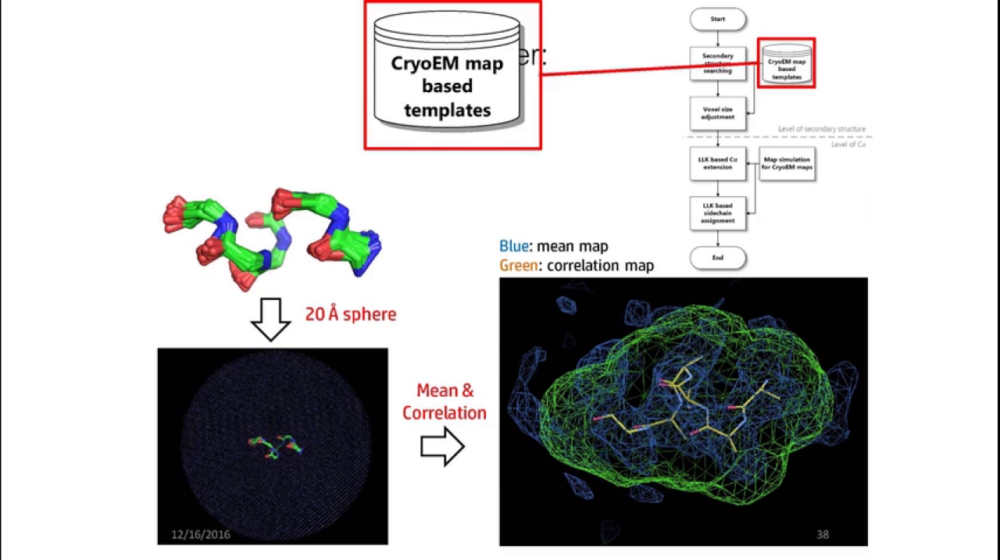

这里有个很实际的坑：电镜的放大倍数、像素尺寸可能不准，导致**体素尺寸**（voxel size）偏差 5%～10%，搭得越长越对不上。所以程序里先用标准螺旋模型做一次体素尺寸精修（用实空间 CC 最大化），再开始搭 [【跳转到 40:23】](https://www.bilibili.com/video/BV1Hz4y1y7xJ?t=2423)。

## 五、精修：把图里的信息搬进模型

### 5.1 精修是什么

精修（refinement）的定义很朴素：把观测数据里的信息尽可能多地传递到模型里，通常通过似然函数实现 [【跳转到 47:09】](https://www.bilibili.com/video/BV1Hz4y1y7xJ?t=2829)。

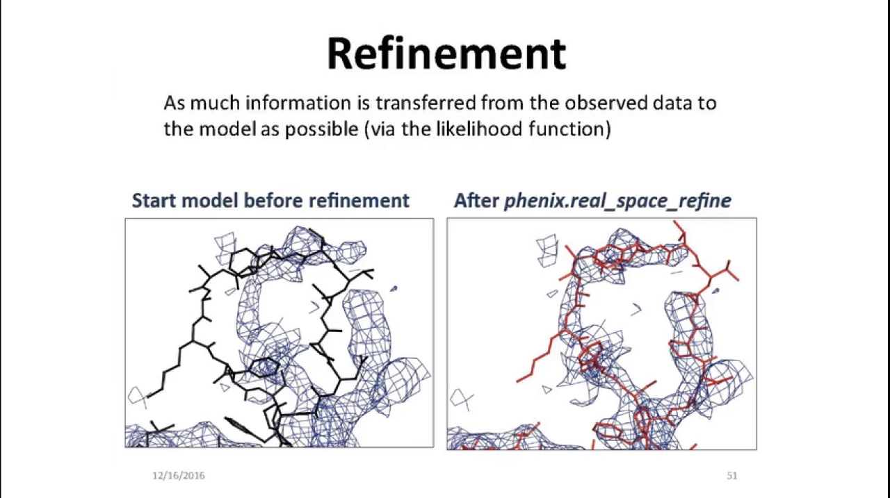

### 5.2 按分辨率选程序

精修同样要"看菜下饭" [【跳转到 48:41】](https://www.bilibili.com/video/BV1Hz4y1y7xJ?t=2921)：目标函数里既要有电镜的似然，也要有先验知识，两者之间还有一个可调的权重。

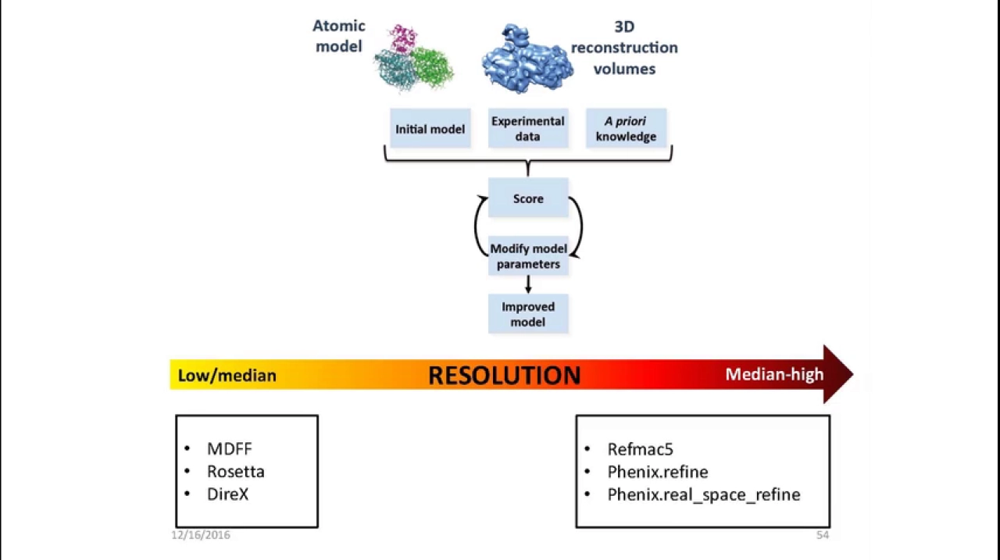

- 低/中等分辨率（只能看到"柱子"）：用 **MDFF**（分子动力学柔性拟合）或 **Rosetta**，把 MD 或结构预测的信息借进来；权重的作用是控制"让分子动多大"——图和模型差得远就把电镜权重调低、让分子动起来，吻合得差不多就把电镜权重调高 [【跳转到 51:29】](https://www.bilibili.com/video/BV1Hz4y1y7xJ?t=3089)。
- 中高分辨率（能看到侧链）：外源信息就多余了，用 **Refmac5**、**PHENIX refine**（倒易空间）或 **PHENIX real_space_refine** 即可 [【跳转到 50:25】](https://www.bilibili.com/video/BV1Hz4y1y7xJ?t=3025)。

### 5.3 实空间还是倒易空间

两种策略的差别在于：实空间可以局部调整；倒易空间要把图做傅里叶变换成结构因子，具有全局性 [【跳转到 53:50】](https://www.bilibili.com/video/BV1Hz4y1y7xJ?t=3230)。倒易空间的缺点是：做膜蛋白时图里有去垢剂的密度，而模型里没有去垢剂，两者匹配不上——这种情况实空间更合适 [【跳转到 54:17】](https://www.bilibili.com/video/BV1Hz4y1y7xJ?t=3257)。

### 5.4 约束：把已知信息明确写进去

精修时还要主动加约束 [【跳转到 55:20】](https://www.bilibili.com/video/BV1Hz4y1y7xJ?t=3320)：

- 二级结构的氢键约束，防止低分辨率下螺旋"散开"；
- 同源多拷贝的一致性约束（几个分子应该一样，就约束它们相等）；
- 参考结构约束（已有晶体结构的距离约束），防止原子乱跑。

原则是：**最大程度挖掘图里的信息，同时把已知的外源信息（立体化学合理性）都保证进来** [【跳转到 56:24】](https://www.bilibili.com/video/BV1Hz4y1y7xJ?t=3384)。

## 六、怎么证明模型没有过度

### 6.1 常规验收指标

精修完要看的指标包括 [【跳转到 57:34】](https://www.bilibili.com/video/BV1Hz4y1y7xJ?t=3454)：

- **CC**：用模型算一张图，与原始图做相关，越接近 1 越好（例子里从 0.645 提到 0.783）；
- **键长/键角 RMSD**：与理想值的偏差越小越好；
- **clash score**：原子重叠越少越好（低分辨率下允许少量）；
- **Ramachandran**：outlier 越少越好，其他偏差量也应接近零。

这些参数正确，审稿人和使用者才敢用你的结构 [【跳转到 58:46】](https://www.bilibili.com/video/BV1Hz4y1y7xJ?t=3526)。

### 6.2 FSCwork / FSCfree：电镜版的 R-free

晶体学里用 R-work 与 R-free 的差距监控过拟合，电镜里对应的做法是 [【跳转到 60:14】](https://www.bilibili.com/video/BV1Hz4y1y7xJ?t=3614)：

1. 把两半数据各成一个图，合起来搭模型；
2. 把模型做随机位移（每个原子 0.5 埃）以打消记忆效应；
3. 用模型分别与第一半图、第二半图算 FSC，得到 $\mathrm{FSC}_{\text{work}}$ 与 $\mathrm{FSC}_{\text{free}}$。

两条曲线如果偏差不大，说明没有过拟合；偏差很大就是过拟合 [【跳转到 60:33】](https://www.bilibili.com/video/BV1Hz4y1y7xJ?t=3633)。

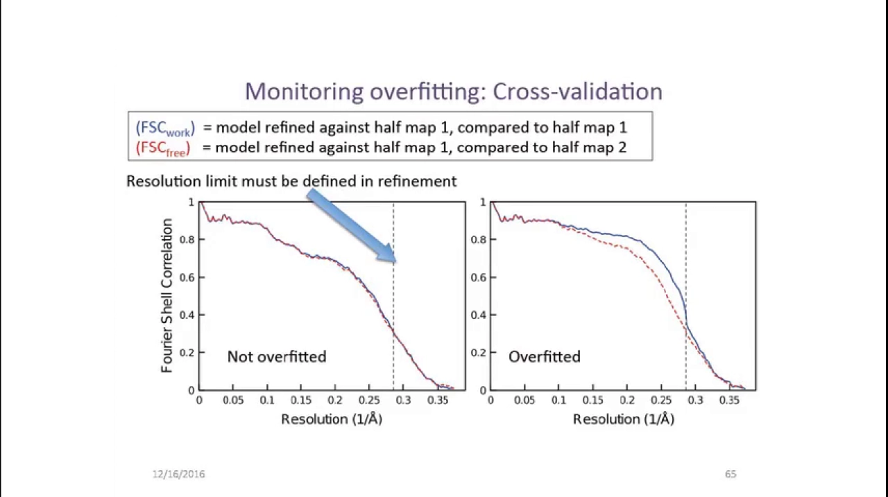

### 6.3 最后一条忠告：别把图扔掉

讲者特别提醒：在晶体学里，有人把数据扔掉、只留 PDB 文件；但在冷冻电镜里，**用模型解释功能时一定要把图保留着**。你回到图里看，才能确认"我的图是否支持这个结论"——只看模型，有时会出现很严重的错误 [【跳转到 59:34】](https://www.bilibili.com/video/BV1Hz4y1y7xJ?t=3574)。

## 小结

- 过拟合是模型搭建的头号敌人：噪声会被"聪明人"看成信号，模型一旦建在噪声上，后面的功能解释全错。
- 判断"图里有多少信号"要在倒易空间定量做：低频是 Guinier 区（形状、溶剂），高频是 Wilson 区（二级结构、原子），后者近似一条直线。
- 分辨率不能简单等同于"FSC 掉到 0.143"：真正的判据是 SSNR，FSC 只是它的换算形式；两半数据的独立性是全部前提。
- 加 mask 会造出假分辨率，必须用相位随机化做高频替换、算出 $\mathrm{FSC}_{\text{true}}$；sharpening 与 FOM 加权则决定你最终看到的图长什么样。
- 图本身要先验证：取向精度用倾斜对检验，绝对手性必须单独确定（螺旋手性、弗里德尔差值或反常散射）。
- 模型只能搭到图支持的那一层：低分辨率做刚体/柔性对接，近原子分辨率才能 de novo；外源信息补得越多，图的贡献就越小，必须说清楚。
- 精修按分辨率选程序（MDFF/Rosetta vs Refmac5/PHENIX），实空间适合局部与含去垢剂的膜蛋白，倒易空间更全局。
- 验收靠 CC、立体化学指标，以及 FSCwork/FSCfree 交叉验证；解释功能时永远回到图本身。

## 关键术语速查

| 术语 | 一句话解释 |
| --- | --- |
| 过拟合（overfitting） | 把噪声当成信号建进模型，模型超出数据能支持的信息量 |
| Guinier 区 / Wilson 区 | 倒易空间信号曲线的低频段（形状、溶剂）与高频段（二级结构、原子） |
| FSC | 傅里叶壳层相关，用两半独立数据算出的相关系数随分辨率的曲线 |
| SSNR | 频谱信噪比，真正用来判断分辨率的量，可由 FSC 换算 |
| 相位随机化 | 把某分辨率以上的高频相位打乱，用来估计 mask 引入的假相关 |
| B-sharpening | 按 Wilson plot 拟合的 B 因子把高频振幅提回来 |
| FOM（品质因子） | 0～1 的权重，表示该频率下振幅的可信程度 |
| 倾斜对（tilt pair） | 用已知旋转角的两张照片检验颗粒取向精度 |
| 绝对手性 | 结构与其镜像都能匹配二维投影，必须额外确定 |
| 刚体 / 柔性对接 | 低分辨率下把已知结构整体放入密度 / 允许其形变但需外源信息 |
| FSCwork / FSCfree | 电镜版的 R-work / R-free，用于监控精修是否过拟合 |