# 单颗粒冷冻电镜：从二维投影到三维密度图的完整路径

> 视频来源：[【中英字幕讲座】程亦凡教授带你走进单颗粒冷冻电镜技术 p01 Single Particle Cryo-EM](https://www.bilibili.com/video/BV1jg411A7da?p=1)（Bilibili · 程亦凡，UCSF）｜时长约 34 分钟
> 导读：这是一场"方法学总览"式的讲座，讲者按"样品—成像—重构—分辨率"的顺序把单颗粒冷冻电镜的流程串了一遍。本文顺着这条线走，重点回答一个问题：一张张信噪比极差的二维照片，凭什么能变成 3 埃的三维密度图。

## 本讲要解决的核心问题（SCQA）

**背景**：冷冻电镜能测蛋白质结构，这一点初学者大多已经知道；也知道它拍的是"照片"，不是衍射图。

**冲突**：照片是三维物体的二维投影，本身丢掉了深度信息；而且为了不把蛋白打坏，曝光必须极短，单张照片的信噪比低到肉眼几乎看不到分子；再加上电子束一照样品就会动，图像还会糊。

**疑问**：既然如此，从一堆模糊的二维粒子照片到一张三维密度图，中间到底发生了什么？分辨率这个数字又是怎么一步步"挣"回来的？

**回答（中心思想）**：单颗粒冷冻电镜的路径是"玻璃态冰制样 → 二维投影 → 粒子拾取 → 取向确定与平均 → 傅里叶空间重构"，而它近十年的分辨率跃升，几乎全部来自**把被噪声和运动吃掉的高频信号重新找回来**（直接电子探测相机 + 单电子计数 + 运动校正）。因此，一张密度图"能支持到哪一层结构"（只能看到轮廓、还是能看到二级结构、还是能看到侧链），取决于它还剩多少高频信号——这正是它能不能用来搭原子模型的分界线。

## 一、样品：为什么必须把蛋白冻在玻璃态冰里

### 1.1 电子比 X 射线"更暴力"，所以样品必须进真空

讲者先比较了电子和 X 射线这两种探针 [【跳转到 02:51】](https://www.bilibili.com/video/BV1jg411A7da?p=1&t=171)：

- 把两者都看成粒子时，电子会与原子的**核外电子和原子核**都发生相互作用，而 X 射线只与核外电子作用。所以 X 射线晶体学得到的密度图叫"电子密度图"，而电镜的密度图严格说应该叫**库仑势图**（大家习惯仍简称密度图）[【跳转到 03:08】](https://www.bilibili.com/video/BV1jg411A7da?p=1&t=188)。
- 电子的散射截面比 X 射线大得多，散射强得多，因此对样品的**辐射损伤**也严重得多 [【跳转到 03:30】](https://www.bilibili.com/video/BV1jg411A7da?p=1&t=210)。
- 电子的另一个身份是带电粒子，可以被电磁透镜聚焦和偏转——这正是"电子显微镜容易造、X 射线显微镜很难造"的原因 [【跳转到 03:56】](https://www.bilibili.com/video/BV1jg411A7da?p=1&t=236)。

散射强带来的第一个麻烦是：电子束必须在高真空里传播，所以整个镜筒内部都是高真空 [【跳转到 06:12】](https://www.bilibili.com/video/BV1jg411A7da?p=1&t=372)。而生物样品一进真空，第一件事就是**脱水**，脱水会破坏结构信息的完整性；第二个麻烦才是辐射损伤 [【跳转到 06:44】](https://www.bilibili.com/video/BV1jg411A7da?p=1&t=404)。历史上的旋转投影、正染、负染都无法把生物样品保存到原子分辨率的完整性 [【跳转到 07:08】](https://www.bilibili.com/video/BV1jg411A7da?p=1&t=428)。

### 1.2 两条保水路线：冷冻水合与糖包埋

1974 年 Ken Taylor 和 Bob Glaeser 首次证明，**冷冻水合**（frozen hydration）可以把生物样品保存到原子分辨率的结构完整性：把样品冻起来，水分子保持固态，既防脱水又能进电镜 [【跳转到 07:41】](https://www.bilibili.com/video/BV1jg411A7da?p=1&t=461)。他们用冷冻水合制备的催化剂晶体，衍射点一直延伸到 3 埃 [【跳转到 08:15】](https://www.bilibili.com/video/BV1jg411A7da?p=1&t=495)。

另一条路线是**糖包埋**：用糖分子替代水分子，同样防脱水。Nigel Unwin 和 Richard Henderson 用它研究细菌视紫红质（bacteriorhodopsin）的二维晶体 [【跳转到 08:34】](https://www.bilibili.com/video/BV1jg411A7da?p=1&t=514)。二维晶体的好处是可以同时记录电子衍射和图像：衍射给出每个衍射点的**振幅**，图像算出的衍射点给出**相位**，两者结合就得到投影结构 [【跳转到 09:22】](https://www.bilibili.com/video/BV1jg411A7da?p=1&t=562)。再把样品倾斜到不同角度，因为倾斜角度是精确已知的，就能把这些中心截面组合成三维结构——1975 年他们得到了约 7 埃的细菌视紫红质三维重建，第一次看到整合膜蛋白的跨膜螺旋 [【跳转到 10:00】](https://www.bilibili.com/video/BV1jg411A7da?p=1&t=600)。

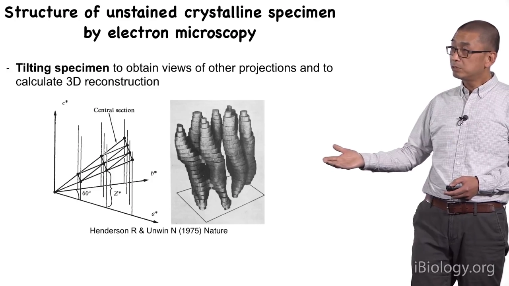

### 1.3 玻璃态冰：今天仍在用的制样方法

真正让"单颗粒"成为可能的是 Jacques Dubochet 在 1980 年代初发展的方法：把单个生物颗粒以冷冻水合的方式制备出来 [【跳转到 11:59】](https://www.bilibili.com/video/BV1jg411A7da?p=1&t=719)。讲者强调，他当年开发的方法就是今天还在用的方法。

具体流程是四步 [【跳转到 12:37】](https://www.bilibili.com/video/BV1jg411A7da?p=1&t=757)：

1. 在覆有连续碳膜、碳膜上带 1～2 微米规则孔洞的铜网上，滴约 2 微升纯化蛋白样品；
2. 用滤纸吸掉大部分溶液；
3. 靠表面张力，孔洞里的液体形成一层连续液膜；
4. 迅速把载网投入由液氮冷却的液态乙烷（约 −200 °C）中，降温速率要达到每秒一万到十万摄氏度。

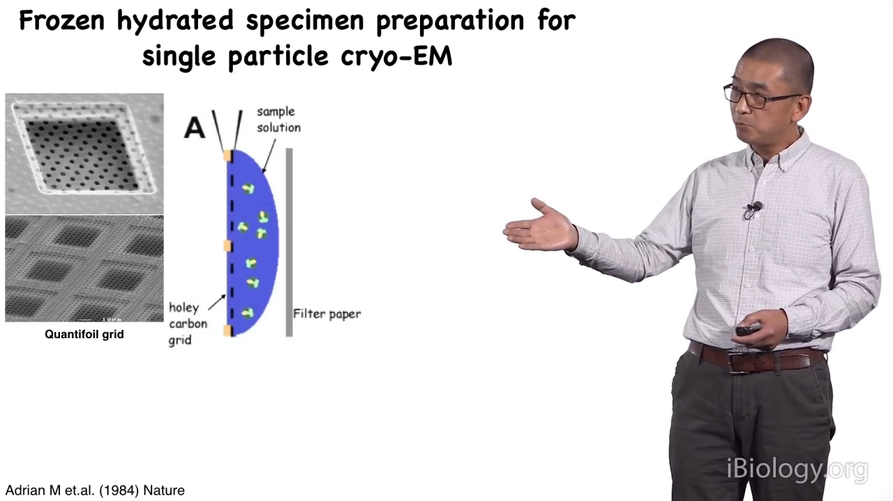

降温必须这么快，是为了让水**来不及结晶**：一旦形成冰晶，冰晶会把蛋白压碎。快速冷冻得到的无定形态就是**玻璃态冰**（vitreous ice），蛋白以自由悬浮的状态包埋在这层薄冰里，大体保持天然构象 [【跳转到 13:27】](https://www.bilibili.com/video/BV1jg411A7da?p=1&t=807)。

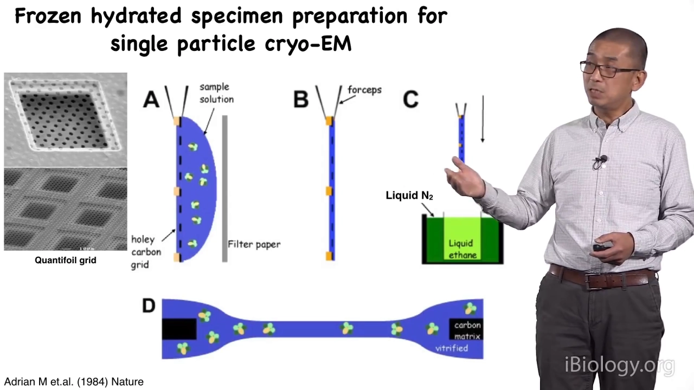

## 二、成像：一张照片里到底记了什么

### 2.1 一张图 = 一个投影 + 六个几何参数

样品进电镜后拍到的是**三维物体的二维投影** [【跳转到 04:22】](https://www.bilibili.com/video/BV1jg411A7da?p=1&t=262)。每个颗粒在图像里的位置和姿态，可以用几个几何参数描述：三个参数决定它的空间取向，两个参数决定 XY 位置，最后一个参数决定 Z 方向——也就是**离焦**（defocus）[【跳转到 14:40】](https://www.bilibili.com/video/BV1jg411A7da?p=1&t=880)。这些参数估得越准，最后的结构分辨率越高。

### 2.2 Thon 环：一张图"值多少分辨率"的体检报告

电镜的衬度传递函数（CTF）会在傅里叶变换里留下一圈圈的**Thon 环**。Thon 环能延伸到多高的空间频率，就大致决定了这张图能贡献到多高的分辨率——讲者把它类比成 X 射线晶体学家看晶体能衍射多远 [【跳转到 19:28】](https://www.bilibili.com/video/BV1jg411A7da?p=1&t=1168)。

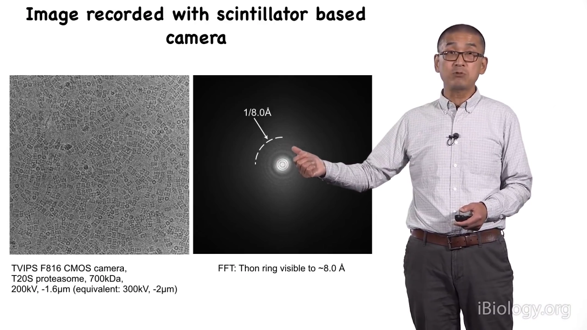

上图是早期闪烁体相机拍的 20S 蛋白酶体，Thon 环只延伸到约 8 埃；换成直接电子探测相机的计数模式后，同一类样品的 Thon 环能到 3.2～4.0 埃 [【跳转到 22:59】](https://www.bilibili.com/video/BV1jg411A7da?p=1&t=1379)。

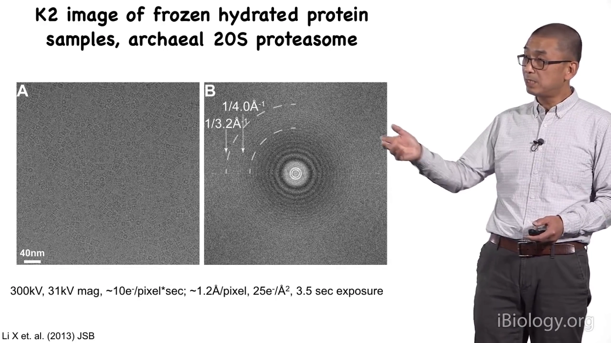

## 三、重构：从二维投影到三维密度

### 3.1 数学基础：中心截面定理

重建的数学原理很早就有了，1968 年 DeRosier 和 Klug 用烟草花叶病毒的二维投影图像做了验证 [【跳转到 04:48】](https://www.bilibili.com/video/BV1jg411A7da?p=1&t=288)。核心是**中心截面定理**：一个二维投影的傅里叶变换，等于三维物体傅里叶变换中、垂直于投影方向的那个中心截面 [【跳转到 05:08】](https://www.bilibili.com/video/BV1jg411A7da?p=1&t=308)。

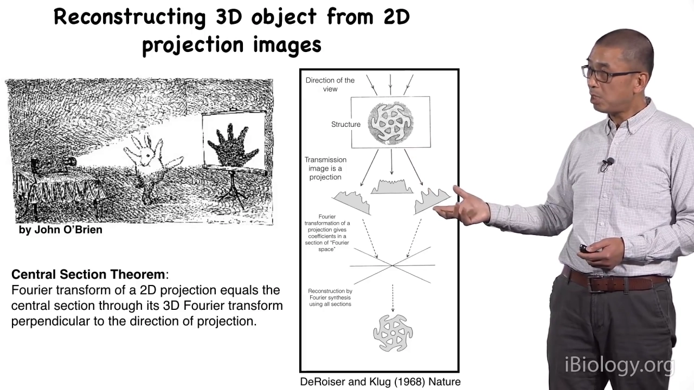

于是流程就清楚了：收集同一物体在不同视角下的多张二维投影 → 各自做傅里叶变换 → 按已知的相对取向把这些中心截面拼起来 → 逆傅里叶变换回到实空间，得到三维物体 [【跳转到 05:38】](https://www.bilibili.com/video/BV1jg411A7da?p=1&t=338)。这里的关键前提是"知道相对取向"——而单颗粒样品里，每个颗粒的取向恰恰是未知的，必须从数据里估出来。

### 3.2 单颗粒的三步走：拾取、对齐、平均

讲者用古菌 20S 蛋白酶体做示范 [【跳转到 15:02】](https://www.bilibili.com/video/BV1jg411A7da?p=1&t=902)：

1. **拍很多照片**：每张显微照片里有几十上百个颗粒；
2. **拾取**（particle picking）：用计算或肉眼把单个颗粒从大图里圈出来、抠出来，组成一个颗粒图像堆栈 [【跳转到 15:17】](https://www.bilibili.com/video/BV1jg411A7da?p=1&t=917)；
3. **对齐 + 平均 + 重构**：把颗粒彼此对齐、平均，再用中心截面定理生成三维重建 [【跳转到 15:49】](https://www.bilibili.com/video/BV1jg411A7da?p=1&t=949)。

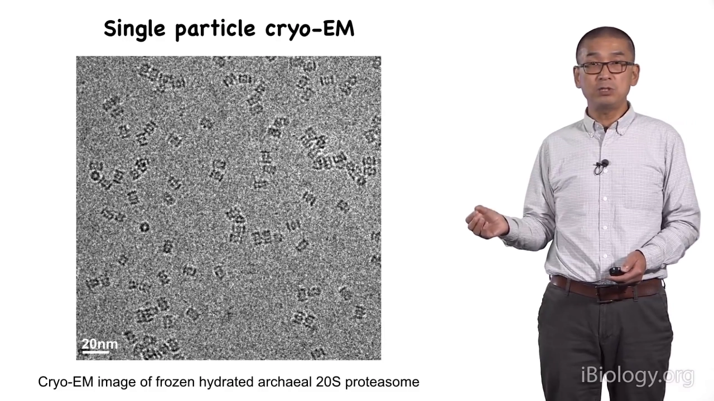

### 3.3 5～6 埃能看到什么：二级结构能看，侧链看不到

用这套流程，讲者实验室当时把 20S 蛋白酶体做到了 5～6 埃 [【跳转到 15:54】](https://www.bilibili.com/video/BV1jg411A7da?p=1&t=954)。在这个分辨率下：

- 能看到二级结构特征：α 螺旋、β 折叠、环 [【跳转到 16:08】](https://www.bilibili.com/video/BV1jg411A7da?p=1&t=968)；
- **看不到侧链密度**，因此不足以从头搭原子模型 [【跳转到 16:20】](https://www.bilibili.com/video/BV1jg411A7da?p=1&t=980)。

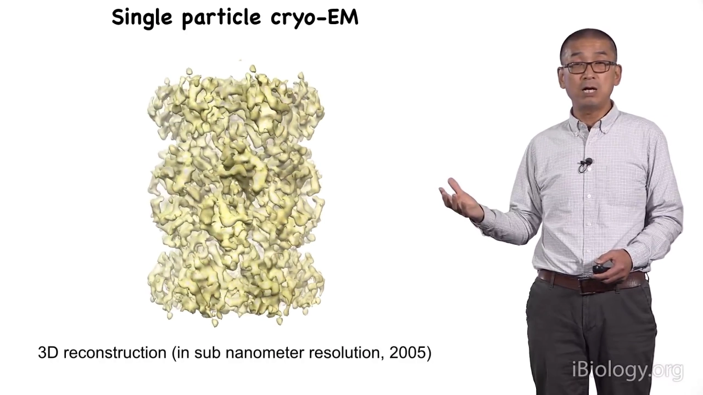

这是理解"分辨率数字意味着什么"的第一个具体标尺：**5～6 埃 ≈ 能认二级结构，不能认氨基酸**。要搭原子模型，必须把分辨率推到接近原子分辨率。

### 3.4 历史插叙：从晶体到单颗粒

讲者顺带交代了单颗粒的思想来源：Joachim Frank 在 1975 年提出，即使没有晶体，也可以对单个分子成像，再用互相关把图像对齐、平均，从而得到更高分辨率的图像 [【跳转到 10:23】](https://www.bilibili.com/video/BV1jg411A7da?p=1&t=623)；1978 年他用谷氨酰胺合成酶证明了这一点，并提出倾斜样品获得第三维；随后用大肠杆菌核糖体和随机圆锥倾斜方法，第一次用单颗粒平均得到三维结构（当时仍用负染）[【跳转到 11:23】](https://www.bilibili.com/video/BV1jg411A7da?p=1&t=683)。

## 四、分辨率的瓶颈与"分辨率革命"

### 4.1 限制不在电镜，而在剂量与探测器

讲者明确说：限制单颗粒电镜分辨率的**不是电镜本身**。普通电镜拍石墨烯，单张照片就能分辨出碳原子，分辨率接近 2 埃——但那是因为无机样品不怕辐射，可以用极高的电子剂量 [【跳转到 17:04】](https://www.bilibili.com/video/BV1jg411A7da?p=1&t=1024)。生物样品不能这么干，只能低剂量曝光，于是图像被噪声主导。

第二个瓶颈是记录方式。CCD 相机探测不到电子，只能探测光子，所以要在芯片上叠一层闪烁体做转换；一个电子会产生很多光子，把"点"摊成"块"，导致高空间频率上约 90% 的信号丢失 [【跳转到 18:51】](https://www.bilibili.com/video/BV1jg411A7da?p=1&t=1131)。衡量这一点的指标就是**探测量子效率 DQE**。

### 4.2 直接电子探测 + 单电子计数

2011～2012 年前后商用的**直接电子探测相机**不再需要闪烁体，直接探测电子并把信号转成电荷 [【跳转到 20:21】](https://www.bilibili.com/video/BV1jg411A7da?p=1&t=1221)。第一步先追平胶片（K2 相机的 DQE 与胶片相当甚至略好）；更关键的是**单电子计数**：相机帧率高达每秒 400 帧，每帧里的电子事件非常稀疏，只要附近没有别的事件，就能识别出单个电子并把电荷重心定到像素甚至四分之一像素 [【跳转到 21:59】](https://www.bilibili.com/video/BV1jg411A7da?p=1&t=1319)。这带来两个好处：点扩散函数缩到一个像素、读出噪声基本消失，DQE 因此显著提高 [【跳转到 22:41】](https://www.bilibili.com/video/BV1jg411A7da?p=1&t=1361)。

### 4.3 光束诱导运动与运动校正

高帧率还带来一个额外能力：把一张图录成一段"电影"而不是一张静止画面 [【跳转到 23:34】](https://www.bilibili.com/video/BV1jg411A7da?p=1&t=1414)。原因很实际——电子束打到样品上时，样品会动，直接叠加所有帧会看到颗粒被拉出条纹，这就是**光束诱导的图像运动**，它已知多年，是影响图像质量的主要因素 [【跳转到 24:08】](https://www.bilibili.com/video/BV1jg411A7da?p=1&t=1448)。

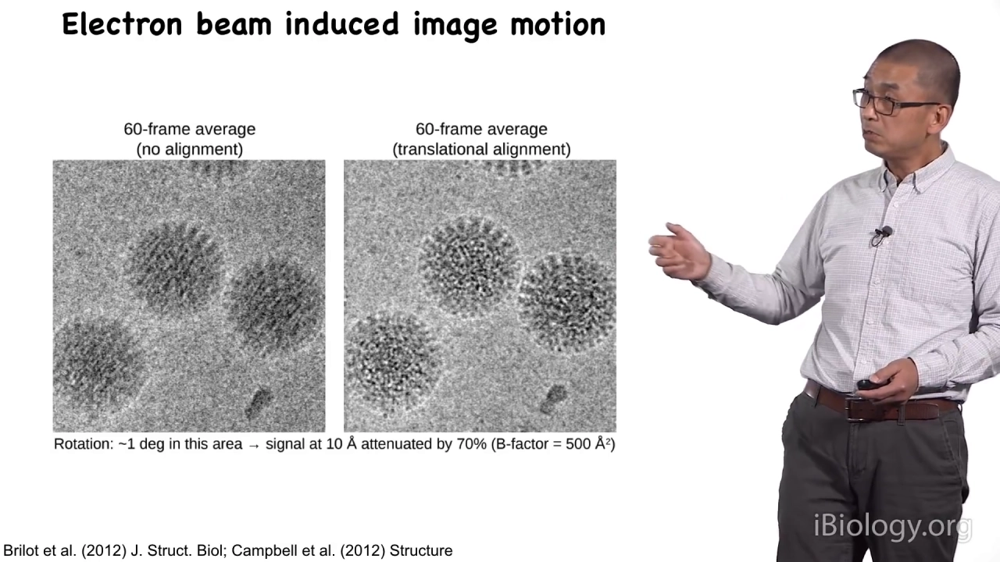

Grigorieff 实验室最早证明可以对运动做计算校正 [【跳转到 24:13】](https://www.bilibili.com/video/BV1jg411A7da?p=1&t=1453)。但单帧信噪比太差，肉眼看不到特征，必须靠算法追踪帧间运动。讲者实验室的做法是先把整张图当刚体做全局校正；后来 Scheres 实验室证明不同位置的颗粒运动方式不同，于是又加了按颗粒追踪的**局部运动校正** [【跳转到 28:17】](https://www.bilibili.com/video/BV1jg411A7da?p=1&t=1697)。

更进一步，他们发现局部运动的本质是冰膜在 Z 方向的形变：样品倾斜时，几乎所有运动都垂直于倾斜轴 [【跳转到 30:00】](https://www.bilibili.com/video/BV1jg411A7da?p=1&t=1800)。据此开发的 **MotionCor2** 先校正全局运动，再把图像分成小块估计每块的平均运动，用多项式拟合冰的形变，从而校正到每个像素 [【跳转到 30:51】](https://www.bilibili.com/video/BV1jg411A7da?p=1&t=1851)。

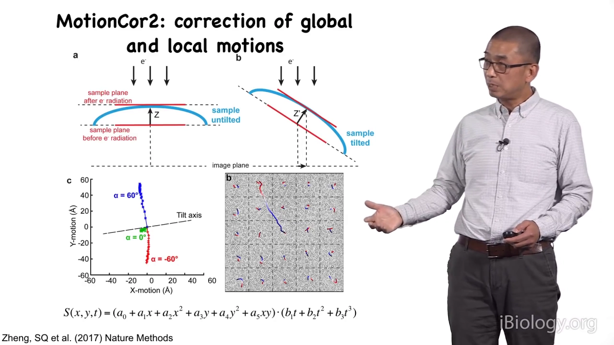

### 4.4 结果：3.3 埃，与 X 射线可比

用同一套数据，只把运动校正从"全局"升级为"全局 + 局部"，分辨率就从 3.3 埃提高到接近 2.5 埃 [【跳转到 31:34】](https://www.bilibili.com/video/BV1jg411A7da?p=1&t=1894)。

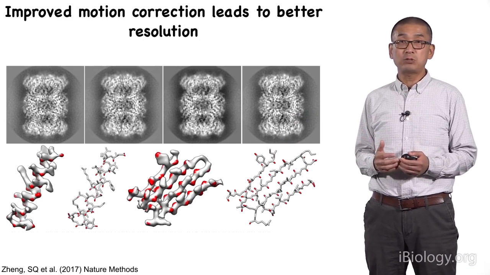

而在 3.3 埃时，电镜密度图已经可以和同分辨率（3.3～3.4 埃）的 X 射线密度图放在一起比较，两者非常可比；讲者的结论是：只要能做到这个分辨率水平，就能基于序列搭出从头原子模型 [【跳转到 27:41】](https://www.bilibili.com/video/BV1jg411A7da?p=1&t=1661)。

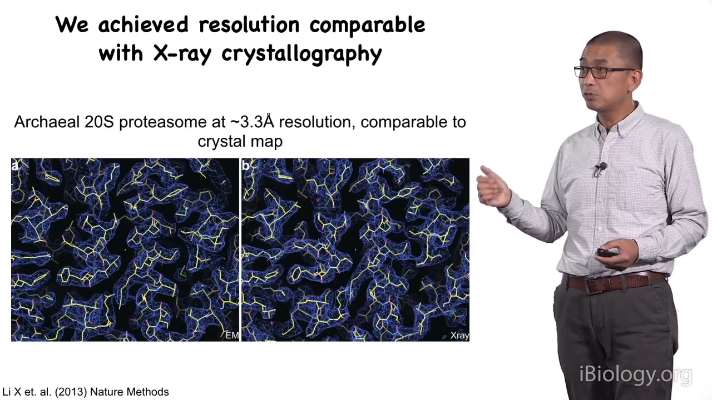

## 五、还差的最后一块：异质性与分类

讲者在结尾把近十年的进展归纳为两个突破：一是相机技术 + 运动校正带来的分辨率提升；二是**软件**，尤其是"怎么把图像分成不同的组""怎么从一个更异质的颗粒数据集里得到更均一的子集" [【跳转到 32:16】](https://www.bilibili.com/video/BV1jg411A7da?p=1&t=1936)。这两件事合起来，才让冷冻电镜领域经历了 Werner Kuhlbrandt 所说的"分辨率革命" [【跳转到 32:41】](https://www.bilibili.com/video/BV1jg411A7da?p=1&t=1961)，并让单颗粒冷冻电镜成为许多有挑战性的生物大分子结构的首选方法 [【跳转到 33:10】](https://www.bilibili.com/video/BV1jg411A7da?p=1&t=1990)。

这一点对读结构文件很重要：所谓"这个结构是 3.3 埃"，指的是一批被判定为"足够像"的颗粒平均出来的结果。把不同构象的颗粒混在一起平均，高频信号会互相抵消——所以分类既是提高分辨率的手段，也是把"异质性"从一张平均图里分离出来的手段。

## 小结

- 单颗粒冷冻电镜的物理起点是"电子散射强"：因此必须高真空、必须防脱水、必须低剂量，最终落到"把蛋白冻在玻璃态冰里"这一条路上。
- 一张显微照片 = 三维物体的二维投影 + 一组几何参数（取向、位置、离焦）；Thon 环延伸多远，就是这张图能贡献的分辨率上限。
- 三维重建的数学核心是中心截面定理：二维投影的傅里叶变换等于三维傅里叶变换的一个中心截面，把不同取向的截面拼起来再逆变换即可。
- 单颗粒流程是"拾取 → 对齐 → 平均 → 重构"，取向未知是它和晶体学的根本差别。
- 5～6 埃只能看二级结构、看不到侧链，因此不能从头搭原子模型；3.3 埃才能与 X 射线密度图相比、支持从头建模。
- 分辨率跃升的两个来源：直接电子探测相机 + 单电子计数（把高频信号记下来），以及运动校正（把被运动糊掉的高频信号找回来）。
- 最后一个突破口是分类：从异质颗粒集里分出均一子集，这既提高分辨率，也决定了"这张图代表的是哪一种构象"。

## 关键术语速查

| 术语 | 一句话解释 |
| --- | --- |
| 玻璃态冰（vitreous ice） | 极快冷冻得到的不结晶的水，蛋白悬浮其中并保持天然构象 |
| 库仑势图 | 电镜密度图的严格名称：电子被原子核与电子云的电场散射，测到的是电势分布 |
| 中心截面定理 | 二维投影的傅里叶变换 = 三维物体傅里叶变换中垂直于投影方向的中心截面 |
| Thon 环 | CTF 在傅里叶变换里留下的同心环，其最外圈大致标出这张图的分辨率上限 |
| 离焦（defocus） | 描述颗粒在 Z 方向位置的参数，同时决定 CTF 零点的位置 |
| 粒子拾取（particle picking） | 从大显微照片中定位并抠出单个颗粒图像 |
| DQE | 探测量子效率，衡量相机把入射电子转成可用信号的能力 |
| 单电子计数 | 高帧率下逐个识别电子事件并定位其重心，几乎消除读出噪声 |
| 光束诱导运动 | 电子束照射导致样品（冰膜）形变位移，使图像模糊 |
| 异质性（heterogeneity） | 同一批颗粒里存在不同构象或组成，混在一起平均会拉低分辨率 |