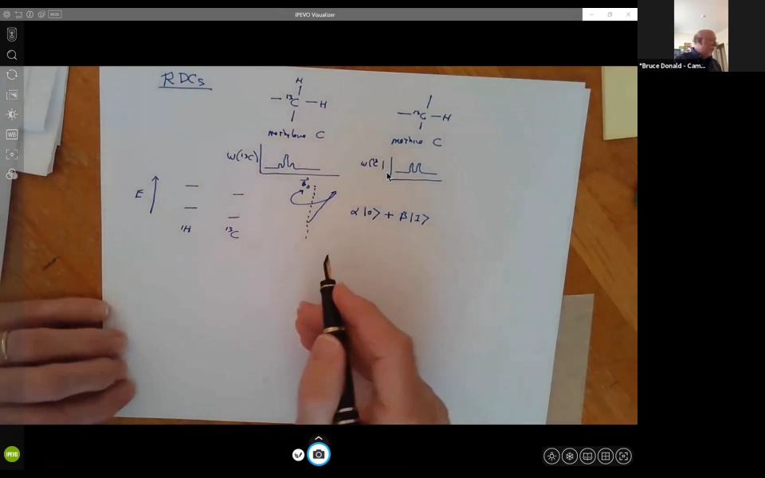
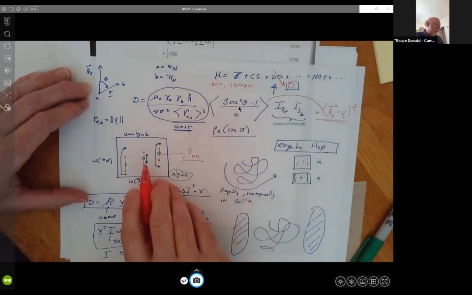
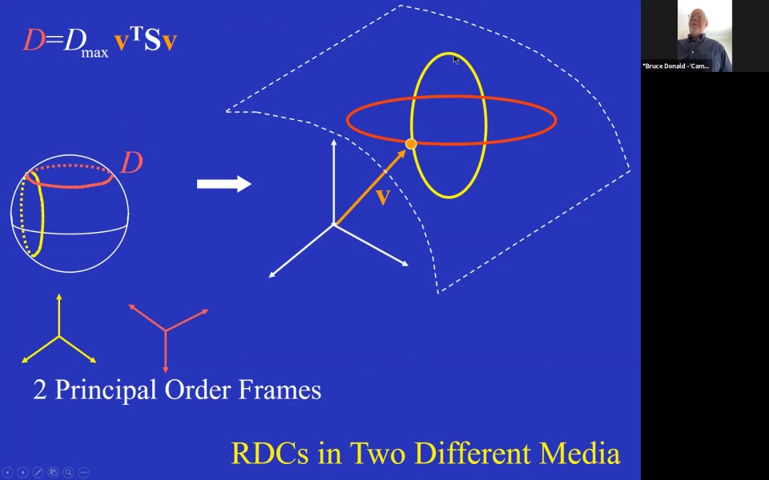
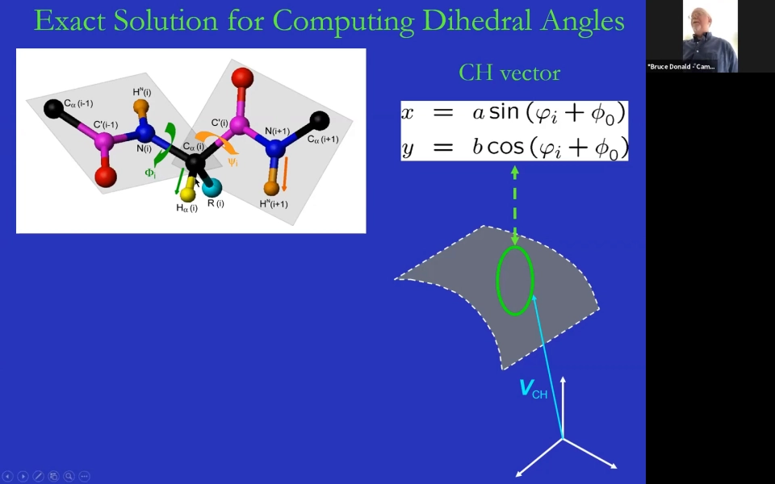
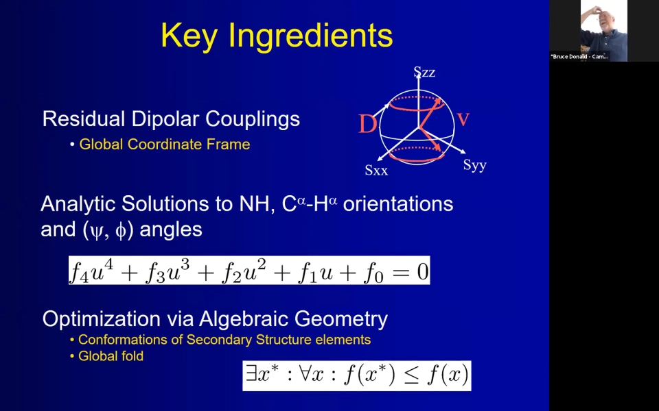
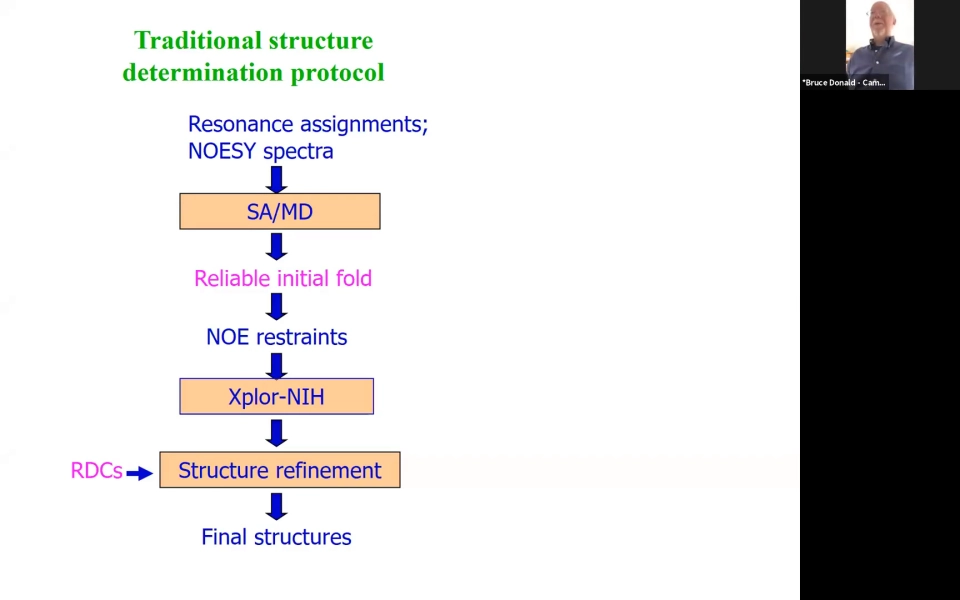
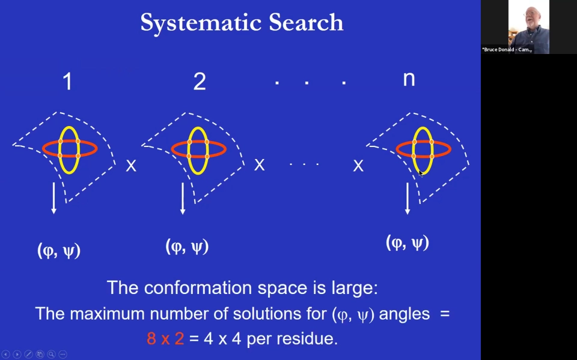
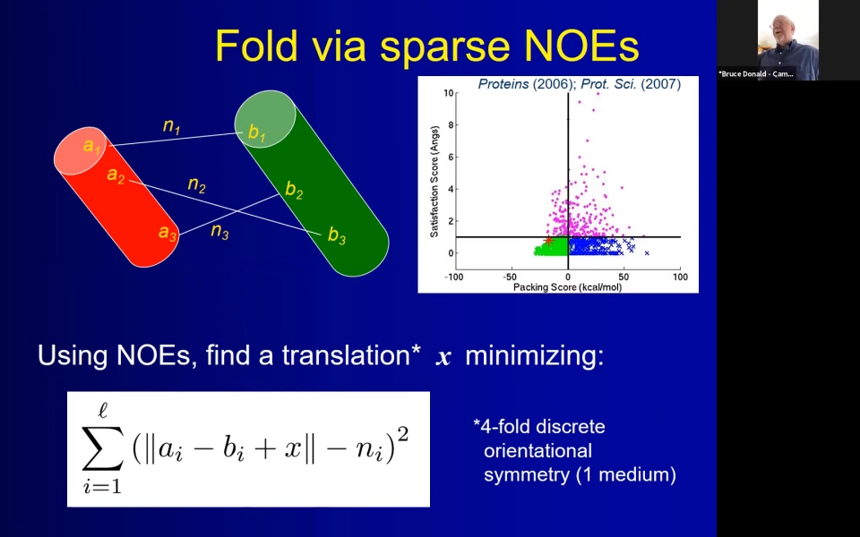
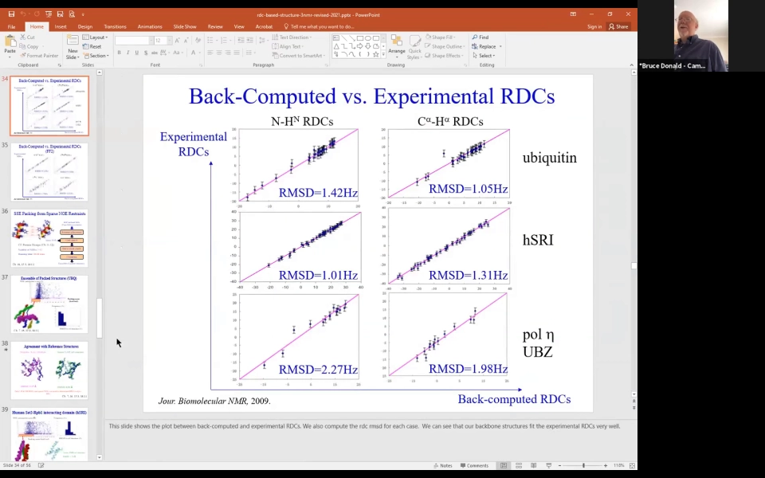
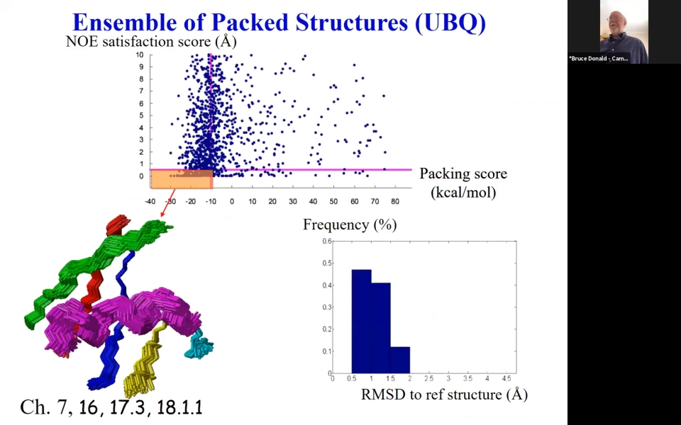

# 从约束到结构集合：核磁共振怎样用 RDC 把取向数据变成可枚举的解

> 视频来源：[NMR, RDCs and Protein Structure Calculation - Lecture L04 by Bruce Donald, Duke University](https://www.bilibili.com/video/BV1Zs421c7HR/?p=4)（Bilibili · 东山月光下 搬运，杜克大学计算结构生物学课程第 4 讲，讲者 Bruce R. Donald）｜时长约 115 分钟
> 导读：这是一堂把"约束如何变成结构"讲透的课。Donald 先解释 RDC（残余偶极耦合）为什么是**全局参照**的取向测量，再把它写成代数方程，用交点、运动学椭圆和四次方程求出精确解，最后把结构测定化归成一次离散搜索——搜索出来的不是一个结构，而是一组满足数据的构象。本文按这条证据链展开，并在结尾专门区分"模型集合"与"真实群体权重"。字幕为自动识别，本文已订正术语与人名。

**一句话结论：核磁共振测的不是坐标，而是两类约束——NOE 给"谁离谁近"的距离约束，RDC 给"键矢量相对外磁场朝哪"的取向约束；把取向约束写成代数方程后，解不再是连续优化里的一个极小点，而是一个**有限的离散解集**，于是"算结构"变成"枚举并打分"，输出自然是一组结构；而这组结构的权重，数据本身并不告诉你。**

## 本讲要解决的核心问题（SCQA）

**背景**：核磁共振能测蛋白质结构，靠的是把大量实验观测量转成几何约束，再交给计算程序去满足这些约束。传统流程里，NOE 距离约束是主力，RDC 往往只在最后精修时才用。

**冲突**：传统流程有三个顽疾。第一，NOE 是**局部**测量，像测量员一段段做三角测量，误差会沿着链累积，量到蛋白另一端时那个结构域的取向可能已经错了。第二，初始折叠只用 NOE，模拟退火很容易陷进局部极小值。第三，流程需要近乎完整的共振归属，复杂体系还要大量人工干预。而 RDC 虽然对几何极其敏感，却因为"对取向是二次依赖、能量景观崎岖"而难以塞进这套流程。

**疑问**：既然 RDC 这么难用，为什么还要把它放到流程最前面？它到底约束了什么？把 RDC 加进来之后，"解结构"这件事在数学上变成了什么？为什么最后拿到的是一组结构，而不是一个结构？

**回答（中心思想）**：RDC 是**全局参照**的取向测量——所有键矢量都相对于同一个外磁场，所以它不像 NOE 那样累积误差。把 RDC 写成 $D = D_{\max}\, v^{\mathsf{T}} S v$（$S$ 是取向张量）之后，一个测量值就把键矢量约束到球面上的一条代数曲线上；两种取向介质给出两条曲线，交点就是有限个精确解；再叠加肽平面的运动学，二面角也能由四次方程精确解出。于是结构测定被化归成**离散有限搜索**：枚举所有与数据相容的构象，用数据拟合、几何合理性、空间冲突等打分，剪枝，最后留下的就是一个**结构集合**。集合里的每个成员都满足数据，但"谁在溶液里占多少"并不由这些数据决定。

## 一、两类约束：标量耦合、距离与取向

### 1.1 HSQC 与 J 耦合：先看清"谁和谁相连"

在生物大分子 NMR 里，最基础的二维谱是 **HSQC**：每个酰胺键（N–H）在谱上给一个斑点，横轴是质子的频率，纵轴是 N-15 的频率 [【跳转到 05:26】](https://www.bilibili.com/video/BV1Zs421c7HR/?p=4&t=326)。

如果不做特殊处理，每个斑点其实会裂开：N-15 的两个能级分裂质子，质子的两个能级也分裂 N-15，于是一个斑点变成四个。对 650 个残基的蛋白来说，那就是四倍多的斑点，谱会挤成一团。所以生物大分子 NMR 必须**去耦**（decouple），把分裂合并成一个峰 [【跳转到 07:30】](https://www.bilibili.com/video/BV1Zs421c7HR/?p=4&t=450)。

这些分裂来自**标量耦合**（scalar coupling，$J$ 耦合），它沿化学键传递，比如 $J_{\mathrm{NH}}$ 只跨 N–H 这一根键 [【跳转到 10:00】](https://www.bilibili.com/video/BV1Zs421c7HR/?p=4&t=600)。J 耦合告诉你"谁和谁相连"，是归属的工具；它本身不给三维距离。

### 1.2 溶液里，偶极耦合被平均成了零

真正携带空间信息的是**偶极耦合**（dipolar coupling）。两个核的磁矩之间的相互作用，其大小依赖键矢量与外磁场的夹角 θ [【跳转到 11:55】](https://www.bilibili.com/video/BV1Zs421c7HR/?p=4&t=715)：

$$
D \propto \frac{\gamma_A \gamma_B}{r_{AB}^{3}}\left\langle \frac{3\cos^2\theta - 1}{2}\right\rangle
$$

其中 $\gamma$ 是旋磁比，$r_{AB}$ 是两核间距，尖括号表示平均，$\frac{3\cos^2\theta-1}{2}$ 是二阶勒让德多项式 $P_2(\cos\theta)$。

问题在于：溶液里的蛋白在快速、各向同性地翻滚（小蛋白的取向相关时间约 10 纳秒，大一些的 20–30 纳秒），所有取向都被平均掉，于是这个偶极耦合**平均为零** [【跳转到 10:32】](https://www.bilibili.com/video/BV1Zs421c7HR/?p=4&t=632)。

### 1.3 取向介质：让"残余"的那一点回来

解决办法来自液晶领域：往样品里滴定一些能造成空间位阻或电荷阻碍的大颗粒（丝状噬菌体、bicelle，或者拉伸/压缩的凝胶），让分子**部分取向** [【跳转到 11:53】](https://www.bilibili.com/video/BV1Zs421c7HR/?p=4&t=713)。

直觉是：分子本来自由翻滚，但两万次里有一次它撞上这些"墙"，取向分布就不再均匀。于是偶极耦合不再平均为零，而是留下一个很小的残余值——通常调到正负 20–30 赫兹（化学位移是几百赫兹量级）。这就是 **RDC**（residual dipolar coupling，残余偶极耦合）里"残余"二字的来历 [【跳转到 12:47】](https://www.bilibili.com/video/BV1Zs421c7HR/?p=4&t=767)。

## 二、RDC 为什么比 NOE"更硬"：全局参照

### 2.1 公式与它的两个性质

RDC 可以写成：

$$
D = D_{\max}\, v^{\mathsf{T}} S v
$$

其中 $v$ 是键矢量的单位矢量，$S$ 是 3×3 的**取向张量**，$D_{\max}$ 是把所有常数（磁导率、旋磁比、键长等）收拢后的常数 [【跳转到 15:34】](https://www.bilibili.com/video/BV1Zs421c7HR/?p=4&t=934)。

这个式子有两个关键性质：

- 对键矢量 $v$ 是**二次**依赖（$v^{\mathsf{T}} S v$），所以对几何变化极其敏感；
- 对 $S$ 的元素是**线性**依赖，所以固定几何后可以用线性最小二乘解出 $S$ [【跳转到 17:04】](https://www.bilibili.com/video/BV1Zs421c7HR/?p=4&t=1024)。

### 2.2 全局参照 vs 三角测量

Donald 用测量员打比方：用 NOE 建结构就像在森林里一段段做三角测量，每次测量都有误差，量到蛋白另一端时误差已经累积，远端结构域的取向可能完全错掉 [【跳转到 14:38】](https://www.bilibili.com/video/BV1Zs421c7HR/?p=4&t=878)。

RDC 不一样：每个键矢量测的都是它相对于**同一个巨大的外磁场**的取向。所以 $v_1$ 与 $B_0$、$v_2$ 与 $B_0$ 的点积都在同一个全局坐标系里，即使两个键矢量相隔几十埃，它们的相对取向仍然可比 [【跳转到 15:02】](https://www.bilibili.com/video/BV1Zs421c7HR/?p=4&t=902)。

这就是"RDC 更像晶体学数据"的意思：它是全局参照的，不靠一段段接力。

### 2.3 平均值与各态历经假设

公式里的尖括号表示平均：溶液里有几十亿个蛋白，你在毫秒到秒的尺度上做平均。这里用到一个很深的假设——**各态历经假设**（ergodic hypothesis）：时间平均等于系综平均 [【跳转到 14:42】](https://www.bilibili.com/video/BV1Zs421c7HR/?p=4&t=882)。

请记住这一条，它是后面"为什么输出是集合"的物理根源：RDC 和 NOE 一样，测的都是平均值。

## 三、取向张量：把"平均取向"装进一个矩阵

### 3.1 从 PCA 到 Soap 矩阵

怎么理解 $S$？Donald 用主成分分析（PCA）做类比 [【跳转到 20:32】](https://www.bilibili.com/video/BV1Zs421c7HR/?p=4&t=1232)。

想象在分子上固定一个坐标系，然后"骑"在分子上看外磁场：分子像一匹尥蹶子的马，外磁场像一根长度不变的旗杆，在分子坐标系里晃来晃去。旗杆端点在球面上留下一团点云。对这团点云做 PCA，就得到一个椭球；椭球用"一个旋转 + 几个拉伸量（特征值）"精确表示 [【跳转到 24:43】](https://www.bilibili.com/video/BV1Zs421c7HR/?p=4&t=1483)。

这个椭球对应的矩阵，就是取向张量（也叫 Soap 矩阵）：矩阵编码平均旋转，特征值编码拉伸。

### 3.2 无迹 + 对称 = 只有五个自由度

$S$ 是 3×3、实值、**无迹**（对角线元素之和为零）、**对称**的矩阵 [【跳转到 16:41】](https://www.bilibili.com/video/BV1Zs421c7HR/?p=4&t=1001)。这带来一个实用后果：

- 无迹：对角元中有一个可由另外两个定出，只剩两个；
- 对称：三个非对角元两两相等，只剩三个；

合起来只有 **5 个自由度** [【跳转到 76:05】](https://www.bilibili.com/video/BV1Zs421c7HR/?p=4&t=4565)。所以只要知道几何，5 个以上的 RDC 就能用最小二乘把 $S$ 解出来。

### 3.3 SVD：把 $S$ 对角化

用奇异值分解（SVD），任意实矩阵可以写成 $A = U\Sigma V^{\mathsf{T}}$；如果 $A$ 对称，则 $U = V$，于是 $S = U\Sigma U^{\mathsf{T}}$ [【跳转到 44:39】](https://www.bilibili.com/video/BV1Zs421c7HR/?p=4&t=2679)。

这一步的物理含义是：$U$ 是旋转（定义**主取向坐标系**），$\Sigma$ 的对角元是三个特征值（描述沿三个主轴拉伸多少）。转到主取向坐标系后，RDC 方程变成

$$
D = D_{\max}\left(S_{xx}x^{2} + S_{yy}y^{2} + S_{zz}z^{2}\right)
$$

也就是只含平方项的代数方程 [【跳转到 77:13】](https://www.bilibili.com/video/BV1Zs421c7HR/?p=4&t=4633)。

## 四、从 RDC 到几何：曲线、交点与精确解

### 4.1 一个 RDC 把键矢量约束到一条曲线上

给定 $S$ 和一个测到的 $D$，满足方程的键矢量 $v$ 在球面上描出一条曲线。因为式子里有平方，这条曲线有上下两支（像机器人学里的"肘朝上/肘朝下"），数据本身无法区分它们 [【跳转到 55:14】](https://www.bilibili.com/video/BV1Zs421c7HR/?p=4&t=3314)。

这些曲线不是圆，Donald 管它们叫 "Pringles"（像薯片）。一个 RDC 只能告诉你"键矢量在这条曲线上"，不告诉你"在曲线的哪个位置" [【跳转到 68:27】](https://www.bilibili.com/video/BV1Zs421c7HR/?p=4&t=4107)。

### 4.2 两种介质：两条曲线相交 = 有限个解

如果在两种不同的取向介质里测同一个键矢量，就会得到两个不同的主取向坐标系、两条不同的曲线。键矢量必须同时落在两条曲线上，于是解从"一条曲线"变成"有限个交点" [【跳转到 74:05】](https://www.bilibili.com/video/BV1Zs421c7HR/?p=4&t=4445)。

因为两条曲线都是代数曲线，交点可以**闭式精确算出**，不需要迭代优化 [【跳转到 74:30】](https://www.bilibili.com/video/BV1Zs421c7HR/?p=4&t=4470)。

### 4.3 运动学椭圆 + 数据椭圆：二面角的精确解

单个残基上，除了 RDC 数据，还有一层纯几何的约束：肽平面的键长键角是固定的，所以当二面角 φ 转动时，Cα–Hα 键矢量只能沿一个椭圆走。这个椭圆完全来自运动学，不含任何数据 [【跳转到 79:30】](https://www.bilibili.com/video/BV1Zs421c7HR/?p=4&t=4770)。

把"运动学椭圆"与"数据椭圆"求交，就得到有限个解；用 $u = \tan(\theta/2)$ 换元后，方程是四次多项式，因此有闭式精确解 [【跳转到 69:17】](https://www.bilibili.com/video/BV1Zs421c7HR/?p=4&t=4157)。

### 4.4 每个残基两个 RDC 几乎就够

于是可以问一个信息论式的问题：最少需要多少数据？

- **每个残基一个 RDC**：不够。它只说"键矢量在这条曲线上"，不说在哪一点 [【跳转到 78:06】](https://www.bilibili.com/video/BV1Zs421c7HR/?p=4&t=4686)。
- **每个残基两个 RDC**（比如 N–H 与 Cα–Hα）：几乎够。固定前一个肽平面，用归纳法一步步往前推，每个残基的 φ、ψ 都能由交点确定 [【跳转到 82:50】](https://www.bilibili.com/video/BV1Zs421c7HR/?p=4&t=4970)。

Donald 把这个结论说成一个定理：只要知道键长、键角（这些不是二面角）、肽平面二面角与取向张量，就能算出**所有**与"每残基两个 RDC"相容的构象集合——这个集合是有限的、代数的，可以算出来也可以打分 [【跳转到 82:50】](https://www.bilibili.com/video/BV1Zs421c7HR/?p=4&t=4970)。

## 五、约束怎样变成结构计算：从模拟退火到离散搜索

### 5.1 传统流程长什么样，问题在哪

这张流程图就是传统做法的骨架，Donald 逐条指出它的问题 [【跳转到 61:56】](https://www.bilibili.com/video/BV1Zs421c7HR/?p=4&t=3716)：

- **归属门槛高**：几乎要有 90% 以上的完整归属才能开始；
- **初始折叠只用 NOE**：数据不全、不是全局参照，误差可能已经埋下；
- **模拟退火容易陷局部极小**：能量景观因为 RDC 的二次敏感性而极其崎岖；
- **需要大量人工干预**：复杂结构不是"一键出结果"。

### 5.2 RDC 优先：先算二级结构，再拼装

反过来做：先用 RDC 的精确解算出各二级结构元件（螺旋、折叠片）的结构。一旦算出来，你不仅有了它们的形状，还有了它们的**取向** [【跳转到 63:47】](https://www.bilibili.com/video/BV1Zs421c7HR/?p=4&t=3827)。

这一步的价值在于"拼装成本"：如果不知道两个刚性元件的相对取向，把它们拼起来需要很多 NOE；如果取向已知，三四条 NOE 就够了 [【跳转到 64:12】](https://www.bilibili.com/video/BV1Zs421c7HR/?p=4&t=3852)。

### 5.3 系统搜索：一棵分支树

于是整个问题被化归成一个离散有限搜索 [【跳转到 88:48】](https://www.bilibili.com/video/BV1Zs421c7HR/?p=4&t=5328)。

搜索怎么进行：

1. 在每个肽平面、每个键矢量上，把运动学椭圆与数据椭圆求交，得到离散解；
2. 沿链往下走，形成一棵分支树（每层分支因子可能是 2、4、6、8）；
3. 沿途打分并剪枝：Ramachandran 离群、空间冲突、能量不合理、NOE 不满足的解被剔除 [【跳转到 88:23】](https://www.bilibili.com/video/BV1Zs421c7HR/?p=4&t=5303)。

拼装二级结构元件时，打分函数把几件事线性组合起来：反算 RDC 与实验值的吻合、与标准链几何的偏离、氢键模式是否符合预期（平行与反平行 β 折叠片各有自己的模式）、NOE 的 RMSD、空间冲突 [【跳转到 112:25】](https://www.bilibili.com/video/BV1Zs421c7HR/?p=4&t=6745)。

### 5.4 验证：反算 RDC 与实验值对得上吗

RDC 的一个好处是可以**正演**：给定结构和取向张量，就能算出应该测到多少 RDC。于是可以把反算值与实验值作图，看相关性 [【跳转到 95:11】](https://www.bilibili.com/video/BV1Zs421c7HR/?p=4&t=5711)。

三个体系的 RMSD 都在 1–2.3 赫兹量级，说明模型确实与数据吻合 [【跳转到 95:47】](https://www.bilibili.com/video/BV1Zs421c7HR/?p=4&t=5747)。Donald 也指出：N–H 最好，Cα–Hα 次之，Cα–C（羰基）与 N–C 的信号更弱、拟合更差——这是这个领域的典型情况 [【跳转到 96:32】](https://www.bilibili.com/video/BV1Zs421c7HR/?p=4&t=5792)。

## 六、为什么输出是结构集合：模型集合、实验平均与真实权重

### 6.1 集合从哪来：离散解 + 误差采样

结构计算的输出是一组结构，原因有两层，都很具体：

1. **离散多解**：每个残基的 (φ, ψ) 本来就有多个解（每残基最多 4×4），拼装时二级元件的取向还有离散对称性带来的多解 [【跳转到 91:53】](https://www.bilibili.com/video/BV1Zs421c7HR/?p=4&t=5513)。
2. **误差采样**：RDC 有测量误差（N–H 约 1.1 赫兹，C–H 更大一些）。围绕每个测量值按误差区间采样，把每个离散解都算一遍，就得到"一系列构象"，也就是一个集合 [【跳转到 89:43】](https://www.bilibili.com/video/BV1Zs421c7HR/?p=4&t=5383)。

### 6.2 模型集合 ≠ 真实群体

这里必须把三件事分开，否则很容易把 NMR 结构文件读错：

- **实验平均**：NOE 与 RDC 的测量值本身是时间平均与系综平均（各态历经假设）[【跳转到 14:42】](https://www.bilibili.com/video/BV1Zs421c7HR/?p=4&t=882)。
- **模型集合**：计算程序给出的、满足数据的一组构象。它的"多"来自离散多解与误差采样，**不是**来自溶液里真实的构象分布。
- **真实群体权重**：每个构象在溶液中实际占多少比例。这一项不由 RDC/NOE 的拟合过程给出——拟合只保证"这组结构平均下来能解释数据"。

换句话说：一个 20 个模型的结构集合，不代表溶液里有 20 种构象各占 5%。它代表的是"在给定数据与误差下，这些构象都说得通"。

### 6.3 打分与筛选：集合是被"排序"出来的

这张图把"集合"的生成过程摊开了：散点里每个点是一个候选结构，两个轴分别是 NOE 满足程度与堆积打分。只有落在绿色区域的才被保留；右下角的直方图显示保留下来的结构相对参考结构的 RMSD 分布——大多数在 1–1.5 埃之间 [【跳转到 97:01】](https://www.bilibili.com/video/BV1Zs421c7HR/?p=4&t=5821)。

所以集合的形状（宽窄、成员分布）主要反映**数据的信息量与打分函数的取舍**，而不是热力学群体。

### 6.4 那"动态测量"体现在哪

RDC 与 NOE 都是平均值，因此它们对运动是"看得见但分不清"的：

- 一个键矢量在两个取向之间跳，测到的是加权平均，落在两条曲线之间；
- 一组结构如果按不同权重混合能更好地解释数据，说明体系确实有多个状态；
- 但要定出权重，需要额外的实验（弛豫、化学位移滴定、单分子测量等），而不是单靠结构计算的输出。

关于"构象系综"的一般概念（自由能景观、状态、群体与互变速率），本系列已在 [2.2.1 蛋白质构象系综](../../../2_折叠不是一张固定的图片/2.2_构象与环境/2.2.1_蛋白质构象系综：群体、互变与功能状态/从静态快照到构象系综：核磁共振如何看见蛋白质的群体与转变速率.md) 中展开，本文只讨论"约束如何变成集合"这一环。

## 七、这条路的边界与互补性

Donald 在结尾很坦率地说明了现状与限制：

- **RDC 优先仍是研究中的路线**：它可能不是人们最终使用 RDC 的方式，但用精确解、全局参照的数据驱动结构测定，方向是有优势的 [【跳转到 98:42】](https://www.bilibili.com/video/BV1Zs421c7HR/?p=4&t=5922)。
- **下游还有大量工作**：补 loop、用结构去归属剩余 NOE、侧链与 rotamer 的归属，都还没讲完 [【跳转到 99:53】](https://www.bilibili.com/video/BV1Zs421c7HR/?p=4&t=5993)。
- **β 折叠片更麻烦**：短链会让取向张量估计不准（理论上至少要 5 个独立矢量），链间键矢量平行会让体系降秩；缺失数据和 rotamer 归属还会与距离约束相互纠缠 [【跳转到 106:09】](https://www.bilibili.com/video/BV1Zs421c7HR/?p=4&t=6369)。
- **分子量限制**：课上举的例子是 550 个氨基酸、65 kDa，已经是用 NMR 研究过的最大蛋白之一；谱峰重叠与归属成本是硬约束 [【跳转到 60:49】](https://www.bilibili.com/video/BV1Zs421c7HR/?p=4&t=3649)。
- **与正交方法的一致性**：在参考案例上，与 X 射线结构、与传统 NMR 结构都能对上，而且用了更少的数据 [【跳转到 67:00】](https://www.bilibili.com/video/BV1Zs421c7HR/?p=4&t=4020)。

与晶体学、冷冻电镜的分工，本系列已在 [4.1.1 实验结构方法](../../4.1.1_实验结构方法：晶体学、冷冻电镜与核磁共振/蛋白质结构测定方法一览：衍射、冷冻电镜与核磁共振的分工.md) 与 [4.1.3 晶体学结构证据](../../4.1.3_X%20射线晶体学结构证据：衍射、电子密度与模型拟合/模型拟合与精修：从分子置换的相位偏倚到%20R-free%20判定.md) 中讨论；本节的要点只有一句：NMR 的独特之处不是分辨率更高，而是它在溶液里测**平均值**，因此天然适合回答"这个分子有没有多个状态"。

## 小结

- **两类约束**：J 耦合告诉你"谁和谁相连"（归属用），NOE 给距离约束，RDC 给取向约束。
- **RDC 的来源**：溶液里偶极耦合被各向同性翻滚平均为零；加取向介质让分子部分取向，残余的那一点就携带取向信息。
- **RDC 的优势是全局参照**：所有键矢量相对同一个外磁场，不像 NOE 那样沿链累积误差。
- **取向张量**：$S$ 是 3×3、无迹、对称的矩阵，只有 5 个自由度；用 SVD 对角化后，$U$ 是主取向坐标系，特征值是拉伸量。
- **一个 RDC 给一条曲线，两种介质给交点**：加上肽平面的运动学椭圆，二面角可由四次方程精确解出；每残基两个 RDC 几乎足以定主链。
- **结构计算变成离散搜索**：枚举有限解、按数据拟合与几何合理性打分、剪枝；输出是一组结构，而不是一个结构。
- **集合的两种含义要分清**：模型集合来自离散多解与误差采样；真实群体权重需要额外实验，数据本身不提供。
- **边界**：分子量、谱峰重叠、归属成本、β 折叠片的退化情形，都决定了这条路的适用范围。

## 关键术语速查

| 术语 | 一句话解释 |
| --- | --- |
| HSQC | 观测每个 N–H 键的二维谱，横轴质子频率、纵轴氮频率，是归属的起点 |
| 标量耦合（J 耦合） | 沿化学键传递的自旋耦合，给"连接性"信息，用于归属 |
| 偶极耦合 | 两个核磁矩之间的空间相互作用，大小依赖键矢量与外磁场的夹角 |
| RDC（残余偶极耦合） | 部分取向条件下未被平均掉的偶极耦合，单位赫兹，量级 20–30 Hz |
| 取向介质 | 使分子部分取向的添加物，如丝状噬菌体、bicelle、拉伸凝胶 |
| 取向张量 $S$ | 3×3 无迹对称矩阵，编码分子相对磁场的平均取向，5 个自由度 |
| 主取向坐标系 | 把 $S$ 对角化后得到的坐标系，由旋转矩阵 $U$ 定义 |
| Soap 矩阵 | 取向张量的别名，来自其数学形式 |
| 各态历经假设 | 时间平均等于系综平均，是 NMR 平均量可解释的前提 |
| 运动学椭圆 | 二面角转动时键矢量在球面上描出的椭圆，只由肽几何决定 |
| 精确解 | 由代数方程闭式求出的解，而非迭代优化得到的近似解 |
| 离散搜索 | 把结构测定化归为枚举有限个解并按打分剪枝的过程 |
| 结构集合（ensemble） | 一组满足数据的构象；成员多来自多解与误差采样 |
| 群体权重 | 各构象在溶液中真实占比，需额外实验确定，不由结构拟合给出 |