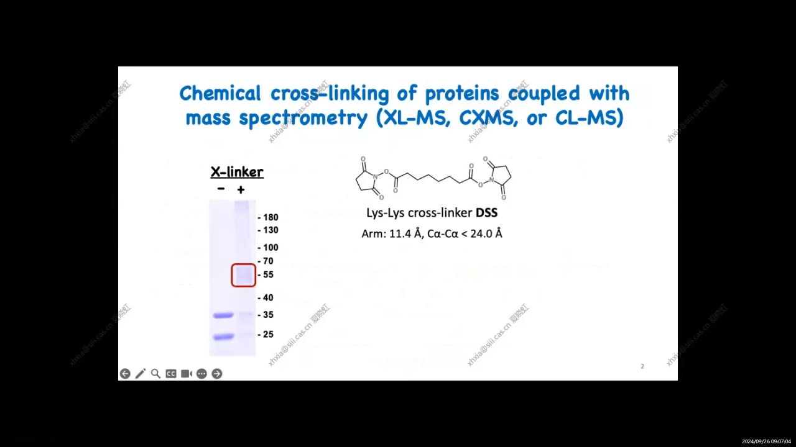
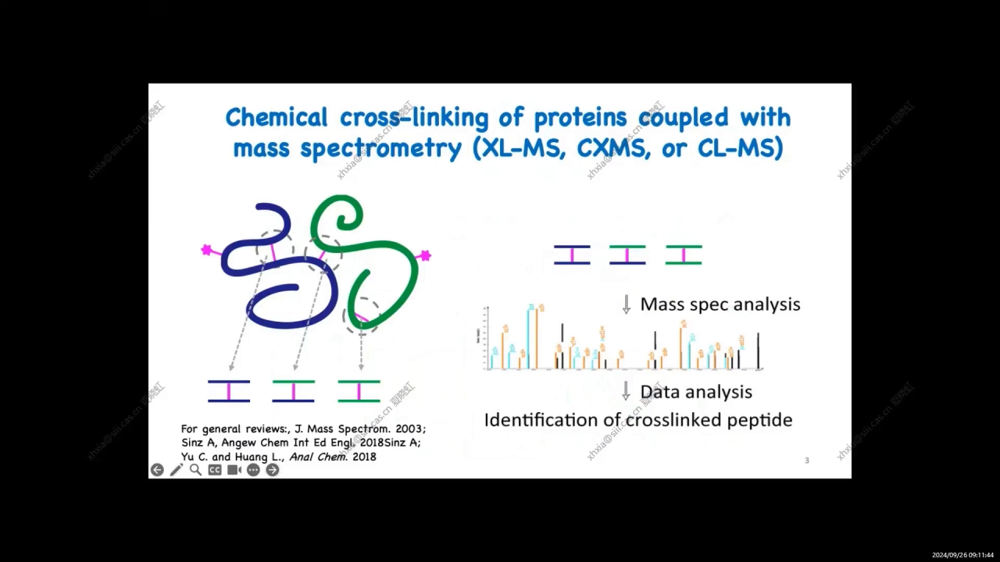
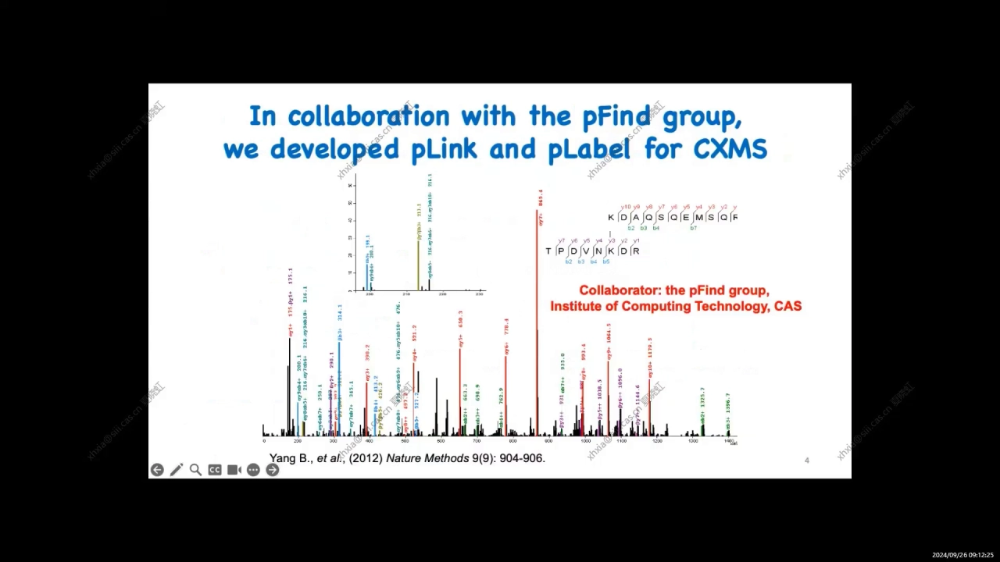
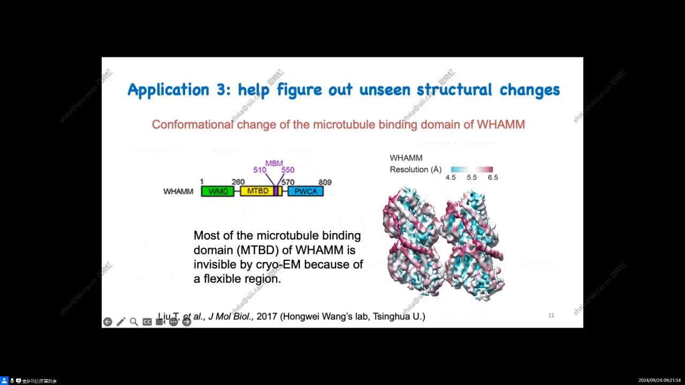
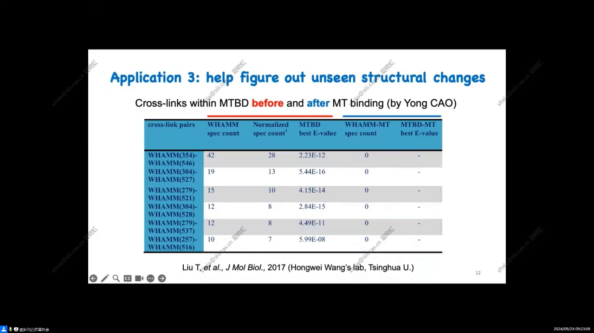
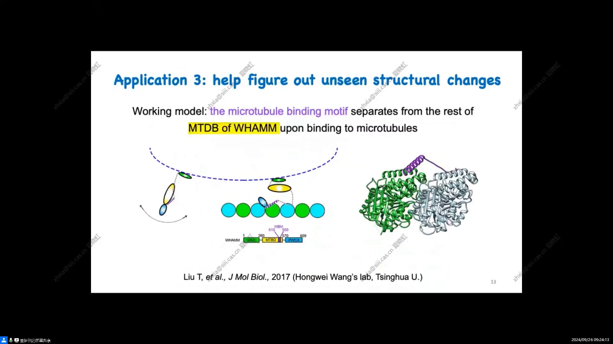
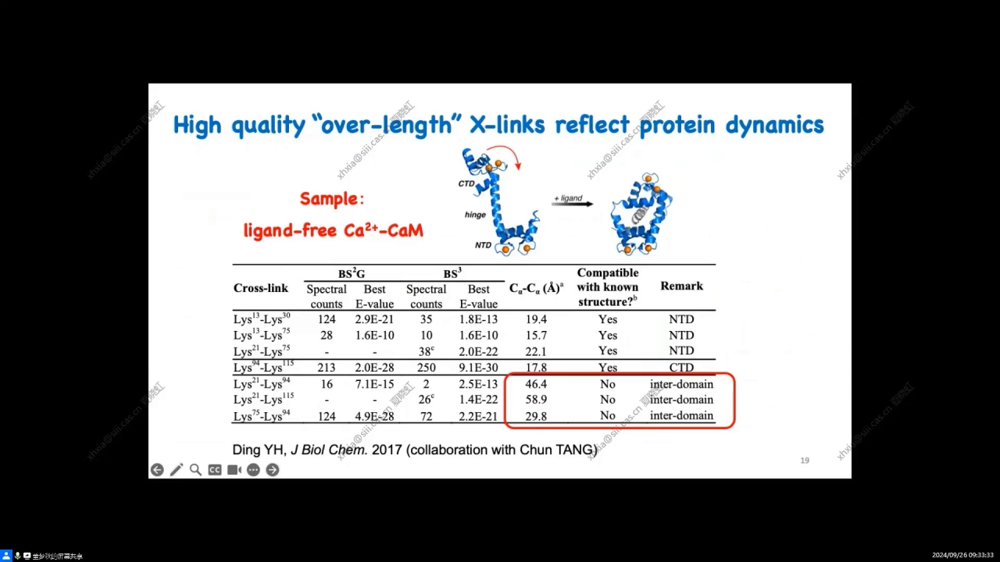
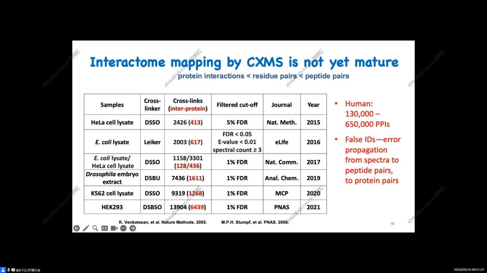

# 交联质谱：距离约束、假阳性与动态构象的证据边界

> 视频来源：[交联质谱 — 董梦秋](https://www.bilibili.com/video/BV19LyVYLEMo/)（Bilibili · 讲者董梦秋，中科院生物物理所）｜时长约 33 分钟
> 简要导读：这是一场方法学报告，讲者从自己二十多年前用交联剂跑 SDS-PAGE 的经历讲起，一路讲到 pLink 软件、冷冻电镜的互补应用，以及"超长交联到底算假阳性还是算动态"这个最容易被误读的问题。适合想搞清楚"交联质谱的距离约束能说到哪一步"的读者。

## 本讲要解决的核心问题（SCQA）

**背景**：冷冻电镜和晶体学能给出原子模型，但对柔性区、瞬时接触、溶液中的构象变化往往无能为力。化学交联质谱（XL-MS）只需要在样品里加一点交联剂，就能得到"哪两个氨基酸在空间上靠得很近"的信息。

**冲突**：交联剂只有十几埃长，看起来像一把精确的尺子。但实际做下来，很多高质量的交联对**和晶体结构对不上**，距离远超交联剂臂长。这些到底是假阳性，还是有别的含义？

**疑问**：交联质谱的样品制备和鉴定流程是怎样的？一条交联肽段对到底约束了什么？和晶体结构不吻合时，应该判为错误还是判为动态？

**回答（中心思想）**：交联质谱给出的是**上限型距离约束**（两个位点的 Cα–Cα 距离不超过约 24 埃），它擅长补冷冻电镜的盲区、描绘相互作用区域；**高质量但"超长"的交联往往不是假阳性，而是溶液中被捕获的瞬时构象**；但把交联推广到全蛋白质组水平的相互作用组图谱，目前仍不成熟，主要受限于假阳性累积和分子间交联比例过低。

## 一、一根 11.4 埃的化学"尺子"

交联质谱的样品制备非常简单：你有蛋白、有复合体、有蛋白-蛋白相互作用，就往里加化学交联剂。最常用的一类是 NHS 酯交联剂，例如 DSS：[【跳转到 01:41】](https://www.bilibili.com/video/BV19LyVYLEMo/?t=101)

- 两端是 **NHS 酯**，特异性地与赖氨酸侧链的氨基或蛋白质 N 端的氨基反应。
- 中间是一条碳链，**臂长 11.4 埃**。
- 加上两个赖氨酸侧链本身的长度，两个 **Cα 原子之间的距离上限约为 24 埃**。

这就是全部"尺子"的来源：只要两个氨基在空间上足够接近，交联剂就有可能把它们共价连起来。

讲者提到，化学交联其实是很古老的技术。他读硕士时就往样品里加交联剂，然后跑变性 SDS-PAGE：不加交联剂时能看到两个清楚的条带，加了之后如果两个蛋白有相互作用，就会出现一条分子量更大、比较弥散的带。

这里有个实操细节：**要控制交联程度，避免过度交联**。过度交联会产生假象——已经连上的复合体继续被加上交联剂。所以通常控制到还能看到约五分之一单体。剩下的单体条带也会变模糊，因为单体上可能有分子内交联，也可能有不同赖氨酸侧链上的不同修饰，分子量出现不均一增加。

## 二、从凝胶到谱图：交联肽段对的鉴定

### 2.1 交联产物的四种身份

酶切之后，样品里其实混着四类肽段：[【跳转到 05:41】](https://www.bilibili.com/video/BV19LyVYLEMo/?t=341)

1. **分子间交联**：两个不同蛋白（或两个亚基）之间的交联，给出相互作用信息。
2. **分子内交联**：同一个蛋白内部两个位点之间的交联，给出折叠信息。
3. **monolink / dead-end**：交联剂一端反应了，另一端还没找到伙伴就被水解成羧酸，不能再反应。这种"被修饰但没交联"的肽段其实很多。
4. **未交联的线性肽段**：占绝大多数。

### 2.2 为什么必须靠软件解谱

把这块混合物做 LC-MS/MS，会同时采集到大量单肽的二级谱和交联肽段对的二级谱。单肽的谱人工还能解，交联肽段对的谱**基本不可能人工解**——因为要同时定出两条肽段的序列和各自的交联位点。

讲者所在团队与中科院计算所合作开发了 **pLink**（2012 年发表，第一作者杨斌），目前全球使用非常广泛，已经从 pLink 1 进化到 pLink 2。软件的任务就是：把两条肽段的序列分别鉴定出来，并定出交联位点。[【跳转到 07:01】](https://www.bilibili.com/video/BV19LyVYLEMo/?t=421)

前提是谱图质量要足够好——这也是为什么样品制备被讲者称为"决定实验成败、至少占 50% 以上比例"的环节。

## 三、四种成熟的应用

### 3.1 找蛋白-蛋白相互作用的区域

传统做法是表达两个蛋白、做免疫共沉淀或 pull-down，再从 N 端、C 端做一系列截短，看切到哪里相互作用就消失。这个过程很慢，做下来可能要几个月。交联质谱快得多，"做得快第二天就有结果"。

讲者举了一个酵母液泡（溶酶体）蛋白运输的例子：两个酶本该被运进液泡，但它们没有典型的溶酶体定位序列。合作者根据交联结果删掉了第 2 号和第 6 号氨基酸（第 1 号是起始甲硫氨酸，不能删），这段区间里正好包含一个赖氨酸交联位点。删除后，蛋白从液泡定位变成弥散在细胞质里；另一个没被改动的伙伴蛋白也跟着失去了定位。后续生物学实验证明交联找到的位点是对的。[【跳转到 12:33】](https://www.bilibili.com/video/BV19LyVYLEMo/?t=753)

### 3.2 补冷冻电镜的盲点——讲者认为最有价值的场景

冷冻电镜能看清紧实、稳定的结构，但**柔性很强的区域在电镜里就是看不见**。2017 年他们与王宏伟课题组合作的 WHAMM 蛋白就是典型例子：这个蛋白通过中间的微管结合结构域（MTBD）结合微管，但这个三百多个氨基酸的结构域在电镜密度里几乎完全消失，只能看到 510–550 这段微管结合基序形成的一小段 α 螺旋和一个尾巴。[【跳转到 16:31】](https://www.bilibili.com/video/BV19LyVYLEMo/?t=991)

交联质谱不管柔性还是刚性都能给信息。他们比较了"结合微管前"和"结合微管后"两个样品，只展示有差异的交联对：[【跳转到 17:42】](https://www.bilibili.com/video/BV19LyVYLEMo/?t=1062)

结合前，MTBD 内部能检测到大量谱图质量很好的交联（位点集中在 200 多到 500 多）；结合微管后，这些交联**全部消失**。由此推出一个工作模型：结合前 MTBD 是一个紧实结构，微管结合基序与其他区域紧密相邻；结合微管后发生大幅构象变化，连接基序的键解开形成柔性 link，基序插入微管的沟槽，再通过柔性 link 连到结构域其余部分，其余结构域则负责拉着货物沿微管运输。[【跳转到 18:49】](https://www.bilibili.com/video/BV19LyVYLEMo/?t=1129)

讲者的评价是：交联质谱对冷冻电镜的**互补性最好**，因为电镜完全看不到这些信息。

### 3.3 内源性交联

体内本来就有蛋白-蛋白交联：烫头发要形成二硫键才有卷发；皮肤里的胶原蛋白、弹性蛋白都有交联；泛素化从某个角度看也是泛素与被修饰蛋白之间的"交联"，类泛素修饰同理。这些都可以用同一套方法鉴定，只是样品制备要重新设计。

## 四、距离约束怎么读：24 埃意味着什么

讲者描述了团队早期的"天真"想法：既然交联剂有固定臂长，那拿到交联位点后，到晶体结构上量一下两个赖氨酸的 Cα–Cα 距离就行了——小于 24 埃就吻合，大于 24 埃就不吻合，应该做到百分之百吻合。

现实是：**无论怎么做都做不到百分之百吻合**。[【跳转到 27:29】](https://www.bilibili.com/video/BV19LyVYLEMo/?t=1649)

这里要区分两种"不吻合"：

| 情形 | 可能原因 | 判读 |
| --- | --- | --- |
| 低质量谱图、低分交联对 | 鉴定错误（假阳性） | 应过滤掉，不能当证据 |
| 高质量谱图、E 值很低，但距离远超 24 埃 | 溶液中的瞬时构象被交联"锁住" | 可能是真实的动态信息 |

关键在于**先看交联对本身的质量**（谱图匹配、E 值、谱峰计数），再看距离是否吻合。质量差的不吻合，是噪声；质量好的不吻合，才值得追问。

## 五、超长交联：假阳性还是动态的证据

### 5.1 钙调蛋白：46 埃和 59 埃的交联

钙调蛋白的经典晶体结构是哑铃状，中间一根长 α 螺旋把两个结合钙的 EF-hand 结构域分开，两个结构域相距很远，交联剂"绝对够不着"。但他们在无配体的 Ca²⁺-CaM 样品里，确实测到了 N 端与 C 端结构域之间的交联，量出来的 Cα–Cα 距离有 46.4 埃和 58.9 埃。[【跳转到 28:09】](https://www.bilibili.com/video/BV19LyVYLEMo/?t=1689)

这些交联与晶体结构不吻合，但与 NMR 结构吻合。NMR 此前就检测到：即使钙调蛋白结合了钙但没结合配体，仍有约 5% 的时间处于闭合构象。交联的作用机制很巧妙——**一旦闭合构象出现并被交联，它就再也打不开了**，等于把平衡往闭合方向拉动，富集了那些本来只占少数、但真实存在的构象。

### 5.2 松散复合物与紧密复合物的对照

讲者又举了一个双蛋白复合体的例子：鉴定到十几对交联，只有一对与晶体结构吻合，其余都与 NMR 结果吻合。NMR 看到这个复合物"像跳舞一样"，不是一下子结合，而是先在较远距离试探性接触，最后才落到能量最低的基态。

但这**不意味着所有复合物的交联都对不上晶体结构**。讲者特意做了对照：一个 KD 约 0.3 μM 的紧密复合物，交联对虽然只有四对，但**每一对都与晶体结构吻合**，因为它结合紧密、不怎么动。[【跳转到 30:49】](https://www.bilibili.com/video/BV19LyVYLEMo/?t=1849)

由此得到一条很有用的判读经验：**交联结果与晶体结构的吻合程度，本身就能反映复合物的动态性**——吻合度低往往说明这个复合物松散、KD 高、构象在动；吻合度高说明它紧实稳定。

## 六、判读边界：相互作用组图谱还不成熟

讲者对未来方向做了很坦诚的评估。领域里最热的方向是把交联质谱用于全蛋白质组的相互作用网络（interactome mapping），但问题很现实：[【跳转到 26:09】](https://www.bilibili.com/video/BV19LyVYLEMo/?t=1569)

1. **分子间交联比例太低**。在复杂体系里，最多的是没交联的单肽；交联肽段对里更多的是分子内交联（因为分子内距离近、容易交联），分子间的相对少。即使做了分级或交联剂改造来富集，很多仍然分不清是 monolink、分子内还是分子间。
2. **假阳性会逐级累积**。一张谱图鉴定错，错误会累积到肽段对，再累积到蛋白-蛋白相互作用。所以"报告了几万条交联"不等于"几万个可靠相互作用"。
3. **覆盖率仍然很低**。即使目前最好的结果，相对于估计的人类细胞中可能存在的一二十万到几十万对相互作用，也只是一个很小的 fraction。

讲者的结论是：想靠它在整个细胞裂解液里找到你关心的某个转录因子或激酶的相互作用，"难度特别大"。当然，你能看到大量核糖体蛋白之间、某些高丰度蛋白之间的交联——但除非那正是你想看的，否则也是无用信息。

## 小结

- 交联质谱用化学交联剂把空间上接近的氨基酸共价连起来，**臂长 11.4 埃对应 Cα–Cα 约 24 埃的上限**。
- 酶切产物包含分子间交联、分子内交联、monolink 和大量未交联肽段，交联肽段对必须靠 pLink 这类软件解谱。
- 最成熟的应用是：找相互作用区域、补冷冻电镜看不到的柔性区、鉴定内源性交联。
- 距离约束是**上限约束**：小于 24 埃说明"可以接近"，大于 24 埃不必然是假阳性。
- 判读的第一步是看交联对本身的质量（E 值、谱峰计数）；高质量的超长交联往往反映**溶液中的瞬时构象**，与 NMR 结果常常一致。
- 交联与晶体结构的吻合程度，可以反过来当作复合物动态性的一个指标。
- 全蛋白质组水平的相互作用组图谱仍不成熟：分子间交联占比低、假阳性逐级累积、覆盖率低。

## 关键术语速查

| 术语 | 一句话解释 |
| --- | --- |
| XL-MS / CXMS | 化学交联质谱，用交联剂 + 质谱鉴定空间邻近的氨基酸对 |
| DSS / BS3 | 常用 NHS 酯类交联剂，臂长 11.4 埃，连接两个赖氨酸氨基 |
| 交联肽段对 | 被交联剂连在一起的两条肽段，是质谱鉴定的基本单位 |
| monolink / dead-end | 交联剂只有一端反应、另一端被水解的产物 |
| pLink | 交联肽段对专用解谱软件，同时定两条序列与交联位点 |
| 距离约束 | 交联给出的 Cα–Cα 距离上限，约 24 埃 |
| 超长交联 | 距离明显超过臂长上限、但谱图质量很高的交联，常反映瞬时构象 |
| 相互作用组 | 全蛋白质组水平的蛋白-蛋白相互作用网络 |