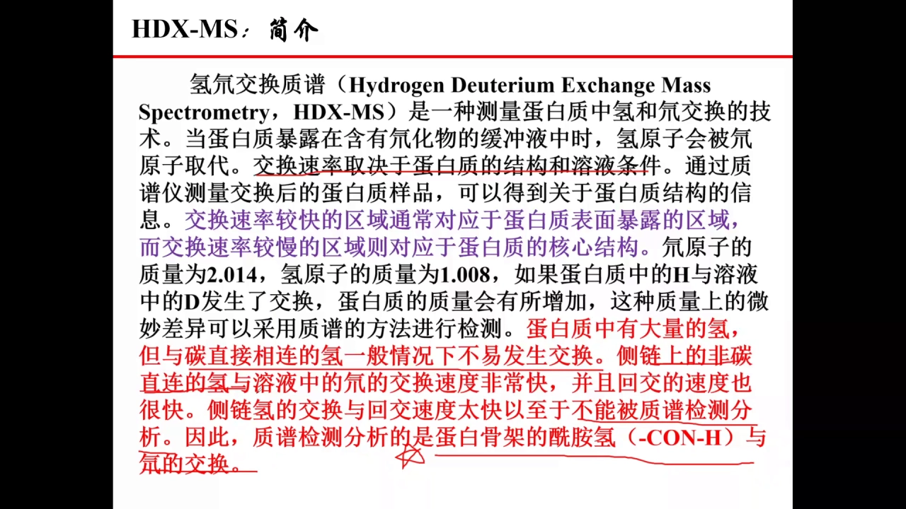
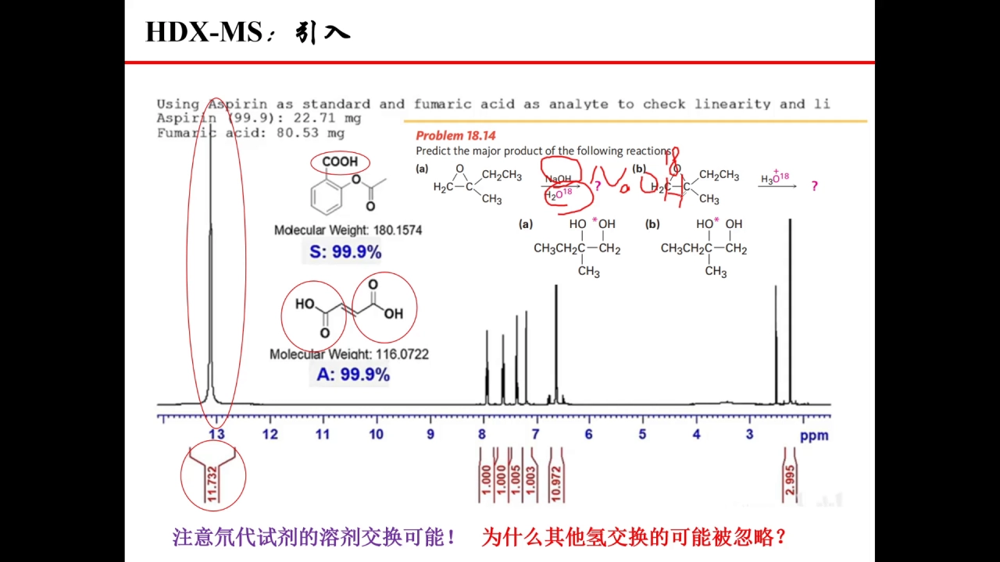
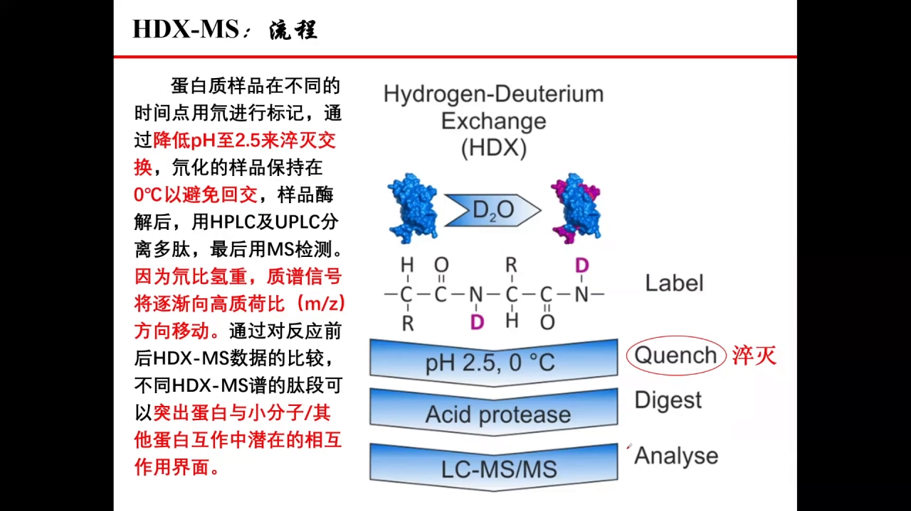

# 氢氘交换质谱：用氘的摄取读出溶剂可及性与相互作用界面

> 视频来源：[生物质谱概述 II：蛋白质相互作用、交联、亲和、氢交换](https://www.bilibili.com/video/BV1LE42137TE/)（Bilibili · UP 主 运舟安生）｜时长约 34 分钟
> 简要导读：这是一次研究生 seminar，前半部分讲质谱基础、交联质谱与亲和纯化质谱，后半部分（约 28 分钟起）专门讲氢氘交换质谱。本文只整理氢氘交换这一段，交联质谱部分见本小节另一篇博客。讲法偏流程与原理，适合作为 HDX-MS 的第一篇入门材料。

## 本讲要解决的核心问题（SCQA）

**背景**：蛋白质在溶液里不是静止的，它会呼吸、会局部展开、会在结合配体时改变构象。晶体结构和冷冻电镜给的是某一个（或几个）状态，看不到这些动态。

**冲突**：氢氘交换现象本身很简单——把蛋白放进重水，氢会被氘换掉，质量增加 1 Da。但蛋白里有成千上万个氢，哪些会换、换多快、换完怎么测，全都有讲究。如果不区分氢的类型，测出来的只是一个没有结构含义的平均数。

**疑问**：到底哪些氢的交换能被质谱测到？交换速率和结构是什么关系？实验流程为什么要"淬灭"和"低温"？HDX-MS 能约束什么、不能约束什么？

**回答（中心思想）**：HDX-MS 测的是**骨架酰胺氢**的交换，交换速率由该氢是否暴露于溶剂、是否参与氢键决定：表面暴露区交换快、埋藏的核心区交换慢。因此它给出的是**溶剂可及性与保护程度**这一层次的约束——能定位相互作用界面、能比较不同状态下的构象变化，但**不能**给出原子坐标，也不能直接给出某个残基的精确距离。

## 一、氘比氢重 1 Da：HDX 的物理基础

氢氘交换质谱（Hydrogen Deuterium Exchange Mass Spectrometry，HDX-MS）是一种测量蛋白质中氢与氘交换的技术。[【跳转到 28:25】](https://www.bilibili.com/video/BV1LE42137TE/?t=1705)当蛋白质暴露在含氘化物的缓冲液中时，氢原子会被氘原子取代。[【跳转到 30:47】](https://www.bilibili.com/video/BV1LE42137TE/?t=1847)

关键在于质量差：氘的原子质量是 2.014，氢是 1.008。一个氢被换成氘，蛋白质量就增加约 1 Da。[【跳转到 31:17】](https://www.bilibili.com/video/BV1LE42137TE/?t=1877)单个交换看不出来，但一段肽段上十几个、几十个氢同时交换，质量差就足以被高分辨质谱分辨出来。

讲者用核磁共振里的一个例子做铺垫：定量氢谱里某个羧基的积分是 11.732 而不是理论上的 10 左右，就是因为活泼氢会与氘代试剂发生**溶剂交换**。[【跳转到 29:05】](https://www.bilibili.com/video/BV1LE42137TE/?t=1745)有机化学教材里也有类似的例子：反应体系中的氧会与氢氧化钠发生交换，把 ¹⁸O 带进产物。[【跳转到 29:45】](https://www.bilibili.com/video/BV1LE42137TE/?t=1785)[【跳转到 30:25】](https://www.bilibili.com/video/BV1LE42137TE/?t=1825)

## 二、只有骨架酰胺氢在"可测的时间尺度"上交换

蛋白质里有大量氢，但它们的交换行为差别极大，讲者把它们分成三类：

| 氢的类型 | 交换行为 | 能否用于分析 |
| --- | --- | --- |
| 与碳直接相连的氢（C–H） | 一般不易发生交换 | 不能 |
| 侧链上非碳直连的氢（如 –OH、–NH₂） | 交换极快，回交也极快 | 不能 |
| 骨架酰胺氢（–CO–NH–） | 交换速度适中，可被结构保护 | **能，是 HDX-MS 的真正对象** |

侧链氢的问题在于"双向都太快"：氢变成氘很快，氘变回氢也很快，在样品处理过程中早就交换回去了，质谱上根本留不住信号。所以**质谱实际检测的，是蛋白骨架酰胺氢与氘的交换**。[【跳转到 31:57】](https://www.bilibili.com/video/BV1LE42137TE/?t=1917)

这一点决定了 HDX-MS 的分辨率边界：酰胺氢沿着主链一个一个排布，它的交换状态间接反映该残基所在位置的溶剂可及性和氢键状态——但它是主链的报告者，不是侧链的报告者。

## 三、交换速率编码了结构信息：表面快、核心慢

交换速率取决于两件事：**蛋白质的结构**和**溶液条件**。[【跳转到 31:12】](https://www.bilibili.com/video/BV1LE42137TE/?t=1872)结构方面最核心的规律是：

- **交换速度较快的区域**，通常对应蛋白质表面暴露的区域；
- **交换速度较慢的区域**，对应蛋白质的核心结构。

背后的化学逻辑是：酰胺氢要发生交换，必须先被溶剂（D₂O）接触到，并且要摆脱原有的氢键。埋藏在疏水核心、或者参与稳定二级结构氢键的酰胺氢，接触不到溶剂、也脱不开氢键，交换就慢。所以"慢"本身就是一种**保护**信号。

这就给出了 HDX-MS 的两种典型用法：

1. **比较不同状态**：同一个蛋白在结合配体、结合另一个蛋白、或者改变 pH/温度之后，哪些肽段的交换变慢或变快。变慢说明这段被保护了（可能形成了界面或被埋藏），变快说明这段变得更暴露或更柔性。
2. **定位相互作用界面**：比较蛋白单独存在和形成复合物两种状态，差异最显著的肽段就指向界面区域。[【跳转到 33:40】](https://www.bilibili.com/video/BV1LE42137TE/?t=2020)

## 四、四步流程：标记、淬灭、酶切、LC-MS

HDX-MS 的流程可以概括为四步：[【跳转到 33:00】](https://www.bilibili.com/video/BV1LE42137TE/?t=1980)

1. **标记（Label）**：在不同时间点用氘进行标记。时间点构成一条"交换动力学曲线"——早期时间点只看得到最快交换的氢，晚期时间点才轮到慢交换的氢。
2. **淬灭（Quench）**：把 pH 降到 2.5，同时把样品保持在 0 °C。低 pH 让交换速率骤降，低温进一步抑制回交。这一步是 HDX-MS 的技术核心：**交换反应必须在被"冻住"的状态下进入质谱**。
3. **酶切（Digest）**：用酸性蛋白酶（如胃蛋白酶）在淬灭条件下消化。普通胰酶在 pH 2.5 下不工作，所以必须用酸性条件下有活性的蛋白酶。
4. **分析（Analyse）**：用 HPLC/UPLC 分离肽段，再用质谱检测。因为氘比氢重，交换后的肽段信号会**向高质荷比方向移动**；比较反应前后（或不同时间点）的同一条肽段的质量分布，就能算出每个肽段摄入了多少氘。

这里有一个容易被忽略的工程难点：整个淬灭、酶切、分离、进样过程都要在低温和酸性下尽快完成，否则氘会在路上跑掉（回交），测出来的保护程度就被系统性低估。[【跳转到 34:01】](https://www.bilibili.com/video/BV1LE42137TE/?t=2041)

## 五、判读边界：HDX-MS 能约束什么

把上面的机制翻译成"证据强度"，可以得到几条清晰的边界：

**能给出的**：

- **溶剂可及性/保护程度的差异**，按肽段分辨率（通常十几到几十个残基一段）给出。
- **相互作用界面的候选区域**：结合后交换显著变慢的肽段。
- **构象变化的定性描述**：哪些区域变得更暴露、哪些被埋藏。
- **动态信息**：交换动力学曲线本身包含快慢两相的信息，反映局部的结构涨落。

**不能给出的**：

- **原子坐标**。HDX 不测量任何距离，只测量"交换了多少"。
- **精确的界面残基**。分辨率受限于酶切产生的肽段长度，通常只能定位到一段序列，而不是某一个残基。
- **绝对的保护程度**。交换速率还受 pH、温度、缓冲液影响，只能在同一实验条件下做**相对比较**。
- **侧链的信息**。侧链氢交换太快，测不到。

因此，HDX-MS 在整合结构建模里的正确定位是：**提供溶液状态下的保护性约束**，用来筛选、验证或修正高分辨率结构模型给出的界面假设，而不是自己独立给出结构。这与 SAXS 提供整体形状包络、交联质谱提供距离上限，属于同一层次的"低分辨率证据"。

## 小结

- HDX-MS 测量蛋白质中氢与氘的交换，氘比氢重约 1 Da，质量增加可被高分辨质谱读出。
- 蛋白里绝大多数氢不能用于分析：C–H 不易交换，侧链活泼氢双向都太快；**真正被检测的是骨架酰胺氢**。
- 交换速率由结构和溶液条件决定：**表面暴露区交换快，核心区交换慢**，"慢"意味着被氢键或埋藏保护。
- 标准流程是：D₂O 标记 → pH 2.5、0 °C 淬灭 → 酸性蛋白酶酶切 → LC-MS/MS 分析，信号向高质荷比移动。
- 典型应用是比较不同状态、定位相互作用界面；它给出的是**溶剂可及性与保护程度**层面的约束，不能给原子坐标和精确距离。
- 与其他低分辨率证据一样，HDX-MS 的价值在于与高分辨率结构联合使用，而不是单独下结论。

## 关键术语速查

| 术语 | 一句话解释 |
| --- | --- |
| HDX-MS | 氢氘交换质谱，用 D₂O 标记 + 质谱读质量增加 |
| 酰胺氢 | 主链 –CO–NH– 上的氢，是 HDX-MS 唯一可测的对象 |
| 交换速率 | 单位时间内氢被氘取代的比例，受溶剂可及性与氢键保护影响 |
| 保护 | 埋藏或形成氢键使交换变慢的现象，是结构信息的来源 |
| 淬灭 | 把 pH 降到 2.5、温度降到 0 °C 以停止交换和回交 |
| 回交 | 已接入的氘在后续处理中重新变回氢，导致信号丢失 |
| 酸性蛋白酶 | 在 pH 2.5 下仍有活性的蛋白酶（如胃蛋白酶），用于淬灭条件下酶切 |
| 质量偏移 | 交换后肽段质荷比向高值移动的幅度，对应摄入的氘数量 |