# 从 RMSD 到 TM-score：结构叠合在优化什么，以及 RMSD 为什么不够用

> 视频来源：[结构生物信息学【密歇根大学张阳】：g1-蛋白质结构比较（TM-score）](https://www.bilibili.com/video/BV141421Q7dB/)（Bilibili · 张阳 · 时长约 68 分钟）
>
> 这是张阳教授结构生物信息学课程的"结构比较"一讲，也是 TM-score 提出者本人来讲 TM-score 的来历。前半段从"叠合"讲到 RMSD 的定义与最小化（Kabsch 问题），后半段讲 RMSD 在柔性尾巴、长度和覆盖范围上的失效，以及 TM-score 如何用 $d_0$ 归一化把它修好。本文按"叠合 → RMSD → RMSD 的软肋 → TM-score → 两者怎么选"的顺序整理，保留课堂上的具体数值与示意图。

## 本讲要解决的核心问题（SCQA）

**背景**：比较两个蛋白质结构，最直接的办法是把它们叠合到一起，再看对应原子之间的平均距离——这就是 RMSD。它是一个有几十年历史、几乎所有结构工具都会输出的数字。

**冲突**：但这个数字会"骗人"。课堂上有两个模型：一个核心区与实验结构几乎重合，只是尾巴绕向了别处；另一个整体拓扑都不对。两者的 RMSD 却都是 12 Å 左右。更极端的一对例子是：RMSD 12.1 Å 的模型 TM-score 是 0.81（好模型），RMSD 12.5 Å 的模型 TM-score 只有 0.22（差模型）——**RMSD 几乎一样，好坏却天差地别**。

**疑问**：叠合到底在优化什么？为什么同一个 RMSD 可以对应完全不同的结构相似性？如果 RMSD 不够用，替代品是什么、它又凭什么更可靠？

**回答（中心思想）**：叠合的本质是**求一个刚体旋转，使对应原子距离的平方和最小**——这是一个有解析解的数学问题（Kabsch，1976）。而 RMSD 的毛病出在"平均"上：它对**离群点（柔性尾巴、loop）**、**蛋白长度**和**覆盖范围**都敏感，所以它只能回答"叠得多紧"，回答不了"折叠像不像"。TM-score 的修法很巧：把距离放进**分母**，让大距离的贡献自动衰减，再用与长度相关的 $d_0$ 归一化，于是它**不依赖长度**、对**全局拓扑**更敏感，0.5 附近恰好对应"是不是同一个 fold"。所以：**判断局部贴合精度用 RMSD，判断整体折叠相似性用 TM-score。**

---

## 一、先分清两件事：叠合（superposition）与比对（alignment）

讲者把这一讲要澄清的两个概念直接摆在开头：**叠加**和**比对**，"这两个非常重要的概念希望这一页能讲清楚"。[【跳转到 02:02】](https://www.bilibili.com/video/BV141421Q7dB/?t=122)

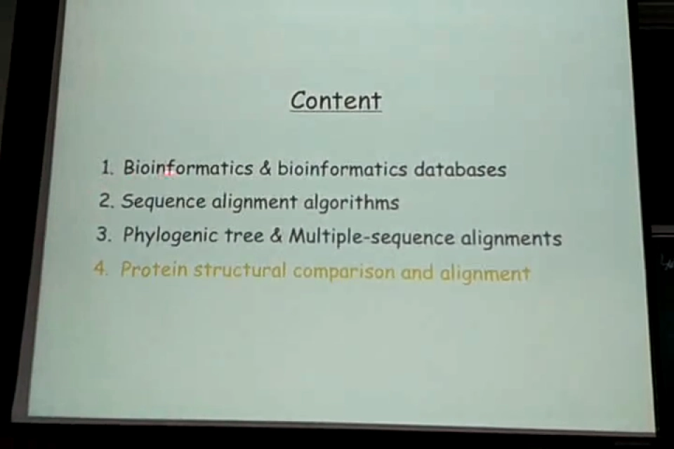

### 1.1 情况一：序列相同，只是结构不同 → 叠合

第一种情形：一个蛋白是**实验测定的结构**，另一个是我用计算机**预测的结构**。两个结构可能不一样，那这个预测到底有多好？讲者说，"唯一的方法就是你把它叠加上去"，然后看它们相互之间的平均距离是多少。[【跳转到 02:27】](https://www.bilibili.com/video/BV141421Q7dB/?t=147)

关键在于：**这时两个序列是完全相同的**，所以"哪个对哪个"是已知的——第一个对第一个、第二个对第二个、第三个对第三个。对应关系已知，剩下的只是把坐标摆到一起。这个动作就叫 **superposition（叠加）**。[【跳转到 03:17】](https://www.bilibili.com/video/BV141421Q7dB/?t=197)

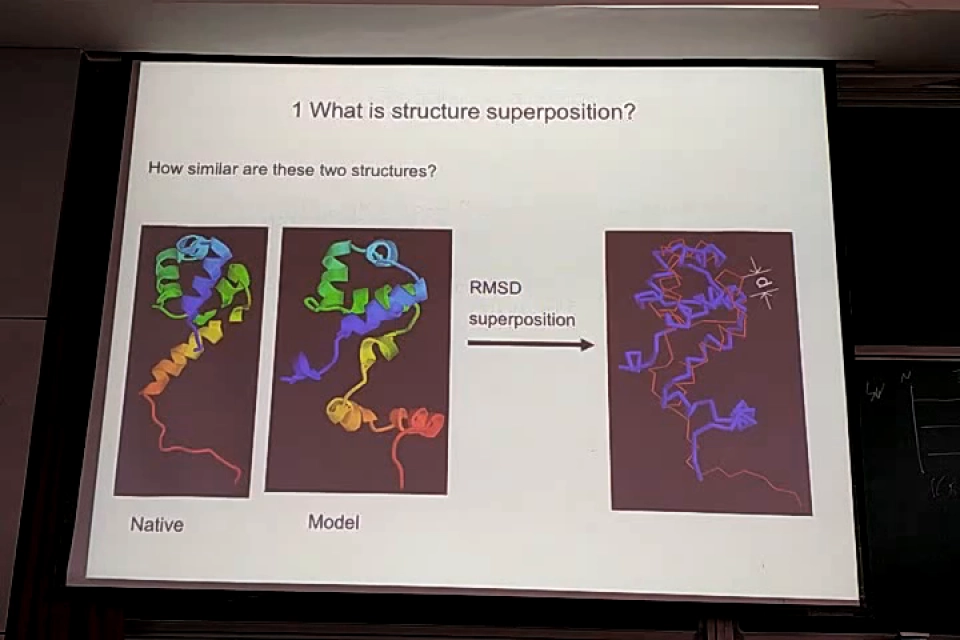

### 1.2 情况二：序列不同，长度也不同 → 比对

第二种情形：这是一个蛋白，那是另一个版本的蛋白，**两者长度都不一样、序列完全不一样**，但我仍然有必要比较它们的结构相似性——因为不同的蛋白是否执行同样的功能，很大程度上要看三维结构像不像。[【跳转到 03:42】](https://www.bilibili.com/video/BV141421Q7dB/?t=222)

这时用的就是 **structure alignment（结构比对）**：要找到一个 best match，也就是在两个结构之间建立**残基对应关系**，再用一个分数来评估相似性。[【跳转到 05:10】](https://www.bilibili.com/video/BV141421Q7dB/?t=310)

所以两者的分工是：

| | 叠合（superposition） | 比对（alignment） |
| --- | --- | --- |
| 前提 | 序列相同，对应关系已知 | 序列不同，对应关系要自己找 |
| 要解决的问题 | 只求刚体变换 | 求对应关系 + 刚体变换 |
| 典型场景 | 预测模型 vs 实验结构 | 两个同源/非同源蛋白比较 |

讲者在这一页也给出了必读文献清单，后面反复用到的两个名字就在这里：**RMSD 的 Kabsch 1976**、**TM-score 的 Zhang & Skolnick 2004**，以及比对算法 **DALI（Holm & Sander 1993）**、**CE（Shindyalov & Bourne 1998）**、**TM-align（Zhang & Skolnick 2005）**。[【跳转到 02:02】](https://www.bilibili.com/video/BV141421Q7dB/?t=122)

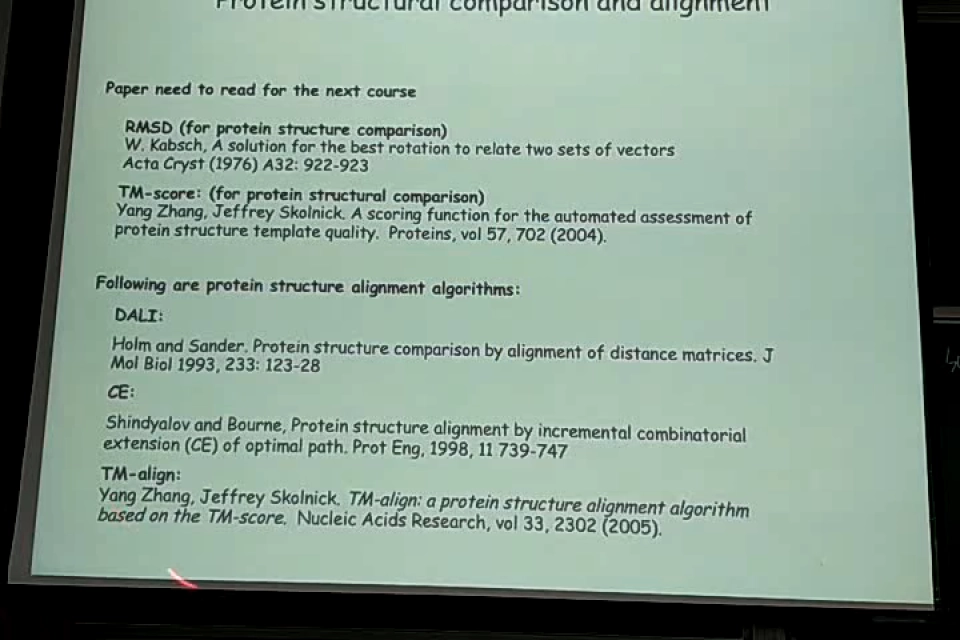

---

## 二、叠合在优化什么：RMSD 是"最小化"出来的

### 2.1 先把 RMSD 写成一句话

RMSD 的定义是：把两个结构叠合之后，每一对对应原子距离 $d_i$ 的平方，求和、除以原子数 $M$、再开方。[【跳转到 06:39】](https://www.bilibili.com/video/BV141421Q7dB/?t=399)

$$
\mathrm{RMSD} = \min\left[\sqrt{\frac{1}{M}\sum_{i=1}^{M} d_i^{2}}\right]
$$

这里的 $i$ 是第 $i$ 个原子，**课堂明确说"我们只考虑 Cα"**——Cα 就代表这个残基。[【跳转到 07:00】](https://www.bilibili.com/video/BV141421Q7dB/?t=420)

### 2.2 为什么公式外面要套一个 min

因为"随便叠上去"是不行的。讲者举了一个很直观的例子：两个结构在同一个坐标系里，你把中心平移到重合，方向可能还是歪的，算出来的距离很大。[【跳转到 07:50】](https://www.bilibili.com/video/BV141421Q7dB/?t=470)

所以真正要解的是一个**求极值**的问题：找一个旋转，把结构 $y$ 变换到结构 $x$ 上，使残差

$$
E = \left(\vec{x} - U\vec{y}\right)^2
$$

最小。这里 $U$ 是三维的旋转矩阵（$3\times3$，因为变换必须是**刚体**的——如果每个点各转各的，结构的形状就变了）。[【跳转到 11:23】](https://www.bilibili.com/video/BV141421Q7dB/?t=683)

约束条件是 $U$ 必须正交：

$$
\sum_k U_{ki}U_{kj} - \delta_{ij} = 0
$$

幻灯片上给这个约束的注释是 **"Unitary transformation to keep structure rigid"**——正交变换才能保持结构刚性、长度不变。[【跳转到 11:48】](https://www.bilibili.com/video/BV141421Q7dB/?t=708)

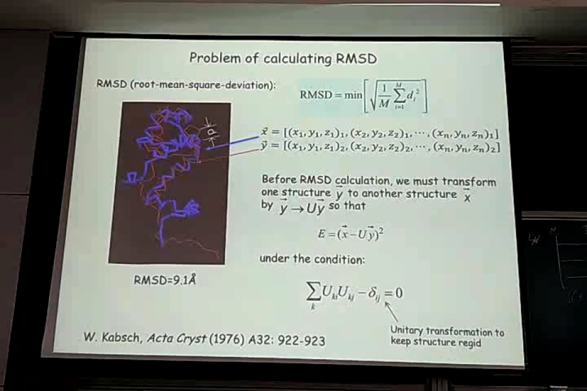

### 2.3 解法：拉格朗日乘子 + 线性代数

课堂上的推导路径是标准的：给目标函数加上带乘子的正交约束，构成拉格朗日函数，再对 $U$ 求极值。讲者的评价是"这个问题用线性代数就能解决，数学上解决得非常干净，可以得到一个最终的关于 $U$ 的解"。[【跳转到 12:13】](https://www.bilibili.com/video/BV141421Q7dB/?t=733)

对使用者来说，结论比推导更重要：

- **给定两组对应的坐标，最优旋转矩阵有解析解**，不需要迭代搜索；
- 所以"叠合"这一步是**确定性的、快速的**——只要对应关系定了，RMSD 就定了；
- 真正麻烦的是**对应关系怎么定**（也就是比对），那是下一层的问题。

---

## 三、RMSD 的经验刻度：2 Å 与 6 Å

有了数字，就需要一把尺子。课堂给出一张"General RMSD values"的对照图，把 RMSD 分成三段：[【跳转到 16:02】](https://www.bilibili.com/video/BV141421Q7dB/?t=962)

| RMSD 区间 | 含义（幻灯片原文） | 课堂举例 |
| --- | --- | --- |
| $[0, 2\,\text{Å}]$ | high resolution structures of close similarity | 1.8 Å |
| $[2\,\text{Å}, 6\,\text{Å}]$ | similar topology, medium resolution | 4.1 Å |
| $> 6.5\,\text{Å}$ | different topology | 7.2 Å |

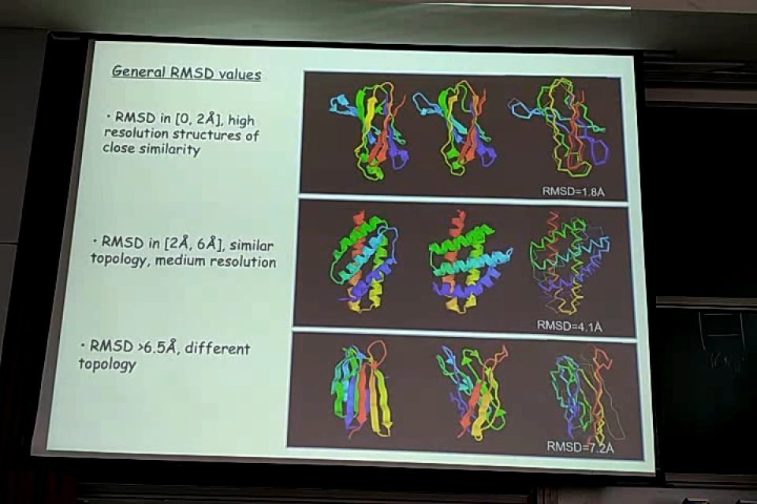

讲者对着图逐行解释：

- **1.8 Å**：骨架走向几乎一致，"只要 RMSD 小于 2 Å，这样的预测都是很精确的"，属于高精度预测；
- **4.1 Å**：拓扑（topology）是一样的，但二级结构的朝向有偏差，属于中等；
- **7.2 Å**：整体形状看着像，但二级结构"怎么绕过来的"不一样——拓扑不同。[【跳转到 16:27】](https://www.bilibili.com/video/BV141421Q7dB/?t=987)

> 注意这三段尺子的前提是**同一套原子（Cα）、同一条链、全部残基都参与计算**。一旦换掉其中任何一个前提，这把尺子就不适用了——这正是下一节要讲的。

---

## 四、RMSD 的三个软肋：它为什么会被"局部"绑架

### 4.1 软肋一：柔性尾巴和 loop 能一票否决

课堂给出一组很扎心的对照：两个 model，核心区（core）与实验结构"非常相似"，只是**尾巴绕的方向不一样**。[【跳转到 17:42】](https://www.bilibili.com/video/BV141421Q7dB/?t=1062)

讲者算了一笔账：假设这条尾巴只有 10 个氨基酸，每个残基偏 20 Å，那么

$$
\mathrm{RMSD} \approx \sqrt{\frac{10 \times 20^2}{N}}
$$

只要 $N$ 不大，这个值就会被拉到十几埃。而另一对**完全错误的预测**，因为中间也有一段大偏差，算出来同样是 12 Å。[【跳转到 19:52】](https://www.bilibili.com/video/BV141421Q7dB/?t=1192)

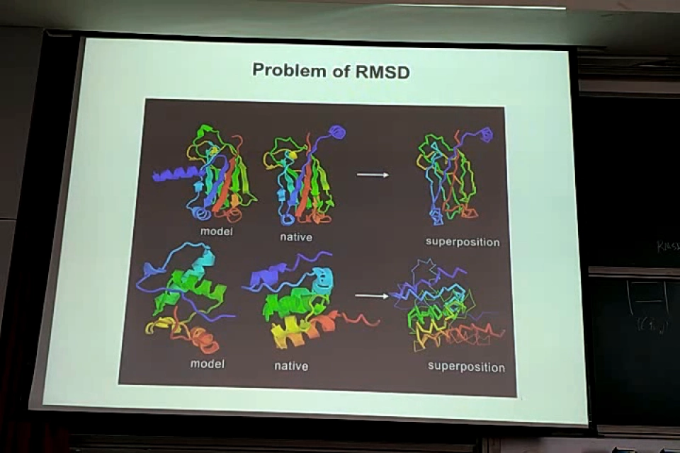

讲者的结论很直接："在这个意义上来讲，RMSD 并不能够用来衡量这两个结构的相似性。"在大部分情况下它好像能用，但在 loop 这类区域出问题时，一个本来很好的结构会被判成很差。[【跳转到 20:17】](https://www.bilibili.com/video/BV141421Q7dB/?t=1217)

**这就是"离群点"问题**：RMSD 是平方和平均，大偏差被平方放大，而且**每个原子权重相同**。核心区几百个原子对得再好，也压不住尾巴上十个残基的 20 Å。

### 4.2 软肋二：RMSD 依赖蛋白长度

第二个问题更隐蔽。讲者说，如果你去统计 PDB 里**随机挑两个结构**的平均 RMSD，会发现它和长度呈指数关系：**长度越大，平均 RMSD 越大；长度越小，平均 RMSD 越小**。"所以 RMSD 也具有类似的缺陷。"[【跳转到 28:46】](https://www.bilibili.com/video/BV141421Q7dB/?t=1726)

这意味着：一个 100 残基的蛋白做到 4 Å，和一个 500 残基的蛋白做到 4 Å，**难度完全不是一回事**。RMSD 没有把长度归一化，所以它不是一个"绝对"的相似性刻度，跨蛋白比较时容易失真。

### 4.3 软肋三：覆盖范围决定数值

第三个问题来自"你算了多少残基"。讲者举了一个非常实际的场景：一个实验只建模了 100 个残基中的 70 个，另一个实验把 100 个都建了，RMSD 是 6 Å；前者因为只算那一块，RMSD 只有 4 Å——**你根本没法判断哪个更好**。[【跳转到 56:38】](https://www.bilibili.com/video/BV141421Q7dB/?t=3398)

更极端的说法是："如果你只是预测得很精确，我只预测一个残基，RMSD 永远都是零。"[【跳转到 56:10】](https://www.bilibili.com/video/BV141421Q7dB/?t=3370)

所以 RMSD 天生奖励"算得少"：**叠合范围越小、参与计算的残基越少，数值越容易好看**。这解释了为什么比赛里"只瞄其中一块"的做法能让 RMSD 看起来很漂亮，而它并不说明模型更好。[【跳转到 58:40】](https://www.bilibili.com/video/BV141421Q7dB/?t=3520)

> 小结这三个软肋：**RMSD 对"哪些原子、多少残基、多长的链"全都敏感**。所以看到 RMSD 的第一反应应该是追问这三个前提，而不是直接比较数值大小。

---

## 五、TM-score：把距离放到分母上

### 5.1 定义：一个大距离只贡献一点点

TM-score 的定义是：[【跳转到 22:21】](https://www.bilibili.com/video/BV141421Q7dB/?t=1341)

$$
\mathrm{TM\text{-}score} = \max\left[\frac{1}{N}\sum_{i=1}^{N}\frac{1}{1+\left(\dfrac{d_i}{d_0}\right)^2}\right], \qquad 0 < \mathrm{TM\text{-}score} \le 1
$$

和 RMSD 相比，最大的改动是 **$d_i$ 从分子搬到了分母**。讲者解释这个改动的效果：[【跳转到 23:01】](https://www.bilibili.com/video/BV141421Q7dB/?t=1381)

- 如果 $d_i$ 很大，$\left(d_i/d_0\right)^2$ 很大，这一项就**接近 0**；
- 如果 $d_i$ 很小、接近 0，这一项就**接近 1**；
- 所以**距离越大，权重越小**——"这个 score 本身就会忽略掉距离很大的那一部分"。

换句话说，RMDS 是"每个原子都必须交代"，TM-score 是"对得上的原子加分，对不上的原子几乎不加分也不狠扣分"。柔性尾巴因此不再能一票否决。

### 5.2 $d_0$：让分数与长度无关的那个标度

分母里的 $d_0$ 不是随便取的常数，而是与蛋白长度挂钩：

$$
d_0 = 1.24\sqrt[3]{N-15} - 1.8
$$

其中 $N$ 是残基数。[【跳转到 22:41】](https://www.bilibili.com/video/BV141421Q7dB/?t=1361)

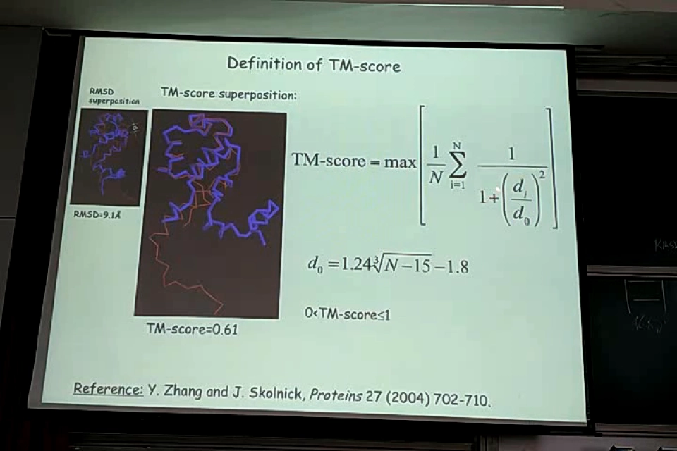

为什么要这么设？讲者用"随机结构"做了论证：如果 $d_0$ 取常数，那么随机挑两个结构算出的 TM-score 会随长度单调变化——小蛋白能到 0.2、0.3，大蛋白只有 0.02。**但随机结构之间本来就应该"一样不相似"**，分数却随长度漂移，说明这个分数没有绝对意义。[【跳转到 27:31】](https://www.bilibili.com/video/BV141421Q7dB/?t=1651)

把 $d_0$ 设成随长度增长的量之后，随机结构的平均分被"拉平"了：图中归一化后的 TM-score 是一条水平线，**约 0.17**，不再随长度变化。[【跳转到 27:56】](https://www.bilibili.com/video/BV141421Q7dB/?t=1676)

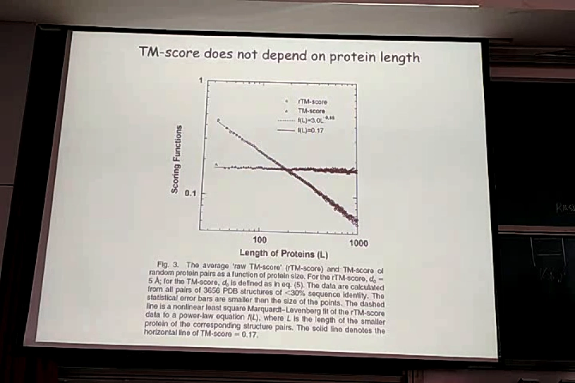

这张图是理解"尺度依赖"最好的材料：**同一个物理事实（两个随机结构），换个标度就从"随长度漂移"变成"恒定"**。RMSD 没有这一步归一化，所以它做不到。

### 5.3 怎么算：没有解析解，只能迭代

TM-score 的麻烦在于：RMSD 那套 Kabsch 解析解只能最小化平方和，而 TM-score 要最大化的是一个非线性函数，**"很不幸的是，这个 TM 没法解析地得到最大值"**。[【跳转到 31:41】](https://www.bilibili.com/video/BV141421Q7dB/?t=1901)

课堂给的做法是启发式迭代：[【跳转到 35:05】](https://www.bilibili.com/video/BV141421Q7dB/?t=2105)

1. 随机选一段初始片段，做一次 RMSD 叠合；
2. 叠合后，找出所有距离小于 $d_0$ 的残基对；
3. 用这批新的残基对**重新做 RMSD 叠合**；
4. 重复 2–3 直到收敛；
5. 换不同的起点重来很多次，取 TM-score 最高的那个解。

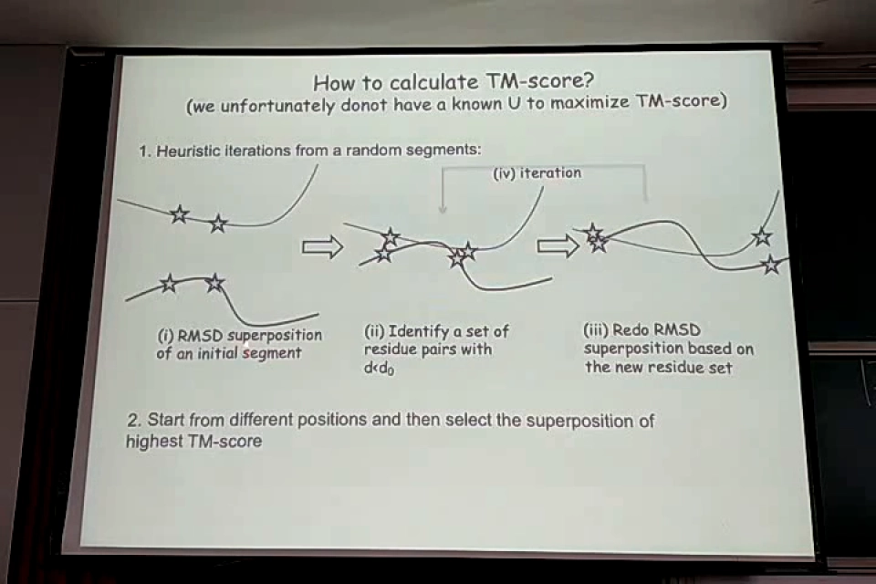

讲者坦言这个办法"虽然不是很漂亮，但是它很实用"，而且很慢——每次迭代都要做一次叠合，为了找到全局最优要重复数百到数千次。这也解释了为什么后来要有 **TM-align** 这种更快的实现。[【跳转到 37:05】](https://www.bilibili.com/video/BV141421Q7dB/?t=2225)

---

## 六、同一对结构，两个数字：什么时候用哪个

### 6.1 决定性的对照：RMSD 12 Å 的两个模型

课堂给出的这组例子，几乎可以作为"为什么需要 TM-score"的标准答案：[【跳转到 22:06】](https://www.bilibili.com/video/BV141421Q7dB/?t=1326)

| 模型 | RMSD | TM-score | 判断 |
| --- | --- | --- | --- |
| 1ca4A | 12.1 Å | 0.81 | 好模型（核心区对得很准） |
| 1cmaA | 12.5 Å | 0.22 | 差模型（拓扑都不对） |

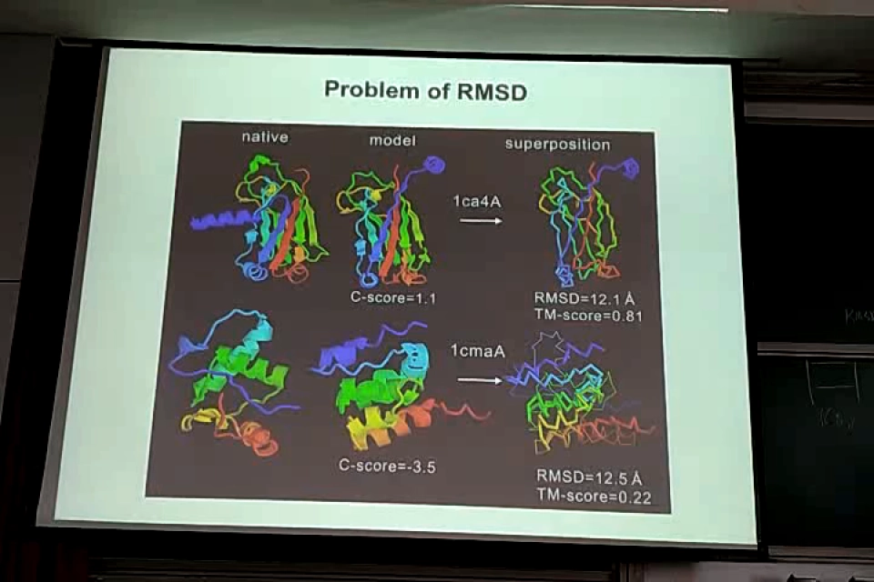

两个模型的 RMSD 只差 0.4 Å，**从 RMSD 看几乎一样**；但一个核心区高度重合、另一个整体拓扑错误，TM-score 把它们分成了 0.81 和 0.22。讲者的结论是："TM-score 对拓扑是非常敏感的。"[【跳转到 40:04】](https://www.bilibili.com/video/BV141421Q7dB/?t=2404)

### 6.2 四象限图：RMSD 与 TM 并不单调对应

另一页把四种情况并排放：

- RMSD 2.5 Å / TM 0.84 —— 又紧又像；
- RMSD 6.5 Å / TM 0.56 —— 局部差一些，拓扑还在；
- RMSD 10.4 Å / TM 0.22 —— 拓扑不同；
- RMSD 10.5 Å / TM 0.70 —— **RMSD 很差，但拓扑其实是对的**。

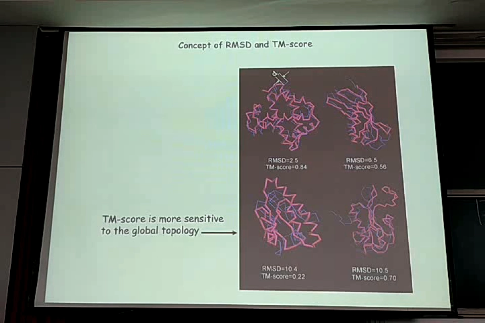

第三、四两组的对比最说明问题：RMSD 10.4 和 10.5 几乎一样，TM-score 却是 0.22 和 0.70。**RMSD 分不开的，TM-score 能分开。**

### 6.3 两者之间有没有简单换算？

有同学问：RMSD 小于 3 Å 大概相当于 TM 多少分？讲者的回答是**没有稳定的换算关系**：[【跳转到 51:22】](https://www.bilibili.com/video/BV141421Q7dB/?t=3082)

- 只有在 RMSD 很小的区间，两者才近似反比（RMSD 小 → TM 高）；
- 一旦 RMSD 超过 2 Å 左右，关系就"发散得很厉害"——RMSD 很大时，TM 可能很低，也可能很高（取决于那部分大距离是不是不重要的尾巴）。[【跳转到 52:07】](https://www.bilibili.com/video/BV141421Q7dB/?t=3127)

所以**不要试图用一个经验系数在两者之间换算**，它们是回答不同问题的两个指标。

### 6.4 原子选择：换成侧链会怎样？

有同学追问：TM-score 里 $d_i$ 用的是 Cα，如果换成侧链原子会怎样？讲者的回答是"很容易，把坐标换一下就行"，而且**权重不需要改**——$d_0$ 这个标度仍然用同一套标准。[【跳转到 53:37】](https://www.bilibili.com/video/BV141421Q7dB/?t=3217)

这段问答点出了本节最重要的一件事：**RMSD 和 TM-score 都是"在某一组原子上"定义的**。Cα 只是最常用的选择，因为一个残基一个点、最能代表骨架；换成主链原子或侧链原子，数值会变，但"选哪组原子"这件事必须自己交代清楚。

---

## 七、TM-score 0.5 是什么意思：显著性、p 值与 fold 的相变

### 7.1 p 值：随机结构也能拿到某个分数

有了分数，还要知道"多高才算显著"。课堂的做法是：把库里所有蛋白做 all-to-all 比较，得到海量"相似与不相似"的样本，发现 TM-score 的分布符合**极值分布（extreme value distribution）**，积分之后就得到 **p-value**——即"两个随机结构拿到同样或更高分数的概率"。[【跳转到 41:17】](https://www.bilibili.com/video/BV141421Q7dB/?t=2477)

结果是：[【跳转到 42:32】](https://www.bilibili.com/video/BV141421Q7dB/?t=2552)

- TM 小于约 **0.2** 时，p 值很高——和随机没区别；
- 到 **0.3** 时已经"很 significant"，p 值远小于 0.1。

讲者还提到，这种极值分布现象最早是 **Michael Levitt（2013 年诺贝尔奖得主）** 在比较 RNA 结构时注意到的，后来发现 RMSD 等其他相似性标准也都有类似行为。[【跳转到 44:12】](https://www.bilibili.com/video/BV141421Q7dB/?t=2652)

### 7.2 0.5 这条线：恰好落在"同一个 fold"的相变点

更有意思的是把 TM-score 和人工分类对照。SCOP 和 CATH 这两个数据库由人工把结构按 class / fold / superfamily / family 分好，可以作为 **gold standard**。把 TM-score 和这个人工标准放在一起看，会看到一条**急剧的相变曲线**：[【跳转到 48:22】](https://www.bilibili.com/video/BV141421Q7dB/?t=2902)

- TM 低于 0.2：基本都不是同一个 fold；
- TM 高于 0.5：基本都是同一个 fold；
- 转折点恰好落在 **0.5** 附近。

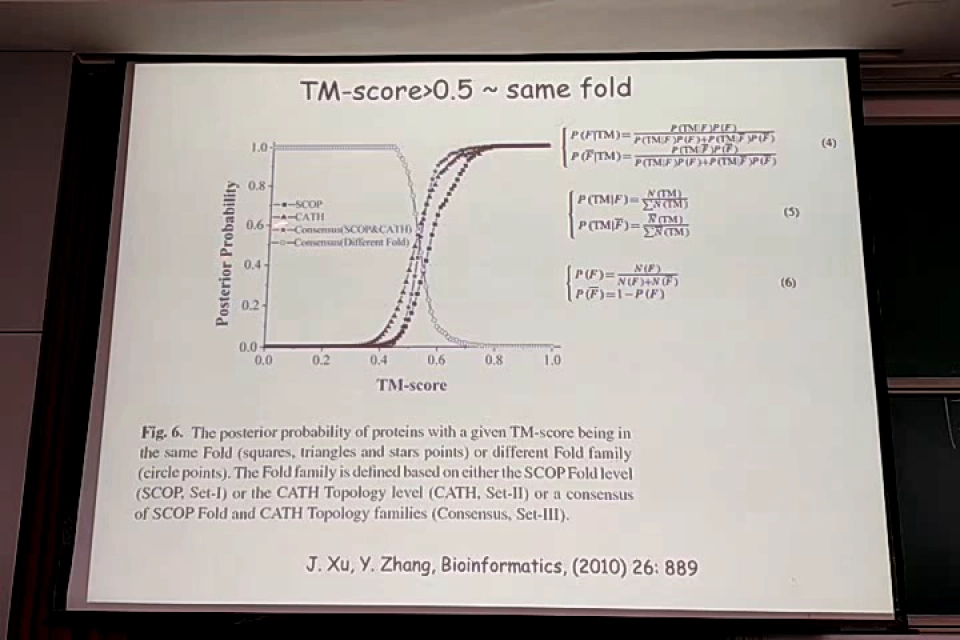

讲者强调，**只有 TM-score 能做这件事**，因为它的物理意义不依赖长度；换成依赖长度的指标，就画不出这样一条绝对的标准线。[【跳转到 50:02】](https://www.bilibili.com/video/BV141421Q7dB/?t=3002)

### 7.3 覆盖范围也被自动考虑了

回到第四节那个"只建模 70 个残基"的问题：TM-score 的分母是**整个蛋白的 $N$**，不是参与叠合的那部分。所以只覆盖一部分时，缺失的部分贡献为 0，分数自然被拉低——**覆盖不足会被自动惩罚**。[【跳转到 57:48】](https://www.bilibili.com/video/BV141421Q7dB/?t=3468)

这正是 RMSD 做不到的："RMSD 没法去比较"，因为它只对参与计算的那批原子负责。[【跳转到 56:10】](https://www.bilibili.com/video/BV141421Q7dB/?t=3370)

---

## 八、回到实践：报告一个 RMSD 时必须交代的三件事

把全讲的要点收拢成一张检查表。看到（或给出）一个 RMSD 时，必须同时说明：

1. **用了哪些原子**——Cα？主链？全部重原子？课堂明确"我们只考虑 Cα"；
2. **用了多少残基、哪一段**——整条链，还是只叠某个结构域/核心区？范围越小，数值越容易好看；
3. **蛋白有多长**——RMSD 有长度依赖，跨长度直接比数值没有意义。

而当你真正要回答的问题是"**这两个结构的折叠是不是同一个**"时，RMSD 不是合适的工具，应该换 TM-score（本讲给出的判据是 0.5）。

> 系列导航：本讲只把 RMSD 与 TM-score 的分工讲清楚。另一类常被拿来对比的指标 **lDDT** 衡量的是"局部距离一致性"，它和 TM-score 的差别、以及预测置信度（pLDDT/PAE/pTM）的解读，属于本系列 5.1.2 与 5.2.x 的内容，本文不展开。

---

## 小结

- **两种任务**：序列相同 → 叠合（对应关系已知，只求刚体变换）；序列不同 → 比对（还要先找对应关系）。
- **叠合在优化什么**：求一个正交矩阵 $U$，使 $\lVert \vec{x}-U\vec{y}\rVert^2$ 最小。这就是 Kabsch 1976 的问题，有解析解，所以叠合本身是快而确定的。
- **RMSD 的刻度**：$[0,2\,\text{Å}]$ 高精度、$[2,6\,\text{Å}]$ 拓扑相同、$>6.5\,\text{Å}$ 拓扑不同。
- **RMSD 的三个软肋**：柔性尾巴/loop 的大偏差被平方放大；数值随蛋白长度漂移；数值随叠合范围缩小而变好看。
- **TM-score 的修法**：把 $d_i$ 放到分母（$1/(1+(d_i/d_0)^2)$），大距离自动降权；用 $d_0=1.24\sqrt[3]{N-15}-1.8$ 归一化，使随机结构的平均分变成与长度无关的 0.17。
- **代价**：TM-score 没有解析最大值，只能靠"随机起点 + 迭代 + 取最优"来算，所以慢；TM-align 是为提速而生的实现。
- **怎么选**：问"局部贴合得多紧"用 RMSD；问"是不是同一个 fold"用 TM-score。两者之间没有稳定的换算系数。
- **0.5 的含义**：TM-score 0.5 附近是"同一个 fold"的相变点（对照 SCOP/CATH），低于 0.2 与随机无异。

## 关键术语速查

| 术语 | 一句话解释 |
| --- | --- |
| superposition（叠合） | 序列相同时，只求一个刚体变换把两个结构摆到一起 |
| structure alignment（比对） | 序列不同时，先建立残基对应关系，再叠合 |
| Kabsch 算法 | 给定对应坐标，解析求出使平方和最小的最优旋转矩阵 |
| 刚体变换 | 只含旋转与平移、保持结构形状不变的坐标变换 |
| RMSD | 叠合后对应原子距离的均方根，单位 Å，对离群点与长度敏感 |
| TM-score | 把距离放到分母、并用 $d_0$ 归一化的相似性分数，取值 0–1，不依赖长度 |
| $d_0$ | TM-score 的长度相关标度，$d_0=1.24\sqrt[3]{N-15}-1.8$ |
| 极值分布 / p-value | 随机结构对的 TM-score 服从极值分布，由此给出显著性 |
| fold | 结构分类层级中的"折叠"层，TM-score≈0.5 大致对应同一 fold |
| TM-align | 基于 TM-score 的快速结构比对算法 |