# 用 PyMOL 做蛋白质结构叠合：align 命令与 RMSD 读数

> 视频来源：[使用PyMOL进行蛋白质结构两两比对[生物信息学]](https://www.bilibili.com/video/BV1pb4y1v72T/)（Bilibili · Biogeek_Lau · 时长约 10 分钟）
>
> 这是一支实验课录屏：讲者一边念实验指导书里的原理段落，一边在 PyMOL 里现场操作，把两个结构叠合起来并读出 RMSD。本文按"为什么要比结构 → RMSD 是什么 → 2 Å 这条经验线 → 在线工具怎么读字段 → PyMOL 里怎么点"的顺序整理，保留视频里出现的具体数值与命令。

## 本讲要解决的核心问题（SCQA）

**背景**：我们平时比较两个蛋白质，第一反应是比序列——做序列比对，看相似度有多高。

**冲突**：但序列相似度低于 30% 时，序列比对就"很难仅依靠它获取有效信息"了；而蛋白质的三级结构比序列更保守，两个序列已经分得很远的蛋白，折叠方式却可能仍然很像。

**疑问**：既然序列靠不住了，怎么定量地说"这两个结构像不像"？这个数字又该怎么算、怎么读？

**回答（中心思想）**：把两个结构**叠合**（superposition）到一起，再用 **RMSD（均方根偏差）** 描述叠合后原子位置的平均偏离。RMSD 单位是埃（Å），数值为 0 表示完全重合；对球状蛋白，通常取 **Cα 原子**、在刚体叠合之后计算，**2 Å 以下**大致可以认为两个结构比较相似。在 PyMOL 里，一条 `align` 命令就能完成"序列比对 + 结构叠合 + 迭代微调"并直接回报这个数值。

---

## 一、什么时候该比结构：序列相似度 30% 这条分界

讲者开篇就把两支路线摆在一起：我们一般对蛋白质做的是**序列比对**，而**结构比对**要用另一类工具，比如 PyMOL。[【跳转到 00:00】](https://www.bilibili.com/video/BV1pb4y1v72T/?t=0)

实验指导书上的原理段落给出了理由：当两条蛋白质序列的相似度**大于 30%** 时，它们的三级结构以及生物学功能也可以推测为很接近；而当相似度**低于 30%** 时，就很难仅靠序列比对获取有效信息，此时**三维结构的比较以及功能位点的比对**会有利于推断蛋白质之间的进化关系。[【跳转到 00:25】](https://www.bilibili.com/video/BV1pb4y1v72T/?t=25)

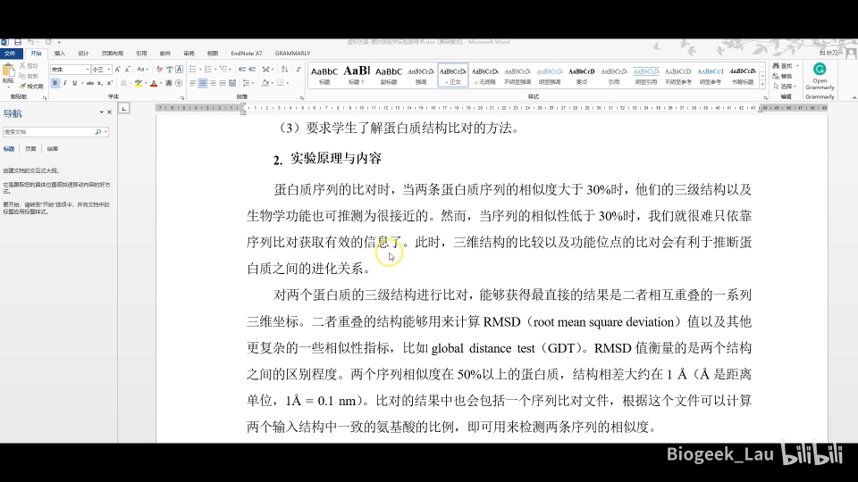

这段文字还交代了两件后面会用到的细节：

- 两个结构比对后，"最直接的结果是二者相互重叠的一系列三维坐标"，在这些坐标上可以算 RMSD，也可以算更复杂的指标，比如 **GDT（global distance test）**；
- 比对结果里还会附一份**序列比对文件**，据此可以算出两个输入结构中一致的氨基酸比例，反过来检测序列相似度。

同一份指导书还列了一串同类工具与数据库：**DALI、CE（combinatorial extension）、SSAP、FATCAT、FLEXPOT** 等，并提示"每种工具的特性以及原理可以参考"相应文献。[【跳转到 01:40】](https://www.bilibili.com/video/BV1pb4y1v72T/?t=100)

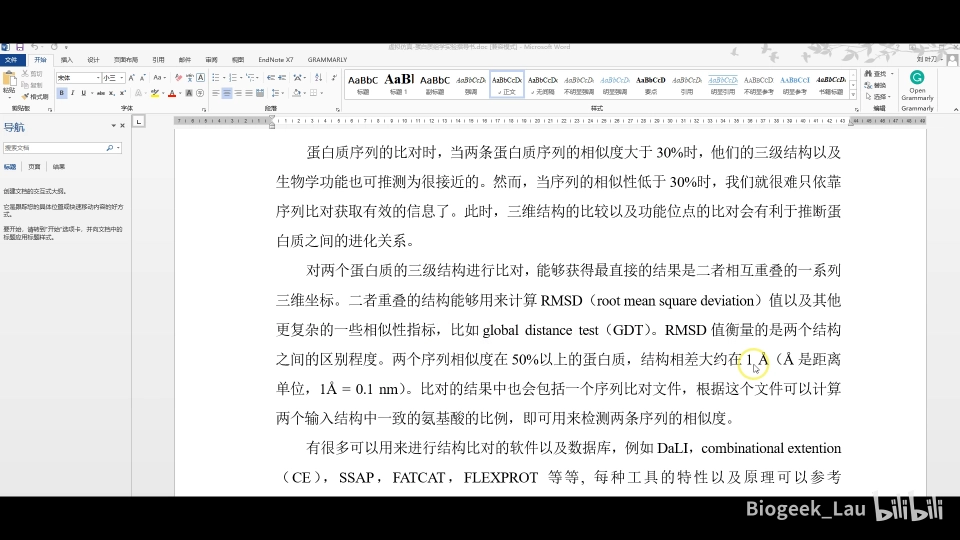

> 一句话记住这一节：**序列能对上就别急着比结构；序列对不上（<30%）时，结构比对才是补充信息的手段。**

---

## 二、RMSD 是什么：叠合之后，原子位置的平均偏离

结构比对有一个统计量叫 **RMSD（root mean square deviation，均方根偏差）**，用来说明两个结构之间的相似性。[【跳转到 00:50】](https://www.bilibili.com/video/BV1pb4y1v72T/?t=50)

它的读法非常直白：

- **等于 0**：两个结构完全一样，"能严丝合缝地叠在一起"；
- **变大**：两个结构的差异比较大。

指导书给出的定义式是：

$$
\mathrm{RMSD} = \sqrt{\frac{1}{N}\sum_{i=1}^{N}\delta_i^{2}}
$$

其中 $N$ 是参与比较的原子对数，$\delta_i$ 是第 $i$ 对对应原子在叠合之后的距离。也就是说，**先把每一对原子的偏差平方、求和、除以原子对数、再开方**——这正是"均方根"三个字的来源。

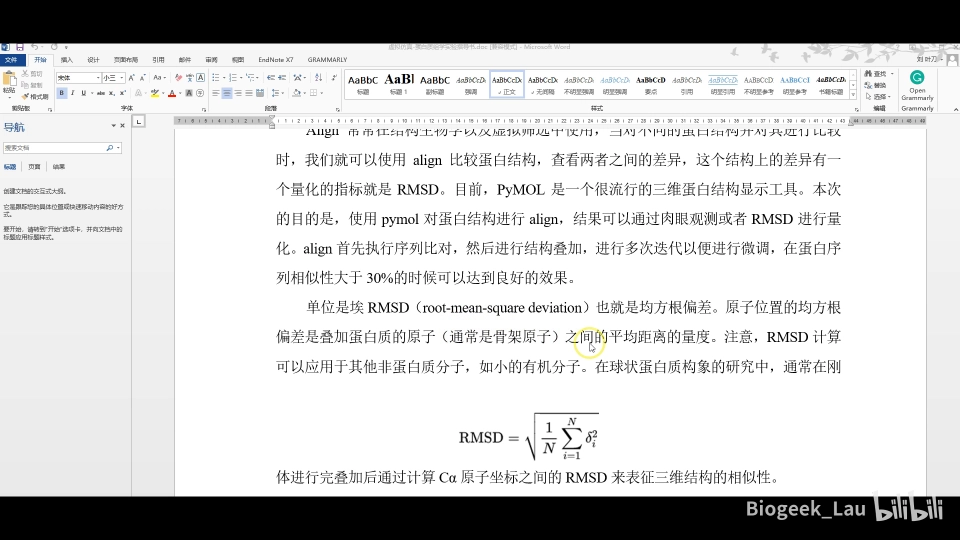

这一页上还有三句很关键的话，直接决定了 RMSD 该怎么算：

1. **RMSD 的单位是埃（Å）**，1 Å = 0.1 nm。讲者在口述里也强调"这个单位是埃"。[【跳转到 01:15】](https://www.bilibili.com/video/BV1pb4y1v72T/?t=75)
2. **它度量的是"叠加蛋白质的原子之间的平均距离"**，而这些原子**通常是骨架原子**。
3. **在球状蛋白质构象的研究中，通常在刚体叠合完成之后，用 Cα 原子坐标之间的 RMSD 来表征三维结构的相似性。**

第 3 点值得初学者停下来想一秒：RMSD 不是把两个文件直接相减得到的，它**必须先叠合**——先找一个旋转和平移，让两个结构尽量重合，然后才在重合后的坐标上量距离。所以"RMSD 是多少"这句话，天然隐含了"用什么原子叠合、用哪些残基叠合"这两个前提。选 Cα 还是选全部重原子、选整条链还是只选某一段，算出来的数字是不同的。

指导书还补了一句适用范围：RMSD 的计算**也可以应用于非蛋白质分子**，比如小的有机分子。[【跳转到 02:30】](https://www.bilibili.com/video/BV1pb4y1v72T/?t=150)

---

## 三、2 Å 这条经验线：多小才算"像"

有了数值，就需要一个判断标准。讲者给出的是经验尺度：**RMSD 大概在 2 Å 以下时，基本上可以认为这两个蛋白质的结构比较相似**。[【跳转到 01:40】](https://www.bilibili.com/video/BV1pb4y1v72T/?t=100)

指导书里给了一个可以互相印证的参照：**序列相似度在 50% 以上的蛋白质，结构相差大约在 1 Å**。也就是说，同源关系很近的蛋白，叠合后通常落在 1 Å 量级；把 2 Å 当作"相似"的上限，是与这个观察一致的。

> 注意这是**经验线**，不是定律。它成立的前提是"同一套原子、同一段范围"。换一组原子、换一段残基，同一个结构对完全可以给出差别很大的 RMSD——这正是后面读 PyMOL 输出时最容易踩的坑。

---

## 四、不想装软件？先看 PDB 的在线比对

在动手装 PyMOL 之前，讲者提到一条更轻的路径：**PDB 网站本身就有一个在线工具**（Pairwise Structure Alignment），可以做两条链之间的比对与可视化；但它"只能用在线手段，功能有一定限制"。[【跳转到 02:05】](https://www.bilibili.com/video/BV1pb4y1v72T/?t=125)

指导书把这类在线比对的输出拆成了六行，逐行解释了含义：

| 输出项 | 含义（按指导书） |
| --- | --- |
| 第一行 | 参与比对的两个蛋白质结构的基本信息 |
| **P 值** | 本次比对中得分可能达到 score 以上的概率 |
| **twists** | 不把蛋白质当作刚性不变的整体，而是允许不同区域做**不同的结构变换**，从而让两个蛋白质可比——这反映了蛋白质的灵活性 |
| **Equ** | 两个结构上**相互对应的氨基酸数量** |
| **RMSD** | 两个结构之间的位置差距 |
| **Score** | Raw alignment score，用来衡量两两比对序列的相似程度，分值越大越相似 |

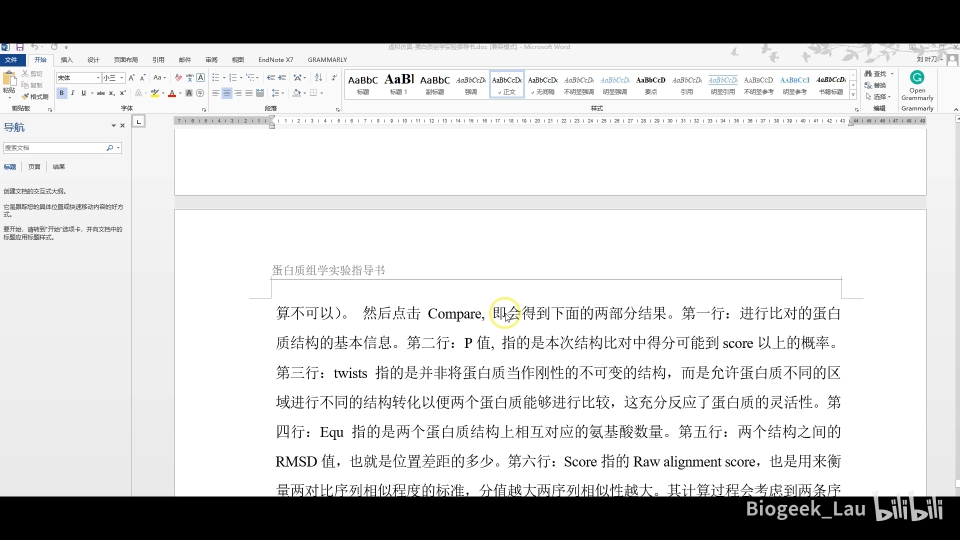

这张表里最容易被忽略的是 **twists** 和 **Equ**：

- **twists** 说明有些工具并不强行用一个刚体变换套住整个蛋白，而是允许结构域各自转动。这相当于承认"整个分子不是一块铁板"，多结构域蛋白尤其如此。
- **Equ** 提醒你：RMSD 是在**多少个对应残基**上算出来的。对应上的残基越少，RMSD 越容易"好看"，因为它只描述了一小部分。

所以看到一个 RMSD，正确的追问是：**在多少对原子上算的？** 这也是下一节 PyMOL 输出里要盯的地方。

---

## 五、动手：PyMOL 里一条 align 命令走完叠合

### 5.1 准备：版本与依赖

讲者用的是 **PyMOL 1.7.4 教育版**——商业版需要购买授权、要收费，而 1.7.4 教育版免费、体积也小，推荐初学者使用。[【跳转到 02:55】](https://www.bilibili.com/video/BV1pb4y1v72T/?t=175)

安装前要先装 **Python 3.7**，这是它的依赖包，"没有 Python，PyMOL 跑不起来"。[【跳转到 03:20】](https://www.bilibili.com/video/BV1pb4y1v72T/?t=200)

### 5.2 实验步骤（指导书原文的顺序）

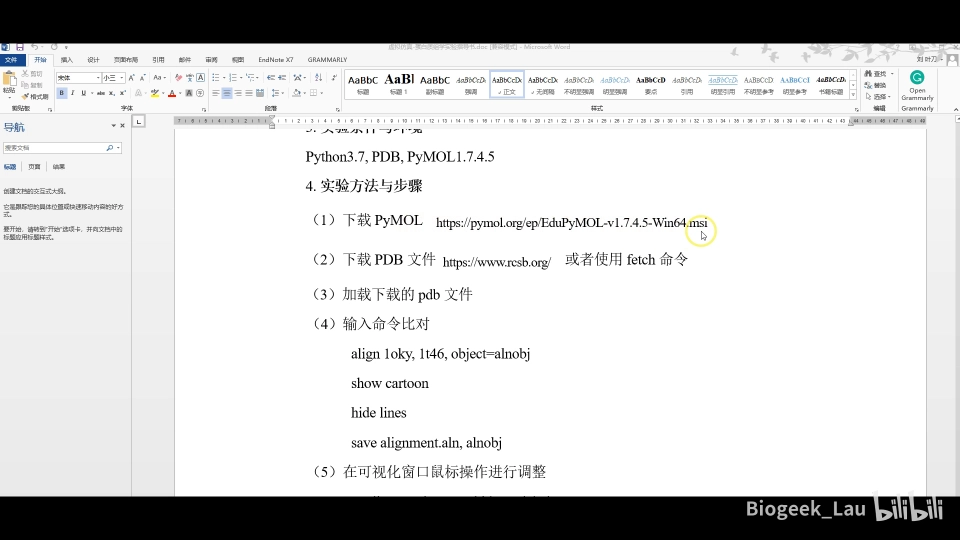

指导书列出的五步是：

1. 下载 PyMOL（`https://pymol.org/ep/EduPyMOL-v1.7.4.5-Win64.msi`）；
2. 下载 PDB 文件（`https://www.rcsb.org/`），或者直接用 `fetch` 命令；
3. 加载下载的 pdb 文件；
4. 输入命令比对：

   ```
   align 1oky, 1t46, object=alnobj
   show cartoon
   hide lines
   save alignment.aln, alnobj
   ```

5. 在可视化窗口用鼠标操作进行调整。

同一页还列了 PyMOL 的鼠标快捷键：**A = align，S = show，H = hide，L = label，S = sequence，F = fullscreen，ESC = 停止全屏和自动播放**。

### 5.3 加载两个结构

打开 PyMOL 后有两个窗口，其中一个是命令行窗口，命令就输在这里。用菜单 **File → Open** 打开下载好的 PDB 文件。[【跳转到 04:42】](https://www.bilibili.com/video/BV1pb4y1v72T/?t=282)

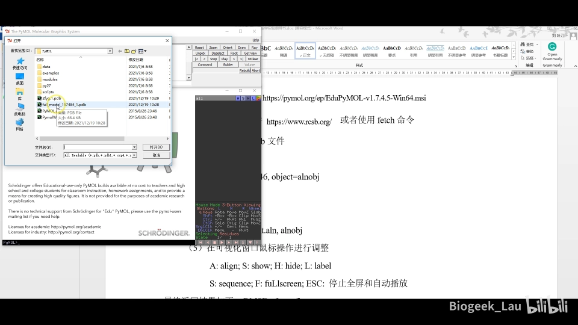

视频里的两个对象，一个是 **PDB 数据库里实验测定的结构**，另一个是**之前练习得到的预测模型**。做比对的目的，就是看预测的和真实的结构"误差有多大"，用 RMSD 反映预测软件的效果。[【跳转到 05:07】](https://www.bilibili.com/video/BV1pb4y1v72T/?t=307)

加载成功与否，命令行里会有提示：显示 `load` 就说明加载成功，同时会给出一个**对象名**，后续命令都用这个名字指代结构。[【跳转到 05:55】](https://www.bilibili.com/video/BV1pb4y1v72T/?t=355)

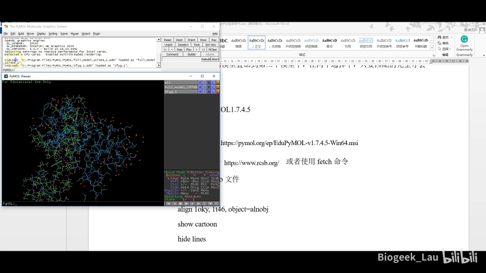

### 5.4 换成卡通表示

火柴棍样式"不那么直观形象"，所以先换展示方式：`show cartoon` 用卡通（ribbon）表示，再把火柴棍隐藏掉 `hide lines`。[【跳转到 06:45】](https://www.bilibili.com/video/BV1pb4y1v72T/?t=405)

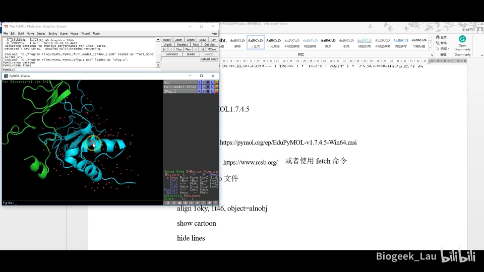

此时两个对象还各自待在原来的坐标系里，并没有对齐——这正是"叠合前"的样子。

### 5.5 执行 align 并读结果

命令很简单：`align` 加上刚才的两个对象名。[【跳转到 07:10】](https://www.bilibili.com/video/BV1pb4y1v72T/?t=430)

```
align 1oky, 1t46, object=alnobj
```

执行后命令行回报的结果是 **RMSD = 4.230**，并注明参与计算的原子数为 **131 to 131 atoms**（两侧各 131 个原子）。[【跳转到 08:00】](https://www.bilibili.com/video/BV1pb4y1v72T/?t=480)

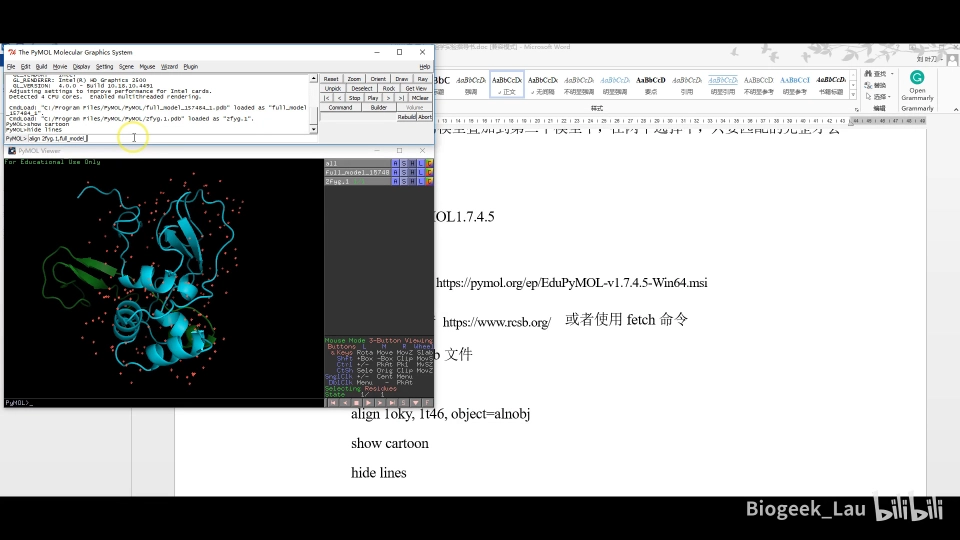

指导书对 `align` 的行为有一句准确概括：**align 先执行序列比对，然后进行结构叠加，并进行多次迭代以便微调；在蛋白序列相似性大于 30% 的时候可以达到良好的效果。** 这就解释了为什么命令回报里除了 RMSD 还有一串 cycle 信息——叠合不是一次算完，而是"比对—叠合—重新配对—再叠合"地迭代。

叠合完成的画面里，两个卡通结构已经重合到一起，黄色虚线把对应的原子连起来，直观显示偏差分布。[【跳转到 08:25】](https://www.bilibili.com/video/BV1pb4y1v72T/?t=505)

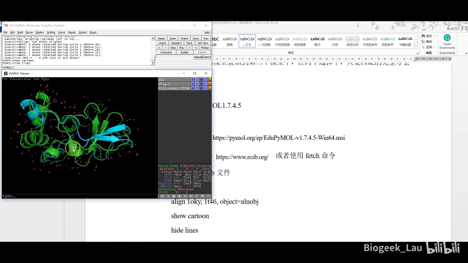

---

## 六、4.230 怎么读：一个"不太理想"的预测

讲者对 4.230 的判读很坦率：**这个结果不是特别理想**。[【跳转到 08:00】](https://www.bilibili.com/video/BV1pb4y1v72T/?t=480)

他给出的理由是分层看二级结构：

- **预测对的部分**：两个 β 折叠被预测出来了，一个 α 螺旋也被预测出来了；
- **差得多的部分**：真实结构有**三个 α 螺旋、两个 β 折叠**，还有很多无规卷曲；而预测出来的结构只有那两个 β 折叠这一带比较准。

所以整体误差偏大，RMSD 落到 4 Å 量级，与第三节那条"2 Å 以下算相似"的经验线相比明显超出。[【跳转到 08:50】](https://www.bilibili.com/video/BV1pb4y1v72T/?t=530)

这个案例恰好演示了 RMSD 的两个特点：

1. **它对"局部对了、整体没对上"很敏感**。二级结构单元猜对了几个，并不足以把 RMSD 压下来；只要有一段整体位置偏了，平方求和就会把它放大。
2. **它是一个被平均过的数**。4.230 里既有对得很准的 β 折叠，也有偏得很远的螺旋和卷曲，读数是它们混在一起的结果。想知道"哪里错了"，必须回到叠合后的画面上看，而不是只看这个数字。

---

## 七、不用命令行：A / S / H 三个键

如果不想敲命令，PyMOL 的鼠标操作可以覆盖同样的动作：[【跳转到 09:15】](https://www.bilibili.com/video/BV1pb4y1v72T/?t=555)

- 点 **A**（Action）→ **align**，对目标对象做比对；
- 点 **H**（Hide）→ 选择要隐藏的表示（比如刚才那些小点）；
- 点 **S**（Show）→ 选择要展示的表示（比如 cartoon）。

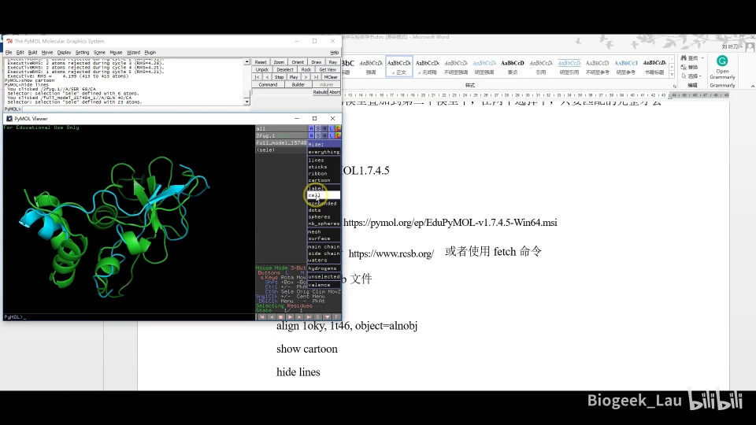

讲者的建议是：命令行和鼠标两条路都掌握，"这边可以直接用鼠标操作，不需要刚才那些命令"。[【跳转到 09:40】](https://www.bilibili.com/video/BV1pb4y1v72T/?t=580)

---

## 小结

- **比结构的前提**：序列相似度 >30% 时结构大概率也接近；<30% 时序列比对失效，结构比对与功能位点比对才有额外信息。
- **RMSD 的定义**：叠合之后，对应原子偏差的均方根，$\mathrm{RMSD}=\sqrt{\frac{1}{N}\sum_i \delta_i^2}$，单位是埃（Å，1 Å = 0.1 nm）。
- **必须先叠合再算**：RMSD 不是两个坐标文件直接相减，而是先找刚体变换让结构尽量重合。
- **原子选择是隐含前提**：指导书明确说通常用骨架原子，球状蛋白常用 **Cα** 计算；换原子、换残基范围，数值就会变。
- **2 Å 经验线**：序列相似度 50% 以上的蛋白结构差约 1 Å，因此 2 Å 以下大致可认为结构相似。
- **读输出要看两件事**：RMSD 的数值，以及它是在多少对原子上算的（`131 to 131 atoms`、在线工具的 `Equ`）。
- **RMSD 会被局部带偏**：本例中 β 折叠与一个 α 螺旋猜对了，但整体差得多，RMSD 仍是 4.230——数字要配合叠合画面一起读。

## 关键术语速查

| 术语 | 一句话解释 |
| --- | --- |
| 结构叠合（superposition） | 找一个旋转加平移，把两个结构尽量重合到一起 |
| RMSD | 叠合后对应原子偏差的均方根，单位 Å，0 表示完全重合 |
| Cα 原子 | 每个残基的α碳，常作为结构比较的代表点 |
| GDT | global distance test，另一类比 RMSD 更复杂的结构相似性指标 |
| twists | 在线比对输出项，表示允许不同区域做不同结构变换，反映柔性 |
| Equ | 在线比对输出项，两个结构中相互对应的氨基酸数量 |
| align（PyMOL） | 先序列比对、再结构叠加、多次迭代微调的命令，会回报 RMSD |
| 刚体变换 | 只含旋转与平移、不改变内部形状的坐标变换 |