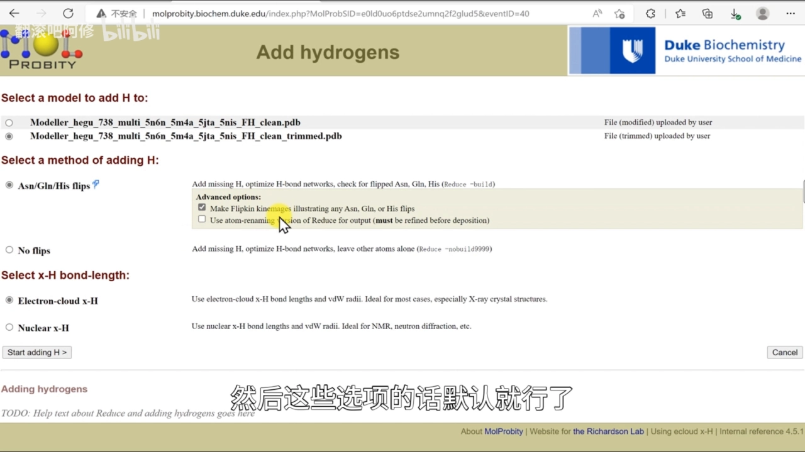
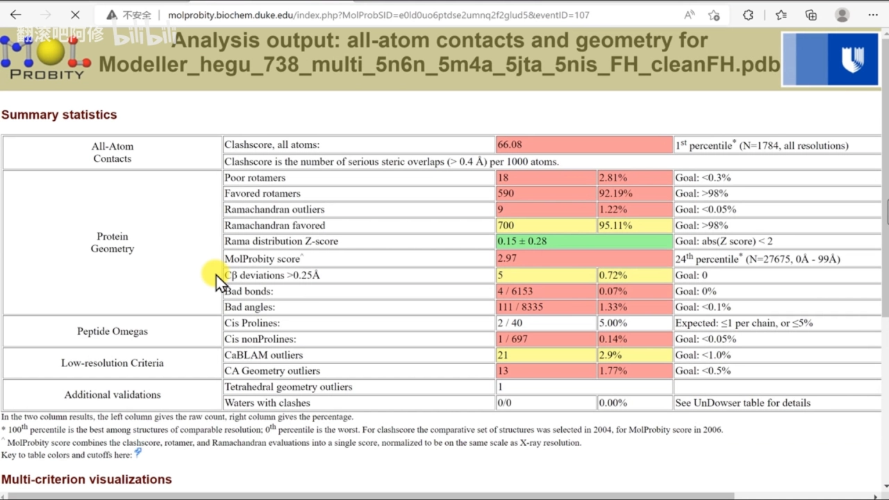
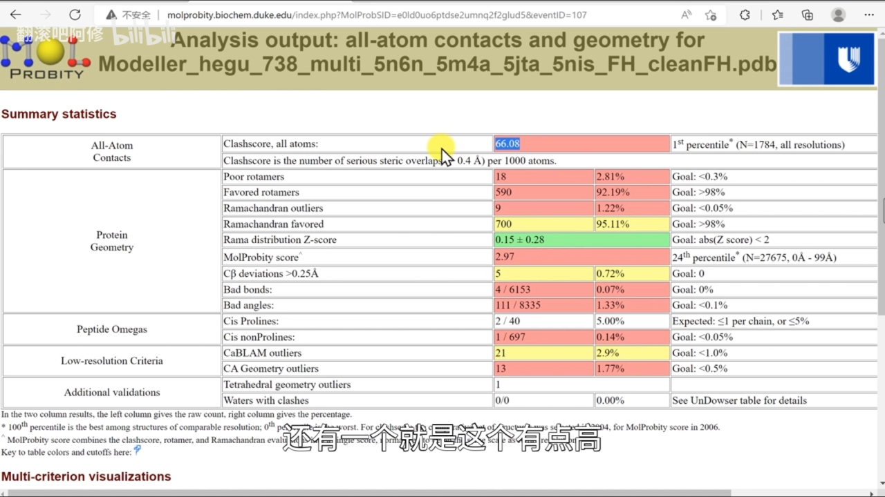
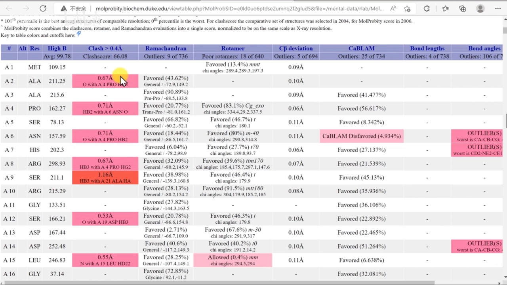
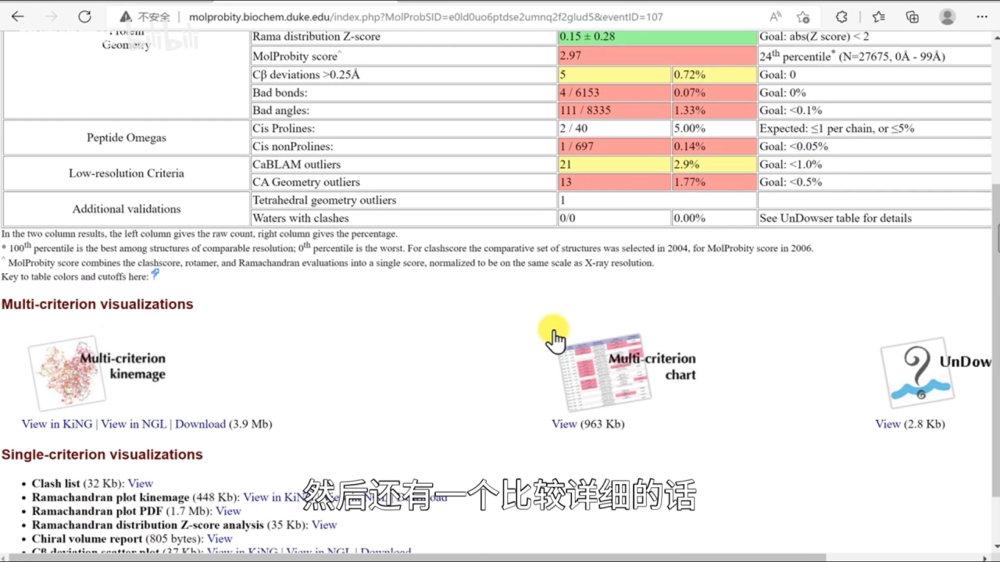

# 用 MolProbity 给模型打分：一张汇总表里的几何指标怎么读

> 视频来源：[MolProbity测评蛋白质模型](https://www.bilibili.com/video/BV1bY4y1G7A9/)（Bilibili · 蛋白质设计 · 时长约 6 分钟）
>
> 这是一支实操录屏：讲者把自己用 Modeller 多模板建出来的模型上传到 MolProbity 网页版，加氢、跑分析，然后对着输出结果讲"哪一项要紧、哪些颜色代表什么、怎么定位到具体残基"。视频很短，所以本文在保留讲者原话的基础上，把屏幕上那张汇总表的每一项都读了一遍——**表里的数字与阈值都来自视频画面**。

## 本讲要解决的核心问题（SCQA）

**背景**：用同源建模或预测工具得到一个蛋白质模型后，第一件事是判断它"能不能用"。MolProbity 是最常用的免费在线打分工具，上传 PDB 文件、点几下就能出一张带红黄绿配色的汇总表。

**冲突**：这张表有近二十行数字，每行后面还跟着一个"Goal"。拉氏图打分 95% 到底算好还是不好？clashscore 66 是高还是低？为什么有的格子绿、有的黄、有的红？

**疑问**：这些指标分别在检查什么？阈值怎么读？汇总表之外还要看什么？

**回答（中心思想）**：MolProbity 的汇总表把**立体化学检查**压缩成三组核心数字——**拉氏图优选比例、碰撞分数、rotamer 优选比例**，再用一个合成的 MolProbity score 概括。读表顺序应该是：**先看这三组的"优选/离群"比例是否达标，再看合成分数，最后一定要回到逐残基清单去定位红色项**。而它检查的始终只是"几何是否合理"，不检查"结构是否正确"。

---

## 一、跑之前：为什么必须先加氢

上传 PDB 文件后，MolProbity 给出的第一个提示是：**模型里的氢原子已经被删掉了，可以再加一些氢**。讲者的处理是"按默认设置就行，点 continue 继续"。[【跳转到 00:44】](https://www.bilibili.com/video/BV1bY4y1G7A9/?t=44)

这一步不能跳过，原因是**碰撞判定依赖氢原子**：两个重原子之间看起来还有空隙，但氢原子伸出去就可能重叠。所以"没加氢的模型"和"加过氢的模型"算出的 clashscore 不可比。

页面上的几个选项值得知道含义：

- **Asn/Gln/His flips**：天冬酰胺、谷氨酰胺的酰胺基，以及组氨酸的咪唑环，在电子密度里常常可以"翻转 180°"而看起来几乎一样。这一步会尝试优化氢键网络、检查这些残基是否需要翻转。这正是"侧链翻转"问题在工具里的落地方式。
- **X-H 键长取电子云还是原子核**：前者适合 X 射线晶体结构，后者适合 NMR 与中子衍射。

加氢完成后工具会提示"你的模型已被改变，是否下载新模型"——讲者点确定，并说明"它会对你的模型做一点修正"。[【跳转到 01:41】](https://www.bilibili.com/video/BV1bY4y1G7A9/?t=101)

---

## 二、汇总表的三组核心数字

跑完分析（讲者说"一般要 2 到 3 分钟"），得到的就是下面这张 Summary statistics：

讲者指出的第一重点是："比较关键的是拉氏图（Ramachandran）的打分，这里是 95%，其实还行，一般很难超过 98%；能到 98% 说明模型已经非常好了。即使从 PDB 数据库里下载的模型，也不一定都能超过 98%。"[【跳转到 02:53】](https://www.bilibili.com/video/BV1bY4y1G7A9/?t=173)

把表里的三组数字并排列出来，逻辑就清楚了：

| 检查项 | 这个模型的数值 | 表里给的 Goal | 它在查什么 |
| --- | --- | --- | --- |
| Ramachandran favored | 95.11% | > 98% | 主链二面角落在核心区的残基比例 |
| Ramachandran outliers | 1.22%（9/736） | < 0.05% | 主链二面角落在允许区之外的残基比例 |
| Clashscore | 66.08 | 越低越好（第 1 百分位） | 每 1000 个原子中重叠 > 0.4 Å 的个数 |
| Favored rotamers | 92.19% | > 98% | 侧链处于优选旋转异构体的比例 |
| Poor rotamers | 2.81%（18/640） | < 0.3% | 侧链处于不利旋转异构体的比例 |
| MolProbity score | 2.97 | 第 24 百分位 | 上面三类检查的合成分数 |

读表时要注意两件事：

1. **"优选比例"和"离群比例"是一对**。只看离群 1.22% 好像不多，但优选只有 95.11%、离目标 98% 还差一截，说明有相当一部分残基落在"允许但非核心"的区域。
2. **百分位的方向**。表脚注写明：100 百分位最好、0 百分位最差；clashscore 的比较集是 2004 年选定的，MolProbity score 的比较集是 2006 年选定的。所以 clashscore 66.08 落到了**第 1 百分位**——这是很差的水平。

讲者对 clashscore 这一项的评价是"还有这一项偏高，质量稍微差点"。[【跳转到 02:58】](https://www.bilibili.com/video/BV1bY4y1G7A9/?t=178)

### 2.1 MolProbity score 是什么

表脚注给的定义是：**MolProbity score 把 clashscore、rotamer 与 Ramachandran 三项评估合成一个分数，并归一化到与 X 射线分辨率相同的尺度上**。

这个设计很实用：一个 2.97 的 MolProbity score，大致相当于"这个模型的几何质量像一个 2.97 Å 分辨率的结构"。它的好处是把三类检查压成一个可比的数，坏处是**丢掉了诊断信息**——所以它只适合当作"总体印象"，具体问题还得回到分项。

---

## 三、几何细项：键长键角、Cβ 偏差与低分辨率判据

汇总表下半部分还有几行，专门抓更细的立体化学问题：

| 指标 | 这个模型 | Goal | 含义 |
| --- | --- | --- | --- |
| Cβ deviations > 0.25 Å | 5（0.72%） | 0 | Cβ 原子相对主链几何的偏离，通常指向主链建模错误 |
| Bad bonds | 4 / 6153（0.07%） | 0% | 键长偏离理想值超出容差 |
| Bad angles | 111 / 8335（1.33%） | < 0.1% | 键角偏离理想值超出容差 |
| Cis prolines | 2 / 40（5.00%） | 每条链 ≤ 1 个或 ≤ 5% | 顺式脯氨酸（多数脯氨酸应为反式） |
| Cis non-prolines | 1 / 697（0.14%） | < 0.05% | 非脯氨酸的顺式肽键，通常意味着建模错误 |
| CaBLAM outliers | 21（2.9%） | < 1.0% | 用 Cα 几何一致性抓主链问题，对低分辨率结构尤其有用 |
| CA geometry outliers | 13（1.77%） | < 0.5% | Cα 虚拟键角异常 |
| Tetrahedral geometry outliers | 1 | — | 四面体几何异常 |
| Waters with clashes | 0 / 0（0%） | 见 UnDowser 表 | 水分子与其他原子的碰撞 |

这一组里最值得初学者记住的是 **bad bonds / bad angles**：它们就是"键长键角偏离理想值"的直接计数，与 PDB 验证报告里用 Z 分数做的检查是同一件事的两种表达——**MolProbity 用绝对容差计数，wwPDB 报告用 Z 分数与 RMSD**。

而 **CaBLAM** 和 **CA geometry** 是给低分辨率结构准备的：分辨率低时侧链密度模糊，主链的 Cα 几何反而更可靠，于是用 Cα 之间的关系来抓主链错误。

---

## 四、颜色和阈值：绿黄红分别意味着什么

讲者对配色的解释是："绿色代表通过，黄色代表在提高，红色区域说明模型需要完善的地方还比较大。"[【跳转到 03:23】](https://www.bilibili.com/video/BV1bY4y1G7A9/?t=203)

他还提到参考标准里有一条："小于 0.5% 就认为模型的大部分是通过的"。[【跳转到 03:48】](https://www.bilibili.com/video/BV1bY4y1G7A9/?t=228) 不过要注意：**表里每一项自己都标了 Goal**，而且不同项的量级差别很大（Ramachandran outliers 的 Goal 是 < 0.05%，bad angles 是 < 0.1%，CaBLAM 是 < 1.0%）。所以更稳妥的做法是**逐项对着它自己的 Goal 看颜色**，而不是记一个统一的 0.5%。

---

## 五、从汇总表回到残基：逐残基清单才是可操作的

讲者说："还有一个更详细的地方，就是看哪个氨基酸残基做得不好，点这里，它会把每一个残基都列出来。"[【跳转到 04:07】](https://www.bilibili.com/video/BV1bY4y1G7A9/?t=247)

这张表是整支视频里信息密度最高的部分，每一列对应一类检查：

- **Clash > 0.4 Å**：直接给出重叠量，例如 0.67 Å、0.71 Å、1.16 Å——数值越大重叠越严重。
- **Ramachandran**：给出该残基属于 favored 还是 outlier，并附上具体的 $(\phi, \psi)$ 角度。
- **Rotamer**：给出 favored / allowed / outlier，以及对应的 $\chi$ 角。
- **Cβ deviation**：给出偏离量（如 0.09 Å、0.10 Å、0.11 Å）。
- **CaBLAM**：标出 favored 或 disfavored。
- **Bond lengths / Bond angles**：只标 outlier，并注明"最差的是哪个键角"。

讲者的用法是："你可以把这些关键信息记下来，需要优化模型时，这些都是参考依据。"[【跳转到 04:27】](https://www.bilibili.com/video/BV1bY4y1G7A9/?t=267)

页面下方还挂着若干单项可视化入口：碰撞清单（clash list）、拉氏图（kinemage 与 PDF）、拉氏图分布 Z 分数、手性体积报告、Cβ 偏差散点图等。要深挖某一项，就从这里进去。

---

## 六、局限：打分低说明什么，不说明什么

讲者对自己这个模型的结论很坦率："看来我这个模型还有待提高。"[【跳转到 04:47】](https://www.bilibili.com/video/BV1bY4y1G7A9/?t=287) 但他同时给出了几条关于"分数怎么用"的判断：

1. **分数与建模方法有关**。他说这个模型是用 Modeller 多模板建的；一般来说"SwissModel 和 AlphaFold 建出来的模型打分值比较高"，而他之前介绍过的 Robetta 建出来的模型"也比较可靠"。[【跳转到 04:57】](https://www.bilibili.com/video/BV1bY4y1G7A9/?t=297)
2. **不要只信一个方法**。"如果你真想用计算的方法确定一个蛋白质模型，我建议用不同方法分别建模，然后把这些模型对比一下，看它们的重叠度是不是很高；如果不同方法都建出基本相同的结构，说明建模还是很好的。"[【跳转到 05:02】](https://www.bilibili.com/video/BV1bY4y1G7A9/?t=302)
3. **MolProbity 只查几何**。它检查的是键长键角、碰撞、拉氏图、rotamer 这些"物理上是否可能"的问题；它不检查模型是否被实验数据支持，也不检查折叠是否生物学正确。对预测模型来说，几何分高只说明"这个结构不违反立体化学"，不说明"这个结构是对的"。

---

## 小结

- 跑 MolProbity 前**必须先加氢**，否则碰撞判定不可比；Asn/Gln/His 的翻转选项就是"侧链翻转"检查的入口。
- 汇总表的核心是三组：**Ramachandran 优选/离群**、**clashscore**、**rotamer 优选/离群**；三者合成 **MolProbity score**（归一化到分辨率尺度）。
- **优选比例和离群比例要成对看**：本例 Ramachandran favored 95.11%（目标 > 98%）、outliers 1.22%（目标 < 0.05%）。
- **clashscore 66.08 落在第 1 百分位**，是很差的水平；百分位是 100 最好、0 最差。
- 细项里 **bad bonds / bad angles** 就是"键长键角偏离理想值"的计数；**CaBLAM、CA geometry** 是为低分辨率结构准备的主链判据。
- 颜色只是提示，真正要对着**每一项自己的 Goal** 判断；红色项要回到**逐残基表**定位到具体残基与具体角度。
- 打分只反映几何合理性；判断模型能不能用，还要交叉比较不同建模方法的结果。

## 关键术语速查

| 术语 | 一句话解释 |
| --- | --- |
| MolProbity | 免费在线工具，对蛋白质模型做全原子接触与几何检查并给出汇总分数 |
| Clashscore | 每 1000 个原子中重叠超过 0.4 Å 的个数，越低越好 |
| Ramachandran favored | 主链二面角落在拉氏图核心区的残基比例，目标 > 98% |
| Ramachandran outliers | 主链二面角落在允许区之外的残基比例，目标 < 0.05% |
| rotamer | 侧链偏好的旋转状态；poor rotamer 指处于不利构象的侧链 |
| MolProbity score | 把 clashscore、rotamer、Ramachandran 合成的单一分数，归一化到分辨率尺度 |
| Cβ deviation | Cβ 原子相对主链几何的偏离，偏大常提示主链建模错误 |
| CaBLAM | 基于 Cα 几何一致性的主链判据，对低分辨率结构尤其有用 |
| 百分位（percentile） | 与同类结构比较的排名，100 最好、0 最差 |
| Asn/Gln/His flip | 酰胺基与咪唑环翻转 180° 后仍与密度相容，需按氢键网络选择取向 |