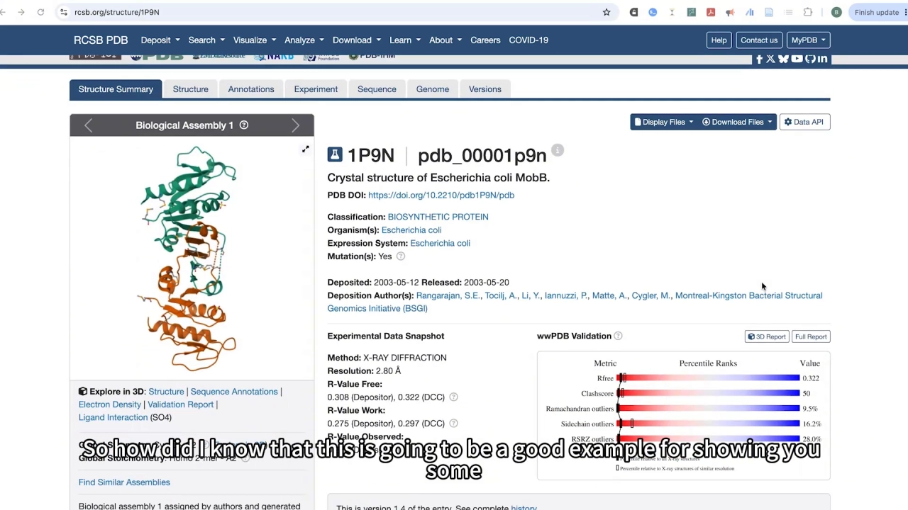
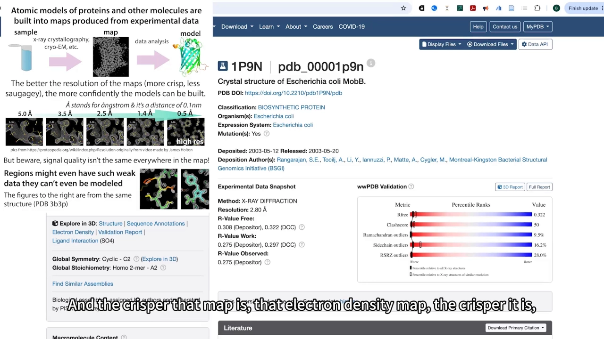
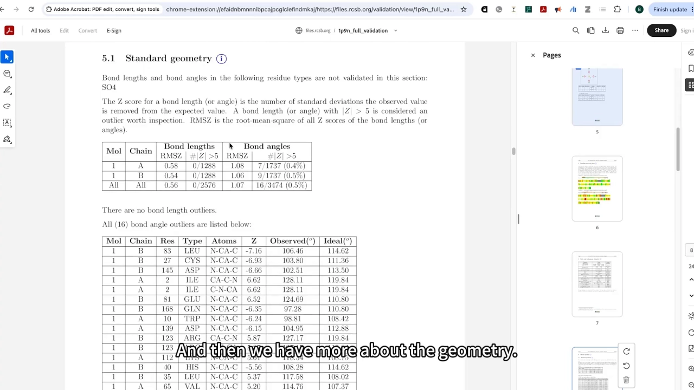
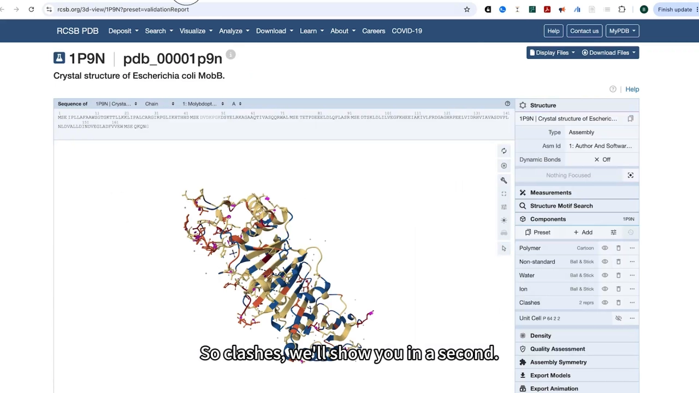
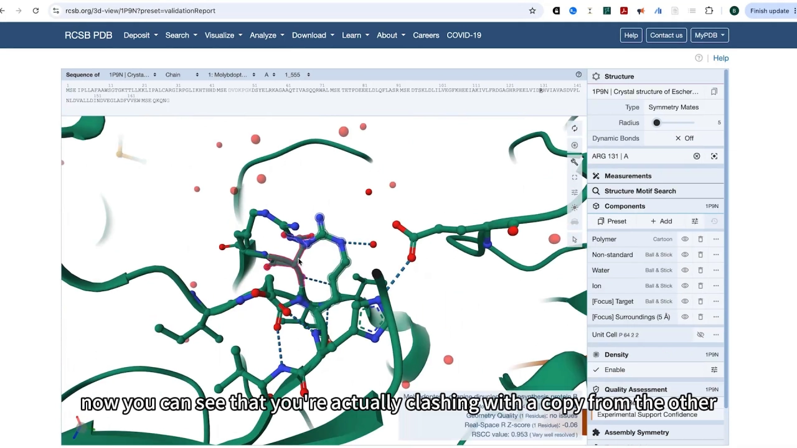
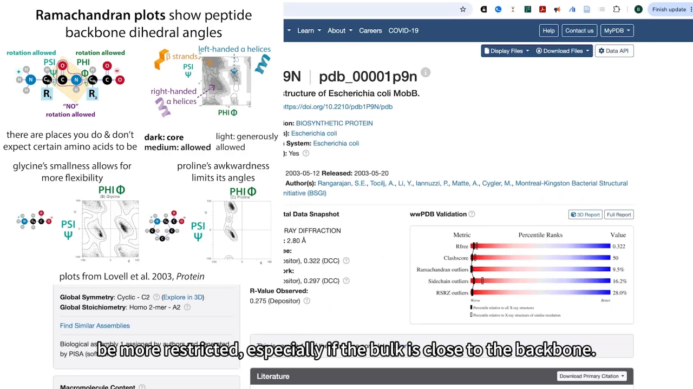
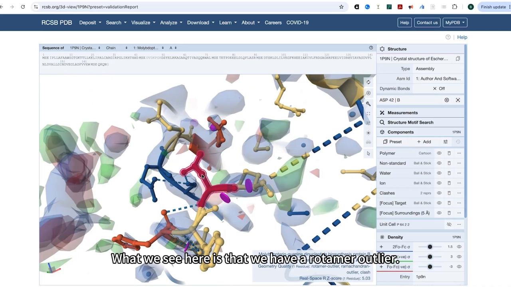
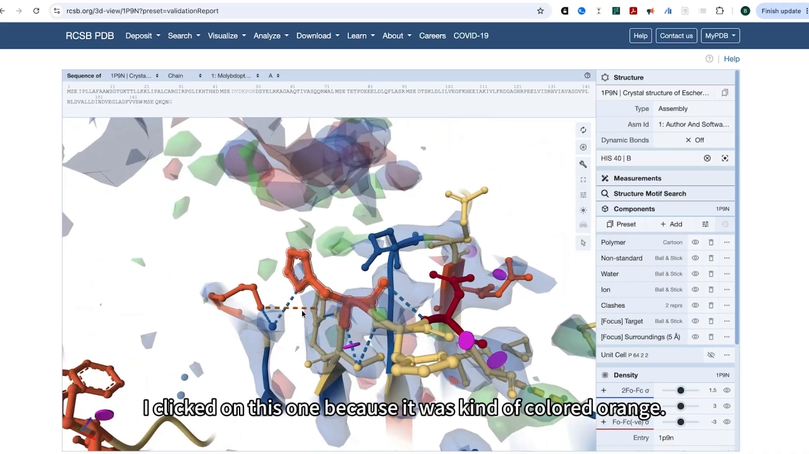
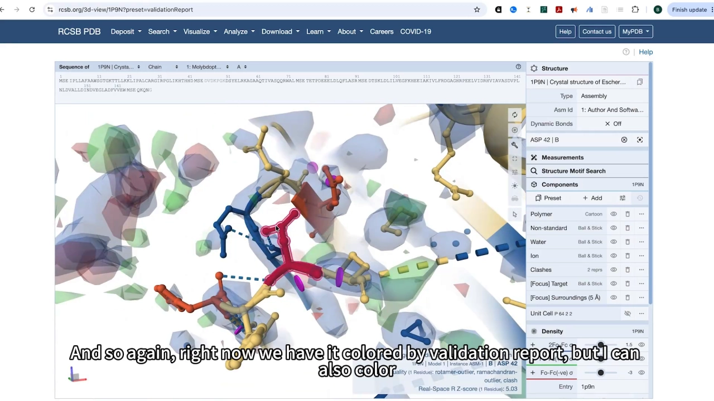
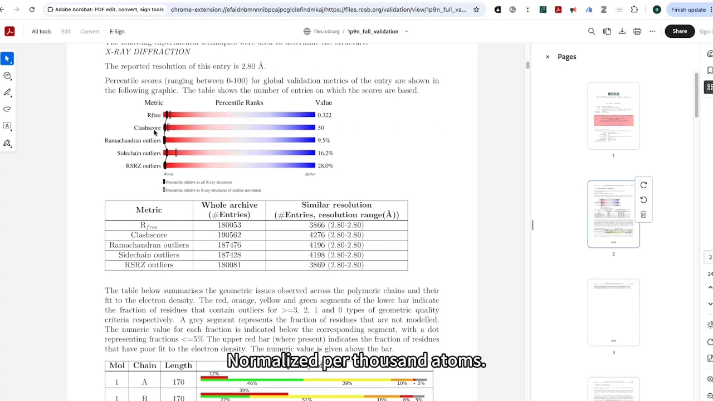

# 读懂 PDB 验证报告：键长键角、碰撞分数与拉氏图离群怎么用

> 视频来源：[通过PDB验证报告和质量度量评估结构模型的质量](https://www.bilibili.com/video/BV1X1g66FEXn/)（Bilibili · 搬运自 the bumbling biochemist 的 PDB 使用指南 · 时长约 36 分钟）
>
> 这是一支"带着你点网页"的教程：讲者以 PDB 条目 **1P9N**（大肠杆菌 MobB 晶体结构，2.80 Å）为例，从条目页面上那排彩色滑动条一路点到完整验证报告 PDF，把分辨率、R-free、clashscore、Ramachandran 异常值、rotamer 异常值、RSRZ、RSCC 逐个解释一遍。本文按"两类问题 → 键长键角 → 碰撞 → 拉氏图与侧链 → 如何在三维里定位 → 局限"的顺序整理。**二面角的定义与拉氏图允许区的来历不在这里重复**（见 1.1.5），本文只讲怎么拿它做质量检查。

## 本讲要解决的核心问题（SCQA）

**背景**：从 PDB 下载一个结构，几乎是结构生物学所有下游工作的第一步。每个条目页面上都有一排彩色滑动条，还挂着一份几十页的验证报告 PDF。

**冲突**：这些数字并不都回答同一个问题。有的说"模型和实验数据吻合得好不好"，有的说"模型自身在物理上合不合理"；而且同一个数值放在不同分辨率的结构上，好坏标准完全不同。更麻烦的是，报告里会出现"几何全绿、但那一截根本没有电子密度"的残基。

**疑问**：键长键角、原子碰撞、拉氏图离群这三类检查分别怎么读？读完能不能说"这个结构是对的"？

**回答（中心思想）**：这三类检查合起来只回答一个问题——**模型在立体化学上是否自洽、物理上是否可能**；它们**不回答**"这个模型是否被实验数据支持"、更不回答"这个模型在生物学上是否正确"。所以正确用法是三步：先看分辨率决定期待值，再把几何指标与**同分辨率**的同类结构比百分位，最后一定要和实验支持度（电子密度、RSCC、RSRZ）对照着看。

---

## 一、先分清两类问题：模型配不配数据，模型自己合不合理

### 1.1 条目页面上那排滑动条，是百分位而不是分数

打开条目页面，最先看到的是 wwPDB 验证信息。讲者的说法很直白：这些滑动条"既包括模型与实验数据的匹配程度，也包括模型本身的合理性，比如键角是否合理、原子是否发生碰撞"。[【跳转到 01:42】](https://www.bilibili.com/video/BV1X1g66FEXn/?t=102)

关键在于：**滑条的左右位置表示的是百分位排名，不是分数本身**。讲者在解释 R-free 滑条时特意强调："它实际上只是百分位排名"——先给出这个模型的数值（本例约 0.3），再问这个表现与数据库里其他结构相比如何。[【跳转到 07:54】](https://www.bilibili.com/video/BV1X1g66FEXn/?t=474)

而且比较对象有两层：**未填充的条形**是与全部 X 射线结构比，**填充的条形**是与分辨率相近的结构比。"希望落在蓝色区域"，本例却落在红色区域，说明 R-free 并不理想。[【跳转到 08:19】](https://www.bilibili.com/video/BV1X1g66FEXn/?t=499)

这一点是后面所有指标读法的前提：**低分辨率结构天然难拿到好指标**。讲者的原话是"分辨率越低越难得到好指标，分辨率越高越有可能建出好模型"。[【跳转到 24:47】](https://www.bilibili.com/video/BV1X1g66FEXn/?t=1487)

### 1.2 分辨率决定了你能期待多好的几何

分辨率不是几何检查，但它决定了后面每一项检查的"及格线"。讲者用一张图说明：分辨率本质上是两个点之间的距离，数值越低代表数据越清晰；2.8 Å 对晶体结构来说偏高，通常希望接近 2 Å，小分子甚至能低得多。[【跳转到 03:53】](https://www.bilibili.com/video/BV1X1g66FEXn/?t=233)

图里还有一句很要紧的补充：**同一张密度图里信号质量并不均匀**，某些区域数据太弱、根本建不了模。这解释了后面为什么会看到"虚线"（未建模区）和"绿色条带红点"（几何很好但没有密度支持）。

---

## 二、键长与键角：用 Z 分数找"几何上不可能"的残基

这是最基础的一项立体化学检查：真实的化学键有确定的长度和角度范围，模型里的键长键角偏离理想值太远，说明建模或精修出了问题。

### 2.1 Z 分数、离群阈值与 RMSD 的定义

验证报告"标准几何（Standard geometry）"一节给出的定义是：

- **Z 分数** = 观测值偏离理想值多少个标准差；
- **|Z| > 5** 的键长或键角算作值得检查的**离群（outlier）**；
- **RMSD** 是全部 Z 分数的均方根，即

$$
\mathrm{RMSD} = \sqrt{\frac{1}{N}\sum_{i=1}^{N} Z_i^{2}}
$$

注意这里的 RMSD 是**无量纲的 Z 分数均方根**，不是 Å——它衡量的是"整体偏离理想几何多少个标准差"，与 5.1.1 里叠合用的坐标 RMSD 完全是两回事。

### 2.2 怎么读这张表：先看比例，再看清单

以 1P9N 为例（两条链合计）：

| 指标 | RMSD | 离群数 / 总数 | 离群比例 |
| --- | --- | --- | --- |
| 键长 | 0.56 | 0 / 2576 | 0 |
| 键角 | 1.07 | 16 / 3474 | 0.5% |

读法有两层：

1. **先看比例**。键长离群为零、键角离群 0.5%，说明整体几何是正常的；如果比例明显偏高，就要怀疑精修没做好或者模型本身有问题。
2. **再看清单**。报告会把每个离群键角逐条列出：哪个链、哪个残基、哪几个原子、Z 值多少、观测角多少、理想角多少。讲者说，这些数据"告诉你键长是比预期更短还是更长、键角是否异常"，也告诉你"哪些残基、哪些原子彼此靠得太近、靠得有多近"。[【跳转到 31:55】](https://www.bilibili.com/video/BV1X1g66FEXn/?t=1915)

清单的价值在于**可定位**：一个 0.5% 的比例只是统计，而清单直接告诉你"第 B 链 83 号亮氨酸的 N-CA-C 角是 106.46°，理想值 114.62°，Z = −7.16"。这样的残基就是回头检查密度、考虑修正的对象。

---

## 三、原子碰撞：clashscore 与那些"看不见的重叠"

### 3.1 碰撞是什么，为什么肉眼看不出来

碰撞就是两个原子在空间中重叠，而它们本应各占一块空间。讲者提醒了一个直觉陷阱：在三维视图里"我好像看不到任何碰撞"，是因为你看到的只是原子的中心，而原子本身占据周围很大一块空间——"虽然看起来没接触，实际上它们确实互相挤占了空间"。[【跳转到 09:31】](https://www.bilibili.com/video/BV1X1g66FEXn/?t=571)

### 3.2 归一化：为什么用"每千个原子"

报告里的碰撞分数（clashscore）定义是：**每 1000 个原子中，出现严重空间重叠（重叠 > 0.4 Å）的个数**。讲者的解释是"碰撞次数按每千个原子进行归一化"[【跳转到 12:18】](https://www.bilibili.com/video/BV1X1g66FEXn/?t=738)、"按每千原子归一化"[【跳转到 23:32】](https://www.bilibili.com/video/BV1X1g66FEXn/?t=1412)。

归一化的意义是让大小不同的结构可比：一个 1000 个原子的结构和一万个原子的结构，直接比"碰撞总数"没有意义。

### 3.3 一个容易误判的坑：对称相关碰撞

讲者专门花时间演示了一个"周围什么都没有"的碰撞：那个残基的侧链看起来悬空，但把对称匹配打开后就能看到，它与晶体里另一个拷贝严重重叠。[【跳转到 10:19】](https://www.bilibili.com/video/BV1X1g66FEXn/?t=619)

这类碰撞叫**对称相关碰撞（symmetry clash）**：碰撞不是发生在单条链内部，而是发生在晶体中重复单元之间。讲者的总结是："在晶体结构里要记住，这是大结构的一部分，包含大量重复单元，碰撞不仅可能出现在单条蛋白链内部，也可能与其他链的重复拷贝冲突。"[【跳转到 21:29】](https://www.bilibili.com/video/BV1X1g66FEXn/?t=1289)

对使用者的含义是：**看到碰撞先别急着判定"模型错了"**，要分清是链内碰撞、链间碰撞，还是晶体堆积造成的对称碰撞。前两者是模型问题，后者往往反映的是结晶堆积的真实情况。

---

## 四、拉氏图离群与侧链 rotamer 离群：检查"骨架和侧链的角度是否常见"

### 4.1 拉氏图在这里的用途：只做"离群计数"

拉氏图（Ramachandran plot）把每个残基的主链二面角 $(\phi, \psi)$ 画成一个点。**它的定义与允许区的物理来源见 1.1.5，这里只关心怎么拿它做质检**。

讲者的解释是：肽链骨架受到限制——一方面受骨架原子限制，同时也受氨基酸类型限制，因为"有些基团更大、有些更小；侧链越大，限制越强，尤其是体积靠近骨架的时候"。[【跳转到 11:36】](https://www.bilibili.com/video/BV1X1g66FEXn/?t=696)

于是验证报告给出的不是"图"，而是三个数：

- **Ramachandran 异常值（outliers）**：落在允许区之外的残基比例；
- **Ramachandran 优选（favored）**：落在核心区的残基比例；
- 以及分布 Z 分数，用来判断整体分布是否异常。

讲者提醒，拉氏图本身还编码了能量信息："它大致告诉你该区域的自由能值。"[【跳转到 12:13】](https://www.bilibili.com/video/BV1X1g66FEXn/?t=733) 所以离群点不只是"角度难看"，而是"落在高能量的构象区"。

### 4.2 侧链 rotamer：把"侧链角度是否常见"也数出来

主链之外，侧链也有偏好的旋转状态，叫 **rotamer（旋转异构体）**。讲者的类比是："可以把侧链想象成能绕轴旋转，不同旋转角度就是不同的 rotamer"，侧链内部各根键也有不同角度，这些键出现异常角度就会得到侧链异常。[【跳转到 12:40】](https://www.bilibili.com/video/BV1X1g66FEXn/?t=760)

报告里对应两项：**rotamer 异常值比例**与 **rotamer 优选比例**。它们的读法与拉氏图完全平行：看离群比例、看优选比例、再定位到具体残基。

---

## 五、把三类检查落到具体残基：三维视图里的四个标签

验证报告的价值在于能定位。讲者演示了在三维视图里点击一个被染成橙色的残基，然后读它的小提示框：

这个残基同时命中了四件事：

1. **rotamer 异常**——侧链取向不常见；
2. **Ramachandran 异常**——主链角度不典型；
3. **碰撞**——原子接触过近；
4. **RSRZ 分数偏高**——明显高于 2，说明与实验数据吻合不佳。

讲者对它的判词是："他们建了模，但看不到电子密度，缺乏确认模型的必要证据。"[【跳转到 19:04】](https://www.bilibili.com/video/BV1X1g66FEXn/?t=1144)

着色规则也要记住：**红色问题最多，橙色次之，黄色问题较少，蓝色表示一切正常**，"问题越多颜色越偏红"。[【跳转到 15:15】](https://www.bilibili.com/video/BV1X1g66FEXn/?t=915)

---

## 六、每项检查的局限：几何合理不等于生物学正确

这一节是本讲最值得记住的部分，讲者反复用同一个例子说明"两套指标会打架"。

### 6.1 几何可以全绿，但那一截根本没有密度

讲者打开电子密度显示，点到一个被染成红色的残基：几何上它"没有几何问题"、在验证报告着色下是蓝色的，但密度图里几乎看不到它的证据。[【跳转到 20:05】](https://www.bilibili.com/video/BV1X1g66FEXn/?t=1205)

这就是**几何检查的第一条局限：它只看模型内部是否自洽，不看模型是否被数据支持**。讲者的总结是："几何与电子密度未必一致：几何可能非常理想，但实验数据未必匹配，于是红点会盖在绿色条上。"[【跳转到 27:48】](https://www.bilibili.com/video/BV1X1g66FEXn/?t=1668)

原因他也解释了：作者看不清电子密度时，"往往按最可能的几何结构去建模"——于是几何最优、证据最弱。

### 6.2 实验支持度要单独看：RSCC 与 RSRZ

对应地，报告里另有一组指标专门衡量"模型配不配数据"：

- **RSCC（实空间相关系数）**：希望接近 1。讲者点到的那个残基只有 **0.52**，小框里直接提示"可信度低"。[【跳转到 19:14】](https://www.bilibili.com/video/BV1X1g66FEXn/?t=1154)
- **RSRZ（实空间 R 值的 Z 分数）**：同时按残基和分辨率归一化，**超过 2 视为异常**，表示与实验数据匹配不佳或缺乏足够电子密度。[【跳转到 13:02】](https://www.bilibili.com/video/BV1X1g66FEXn/?t=782)

### 6.3 低分辨率结构为什么离群更多

第二类局限来自数据本身。讲者把"分辨率—指标"的关系讲得很清楚：分辨率越低，越难得到好指标；分辨率越高，越有可能建出好模型——"但这并不意味着作者一定建模得自信"。[【跳转到 24:47】](https://www.bilibili.com/video/BV1X1g66FEXn/?t=1487)

这张图把"比例"讲得最直观：下部彩条中，红色是含 3 个以上几何误差的残基比例，橙色是 2 个，黄色是 1 个，绿色是 0 个；上部红条表示与电子密度拟合较差的残基比例。[【跳转到 25:37】](https://www.bilibili.com/video/BV1X1g66FEXn/?t=1537) 所以正确的比较方式是**与同分辨率的结构比**，而不是拿 3.5 Å 的结构去对 1.2 Å 的标准。

### 6.4 还有几类"看起来像问题"的正常现象

- **替代构象（alternate conformation）**：赖氨酸、精氨酸这类又长又灵活的侧链可能采取两种构象、两种角度，"这不是坏事，只是真实存在的现象"。[【跳转到 27:06】](https://www.bilibili.com/video/BV1X1g66FEXn/?t=1626)
- **未建模区（虚线）**：有些区域密度不足、无法建模，报告里用虚线表示。[【跳转到 16:02】](https://www.bilibili.com/video/BV1X1g66FEXn/?t=962)
- **两条链质量不同**：即使序列相同，两条链的指标也可能不同，要分开看。[【跳转到 26:02】](https://www.bilibili.com/video/BV1X1g66FEXn/?t=1562)

### 6.5 冷冻电镜结构：指标大同小异

讲者最后说明，这些检查并非晶体结构专属：冷冻电镜结构同样有碰撞分数、rotamer 异常、侧链异常、分辨率问题，"与我们看到的情况相似"；拿到冷冻电镜结构的完整报告，会发现"部分统计指标略有不同，但许多指标仍然高度相似"。[【跳转到 36:06】](https://www.bilibili.com/video/BV1X1g66FEXn/?t=2166)

---

## 七、一份可操作的检查清单

按讲者的演示顺序，拿到一个 PDB 结构时可以这样走：

1. **看分辨率**，确定期待值；2.8 Å 的结构不该用 1.5 Å 的标准去要求它。
2. **看百分位滑条**，注意是"与同分辨率结构比"的那一根，而不是与全部结构比。
3. **看几何三件套**：键长/键角离群比例、clashscore、Ramachandran 与 rotamer 离群比例。
4. **看实验支持度**：RSCC 是否接近 1、RSRZ 是否超过 2、有没有大片未建模的虚线区。
5. **定位到残基**：在三维视图里点开红/橙色残基，读它的提示框，判断是"几何问题"还是"证据不足"。
6. **要更细就下 SF 文件**：只看 PDB 文件只有模型、没有密度图，要真正看密度得下载结构因子文件，在 PyMOL 或 ChimeraX 里打开。[【跳转到 34:38】](https://www.bilibili.com/video/BV1X1g66FEXn/?t=2078)

---

## 小结

- 验证报告回答两个不同的问题：**模型配不配实验数据**（R-free、RSCC、RSRZ）与**模型自身合不合理**（键长键角、碰撞、拉氏图、rotamer）。两类都要看。
- **键长键角**用 Z 分数判定：$\lvert Z \rvert > 5$ 算离群，整体偏离用 Z 分数的 RMSD 概括；报告会给出每个离群键角的观测值与理想值。
- **碰撞**用 clashscore 表示，定义是每 1000 个原子中重叠超过 0.4 Å 的个数；要区分链内、链间与**对称相关碰撞**。
- **拉氏图与 rotamer** 在这里只用来数离群与优选比例；离群意味着落在高能量构象区。
- 条目页上的滑条是**百分位**，必须与**同分辨率**结构比较才有意义。
- 最大的局限：**几何合理 ≠ 有实验支持 ≠ 生物学正确**。几何全绿的残基可能完全没有密度；低分辨率结构天然离群更多。
- 替代构象、未建模虚线区、双链质量差异都不是"错误"，读报告时要能分辨。

## 关键术语速查

| 术语 | 一句话解释 |
| --- | --- |
| 验证报告（validation report） | wwPDB 在收录结构时自动生成的质量报告，含几何与拟合两类指标 |
| Z 分数 | 观测值偏离理想值多少个标准差；键长键角用 $\lvert Z \rvert > 5$ 判为离群 |
| 标准几何 RMSD | 全部键长（或键角）Z 分数的均方根，无量纲 |
| clashscore | 每 1000 个原子中严重空间重叠（> 0.4 Å）的个数 |
| 对称相关碰撞 | 与晶体中另一份拷贝（对称匹配）发生的碰撞，不是链内建模错误 |
| Ramachandran 离群 | 主链 $(\phi,\psi)$ 落在拉氏图允许区之外的残基 |
| rotamer | 侧链偏好的旋转状态；rotamer 离群指侧链角度不常见 |
| RSCC | 实空间相关系数，模型与电子密度的一致性，越接近 1 越好 |
| RSRZ | 实空间 R 值的 Z 分数，按残基与分辨率归一化，超过 2 视为异常 |
| R-free / R-work | 模型对未参与建模数据 / 参与建模数据的吻合度，目标约 0.2，R-free 通常比 R-work 高约 0.05 |