# 从坐标到接触图：残基距离矩阵怎么算、怎么读、怎么比

> 视频来源：[DuIvyProcedures-残基距离接触矩阵](https://www.bilibili.com/video/BV1nC411J7oe/)（Bilibili · 杜艾维 · 时长约 47 分钟）
>
> 这是一支工具实操课：讲者用自己写的 DuIvyProcedures 在一段 10001 帧的蛋白模拟轨迹上，把「残基距离矩阵 / 残基距离接触矩阵」从参数设置一路算到出图，再逐张解释每张图该怎么读。本文按「为什么要把结构压成矩阵 → 三个必须自己决定的参数 → 怎么读一张图 → 怎么比较两张图 → 同一套矩阵还能算什么 → 代价与陷阱」整理，保留视频里的具体数值（1.5 nm 截断、0.5/0.75 nm 的 encounter 双阈值、50 残基体系等）。
>
> 全局相似性指标（RMSD、TM-score、lDDT）的定义见同节 5.1.1 与 5.1.2，本文只在「同一张矩阵也能反推 RMSD」处点到；蛋白-蛋白界面的埋藏面积与作用力分析见同小节的另一篇《界面残基怎么找》。

## 本讲要解决的核心问题（SCQA）

**背景**：比较两个结构、或者比较同一个蛋白在不同时刻的构象，最直觉的做法是先把坐标叠合起来，再量原子偏差。

**冲突**：坐标是「绝对位置」，分子在水里随便平移、转动一下，坐标全变了，可结构其实一点没变。每次比较都得先做一次叠合，而叠合本身是一个全局最优化的动作——它会把局部的差异平均掉。

**疑问**：有没有一种表示，只描述「分子内部谁离谁近」，而不关心它在空间的朝向？这种表示怎么从坐标算出来？算出来又该怎么读？

**回答（中心思想）**：有，就是**残基距离矩阵（distance matrix）**和它的二值化版本**残基距离接触矩阵（contact map）**。做法只有三步：给每个残基选一个代表点、量两两距离、再按一个阈值决定「算不算接触」。它天然免疫平移和转动（讲者的原话是「避免了分子平动转动带来的干扰」），代价是丢掉手性、也丢掉绝对位置。读图的关键是认模式：对角线增宽是 α 螺旋，与对角线平行或垂直的线段是 β 折叠；比较两张图的关键是做差，差值图会直接告诉你「哪一段变紧了、哪一段松了」。

---

## 一、把结构压成一张矩阵：为什么值得

讲者一开场就把工具里的两个组件摆出来：一个是 `gmx_mdmat`，它其实就是调用 GROMACS 的 `mdmat` 命令，算的是**残基间的最短距离矩阵**；另一个是 `RDCM`（Residue Distance Contact Matrix，残基距离接触矩阵），基于这个矩阵可以延伸出特别多的分析，也是这个工具里最复杂的一个组件。[【跳转到 00:00】](https://www.bilibili.com/video/BV1nC411J7oe/?t=0)

为什么要绕这一圈？讲者在介绍 RDCM 时引了一篇很多年前的文章，里面有个叫 corner 的工具，也是算残基距离接触矩阵的。那篇文章做的事，是把平时基于坐标做的各种分析（比如动力学互相关）**整体搬到接触矩阵上做**。讲者对这件事的评价是：残基距离接触矩阵「实际上是分子内部的一种表征」，是一种比较底层的表示方式；而它相较于坐标的好处，是「避免了分子的平动转动，或者体系外部的一些因素带来的对这个表示的干扰」。[【跳转到 08:58】](https://www.bilibili.com/video/BV1nC411J7oe/?t=538)

换句话说，同一个蛋白，你在模拟盒子里把它挪个位置、转个角度，坐标矩阵面目全非，接触矩阵却一个数字都不变。这就是为什么它适合用来做「结构像不像」「构象变没变」的判断。

## 二、构造一张接触图，只有三个决定要拿

一张接触矩阵长这样：横轴和纵轴都是残基编号，格子 $(i,j)$ 里的值表示第 $i$ 个残基和第 $j$ 个残基之间有多远。要把它算出来，必须先回答三个问题。

### 2.1 每个残基用哪个点代表

一个残基有十几个原子，两个残基之间有很多对原子，到底用哪一对的距离代表「这两个残基的距离」？工具给了三个选项，对应参数 `type_select`：[【跳转到 10:32】](https://www.bilibili.com/video/BV1nC411J7oe/?t=632)

| `type_select` | 代表点 | 说明 |
| --- | --- | --- |
| `center` | 残基质心 | 把整个残基的原子坐标平均成一个点，再量两点距离 |
| `atom` | 指定的单个原子 | 通常填 `protein and name CA`，即每个残基只取 Cα 一个原子 |
| `min` | 两组原子间的最短距离 | 两个残基所有原子两两配对，取最小的一对 |

讲者特意提醒了 `atom` 的一个坑：`atom_selection` 你给的是一整个残基，而一个残基包含很多原子，用 `atom` 模式它会默认去算「原子之间的距离」，这就不对了；所以选 `atom` 时，参数必须写成每个残基只有一个的那种原子，比如 Cα。[【跳转到 10:57】](https://www.bilibili.com/video/BV1nC411J7oe/?t=657)

`min` 模式最符合直觉（两个残基最近的那对原子贴在一起，就算接触），代价是慢。讲者说 GROMACS 的 `mdmat` 做这个计算「实际上是很慢的」，他看过源代码，里面就是三重循环套在一起，时间复杂度三次方往上；但 GROMACS 是 C/C++ 写的所以还快，DuIvyProcedures 是 Python 实现，「虽然我做了一些优化，它仍然会非常非常慢」。[【跳转到 11:56】](https://www.bilibili.com/video/BV1nC411J7oe/?t=716)

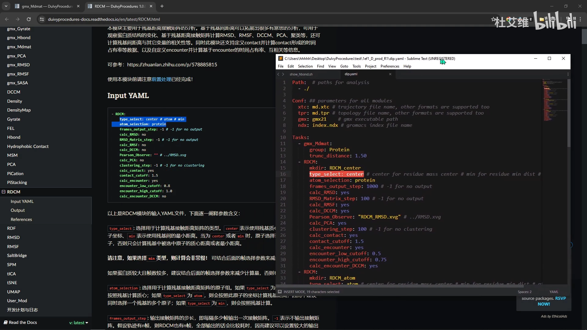

### 2.2 距离阈值：截断在哪，颜色就饱和在哪

第二个决定是阈值。`gmx_mdmat` 里用 `-t` 指定距离阈值，讲者演示时设成 1.5（单位 nm）。关键在于**超过阈值的距离会被压到阈值上**：如果某对残基距离是 2.2 nm，它也会被当作 1.5，绘图的时候就按 1.5 画。讲者的说法是「它实际上是一个距离的截断」。[【跳转到 01:41】](https://www.bilibili.com/video/BV1nC411J7oe/?t=101)

这是接触图最容易被忽略的一点：**图上的颜色不是真实距离，而是「距离与阈值取小」之后的值**。所以图上大片饱和的红色，只说明「这些残基对离得比阈值远」，具体远多少已经看不出来了。

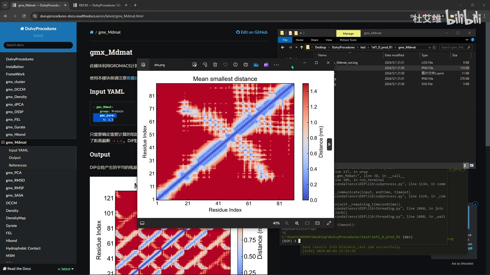

### 2.3 二值化：contact 与 encounter

距离矩阵是连续值，接触矩阵是二值的。定义很干脆：**当两个残基之间的距离小于 `contact_cutoff` 时，这两个残基就视为一个 contact**。讲者演示的配置里 `contact_cutoff` 取 1.5（nm），也就是 15 Å。[【跳转到 19:39】](https://www.bilibili.com/video/BV1nC411J7oe/?t=1179)

但讲者更推荐另一个定义——`encounter`。理由是 contact 只有「一个大阈值」，小于就算、大于就不算；而 encounter 用了**两个阈值**，更像在描述一次真实的结合与解离：[【跳转到 20:04】](https://www.bilibili.com/video/BV1nC411J7oe/?t=1204)

- 两个残基的距离**第一次小于低阈值** `encounter_low_cutoff` 时，认为 encounter **形成**；
- 距离变大、超过低阈值时，**不算断开**——因为文献里观察到「形成的时候距离要短一些、断开的时候距离会大一些」；
- 只有当距离**大于高阈值** `encounter_high_cutoff` 时，才认为 encounter **断裂**。

这就是一个带滞回的开关：进去难、出来也难，中间那段距离既不判形成也不判断裂。讲者提到 corner 那篇文章里用的是 0.55 到 0.7 nm 的 encounter 设计，并强调这两个阈值「需要结合具体的文献去做分析」，「并不一定都是普适的」。[【跳转到 21:19】](https://www.bilibili.com/video/BV1nC411J7oe/?t=1279)

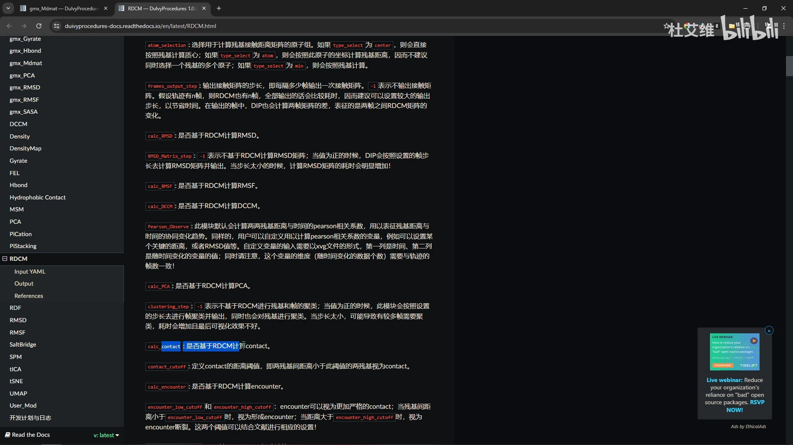

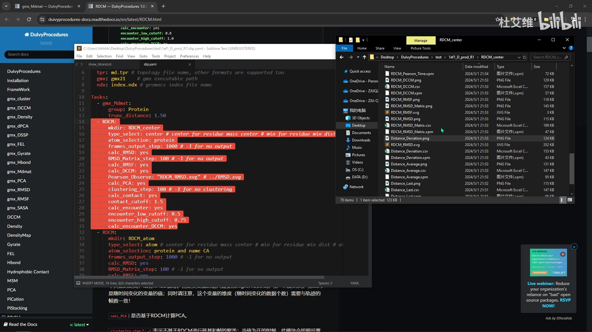

## 三、怎么读一张接触图：认三种模式

拿到一张距离矩阵图，讲者教的是「先看对角线，再看线外」。以那个 50 残基的体系为例，1.5 的截断下，红色部分基本上都是超过截断的：[【跳转到 07:06】](https://www.bilibili.com/video/BV1nC411J7oe/?t=426)

- **对角线本身**是零距离（残基到自己），所以永远是最蓝的一条。
- **对角线的增宽**：某一段对角线附近出现一片连续的蓝色加宽，说明这段序列上的残基彼此靠得很近、形成了规则的局部结构，**大概率是 α 螺旋**。讲者补充说，这种情况在 DCCM 图或者协方差图里也能够有所体现。[【跳转到 07:31】](https://www.bilibili.com/video/BV1nC411J7oe/?t=451)
- **与对角线平行或垂直的线段**：出现了成条的、离对角线有一定距离的蓝色带，**大概率是 β 折叠**，或者那种更加广义的平行排列。
- 讲者对这个体系的判断是：它实际上就是**两条 α 螺旋以一种比较平行的结构排列**——两条螺旋各自的「对角线增宽」加上它们之间那条平行的接触带，正好对应这个描述。

这里值得停一下：接触图把「二级结构是什么」变成了「图上有哪种几何花纹」。你不需要看三维结构，只要认得出花纹，就能从一张二维图里读出拓扑。

## 四、怎么比较两张图：做差，比做叠合更直接

讲者把第一帧和最后一帧的矩阵并排放出来，结论是「非常不同」：某一部分的距离变得更近了，另一部分变得更远了；具体到结构上，是蛋白的 C 端和 N 端距离更远了，而靠近 N 端的那一部分出现了「更加紧缩的构象」。[【跳转到 25:05】](https://www.bilibili.com/video/BV1nC411J7oe/?t=1505)

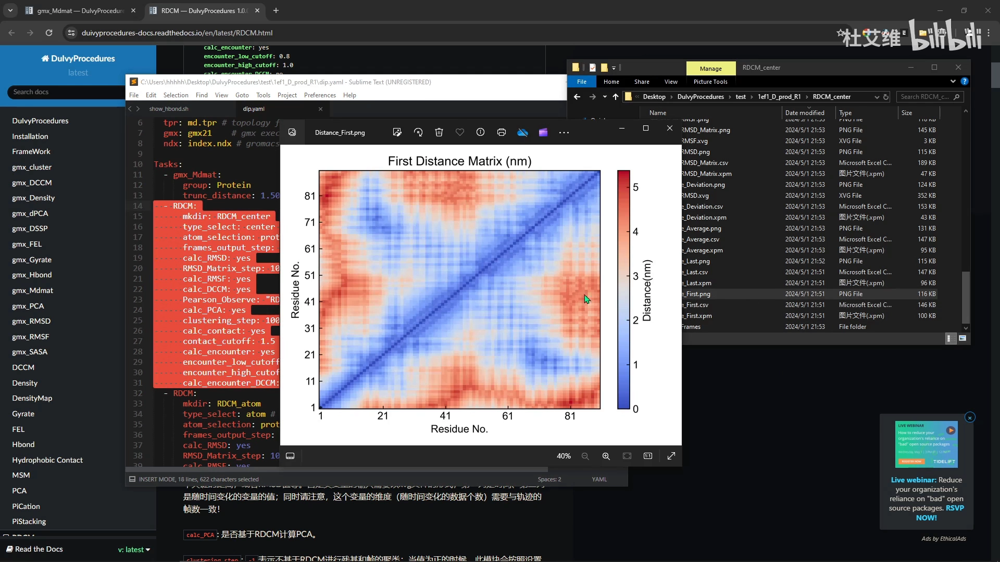

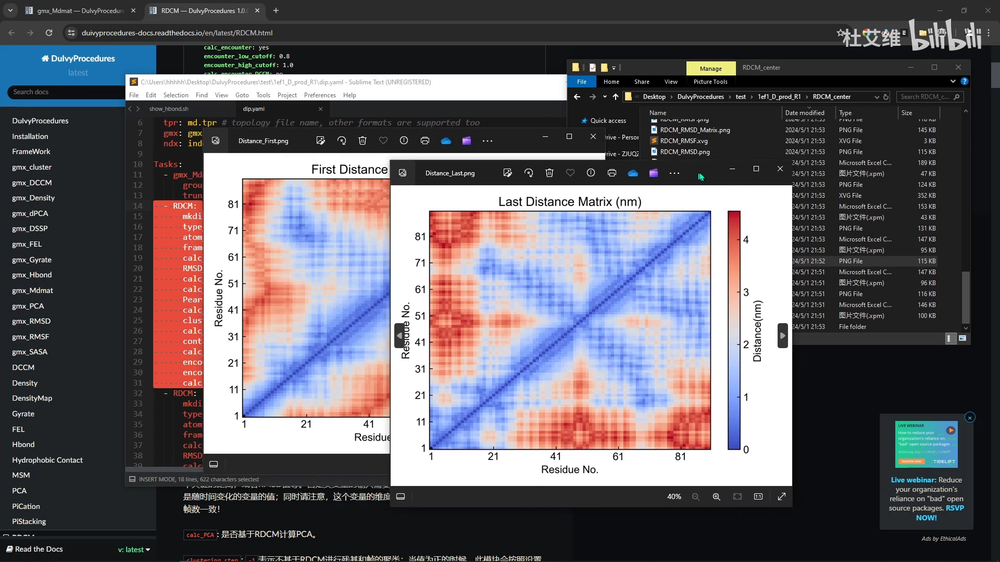

更狠的一步是直接把两张矩阵相减。工具会输出「10 纳秒减 0 纳秒」的差值矩阵：红色区域表示距离变化比较大，蓝色区域变化也比较大，但**变化的方向不一样**——那一部分是收缩的。[【跳转到 27:57】](https://www.bilibili.com/video/BV1nC411J7oe/?t=1677)

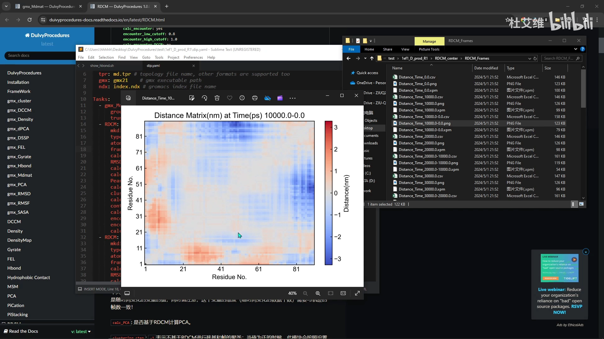

这就是接触图在「局部 vs 全局」这件事上的价值。同一份矩阵，讲者还做了两件事：

- 算**标准差矩阵**：对每一对残基，把 10001 帧的距离做平均，同时给出标准偏差。标准偏差大，说明这两个残基之间的距离变化范围大，也就说明「这两部分之间可能是柔性比较强的一部分」。在那个体系里，蛋白质中心那一部分（对应两条 α 螺旋）距离变化比较低、相对稳定，而 C 端和 N 端「比较接近无规卷曲」。[【跳转到 26:23】](https://www.bilibili.com/video/BV1nC411J7oe/?t=1583)
- 基于矩阵算 **RMSD 矩阵并聚类**：100 帧被分成「三个大的簇」。[【跳转到 29:22】](https://www.bilibili.com/video/BV1nC411J7oe/?t=1762)

把这两件事放在一起看，就是本小节关心的那个判读场景：**聚类告诉你「整体上还是同一类构象」（所以聚成几大簇、RMSD 矩阵呈块状），差值矩阵告诉你「局部哪些残基对的距离确实变了」**。局部接触的变化和全局构象的相似，是同一张矩阵给出的两个不同读数，不必也不应该用同一个数字去概括。

### 4.1 顺带一个结论：不用叠合也能算 RMSD

讲者用接触矩阵反算了一条 RMSD 曲线，和直接用坐标算的曲线「几乎一模一样」。他的解释是：基于 RDCM 算出来的 RMSD「更有代表性」，因为它去掉了平动转动，**不需要做蛋白质结构的对齐**，本身就是分子内的一个表征。[【跳转到 29:01】](https://www.bilibili.com/video/BV1nC411J7oe/?t=1741)

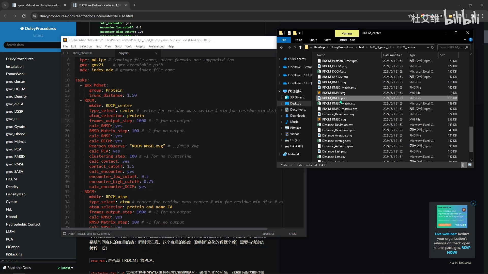

## 五、同一套矩阵还能回答什么

讲者把 RDCM 模块的输出从头到尾过了一遍，可以按「回答什么问题」分成四组。

### 5.1 结构层面的读数：RMSD、RMSF、DCCM、PCA

- **RMSD**：见上一节，可由矩阵直接算，无需叠合。
- **RMSF**：也是两端稳定性比较差、中间灵活性比较低，和常见的 RMSF 曲线一致。
- **DCCM（动力学互相关矩阵）**：讲者把基于 RDCM 的 DCCM 和基于坐标的 DCCM 并排比较，结论是「总体上的趋势是非常接近的」，会有一些小出入，因为「它们底层的表示方式不同」；而且基于 RDCM 的那张「总体上来说更加偏向于协同性」，坐标法那张蓝的地方更多。[【跳转到 32:11】](https://www.bilibili.com/video/BV1nC411J7oe/?t=1931)
- **PCA**：结果和讲者前面几个视频里基于坐标的 PCA「非常类似」，右半部分是蓝色的，主要有两个坑。[【跳转到 35:28】](https://www.bilibili.com/video/BV1nC411J7oe/?t=2128)

### 5.2 时间层面的读数：聚类与 Pearson 相关

- **聚类**分两种：一种是对「帧」聚类，看哪些时刻的矩阵彼此很像，输出一张树状层次聚类图；另一种是对「残基」聚类。讲者演示时每 100 帧聚一次。[【跳转到 36:08】](https://www.bilibili.com/video/BV1nC411J7oe/?t=2168)
- **Pearson 相关**：默认会算「每一对残基的距离」与「时间」这两个变量的相关系数。蓝色的部分表示这对残基的距离随时间增加而减少，红色表示随时间增加而增加；配一张 p 值矩阵，值越大表示可信度越低，白色是对角线（自己和自己，值不变，所以没有相关性）。讲者还演示了把第二列变量换成 RMSD，看残基距离和 RMSD 的相关性。[【跳转到 33:19】](https://www.bilibili.com/video/BV1nC411J7oe/?t=1999)

### 5.3 接触层面的读数：占有率

这是接触图最实用的一张衍生图。**contact 的时间占有率**定义为：在所有时间帧里，这对残基的距离小于 `contact_cutoff` 的帧占总帧数的比重。[【跳转到 37:50】](https://www.bilibili.com/video/BV1nC411J7oe/?t=2270)

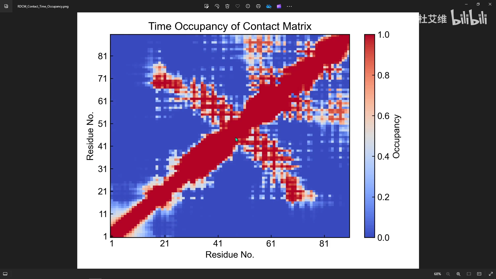

把这张二维矩阵沿一个方向压成一维，就得到「每个残基的接触稳定性曲线」：数值越高，说明这部分的残基形成的 contact 越稳定；两端形成的 contact 就不那么稳定。讲者说它「类似于 RMSF」，只是数值方向反过来了——RMSF 高表示灵活，这里高表示稳定。[【跳转到 38:38】](https://www.bilibili.com/video/BV1nC411J7oe/?t=2318)

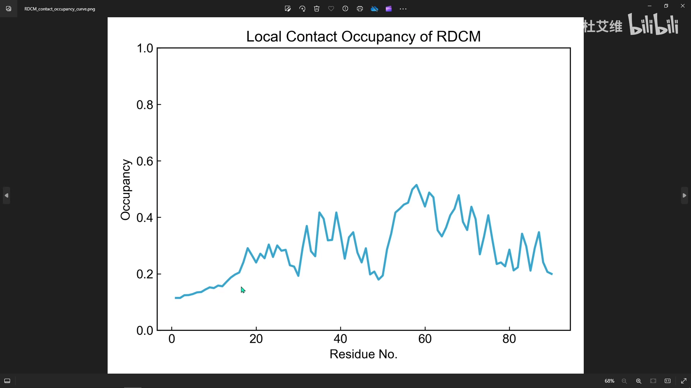

讲者还基于 contact 算了几个无量纲的数，其中一个是 **C50**：contact 时间占有率超过 50% 的残基对，占总残基对的比例。这个数越大表示整体越稳定，但**必须有对照**——一个蛋白的 C50 是 0.9、另一个是 0.3，才能说前者整体构象更稳定。[【跳转到 40:20】](https://www.bilibili.com/video/BV1nC411J7oe/?t=2420)

### 5.4 encounter 层面的读数：什么时候形成、形成多久

encounter 因为带滞回，能问出 contact 问不出的问题：某个残基对在整个 10001 帧里**形成了多少次**、**占有率**多少、**第一次形成**在什么时刻、**最后一次形成**在什么时刻、**形成时长**、**平均时长**。[【跳转到 41:03】](https://www.bilibili.com/video/BV1nC411J7oe/?t=2463)

讲者重点讲了「首次形成时间」那张图：对角线附近的 encounter 形成得比较早，越红的部分形成得越晚；图上有几个黄色的点，表示在模拟的后半段、大约六七十纳秒的时候，这些残基对才第一次形成 encounter——这和前面「模拟后半程这部分残基靠得更紧」的观察是一致的。[【跳转到 42:10】](https://www.bilibili.com/video/BV1nC411J7oe/?t=2530)

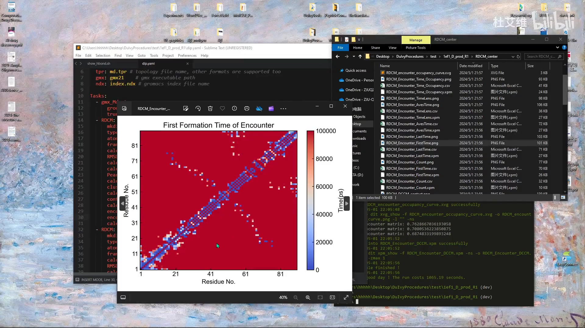

## 六、代价与陷阱：讲者自己点出来的四个坑

1. **内存是 $O(N^2 \times \text{帧数})$**。90 个残基一帧就有 8100 个距离数据，乘上 10001 帧就是一个三维矩阵；如果残基数是 1000，一张矩阵就是 100 万个数据，「如果再有 1 万帧，这个数据量就非常恐怖」。所以即使选 `center` 或 Cα 也很吃内存。[【跳转到 13:23】](https://www.bilibili.com/video/BV1nC411J7oe/?t=803)
2. **`min` 模式又慢又吃内存**。讲者的建议是：如果非要用 `min`，就去算一个平均的 `min`，代价是「它就没有更多后续的分析了」；或者结合帧选择，隔十帧算一帧来减少计算量。[【跳转到 14:34】](https://www.bilibili.com/video/BV1nC411J7oe/?t=874)
3. **输出本身很贵**。`frames_output_step` 默认 -1 表示不输出；一旦按帧输出 CSV/XPM，讲者的经验是「这个输出实际上可能占了整个分析差不多 1/3 的时间」。[【跳转到 16:19】](https://www.bilibili.com/video/BV1nC411J7oe/?t=979)
4. **二值数据做不了精细分析**。讲者明确说：用 contact 去做的 DCCM「是非常粗糙的」，因为 contact 就是零和一的数据；encounter 版的 DCCM 也一样粗糙，「基本上不建议大家去使用」。另外 encounter 的两个阈值「非常重要」，必须结合文献和实际情况设定。[【跳转到 39:24】](https://www.bilibili.com/video/BV1nC411J7oe/?t=2364)

还有一处纯工程上的细节容易踩：如果为了省时间改成「每隔 100 帧轨迹算一帧 RDCM」，那么 `frames_output_step` 和聚类、RMSD 矩阵的步长**都是基于 RDCM 的帧数**去算的，不是基于原始轨迹帧数。讲者的例子是：100 帧轨迹里选一帧，总共得到 100 帧 RDCM，再每隔十帧输出一次。[【跳转到 45:39】](https://www.bilibili.com/video/BV1nC411J7oe/?t=2739)

---

## 小结

- **接触图 = 三步**：给每个残基选代表点（质心 / 单个 Cα / 原子间最短距离）→ 量两两距离 → 按阈值二值化。三个选择都会改变图的样子，没有「默认正确」的一档。
- **阈值是截断，不是真实距离**：超过阈值的距离被压到阈值上，所以图上饱和的颜色只表示「比阈值远」，不表示「远多少」。
- **contact 是单阈值，encounter 是双阈值**：encounter 用低阈值判形成、高阈值判断裂，中间带滞回，更适合描述「结合了又松开」的过程；阈值本身要按文献定，不是普适常数。
- **读图认花纹**：对角线增宽 = α 螺旋，与对角线平行或垂直的线段 = β 折叠或广义平行排列。
- **比较靠做差**：两帧矩阵相减，正负分别对应距离变大与变小，能直接定位局部变化；标准差矩阵则告诉你哪一段最柔性。
- **局部与全局是两个读数**：同一张矩阵既能聚出「整体还是同一类构象」（RMSD 矩阵、帧聚类），也能指出「局部哪些残基对变了」（差值矩阵），不要用一个数字去概括两件事。
- **接触矩阵不需要叠合**：因为它只记录分子内部谁离谁近，天然免疫平移与转动，所以由它反算的 RMSD 与坐标法几乎一致，却省掉了对齐这一步。

## 关键术语速查

| 术语 | 一句话解释 |
| --- | --- |
| 距离矩阵（distance matrix） | 横纵轴都是残基编号、格子里是两残基间距离的方阵 |
| 接触矩阵 / 接触图（contact map） | 把距离矩阵按阈值二值化后的 0/1 方阵，1 表示「算接触」 |
| RDCM | Residue Distance Contact Matrix，残基距离接触矩阵；也是本工具里算它的模块名 |
| `type_select` | 选残基代表点的参数：`center` 质心、`atom` 指定原子（如 Cα）、`min` 原子间最短距离 |
| 截断（cutoff） | 距离阈值；超过阈值的距离在图上被压到阈值，颜色因此饱和 |
| contact | 两残基距离小于 `contact_cutoff` 即视为接触，单阈值 |
| encounter | 双阈值接触：低于低阈值算形成，高于高阈值才算断裂，中间带滞回 |
| 时间占有率（occupancy） | 某对残基在所有帧中处于接触状态的比例，衡量接触的稳定性 |
| C50 | contact 占有率超过 50% 的残基对占总残基对的比例，用于横向比较整体稳定性 |
| DCCM | 动力学互相关矩阵，描述残基运动的协同性；基于二值 contact 计算会很粗糙 |
| 平动/转动不变性 | 接触矩阵只记录内部相对距离，整体平移旋转不改变它，因此无需叠合 |