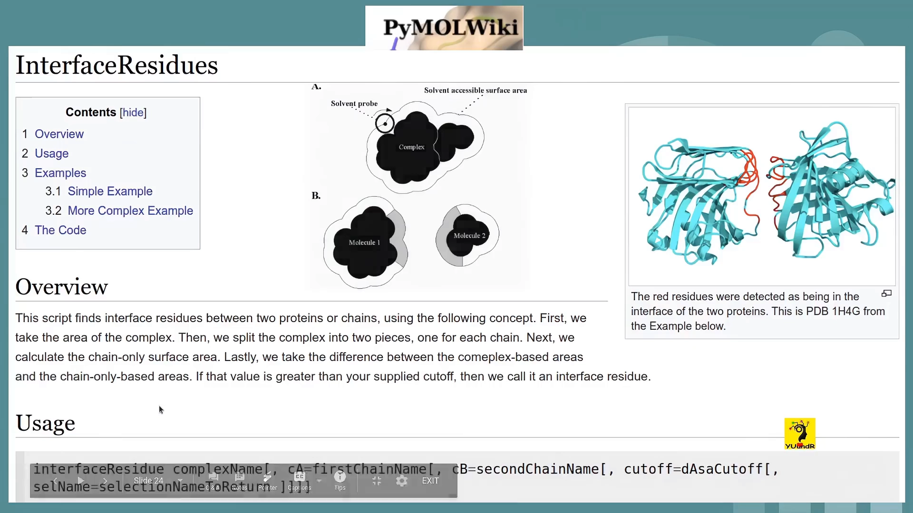
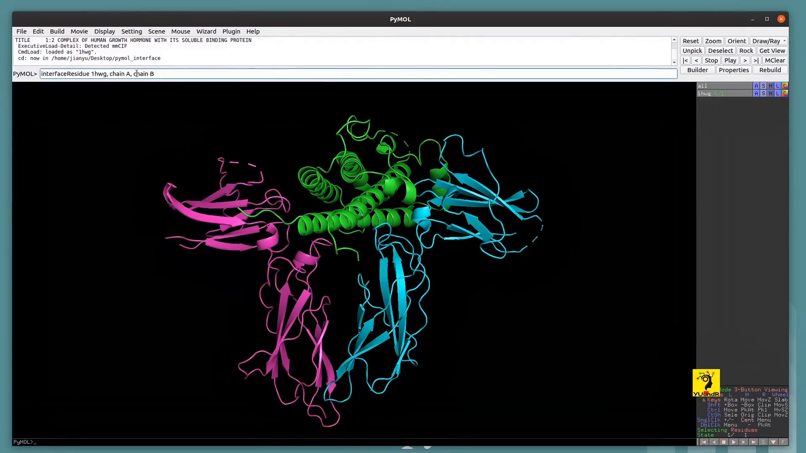
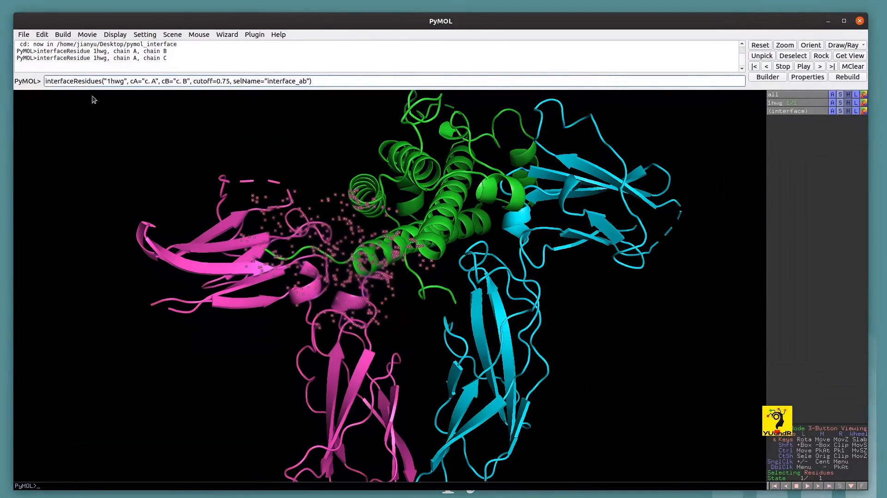
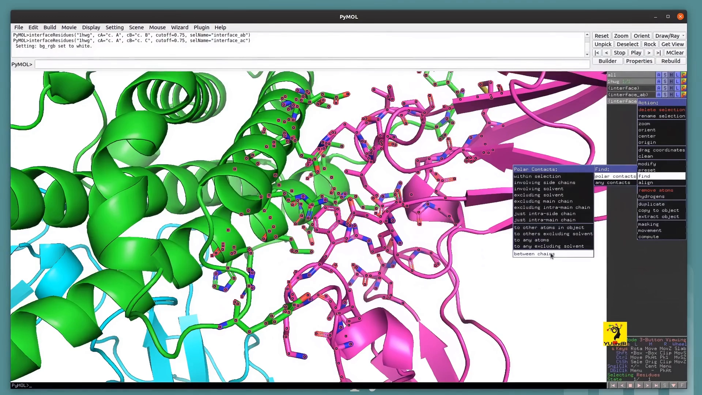
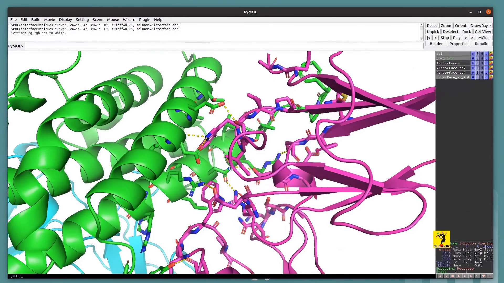
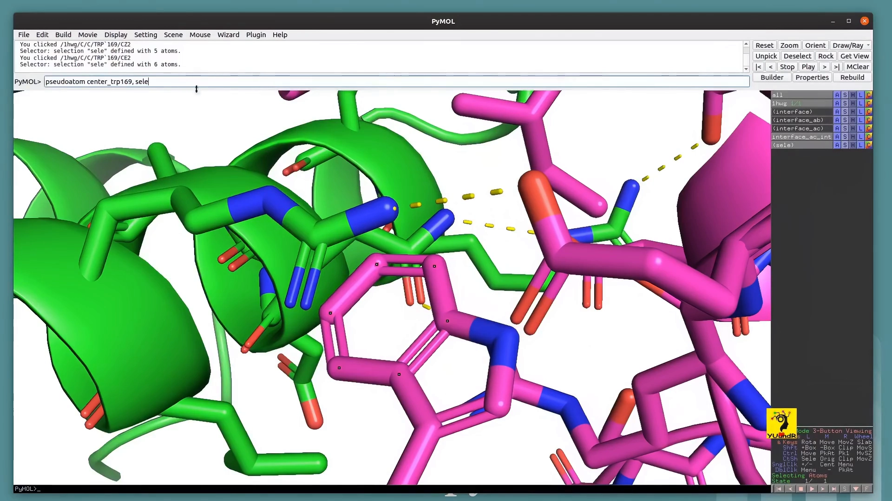
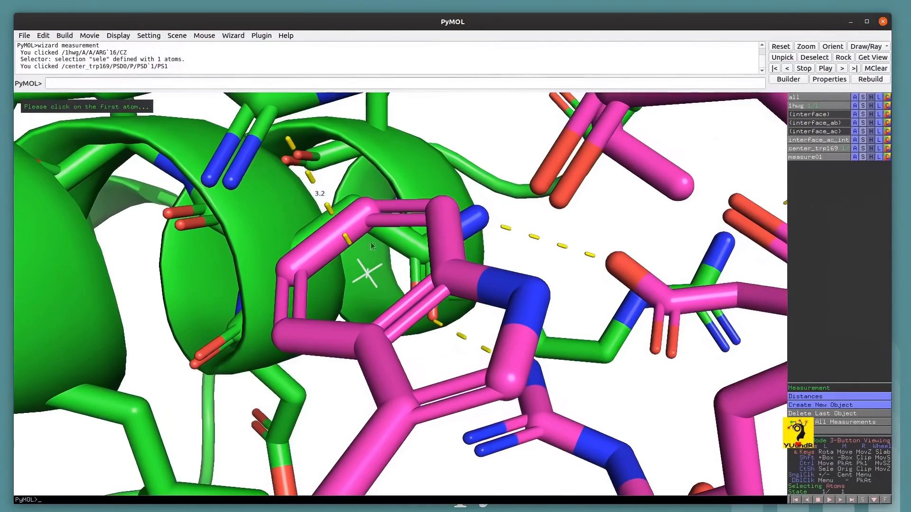
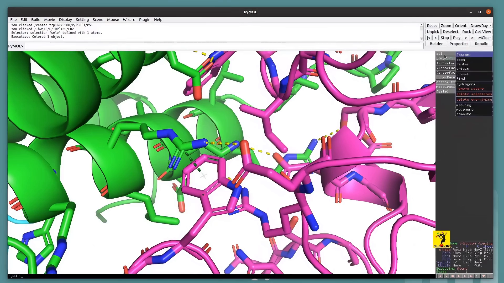

# 界面残基怎么找：用 PyMOL 从埋藏面积算到氢键与 π-阳离子

> 视频来源：[Pymol - 分析蛋白-蛋白相互作用界面](https://www.bilibili.com/video/BV1tZ4y137VB/)（Bilibili · 钰沐菡-YuMuhan · 时长约 13 分钟）
>
> 这是一支十几分钟的实操演示：讲者拿人生长激素与其受体（PDB 1HWG，三条链、两个界面）当例子，先用一段现成脚本按「结合前后表面积的变化」把界面残基选出来，再逐个找界面上的氢键、π-阳离子和 π-π 作用。本文按「界面怎么定义 → 脚本怎么跑 → 氢键怎么找 → 没有现成命令的作用力怎么量 → 出图 → 这套流程的边界」整理，命令与数值都照视频原样保留。
>
> 接触图（从坐标构造残基距离/接触矩阵）见同小节的另一篇《从坐标到接触图》。本文只讲**界面**这一侧的描述。

## 本讲要解决的核心问题（SCQA）

**背景**：拿到一个蛋白-蛋白复合物的结构文件，你看到的是几千个原子的坐标，以及几条链的划分。

**冲突**：结构文件里并没有「界面」这个标签。哪几个残基算界面残基、哪两个原子之间算氢键，都得你自己从坐标里算出来；而且不同工具给的命令还不一样。

**疑问**：能不能用一个明确的物理量把「界面」定义出来，而不是靠肉眼看两条链挨着的地方？定义出来之后，具体的作用力（氢键、π-阳离子、π-π）又该怎么一个个找？

**回答（中心思想）**：界面的定义是**结合前后溶剂可及表面积的变化**——复合物算一次表面积，把两条链拆开各算一次，差值超过阈值的残基就是界面残基（这就是常说的 ΔSASA / 埋藏面积）。PyMOL 里有一段现成脚本 `InterfaceResidues.py` 就按这个定义选残基。选出来之后，作用力分两类处理：**有现成命令的**（氢键，`find polar contacts` 里选 `between chains`），和**没有现成命令的**（π-阳离子、π-π，只能在环中心放一个假原子，再量距离和角度）。

---

## 一、界面的定义：结合前后，表面积变了多少

讲者一上来先念了 PyMOL wiki 上 `InterfaceResidues` 这段脚本的描述，并把原理讲清楚：它「会先对这个复合物做一次表面积计算，然后把 A、B 链分开以后分别再算一次。如果某些氨基酸残基在拆分前后表面积有变化，就说明它们参与了相互作用、位于界面上」。[【跳转到 00:50】](https://www.bilibili.com/video/BV1tZ4y137VB/?t=50)

wiki 原文的说法更完整：先取复合物，把复合物拆成两块（每条链一块），计算各链单独存在时的表面积，最后用「基于复合物的面积」减去「基于单链的面积」，如果这个差值大于你给的 cutoff，就把它叫作界面残基。[【跳转到 00:25】](https://www.bilibili.com/video/BV1tZ4y137VB/?t=25)

用公式写出来就是每个残基的埋藏面积：

$$
\Delta \mathrm{SASA}_i = \mathrm{SASA}_i^{\text{复合物}} - \mathrm{SASA}_i^{\text{游离链}}
$$

只有当 $\Delta \mathrm{SASA}_i$ 大于 cutoff 时，残基 $i$ 才被算进界面。讲者说这个原理「跟我之前讲溶剂可及表面积的时候讲到的一样」——也就是说，它衡量的不是「两个残基离得多近」，而是「这个残基有多少表面被对方挡住了」。



这个定义有两个直接后果，值得先记住：

- **它是几何量，不是能量量**。表面积变化大，只说明埋进去的部分多，不代表结合得更牢。
- **cutoff 是你自己定的**。讲者演示时用的是 `cutoff=0.75`（单位是面积），换一个 cutoff，界面残基的数量就会变。

## 二、实操：三步把界面残基选出来

### 2.1 准备：加载结构、清掉结晶水、按链上色

讲者打开 PyMOL 后先把工作路径切到放脚本的文件夹，加载 1HWG。他做了一个明确的假设：**这些水分子全部是结晶水，对相互作用没有影响，所以先删掉**。然后按链染色，于是能看清这个复合物的组成——中间那条 α 螺旋是 A 链（生长激素），左右两边是生长激素的受体 B 链和 C 链。[【跳转到 02:17】](https://www.bilibili.com/video/BV1tZ4y137VB/?t=137)

这一步决定了后面所有分析的范围：**这个结构有两个界面，AB 之间和 AC 之间**。所以找界面残基时不能只跑一次，否则两个界面的结果会互相覆盖。



### 2.2 跑脚本：`run script` + 一条命令

脚本的用法是：先 `File → Run Script` 把 `InterfaceResidues.py` 加载进来，然后在命令框里输入 `interfaceResidues`，后面跟三样东西——object 的名字、第一条链、第二条链。[【跳转到 03:22】](https://www.bilibili.com/video/BV1tZ4y137VB/?t=202)

讲者演示的第一条命令是 `interfaceResidue 1hwg, chain A, chain B`，回车后 PyMOL 就选出了一批残基，并把它们存进一个叫 `interface` 的 selection 里。[【跳转到 03:47】](https://www.bilibili.com/video/BV1tZ4y137VB/?t=227)

问题马上出现了：如果接着算 A 链和 C 链之间的界面，结果还是存进 `interface` 这个 selection，**刚刚保存的 AB 界面就被替代掉了**。所以只要复合物有两个以上界面，就必须用带 `selName` 的完整版本：

```
interfaceResidues("1hwg", cA="A", cB="B", cutoff=0.75, selName="interface_ab")
interfaceResidues("1hwg", cA="A", cB="C", cutoff=0.75, selName="interface_ac")
```

讲者对这个命令的拆解是：括号里先告诉 PyMOL 分析对象是哪个，再说明分析的是哪两条链，然后是 cutoff（也可以不设），最后告诉它「现在找出来的这些界面残基请保存到这个新名字里」。[【跳转到 05:02】](https://www.bilibili.com/video/BV1tZ4y137VB/?t=302)



跑完之后，对象面板里会并列出现 `interface`、`interface_ab`、`interface_ac` 三个 selection，两个界面各归各的名字，后面才能分别做分析。

## 三、氢键：只看链间，不看链内

界面残基选好之后，讲者只分析 AC 这一个界面。他把界面残基显示成棒状、按元素上色（氧红、氮蓝），然后把视角推近。[【跳转到 06:25】](https://www.bilibili.com/video/BV1tZ4y137VB/?t=385)

找氢键的路径是：在 `interface_ac` 的 Action 菜单里选 `find` → `polar contacts`。这里有一个关键的下拉选项：因为**链内部的相互作用不是我们关心的**，所以要在菜单里选最下面的 `between chains`。[【跳转到 06:40】](https://www.bilibili.com/video/BV1tZ4y137VB/?t=400)

选对之后，屏幕上出现的黄色虚线「就是这两条链之间的氢键作用」，「而没有任何 A 链或者 C 链内部的残基之间的相互作用力」。[【跳转到 07:05】](https://www.bilibili.com/video/BV1tZ4y137VB/?t=425)





这一步的教训很朴素：**同一个「找氢键」的功能，选不选 `between chains`，得到的是两个完全不同的答案**。不选的话，链内二级结构里那些氢键会全部混进来，界面信号被淹没。

## 四、没有现成命令的作用力：在环中心放个假原子

氢键找完，讲者转向非极性作用，并直接说明困难：**PyMOL 里没有一个方便的办法让你直接看到这些非极性作用**，所以「只能通过测量距离来分析」——看这个距离是不是符合范德华力的范围，或者是不是符合 π-π、π-阳离子 interaction 的距离范围或者角度范围。[【跳转到 07:46】](https://www.bilibili.com/video/BV1tZ4y137VB/?t=466)

### 4.1 先明确要找的是什么

讲者挑的例子是一个**色氨酸**和一个**精氨酸**。要判断它们之间有没有 π-阳离子作用，需要两个几何量：

- **距离**：从精氨酸的碳原子，到色氨酸六元环的**环中心**的距离；
- **角度**（π-π 时还需要）：两个环平面之间的夹角。

为什么选碳原子而不是氮原子？讲者的依据是文献：精氨酸的胍基基团，「它的正电性其实是在这个碳原子上面的」，所以他「今天先用这个碳原子」来量。[【跳转到 08:22】](https://www.bilibili.com/video/BV1tZ4y137VB/?t=502)

### 4.2 环中心没有原子，那就造一个

这里撞上一个纯几何的障碍：**环的中间没有任何原子可选**，而测量距离必须选两个原子。解决办法是放一个假原子（pseudoatom）在环中心。步骤是：

1. 把鼠标选择模式改成「原子」，逐个点中六元环的六个原子；
2. 输入命令 `pseudoatom center_trp69, sele`；
3. 回车后，环中心出现一个叉号（×）标记的假原子。

讲者解释这条命令做的事：「把这六个原子的坐标拿出来，计算一下它们围成的环的中心坐标，然后在那个坐标位置给你放一个假原子」。[【跳转到 09:51】](https://www.bilibili.com/video/BV1tZ4y137VB/?t=591)



### 4.3 量距离、读数值

有了假原子，就可以用 `wizard → measurement` 量距离：先点假原子，再点精氨酸的碳原子，屏幕上出现一条黄色虚线和一个数字——**3.2**（单位 Å）。讲者随后把这条测量保存进对象面板的 `measure01`，并把它改成绿色，于是画面上一眼能区分：**黄色虚线是氢键，绿色虚线是 π-阳离子作用**。[【跳转到 10:40】](https://www.bilibili.com/video/BV1tZ4y137VB/?t=640)



3.2 Å 这个数怎么判？讲者给的是范围判断：只要落在 π-阳离子作用的距离范围内就算成立；他在同一系列的另一支视频里提到这个 cutoff 的上限「好像是 6，有的软件也设到了 6.6」。本文只按本视频的口径：这是一个**距离范围判断**，不是精确的能量计算。

### 4.4 π-π 同理，只是多一个中心

讲者最后补了一句推广：如果界面上还有可能的 π-π interaction，「也可以通过同样的方法，在两个 π 系统的六元环中心或者五元环中心放一个假原子，然后点击这个假原子来测量距离」——两个中心各放一个假原子，量中心距，必要时再量两个环平面的夹角。[【跳转到 11:22】](https://www.bilibili.com/video/BV1tZ4y137VB/?t=682)

## 五、出图：把双线改成单线

分析做完，如果要把画面保存成图片，讲者提醒先做一件事：把 valence 显示隐藏掉（`hide valence`）。这样芳环和双键都画成单线条，而不是两条线并排——「因为大家如果发论文的话，一般看到的都是这种单线而不是双线」。[【跳转到 11:58】](https://www.bilibili.com/video/BV1tZ4y137VB/?t=718)



## 六、这套流程的边界

把整个视频的动作串起来看，它其实只做了两件事：**用表面积差定义界面，用距离和角度描述界面上的作用力**。这两件事都是纯几何的，所以边界也很清楚：

- **判据全是几何量**。界面残基靠 ΔSASA 加一个 cutoff 判定，作用力靠距离（必要时加角度）判定。视频里没有出现任何能量项，也没有对结合强弱下结论。
- **「距离符合范围」不等于「作用一定存在」**。讲者的措辞始终是「会不会有一个 π-阳离子作用」「来看一下它是不是符合范围」——符合范围只是必要条件。
- **水分子被当作不存在**。讲者明确假设这些是结晶水、对相互作用没有影响，直接删掉；如果界面里有保守水桥，这个假设就不成立。
- **cutoff 是人选的**。`cutoff=0.75` 是演示值，换一个值界面残基的名单就会变；π-阳离子的距离上限在不同软件里也不一样。

---

## 小结

- **界面 = 埋藏面积**：复合物表面积减去拆开后各链表面积，差值超过 cutoff 的残基就是界面残基；这是 ΔSASA 的定义，PyMOL 的 `InterfaceResidues.py` 直接实现了它。
- **多界面必须分开命名**：用带 `selName` 的完整调用，否则后算的界面会覆盖先算的。
- **氢键要选 `between chains`**：不选的话链内氢键会混进来，界面信号被淹没。
- **环中心没有原子**：用 `pseudoatom` 在选中的环原子上算几何中心、放一个假原子，才能量「环心到某原子」的距离。
- **三类作用力用三种方式表达**：氢键有现成命令（黄色虚线），π-阳离子与 π-π 只能量距离/角度（绿色虚线），范德华力同样靠距离范围判断。
- **出图前 `hide valence`**：芳环与双键画成单线，才是论文里常见的画法。
- **结论的强度要匹配方法的强度**：全流程给的是几何判据，能回答「这里有没有可能形成某种作用」，不能回答「结合有多强」。

## 关键术语速查

| 术语 | 一句话解释 |
| --- | --- |
| 界面残基（interface residue） | 结合前后溶剂可及表面积发生明显变化的残基，即被对方挡住了一部分表面的残基 |
| SASA | 溶剂可及表面积，用探针球在分子表面滚动得到的、能被溶剂碰到的面积 |
| ΔSASA / 埋藏面积 | 复合物状态与游离链状态的 SASA 之差；差值越大，说明埋进去的部分越多 |
| `InterfaceResidues.py` | PyMOL wiki 上的脚本，按 ΔSASA 大于 cutoff 的规则选出界面残基 |
| `between chains` | `find polar contacts` 里的选项，只保留跨链的极性接触，排除链内氢键 |
| π-阳离子作用（π-cation） | 带正电的基团（如精氨酸胍基）与芳香环 π 电子云之间的吸引，用「正电中心到环心」的距离判定 |
| π-π 作用 | 两个芳香环之间的堆积作用，用两个环心的距离与环平面夹角判定 |
| 假原子（pseudoatom） | 没有真实原子核、只由若干原子坐标算出的几何点，用来表示环中心这类「没有原子但有位置」的地方 |
| 胍基 | 精氨酸侧链末端的基团，带正电；讲者按文献取碳原子作为正电中心 |
| valence | PyMOL 里表示化学键级的显示方式，`hide valence` 后双键画成单线 |