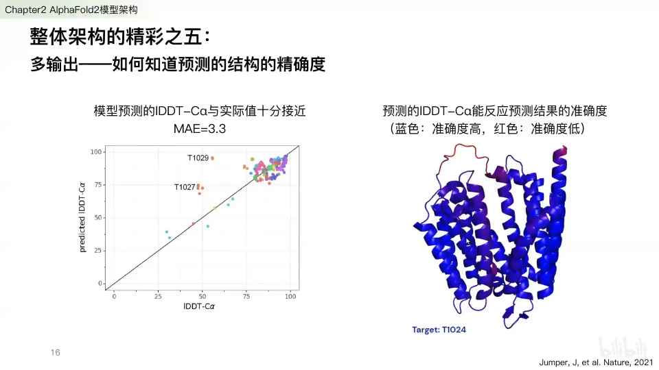
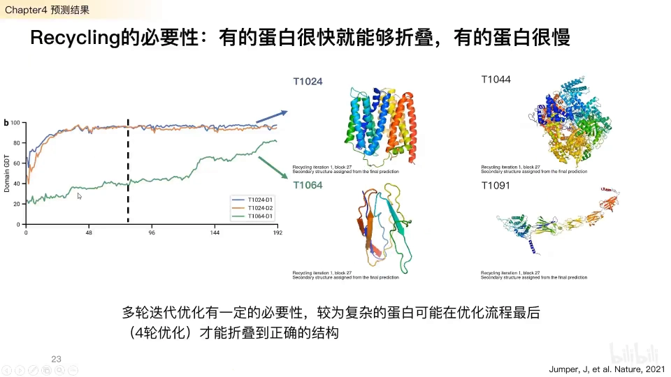
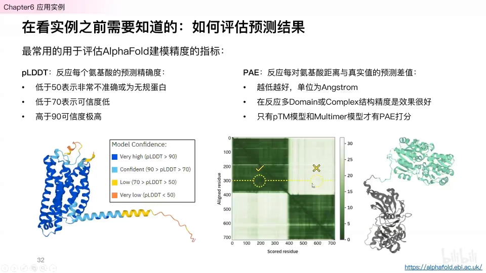
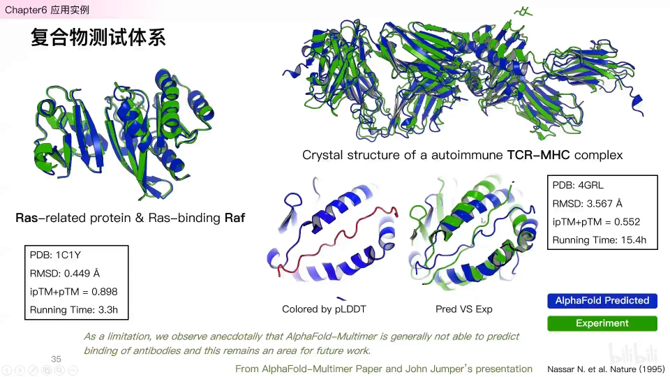
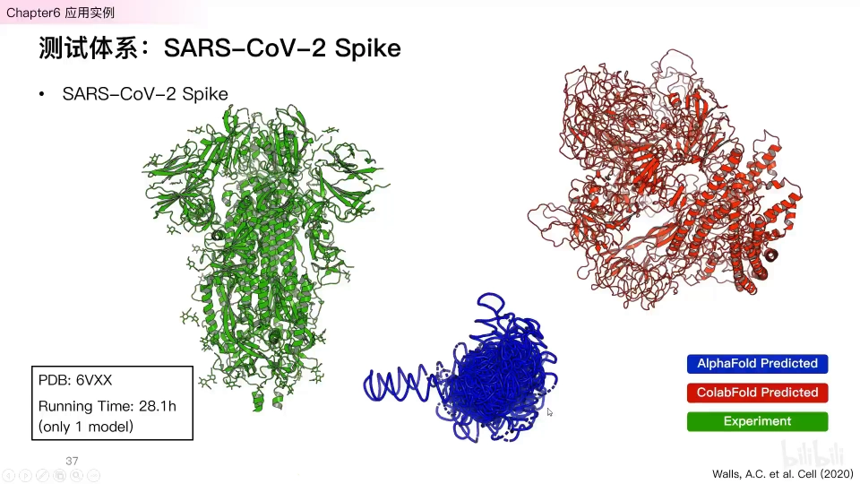
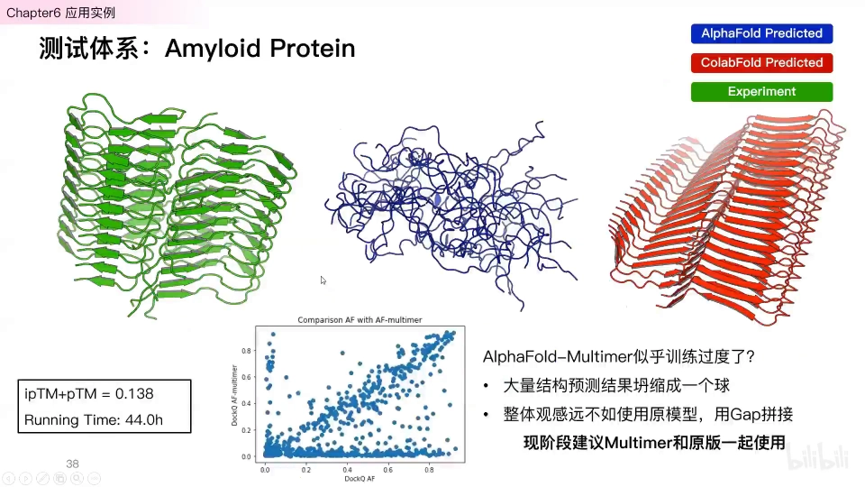
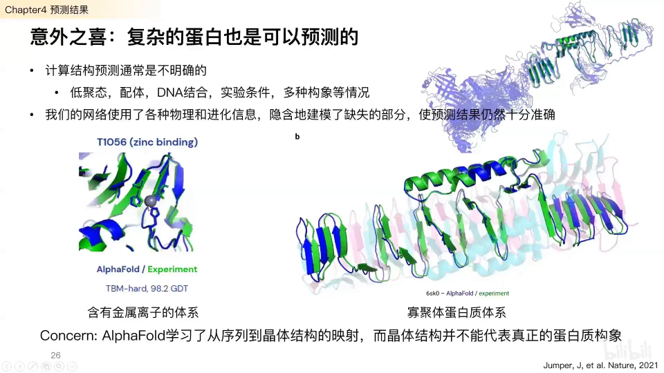
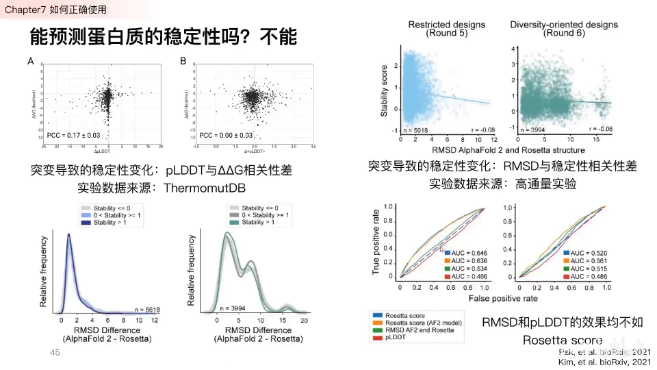
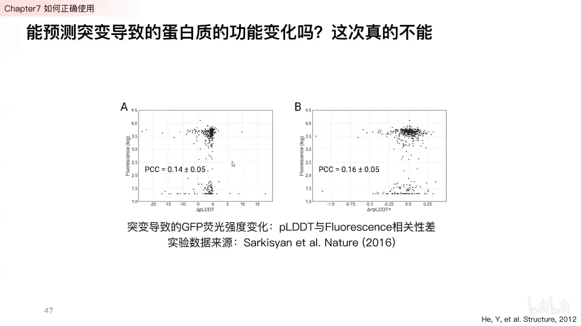

# AlphaFold 的分数能告诉我们什么：从 pLDDT 到"不能预测稳定性与功能"

> 视频来源：[AlphaFold 的原理和展望](https://www.bilibili.com/video/BV1fm4y1D7Wz)（Bilibili · 钰沐菡公开课，主讲钟博子韬，上海交通大学，时长约 77 分钟）
>
> 这是一场面向生物背景听众的讲座：前半段讲 AlphaFold2 / Multimer 为什么有效（MSA、recycling、Evoformer、structure module、置信度输出），后半段花大量篇幅讲**怎么用、什么时候不该用**——包括他自己跑失败的一批复合物案例，以及 pLDDT 与稳定性、功能之间"没有相关性"的文献证据。本文把重心放在后半段：**分数该怎么读，读到低分时又该怀疑什么**。模型架构的细节属于 5.2.1，这里只做简要回顾。

## 本讲要解决的核心问题（SCQA）

**背景**：AlphaFold2 在 CASP14 上把预测精度推到了接近实验的水平，AlphaFold DB 也已经覆盖了整个 UniProt，很多蛋白直接下载就能用 [【跳转到 54:26】](https://www.bilibili.com/video/BV1fm4y1D7Wz/?t=3266)。

**冲突**：但模型同时输出一个"置信度"分数，于是出现了一个很常见的误用——**把分数当成结论**：pLDDT 高就认为"这个蛋白就是这样"，pLDDT 低就认为"这段没用"。讲者用两类反例打破这个习惯：一类是模型在复合物上彻底失败（Spike 三聚体被算成一团毛线），另一类是**分数与功能之间根本没有相关性**（GFP 突变体的荧光强度与 pLDDT 相关系数只有 0.14）[【跳转到 65:02】](https://www.bilibili.com/video/BV1fm4y1D7Wz/?t=3902)。

**疑问**：那么 pLDDT、PAE 这些分数到底在度量什么？低分区的出现有哪几种完全不同的原因？从"结构预测"走到"功能结论"，中间还差哪几步？

**回答（中心思想）**：分数度量的是**"这个模型对自己摆出的坐标有多自信"**，不是"这个蛋白在细胞里是什么样"，更不是"它能不能工作"。低分至少有三种来源：**真的没有固定结构（无规/柔性区）**、**存在多种构象而被平均掉**、**模型确实算错了**；三者必须靠不同证据区分 [【跳转到 41:23】](https://www.bilibili.com/video/BV1fm4y1D7Wz/?t=2483)。反过来，高分也只保证"坐标摆得像晶体结构"，不保证稳定性与功能——这一点有直接的定量证据 [【跳转到 61:17】](https://www.bilibili.com/video/BV1fm4y1D7Wz/?t=3677)。

---

## 一、AlphaFold 解决的到底是什么问题

中心法则把信息从 DNA 传到 RNA 再到蛋白质；新生肽链折叠成稳定的三维结构才发挥功能。1972 年诺贝尔化学奖得主 Anfinsen 的经典结论是：折叠成天然结构所需的全部信息都编码在氨基酸序列里 [【跳转到 03:33】](https://www.bilibili.com/video/BV1fm4y1D7Wz/?t=213)。这句话暗示"序列决定结构"，但实操上并不容易：实验解析结构准确度很高，却是低通量的，需要大量时间和成本；早期计算方法的效率高，但准确度低 [【跳转到 04:17】](https://www.bilibili.com/video/BV1fm4y1D7Wz/?t=257)。

于是有了明显的"序列—结构 gap"：序列数据比结构数据多上千倍。CASP 比赛就是为填这个 gap 设的：先给序列、实验结构暂不公布，各队盲测，三个月后比对 [【跳转到 05:07】](https://www.bilibili.com/video/BV1fm4y1D7Wz/?t=307)。

CASP 近 20 年的几次台阶很清晰：2014 年 contact 方法引入多序列比对提取共进化信息，2016 年深度学习加入，2020 年 AlphaFold2 引入 Transformer [【跳转到 05:37】](https://www.bilibili.com/video/BV1fm4y1D7Wz/?t=337)。而且提升最大的恰恰是**困难靶点**——那些没有近缘模板、必须"从头算"的蛋白 [【跳转到 06:27】](https://www.bilibili.com/video/BV1fm4y1D7Wz/?t=387)。

---

## 二、为什么有效：五处关键设计（简要回顾）

传统流程是"序列 → 多序列比对 → 预测二维接触/距离图 → 用二维图作约束去优化三维结构"。之所以绕道二维，是因为直接预测三维坐标太难，而二维图可以套用计算机视觉里成熟的 ResNet 之类模型 [【跳转到 07:21】](https://www.bilibili.com/video/BV1fm4y1D7Wz/?t=441)。其理论基础是共进化：两个位点在不同物种里同步变化，往往说明它们在三维空间里靠得很近 [【跳转到 08:50】](https://www.bilibili.com/video/BV1fm4y1D7Wz/?t=530)。

AlphaFold2 的"精彩之处"可以归成五点：

1. **MSA 做得足够深**。序列库来自 Uniref/MGnify 与自建的 BFD，结构库用 PDB 并按 70% 相似度去重。讲者的判断是：**MSA 决定了预测准确度的上限** [【跳转到 12:51】](https://www.bilibili.com/video/BV1fm4y1D7Wz/?t=771)。
2. **recycling**：把输出再送回输入，整个模型多跑几轮（训练时三轮，即每个输入过四次 Evoformer）。有的蛋白第一轮就收敛，有的要到第四轮才成形 [【跳转到 13:07】](https://www.bilibili.com/video/BV1fm4y1D7Wz/?t=787)。
3. **Evoformer**：用 attention 让 MSA 表示与残基对（pair）表示互相更新，前者管共进化，后者管几何关系 [【跳转到 14:02】](https://www.bilibili.com/video/BV1fm4y1D7Wz/?t=842)。
4. **structure module**：把每个残基抽象成一个"残基三角"（主链 N、Cα、C 三个原子），通过旋转平移把三角摆到正确位置，从而实现端到端输出三维坐标 [【跳转到 15:09】](https://www.bilibili.com/video/BV1fm4y1D7Wz/?t=909)。
5. **多输出置信度**：模型同时预测自己每个残基的准确度，这就是 pLDDT [【跳转到 18:12】](https://www.bilibili.com/video/BV1fm4y1D7Wz/?t=1092)。

recycling 的必要性可以用 CASP 靶点说明：T1024 这类蛋白第一轮就到高分，而 T1064 前几轮都不行，到第四轮末端才接近 80 分 [【跳转到 28:10】](https://www.bilibili.com/video/BV1fm4y1D7Wz/?t=1690)。

一个常被误解的点：**不要给 AlphaFold 硬塞模板**。讲者给的数据是，当 MSA 深度超过 30 之后，有模板和没模板差别很小；只有找不到 MSA 时模板才明显有用。而如果你手上真有一个好模板，用同源建模反而更直接——因为 AlphaFold 并不保证输出会遵循你给的模板 [【跳转到 30:35】](https://www.bilibili.com/video/BV1fm4y1D7Wz/?t=1835)。

---

## 三、Multimer：复合物预测，以及"它学到了什么"的边界

讲者强调了一个概念性区别：AlphaFold 学的是**从共进化到接触**的映射，而**共进化关系不等于物理上的相互作用** [【跳转到 21:19】](https://www.bilibili.com/video/BV1fm4y1D7Wz/?t=1279)。所以用单体模型硬套复合物会引入系统误差。Multimer 的做法是：把两个蛋白的 MSA 按物种配对拼接（原核用分类学距离，真核用序列相似性），改 loss 让链间接触也进入训练，并新增 ipTM 这个界面指标 [【跳转到 25:52】](https://www.bilibili.com/video/BV1fm4y1D7Wz/?t=1552)。

结果层面，Multimer 在复合物上的平均 DockQ 超过 0.6，优于"用长 linker 把两条链连起来"和"把 Multimer 当 MSA 用"等替代方案 [【跳转到 34:30】](https://www.bilibili.com/video/BV1fm4y1D7Wz/?t=2070)。但**它在单体上并不比单体模型更好**，所以"用 Multimer 跑一切"是错的 [【跳转到 36:39】](https://www.bilibili.com/video/BV1fm4y1D7Wz/?t=2199)。

---

## 四、分数怎么读：pLDDT 与 PAE 的两套阈值

这是本文最想留下的一段。讲者给的判读标准非常具体：

**pLDDT（每个残基一个分数，0—100）** [【跳转到 41:23】](https://www.bilibili.com/video/BV1fm4y1D7Wz/?t=2483)：

- 高于 90：几乎完全准确；
- 低于 70：可信度较低；
- 全链平均超过 70 才算"勉强可接受"，超过 80 才算好；
- 低于 50：**要么预测是错的，要么这个蛋白本来就是无规的**。

**PAE（残基对距离误差，单位 Å）**：越低越好，接近 0 表示这一对残基之间的距离完全可信。它的价值在于能分开"域内"和"域间"——一个蛋白可能每个结构域内部都是深绿（很准），但域与域之间是浅绿甚至黄（不准）[【跳转到 42:13】](https://www.bilibili.com/video/BV1fm4y1D7Wz/?t=2533)。

讲者特别提醒：**默认的单体模型不输出 PAE**，只有 pTM 模型和 Multimer 才有这个打分；但他认为 PAE 那张图信息量很大，值得优先看 [【跳转到 43:03】](https://www.bilibili.com/video/BV1fm4y1D7Wz/?t=2583)。

---

## 五、低分区到底意味着什么：三种来源，三种处理

把全篇的案例按"低分原因"归类，可以得到一张很实用的对照表。

### 5.1 来源一：这段本来就没有固定结构（无规/柔性）

讲者在问答里给了一个非常干脆的判断：**AlphaFold 对 flexible linker 永远不会给高分**，"不管再怎么稳定，它的 pLDDT 都不会很好" [【跳转到 66:49】](https://www.bilibili.com/video/BV1fm4y1D7Wz/?t=4009)。

这不是模型缺陷，而是事实：柔性区本来就没有单一构象，任何"单一坐标 + 置信度"的表示都无法描述它。所以看到一段连续的低 pLDDT、且位于链端或连接区，第一反应应该是"这里可能真是柔性的"，而不是"模型坏了"。

同理，讲者提到 10—50 个氨基酸的小肽常见"中间高、两端低"的 pLDDT 分布，这也是正常的，因为两端本来就比较 flexible [【跳转到 72:08】](https://www.bilibili.com/video/BV1fm4y1D7Wz/?t=4328)。

### 5.2 来源二：存在多种构象，被"平均"成一个错误答案

TCR–MHC 复合物的例子很典型。这个体系在训练集里，整体 ipTM+pTM 是 0.552、RMSD 约 3.567 Å，属于"中规中矩"；但**被呈递的那段抗原多肽**拿到了很低的 pLDDT [【跳转到 46:41】](https://www.bilibili.com/video/BV1fm4y1D7Wz/?t=2801)。

讲者给了两种解释：要么这段确实预测不准，要么这段多肽**本身就是比较无规的**，因此低分是"如实反映"而非"算错" [【跳转到 46:41】](https://www.bilibili.com/video/BV1fm4y1D7Wz/?t=2801)。注意这里的逻辑：低分不等于错误，它也可能是对"没有单一构象"的正确报告。

### 5.3 来源三：模型真的算错了（而且分数会告诉你）

反过来，也有模型彻底失败、分数也确实很低的例子。讲者自己跑的几个复合物：

| 体系 | ipTM+pTM | 现象 |
| :--- | :--- | :--- |
| Ras 与 Raf 结合蛋白（训练集内） | 0.898 | 几乎完全正确 |
| TCR–MHC（训练集内） | 0.552 | 整体尚可，抗原肽段低分 |
| SARS-CoV-2 RBD 与 ACE2（训练集外） | 0.3 | 跑出来的模型全部结合到错误面 |
| Spike 三聚体 | — | 完全塌成一团"毛线" |

RBD–ACE2 的失败很有诊断价值：真实结合位点在右侧绿色区域，但跑出来的模型**全部结合到了 ACE2 上端的另一个角度**；讲者与合作者的推测是模型**过度倾向于往无序区/柔性区结合** [【跳转到 48:46】](https://www.bilibili.com/video/BV1fm4y1D7Wz/?t=2926)。而 PAE 图也如实反映了这一点：链内结构还算正确，链间可信度一直不高 [【跳转到 49:16】](https://www.bilibili.com/video/BV1fm4y1D7Wz/?t=2956)。

Spike 三聚体更极端：AlphaFold Multimer 的结果完全没有折叠出来，ColabFold 稍好但也与实验相差甚远，而且跑了 28 小时只出一个模型 [【跳转到 50:02】](https://www.bilibili.com/video/BV1fm4y1D7Wz/?t=3002)。

淀粉样蛋白 Aβ42 是另一个方向：Multimer 完全没预测出淀粉样倾向（ipTM+pTM 仅 0.138），ColabFold 反而给出了类似淀粉样的排布。讲者据此提出一个判断：**Multimer 可能被训练过度了，大量结果被坍缩成一个球**，所以现阶段建议 Multimer 与原版方案一起用、哪个好选哪个 [【跳转到 50:39】](https://www.bilibili.com/video/BV1fm4y1D7Wz/?t=3039)。

### 5.4 还有一个"意外之喜"，但它的含义要小心

讲者提到 AlphaFold 有时能"猜出"没给它的信息：只给单链，却预测出三聚体；没给金属离子，却把结合口袋和侧链摆得很端正 [【跳转到 32:45】](https://www.bilibili.com/video/BV1fm4y1D7Wz/?t=1965)。

但讲者立刻给了正确的解读：这说明 AlphaFold 学的是**"这个蛋白在能结晶的条件下会是什么样"**，而**晶体结构不一定等于溶液里的真实构象** [【跳转到 33:10】](https://www.bilibili.com/video/BV1fm4y1D7Wz/?t=1990)。换句话说，这种"猜对"恰恰暴露了它学到的是训练集（PDB）的分布，而不是物理。

---

## 六、高分不等于功能正确：两组定量反例

这是本讲最"反直觉"、也最贴合本小节的部分。

### 6.1 pLDDT 与稳定性：没有相关性

讲者引用了两篇工作。第一篇用热力学数据库里突变引起的稳定性变化（ΔΔG）去对照 pLDDT，发现**没有相关性**；第二篇用 de novo 设计的蛋白，比较 AlphaFold 与 Rosetta 结构的 RMSD 和 Rosetta 的 stability score，相关系数只有零点几 [【跳转到 61:17】](https://www.bilibili.com/video/BV1fm4y1D7Wz/?t=3677)。

用 AUC 区分"能折叠/不能折叠"时，Rosetta score 的曲线明显更好，而 pLDDT 与 RMSD 都很差 [【跳转到 62:32】](https://www.bilibili.com/video/BV1fm4y1D7Wz/?t=3752)。

有没有救？有，但代价是"不能只看分数"。第三篇文章把 AlphaFold 的结构表示输入一个很简单的单层全连接网络，再去预测 ΔΔG，Pearson r 达到 0.8。讲者的解读很关键：**稳定性信息可能确实藏在 AlphaFold 的表示里，但它不直接体现在 pLDDT 或 PAE 上**，需要额外提取 [【跳转到 63:27】](https://www.bilibili.com/video/BV1fm4y1D7Wz/?t=3807)。

### 6.2 pLDDT 与功能：彻底没有关系

GFP 的高通量突变实验提供了更硬的证据：有的突变体还有荧光，有的完全失去荧光。把这些野生型与突变体都跑一遍 AlphaFold，再看 pLDDT 与荧光强度的关系——**彻底没有关系**，相关系数只有 0.14 与 0.16 [【跳转到 65:02】](https://www.bilibili.com/video/BV1fm4y1D7Wz/?t=3902)。

讲者的结论很克制：AlphaFold 现在的定位是**给出具体结构**；要分析功能、分析稳定性，还需要进一步挖掘，或者补一个新的网络、补一些特征工程 [【跳转到 65:27】](https://www.bilibili.com/video/BV1fm4y1D7Wz/?t=3927)。

---

## 七、从结构预测走到功能结论：一份检查清单

把全篇的经验收成一张表，就是本小节最想留下的东西：

| 你看到的现象 | 先别下什么结论 | 该做什么 |
| :--- | :--- | :--- |
| 某段 pLDDT < 50 | "这段没功能" | 先判断是不是链端/linker/无规区；查是否有实验证据（NMR、SAXS、HDX 等） |
| 域内 PAE 绿、域间 PAE 黄 | "整体结构可信" | 只引用域内结论；域间相对取向需要交联、SAXS 或 FRET 之类证据 |
| 复合物 ipTM 低 | "这两个蛋白不互作" | 先看 PAE：可能是模式算错，而不是没有互作 [【跳转到 74:04】](https://www.bilibili.com/video/BV1fm4y1D7Wz/?t=4444) |
| 五个模型分数接近但界面不同 | "取最高分" | 看 PAE 与界面一致性；必要时补实验 |
| pLDDT 很高 | "结构和功能都对了" | 高分只说明局部坐标像晶体结构，不保证稳定性与功能 [【跳转到 61:17】](https://www.bilibili.com/video/BV1fm4y1D7Wz/?t=3677) |
| 单链预测出三聚体/金属位点 | "模型理解了生物学" | 更可能是学到了 PDB 分布；晶体结构 ≠ 溶液构象 [【跳转到 33:10】](https://www.bilibili.com/video/BV1fm4y1D7Wz/?t=1990) |

还有两条来自讲者实测的操作性建议：

- **不要盲目加 recycling 轮数**。模型是按三轮训练的，擅自改轮数可能更差；只有在三轮结果明显异常时才尝试加 [【跳转到 29:10】](https://www.bilibili.com/video/BV1fm4y1D7Wz/?t=1750)。
- **不要给模型硬塞模板**。MSA 深度足够时模板影响很小；真要给模板，不如直接做同源建模 [【跳转到 30:35】](https://www.bilibili.com/video/BV1fm4y1D7Wz/?t=1835)。

---

## 八、工程侧的一个附带结论：慢在哪

讲者顺带介绍了自己团队对流程的优化，其中有一个对使用者很有用的观察：AlphaFold 的流程是串行的，**CPU 部分（MSA 搜索、模板搜索）常常占到 70% 以上的时间**，而 GPU 跑一个模型只要五到十分钟 [【跳转到 37:46】](https://www.bilibili.com/video/BV1fm4y1D7Wz/?t=2266)。把 CPU 与 GPU 拆开、分别优化后，近 2 万个 50 残基小蛋白的预测从"上千小时"降到约五小时量级 [【跳转到 40:28】](https://www.bilibili.com/video/BV1fm4y1D7Wz/?t=2428)。

这段不是本小节的重点，但它解释了为什么"跑一个 AlphaFold"常常比宣传的慢很多——**瓶颈往往不在模型，而在数据准备**。

---

## 九、选哪个版本、会踩哪些坑

讲者把可用方案分成四类：官方 Docker 版（装好即用，但能改的少，只能选单体/pTM/Multimer、模板时间等）、本地 Conda 版（能改代码，可选模型、改 recycling 轮数、关掉 AMBER 优化、自定义数据集）、ColabFold（网页即用、MSA 快、可视化好，但依赖 Colab 资源）、以及他们自己改的 OpenFold 版（面向集群与高通量）[【跳转到 52:24】](https://www.bilibili.com/video/BV1fm4y1D7Wz/?t=3144)。

他还列了一份报错清单，其中两条对判读结果有直接意义：

- **显存/张量过大**：往往是因为 MSA 太深，而深度超过 100 之后收益很小，所以限制 MSA 深度既省资源也不损精度 [【跳转到 59:24】](https://www.bilibili.com/video/BV1fm4y1D7Wz/?t=3564)。
- **IndexError**：多数是把复合物任务丢给了单体模型，模型选错了 [【跳转到 58:59】](https://www.bilibili.com/video/BV1fm4y1D7Wz/?t=3539)。

换句话说，很多"预测结果奇怪"的情况，其实是输入配置错了——这也应当算进"低置信"的排查范围。

---

## 小结

- **分数度量的是模型的自信，不是生物学结论**：pLDDT 反映局部坐标可信度，PAE 反映残基对距离可信度，两者都不能直接翻译成"有没有功能" [【跳转到 41:23】](https://www.bilibili.com/video/BV1fm4y1D7Wz/?t=2483)。
- **低分有三种来源**：真无规/柔性、多构象被平均、模型算错。柔性 linker 永远拿不到高分，这是事实而非缺陷 [【跳转到 66:49】](https://www.bilibili.com/video/BV1fm4y1D7Wz/?t=4009)。
- **模型失败时会留下痕迹**：RBD–ACE2 全部结合到错误面、Spike 塌成毛线团，同时 PAE 与 ipTM 都低——分数在这里是可信的警报 [【跳转到 50:02】](https://www.bilibili.com/video/BV1fm4y1D7Wz/?t=3002)。
- **高分不保证功能**：pLDDT 与 ΔΔG 相关系数约 0.17/0.00，与 GFP 荧光约 0.14/0.16；稳定性信息可能存在模型表示里，但不体现在分数上 [【跳转到 65:02】](https://www.bilibili.com/video/BV1fm4y1D7Wz/?t=3902)。
- **"猜对"要小心解读**：单链预测出三聚体、无金属却摆对配位，说明它学到的是 PDB 的分布，而晶体结构不等于溶液构象 [【跳转到 33:10】](https://www.bilibili.com/video/BV1fm4y1D7Wz/?t=1990)。
- **实践建议**：Multimer 与原版方案并行使用、优先看 PAE、不硬塞模板、不盲改 recycling [【跳转到 50:39】](https://www.bilibili.com/video/BV1fm4y1D7Wz/?t=3039)。

## 关键术语速查

| 术语 | 一句话解释 |
| :--- | :--- |
| pLDDT | 每个残基的预测局部置信度（0—100），本质是"模型对这个坐标有多自信" |
| PAE | 预测对齐误差，逐对残基给出距离误差（Å），能分开域内与域间可信度 |
| pTM / ipTM | 整体/界面 TM-score 的预测值，Multimer 的综合打分是 0.8×ipTM + 0.2×pTM |
| DockQ | 复合物界面预测质量的常用指标，>0.8 很好，<0.23 基本算错 |
| recycling | 把模型输出送回输入、重复跑若干轮以加深有效深度 |
| Evoformer | AlphaFold2 中用 attention 交替更新 MSA 表示与残基对表示的模块 |
| structure module | 把残基三角通过旋转平移摆成三维坐标的模块，是端到端的关键 |
| 共进化 | 两个位点在物种间同步突变的现象，常提示空间邻近，但不等于物理作用 |
| ColabFold | 用 MMseqs2 加速 MSA 的 AlphaFold 封装，可在 Colab 或本地运行 |
| 无规蛋白 | 没有稳定三维结构的蛋白；其 pLDDT 低是"如实报告"，不是预测错误 |