# 一张结构解释不了一条曲线：用核磁、单分子 FRET 与分子模拟判读蛋白质的柔性区

> 视频来源：[结合实验和计算方法解析蛋白质的构象动力学和功能关系](https://www.bilibili.com/video/BV1k3411F7NW)（Bilibili · 钰沐菡公开课，主讲吴绍文博士，广东省农业科学院，时长约 63 分钟）
>
> 这是一场以三个真实课题为主线的研究报告：微管结合蛋白在受力下的行为、两种无序蛋白如何结合、以及一个结合蛋白的四种构象如何被证明。它不讲"怎么预测结构"，而是讲**预测/晶体给出的那一张结构，什么时候不够用，以及用什么实验把它补上**——正好是判读低置信区最需要的那套证据链。
>
> 字幕为 AI 生成，本文已按幻灯片订正关键名词（如 NuMA、Dam1、Ska、GlnBP、RDC、pLDDT）。

## 本讲要解决的核心问题（SCQA）

**背景**：结构生物学给我们的通常是一张图——一个晶体结构、一个冷冻电镜模型，或者一次 AlphaFold 预测。我们习惯把它当作"这个蛋白长什么样"的答案 [【跳转到 01:47】](https://www.bilibili.com/video/BV1k3411F7NW/?t=107)。

**冲突**：但讲者一开场就给出反例：蛋白质的构象变化横跨飞秒级的键振动、纳秒到微秒的侧链与环区运动、毫秒级的变构调节，一直到更慢的折叠过程 [【跳转到 05:42】](https://www.bilibili.com/video/BV1k3411F7NW/?t=342)。一张静态结构只能落在其中一个尺度上。更麻烦的是，有些区域**本来就没有单一结构**——而无序区在结构预测里恰恰是分数最低的那一段。

**疑问**：当一个区域"看起来不确定"时，我们怎么判断它到底是**真无序**、是**在几种构象之间切换**、还是**这次预测就是错的**？判断出来之后，又怎么知道它有没有功能？

**回答（中心思想）**：讲者用三个课题说明，答案不在分数里，而在**证据的组合**里。第一，**力学表型**能区分同一张结构下的不同功能状态：Dam1/Ska 在受力时表现为暂停还是滑动，单靠静态结构看不出来 [【跳转到 17:39】](https://www.bilibili.com/video/BV1k3411F7NW/?t=1059)。第二，**核磁的化学位移分散度**是判断"无序"最直接的实验读数，而"滴加配体后峰不移位、只变弱"说明结合后仍然无序 [【跳转到 21:49】](https://www.bilibili.com/video/BV1k3411F7NW/?t=1309)。第三，**晶体结构解释不了的溶液数据**，要靠 RDC、单分子 FRET 与分子模拟三方对齐，才能把"四种构象"从猜测变成结论 [【跳转到 31:37】](https://www.bilibili.com/video/BV1k3411F7NW/?t=1897)。换句话说：**低置信不是结论，而是一个需要被实验判定的提问**。

---

## 一、先承认一件事：没有任何一种手段能覆盖全部时空尺度

讲者先用一张经典的"方法地图"定调。横轴是时间（飞秒到秒），纵轴是空间尺度（原子到细胞），图上每一块色块代表一种方法能覆盖的范围：全原子分子动力学模拟在左上角（小尺度、快），FRET 在中部（纳米级距离、毫秒到秒），光镊与 AFM 偏右，核磁在中下，电镜和晶体学在右侧偏下 [【跳转到 06:32】](https://www.bilibili.com/video/BV1k3411F7NW/?t=392)。

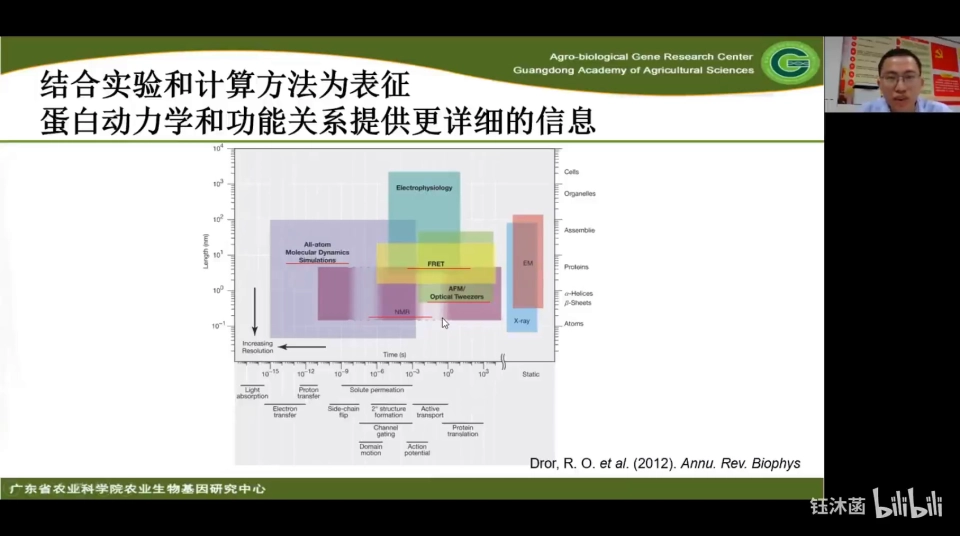

这张图解释了一个常见困惑：为什么同一个蛋白，晶体学给出一个"关闭"构象，而溶液实验却说不止一种构象。不是谁错了，而是**两种方法看的尺度和环境不同**。讲者自己的做法是"三种实验 + 一种计算"：荧光共振能量转移（FRET）、核磁共振（NMR）、光镊，配合全原子或粗粒化分子动力学模拟 [【跳转到 07:22】](https://www.bilibili.com/video/BV1k3411F7NW/?t=442)。

这里先把三个工具的一句话定义摆出来，后面反复要用：

- **FRET（荧光共振能量转移）**：在两个位点各挂一个荧光分子（供体、受体），两者距离在 1—10 纳米时，供体的能量会转移给受体；测转移效率就能反推距离，因此被称为"分子尺" [【跳转到 26:12】](https://www.bilibili.com/video/BV1k3411F7NW/?t=1572)。
- **NMR（核磁共振）**：给蛋白做同位素标记，读每个氨基酸酰胺氢的"化学位移"。化学位移对局部化学环境敏感，环境越固定，位移越分散 [【跳转到 21:49】](https://www.bilibili.com/video/BV1k3411F7NW/?t=1309)。
- **光镊**：用激光抓住微球，通过微球给分子施加皮牛级的力，同时读位移，从而测力与速度 [【跳转到 12:14】](https://www.bilibili.com/video/BV1k3411F7NW/?t=734)。

---

## 二、案例一：同一张结构，受力时却有两种完全不同的行为

### 2.1 Dam1 环在动粒上承受张力

细胞分裂时，微管通过动粒上的蛋白复合物拉住染色体。Dam1 复合物由十个亚基组成一个十聚体，十几个到二十几个十聚体再围成一个环套在微管外面，并通过 Ndc80 复合物连到动粒上 [【跳转到 08:30】](https://www.bilibili.com/video/BV1k3411F7NW/?t=510)。

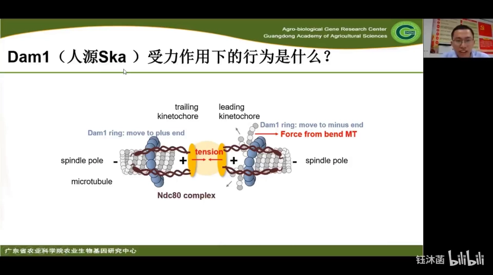

不受力时，Dam1 有两个经典行为：微管解聚时它"跟着末端走"（末端追踪），以及贴着微管壁"漂移"（扩散）[【跳转到 09:27】](https://www.bilibili.com/video/BV1k3411F7NW/?t=567)。但细胞里它是要受力的——于是问题变成：**受力时它做什么？**

### 2.2 用光镊给微管"踩刹车"

实验设计很直观：把 Dam1（或人源同功能蛋白 Ska）锚在一个大微球上，两个小微球夹住一条微管，用光镊让微管来回移动；当蛋白抓住微管时，测力的变化 [【跳转到 11:49】](https://www.bilibili.com/video/BV1k3411F7NW/?t=709)。

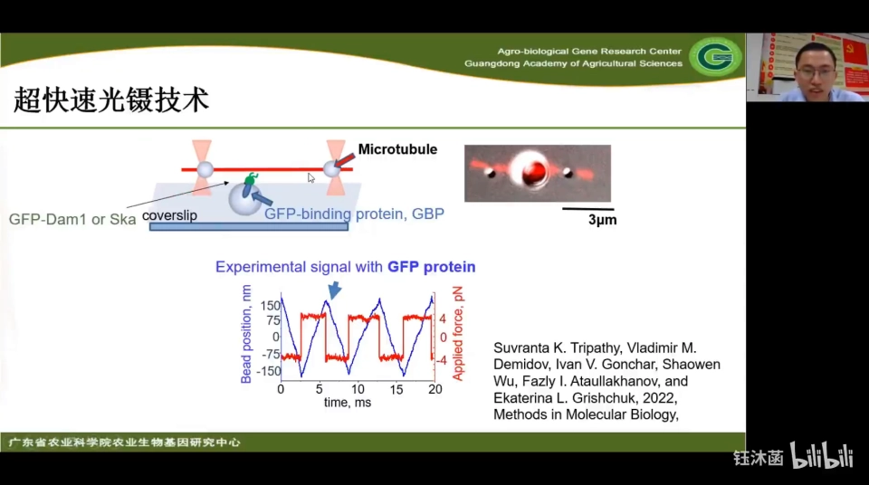

先用绿色荧光蛋白（GFP，不与微管结合）做阴性对照，确认"微管自己在动"的基线速度。换成 Ska 后，速度明显下降：施加 4 皮牛的力时，无蛋白结合约 250 微米/秒，结合后降到约 100—125 微米/秒。用"外力减去摩擦力"的关系，就能算出 Ska 产生的反向摩擦力 [【跳转到 28:19】](https://www.bilibili.com/video/BV1k3411F7NW/?t=1699)。

### 2.3 关键发现：结构相似，力学表型不同

讲者观察了多种微管结合蛋白，受力行为可以归成几类：单向暂停、双向暂停、持续滑动，以及滑动与暂停交替出现 [【跳转到 15:59】](https://www.bilibili.com/video/BV1k3411F7NW/?t=959)。**同一个"结合微管"的结构描述，对应的是完全不同的力学功能。**

讲者给了一个尚未验证的推测，但它正好点中本小节的主题：**有序结构**的蛋白结合可能更强、结构不容易变形，因此更容易"暂停"；**无序区**结构多变，更容易适应微管表面复杂的环境，因此更容易"滑动"；而暂停与滑动之间的切换，可能就对应无序与有序之间的转换 [【跳转到 17:39】](https://www.bilibili.com/video/BV1k3411F7NW/?t=1059)。

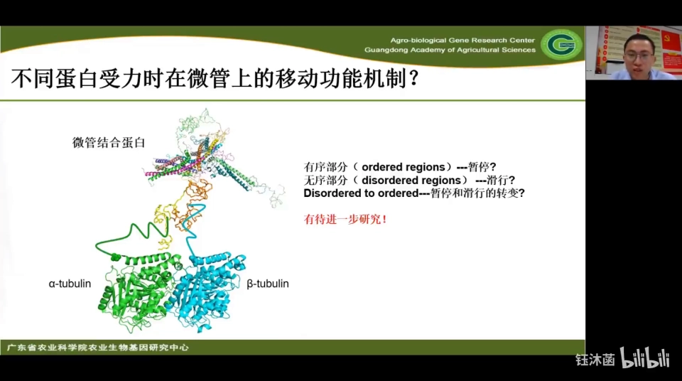

这张幻灯片值得记住：它把"这段是不是无序"从**结构描述问题**变成了**可检验的功能假设**。要检验它，就得先能可靠地判断无序，这正是下一个案例。

---

## 三、案例二：两种无序蛋白怎么结合——从"无规"到"模糊复合物"

### 3.1 体系：4.1G 与 NuMA

2013 年有工作报道，4.1G 蛋白通过与有丝分裂相关蛋白 NuMA 结合，参与决定纺锤体的定位；4.1G 的 CTD 结构域与 NuMA 的 C 端一段多肽结合 [【跳转到 19:19】](https://www.bilibili.com/video/BV1k3411F7NW/?t=1159)。

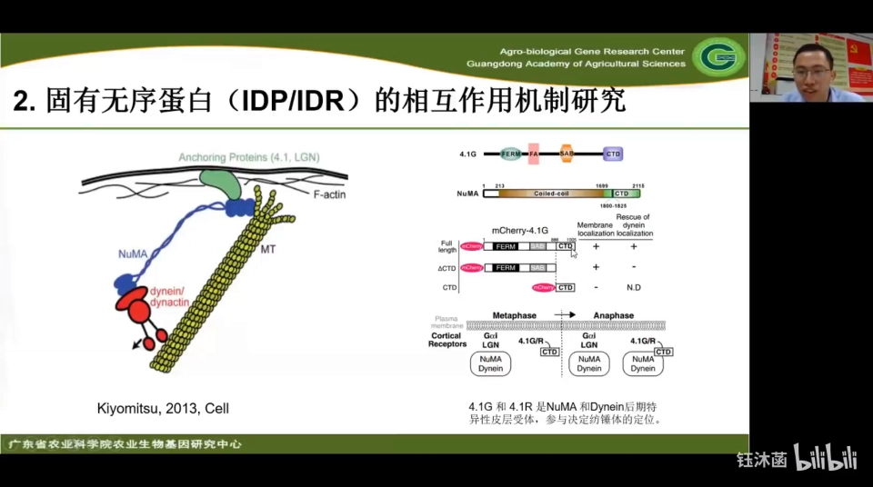

生物信息学分析显示，这两个蛋白的大部分区域都是无序的，4.1G 上只有少部分区域有结构倾向 [【跳转到 19:44】](https://www.bilibili.com/video/BV1k3411F7NW/?t=1184)。于是问题变成：**两个都没有固定结构的蛋白，靠什么互相识别？**

这里有个很实用的实验策略：先用等温滴定量热和 GST pull-down 把结合区域"缩小"，因为无序蛋白做结构表征本来就难，区域越短越好做。最终定位到 NuMA 的 1800—1825 片段与 4.1G 的 939—1005 片段 [【跳转到 21:09】](https://www.bilibili.com/video/BV1k3411F7NW/?t=1269)。

### 3.2 判读"无序"的第一手证据：化学位移的分散度

对 4.1G CTD 做同位素标记后测 $^{15}$N-HSQC 谱。判读规则只有一句：**看酰胺氢化学位移的分散范围**。

- 结构蛋白：每个氨基酸处在相对固定、彼此差异较大的化学环境里，位移会散得很开，可能从 7 ppm 一直到十几个 ppm；
- 无序蛋白：结构一直在变，每个残基的化学环境都不稳定，位移会挤在一个窄区间。

4.1G CTD 的峰集中在 7.7—9 ppm，因此判定为无序 [【跳转到 21:49】](https://www.bilibili.com/video/BV1k3411F7NW/?t=1309)。

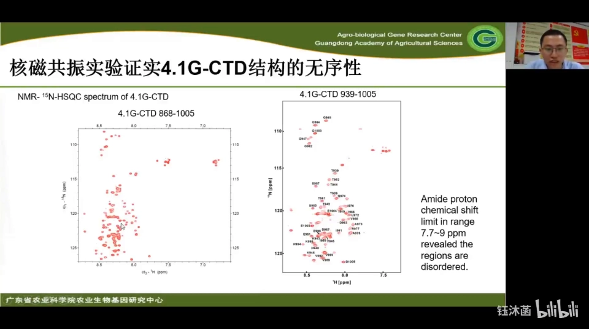

讲者在问答里补充了这个判据的边界：这是**经验判据**，目前还没有一个"看到谱就能反推结构"的统一规律；而且无序不等于没有二级结构——无序指的是**没有稳定的三维结构**，二级结构（比如一段较长的 α 螺旋）完全可能存在，并且在系综里不断变化 [【跳转到 35:25】](https://www.bilibili.com/video/BV1k3411F7NW/?t=2125)。

### 3.3 结合之后还是无序：一个"峰变弱但不移动"的判据

接着做核磁滴定：往标记好的 4.1G 里逐步加入未标记的 NuMA。

- 如果结合后形成了固定结构，应该看到**峰位移动**（化学位移扰动），并随浓度一步步走；
- 实际看到的是**峰位不动、峰强度不断减弱**。

这说明结合后没有形成结构倾向，仍保持无序；峰变弱则提示结合/解离处在毫秒到微秒的交换区间 [【跳转到 22:39】](https://www.bilibili.com/video/BV1k3411F7NW/?t=1359)。用 4.1G-NuMA 融合蛋白再做一次，谱图同样集中在窄区间，与滴定结果吻合 [【跳转到 23:04】](https://www.bilibili.com/video/BV1k3411F7NW/?t=1384)。

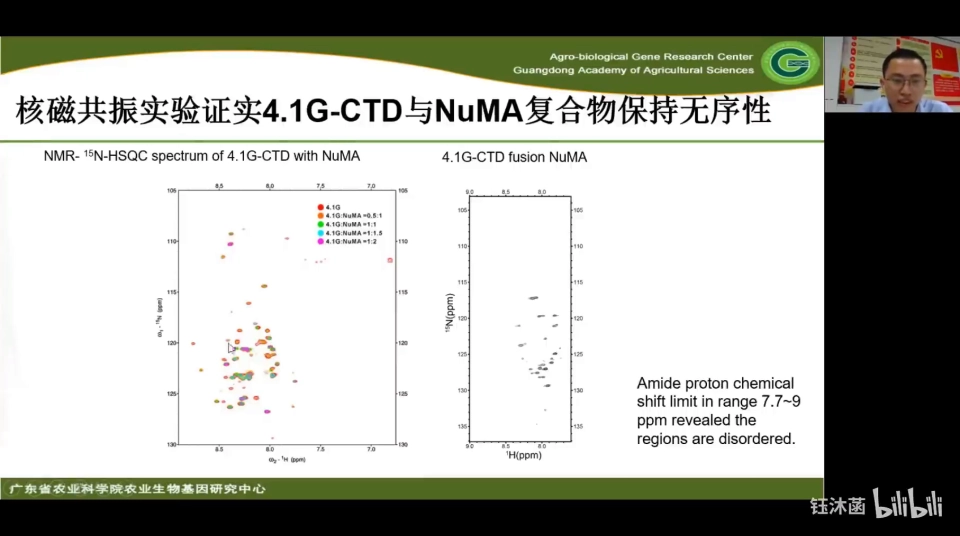

### 3.4 用模拟提出"模糊复合物"，再用三种实验验证

无序蛋白没法用传统结构生物学解结构，于是用副本交换分子动力学模拟。结果是一组构象：NuMA 的多肽在不同聚类里结合在 4.1G 的不同位点，界面一直在变——这就是所谓**模糊复合物（fuzzy complex）**：结合是真实的，但没有唯一姿势 [【跳转到 24:19】](https://www.bilibili.com/video/BV1k3411F7NW/?t=1459)。

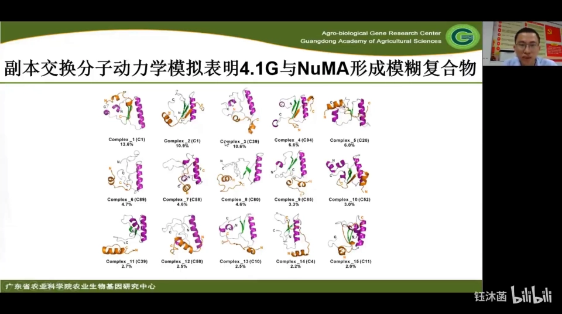

模拟本身不是证据，所以讲者做了三重验证：

1. **化学位移反算**：把模拟系综的化学位移与实验值比对，吻合很好 [【跳转到 25:22】](https://www.bilibili.com/video/BV1k3411F7NW/?t=1522)；
2. **接触图谱指导突变**：按模拟给出的接触位点设计突变，突变都能不同程度减弱甚至破坏结合 [【跳转到 25:47】](https://www.bilibili.com/video/BV1k3411F7NW/?t=1547)；
3. **单分子 FRET 测距离**：在 4.1G 的 N 端和 C 端各标一对荧光分子，加 NuMA 后两对标记点之间的距离都变长，说明结构更松散；这与模拟系综统计出的距离变化在**定性上**一致（定量比较受实验与计算限制，暂未做到）[【跳转到 27:52】](https://www.bilibili.com/video/BV1k3411F7NW/?t=1672)。

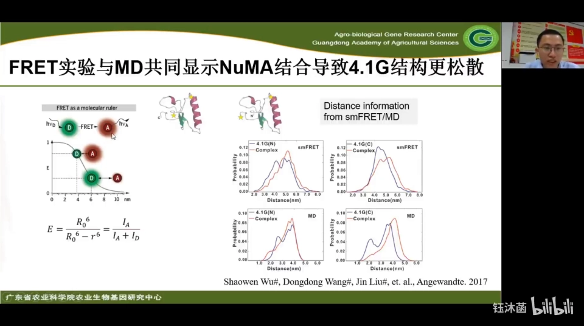

这一节的逻辑值得单独拎出来：**模拟负责提出"有哪几种构象"，实验负责否决或确认**。化学位移、突变、FRET 三种读数分别从局部环境、能量上的关键接触、整体距离三个角度交叉验证，缺一项结论都会弱很多。

---

## 四、案例三：晶体结构解释不了溶液数据时，怎么证明"四种构象"

### 4.1 一个"标准"的结合蛋白，偏偏对不上

第三个体系是谷氨酰胺结合蛋白 GlnBP：它位于周质，负责结合 L-型谷氨酰胺并把它送进跨膜转运组分 [【跳转到 29:37】](https://www.bilibili.com/video/BV1k3411F7NW/?t=1777)。晶体学早就给出了两种状态：结合底物时两个"大小亚基"关闭、把底物包在内部；不结合时相对打开、暴露结合口袋 [【跳转到 30:22】](https://www.bilibili.com/video/BV1k3411F7NW/?t=1822)。

但讲者提醒：这些结构是在结晶条件下得到的，**反映的不一定是溶液里的真实状态** [【跳转到 30:47】](https://www.bilibili.com/video/BV1k3411F7NW/?t=1847)。

检验方法用 RDC（残余偶极耦合）：在溶液里加介质，测各残基的 RDC 信号，再与晶体结构算出的理论值比较。结果两种晶体构象算出来的信号**都与实验匹配得比较差** [【跳转到 31:12】](https://www.bilibili.com/video/BV1k3411F7NW/?t=1872)。

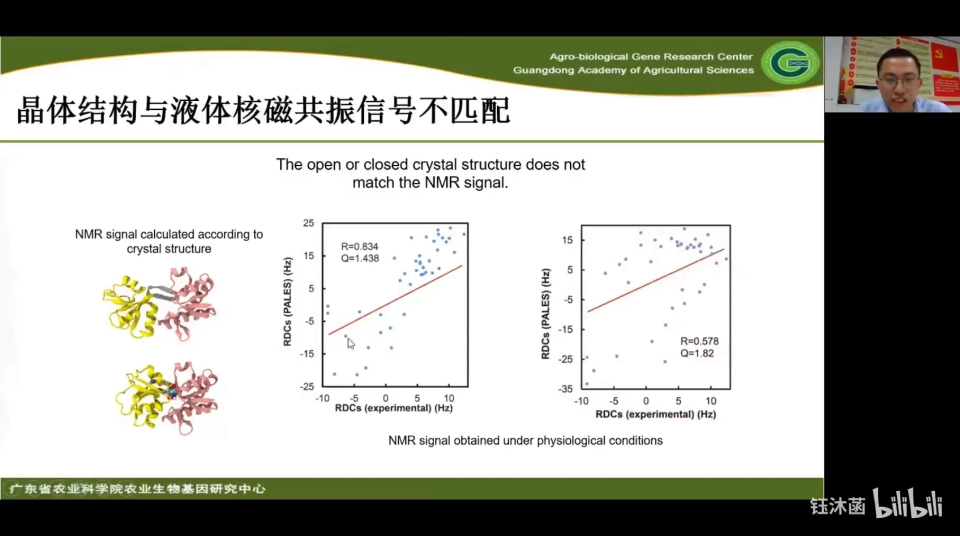

这一步非常关键：它把"低置信"的怀疑变成了可量化的否证——**如果只有一个构象，晶体结构应该能解释数据；解释不了，就说明这个体系是系综。**

### 4.2 四种构象：模拟提出、RDC 与 FRET 各自确认

长时间 MD 轨迹做马尔可夫模型分析，得到四种主要构象：S1 打开扭曲、S2 打开、S3 关闭、S4 准关闭（晶体里只见过打开和关闭两种）[【跳转到 32:02】](https://www.bilibili.com/video/BV1k3411F7NW/?t=1922)。用这组系综反算 RDC，与实验吻合得很好——相关性明显优于单用晶体结构 [【跳转到 32:27】](https://www.bilibili.com/video/BV1k3411F7NW/?t=1947)。

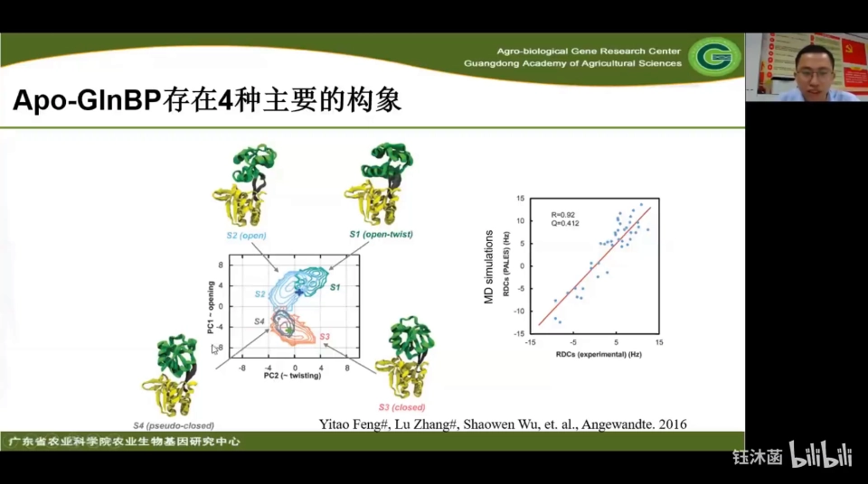

单分子 FRET 给出独立证据：在两个亚基上标供体/受体，FRET 效率出现**四个明显的平台期**；大量轨迹的状态转变分析也显示主要就是这四种状态之间的转换 [【跳转到 33:17】](https://www.bilibili.com/video/BV1k3411F7NW/?t=1997)。

讲者在问答里把"如何证明四种构象同时存在"总结成两条：一是核磁数据无法被任何单一晶体结构解释；二是 MD + 马尔可夫给出四种构象、其 RDC 与实验吻合，而 smFRET 直接看到四个距离平台 [【跳转到 31:37】](https://www.bilibili.com/video/BV1k3411F7NW/?t=1897)。

### 4.3 构象分布本身就是功能参数

加底物谷氨酰胺后，FRET 显示**打开构象比例下降、关闭构象比例上升**——底物把构象分布往"关闭"推 [【跳转到 33:42】](https://www.bilibili.com/video/BV1k3411F7NW/?t=2022)。

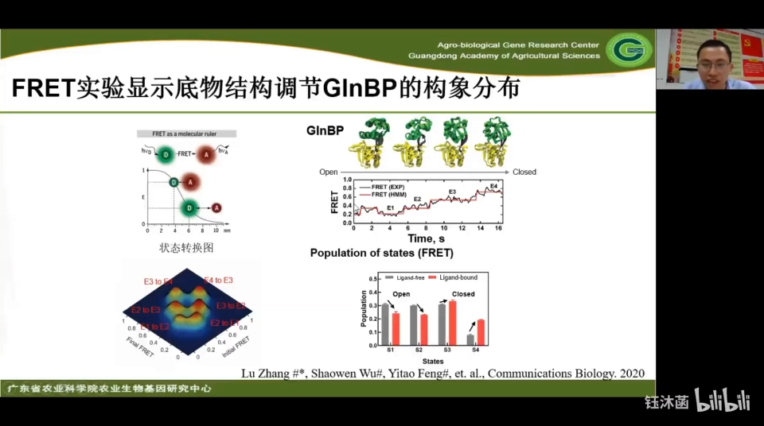

更漂亮的是反向实验：在连接两个亚基的 linker 上做双突变（G84P/G89P、Y85A/T5183A），**刻意避开底物结合位点**，结果底物亲和力大幅下降，$K_D$ 从 0.2 微摩尔变成 11.5 和 194 微摩尔 [【跳转到 34:37】](https://www.bilibili.com/video/BV1k3411F7NW/?t=2077)。FRET 显示突变体的打开构象减少、最关闭的 S4 增加 [【跳转到 35:47】](https://www.bilibili.com/video/BV1k3411F7NW/?t=2147)。

也就是说：**不改结合位点，只改构象分布，就能改结合能力**。这直接证明了"构象分布"不是噪声，而是可调控的功能变量。

最后把这套数据变成动力学模型：不结合态四种、结合态四种，共八个状态、八个平衡方程；实验中能测到状态比例和转变速率，测不到底物结合/解离速率，于是用遗传算法解方程反推参数，再与实验可观测值比对，大部分参数吻合 [【跳转到 37:27】](https://www.bilibili.com/video/BV1k3411F7NW/?t=2247)。

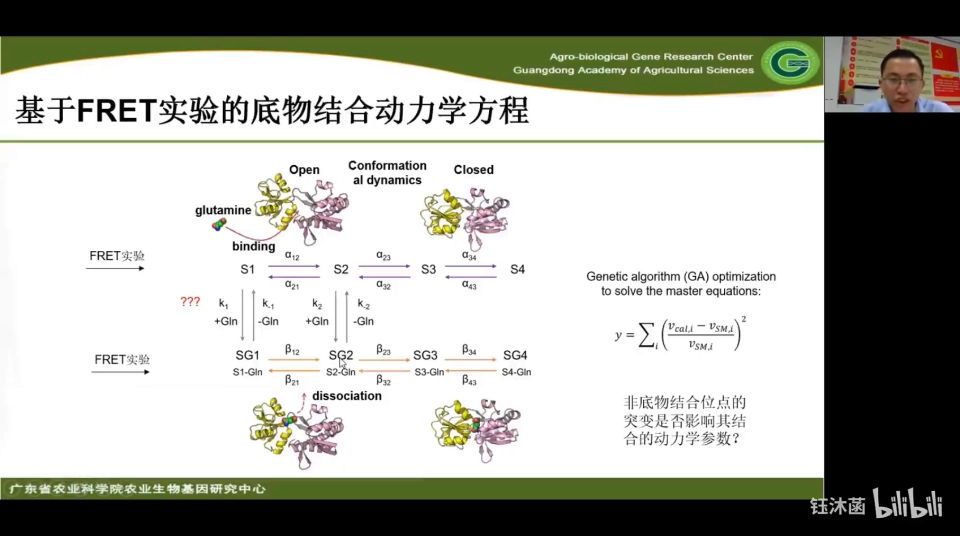

问答里还有一个对判读很关键的细节：**同一套实验数据可以用来挑力场**。讲者这个体系用的是 CHARMM27，原因是他们拿核磁二级化学位移去比，CHARMM27 的相关性 R 能到 0.8 几，而其他一些力场（包括针对 IDP 优化的力场）反而只有 0.6 几 [【跳转到 32:52】](https://www.bilibili.com/video/BV1k3411F7NW/?t=1972)。这提醒我们：模拟结果与实验的吻合度不是自动成立的，**必须用实验可观测量去校准**；没有实验数据时，无序蛋白的力场只能 case by case 地选 [【跳转到 34:57】](https://www.bilibili.com/video/BV1k3411F7NW/?t=2097)。

---

## 五、把三个案例收成一张"判读清单"

讲者的三个课题其实对应三种不同的"结构不确定性"，处理方式也不同。把它们并排看，就是一张很实用的检查表：

| 你看到的现象 | 可能的解释 | 该补什么证据 | 本讲的例子 |
| :--- | :--- | :--- | :--- |
| 预测/晶体只给一个构象，但溶液数据对不上 | 多构象系综 | RDC、smFRET、MD + 马尔可夫 | GlnBP 的四种构象 |
| 一段区域没有固定结构 | 真无序 | HSQC 化学位移分散度、滴定位移是否移动 | 4.1G-CTD |
| 结合后仍无固定界面 | 模糊复合物 | 化学位移反算、接触位点突变、smFRET 距离 | 4.1G–NuMA |
| 结构相同但功能表型不同 | 力学/环境依赖的状态 | 光镊测力—速度关系 | Ska 滑动 vs CENP-E 暂停 |

三条经验值得记住：

1. **先问"这个分数是在什么条件下得到的"**。晶体条件不等于溶液条件，静态结构不等于系综；低置信可能只是方法没覆盖到那个尺度 [【跳转到 06:32】](https://www.bilibili.com/video/BV1k3411F7NW/?t=392)。
2. **无序不等于没功能**。4.1G 与 NuMA 都是无序的，但它们形成模糊复合物、参与纺锤体定位；无序区的"多变"反而可能是适应复杂界面（比如微管表面）的优势 [【跳转到 17:39】](https://www.bilibili.com/video/BV1k3411F7NW/?t=1059)。
3. **模拟只能提出假设，实验才能定案**。本讲每个体系都是"模拟给系综 → 实验（化学位移/突变/FRET/力学）验证"，没有一个是靠模拟单独下结论的。

---

## 六、这些判读有什么用：从 Tau 到代谢转运

讲者最后谈了应用。第一个例子是 Tau：Tau 功能异常与阿尔茨海默症等神经退行性疾病相关，而现有的结构生物学与生物物理研究**大多没有考虑力传导**；力学测定实验显示，长的 Tau 异构体比短的更能稳定微管结构 [【跳转到 41:33】](https://www.bilibili.com/video/BV1k3411F7NW/?t=2493)。

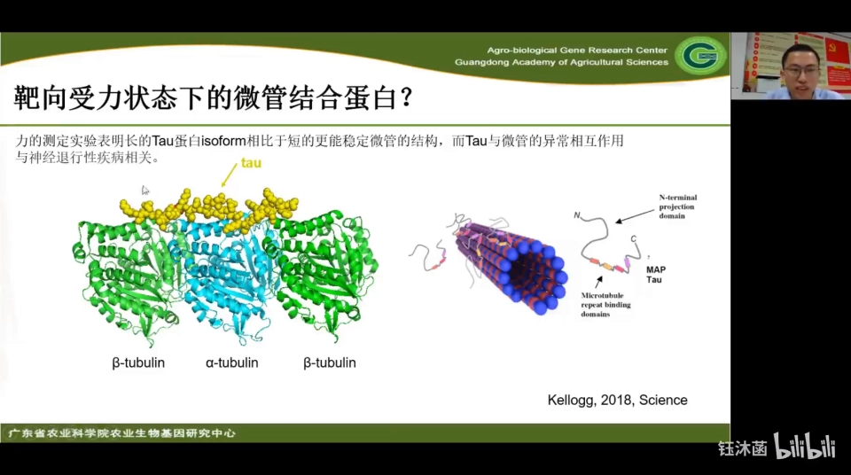

如果药物要靶向 Tau 的某种异常状态，那么这些状态在受力时是否还有不同的结构变化，就是一个必须回答的问题——这正是前面"结构相同、力学表型不同"那套思路的延伸 [【跳转到 42:18】](https://www.bilibili.com/video/BV1k3411F7NW/?t=2538)。

第二个例子在代谢方向：GlnBP 这类转运蛋白的多构象状态与构象变化会影响结合和解离速率；如果能完整解析整条转运通路的构象变化，就有可能对转运速率做理性设计，进而影响与谷氨酰胺相关的代谢通路，甚至用于改造光合途径中的通道蛋白 [【跳转到 43:05】](https://www.bilibili.com/video/BV1k3411F7NW/?t=2585)。

---

## 小结

- **一张结构只是一个采样点**：构象变化横跨飞秒到秒、原子到细胞，任何单一方法都只覆盖其中一块；低置信区往往正落在方法覆盖不到的尺度上 [【跳转到 06:32】](https://www.bilibili.com/video/BV1k3411F7NW/?t=392)。
- **判断"真无序"最直接的实验读数是化学位移分散度**：4.1G-CTD 的酰胺氢位移集中在 7.7—9 ppm，因此判为无序；但这是经验判据，且无序不等于没有二级结构 [【跳转到 21:49】](https://www.bilibili.com/video/BV1k3411F7NW/?t=1309)。
- **"峰不移位、只变弱"是结合后仍无序的信号**：说明没有形成固定结构，且处在毫秒—微秒的交换区间 [【跳转到 22:39】](https://www.bilibili.com/video/BV1k3411F7NW/?t=1359)。
- **晶体结构解释不了溶液数据，是"多构象"的硬证据**：GlnBP 的打开/关闭晶体结构都算不出实验 RDC，而四构象系综能 [【跳转到 31:37】](https://www.bilibili.com/video/BV1k3411F7NW/?t=1897)。
- **构象分布本身是功能参数**：不改结合位点、只改 linker，就能把 $K_D$ 从 0.2 微摩尔改到 11.5 与 194 微摩尔 [【跳转到 34:37】](https://www.bilibili.com/video/BV1k3411F7NW/?t=2077)。
- **模拟提出、实验定案**：本讲的每个结论都至少有两种独立实验交叉验证，模拟从不单独承担结论 [【跳转到 24:19】](https://www.bilibili.com/video/BV1k3411F7NW/?t=1459)。

## 关键术语速查

| 术语 | 一句话解释 |
| :--- | :--- |
| 构象系综 | 溶液里一个蛋白实际存在的一整组构象及其比例，而不是单一结构 |
| HSQC | 核磁二维谱，读主链酰胺氢的化学位移；位移分散度可判无序 |
| 化学位移扰动 | 配体结合导致谱峰位置移动；只变弱不移位通常意味着没有形成固定结构 |
| RDC（残余偶极耦合） | 核磁可观测量，对键矢量相对外场的取向敏感，可用于检验构象系综 |
| smFRET | 单分子荧光共振能量转移，1—10 纳米范围内的"分子尺"，直接读距离变化 |
| 模糊复合物 | 结合真实存在但界面不唯一、位点不断变化的复合物 |
| 马尔可夫状态模型 | 把长 MD 轨迹切成若干亚稳态并估计状态间转变速率的方法 |
| 光镊 | 用激光捕获微球施加皮牛级力并测位移的技术，可测分子马达/结合蛋白的力学行为 |
| 化学冲突（conflict） | 结构模型中原子过近等化学上不合理的情况，可作为模型质量的旁证 |