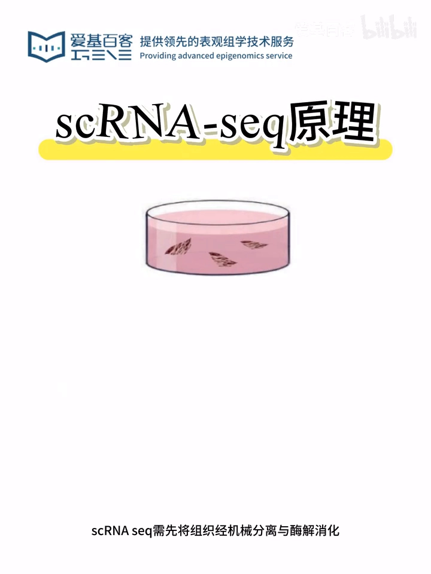
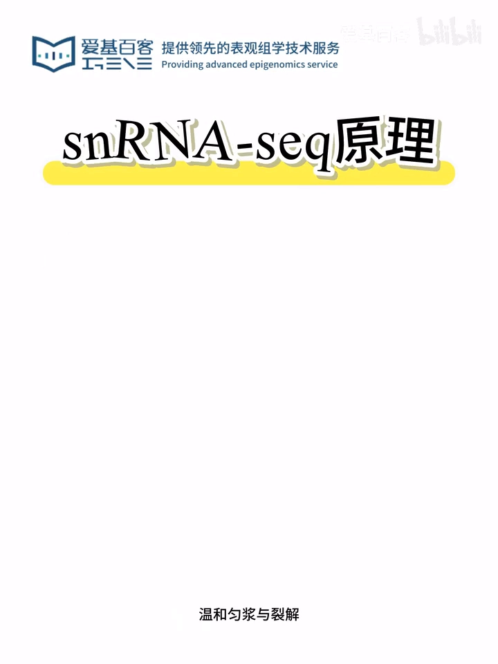
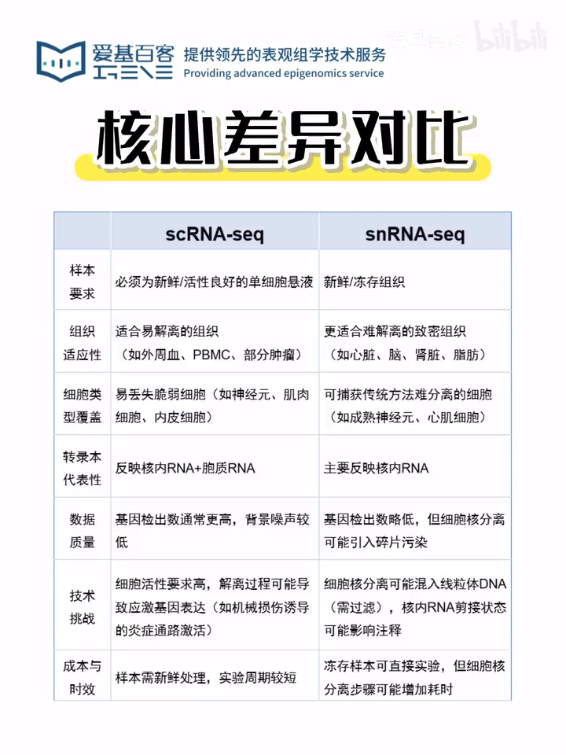
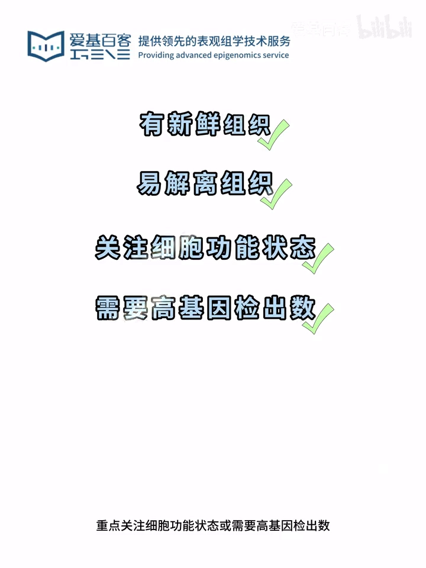
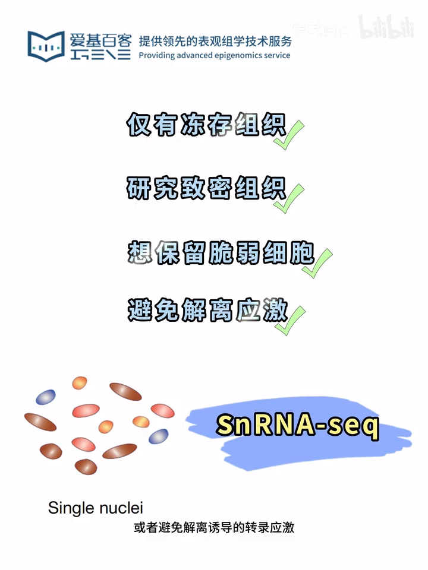
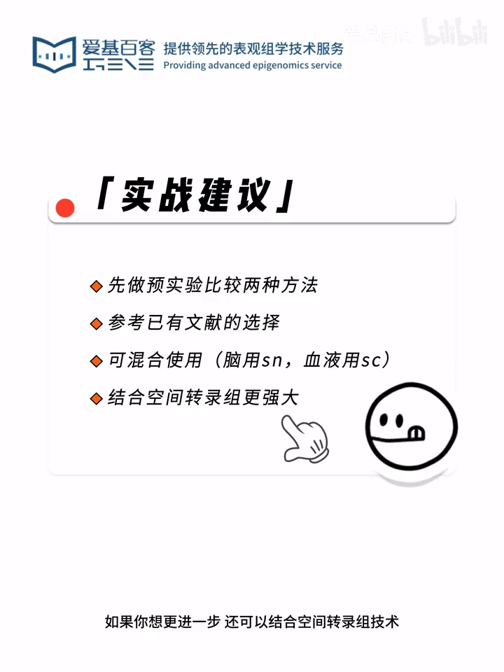

# 单细胞与单核 RNA 测序：捕获对象、样本条件与检出差异

> 视频来源：[scRNA-seq vs snRNA-seq怎么选？](https://www.bilibili.com/video/BV1YF1kBpEo3/)（B 站 · 爱基百客）｜时长约 2 分钟
> 导读：这是一支服务方做的科普短视频，用一张对照表把「测整个细胞」和「只测细胞核」两条路线并列：前处理怎么做、各自捕获哪些 RNA、适合什么样本、数据上差在哪里。它的价值在于把选择标准压缩成可核对的条目，而不是介绍建库化学；barcode、UMI 与液滴反应的分子细节不在本文范围。

## 本讲要解决的核心问题（SCQA）

**背景**：单细胞转录组测的是「一个细胞」的表达，但同一个组织也可以只取细胞核来测。两者用的是同一类捕获平台，产出的也是一张「细胞（或细胞核）× 基因」的计数矩阵。

**冲突**：两条路线从样本处理的第一步就分开了——一条要把组织消化成单个完整细胞，另一条只要把细胞核放出来。因此它们能测的样本、能留住的细胞类型、测到的 RNA 种类都不一样，数据不能直接当成同一种东西来比。

**疑问**：完整细胞与细胞核各自捕获了什么？什么样的样本只能走其中一条路？选错会付出什么代价？

**回答（中心思想）**：**完整细胞测的是「核内 + 胞质」的 RNA，接近细胞的整体转录状态；细胞核只测核内 RNA。** 选择取决于三件事：样本能不能做成新鲜、活性良好的单细胞悬液；目标细胞类型会不会在解离中丢失；以及是否需要尽可能高的基因检出数。

## 一、两条路线在第一步就分开了

### 1.1 完整细胞：先解离，再捕获

scRNA-seq 的前处理是**机械分离加酶解消化**：把组织拆开、用酶把细胞之间的连接消化掉，制备成高质量的单细胞悬液，再交给单细胞捕获平台完成分选与标记 [【跳转到 00:04】](https://www.bilibili.com/video/BV1YF1kBpEo3/?t=4)。

它研究的对象是**细胞核加细胞质中的 RNA**，反映的是细胞整体的转录状态 [【跳转到 00:17】](https://www.bilibili.com/video/BV1YF1kBpEo3/?t=17)。换句话说，细胞质里那些已经剪接完成、准备翻译的成熟 mRNA 也在读数里。

### 1.2 细胞核：温和匀浆，只取核

snRNA-seq 换成**温和匀浆与裂解**：把细胞膜破开、放出细胞核，制备成单细胞核悬液，再依托同一类捕获平台完成核分选与标记 [【跳转到 00:28】](https://www.bilibili.com/video/BV1YF1kBpEo3/?t=28)。

它研究的对象只有**细胞核中的 RNA** [【跳转到 00:37】](https://www.bilibili.com/video/BV1YF1kBpEo3/?t=37)。细胞质里的成熟转录本基本留在了上清里，因此同一群细胞用两条路线测，读到的 RNA 组成并不相同。

## 二、核心差异对照表：七个维度

视频用一张表把两条路线逐项并列 [【跳转到 00:41】](https://www.bilibili.com/video/BV1YF1kBpEo3/?t=41)：

| 维度 | scRNA-seq（完整细胞） | snRNA-seq（细胞核） |
| :--- | :--- | :--- |
| 样本要求 | 必须为新鲜、活性良好的单细胞悬液 | 新鲜或冻存组织 |
| 组织适应性 | 适合易解离的组织（外周血、PBMC、部分肿瘤） | 更适合难解离的致密组织（心脏、脑、肾脏、脂肪） |
| 细胞类型覆盖 | 易丢失脆弱细胞（神经元、肌肉细胞、内皮细胞） | 可捕获传统方法难分离的细胞（成熟神经元、心肌细胞） |
| 转录本代表性 | 反映核内 RNA + 胞质 RNA | 主要反映核内 RNA |
| 数据质量 | 基因检出数通常更高，背景噪声较低 | 基因检出数略低，核分离可能引入碎片污染 |
| 技术挑战 | 细胞活性要求高，解离过程可能导致应激基因表达（如机械损伤诱导的炎症通路激活） | 核分离可能混入线粒体 DNA（需过滤），核内 RNA 的剪接状态可能影响注释 |
| 成本与时效 | 样本需新鲜处理，实验周期较短 | 冻存样本可直接实验，但核分离步骤可能增加耗时 |

这张表可以按三组来读：

1. **样本条件**（前两行）：完整细胞要求「新鲜 + 活性 + 已成悬液」，这是硬门槛；细胞核只要组织本身还在，冻存样本也能用，致密组织也不必先消化成单细胞。
2. **捕获内容**（中间三行）：完整细胞拿到的是核内加胞质的 RNA，检出基因更多、背景更干净；细胞核只拿到核内 RNA，检出基因略少，且要处理碎片污染与剪接状态带来的注释问题。
3. **代价**（最后两行）：完整细胞的技术风险集中在解离——细胞活性不够就测不好，解离本身还会激活应激基因；细胞核的风险集中在核制备——线粒体 DNA 混入要过滤，步骤更耗时。

## 三、什么时候该选完整细胞

视频给出的判据是四条同时成立时优先选 scRNA-seq [【跳转到 00:46】](https://www.bilibili.com/video/BV1YF1kBpEo3/?t=46)：

- 能拿到**新鲜组织**；
- 组织**易于解离**；
- 研究重点是**细胞的功能状态**（这需要胞质里的成熟转录本参与）；
- 需要**较高的基因检出数**。

## 四、什么时候该选细胞核

反过来，出现下面任一情况时优先选 snRNA-seq [【跳转到 00:54】](https://www.bilibili.com/video/BV1YF1kBpEo3/?t=54)：

- **仅有冻存样本**——完整细胞路线要求新鲜活性细胞，冻存样本过不了这一关；
- 研究对象是**脑、心脏、肾脏等致密组织**，很难消化成合格的单细胞悬液；
- 想**保留神经元、心肌细胞等脆弱细胞类型**——它们在解离中容易丢失；
- 想**避免解离诱导的转录应激**——机械与酶解处理本身会激活一批应激基因，混进真实的表达差异里 [【跳转到 00:58】](https://www.bilibili.com/video/BV1YF1kBpEo3/?t=58)。

## 五、拿不准时的做法：预实验与混合策略

视频最后给了一组实操建议 [【跳转到 01:14】](https://www.bilibili.com/video/BV1YF1kBpEo3/?t=74)：

- **先做预实验**，两种方法都试，比较数据质量；
- **参考已有文献**，看同类组织别人是怎么做的；
- 条件允许时**混合使用**：例如脑组织用 snRNA-seq、血液用 scRNA-seq，各自取所长 [【跳转到 01:29】](https://www.bilibili.com/video/BV1YF1kBpEo3/?t=89)；
- 还可以**结合空间转录组**，给细胞加上位置标签，实现单细胞加空间定位的双重解析。

视频的收尾判断是：**没有绝对好的技术，只有最适合研究目标的选择** [【跳转到 01:43】](https://www.bilibili.com/video/BV1YF1kBpEo3/?t=103)。

## 小结

- 两条路线的分岔点在第一步：完整细胞要「机械分离 + 酶解消化」做成单细胞悬液，细胞核只要「温和匀浆 + 裂解」放出核。
- 捕获内容不同：完整细胞测核内加胞质的 RNA，接近细胞整体转录状态；细胞核只测核内 RNA。
- 样本条件是硬约束：新鲜、活性、易解离才能走完整细胞；冻存样本、致密组织、脆弱细胞类型走细胞核。
- 数据上各有代价：完整细胞基因检出数更高、背景更干净，但怕解离应激与活性不足；细胞核检出略低，要处理线粒体 DNA 混入与剪接状态对注释的影响。
- 选择标准不是「哪个更先进」，而是样本条件、目标细胞类型与所需检出深度三者的交集；不确定时先做预实验，必要时两种方法混用。

## 关键术语速查

| 术语 | 一句话解释 |
| :--- | :--- |
| scRNA-seq | 单细胞 RNA 测序，捕获单位是完整细胞，读数是核内加胞质的 RNA |
| snRNA-seq | 单核 RNA 测序，捕获单位是细胞核，读数主要是核内 RNA |
| 单细胞悬液 | 组织经机械分离与酶解消化后得到的、彼此分开的活细胞溶液，是完整细胞路线的上样前提 |
| 单细胞核悬液 | 组织经温和匀浆与裂解后释放出的细胞核溶液，不需要细胞保持活性 |
| 解离应激 | 机械与酶解处理本身诱导表达的基因（如炎症通路），会混进真实的表达差异 |
| 致密组织 | 细胞外基质多、难以消化成单细胞悬液的组织，如脑、心脏、肾脏、脂肪 |
| 基因检出数 | 一个细胞（或细胞核）里能被检测到的基因个数，常用来衡量单次测量的深度 |
| 碎片污染 | 核制备过程中混入的细胞碎片或线粒体 DNA，需要在分析前过滤 |