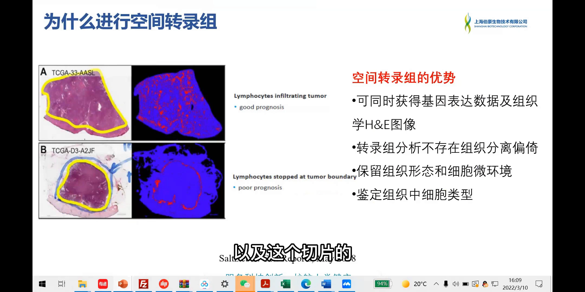
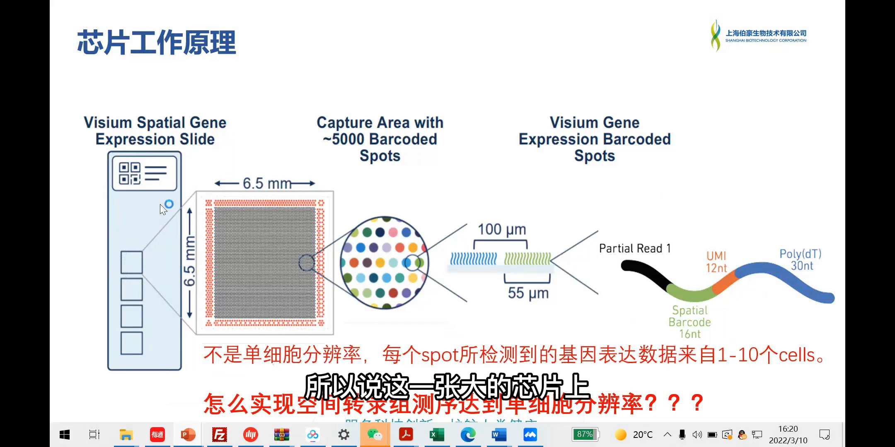
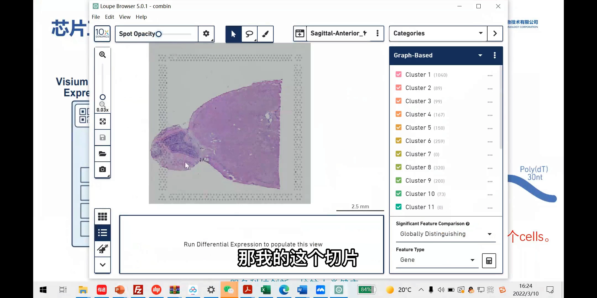
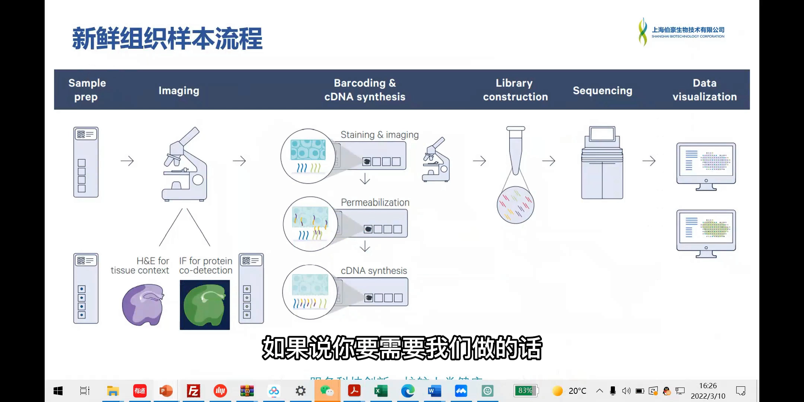
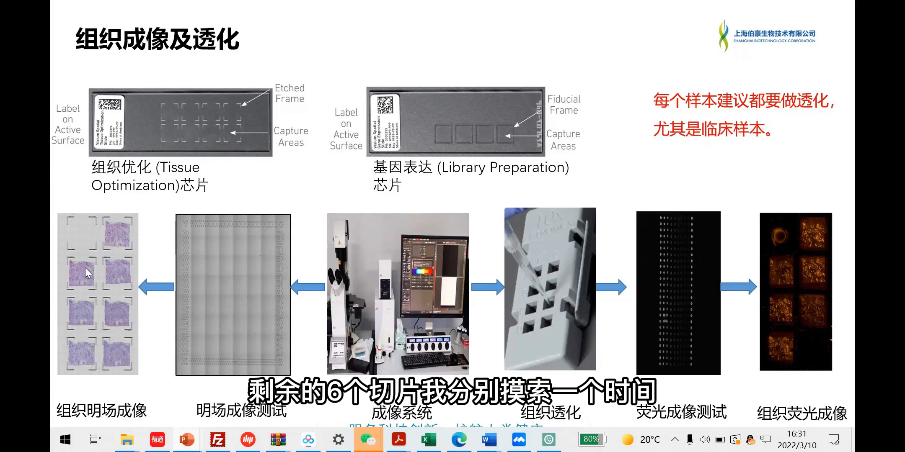
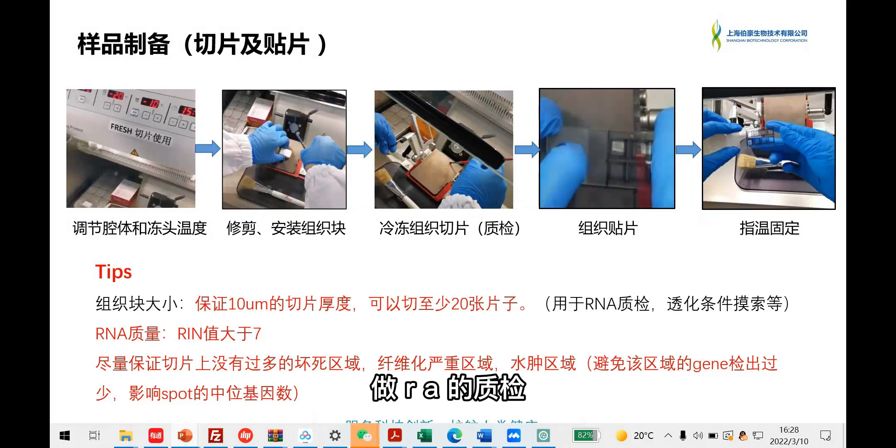
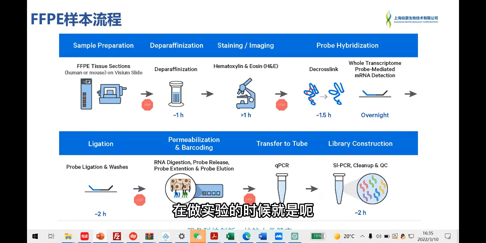
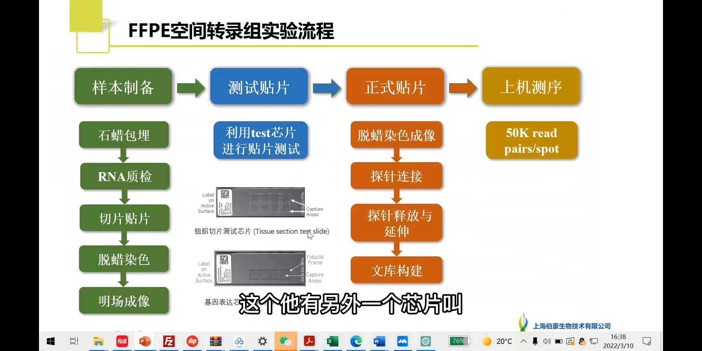

# 空间转录组怎么把表达放回组织：位置条码、斑点分辨率与样本误差

> 视频来源：[空间转录组测序原理，分析，应用](https://www.bilibili.com/video/BV1HU4y1S7xm/)（Bilibili · 探研究）｜时长约 58 分钟
> 简要导读：这是一场服务方的技术讲座，前半段（约 00:00–42:53）讲「一张切片怎么变成带坐标的表达矩阵」，后半段转入聚类、区域圈选与反卷积。本文只覆盖前半段的测量部分，按「坐标怎么来 → 分辨率是什么 → 误差来自哪里 → 组织背景如何限制解释」重新组织；视频里的产品口径按原话记录并标明来源。

## 本讲要解决的核心问题（SCQA）

**背景**：单细胞测序已经能告诉我们一块组织里有哪些细胞类型、各占多少。但它的第一步是把组织解离成细胞悬液——细胞一散开，原来谁挨着谁、谁在哪个结构里，这层信息就没了 [【跳转到 02:20】](https://www.bilibili.com/video/BV1HU4y1S7xm/?t=140)。

**冲突**：知道「有什么细胞」和知道「细胞在哪」是两个不同的问题。同一个基因在整块组织里表达量不变，但表达它的细胞从组织中心挪到了边缘，生物学含义可能完全相反——视频举的例子是肿瘤里的淋巴细胞浸润：浸润到肿瘤核心、分布均匀的病人预后好，只停在肿瘤边界的病人预后差 [【跳转到 04:08】](https://www.bilibili.com/video/BV1HU4y1S7xm/?t=248)。单细胞测序看不到这个差别。

**疑问**：能不能在不打散组织的前提下读出基因表达？如果能，这个「位置」到底有多精细、有多可靠？

**回答（中心思想）**：空间转录组用**两套坐标**把表达放回组织——芯片上事先印好的**位置条码**（阵列坐标），和同一张切片的**染色照片**（切片图像坐标）；两者靠「同一张切片」对齐。但它的测量单位是**斑点（spot）而不是细胞**：一个直径 55 微米的 spot 下面压着 1–10 个细胞，所以它给出的是「这一小块组织里混着谁的 RNA」，不是「这个细胞表达了什么」。而透化条件、RNA 质量、探针面板、贴片越界、坏死区域这些环节，会**系统性地**改变某个位置的读数——读空间数据时，先问「这个位置的数字是怎么来的」，再问「它说明了什么」。

## 一、为什么需要空间：位置本身就是一层信息

单细胞测序是 2013 年 Nature Methods 的年度技术之一，空间转录组是 2020 年的年度技术 [【跳转到 01:05】](https://www.bilibili.com/video/BV1HU4y1S7xm/?t=65)。讲者用两个技术的分工来解释为什么后者会出现：

- 单细胞测序回答「这个组织里含有什么样的细胞类型」——比如脑组织里有神经元、小胶质细胞、少突胶质细胞、星形胶质细胞；也能回答「用了某种麻醉药以后，兴奋性/抑制性神经元的组成有没有变化」。
- 但它回答不了「少突胶质细胞分布在这张切片的哪个位置、星形胶质细胞分布在哪里、这个细胞类型是不是住在一个特殊结构上」[【跳转到 02:20】](https://www.bilibili.com/video/BV1HU4y1S7xm/?t=140)。

空间转录组补的就是这一层。讲者列了四条优势，每一条都对应一种「单细胞拿不到」的信息 [【跳转到 04:58】](https://www.bilibili.com/video/BV1HU4y1S7xm/?t=298)：

1. **同一张切片同时给出基因表达和 H&E 图像**。切片先染色拍照，再在原位捕获 RNA，所以表达图和形态图是同一张片子。
2. **不存在组织解离的偏好性**。做单细胞时，脑组织的神经元、星形胶质细胞在悬液里含量偏低，大部分是少突胶质细胞和小胶质细胞——说明解离过程对细胞类型有偏好，有些类型没被解离出来，有些比较脆弱被弄死了。切片法不做解离，切片上有什么细胞就测什么 [【跳转到 05:48】](https://www.bilibili.com/video/BV1HU4y1S7xm/?t=348)。
3. **保留组织形态和细胞微环境**。做完以后组织形态是完整的，病理上的特殊结构信息都还在，因此可以研究「这个位置周围是些什么细胞」。
4. **可以鉴定细胞类型**——但这一条要打折扣，原因见第三节：空间转录组本身不是单细胞分辨率的技术，只能「粗略地」鉴定，要拿到详细类型信息还得借同一样本的单细胞数据 [【跳转到 07:03】](https://www.bilibili.com/video/BV1HU4y1S7xm/?t=423)。

讲者还引了 2020 年 Nature Methods 年度技术文章里的一个比喻来说明三者的关系 [【跳转到 07:39】](https://www.bilibili.com/video/BV1HU4y1S7xm/?t=459)：bulk RNA-seq 像**一杯奶昔**（所有水果打匀，测到的是每个细胞平均的表达）、单细胞像**一盘水果沙拉**（能看清有哪些水果，但没有位置）、空间转录组像**水果披萨**（每个位置有什么水果一目了然）。这个比喻的落点很关键：**空间转录组换来的是位置，代价是「每个位置」不再等于「一个细胞」。**

最后，讲者给了一个帮助建立直觉的定位：可以把空间转录组理解成**高通量的 FISH（荧光原位杂交）或高通量的免疫组化**——传统 FISH 一次只能看一个基因，空间转录组一次能看几万个基因在同一张切片上的分布 [【跳转到 09:51】](https://www.bilibili.com/video/BV1HU4y1S7xm/?t=591)。

## 二、坐标怎么来：两套坐标，靠「同一张切片」对齐

这是本节最核心的一节。空间转录组的「位置」不是一种坐标，而是两种坐标叠在一起。

### 2.1 阵列坐标：位置条码在实验之前就印好了

芯片（slide）上有四个方框，叫四个**捕获区域**（capture area），一张芯片可以贴四张切片；每个捕获区域 6.5 mm × 6.5 mm，里面有约 **5000 个 spot** [【跳转到 16:39】](https://www.bilibili.com/video/BV1HU4y1S7xm/?t=999)。

关键在于：**每个 spot 上的探针，其位置条码（spatial barcode）是不一样的，而且是实验前就固定好的。**

每个 spot 上分布着几百万条探针，探针从下往上依次是：一段 Read 1 引物结合位点、**spatial barcode**（每个 spot 一种）、**UMI**（每一条探针随机不同，用于分子去重）、**poly-dT**（用于捕获带 poly-A 尾巴的 mRNA）[【跳转到 19:00】](https://www.bilibili.com/video/BV1HU4y1S7xm/?t=1140)。

捕获的分子过程是：

1. 切片贴到芯片上，做 H&E 染色并拍照；
2. **透化**（permeabilization）：用试剂在细胞上打出孔，让 mRNA 释放出来；
3. mRNA 的 poly-A 尾巴与探针的 poly-dT 互补配对，被**下方对应 spot** 的探针抓住；
4. 反转录合成 cDNA 时，把探针上的 spatial barcode 和 UMI 一起抄进 cDNA；
5. 测序读出这段 barcode，就知道这条 read 来自哪个 spot [【跳转到 15:13】](https://www.bilibili.com/video/BV1HU4y1S7xm/?t=913)。

所以**阵列坐标的本质是「一张事先印好的地址表」**：位置不是测出来的，是芯片出厂时就编好的；测序只是把每条 read 的地址读出来。

### 2.2 切片图像坐标：同一张切片的 H&E 照片

第二套坐标来自图像。切片贴上去以后要做 H&E 染色、拍照，这张照片「是用于后面数据分析的时候用的」[【跳转到 13:33】](https://www.bilibili.com/video/BV1HU4y1S7xm/?t=813)。

讲者用 Loupe Browser 演示了两套坐标怎么对上：打开软件，先看到芯片的一个捕获区域方框，切片就贴在这个方框里；把视野推到组织上，能看到一个一个圆点——那就是 spot；每个 spot 捕获的 RNA，就是这张病理切片上这个位置的组织里的细胞释放出来的 [【跳转到 21:17】](https://www.bilibili.com/video/BV1HU4y1S7xm/?t=1277)。

「这个片子和这个空间转录组实验用的片子是完全一模一样的一张片子，它可以完全 overlap 在一起」[【跳转到 22:07】](https://www.bilibili.com/video/BV1HU4y1S7xm/?t=1327)。这句话是坐标可信度的来源：**两套坐标之所以能对齐，是因为它们来自物理上的同一张切片，而不是两次取样。**

也正因为如此，对齐的边界很清楚：如果切片贴的时候超出了捕获区域——「已经贴到边框上，甚至贴到外面去了，那这个区域都是没有信息的，因为探针不在上面」[【跳转到 21:17】](https://www.bilibili.com/video/BV1HU4y1S7xm/?t=1277)。**组织在图像上看得见，不等于这个位置有表达数据。**

### 2.3 第三种坐标：成像路线里的「显微镜坐标」

上面两套坐标属于「先捕获、再测序」的路线。还有一条路线是**原位成像**：不解离组织，用带荧光的探针在切片上直接把 mRNA 点亮，逐轮成像、逐轮解码，位置从显微镜图像里读出来。MERFISH 就属于这一类——它「用带荧光的探针直接在组织切片里把 mRNA 分子点亮，再逐轮成像、逐轮解码，从而在保留位置的前提下读出每个细胞里几千个基因的表达量」，详见 [跨物种比较的保守与差异：MERFISH 解读人与小鼠大脑皮层](跨物种比较的保守与差异：MERFISH解读人与小鼠大脑皮层.md) 第一节。

把三种坐标并排放：

| 坐标 | 怎么产生 | 单位 | 典型误差 |
| --- | --- | --- | --- |
| 阵列坐标 | 芯片出厂时把位置条码印在固定网格上 | spot（如 55 μm 直径、100 μm 间距） | 条码合成/打印偏差、spot 之间的空隙无探针 |
| 切片图像坐标 | 同一张切片的 H&E 拍照 | 像素 | 染色与成像质量、组织折叠、贴片越界 |
| 成像坐标 | 显微镜逐轮成像与解码 | 像素/衍射极限，可到亚细胞 | 解码错误、光学背景、轮次间配准 |

三者的共同点是：**位置都是「外部给定的参照系」，不是从表达数据里推出来的。** 表达矩阵本身只有「行 = spot、列 = 基因」，坐标是另外一张表。

## 三、分辨率是什么：一个测量单位里混了几个细胞

「分辨率」在空间转录组里有一个非常具体的定义：**一个测量单位覆盖多大面积，以及这个面积里压着几个细胞。**

讲者给的数字是：spot 直径 **55 微米**，spot 与 spot 之间中心间距 **100 微米**，空隙约 40–50 微米且**空隙上没有探针**；而细胞直径大约 5–10 微米，所以一个 spot 覆盖的组织里「对应的细胞应该是 1 到 10 个细胞」[【跳转到 17:45】](https://www.bilibili.com/video/BV1HU4y1S7xm/?t=1065)。

由此得到三条必须记住的推论：

1. **不能把一个 spot 当成一个细胞。** 讲者的原话是「我们在数据分析的时候，不能把这一个 spot 认为是一个细胞，所以它不是单细胞的分辨率」[【跳转到 18:35】](https://www.bilibili.com/video/BV1HU4y1S7xm/?t=1115)。
2. **这 1–10 个细胞可能是不同类型。** 所以一个 spot 的高表达，可能是「这类细胞表达高」，也可能是「这个位置恰好这类细胞多」——两种解释在数据上长得一样。
3. **分辨率不等于覆盖。** spot 之间的空隙没有探针，意味着组织有一部分面积根本没被测到。分辨率（一个点多大）和覆盖率（多少面积被测到）是两个独立的量。

那怎么才能拿到单细胞分辨率？讲者的回答很直接：**靠单细胞测序数据加生物信息学方法**，把细胞类型「映射、定位到这张切片上」[【跳转到 07:28】](https://www.bilibili.com/video/BV1HU4y1S7xm/?t=448)。这一步就是后面要做的反卷积——它是**模型估计**，不是直接测量。

## 四、误差来源之一：样本与捕获效率

这一节开始回答「为什么某个位置的数字会偏低或偏假」。第一类误差来自**样本本身和 RNA 能不能被释放出来**。

### 4.1 两种样本，两套流程

空间转录组能做的样本分两大类，原理上略有差别，根本原因是 **RNA 质量差别非常大** [【跳转到 00:00】](https://www.bilibili.com/video/BV1HU4y1S7xm/?t=0)：

- **新鲜样本**：手术或动物模型取下后立即 OCT 包埋、冰冻切片（约 10 微米厚）。已经冻存在 −80 度冰箱的组织一般不建议做。
- **FFPE（福尔马林固定石蜡包埋）样本**：RNA 高度降解，需要另一套化学（见第五节）。

新鲜组织样本的完整链条是：取样 → OCT 包埋 → 冰冻切片 → H&E 染色与成像 → 透化 → 原位捕获与 cDNA 合成 → 建库 → 测序 → 数据可视化 [【跳转到 22:26】](https://www.bilibili.com/video/BV1HU4y1S7xm/?t=1346)。

这张流程图的读法是：**成像在捕获之前**，所以形态学图像与表达数据共享同一张切片；**透化夹在成像与捕获之间**，所以它是一个可以改变「每个位置读到多少」的旋钮。

### 4.2 透化条件必须逐样本摸索

透化就是「用试剂把细胞打出孔，让 mRNA 释放出来」。问题在于：**不同组织、甚至同一类肿瘤的不同病人，透化条件都不一样。**

做法是：拿一张 8 个捕获区域的「组织优化芯片」，贴 6 张连续切片，分别试 6、8、10、12、18、20 分钟等不同透化时间，反转录时掺入荧光物质，看哪个时间的荧光最强、**而且整张切片每个部位都均匀**，就用那个时间做正式实验 [【跳转到 27:00】](https://www.bilibili.com/video/BV1HU4y1S7xm/?t=1620)。

为什么必须逐样本做？讲者给的理由很具体：同样是肝癌病人，不同病人的肿瘤程度、坏死程度、纤维化程度都不一样，透化条件也就不同。「如果你不去摸索，只用一个条件去做，那么最终检测出来某一个基因表达量非常低，你就没有办法判断它是因为没有透化出来而没有检测到，还是它实际上表达的就是非常低」[【跳转到 29:05】](https://www.bilibili.com/video/BV1HU4y1S7xm/?t=1745)。

**这句话就是捕获效率误差的完整表述**：低读数有两种来源——生物学上的低表达，和技术上的没释放出来——而在没有对照的情况下，两者在数据上无法区分。

### 4.3 RNA 质量有硬门槛

- **新鲜组织**：RIN（RNA 完整性数值）≥ 7 [【跳转到 31:03】](https://www.bilibili.com/video/BV1HU4y1S7xm/?t=1863)。
- **FFPE**：用 DV200 代替 RIN，要求 DV200 > 50%，即抽提出来的 RNA 中片段大于 200 bp 的占比过半；DV200 = 50% 时对应的 RIN 只有 3 点几 [【跳转到 37:32】](https://www.bilibili.com/video/BV1HU4y1S7xm/?t=2252)。

### 4.4 组织状态本身会拉低数据质量

切片上「尽量不要有很多坏死区域，或者纤维化非常严重的区域」——这些区域里活的细胞或 RNA 比较少，透化时透不出东西，这个区域的数据就会不好，**也会拉低整个 spot 的中位基因数** [【跳转到 25:24】](https://www.bilibili.com/video/BV1HU4y1S7xm/?t=1524)。

这条限制有一个重要的推论：**坏死区与正常区的读数不能直接比较**，因为差异里混着「组织状态 → RNA 可得性」这一层。讲者也承认有些研究（脑梗死、心肌梗死）样本本身就是以坏死为表现，「那也没有办法，只能这样去取样本」[【跳转到 26:14】](https://www.bilibili.com/video/BV1HU4y1S7xm/?t=1574)——这时必须在结论里说明。

### 4.5 切片与贴片：物理层面的失败模式

组织块横截面积要落在 6.5 mm × 6.5 mm 之内：太大贴到芯片外面没有用，太小则浪费捕获区域 [【跳转到 25:24】](https://www.bilibili.com/video/BV1HU4y1S7xm/?t=1524)。FFPE 切片还多一道「贴片测试」：石蜡切片很难贴牢，会脱片，所以先用测试芯片确认能贴住、RNA 质量也合格，才做正式实验 [【跳转到 35:07】](https://www.bilibili.com/video/BV1HU4y1S7xm/?t=2107)。

## 五、误差来源之二：探针与面板

FFPE 样本不能直接捕获 mRNA——RNA 降解后既没有 3′ poly-A 尾巴，也没有 5′ 帽子结构。所以 FFPE 路线改成**先杂交、再捕获探针**：

对每个目标基因设计**一对探针**：左探针带 5′ 端结构、右探针带 poly-A 尾巴，两者分别结合到同一段 RNA 的两半上，再用连接酶把它们连成一条完整探针；随后用 RNA 酶消化掉 RNA，只留下 DNA 探针；探针靠 poly-A 尾巴被芯片上的 poly-dT 捕获 [【跳转到 32:48】](https://www.bilibili.com/video/BV1HU4y1S7xm/?t=1968)。

这条路线带来两类新的误差来源：

1. **面板覆盖有限。** 探针集只针对**人或小鼠约 2 万个基因**设计。「这个优势其实也限定了：做 FFPE 样本只能做人和小鼠，因为我的探针集没有针对其他物种设计」[【跳转到 36:11】](https://www.bilibili.com/video/BV1HU4y1S7xm/?t=2171)。而新鲜组织样本理论上所有真核生物都能做，只要 RNA 有 poly-A 尾巴和 5′ 帽子结构。
2. **特异性靠探针设计保证。** 讲者的说法是「每一条探针都是针对每一条 mRNA 设计的，它们都是特异性一一匹配的」[【跳转到 34:03】](https://www.bilibili.com/video/BV1HU4y1S7xm/?t=2043)。这是设计目标，不是自动成立的保证——探针之间的交叉杂交、同源基因之间的区分，都需要在具体面板上验证。

还有一条讲者主动提到的反直觉结论：**FFPE 的中位基因数并不比新鲜组织差**，「包括 10x 官方测试的，包括我们做过的这些项目来看，它的中位基因数并不比新鲜组织样本差，甚至要比它好得多」[【跳转到 38:50】](https://www.bilibili.com/video/BV1HU4y1S7xm/?t=2330)。这句是讲者所在公司的项目经验，不是独立验证过的事实，读的时候应当按「服务方口径」对待。

## 六、误差来源之三：批次与质控指标

### 6.1 批次从芯片和样本制备就开始了

- **一张芯片四个捕获区域**，可以贴四张切片 [【跳转到 16:39】](https://www.bilibili.com/video/BV1HU4y1S7xm/?t=999)。同一张芯片上的四张切片共享一次实验，不同芯片之间则不是。
- **每个样本单独摸透化条件**，意味着不同样本的透化时间可能不同。这是为了让每个样本都达到「RNA 充分释放」，但副作用是**样本之间的处理条件不再完全一致**——比较跨样本的表达时，这一层必须记住。
- **切片张数本身就是设计变量**：一个组织块要切够约 20 张 10 微米切片，其中约 10 张用于 RNA 质检、6–8 张用于透化摸索、1–2 张做正式实验 [【跳转到 24:34】](https://www.bilibili.com/video/BV1HU4y1S7xm/?t=1474)。

### 6.2 三个质控指标各自在说什么

Space Ranger 给出的三个指标，正好对应三种不同的「测得够不够」[【跳转到 40:48】](https://www.bilibili.com/video/BV1HU4y1S7xm/?t=2448)：

| 指标 | 含义 | 它反映的问题 |
| --- | --- | --- |
| number of spots under tissue | 组织覆盖了多少个 spot（例：5000 个里覆盖 2495 个） | 组织太小 → 浪费捕获区域；组织太靠边 → 部分 spot 无信息 |
| median genes per spot | 每个 spot 检出多少个有表达的基因（例：中位 5775 个） | 捕获效率与 RNA 质量的综合结果 |
| mean reads per spot | 每个 spot 的平均测序深度（例：11K，一般要求 5K） | 测序够不够深 |

注意这三个指标不能互相替代：测序深度不够可以加测，但**中位基因数偏低是样本和实验层面的问题，加测补不回来**。

### 6.3 最终产物：带坐标的表达矩阵

所有测量最后收敛成一个矩阵：行是 spot1…spot2495，列是基因 1…20806，格子里是**该基因在该 spot 的 UMI 计数**——「这个值是通过 UMI 的种类来计算的，所以 UMI 的种类是用于定量基因表达的」[【跳转到 42:28】](https://www.bilibili.com/video/BV1HU4y1S7xm/?t=2548)。

这个矩阵和单细胞的「基因 × 细胞」矩阵结构相同，唯一多出来的东西是**每个 spot 的坐标**。视频从这里往后转入聚类、区域圈选与反卷积，属于分析范围，本文不展开。

## 七、组织背景：结构是判读的参照系

前面六节讲的是「数字怎么来的」，这一节讲「数字能说明什么」。空间转录组相比其他组学最特别的地方在于：**它自带一个独立的参照系——组织形态学。**

1. **形态学先给出区域，表达再回到区域上读。** H&E 与表达图来自同一张切片（第一节），所以可以先在 H&E 上认结构——这块是肿瘤核心还是边界、有没有坏死、有没有腺体——再把 spot 的数值放到这些结构上解释。视频里淋巴细胞浸润的例子就是这个逻辑：同样是「有淋巴细胞」，浸润到肿瘤核心和停在肿瘤边界，预后含义完全相反 [【跳转到 04:08】](https://www.bilibili.com/video/BV1HU4y1S7xm/?t=248)。
2. **同一个基因在不同结构里的含义不同。** 一个基因在肿瘤区高和在间质高，指向的细胞来源完全不同；区域不是从表达聚类里推出来的，是独立标注的。
3. **网格是均匀的，组织不是。** 芯片的 spot 网格规则排列，组织却有不规则的边界和结构。这意味着「一个 spot 的读数」对应的组织内容，取决于这个 spot 恰好压在什么结构上——压在结构边界上的 spot 会同时混进两侧的细胞。

由此得到三条解释上的限制：

- **共定位不等于同一细胞。** 因为一个 spot 里混着 1–10 个细胞，两种 marker 出现在同一个 spot，只能说明「这两种 RNA 在 55 微米范围内共存」，不能断言它们来自同一个细胞。
- **组织状态是混杂变量。** 坏死区、纤维化区的读数系统性偏低（见 4.4），拿它和正常区比，差异里混着技术成分。
- **采样范围限定结论。** 一张 6.5 mm × 6.5 mm 的切片、一个病人、一个时间点，能支持的结论范围就是这个范围；切片之外的组织、其他病人、其他病程，都不在证据里。

## 小结

- **空间转录组的「位置」是两套坐标叠出来的**：芯片上事先印好的位置条码（阵列坐标）决定「这条 read 属于哪个 spot」，同一张切片的 H&E 照片（切片坐标）决定「这个 spot 在组织的哪里」；两者能对齐，是因为它们来自物理上的同一张切片。
- **分辨率 = 一个测量单位覆盖多大面积 ÷ 细胞多大**。Visium 的 spot 直径 55 微米、间距 100 微米，一个 spot 压着 1–10 个细胞，所以它不是单细胞分辨率；想要单细胞信息必须借单细胞数据做反卷积，而反卷积是模型估计。
- **分辨率不等于覆盖**：spot 之间的空隙没有探针，贴到捕获区域外面的组织没有数据。
- **捕获效率误差最难识别**：透化不足与真实低表达在数据上长得一样，所以透化条件要逐样本摸索，RIN / DV200 是硬门槛。
- **探针面板是隐形的范围限制**：FFPE 只能做人或小鼠约 2 万个基因；面板之外的基因，在这条路线上天然看不见。
- **批次从芯片和样本制备就开始了**：一张芯片四个捕获区域、每个样本单独摸透化条件，都让样本之间不再完全同条件。
- **组织形态是独立参照系**：区域由病理标注给出，表达回来对照；共定位不能推成同一细胞，组织状态是混杂变量，采样范围限定结论适用范围。

## 关键术语速查

| 术语 | 一句话解释 |
| --- | --- |
| 空间转录组（spatial transcriptomics） | 在保留组织位置的前提下测量基因表达的技术总称，输出「带坐标的表达矩阵」 |
| 捕获区域（capture area） | 芯片上可贴一张切片的方形区域，Visium 为 6.5 mm × 6.5 mm，内含约 5000 个 spot |
| spot（斑点） | 芯片上的一个捕获点，直径约 55 微米、间距 100 微米，其探针共享同一种位置条码 |
| spatial barcode（位置条码） | 每个 spot 独有的一段短序列，测序读出它就知道 read 来自哪个 spot |
| UMI（unique molecular identifier） | 每条探针上随机的一段序列，用于区分「原始分子」与「PCR 扩增副本」，实现分子计数 |
| poly-dT / poly-A | 探针上的胸腺嘧啶串与 mRNA 上的腺嘌呤串互补配对，是捕获真核 mRNA 的抓手 |
| 透化（permeabilization） | 用试剂在细胞上打孔、让 RNA 释放出来被下方探针捕获的步骤；不同组织所需时间不同 |
| RIN（RNA integrity number） | RNA 完整性数值，新鲜样本一般要求 ≥ 7 |
| DV200 | 抽提 RNA 中片段长度大于 200 bp 的比例，FFPE 样本要求 > 50% |
| FFPE | 福尔马林固定石蜡包埋，临床最常用的组织保存方式，RNA 高度降解 |
| 连接探针（ligation probe） | FFPE 路线中成对设计的左右探针，分别结合同一 RNA 的两半，再由连接酶连成一条 |
| 反卷积（deconvolution） | 用单细胞参考数据估计每个 spot 里各类细胞的比例，是模型推断而非直接测量 |
| Space Ranger | 10x 官方用于空间转录组原始数据质控与定量生成的软件 |
| H&E 染色 | 苏木精—伊红染色，给出组织形态学图像，是空间表达图的形态参照 |