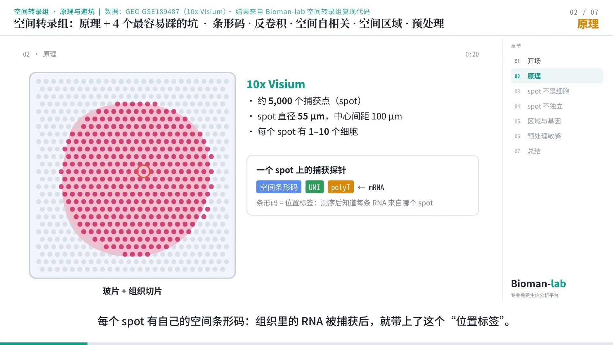
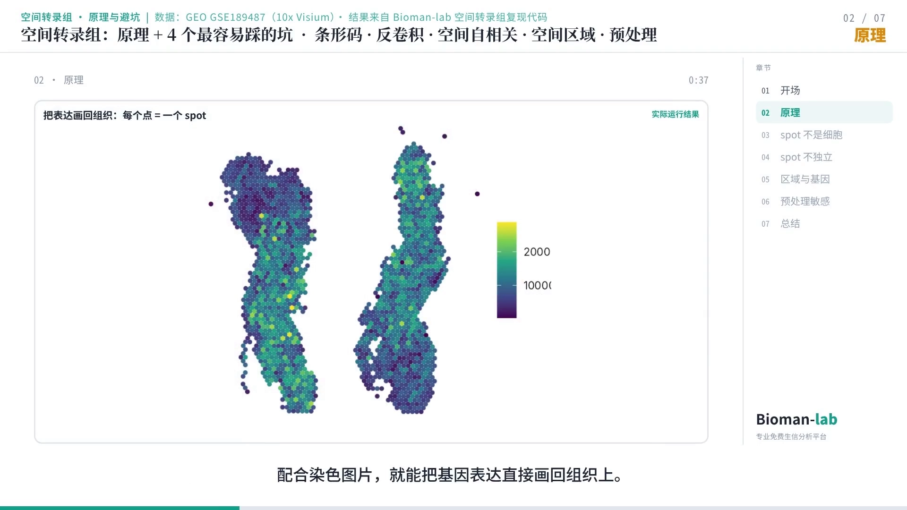
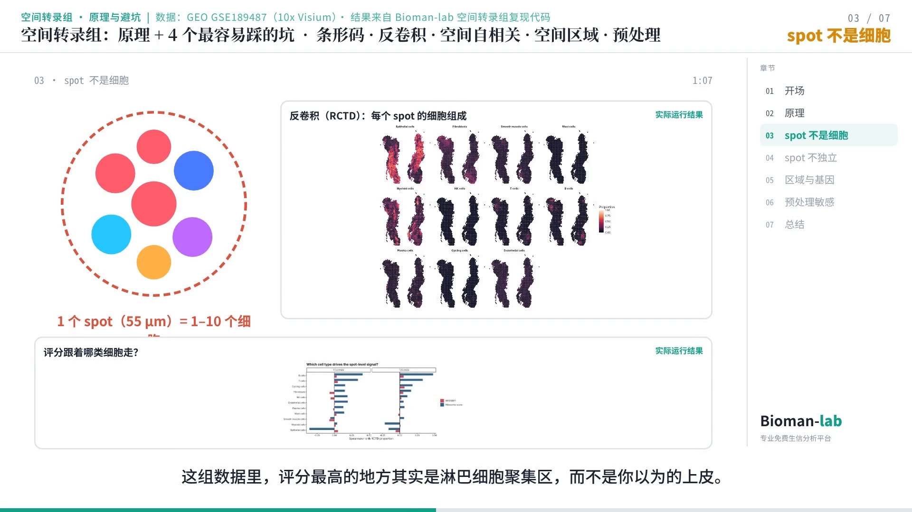
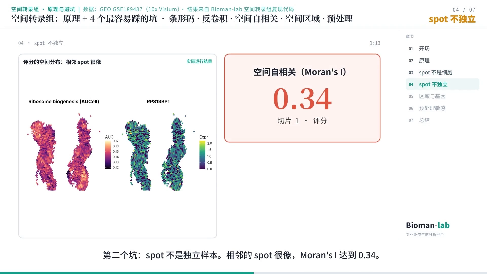
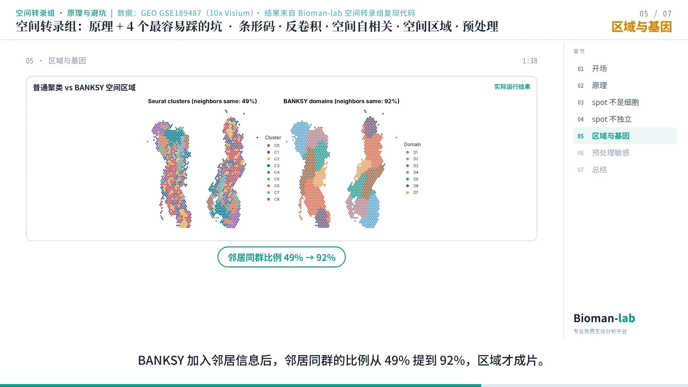
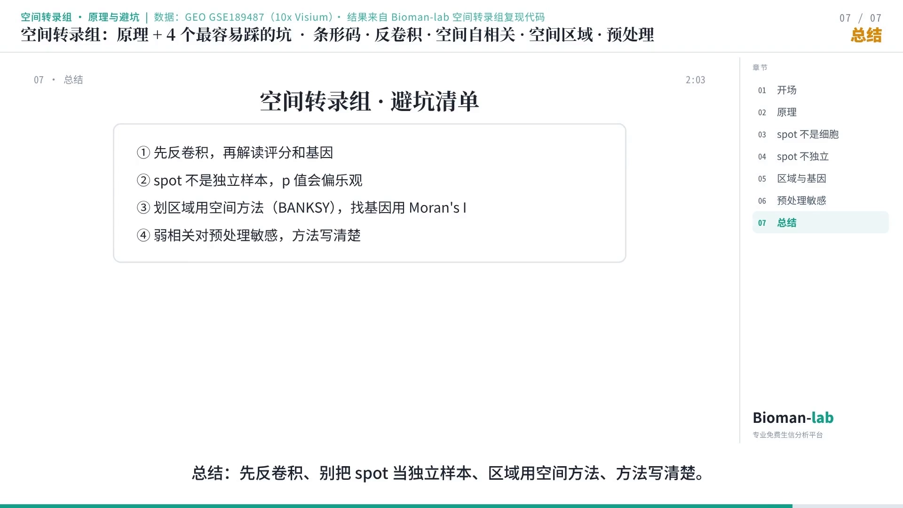

# 空间转录组的四个坑：斑点混细胞、空间自相关、聚类不等于区域

> 视频来源：[空间转录组：原理 + 4 个最容易踩的坑](https://www.bilibili.com/video/BV1xNx96fELs/)（Bilibili · Bioman-lab）｜时长约 2 分钟
> 简要导读：一支节奏极快的幻灯片讲解，用同一份 Visium 数据（GEO GSE189487）演示四个判读错误。本文按「原理 → 四个坑 → 清单」重排，四个坑的先后顺序对应「先看测量单位、再看样本独立性、再看区域、最后看基因筛选」这条推理链。

## 本讲要解决的核心问题（SCQA）

**背景**：空间转录组的数据长成一张「基因 × spot」的矩阵，每个 spot 还带一个坐标。看上去它和单细胞的「基因 × 细胞」矩阵只差一个坐标字段。

**冲突**：正因为长得像，很多人会顺手把单细胞的分析习惯搬过来——把 spot 当细胞、把 spot 当独立样本、把聚类当空间区域、把高变基因当空间可变基因。这四步每一步都错在一个隐含假设上，而且错得不显眼：结果照样出图，只是结论不成立。

**疑问**：这四个假设分别在什么地方不成立？错了以后会得到什么样的假结论？

**回答（中心思想）**：空间转录组的测量单位是**混着多个细胞的 spot**，而且相邻 spot 高度相似。因此四个默认假设全部需要替换：spot 要先用单细胞参考做反卷积才谈得上细胞类型；spot 不能当独立样本，否则 p 值偏乐观；区域要用带邻居信息的方法划分，否则同一群散落在各处；找组织特异的基因要用空间自相关，而不是高变基因。

## 一、先看原理：空间转录组比单细胞多了什么

和单细胞相比，空间转录组多了一样东西：**每个测序点在组织上的位置**。以最常用的平台为例，组织切片贴在玻片上，玻片上有大约 5000 个捕获点，每个捕获点都有自己的空间条形码 [【跳转到 00:00】](https://www.bilibili.com/video/BV1xNx96fELs/?t=0)。

组织里的每一条 RNA 被捕获以后都带上了这个位置标签；测序以后按条形码分回每个捕获点，就得到了**基因 × spot** 的表达矩阵。再加上每个 spot 的坐标，配合组织的染色图片，就能把基因表达直接画回组织上 [【跳转到 00:20】](https://www.bilibili.com/video/BV1xNx96fELs/?t=20)。

这一步是「坐标」真正起作用的地方：表达值本身是数字，只有配上每个 spot 的坐标和染色图，它才变成「组织上的分布」 [【跳转到 00:37】](https://www.bilibili.com/video/BV1xNx96fELs/?t=37)。

标准分析流程是：质控 → 标准化和聚类 → 划分空间区域 → 找空间可变基因 → 反卷积 → 评分与相关 [【跳转到 00:42】](https://www.bilibili.com/video/BV1xNx96fELs/?t=42)。四个坑正好分布在这条流程的四个位置上。

## 二、第一个坑：spot 不是细胞

一个 spot 直径 55 微米，里面有 **1 到 10 个细胞**。所以看到「某个 spot 里某类 marker 高」，不能直接说「这个 spot 是这类细胞」。

正确做法是**先做反卷积**：用单细胞数据做参考，算出每个 spot 里各类细胞占多少 [【跳转到 00:42】](https://www.bilibili.com/video/BV1xNx96fELs/?t=42)。

视频给了一个很有说服力的例子：在这组数据里，「评分最高的地方」其实是**淋巴细胞聚集的区域**，而不是你以为的上皮 [【跳转到 01:07】](https://www.bilibili.com/video/BV1xNx96fELs/?t=67)。如果跳过反卷积、直接把 spot 当细胞读，就会把「这个位置淋巴细胞多」误读成「这个位置的细胞高表达该基因」——**细胞组成的变化被当成了细胞内表达的变化**。

## 三、第二个坑：spot 不是独立样本

相邻的 spot 很像——因为它们物理上就挨着，共享同一片组织。这在统计上叫**空间自相关**，视频给出的 Moran's I 是 **0.34** [【跳转到 01:13】](https://www.bilibili.com/video/BV1xNx96fELs/?t=73)。

后果是：上千个 spot 直接算相关，**p 值会非常小**，「但这只说明 spot 多，不说明结论稳」。这正是统计学里的**伪重复**——把一个样本切成上千份，重复数看着很大，独立信息并没有增加。

## 四、第三个坑：聚类不等于空间区域

普通聚类（如 Seurat 的 cluster）只看表达，不看位置。结果是一群表达相似的 spot 可能散落在切片各处，形不成连续的区域。

视频的做法是加入邻居信息（BANKSY）：**邻居同群的比例从 49% 提高到 92%**，区域才成片 [【跳转到 01:38】](https://www.bilibili.com/video/BV1xNx96fELs/?t=98)。

同一个坑还有一半：**高变基因不等于空间可变基因**。高变基因是按表达方差选的，和「在空间上有没有结构」无关；要找组织特异的基因，要用**空间自相关**（如 Moran's I）来筛。

## 五、第四个坑：弱相关对预处理很敏感

同一份数据，换一种预处理（置换矩阵、标准化），相关系数会从 **0.05 变到 0.29** [【跳转到 01:38】](https://www.bilibili.com/video/BV1xNx96fELs/?t=98)。

方向是稳的（正相关还是正相关），但**数值差了一个数量级**。这意味着：如果你只报一个相关系数、不写清楚预处理流程，读者无法判断这个数字是数据的性质还是流程的产物。所以「写文章的时候，方法一定要写清楚」。

## 六、避坑清单

| 坑 | 错在哪 | 换成什么 |
| --- | --- | --- |
| spot 不是细胞 | 一个 spot 混着 1–10 个细胞，组成变化会被读成表达变化 | 先用单细胞参考做反卷积，再解读评分与基因 |
| spot 不是独立样本 | 相邻 spot 高度相似（Moran's I = 0.34），p 值偏乐观 | 不把 spot 数当重复数；统计单位回到切片/样本 |
| 聚类不等于区域 | 普通聚类不看位置，同一群散落各处 | 划区域用带邻居信息的方法（BANKSY），找基因用空间自相关 |
| 弱相关对预处理敏感 | 同一数据不同预处理，相关系数 0.05 → 0.29 | 方法写清楚，报告预处理流程 |

## 小结

- 空间转录组的矩阵看起来像单细胞，但**行是 spot 不是细胞**，这是后面所有坑的源头。
- 四个坑分别对应四个默认假设：spot = 细胞、spot = 独立样本、cluster = 区域、高变基因 = 空间可变基因。四个假设都不成立。
- 每个坑都有对应的替代做法：反卷积、按样本而非 spot 计重复、带邻居信息的区域划分、用空间自相关筛基因。
- 最后一条是元规则：**弱相关对预处理敏感**，所以方法必须写清楚，否则数字不可复现。
- 视频结尾的提醒值得单列：用 AI（或任何自动化流程）分析空间数据时，这四步最容易出错，有一份标准代码做参照才能判断对不对 [【跳转到 02:03】](https://www.bilibili.com/video/BV1xNx96fELs/?t=123)。

## 关键术语速查

| 术语 | 一句话解释 |
| --- | --- |
| spot | 芯片上的一个捕获点，Visium 直径约 55 微米，覆盖 1–10 个细胞 |
| 反卷积（deconvolution） | 用单细胞参考数据估计每个 spot 内各类细胞的比例，把「混合读数」拆成「组成」 |
| RCTD | 一种常用的空间反卷积方法，输出每个 spot 的细胞类型比例 |
| 空间自相关 | 相邻位置的取值彼此相关的现象；Moran's I 是常用度量，越接近 1 越聚集 |
| 伪重复 | 把同一个样本拆成很多份当成独立重复，导致 p 值偏小、结论过度自信 |
| BANKSY | 在聚类时同时使用表达与邻居信息的方法，使划分出的群在空间上成片 |
| 空间可变基因（SVG） | 表达在空间上有结构的基因，需用空间自相关筛选，不等于高变基因（HVG） |
| 预处理敏感性 | 同一数据在不同标准化/变换下统计量变化很大的性质，要求方法透明可复现 |