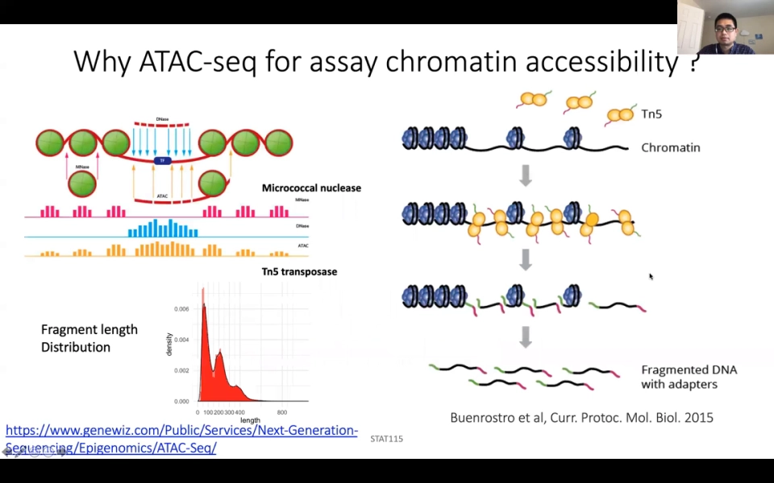
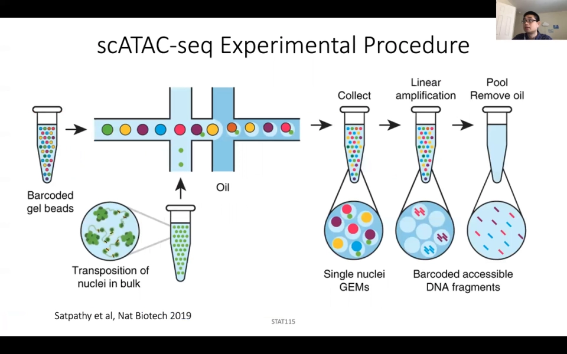
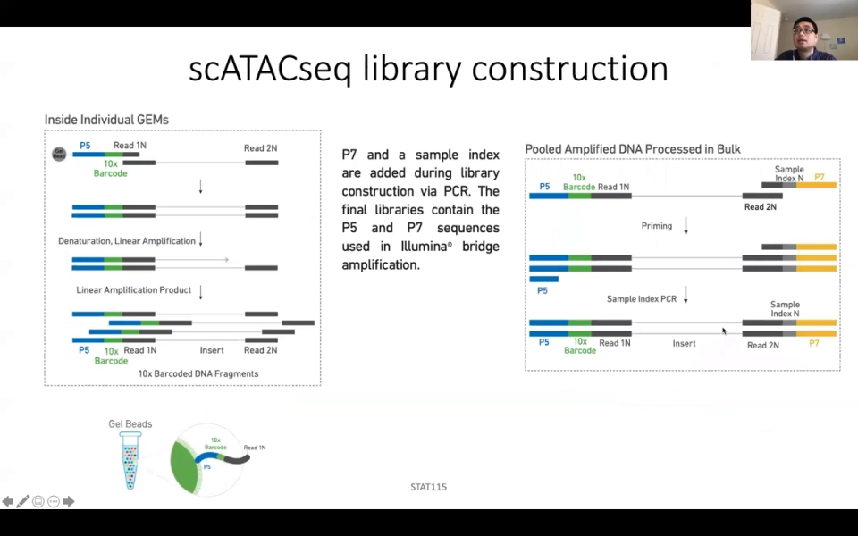
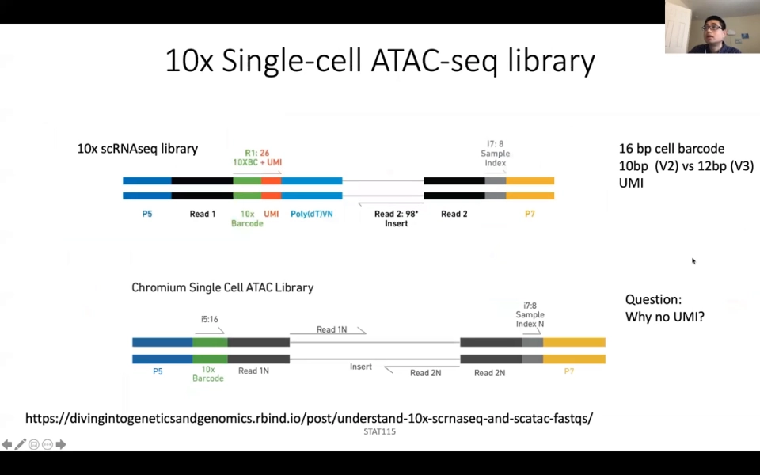
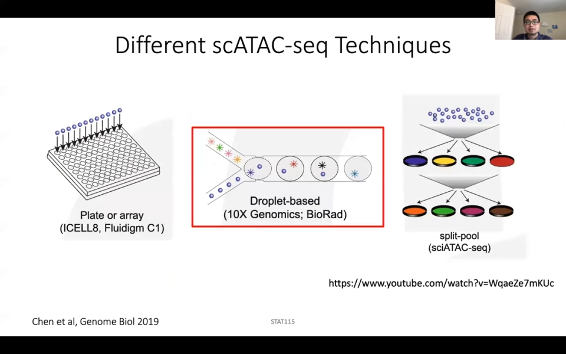
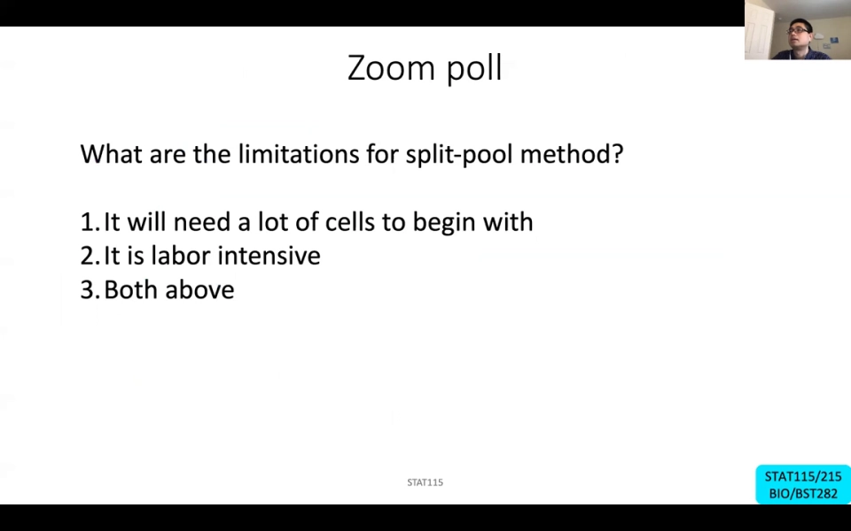
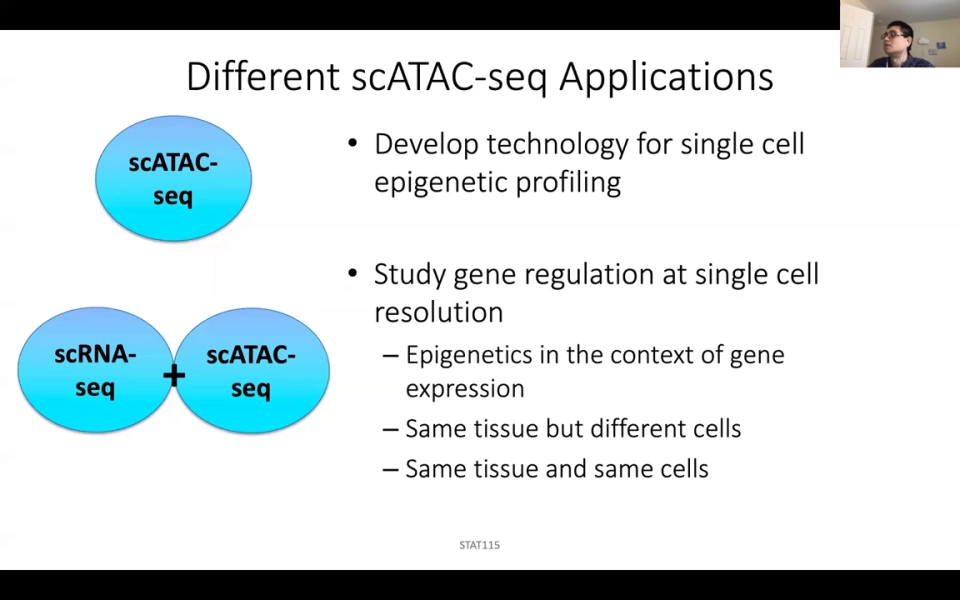

# 单细胞ATAC-seq原理：Tn5标记开放染色质与10x条码化

> 视频来源：[STAT115 Chapter 21.1 Single-Cell ATAC-seq Technique](https://www.youtube.com/watch?v=ufUVMHLDa00)（YouTube · Xiaole Shirley Liu 的 STAT115 课程频道，讲者 Ming Tang，Dana-Farber 癌症研究所）｜时长约 12 分钟
> 导读：这是哈佛 STAT115 生物信息学课程里讲 scATAC-seq 技术的一章，讲者把「染色质可及性怎么被 Tn5 读出来」一路讲到「10x 的文库为什么长这个样子」。本文只讲**测定原理与文库结构**：scRNA-seq 自己的建库原理见 [§2.1.2](../../../README.md#b04-2-1-2)，读段量化与细胞判定见 [§2.1.6](../../../README.md#b04-2-1-6) 与 [§2.2.3](../../../README.md#b04-2-2-3)，稀疏矩阵与数据对象见 [§2.2.1](../../../README.md#b04-2-2-1)。

## 本讲要解决的核心问题（SCQA）

**背景**：真核生物的 DNA 不是裸的，它缠在核小体（nucleosome，由组蛋白八聚体与绕在上面的 DNA 构成的小线轴）上。转录因子要结合到启动子或增强子上，前提是那段 DNA **够得着**——这段「够不够得着」的性质就叫染色质可及性（chromatin accessibility）。

**冲突**：单细胞 RNA 测序测的是已经转录出来的 mRNA。它告诉你细胞「正在做什么」，却没有告诉你「能不能做」。一个基因在某个细胞里没有表达，可能是因为缺少激活它的转录因子，也可能是因为那段染色质被核小体封住了、转录因子根本进不去。这两件事在表达矩阵里长得一模一样。

**疑问**：可及性本身不是一种分子，没法直接「测序」。它怎么变成测序仪能读的东西？又怎么从一整管细胞，做到**一个细胞一份**？

**回答（中心思想）**：答案是**用酶把「开放」这件事翻译成「DNA 片段」**。Tn5 转座酶只在可及的区域切 DNA 并顺手接上测序接头，所以测到的每一段序列都对应一个「当时是开着的位点」。单细胞化并没有改变这个化学过程，只是给这些片段再加一个**细胞条码**：同一个液滴里所有片段共享一个条码，于是「片段落在哪个基因组区间」和「它来自哪个细胞」两件事可以同时被读出来。ATAC-seq 之所以能成为主流，是因为它一步完成识别、剪切、接接头，起始量低到约 2000 个细胞，才使得单细胞化在经济上可行。

## 一、可及性：为什么「开放」值得单独测

### 1.1 核小体挡住的地方，转录因子进不去

讲者开场就把逻辑摆出来：DNA 缠在核小体上，转录又严格受转录因子控制，因此**染色质区域对某个转录因子是否可及，是基因调控的关键一环**。开放的区域是转录因子能落脚的地方；被核小体包住的区域，转录因子进不去，基因就处于「关闭」的默认状态。

[【跳转到 01:06】](https://www.youtube.com/watch?v=ufUVMHLDa00&t=66)

### 1.2 三种酶，切出三种不同的图

要测可及性，历史上不止一种办法，讲者把它们并排放在一张幻灯片上（上图左半）：

| 方法 | 用的酶 | 酶偏好切哪里 | 最后得到的信息 |
| --- | --- | --- | --- |
| MNase-seq | 微球菌核酸酶（micrococcal nuclease） | 优先切核小体之间的连接 DNA（linker DNA） | 核小体**占据**在哪里 |
| DNase-seq | DNase I | 优先切开放染色质 | 开放区（DNase 超敏位点） |
| ATAC-seq | Tn5 转座酶 | 既切开放区，也切连接区 | 全基因组**所有可及区域** |

差别就在「切哪里」这一列。MNase 把核小体之间的缝切开，剩下被保护的就是核小体的位置；DNase I 只在开放处下刀，得到的是超敏位点；Tn5 两边都切，所以一次就能把基因组里所有「没有被核小体严严实实包住」的地方都标出来。这也是 ATAC 名字的由来——**A**ssay for **T**ransposase-**A**ccessible **C**hromatin，用转座酶测可及染色质。

### 1.3 Tn5 一步做完三件事

上图右半是 Tn5 的工作过程，值得逐格看：

1. 蓝色的核小体串在 DNA 上，中间露出几段没被包住的空隙；
2. 高活性的 Tn5 转座酶（图中橙色的小分子）带着测序接头靠近，只落在这些空隙里；
3. Tn5 把携带的接头**直接插进** DNA（转座反应，本质是「剪切 + 粘贴」一步完成）；
4. 最后得到一堆两端都带接头的片段，可以直接拿去扩增、测序。

传统做法要「先切、再连接接头」两步，Tn5 把这两步合成一步，这就是它快、省样本的根本原因。

### 1.4 片段长度谱：ATAC 数据的「指纹」

因为 Tn5 既切开放区也切连接区，切出来的片段长度会呈现**周期性**。讲者给了一张片段长度分布图（上图左下），并强调这个图在实验室里就能看到：把文库上 TapeStation 跑一下，会看到

- 一个 **小于 100 bp** 的峰——对应没有核小体挡着的开放区片段；
- 一个 **约 200 bp** 的峰——大致等于一个核小体所占的长度；
- 一个 **约 400 bp** 的峰——对应跨过两个核小体的片段。

同样的周期性在数据里也能复现：拿到 R1、R2 两条 read 就知道每个片段的长度，直接画直方图，会看到相同的周期模式。**这个「指纹」既是实验成功的证据，也是判断数据质量的第一道关卡**——如果片段长度谱没有周期性，说明转座反应没做好，后面怎么分析都白搭。

## 二、为什么 ATAC-seq 成了主流

讲者列了三条理由，并顺手回答了一个学生常有的误解。

**第一，它一次性覆盖全基因组所有可及区，也就是所有转录因子的结合位点。** 讲者在这里停下来问了一个问题：这些开放区是不是都是**激活**位点？答案是**不一定**。阻遏蛋白（repressor）同样要结合到染色质上才能发挥作用，它一结合就把那段 DNA 保护起来，Tn5 也就切不进去。所以「开放」只说明「有蛋白在这里落脚」，至于落脚的是激活因子还是抑制因子，要靠 motif 分析等手段再判断。

**第二，它快、操作简单。** 相比 ChIP-seq 这类要免疫沉淀、要抗体、要大量起始材料的方法，ATAC-seq 的实验流程短得多。

**第三，起始量低。** 早期做 ChIP-seq 之类的实验需要大量细胞，肿瘤样本或难以获取的样本根本凑不出来；而 ATAC-seq **低到约 2000 个细胞**就能起步。正是这一点，让「单细胞化」在成本上变得现实——要拆成单个细胞，每个细胞能分到的材料本来就少得可怜。

[【跳转到 04:01】](https://www.youtube.com/watch?v=ufUVMHLDa00&t=241)

[【跳转到 04:51】](https://www.youtube.com/watch?v=ufUVMHLDa00&t=291)

## 三、单细胞化：一条液滴一个细胞条码

10x Genomics 把 ATAC-seq 做成了商业化试剂盒。讲者用一张流程图讲清了整个物理过程（下图）：

[【跳转到 05:11】](https://www.youtube.com/watch?v=ufUVMHLDa00&t=311)

按图中箭头从左到右：

1. **准备核悬液并做批量转座**。图中标注的 "Transposition of nuclei in bulk" 很关键：Tn5 的转座反应是在**进液滴之前、在整管核悬液里**完成的。此时每个核里所有可及位点都已经被切好、接上了接头。
2. **与带条码的凝胶珠一起进微流控通道**。水相被油相（Oil）切成一个个液滴，理想情况下**一个液滴里装一个细胞核 + 一颗凝胶珠**。
3. **收集液滴（Single nuclei GEMs）**，在液滴内做**线性扩增**：凝胶珠上溶出的条码引物把该核的片段全部标上同一个细胞条码。
4. **破油、把液滴合并**，进入常规的文库构建与测序。此后所有细胞混在一管里，靠条码在计算上分开。

讲者特别提到：**细胞悬液和细胞核悬液都能上机**，两种都能跑通 10x 的流程，所以图里收集到的是「单个细胞核的 GEM」（Single nuclei GEMs）。

## 四、文库结构：为什么 scATAC 没有 UMI

这是本讲最「硬」的一段，也是理解 scATAC 数据形态的关键。先看文库是怎么搭起来的（下图）：

[【跳转到 06:10】](https://www.youtube.com/watch?v=ufUVMHLDa00&t=370)

- **液滴内部（Inside Individual GEMs）**：片段一端已经带着 Tn5 插进去的接头，另一端接上凝胶珠带来的 **P5 接头 + 16 bp 的 10x 细胞条码**，然后是 Read 1N 测序引物位点；经过变性、线性扩增，得到一批共享同一细胞条码的片段。
- **破油之后（Pooled Amplified DNA Processed in Bulk）**：用另一组引物补上 **P7 接头 + 6 bp 的 sample index**（用于多样本混测时区分样本），再做一轮 PCR 把缺口补齐。最终文库两端分别是 P5 和 P7，这正是 Illumina 桥式扩增需要的结构。

把 scATAC 的文库和 scRNA 的文库并排看，差别一目了然（下图）：

[【跳转到 07:36】](https://www.youtube.com/watch?v=ufUVMHLDa00&t=456)

| 项目 | 10x scRNA-seq | 10x scATAC-seq |
| --- | --- | --- |
| R1 内容 | 16 bp 细胞条码 + UMI（V2 为 10 bp，V3 为 12 bp） | 16 bp 细胞条码 + 基因组序列 |
| R1 长度 | 26 bp 或 28 bp | 条码 + 基因组片段 |
| R2 内容 | 基因组（转录本）序列 | 基因组序列 |
| 测序方式 | 事实上的单端（R1 不含基因组信息） | 真正的双端 |
| 是否有 UMI | 有 | **没有** |

**为什么 scATAC 不需要 UMI？** 讲者把这个问题抛给听众。UMI（unique molecular identifier，分子标签）在 scRNA-seq 里的作用是标记「同一条原始 mRNA 分子」，从而把 PCR 扩增出来的重复拷贝识别出来并去掉。而 ATAC 测的不是 RNA，是**基因组上的片段**：一个二倍体细胞里每条染色体只有**两份拷贝**，所以同一个基因组坐标上出现**超过两次**的片段，逻辑上必然是 PCR 重复，直接按坐标去重即可，不需要额外的分子标签。

这条推理直接决定了 scATAC 数据的样子：它没有「分子计数」这一层，只有「这个细胞的这个位点有没有被测到」——这正是它比 scRNA 更稀疏、更接近二值的原因（数据形态的细节见 [§2.2.1](../../../README.md#b04-2-2-1) 与 [§2.2.2](../../../README.md#b04-2-2-2)）。

## 五、并行化不止液滴一条路

讲者把当时存在的三条技术路线放在一张图上比较（下图）：

[【跳转到 09:46】](https://www.youtube.com/watch?v=ufUVMHLDa00&t=586)

- **板式 / 阵列（Plate or array）**：把单个细胞（或核）分到 96 孔板的孔里，一孔一个条码，代表方法是 ICEL8、Fluidigm C1。通量受孔数限制，但每个细胞分得清楚。
- **液滴微流控（Droplet-based）**：10x Genomics、Bio-Rad 走的路，就是上一节讲的流程。通量高、商业化成熟。
- **split-pool 组合索引（sciATAC-seq）**：先把细胞分到不同孔里加第一轮条码，合并、打散，再分到另一批孔里加第二轮条码。每个细胞走过的「路径」由两轮条码组合唯一确定，所以 $N$ 个第一轮条码乘 $M$ 个第二轮条码就能标出 $N \times M$ 个细胞。

split-pool 的代价也很直接：**起始需要大量细胞**（每一轮分装都会损失一部分），以及**极其费人力**；再加上当时没有商业化试剂，实验室要自己搭流程。讲者在课末用一道投票题把这两个短板再确认了一遍（下图）。

[【跳转到 12:08】](https://www.youtube.com/watch?v=ufUVMHLDa00&t=728)

所以讲者的结论很务实：**10x 至今仍是最流行的选择**——买试剂、买机器、按流程跑，大概率能拿到质量不错的数据；代价是贵一些，需要在成本和省心之间做权衡。

[【跳转到 10:36】](https://www.youtube.com/watch?v=ufUVMHLDa00&t=636)

## 六、和 scRNA-seq 的关系：两层信息要一起读

讲者在结尾回到生物学：表观遗传信息**必须放在基因表达的语境里解释**。只看「哪里开放」而不看「哪些基因在表达」，很难判断这个开放位点到底在调控什么。于是有了三种做法（下图）：

[【跳转到 11:01】](https://www.youtube.com/watch?v=ufUVMHLDa00&t=661)

1. **只用 scATAC**：早期为了验证技术本身，人们只做 scATAC-seq。
2. **同一组织、不同细胞**：把同一份样本分成两管，一管做 scRNA-seq、一管做 scATAC-seq。两管里的细胞不是同一批，但来自同一个样本，可以事后把两个数据集映射到一起。
3. **同一组织、同一细胞**：10x 推出的 Multiome 方案，在同一个细胞核里同时测转录组和可及性。讲者提到这正是课程后续作业要分析的数据。

第 3 条路的意义在于：前两种做法都只能「猜」某个细胞的表达谱和它的染色质状态是否对应，Multiome 则把两者绑在同一个条码上，可以直接问「这个细胞的这个基因表达高低，和它启动子区的可及性是否一致」。多组学测量的细节见 [§1.2.6](../../../README.md#b04-1-2-6)。

## 小结

- **可及性 = 转录因子够不够得着**。它决定了基因「能不能」被转录，而 scRNA-seq 只告诉你「正在」转录什么——这是两件事。
- **Tn5 把三件事合成一步**：识别开放区、剪切 DNA、接上测序接头。片段长度谱（约 100 / 200 / 400 bp 的周期性峰）是 ATAC 数据的指纹，也是第一道质控。
- **ATAC 的主流地位来自三点**：覆盖全部可及区（含抑制性位点）、流程快、起始量低到约 2000 个细胞。
- **单细胞化的本质是加条码**：转座在液滴之前批量完成，液滴里只做「一个核 + 一颗珠 + 线性扩增」，破油后再补 P7 与样本 index。
- **scATAC 没有 UMI**，因为每条染色体只有两份拷贝，超过两份的片段就是 PCR 重复，按坐标去重即可。这一条直接决定了 scATAC 数据比 scRNA 更稀疏、更接近二值。
- **并行化有三条路线**：板式阵列、液滴微流控、split-pool 组合索引；前者通量有限，后者费细胞费人力，液滴路线因商业化成熟而最流行。
- **scATAC 要与 scRNA 一起读**：可以分两管做同一组织，也可以在同一个细胞里做 Multiome。

## 关键术语速查

| 术语 | 一句话解释 |
| --- | --- |
| 染色质可及性（chromatin accessibility） | 某段 DNA 是否没有被核小体包住、转录因子能否结合上去 |
| 核小体（nucleosome） | 组蛋白八聚体与绕在上面的 DNA 构成的小线轴，染色质的基本包装单位；讲者提到一个核小体大致对应 200 bp 的片段长度 |
| Tn5 转座酶 | 高活性转座酶，能把携带的测序接头直接插进可及的 DNA，一步完成剪切与接接头 |
| ATAC-seq | Assay for Transposase-Accessible Chromatin，用 Tn5 标记全基因组可及区域的测序方法 |
| 连接 DNA（linker DNA） | 相邻两个核小体之间的裸露 DNA，MNase 优先切这里 |
| 片段长度周期性 | ATAC 文库中约 100 / 200 / 400 bp 的峰，分别对应无核小体、单核小体、双核小体跨度 |
| 细胞条码（cell barcode） | 16 bp 的短序列，同一液滴（同一细胞）的所有片段共享一个，用于在计算上把细胞分开 |
| UMI | 分子标签，用于识别 PCR 重复；scRNA-seq 需要，scATAC-seq 不需要 |
| GEM | Gel Bead in Emulsion，凝胶珠与细胞核被油包成的液滴，是 10x 的反应单元 |
| Multiome | 在同一个细胞核里同时测 scRNA-seq 与 scATAC-seq 的商业方案 |