# 单细胞ATAC-seq的数据形态：从bulk平均轨道到细胞乘峰矩阵

> 视频来源：[WEBINAR Understanding Single-Cell ATAC-Seq and its Applications](https://www.youtube.com/watch?v=K7IBMunFrZ4)（YouTube · Active Motif 网络研讨会，讲者 Felizza Gunderson）｜时长约 21 分钟
> 导读：这场研讨会的主线是「bulk ATAC 的局限 → 单细胞化怎么做 → 数据长什么样 → 能回答什么问题」。本文只取原理与数据形态部分：研讨会末尾的厂商服务与交付清单与原理无关，本文不展开；多组学联合测量见 [§1.2.6](../../../README.md#b04-1-2-6)，单细胞建库与平台横向对比见 [§2.1.2](../../../README.md#b04-2-1-2)，降维与聚类见 [§3.2.1](../../../README.md#b04-3-2-1) 至 [§3.2.3](../../../README.md#b04-3-2-3)。

## 本讲要解决的核心问题（SCQA）

**背景**：ATAC-seq（Assay for Transposase-Accessible Chromatin）用 Tn5 转座酶标记基因组里开放的、可及的区域。一次实验就能给出全基因组的可及性图谱，用来判断表观遗传是否参与了某个响应、推断哪些组蛋白修饰值得关注、用 motif 分析找出驱动细胞命运的转录因子。

**冲突**：标准 ATAC-seq 是把成千上万个细胞（讲者给的量级是 500 到 100,000 个）混在一起做。测出来的信号是**所有细胞的平均**。如果只有一小群细胞在响应，它的信号会被大量不响应的细胞稀释掉，在一整条 bigWig 轨道上根本看不出来是哪群细胞在动。要分离稀有亚群就得靠 FACS 分选或磁珠分选，可**分选本身是剧烈的样本操作，可能改变你要观察的生物学**。

**疑问**：能不能不分选，直接拿到每个细胞各自的可及性？单细胞化之后，数据从「一条轨道」变成了什么形状？

**回答（中心思想）**：单细胞 ATAC-seq 用的还是同一套 Tn5 化学，只是**给每个细胞核的片段加上一个只属于它的条码**。于是数据从「一条代表平均值的 bigWig 轨道」变成「**细胞 × 峰** 的高维矩阵」，再经降维聚类变成「细胞群 + 每群的开放谱」。信息形态的这一变化，才让「不用标记基因就能分群」「反卷积肿瘤微环境」「沿分化轨迹看调控元件与转录因子」成为可能。

## 一、ATAC-seq 到底在测什么

### 1.1 定义与实验流程

ATAC-seq 的全名是 **A**ssay for **T**ransposase **A**ccessible **C**hromatin，用于探查基因组中开放、可及的区域。实现方式是使用 **Tn5 转座酶**。讲者给的流程图（下图）可以拆成五步：

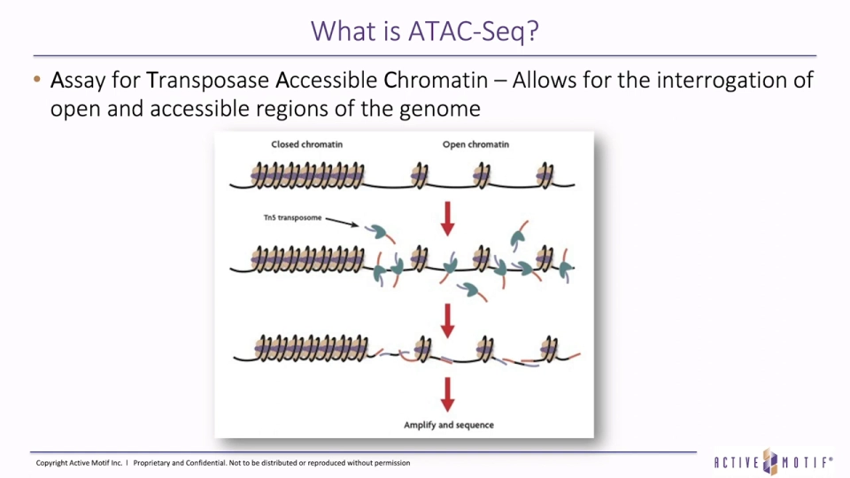

[【跳转到 02:01】](https://www.youtube.com/watch?v=K7IBMunFrZ4&t=121)

1. **分离细胞核**：起始量约 500 到 100,000 个细胞；
2. **转座**：把载有测序接头的 Tn5 加进去，Tn5 只落在开放染色质处，并把接头的一部分插进 DNA；
3. **片段化完成**：被切开的 DNA 纯化出来；
4. **PCR**：补全测序接头，同时引入 index，用于多样本混测（multiplexing）；
5. **下一代测序**。

上图左右两半的对比很直观：左边是**闭合染色质**，核小体排得密，Tn5 无处落脚；右边是**开放染色质**，核小体之间露出空隙，Tn5 插进去、切开、接上接头，最后扩增测序。所以「测到的片段落在哪里」就等于「哪里当时是开着的」。

### 1.2 开放染色质能回答什么问题

讲者列了四类用途（下图）：

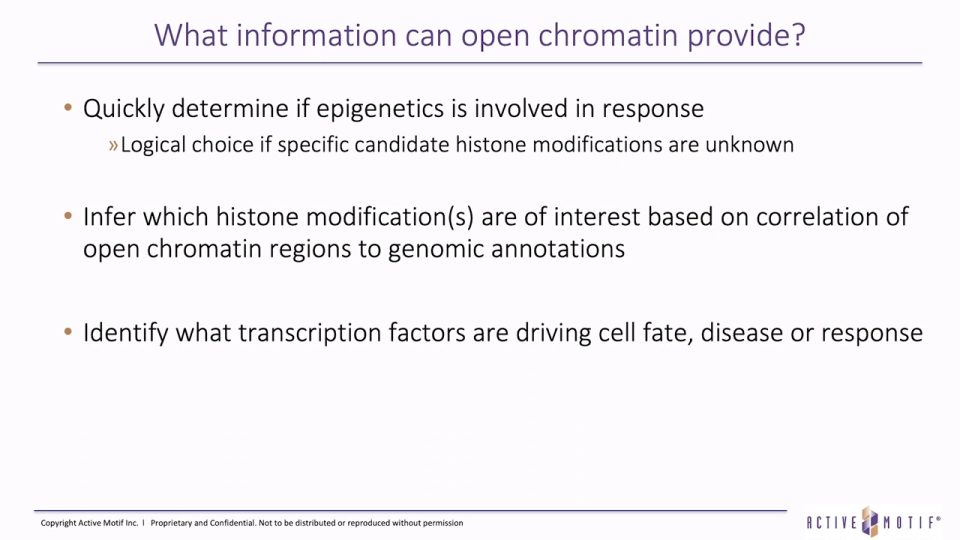

[【跳转到 02:37】](https://www.youtube.com/watch?v=K7IBMunFrZ4&t=157)

- **快速判断表观遗传是否参与**：当你手上既没有候选的组蛋白修饰、也没有已知的转录因子可查时，ATAC-seq 是「先摸清表观遗传地形」的合理选择。
- **反推该关注哪种组蛋白修饰**：把开放区与基因组注释做相关，就能推断哪些修饰值得进一步测。
- **找驱动转录因子**：对开放区做 motif 分析，可以找出可能驱动细胞命运、疾病或响应的转录因子。
- **获得机制层面的解释**：通路、细胞响应或疾病到底是怎么被调控的，以及下一步该做什么实验。

## 二、标准 ATAC-seq 的两个局限

### 2.1 平均掉细胞异质性

这是整场研讨会的转折点。讲者用 CD33 基因位点的 bigWig 轨道举例（下图）：蓝色的峰是开放染色质信号，看起来非常清楚——但你看到的其实是**所有细胞信号的叠加**。

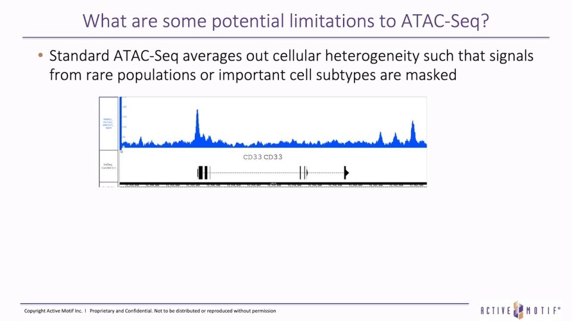

[【跳转到 03:52】](https://www.youtube.com/watch?v=K7IBMunFrZ4&t=232)

问题在于：**你无法判断是哪个亚群在驱动这个响应**。如果只有 5% 的细胞在这个位点开放，剩下 95% 是关闭的，平均之后峰还是会出现，只是矮一些——而你在 bulk 数据里没有任何线索去把这 5% 找出来。讲者的原话是：信号被平均掉，以至于稀有群体或重要亚群的信号被**掩盖**（masked）。

### 2.2 分选会改变生物学

直觉的补救办法是先分选、再测：用 FACS 或磁珠把目标亚群挑出来。但讲者提醒，**分离策略本身就是一种样本操作**，可能改变你要研究的生物学。有些时候为了拿到稀有群体不得不用 FACS，那就得接受这个代价。

由此引出单细胞方法的价值：**不分选，也能把混合群体拆开**。

## 三、单细胞 ATAC-seq 怎么做

### 3.1 定义：同一套化学加一层条码

单细胞 ATAC-seq 用的是**和标准 ATAC-seq 完全相同的 Tn5 转座酶**，区别在于它把这套化学与**单细胞条码**结合起来，从而在单细胞分辨率上、对成千上万个细胞核做可及性 profiling。

### 3.2 两条主流路线

讲者把当时的两条路线放在一张图上对照（下图），中间一列是两者共享的 ATAC-seq 关键步骤：细胞裂解（分离核）→ 转座 → 扩增 → 测序。

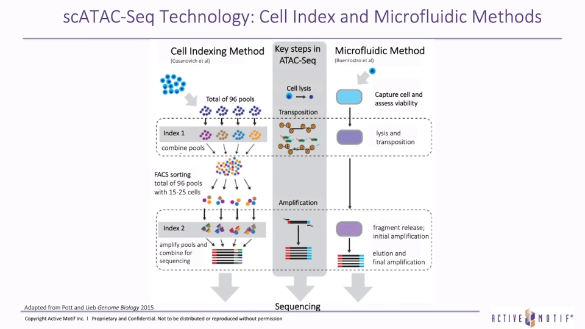

[【跳转到 06:10】](https://www.youtube.com/watch?v=K7IBMunFrZ4&t=370)

**组合细胞索引（combinatorial cell indexing）** 的流程是：

1. 分离细胞核，在 **96 孔板**里加上第一轮分子标签（Index 1），这一步同时用带转座酶复合物的条码标记；
2. 把标记好的核**合并、稀释**，再用 FACS 重新分到第二块 96 孔板里，每孔约 **15 到 25 个核**；
3. 每一孔对应一个「池」，加第二轮条码（Index 2）；
4. PCR 补全接头并引入 index，然后测序。

一个细胞的身份由「第一轮孔号 × 第二轮孔号」共同决定：每一轮只有 96 次加样，两轮组合起来就能给出远多于 96 个的细胞标签。

**微流控（microfluidic）方法** 则保持 ATAC-seq 的步骤不变，只是把**转座反应搬到纳升级的微流控芯片里**做；转座完成后扩增、补全接头、建库。

讲者的结论是：两条路线的方法学非常相似，**选哪条取决于你手上有哪台设备**。

### 3.3 10x Genomics 的具体做法

研讨会的重点放在 10x 的微流控方案上（下图）：

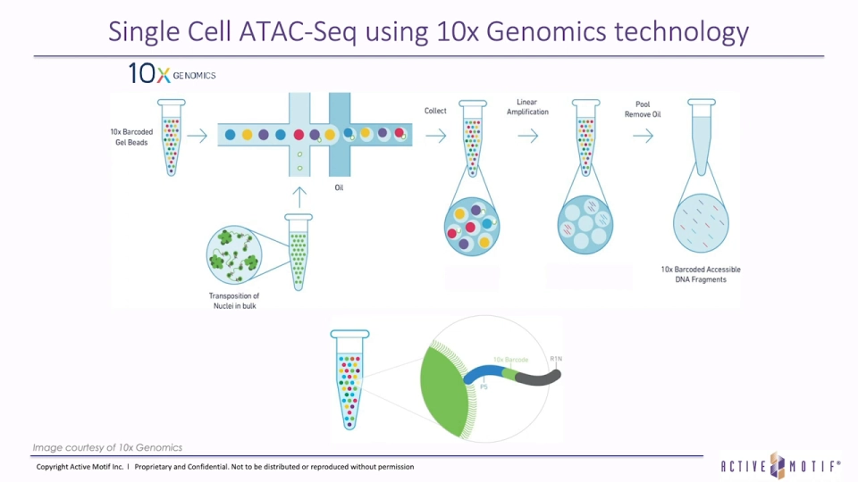

[【跳转到 07:50】](https://www.youtube.com/watch?v=K7IBMunFrZ4&t=470)

1. **批量转座**：分离好的细胞核在 Eppendorf 管里与转座酶共孵育——注意这一步是在**进芯片之前**完成的（图中 "Transposition of Nuclei in bulk"）。
2. **进 Chromium 控制器**：核悬液与**带条码的凝胶珠**一起进微流控芯片。每颗凝胶珠表面覆盖着成千上万条 oligo，**每颗珠的条码都不同**。
3. **一个珠配一个核**：珠与核在油包里相遇，形成「一个核 + 一颗珠」的胶囊。正因为珠上的条码唯一，事后才能追溯「这个信号来自哪个细胞」。
4. **线性扩增**：在液滴内把信号放大（条码来自凝胶珠上的 oligo）；
5. **破油、合并、建库**：去掉油，把所有带条码的片段合并，进入常规建库测序。

（文库结构与「为什么没有 UMI」的推导见同节另一篇 [单细胞 ATAC-seq 原理：Tn5 标记开放染色质与 10x 条码化](单细胞ATAC-seq原理：Tn5标记开放染色质与10x条码化.md)。）
## 四、数据形态的差别：这是单细胞化真正的分水岭

讲者把这一页称为「scATAC 数据如何被表示」。同一张幻灯片上并排放了三样东西（下图）：

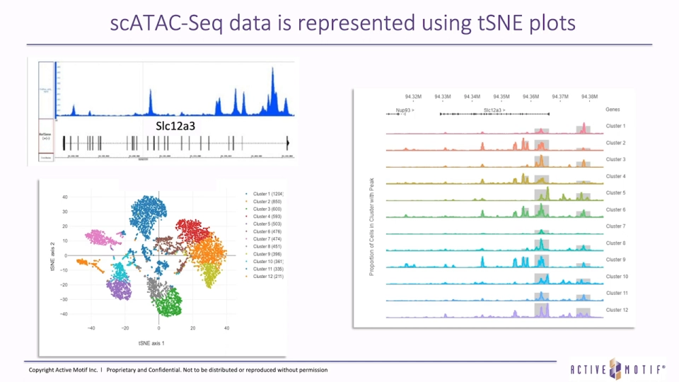

[【跳转到 09:30】](https://www.youtube.com/watch?v=K7IBMunFrZ4&t=570)

- **左上：一条 bigWig 轨道**。这是标准 ATAC-seq 的输出形态——某个基因位点（图中是 Slc12a3）上，信号随基因组坐标起伏，蓝色的峰就是开放区。它是**一个平均值**。
- **左下：tSNE 散点图**。这是单细胞数据特有的形态。每个点是一个细胞核，颜色代表一个细胞簇；图中标出了 12 个簇及其细胞数（Cluster 1 有 1294 个核，Cluster 12 有 211 个核……）。因为单细胞数据维度极高，必须降维到二维才能看，而降到二维之后，**开放谱相似的细胞会自然聚成一团**。
- **右边：每个簇各自的 peak profile**。这是最容易被忽略、也最关键的一层：把每个簇里的细胞合起来（pseudo-bulk），再画出该位点的信号轨道，就能看到 **12 条轨道在同一个位点上的强弱差异**。

这三样东西合起来说明了单细胞化的意义：**bulk 给你一条曲线，单细胞给你「一群细胞各一条曲线」**。前者只能告诉你「这个位点整体是开的」，后者能告诉你「是第 3 簇和第 7 簇开着，其余关着」。讲者的说法是：正因为单细胞数据如此高维、信息量如此大，这种分辨率才能帮研究者**更好地分类异质群体中的不同细胞群**、或者**反卷积肿瘤微环境**。

## 五、单细胞 ATAC 能回答哪些生物学问题

### 5.1 问题清单

讲者列出的典型问题包括：

- 把一个异质群体里的不同细胞群**分类**出来；
- 搞清楚**肿瘤微环境**里到底有哪些细胞群、哪些群在驱动药物响应；
- 研究发育过程中的**细胞分化与细胞轨迹**；
- 识别并构建发育或疾病相关的**基因调控网络**。

其中最有代表性的一条是「**无需标记基因就能鉴定细胞类型**」（marker-free identification）。传统上要靠已知的 marker 基因或表面抗体来定义细胞类型，而染色质开放谱本身就是一种身份特征。

### 5.2 案例一：人造血过程中的细胞类型与调控元件

第一个案例研究人骨髓与外周血。研究者做了 scATAC-seq，在 **63,882 个细胞核里识别出 31 个细胞簇**，覆盖从早期祖细胞到终末分化细胞的全过程（下图左）。

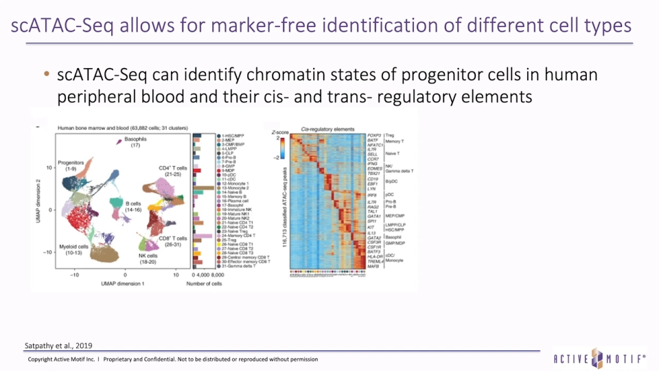

[【跳转到 12:00】](https://www.youtube.com/watch?v=K7IBMunFrZ4&t=720)

进一步下钻，研究者为每个细胞类型找到了对应的 **cis 调控元件**——也就是各类型特异的增强子与启动子，汇总成右图那张热图（行是细胞类型，列是 16,773 个差异可及位点，颜色是 z-score）。

讲者还讲了第三个发现：以**浆细胞 B 细胞的分化**为例，研究者能把细胞沿着「造血干细胞 → 浆细胞 B 细胞」的轨迹排序，并找出**每一步涉及哪些转录因子**。这正是「开放谱 + 转录因子 motif」的组合能给出的信息：不只是「谁和谁像」，而是「谁在推动这一步转变」。

### 5.3 案例二：反卷积肿瘤微环境

第二个案例是基底细胞癌（BCC）患者接受 PD-1 免疫治疗后的活检样本。scATAC-seq 把肿瘤微环境拆成了免疫细胞、基质细胞和恶性细胞（下图）：

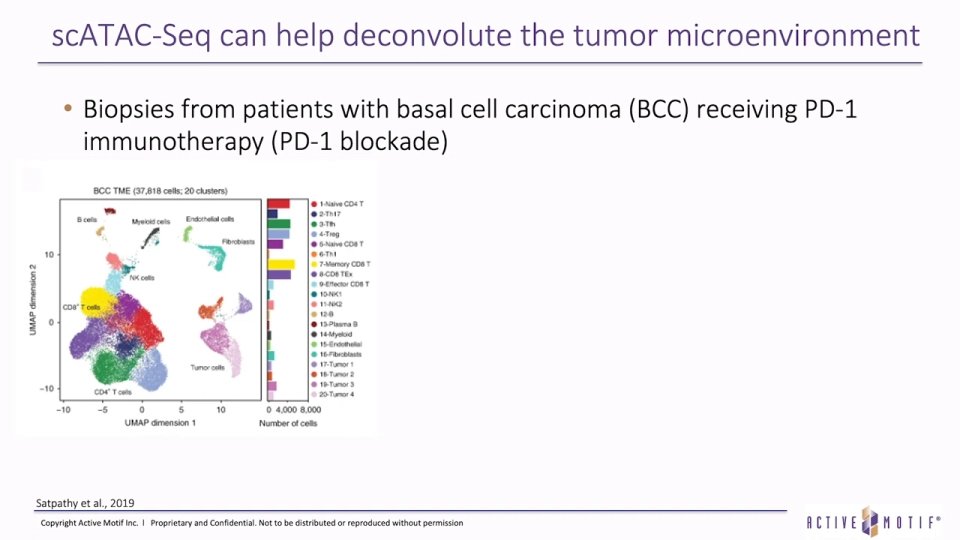

[【跳转到 13:40】](https://www.youtube.com/watch?v=K7IBMunFrZ4&t=820)

这张 UMAP 里有一个很值得注意的现象：**基质细胞和免疫细胞不管来自哪个病人，都聚在一起**；而**肿瘤细胞则分成 4 簇，且与病人一一对应**。也就是说，免疫和基质的「身份」在病人之间是共享的，肿瘤细胞的表观状态却带着强烈的个体特征。

接下来研究者把注意力放到 T 细胞活化上：在肿瘤微环境里，T 细胞可以被 T 细胞和基质细胞上的**抑制性受体**调控。他们挑了三个已知的抑制性配体——**CD47、TGFB1、PD-L1**——去看这些位点的可及性（下图）：

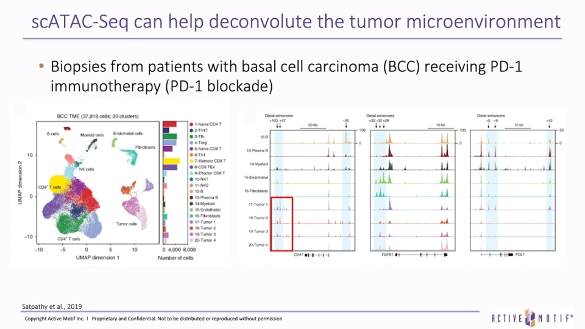

[【跳转到 14:30】](https://www.youtube.com/watch?v=K7IBMunFrZ4&t=870)

结果是：这三个位点的开放程度在不同细胞类型之间不同（肿瘤 vs 基质），有些开放区**只在基质细胞里出现**；甚至在同一个病人的不同细胞、以及不同病人之间，也能看出差别。这正是 bulk ATAC 做不到的事——**bulk 只会把肿瘤、基质、免疫细胞的可及性混成一条轨道**。

## 六、实验上的现实挑战

讲者在结尾列了做 scATAC 时会遇到的坑（下图）：

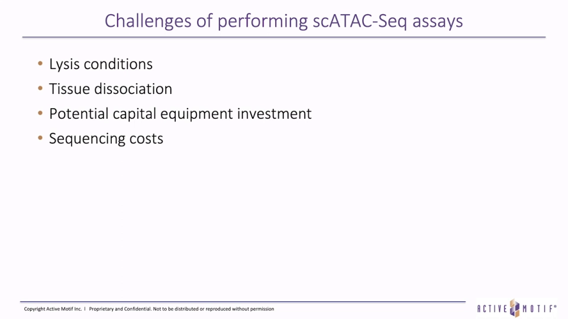

[【跳转到 16:10】](https://www.youtube.com/watch?v=K7IBMunFrZ4&t=970)

- **裂解条件**：每种细胞类型、每种组织的最优裂解条件都不一样，要自己摸；
- **组织解离**：某些组织很难解离成单细胞/单核悬液；
- **设备投入**：没有 FACS 分选机、没有微流控设备，就得先买；
- **测序成本**：要测成千上万个细胞核，测序量直接换算成钱；
- **下游生信分析**：单细胞数据的分析本身有门槛。

讲者的总结是：**任何新技术进入自己的实验体系都需要优化**，这五条就是优化阶段最可能卡住的地方。（研讨会最后一段是厂商服务与交付清单，属于商业内容，本文不展开。）

## 小结

讲者自己的总结页把全篇收束成五条（下图）：

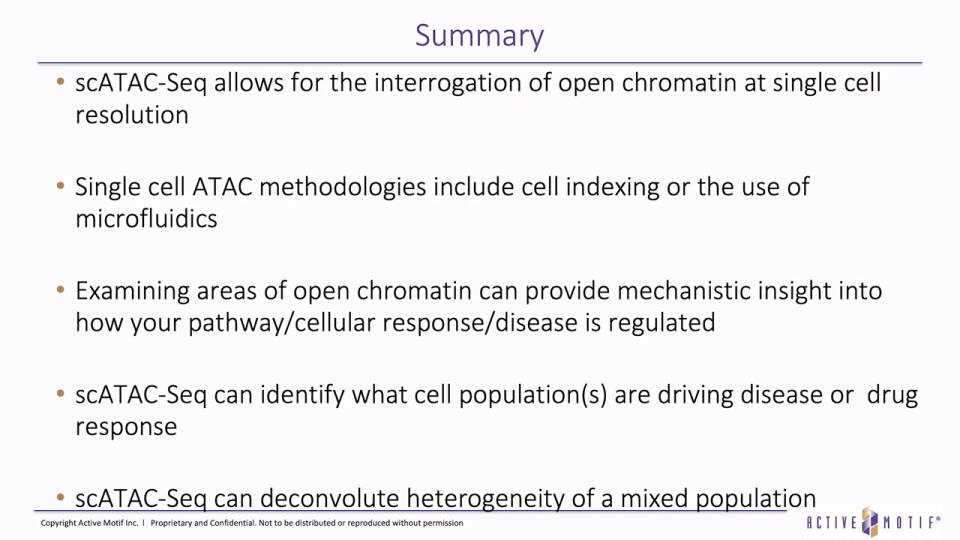

[【跳转到 16:10】](https://www.youtube.com/watch?v=K7IBMunFrZ4&t=970)

- **ATAC-seq 用 Tn5 把「开放」翻译成「片段」**：Tn5 只在开放染色质处插入接头，测到的片段位置就是当时的可及位点。
- **bulk ATAC 的两个局限**：一是把所有细胞的信号平均掉，稀有亚群的信号被掩盖；二是想靠分选补救，分选本身又会改变生物学。
- **单细胞化 = 同一套 Tn5 化学 + 一层细胞条码**。两条主流路线是组合细胞索引（两轮 96 孔条码）与微流控（纳升级转座，10x 为代表），选哪条取决于手上有哪台设备。
- **数据形态的变化才是分水岭**：从「一条 bigWig 平均轨道」变成「细胞 × 峰的高维矩阵」，降维聚类得到细胞群，再把每群合成 pseudo-bulk 轨道看差异。
- **由此获得三种能力**：无需 marker 基因就能鉴定细胞类型；沿轨迹找出每一步的调控元件与转录因子；反卷积肿瘤微环境，看出哪群细胞在驱动响应。
- **现实约束**：裂解条件、组织解离、设备与测序成本、下游生信，都是必须提前算进去的成本。

## 关键术语速查

| 术语 | 一句话解释 |
| --- | --- |
| ATAC-seq | 用 Tn5 转座酶标记全基因组开放染色质并测序的方法 |
| 开放染色质（open chromatin） | 没有被核小体紧密包裹、转录因子可以结合的 DNA 区域 |
| Tn5 转座酶 | 把测序接头直接插入可及 DNA 的酶，一步完成剪切与接接头 |
| bigWig 轨道 | 把信号按基因组坐标画成波峰的浏览器轨道文件，bulk ATAC 的典型输出形态 |
| 组合细胞索引（combinatorial cell indexing） | 用两轮 96 孔板条码的组合给每个细胞核编号，96 × 96 可标出近万细胞 |
| 微流控（microfluidic） | 在纳升级芯片通道里完成转座与条码标记，10x Chromium 属于这一类 |
| GEM | 凝胶珠与细胞核被油包成的液滴，是液滴法的最小反应单元 |
| tSNE / UMAP | 把高维单细胞数据压到二维的降维方法，用于可视化细胞群 |
| pseudo-bulk | 把同一细胞群的所有片段合并成一条轨道，用 bulk 的方式看这一群的平均信号 |
| cis 调控元件 | 位于基因附近、调控其转录的 DNA 元件，如增强子与启动子 |
| 反卷积（deconvolution） | 把混合样本的信号拆解成各个细胞群各自的贡献 |
| marker-free | 不依赖已知标记基因或抗体，仅凭全基因组特征（如开放谱）鉴定细胞类型 |