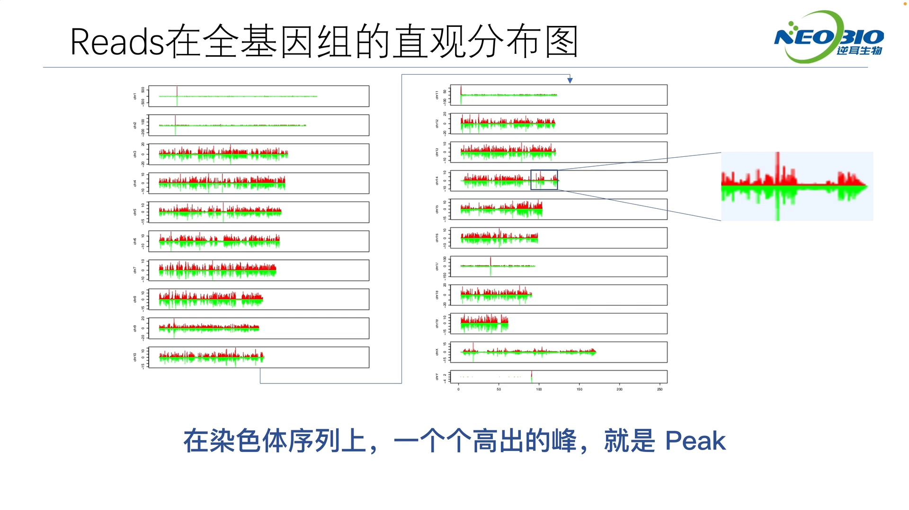
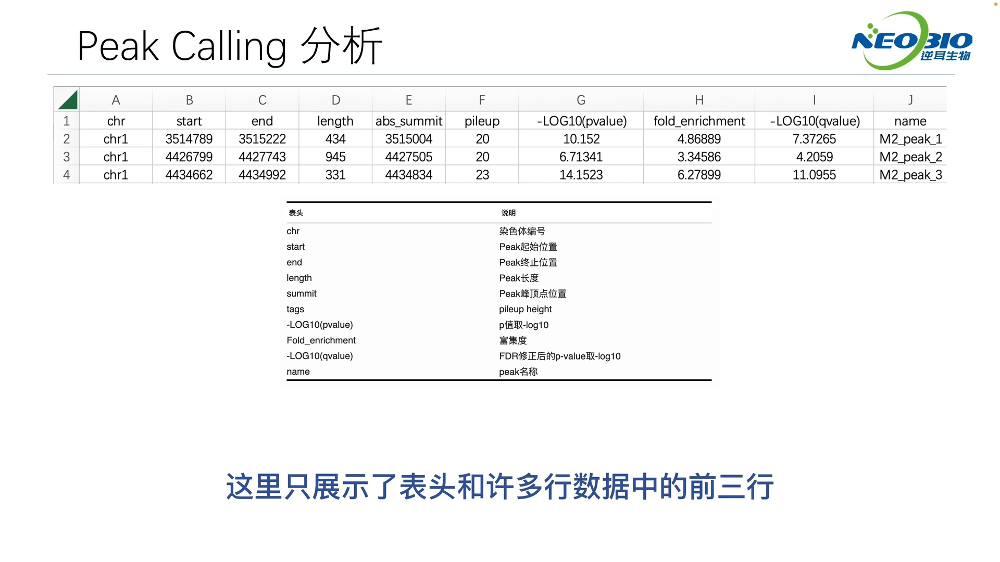
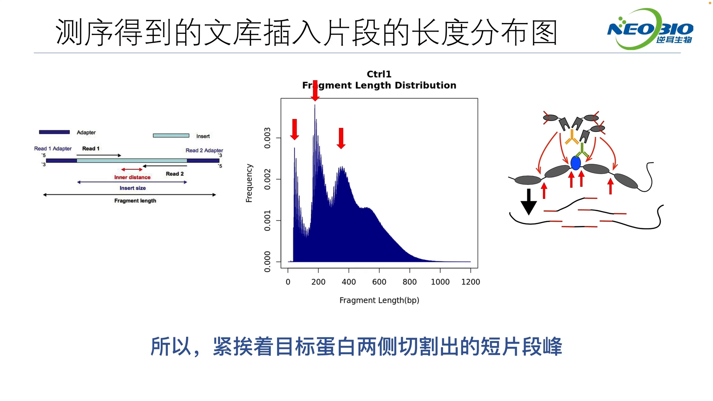
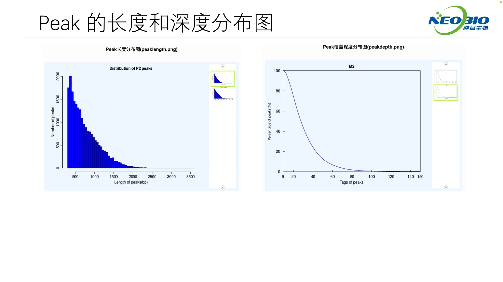
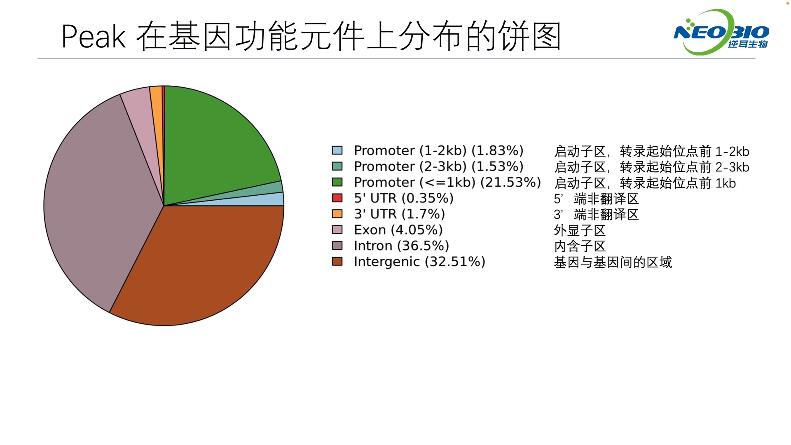
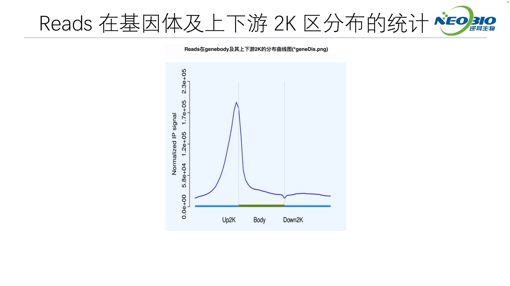
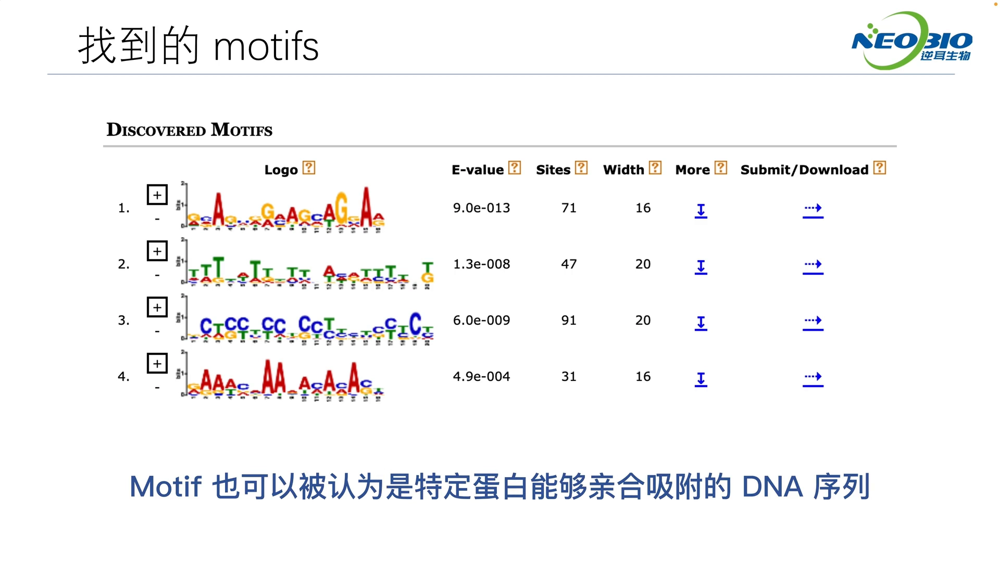
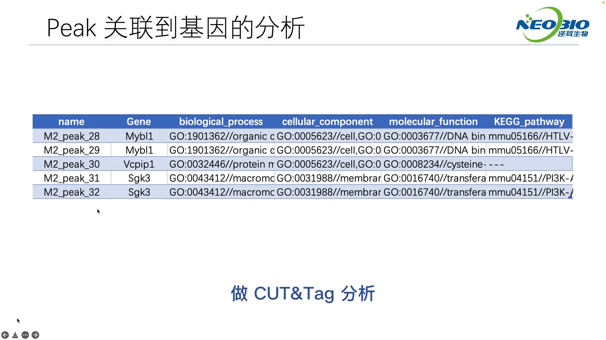
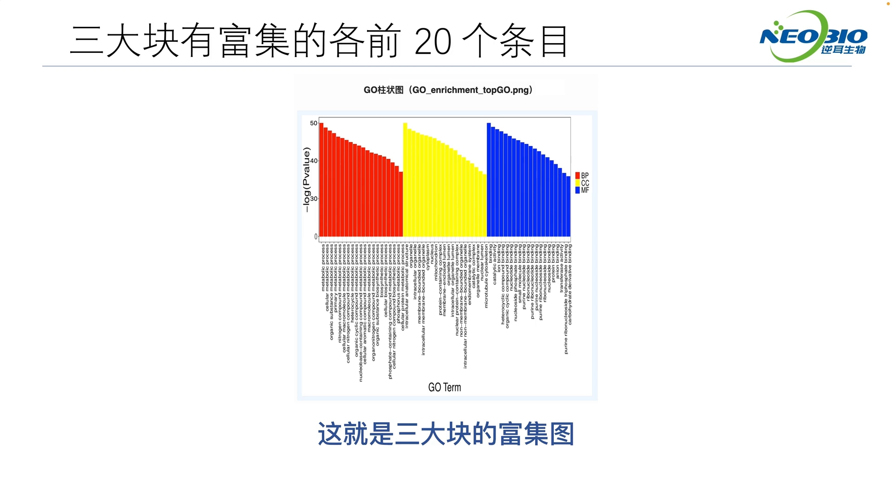
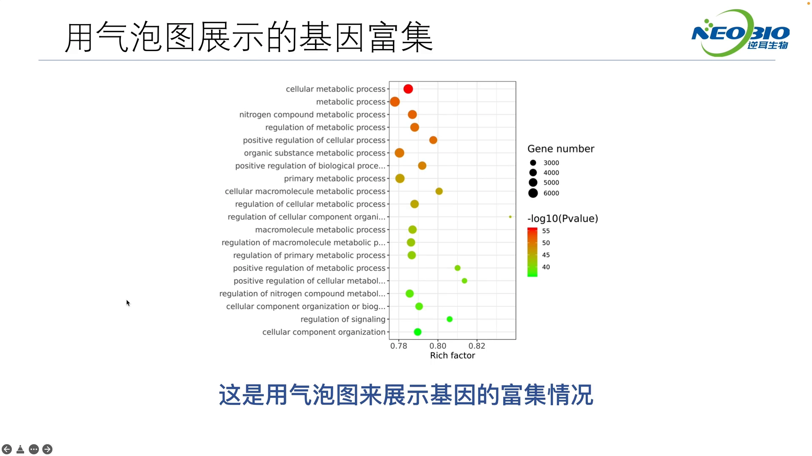

# CUT&Tag报告解读：峰高、峰长、峰位置与关联基因

> 视频来源：[【陈巍学基因】102：CUT&Tag 分析报告解读](https://www.bilibili.com/video/BV1B3411X7Pj/)（B 站 · 约 13 分钟）
> 简要导读：实验做完、数据跑完，报告里是一堆图和表。这支片子按「峰分析—motif 分析—峰关联基因分析」三段，逐张解释这些图表在说什么。本文保留原有顺序，把「怎么读一张峰表」和「峰关联到基因之后能说什么」讲得更细一些。

## 本讲要解决的核心问题（SCQA）

**背景**：CUT&Tag（以及 ChIP-seq）实验做完、生物信息学分析跑完，会得到一大堆图表：全基因组分布图、峰列表、插入片段长度分布、峰长分布、峰在功能元件上的分布、motif logo、GO/KEGG 富集图。

**冲突**：这些图看起来都很像「结果」，但它们回答的是不同层次的问题——有的在说「信号干不干净」，有的在说「峰在哪里」，有的在说「峰旁边是哪些基因」。混在一起看，很容易把「峰高」当成「调控强」，把「关联基因」当成「靶基因」。

**疑问**：一张峰表里哪几列是测量值、哪几列是统计量？峰的形状和位置能读出什么？从峰到基因再到功能，中间还差哪几步？

**回答（中心思想）**：报告可以按「峰本身 → 峰的序列特征 → 峰关联的基因」三层来读；每一层都只回答自己那一层的问题，跨层的结论（尤其是「调控了哪个基因」）需要额外证据。

## 一、峰分析：先把「信号长什么样」看清楚

### 1.1 全基因组分布图：峰就是高出来的那一段

第一张图是测序 reads 在全基因组的直观分布：纵轴从上到下是人的 23 条染色体，横轴是每条染色体的全部序列，染色体区域上一个个高出的峰就是 peak。[【跳转到 00:43】](https://www.bilibili.com/video/BV1B3411X7Pj/?t=43)

这张图的作用是**整体体检**：信号是均匀铺开还是集中在少数区域，有没有某条染色体异常偏高，一眼就能看出来。

### 1.2 峰高是什么：reads 堆起来的高度

讲者给峰高的定义很直接：峰就是覆盖在上面的测序 reads 堆叠起来的高度。一个位置的峰越高，说明富集在这个位置的 reads 数越多，也同时说明被检测的目标蛋白对染色体的这个位置有越强的吸附能力。[【跳转到 01:08】](https://www.bilibili.com/video/BV1B3411X7Pj/?t=68)

这里要留一个边界：**峰高是「被回收到的片段数」的代理**。它同时受三件事影响——目标在细胞群体里的真实丰度、抗体捕获的效率、以及测序深度。所以峰高适合在**同一方法、同一分析流程**内做相对比较；跨方法、跨实验室直接比峰高没有意义（这一点在 [CUT&Tag 原理一篇](CUT&Tag：抗体引导的pA-Tn5原位转座与低起始量测量.md) 的 H3K27me3 对比里可以看到：同一段染色质，三种方法的峰高差别很大）。

### 1.3 一张峰表里的十列

峰列表是后续所有分析的入口。讲者逐列解释了表头：[【跳转到 01:33】](https://www.bilibili.com/video/BV1B3411X7Pj/?t=93)

| 列 | 含义 | 属于哪一类 |
| --- | --- | --- |
| chr / start / end | 峰所在的染色体与起止坐标 | 位置 |
| length | 峰在染色体上的横向长度 | 位置（形状） |
| abs_summit | 峰尖对应的坐标 | 位置（形状） |
| pileup | 峰上堆叠的 reads 数形成的高度 | **测量值** |
| -log10(pvalue) | 峰的显著程度 | 统计量 |
| -log10(qvalue) | p 值经 FDR 修正后的显著程度 | 统计量 |
| fold_enrichment | 峰上 reads 数相对本底富集的倍数 | 相对量 |
| name | 软件给峰起的编号 | 标识 |

读这张表的关键是分清三类列：**位置**告诉你峰在哪、有多宽；**测量值**（pileup）告诉你堆了多少 reads；**统计量**（p/q 值、富集倍数）告诉你这个高度相对背景有多可信。三者不能互相替代——一个很宽的峰可能 pileup 不高，一个很窄的峰可能显著性很高。

### 1.4 插入片段长度：一条质量指纹

文库插入片段的长度分布图，是判断实验是否正常的第一道指纹。CUT&Tag 中用的 DNA 酶很容易切割裸露的 DNA，而不切割被核小体保护的 DNA，所以紧挨着目标蛋白两侧切割出的短片段，以及 180 bp、360 bp 这些核小体缠绕长度的整数倍片段会最多，堆起来就形成两到三个明显的峰。[【跳转到 02:19】](https://www.bilibili.com/video/BV1B3411X7Pj/?t=139)

### 1.5 峰长与峰深分布：形状也是信息

把峰按长度分成 50 个区间，得到峰长分布图；把峰按覆盖深度排序，得到「大于等于某深度的峰占全部峰的比例」曲线。[【跳转到 02:57】](https://www.bilibili.com/video/BV1B3411X7Pj/?t=177)

这两张图回答的是「这批峰是**窄而尖**还是**宽而长**」。这一点在判读时很关键：转录因子结合位点通常读成窄峰，而组蛋白修饰可以铺成较宽的区域；同一个实验里出现大量异常宽的峰，往往提示片段化或背景有问题。

### 1.6 峰在基因组上的位置：启动子、内含子还是基因间区

把峰对应到基因功能元件上，可以得到一张饼图：启动子（按距离转录起始位点 1 kb、1–2 kb、2–3 kb 分档）、5′ UTR、3′ UTR、外显子、内含子、基因间区。[【跳转到 03:19】](https://www.bilibili.com/video/BV1B3411X7Pj/?t=199)

这张图是**判读蛋白类型的第一条线索**：如果峰大量落在启动子区，说明这个蛋白主要在启动子附近发挥作用；如果峰主要落在基因间区，就要考虑增强子等远端元件，而不是急着把它和最近的基因绑在一起。

### 1.7 基因体与上下游的分布曲线

把 reads 在「基因上游 2 kb—基因体—下游 2 kb」上做统计，会得到一条分布曲线：中间高、两边低的峰形，说明信号集中在转录起始位置附近。[【跳转到 03:32】](https://www.bilibili.com/video/BV1B3411X7Pj/?t=212)

讲者强调这条曲线「基本上呈现一个峰的样子，中间高两边低，两边的坡呈一定程度的对称性」——对称性是判断数据质量的一个直观指标，明显偏斜往往提示链特异性或片段化的问题。

## 二、motif 分析：峰里的序列在说什么

### 2.1 motif 是「反复出现的 DNA 序列」

motif 原意是一段音乐里反复出现的旋律，或者图案里反复出现的样式；在蛋白与 DNA 结合的语境里，它指反复出现的 DNA 序列，也可以理解为特定蛋白能够亲和吸附的 DNA 序列。[【跳转到 03:57】](https://www.bilibili.com/video/BV1B3411X7Pj/?t=237)

读 motif logo 的三件事：字母高度代表该位置出现该碱基的概率；E-value 越小特征性越强；Sites 是这个 motif 出现在多少条序列里、Width 是它有多少个碱基宽。[【跳转到 04:22】](https://www.bilibili.com/video/BV1B3411X7Pj/?t=262)

### 2.2 motif 与已知数据库比对

找到的 motif 可以与 JASPAR 等转录因子数据库比对，看实验找到的 motif 是否与数据库里已知的 motif 相似。[【跳转到 05:12】](https://www.bilibili.com/video/BV1B3411X7Pj/?t=312)

这一步的意义在于**给峰一个序列层面的解释**：如果峰里富集的 motif 正好是你研究的转录因子家族的 motif，说明数据内部自洽；如果富集的是别的因子的 motif，就要考虑抗体特异性或间接结合的问题。但 motif 相似只是序列层面的证据，不等于该蛋白真的结合在那里——motif 命中、真实结合与功能调控三者的区分属 [B02 §3.1.3](../../../../B02_基因组与基因调控基础/README.md#b02-3-1-3)（当前 WAITING）。

## 三、峰关联基因：从位置走到基因

### 3.1 最近基因表

峰关联基因分析的第一步，是给每个峰找「最近的基因」：表里第一列是峰编号，第二列是这个峰所靠近的基因名，后面几列是这个基因在 GO 和 KEGG 数据库中的条目。[【跳转到 05:54】](https://www.bilibili.com/video/BV1B3411X7Pj/?t=354)

这里必须说清楚：**「最近基因」是一个注释约定，不是调控结论**。一个峰落在两个基因之间时，按距离取最近的那个只是默认规则；真实的调控对象可能更远，也可能根本不在附近。峰与靶基因的对应关系、增强子—启动子关联的验证属 [B02 §3.2.2](../../../../B02_基因组与基因调控基础/README.md#b02-3-2-2)（当前 WAITING）。

### 3.2 GO 与 KEGG：把基因列表变成功能主题

拿到一批关联基因之后，常用的做法是看它们是否集中在某些功能条目上。讲者用「圣诞树挂礼物」的比喻解释 GO 富集：GO 数据库是一棵巨大的树，每个节点是一个条目（比如生物过程的「有机物代谢」、细胞组分的「细胞膜系统」），把峰邻近的基因挂到对应条目上，最后看哪些树枝上挂得最多、最显著。[【跳转到 08:16】](https://www.bilibili.com/video/BV1B3411X7Pj/?t=496)

GO 分三大块：[【跳转到 06:56】](https://www.bilibili.com/video/BV1B3411X7Pj/?t=416)

- **细胞组分（CC）**：这个基因的产物定位在细胞的哪里；
- **分子功能（MF）**：这个产物有什么功能，比如是不是一个有催化功能的酶；
- **生物过程（BP）**：这个产物参与生命的哪个过程。

用大白话说就是：你待在什么地方、你具体做什么事、你完成什么样的任务。

富集结果通常有三种画法：柱状图（每块富集程度最高的 20 个条目，柱子高低是显著程度）、气泡图（横轴 rich factor，气泡大小是基因数、颜色是显著性）、以及树状图或有向无环图（展示条目之间的从属与调控关系）。[【跳转到 09:05】](https://www.bilibili.com/video/BV1B3411X7Pj/?t=545)

KEGG 是通路数据库，做法与 GO 类似：把峰附近的基因比对到 KEGG 通路上，得到通路富集的柱状图、气泡图和网络图。[【跳转到 11:22】](https://www.bilibili.com/video/BV1B3411X7Pj/?t=682)

### 3.3 富集结果能说什么

讲者对这批图的定位很克制：这些富集程度最高的条目「给出了值得科学家做进一步研究的方向」。[【跳转到 09:30】](https://www.bilibili.com/video/BV1B3411X7Pj/?t=570)

这句话值得原样记住。GO/KEGG 富集回答的是「这批关联基因在功能注释上偏向什么主题」，它既不是「这个蛋白调控了这些通路」的证据，也不是因果结论。从峰到功能，还差表达变化、扰动实验等独立证据——这一点在 [ChIP-seq 一篇](ChIP-seq：交联、抗体富集与input对照下的结合位点定位.md) 里被总结为「关联 ≠ 调控」。

## 四、三层读法合起来

把报告的三部分放在一条链上：

1. **峰本身**：位置、长度、pileup 高度、显著性——回答「信号在哪、有多强、可不可信」；
2. **峰的序列**：motif 与数据库比对——回答「这段序列像谁的结合位点」；
3. **峰关联的基因**：最近基因、GO/KEGG 富集——回答「这些位置旁边是哪些基因、偏什么功能」。

每一层都只提供自己那一层的证据。把三层叠起来可以形成一条**候选线索**（这个蛋白可能通过这些位点影响这类基因），但要变成结论，还需要表达测量或扰动实验。

## 小结

- 峰高 = 该位置堆叠的 reads 数，是「回收片段数」的代理；它受丰度、抗体效率和测序深度共同影响，不适合跨方法比较。
- 峰表要分三类列来读：位置（chr/start/end/length/summit）、测量值（pileup）、统计量（p/q 值、fold enrichment）。
- 插入片段长度分布是质量指纹：短片段与 180/360 bp 的周期性来自核小体保护。
- 峰长、峰深、峰在功能元件上的分布、基因体上下游曲线，共同说明「信号是窄是宽、落在启动子还是基因间区」。
- motif 是序列层面的解释，与数据库比对可以佐证，但命中不等于真实结合。
- 「最近基因」是注释约定；GO/KEGG 富集给出的是研究方向，不是调控结论。

## 关键术语速查

| 术语 | 一句话解释 |
| --- | --- |
| peak（峰） | reads 在基因组某区域堆叠形成的富集信号。 |
| pileup | 峰上堆叠的 reads 数，即峰高。 |
| summit | 峰尖所在的坐标。 |
| fold enrichment | 峰上 reads 相对本底的富集倍数。 |
| q value | p 值经 FDR 多重检验校正后的值。 |
| motif | 反复出现、可被特定蛋白亲和吸附的 DNA 序列模式。 |
| rich factor | 富集到某条目的基因数占该条目全部注释基因数的比例。 |
| GO / KEGG | 基因功能注释数据库 / 生物学通路数据库。 |