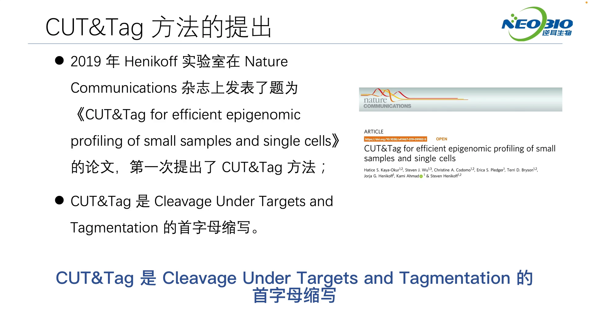
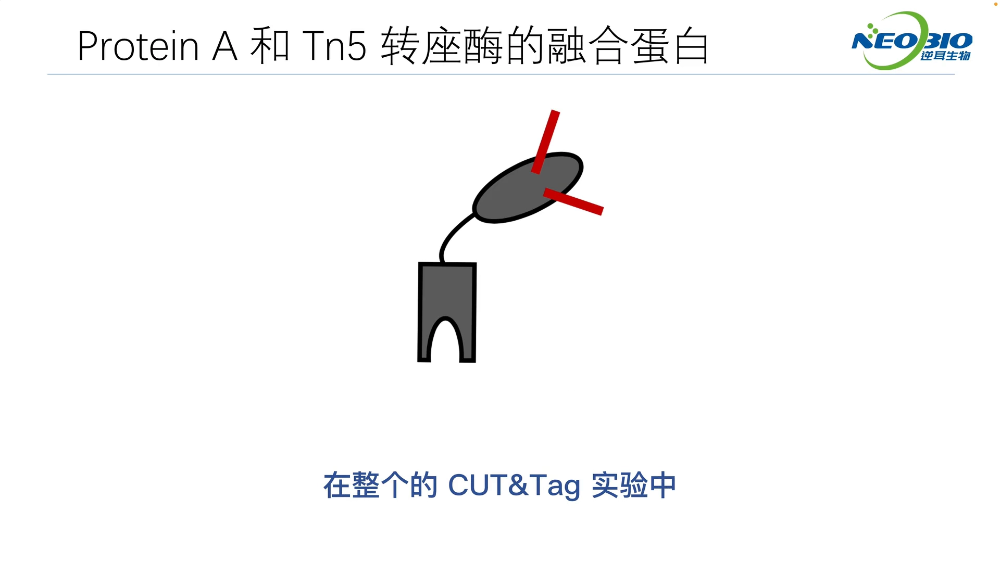
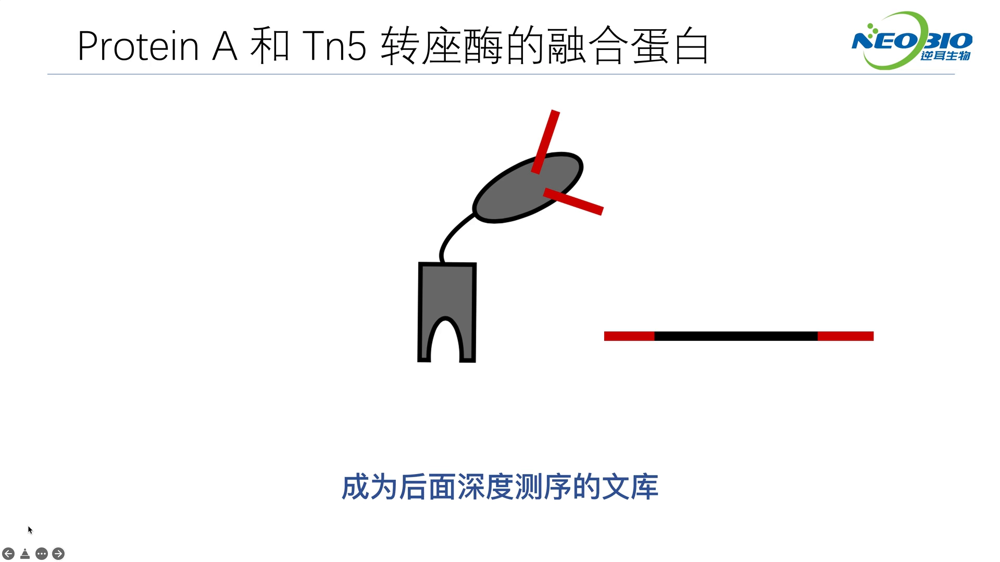
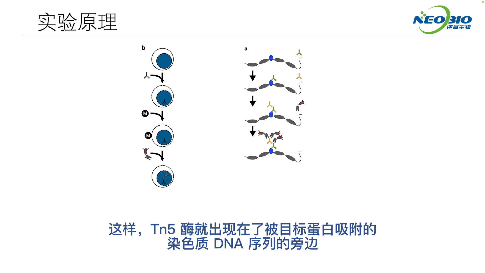
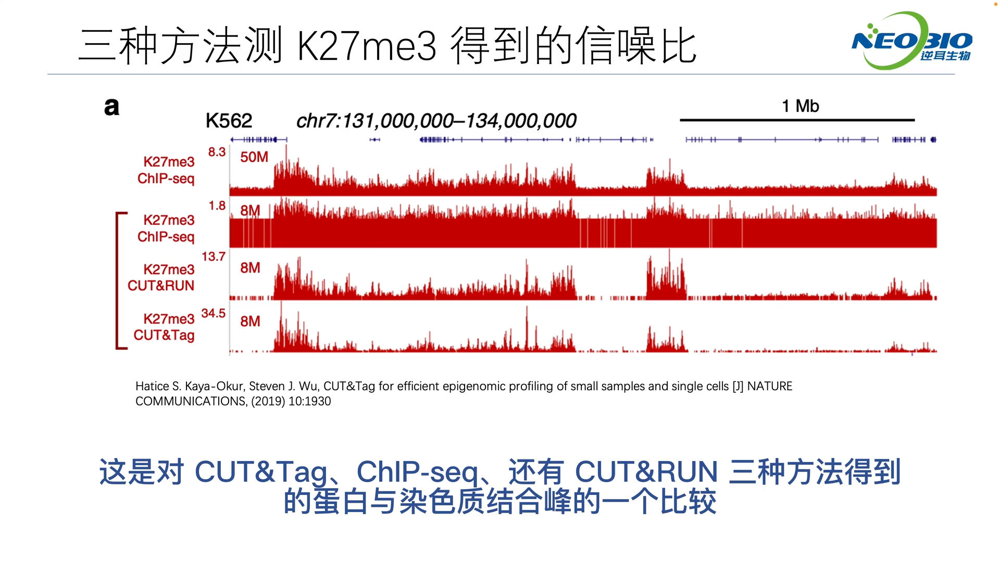
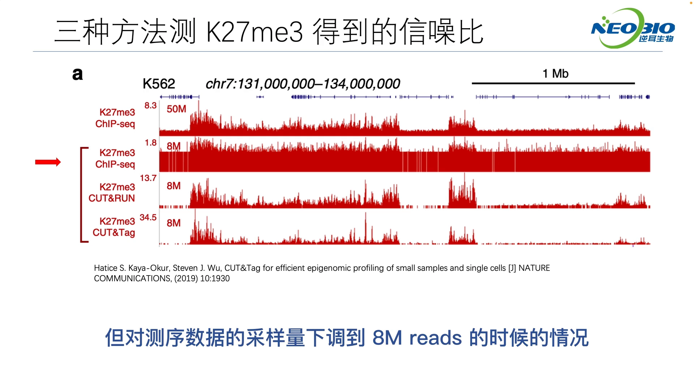
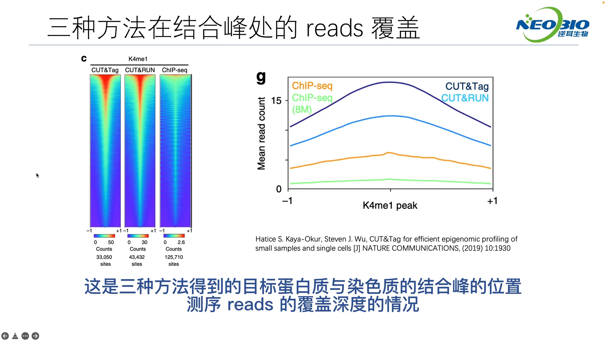
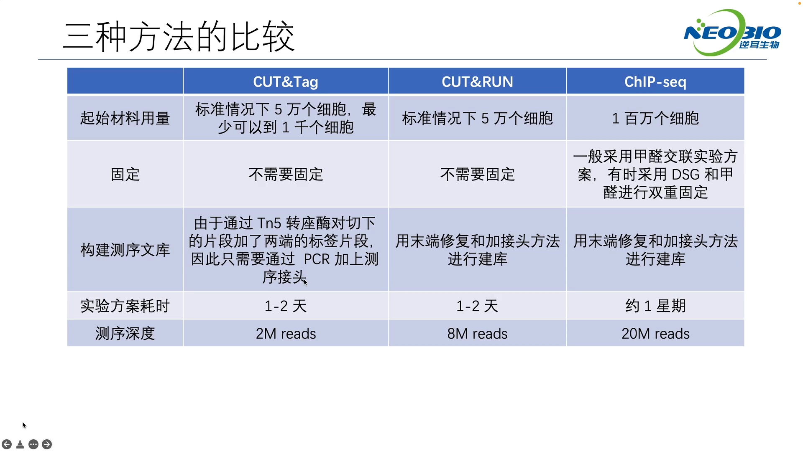

# CUT&Tag：抗体引导的pA-Tn5原位转座与低起始量测量

> 视频来源：[【陈巍学基因】101：研究蛋白质与DNA相互作用的新技术——CUT&Tag](https://www.bilibili.com/video/BV1T14y1M73r/)（B 站 · 约 8 分钟）
> 简要导读：一支系统讲 CUT&Tag 概念的短片，按「概念—实验原理—实验效果—与 ChIP-seq/CUT&RUN 比较」四段展开。本文保留原有顺序，把「为什么信噪比高、为什么起始量低」这两条因果链单独拎出来讲清楚。

## 本讲要解决的核心问题（SCQA）

**背景**：ChIP-seq 已经能把蛋白关联的 DNA 找出来，但它的做法是「先把染色质打碎，再用抗体从碎片堆里捞」。

**冲突**：打碎之后，目标蛋白身边的 DNA 只占全管碎片的一小部分，捞的时候会带出大量无关片段，背景高；而且整个流程需要较多细胞、较长时间。片段越碎、细胞越少，背景问题越突出。

**疑问**：能不能不把染色质先打碎，而是让「切割」和「标记」只发生在抗体指定的位置？

**回答（中心思想）**：CUT&Tag 把 Tn5 转座酶用抗体「牵」到目标蛋白旁边，让它在原位切割并同时加上接头，于是只有目标附近的 DNA 被切下来、被标记、被扩增；因此背景低、起始量小、测序深度需求也低。

## 一、CUT&Tag 是什么

### 1.1 名字就是机制

CUT&Tag 是 **C**leavage **U**nder **T**argets and **T**agmentation 的首字母缩写，直译是「在目标之下的切割与标记」。这个方法由 Henikoff 实验室于 2019 年在 Nature Communications 上发表，论文标题是《CUT&Tag for efficient epigenomic profiling of small samples and single cells》。[【跳转到 00:25】](https://www.bilibili.com/video/BV1T14y1M73r/?t=25)

### 1.2 三个核心技术点

讲者把方法的核心概括成三步：[【跳转到 00:50】](https://www.bilibili.com/video/BV1T14y1M73r/?t=50)

1. 利用**抗体**把目标蛋白和基因工程改造过的 **Tn5 转座酶**吸附在一起；
2. 利用 Tn5 的转座功能，对目标蛋白吸附区**附近**的 DNA 进行切断；
3. 在切下的片段两端**加上标签序列**，然后构建成深度测序文库。

第 3 点是它和 ChIP-seq 最大的操作差异：ChIP-seq 回收 DNA 之后还要做末端修复、加接头才能建库；CUT&Tag 的片段被切下来时就已经带了标签，后面只需要 PCR 加上测序接头。[【跳转到 03:59】](https://www.bilibili.com/video/BV1T14y1M73r/?t=239)

## 二、实验原理：一条「抗体—Protein A—Tn5」的链条

### 2.1 融合蛋白是实验的核心

整个实验的核心，是用基因工程方法做出来的**融合蛋白**：它同时具备 Protein A 和 Tn5 转座酶两种蛋白质的功能。[【跳转到 01:24】](https://www.bilibili.com/video/BV1T14y1M73r/?t=84)

- **Protein A 的部分**负责和实验中的一抗或二抗结合，也就是负责把 Tn5 酶「拉」到目标蛋白质所吸附的染色质 DNA 位置附近；
- **Tn5 酶的部分**执行转座酶的功能，切断附近的 DNA 链。

并且这个 Tn5 酶事先已经结合好了**标签 DNA 序列**，所以被它切断的染色质 DNA 片段会自动被加上标签。[【跳转到 01:24】](https://www.bilibili.com/video/BV1T14y1M73r/?t=84)

### 2.2 实验步骤：透化、加抗体、加融合蛋白、加 Mg 离子

讲者按操作顺序把原理讲了一遍：[【跳转到 02:14】](https://www.bilibili.com/video/BV1T14y1M73r/?t=134)

1. **透化**细胞膜和核膜，产生小洞，让后面要用的酶和抗体能进入细胞核；
2. 加入针对目标蛋白的**一抗**，它进入细胞核并结合到目标蛋白上；
3. 加入**二抗**，结合到一抗上，目的是放大信号；
4. 加入 **Protein A 与 Tn5 的融合蛋白**，其中 Protein A 结合到抗体上（包括一抗和二抗）。

这样形成一条链：目标蛋白自己结合在它识别的染色质 DNA 序列上，抗体结合到目标蛋白，Protein A 结合到抗体，Protein A 又连着 Tn5 酶——于是 Tn5 酶就出现在了目标蛋白旁边的 DNA 序列旁。[【跳转到 02:39】](https://www.bilibili.com/video/BV1T14y1M73r/?t=159)

5. 加入 **Mg 离子**激活 Tn5 的酶活性，Tn5 切断 DNA 链，并在断口两端加上标签序列；
6. 抽提核酸，对带标签的片段做 **PCR 扩增**并加上测序接头，上机测序。[【跳转到 03:04】](https://www.bilibili.com/video/BV1T14y1M73r/?t=184)

### 2.3 一个操作细节：用刀豆蛋白 A 磁珠粘住细胞

实验中在加入一抗后，还会加入**刀豆蛋白 A（Concanavalin A）包被的磁珠**来粘住细胞。刀豆蛋白 A 是一种凝集素，可以粘住细胞。之所以要用它，是因为整个实验要做多步孵育和清洗，用磁珠吸附细胞可以让回收细胞的操作变得方便。[【跳转到 03:29】](https://www.bilibili.com/video/BV1T14y1M73r/?t=209)

这个细节说明了 CUT&Tag 的一个重要特点：**它是在完整的细胞核里做反应，靠反复换液和洗涤推进**，而不是把染色质打碎后在一管液体里捞。这也是它能做到低起始量的前提之一。

## 三、实验效果：同一段染色体上的三种方法

### 3.1 峰的位置一致，背景差别很大

讲者用第 7 号染色体上一段 3M 碱基长的片段做对比，四行分别是：[【跳转到 04:09】](https://www.bilibili.com/video/BV1T14y1M73r/?t=249)

- ChIP-seq，测序深度 50M reads；
- ChIP-seq，采样量下调到 8M reads；
- CUT&RUN，8M reads；
- CUT&Tag，8M reads。

横轴是把这 3M 的染色体横向展开，每张图中峰的高低就是覆盖在该位置的 reads 数量：一个位置覆盖的 reads 越多，峰越高；峰所在的位置就是目标蛋白所吸附的染色质位置。[【跳转到 04:34】](https://www.bilibili.com/video/BV1T14y1M73r/?t=274)

结论有两条：[【跳转到 04:59】](https://www.bilibili.com/video/BV1T14y1M73r/?t=299)

1. **位置一致**：三种方法测到的蛋白吸附位置高度一致；
2. **信噪比不同**：8M reads 时 ChIP-seq 背景很高，要把深度提到 50M reads 信号才比较明显；而 CUT&Tag 在 8M reads 时背景已经很低。

### 3.2 用组蛋白修饰 H3K27me3 看同一件事

同一组对比在原文里用的是组蛋白修饰 **H3K27me3**：即使只看 8M reads，CUT&Tag 的峰也明显比 ChIP-seq 干净，覆盖深度也高于 CUT&RUN。[【跳转到 05:24】](https://www.bilibili.com/video/BV1T14y1M73r/?t=324)

这张图对判读很重要：它说明**同一种组蛋白修饰**用不同方法测，峰的位置可以一致，但背景和动态范围不同。换句话说，「峰高」这个数字是方法相关的，跨方法直接比较峰高没有意义；能比较的是同一方法、同一分析流程下的相对变化。

### 3.3 峰的覆盖深度统计

把单个峰罗列出来、按覆盖深度从深到浅排列（颜色越红表示越深），可以看到 CUT&Tag 和 CUT&RUN 的峰覆盖深度比 ChIP-seq 更深；右侧的统计比较则显示 CUT&Tag 的覆盖深度高于 CUT&RUN，并明显高于 ChIP-seq。[【跳转到 05:31】](https://www.bilibili.com/video/BV1T14y1M73r/?t=331)

## 四、与 ChIP-seq、CUT&RUN 的比较

### 4.1 五个维度的对照表

讲者给出了一张三方法比较表，覆盖起始材料、固定、建库、耗时、测序深度五个维度：[【跳转到 06:14】](https://www.bilibili.com/video/BV1T14y1M73r/?t=374)

| 维度 | CUT&Tag | CUT&RUN | ChIP-seq |
| --- | --- | --- | --- |
| 起始材料 | 标准 5 万细胞，最少可到 1 千个 | 标准 5 万细胞 | 100 万细胞 |
| 固定 | 不需要 | 不需要 | 一般用甲醛交联，有时用 DSG 和甲醛双重固定 |
| 建库 | Tn5 已加标签，只需 PCR 加测序接头 | 末端修复加接头 | 末端修复加接头 |
| 耗时 | 1–2 天 | 1–2 天 | 约 1 星期 |
| 测序深度 | 2M reads | 8M reads | 20M reads |

### 4.2 为什么起始量能低两个数量级

把表里的几行连起来看，因果链是清楚的：

- **不需要交联**：ChIP-seq 一定要用甲醛之类的试剂固定，CUT&Tag 不需要；[【跳转到 06:14】](https://www.bilibili.com/video/BV1T14y1M73r/?t=374)
- **不需要先打碎再捞**：切割发生在抗体指定的位置，无关 DNA 基本不会被切下来，所以背景低；
- **切割即建库**：Tn5 切下片段时已经加了两端标签，只需 PCR 加接头，容易从极微量的 DNA 片段中得到足够的文库；而另外两种方法都要做末端修复和加接头，操作更麻烦、效率也更低。[【跳转到 06:39】](https://www.bilibili.com/video/BV1T14y1M73r/?t=399)

背景低 + 建库效率高，合起来就是「起始细胞少、测序深度低」这两个结果。

### 4.3 讲者的小结

CUT&Tag 的优点被归纳为三条：[【跳转到 07:19】](https://www.bilibili.com/video/BV1T14y1M73r/?t=439)

1. 所需样本细胞数量少，可适用于微量样本，几千个细胞就可以做；
2. 实验操作方便，从 ChIP-seq 的一星期缩短到 1、2 天；
3. 数据信噪比高，2M 测序 reads 就可以做后续分析，比 ChIP-seq 的 20M reads 节约大量数据量。

## 小结

- CUT&Tag = Cleavage Under Targets and Tagmentation：在抗体指定的位置切割并加标签。
- 机制核心是 **Protein A–Tn5 融合蛋白**：Protein A 认抗体，Tn5 负责切 DNA 并加标签，Mg 离子激活酶活。
- 与 ChIP-seq 的根本差异在于**顺序**：ChIP-seq 先打碎再捞，CUT&Tag 先定位再切；因此背景低、起始量小、建库简单。
- 三种方法峰的位置高度一致，差别主要在**背景和覆盖深度**；峰高是方法相关的量，不能跨方法直接比。
- 低起始量与低测序深度是「背景低 + 切割即建库」的结果，不是单独的优化技巧。

## 关键术语速查

| 术语 | 一句话解释 |
| --- | --- |
| CUT&Tag | 抗体引导 Tn5 在目标蛋白旁原位切割并加标签的测序方法。 |
| Tn5 转座酶 | 能切断 DNA 并在断口两端接上标签序列的酶。 |
| Protein A | 能结合抗体 Fc 段的蛋白，在这里负责把 Tn5 拉到抗体旁边。 |
| 融合蛋白 | 把 Protein A 与 Tn5 做在一条肽链上，使「认抗体」和「切 DNA」成为一件事。 |
| 透化 | 让细胞膜和核膜产生小洞，使抗体和酶能进入细胞核。 |
| 刀豆蛋白 A 磁珠 | 凝集素包被的磁珠，用来粘住细胞，方便多步孵育和换液。 |
| 信噪比 | 目标位置的信号与背景之比；CUT&Tag 的主要优势就在这里。 |