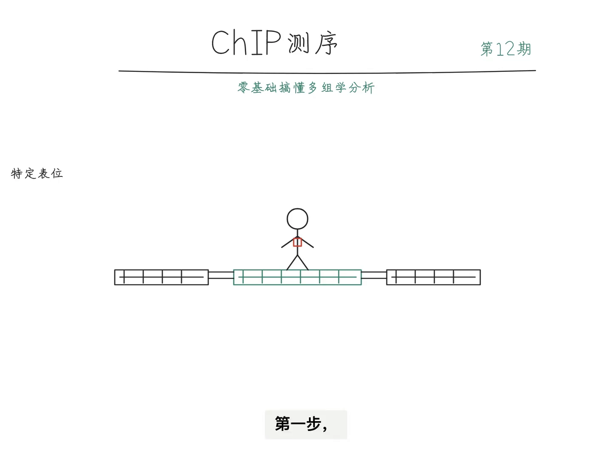
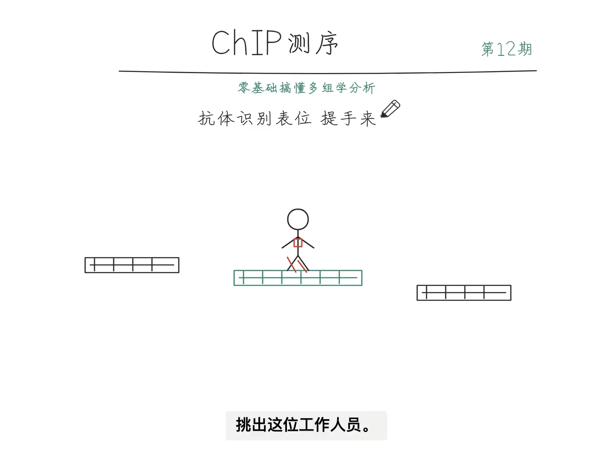
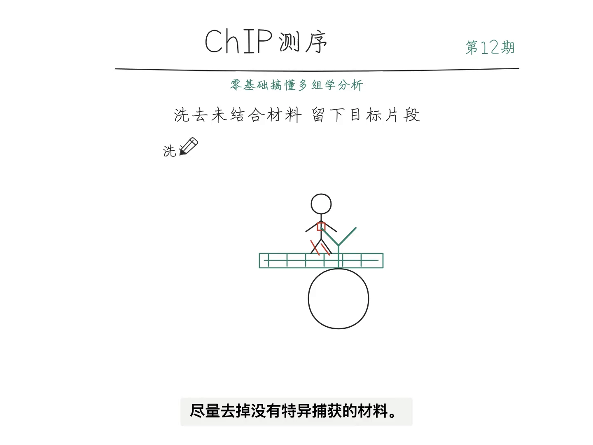
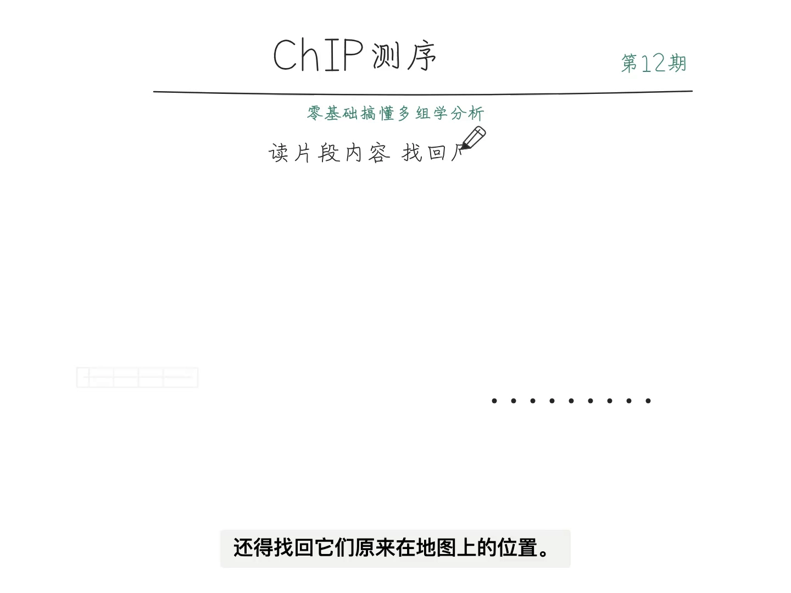
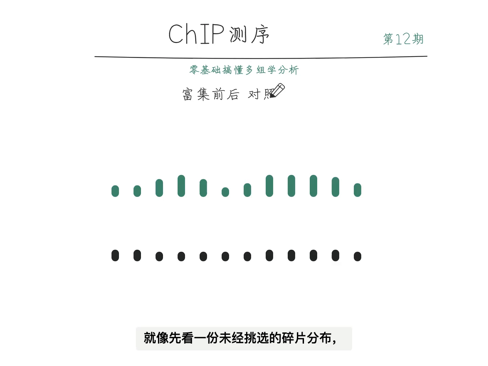
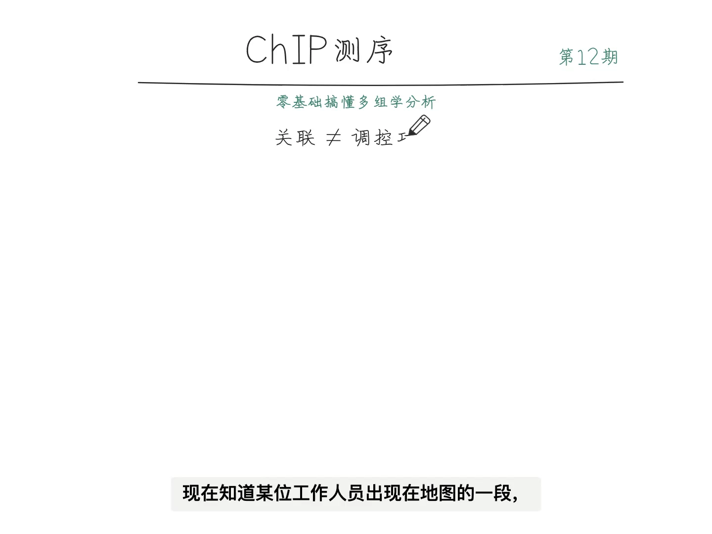

# ChIP-seq：交联、抗体富集与input对照下的结合位点定位

> 视频来源：[ChIP 测序（零基础搞懂多组学分析 第12期）](https://www.bilibili.com/video/BV1jws26REdf/)（B 站 · 约 3 分 20 秒）
> 简要导读：一支用「地图与工作人员」比喻把 ChIP-seq 全流程串起来的短片：交联、打断、抗体富集、input 对照、比对堆峰，以及「关联不等于调控」这条判读底线。本文按实验步骤重排讲解顺序，术语按初学者需要补齐。

## 本讲要解决的核心问题（SCQA）

**背景**：我们常常只知道一个蛋白的名字，想知道它在基因组的哪些位置出现、旁边是哪些基因。

**冲突**：蛋白和 DNA 的结合看不见、摸不着。就算把染色质打断成碎片，目标蛋白和它旁边那段 DNA 仍然连在一起，但它们混在整管碎片里，和成千上万段无关的 DNA 混在一起。

**疑问**：怎么把「这个蛋白待过的地方」从全基因组的碎片堆里挑出来，并且变成可以互相比较的信号？

**回答（中心思想）**：ChIP-seq 用「交联定格现场 → 打断成小片段 → 抗体把目标连同身边的 DNA 一起捞出来 → 回收 DNA 测序 → 比对回基因组堆成峰」这条链，把蛋白的关联位置变成 reads 的富集；但峰只是「关联」的代理，要靠 input 对照扣掉背景，靠表达和扰动证据才能谈功能。

## 一、交联：把「此刻的接触」定格成稳定的连接

### 1.1 交联固定的是「关联」，不是「直接接触」

ChIP-seq 的第一步是**交联**（crosslinking）：用化学方法把蛋白与周围染色质的关联固定下来，让「谁和谁挨在一起」这件事在后续操作中不再散开。[【跳转到 00:00】](https://www.bilibili.com/video/BV1jws26REdf/?t=0)

这里有一个容易被忽略的细节：交联抓到的是**邻近关系**。讲者提醒，交联也可能把旁边的伙伴一起连住，所以「抓到关联」还不等于证明「直接接触」。[【跳转到 00:25】](https://www.bilibili.com/video/BV1jws26REdf/?t=25) 这条限制在后面判读峰时会再出现一次：一个蛋白出现在某段 DNA 上，说明它当时在那一片区域，但不自动说明它是直接结合在该序列上的。

### 1.2 打断：把长地图切成小片段

交联之后要把染色质打断成小片段。比喻里是「把长地图打成小片段」，此时原来站在工作人员旁边的那张纸条仍然和他连在一起。[【跳转到 00:25】](https://www.bilibili.com/video/BV1jws26REdf/?t=25)

打断这一步决定了后面信号的分辨率：片段越短，峰的位置越精确；片段太长，峰会被「糊」成一大片。不同方法打断方式不同（超声、酶切等），这一点在 [CUT&Tag 一篇](CUT&Tag：抗体引导的pA-Tn5原位转座与低起始量测量.md) 里会和「原位转座」形成对照。

## 二、抗体与磁珠：从碎片堆里挑出目标

### 2.1 抗体是「只认一个徽章的夹子」

要从一堆碎片里挑出目标蛋白，靠的是**抗体**：它识别目标蛋白的表位，或者识别某种特定的组蛋白修饰。[【跳转到 00:50】](https://www.bilibili.com/video/BV1jws26REdf/?t=50)

这句话包含两个层次，正好对应 ChIP-seq 的两大类用途：

- 抗体认的是**某个蛋白**（例如某个转录因子）→ 测到的是这个蛋白的结合位点；
- 抗体认的是**某种组蛋白修饰**（例如某个位点上的甲基化或乙酰化）→ 测到的是带这种修饰的染色质区域。

### 2.2 洗涤：信噪比是在这一步决定的

抗体抓住目标之后，还要给夹子装上「磁性提手」（磁珠），把整组东西收起来；提起来以后冲掉没被夹住的散纸条，对应到实验就是**洗涤**——尽量去掉没有被特异性捕获的材料。[【跳转到 00:50】](https://www.bilibili.com/video/BV1jws26REdf/?t=50)

洗涤不彻底，背景就高；洗涤过头，目标也会被冲掉。所以「抗体好不好用」和「洗得够不够」共同决定最终数据里信号与背景的比例。

### 2.3 解交联、回收 DNA、建库测序

接下来松开固定连接，移走蛋白、抗体和磁珠，只留下跟着带出来的 DNA，这一步叫**解交联、去蛋白和回收 DNA**；然后给 DNA 加测序接头、扩增建库，再上机测序。[【跳转到 01:15】](https://www.bilibili.com/video/BV1jws26REdf/?t=75)

注意最后读到的是 **DNA 序列**，不是蛋白的名字。蛋白的身份信息在抗体那一步就已经「用掉」了：我们知道自己用了什么抗体，所以知道捞上来的 DNA 应该和谁有关。

## 三、比对回基因组：峰是怎么来的

### 3.1 从纸条内容找回地图上的位置

拿到测序读段后，要把每一条读段比对回参考基因组，相当于「读出纸条的内容，再和完整地图逐段对照」。[【跳转到 01:15】](https://www.bilibili.com/video/BV1jws26REdf/?t=75)

单条读段落在哪里说明不了太多问题；但当许多细胞里回收的片段都落在相近区域时，这个位置的读段就会堆起来，形成一个**富集信号**，也就是我们说的**峰（peak）**。[【跳转到 01:40】](https://www.bilibili.com/video/BV1jws26REdf/?t=100)

这里已经埋下本节最重要的一条判读前提：峰是**群体**信号。它来自许多细胞、许多片段的叠加，所以峰高反映的是「这个区域被回收到的片段有多少」，而不是「某一个细胞里这个蛋白抓得多紧」。

### 3.2 input 对照：判断「这里本来是不是就容易堆高」

峰高并不自动等于「这里真的有蛋白」。讲者给了一个很实在的反例：纸条堆得高，也可能是这个区域本来就容易被回收到。[【跳转到 01:40】](https://www.bilibili.com/video/BV1jws26REdf/?t=100)

所以还需要一份**没有经过抗体挑选**的对照，常用的就是 **input**：它相当于先看一份「未经挑选的碎片分布」，用来判断哪里原本就容易堆得高。如果挑选后的样本和 input 在某个区域都高，就要考虑这是背景而不是富集；软件要结合对照和统计方法，才能识别出候选富集区域。[【跳转到 02:05】](https://www.bilibili.com/video/BV1jws26REdf/?t=125)

用一句话概括 input 的作用：**它不告诉你蛋白在哪，它告诉你「如果没有抗体，这里会长什么样」**。峰的意义是在和 input 的比较中产生的，不是从峰高本身读出来的。

### 3.3 峰的形状：不同蛋白、不同修饰长得不一样

讲者还提到一个常被忽略的现象：**有的信号像一个集中的路标，有的铺成一段长区域**，不同蛋白和组蛋白修饰的信号形状可能不同。[【跳转到 02:05】](https://www.bilibili.com/video/BV1jws26REdf/?t=125)

这条观察对读图很重要：看到一段又宽又长的信号，不能按「一个转录因子结合在一个位点」的方式去理解；反过来，看到一根很尖的峰，也不该期待它覆盖整段基因。峰的形状是**测量对象**留下的痕迹，不是可以忽略的作图细节。组蛋白修饰与转录因子占据在读法上的差别，见本文第四节与导读中的说明。

## 四、峰能说什么、不能说什么

### 4.1 关联 ≠ 调控

知道某个蛋白出现在某段 DNA 上，能不能直接说它一定调控了旁边那条基因？讲者的回答是：**还不能**。ChIP-seq 给的是「富集和关联线索」，要把它和基因表达变化、调控功能连起来，还需要其他证据。[【跳转到 02:30】](https://www.bilibili.com/video/BV1jws26REdf/?t=150)

这条限制可以拆成三层，读任何 ChIP-seq 结果时都值得逐层检查：

1. **位置层**：峰是否真的高于 input 背景，而不是测序偏好或开放染色质造成的假信号；
2. **身份层**：抗体认的是不是你以为的那个蛋白或那种修饰（夹子认错人，后面全错）；
3. **功能层**：这个位点是否真的影响旁边基因的表达——这需要表达测量或扰动实验，而不是峰本身。

### 4.2 三项必查：抗体、对照、重复

讲者把风险点收成三条：夹子认错人、背景太多、重复实验对不上，结论都会受影响，所以**抗体、对照和生物学重复都要检查**。[【跳转到 02:30】](https://www.bilibili.com/video/BV1jws26REdf/?t=150)

这三项其实对应三种不同的失败模式：抗体不特异会让峰指向错误的蛋白；缺对照会把背景当成信号；缺重复则无法区分「真实的生物学差异」和「这一次实验的偶然波动」。

## 五、把流程串起来

用讲者的比喻再走一遍：定格现场（交联）、打断地图（片段化）、夹住目标（抗体）、带走纸条（磁珠富集与洗涤）、再把内容定位回原处（比对与堆峰）。换回真实实验就是：**交联 → 打断染色质 → 抗体富集 → 回收 DNA 和测序 → 定位**。[【跳转到 02:55】](https://www.bilibili.com/video/BV1jws26REdf/?t=175)

记住一句话：ChIP-seq 帮你找到的是**目标蛋白关联的 DNA 富集区域**；找到关联是机制研究的线索，后面还得验证。[【跳转到 02:55】](https://www.bilibili.com/video/BV1jws26REdf/?t=175)

## 小结

- ChIP-seq 把「蛋白在基因组哪里出现过」变成可测的 DNA 片段：交联定格关联 → 打断 → 抗体富集 → 洗涤 → 解交联回收 DNA → 建库测序 → 比对堆峰。
- 交联抓到的是邻近关系，**关联不等于直接接触**。
- 峰是群体叠加出来的读段富集，**峰高是回收片段数的代理**，不是单细胞里的结合强度。
- **input 对照**回答的是「没有抗体时这里会长什么样」，峰的意义来自与对照的比较。
- 峰的形状因蛋白和修饰而异：有的像集中路标，有的铺成一段长区域。
- **关联不等于调控**：要谈功能，需要表达变化或扰动证据；抗体、对照、生物学重复是三项必查。

## 关键术语速查

| 术语 | 一句话解释 |
| --- | --- |
| ChIP-seq | 染色质免疫沉淀测序：用抗体富集「蛋白 + 它身边的 DNA」，再测序定位。 |
| 交联（crosslinking） | 用化学方法把蛋白与周围染色质的关联固定下来，防止后续操作中散开。 |
| 片段化 | 把染色质打断成小片段，决定后续峰的位置分辨率。 |
| input | 不经抗体挑选的对照样本，用来判断哪些区域本来就容易堆高。 |
| 峰（peak） | 读段在基因组某区域堆叠形成的富集信号，位置提示关联区域，高度提示回收片段数。 |
| 解交联 | 松开交联、去掉蛋白，只回收 DNA 的步骤。 |
| 表位 | 抗体实际识别的那一小段结构；抗体特异性就取决于它。 |