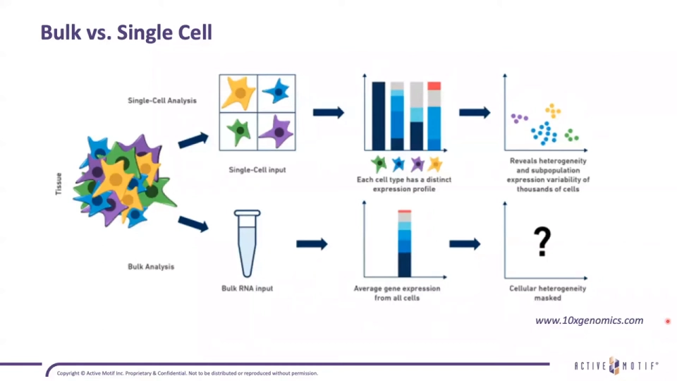
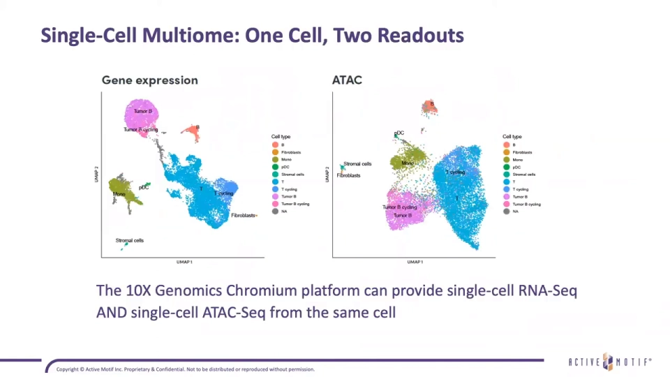
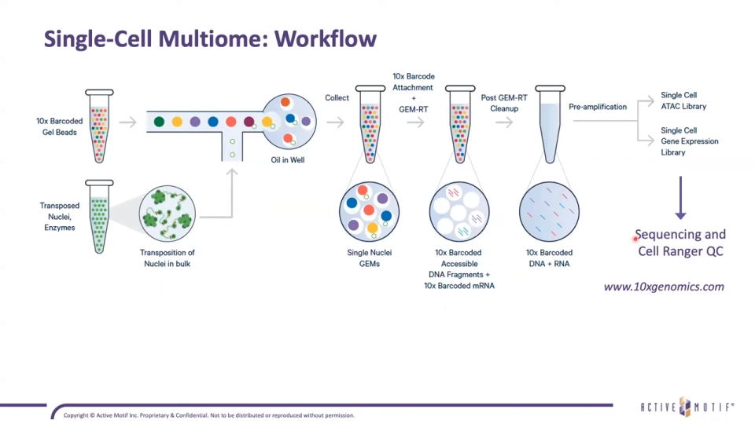
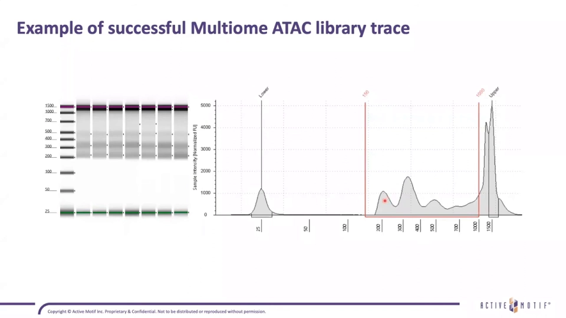
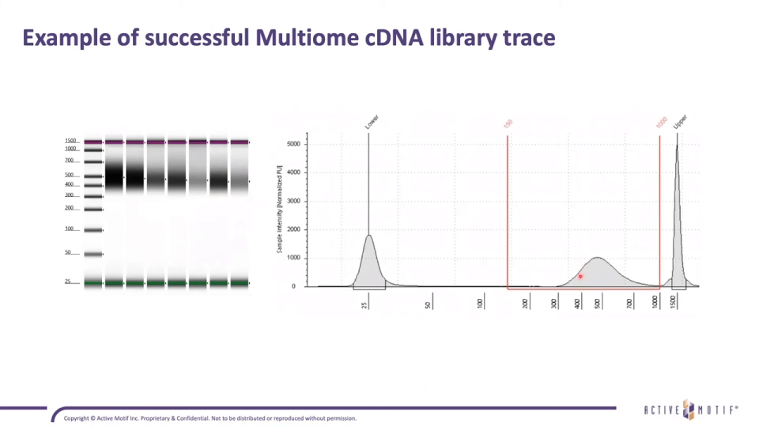
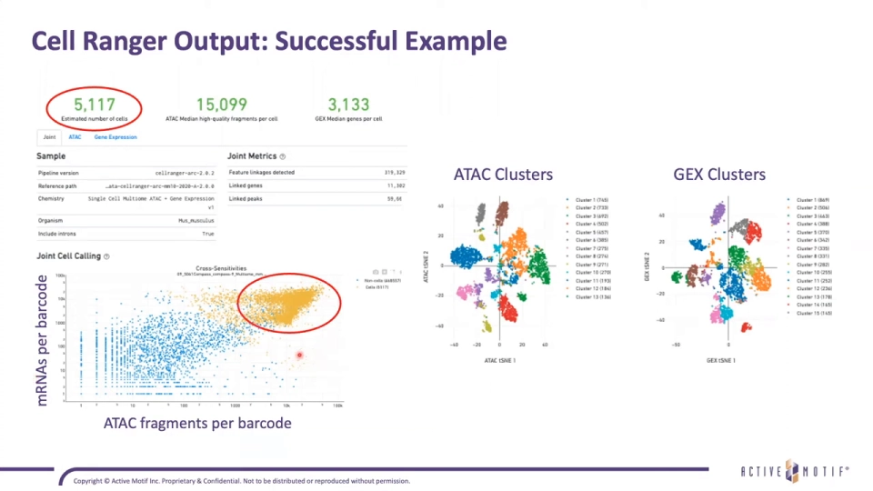
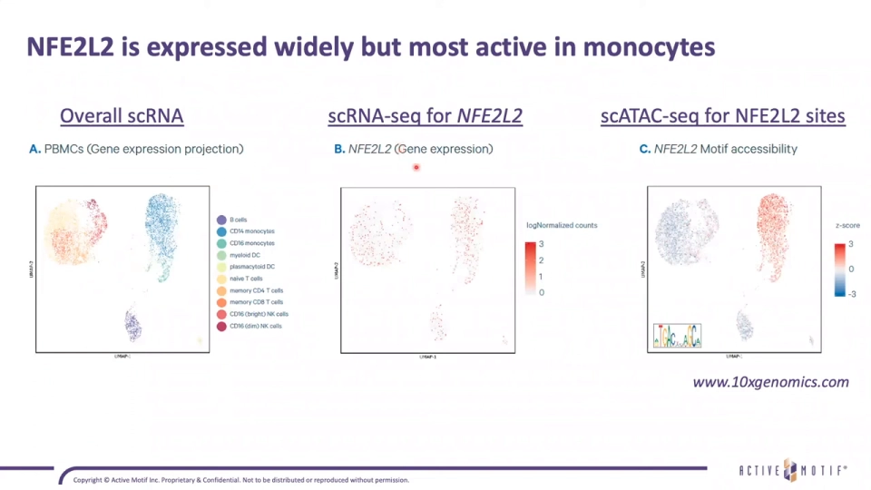
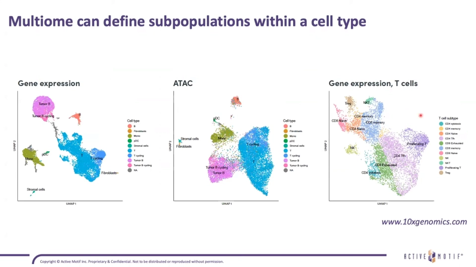
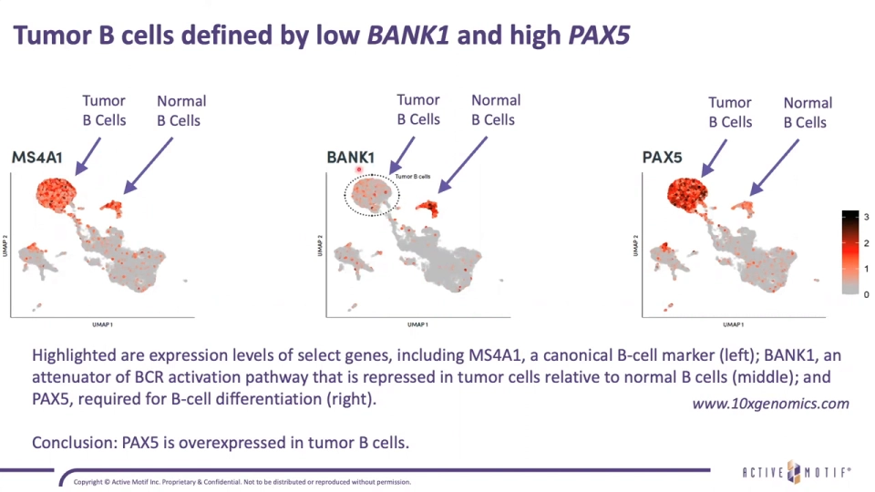

# 单细胞 Multiome：同一个细胞核里同时读出转录组与开放染色质

> 视频来源：[Single-Cell Multiome - Open chromatin plus gene expression from the same cell](https://www.youtube.com/watch?v=m0Ru-BOHNPE)（YouTube · Active Motif 网络研讨会，讲者 Michael Garbutt 博士）｜时长约 13 分钟
> 导读：这支研讨会把单细胞 multiome（ATAC + 基因表达）从湿实验流程讲到干实验结果，核心问题是「两个文库怎么被同一个细胞核的条码绑在一起」。本文只讲**多模态信号如何编码到同一个细胞上、以及多一个模态多回答了什么**：scRNA-seq 建库原理见 [§2.1.2](../../../README.md#b04-2-1-2)，Tn5 与 scATAC-seq 原理见 [§1.2.4](../../../README.md#b04-1-2-4)，Cell Ranger 的比对定量细节见 [§2.1.6](../../../README.md#b04-2-1-6) 与 [§2.2.3](../../../README.md#b04-2-2-3)。字幕为自动生成，术语已按上下文订正。

## 本讲要解决的核心问题（SCQA）

**背景**：[§2.1.2](../../../README.md#b04-2-1-2) 与 [§1.2.4](../../../README.md#b04-1-2-4) 分别讲过两种单细胞测定：scRNA-seq 读转录组，告诉你细胞**正在做什么**；scATAC-seq 读染色质可及性，告诉你哪些调控元件**是开着的**。

**冲突**：这两件事必须落在**同一个细胞**上才有意义。如果转录组来自一批细胞、可及性来自另一批细胞，你只能说「这群细胞平均表达了某个基因，那群细胞平均有某个开放位点」，无法回答「这个表达这个基因的细胞，它自己有没有让转录因子结合上去的开放位点」。bulk 测序更是把整个群体平均掉，亚群信息直接消失。

**疑问**：能不能在同一个细胞核里同时做这两件事？两套文库怎么才能被同一个细胞条码收走，而不是互相干扰、或者张冠李戴？

**回答（中心思想）**：**先转座、再包裹、最后共用一套细胞条码**。细胞核悬液先做 Tn5 转座（tagmentation），把「开放」这件事翻译成带接头的 DNA 片段；随后这些细胞核被液滴包裹，与凝胶珠上的细胞条码相遇，在同一管反应里，mRNA 被逆转录成带条码的 cDNA、转座片段也被加上同一个条码。于是每个细胞核产出两个文库（ATAC 文库 + 基因表达文库），它们共享同一个细胞条码，可以在分析时按条码重新配成一对。这带来的新能力是：不只看到「谁表达了某个转录因子」，还能看到「谁拥有让它结合上去的开放位点」。

## 一、为什么必须「同一个细胞」：bulk 平均掉的东西

讲者开场先讲 bulk 与单细胞的区别，这段是理解 multiome 价值的前提。

[【跳转到 01:33】](https://www.youtube.com/watch?v=m0Ru-BOHNPE&t=93)

同一张图可以套在两种测定上：

- 对基因表达做单细胞化，就是单细胞 RNA 测序；
- 对染色质开放/关闭状态做单细胞化，就是单细胞 ATAC 测序；
- 把两者合并到**一个检测**里，就是单细胞 multiome。

讲者给的理由很实在：单细胞能识别同一份样本里转录组与表观遗传谱不同的亚群，**免去 FACS 分选或磁珠分选这类先分离再测量的步骤**；能区分对药物响应与耐药的细胞、肿瘤与正常细胞；灵敏度足以检测只占总群体 1% 的细胞群。而 multiome 在此基础上多给一层：**每个基因表达文库和每个开放染色质文库都能追溯到同一个细胞核**。

[【跳转到 02:20】](https://www.youtube.com/watch?v=m0Ru-BOHNPE&t=140)

## 二、把两路信号塞进同一个条码：multiome 的湿实验流程

这是本节的技术核心。整条流程可以拆成「先酶切、后包裹、共条码」三步，讲者用一张动画逐步展开：

[【跳转到 05:39】](https://www.youtube.com/watch?v=m0Ru-BOHNPE&t=339)

[【跳转到 03:59】](https://www.youtube.com/watch?v=m0Ru-BOHNPE&t=239)

### 2.1 第一步：先做转座，而不是先包裹

与纯 scATAC-seq 相比，multiome 的关键差别在于**顺序**：先把细胞核悬液与 Tn5 转座酶一起孵育，做 **tagmentation（标签化）**——Tn5 是预先装载好接头的酶，它切割每个细胞核里所有可及的染色质，同时把接头连接上去。这一步是在**整管**里做的（in bulk），此时还没有任何细胞条码。

### 2.2 第二步：包裹进 GEM，一个细胞核一颗珠

转座完成后，这些细胞核被送进 10x Chromium 的液滴体系。GEM 是 gel bead in emulsion（乳液中的凝胶珠）的缩写：一个细胞核与一颗凝胶珠被油包进同一个液滴。讲者说他们通常目标上样 5000 个细胞核，让一个细胞核进入一颗凝胶珠。

### 2.3 第三步：同一反应里给两类分子加同一个条码

每个 GEM 里有一套由逆转录酶与连接酶组成的酶混合物，同时干两件事：

- 把 mRNA 逆转录成 cDNA；
- 把已经带上接头的转座片段补平、加上同一段细胞条码。

于是「同一个细胞核里的 mRNA」和「同一个细胞核里的开放片段」被写进了**同一段条码序列**。这就是 multiome 能「配对」的全部秘密——**不是两个实验拼起来，而是一个实验产出两个文库**。

### 2.4 第四步：分头建库、测序、拆分

每个样本最终产出两个文库：单细胞 ATAC 文库与单细胞基因表达文库。讲者说这两个文库按每个细胞核约 30000 条 reads 的深度测序，然后经过拆分（demultiplexing），交给 10x 的 Cell Ranger 判断有多少细胞核真正进入了数据集。

值得强调的是：**这一步没有任何新的分子生物学原理**。Tn5 转座是 [§1.2.4](../../../README.md#b04-1-2-4) 讲过的同一套化学；oligo-dT 逆转录与细胞条码是 [§2.1.2](../../../README.md#b04-2-1-2) 讲过的同一套化学。multiome 的创新在于**把两套化学放进同一个液滴、共用一段条码**。

## 三、怎么判断实验成功了：两个文库的片段分布

湿实验做完，第一道关卡是看文库本身。讲者用 TapeStation（一种片段分析仪）跑两个文库。

### 3.1 ATAC 文库：三个核小体峰

[【跳转到 06:04】](https://www.youtube.com/watch?v=m0Ru-BOHNPE&t=364)

预期看到三个主峰：约 200、350、500 碱基对。这正是 Tn5 转座酶留下的核小体模式（nucleosome patterning）——片段长度对应「跨过几个核小体」。**这个指纹就是实验成功的证据**：如果看不到周期性，说明转座反应没做好。

### 3.2 cDNA 文库：一个 500 bp 主峰

[【跳转到 06:54】](https://www.youtube.com/watch?v=m0Ru-BOHNPE&t=414)

cDNA 文库的判据简单得多：建库前 cDNA 会被片段化、连接接头，再用 SPRI 磁珠选 500 bp 左右的片段，所以只要有一个主峰落在 500 bp 附近，文库就可以上机了。峰高会随样本变化，但位置不能变。

## 四、怎么判断数据可用：联合 Cell Calling

测序之后看 Cell Ranger 的输出。这是本节里最能体现「多模态」这一点的质控环节。

[【跳转到 07:44】](https://www.youtube.com/watch?v=m0Ru-BOHNPE&t=464)

- 一次成功的 multiome 运行，Cell Ranger 应该 call 出 **3000～7000 个细胞**；讲者的例子是 5117 个。
- 每个条码由两个量定义：唯一的 ATAC 片段数与唯一的 mRNA 数。**联合判定（joint cell calling）**的好处是：一个只有 mRNA 没有 ATAC 的条码、或只有 ATAC 没有 mRNA 的条码，都不会被误当成真细胞核——**两个模态互为对方的质控**。
- 同一批细胞核，软件会分别用 ATAC 数据和基因表达数据 call cluster，于是你得到两套聚类结果，可以互相比对。

讲者顺带给了两个中位数指标：ATAC 每个细胞核约 15099 条高质量片段、基因表达每个细胞核约 3133 个基因。这类数字是判断「这批数据能不能用」的经验刻度。

## 五、多一个模态，多回答了什么

这一节是整支视频的重点：三个具体的应用场景，每个都说明「只有 RNA 时你答不了、加上 ATAC 才答得了」。

### 5.1 场景一：转录因子「表达了」不等于「能干活」

第一个例子是 NFE2L2（也叫 NRF2）。三张 UMAP 并排看：

[【跳转到 08:34】](https://www.youtube.com/watch?v=m0Ru-BOHNPE&t=514)

- 中间的基因表达图：NFE2L2 在很多群体里都表达，看起来「到处都有」；
- 右边的 ATAC 图：只有单核细胞在 NFE2L2 的结合位点（motif）上有开放的染色质。

讲者补上了生物学背景：NFE2L2 蛋白正常情况下被隔离在细胞质里，只有氧化应激时才转位进核、启动抗氧化蛋白的表达。所以真正「这个转录因子能起作用」的细胞，必须**同时满足两个条件**：自己表达了它，且自己拥有让它结合上去的开放位点。**只看 RNA 的话，这两个条件会被混为一谈。**

### 5.2 场景二：在一个细胞类型内部再分亚群

第二个例子说明 multiome 也能用来细分：先用基因表达分出血液里的各种细胞类型，再把 T 细胞单独放大，软件可以进一步定义亚群。

[【跳转到 09:49】](https://www.youtube.com/watch?v=m0Ru-BOHNPE&t=589)

这与本节另一篇 [CITE-seq](CITE-seq：把抗体变成可测条码，蛋白与转录组同时读.md) 里「蛋白读数让 T 细胞亚群分得更细」是同一个道理：**多一个独立的信息维度，就多一层分辨力**。区别在于 CITE-seq 加的是蛋白，multiome 加的是染色质状态。

### 5.3 场景三：把肿瘤细胞和正常细胞分开

第三个例子是肿瘤与正常 B 细胞的区分，逻辑很漂亮：

[【跳转到 10:35】](https://www.youtube.com/watch?v=m0Ru-BOHNPE&t=635)

- 左图：MS4A1 是经典的 B 细胞标记，把所有 B 细胞圈出来；
- 中图：BANK1 是 BCR 活化的衰减因子，在肿瘤 B 细胞里相对正常 B 细胞被抑制；
- 右图：PAX5 是 B 细胞分化必需基因，但在淋巴瘤里常常过表达。

**BANK1 低 + PAX5 高**，就把这个群体定义为肿瘤 B 细胞，与 BANK1 和 MS4A1 都正常表达的群体分开。这类判断依赖多个基因的组合，而组合判断的前提是每个细胞都有自己的一套读数。

## 六、这套方法的边界与它在系列里的位置

讲者没有专门讲局限，但从内容里可以直接读出几条边界，写在这里避免误解：

- **起始材料是细胞核，不是细胞**。multiome 用 nuclei，这意味着你测的是核内 mRNA 与核内染色质，细胞质里的信息拿不到；也意味着样本必须先能制备出干净的核悬液。
- **两个模态的测序深度要分账**。每个细胞核约 30000 条 reads 要在 ATAC 与基因表达之间分配，两边都不深；这也是为什么 multiome 的基因表达数据通常比专门的 scRNA-seq 浅。
- **它回答的是「状态」，不是「因果」**。开放位点 + 表达只能说明「具备条件」，不能直接证明这个转录因子在这里起了作用——要证明因果，需要扰动实验（见 [§5.1.3](../../../README.md#b04-5-1-3)）。
- **平台相关**。讲者全程以 10x Chromium 为例，具体上样量、读深、细胞数区间都是这个平台的刻度；不同平台的参数对比属于 [§2.1.2](../../../README.md#b04-2-1-2) 的范围。

[【跳转到 11:50】](https://www.youtube.com/watch?v=m0Ru-BOHNPE&t=710)

在本脉络里的位置可以这样记：[§2.1.2](../../../README.md#b04-2-1-2) 讲「怎么读转录组」，[§1.2.4](../../../README.md#b04-1-2-4) 讲「怎么读染色质」，本节讲「**怎么让两路信号共享同一个细胞条码**」——CITE-seq 用一条伪装成 mRNA 的抗体 oligo 把蛋白拉进来，multiome 用「先转座、再共条码」把染色质拉进来，两者是同一个思路的两种实现。

## 小结

- **multiome 的核心机制**是三步：先在整管里做 Tn5 转座（把开放区变成带接头的片段），再把细胞核包进 GEM，最后在同一反应里给 mRNA 和转座片段加上**同一个细胞条码**，产出 ATAC 与基因表达两个文库。
- **判读文库**：ATAC 文库看 200/350/500 bp 三个核小体峰，cDNA 文库看 500 bp 附近一个主峰。
- **判读数据**：Cell Ranger 的联合 cell calling 用「ATAC 片段数 + mRNA 数」两个维度定义真细胞核，两个模态互为质控；成功运行通常 call 出 3000～7000 个细胞。
- **多一个模态的价值**：NFE2L2 例子说明「表达」与「有开放结合位点」是两件事；T 细胞例子说明多一个维度能细分亚群；BANK1/PAX5 例子说明多基因组合能定义肿瘤细胞。
- **边界**：用细胞核起始、两个模态要分测序深度、只说明状态不说明因果、参数与平台强相关。

## 关键术语速查

| 术语 | 一句话解释 |
| --- | --- |
| multiome | 在同一个细胞核里同时测基因表达（RNA）与开放染色质（ATAC）的单细胞检测 |
| tagmentation | Tn5 转座酶一步完成「切 DNA + 接接头」的反应，把可及区域变成可测片段 |
| GEM | gel bead in emulsion，乳液中的凝胶珠；一个液滴里一颗粒子配一个细胞核 |
| 细胞条码（cell barcode） | 每个液滴一段独特序列，把该液滴里所有分子标记为「同一个细胞」 |
| demultiplexing | 测序后按条码把 reads 拆回各自的细胞 |
| 联合 cell calling | 同时用 ATAC 片段数与 mRNA 数判断哪些条码是真细胞核 |
| 核小体模式 | ATAC 文库片段长度呈 200/350/500 bp 周期峰，是转座成功的指纹 |
| motif 可及性 | 某个转录因子结合位点处的染色质是否开放，决定该因子能否结合 |
| NFE2L2 / NRF2 | 氧化应激响应的转录因子，平时滞留在细胞质，应激时入核 |
| 核悬液（nuclei suspension） | multiome 的起始材料，用细胞核而非完整细胞 |