# 成像与测序捕获两条空间测量路线：观测对象、分辨率与基因覆盖

> 视频来源：[MIA｜Jean Fan：比较空间转录组学（Primer by Caleb Hallinan）](https://www.bilibili.com/video/BV1vqQfBXEFB/)（Bilibili · MIA 学术讲座转载）｜全长约 86 分钟，本文只覆盖 00:00–13:20 的「两条路线对照 + 成像路线怎么读出分子」部分
> 简要导读：这是约翰霍普金斯大学 Jean Fan 实验室的 Caleb Hallinan 给组内做的空间转录组入门报告。前十分钟用两个具体技术（成像路线的 Xenium、测序捕获路线的 Visium）把「观测对象、分辨率、基因覆盖」三件事并排讲清，再用同一块乳腺癌组织的连续切片做了一次 A/B 对照；10:20–13:20 补讲 Xenium 如何靠逐轮成像解码出分子身份。13:20 之后转入他自己的探针脱靶项目（探针特异性问题），不属于本节的路线比较，本文不写入。字幕为 B 站 AI 生成，技术名与基因名已按幻灯片核对订正。

## 本讲要解决的核心问题（SCQA）

**背景**：空间转录组测量的都是「完整组织里的基因表达 + 空间坐标」。既然目标相同，不同技术测出来的东西应该差不多。

**冲突**：实际拿到数据时会发现，有的技术能定位到单个 mRNA 分子、但只看几千个基因；有的技术能看全转录组、但一个测量单位里混着好几个细胞。更麻烦的是，同一块组织的相邻切片分别用这两种技术测，抽查的基因空间模式相似，却有基因在一方明显表达、在另一方完全检不到。

**疑问**：这两条路线到底在测什么？它们的差别落在哪几个量上？看到不一致时，应该先怀疑技术，还是先怀疑生物学？

**回答（中心思想）**：空间转录组的两条主路线——**成像路线**与**测序捕获路线**——差别可以收敛到三个量上：**观测对象**（单分子信号 vs 一个格子里的 RNA 混合物）、**分辨率**（单分子/亚细胞 vs 斑点或像素）、**覆盖**（实验前定死的靶向面板 vs 全转录组）。三者构成一个此消彼长的三角：想要更细的位置，就得接受更窄的基因范围；想要更宽的基因范围，就得接受更粗的测量单位。因此跨路线比较前必须先把两边聚合到同一个测量单位上，而「一方未检出」永远不能直接读成「另一方不表达」。

## 一、两条路线只差三件事：观测对象、分辨率、覆盖

讲者给这两条路线下的定义很朴素：从数据分析的角度看，空间转录组只有两类技术 [【跳转到 02:28】](https://www.bilibili.com/video/BV1vqQfBXEFB/?t=148)。

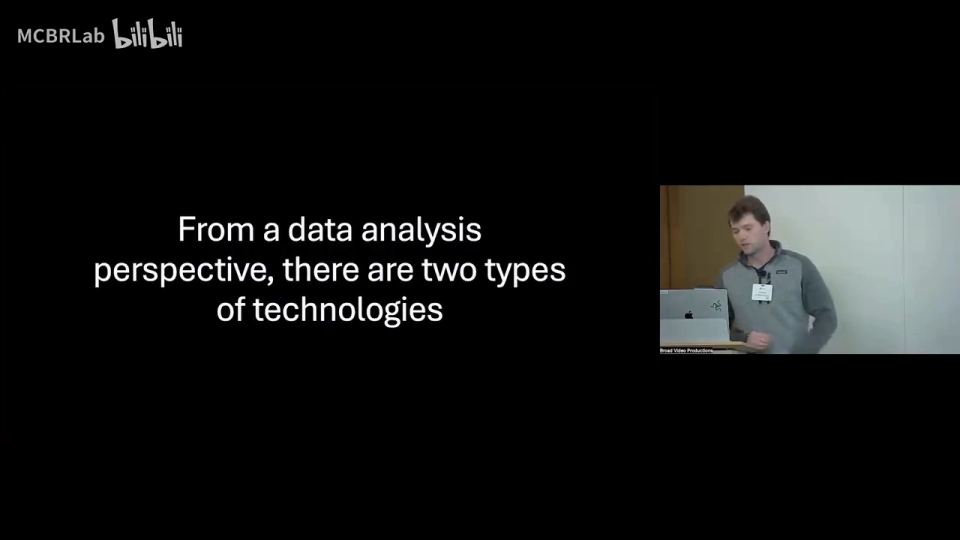

### 1.1 成像路线：先把分子点亮，再逐轮解码

成像路线的代表是 10x Genomics 的 Xenium。它的测量过程是：把带荧光标记的探针送进切片，探针与目标 mRNA 杂交并连接，再由滚环扩增（rolling circle amplification，RCA）在每个分子位置生成一个可被拍到的产物；随后逐轮送探针、逐轮拍照、逐轮洗掉，最后靠「第几轮亮、第几轮不亮」组成的条形码反解出「这个亮点是哪个基因」[【跳转到 11:44】](https://www.bilibili.com/video/BV1vqQfBXEFB/?t=704)。

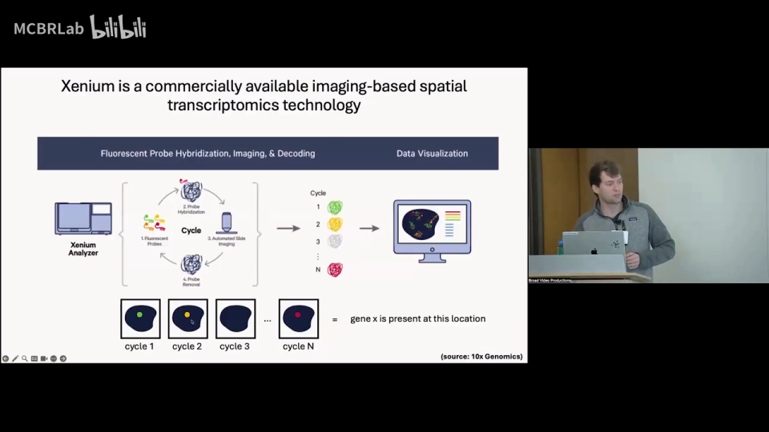

这张图解释了为什么成像路线能到单分子：每个分子被扩增成一个可分辨的亮点，亮点在每一轮的亮/不亮组合就是它的「身份证」[【跳转到 12:52】](https://www.bilibili.com/video/BV1vqQfBXEFB/?t=772)。

关键点在于**信号的最小单位是一个分子**：一个亮点对应一个被探针抓住的 mRNA，所以位置能精确到分子所在的那一点。讲者把这条路线概括成四条特征 [【跳转到 02:53】](https://www.bilibili.com/video/BV1vqQfBXEFB/?t=173)：

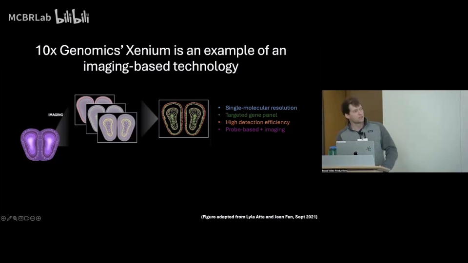

- **单分子分辨率**（single-molecular resolution）：能确定每一个 mRNA 分子在组织里的位置；
- **靶向基因面板**（targeted gene panel）：只测面板里预先设计好探针的那些基因，本例中约 5000–6000 个；
- **高检测效率**（high detection efficiency）：面板内的基因，能被有效找到；
- **基于探针 + 成像**：读出方式是拍照与解码，不是测序。

### 1.2 捕获路线：先把 RNA 抓到带地址的格子里，再测序

捕获路线的代表是同一家公司的 Visium。它的测量过程是：切片贴到芯片上，mRNA 被下方带位置条码的探针捕获，建库后靠高通量测序把每条 read 读出来，再按条码归位 [【跳转到 06:06】](https://www.bilibili.com/video/BV1vqQfBXEFB/?t=366)。讲者在这场报告里只讲到「捕获 + 测序」这一层，透化、poly-dT 捕获与位置条码抄进 cDNA 的分子细节见 [1.2.3](../1.2.3_空间组学：空间坐标、测量分辨率与误差来源/空间转录组怎么把表达放回组织：位置条码、斑点分辨率与样本误差.md) 第二节。

这条路线的最小单位不是分子，而是**一个格子（spot/像素）**：格子里的所有 mRNA 被一起捕获、一起测序，测完之后只知道「这个格子里有多少条来自基因 X 的 read」，不知道它们各自落在格子的哪个位置。

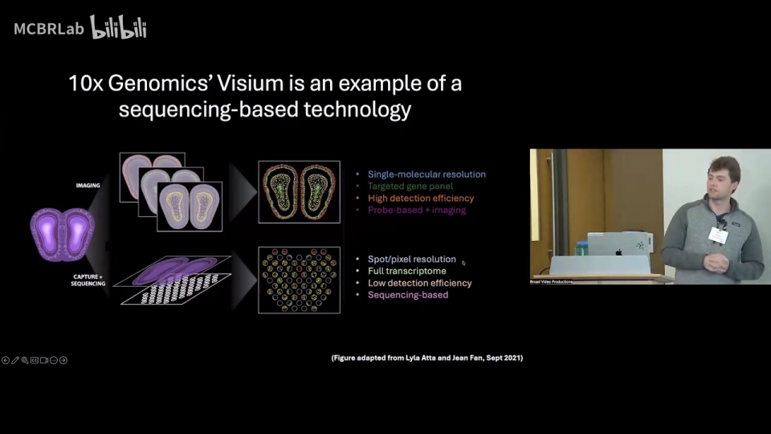

### 1.3 把两条路线并排放

讲者用同一张幻灯片做了正面对照，这张表是本节最该记住的内容 [【跳转到 06:06】](https://www.bilibili.com/video/BV1vqQfBXEFB/?t=366)：

| 比较项 | 成像路线（以 Xenium 为例） | 测序捕获路线（以 Visium 为例） |
| --- | --- | --- |
| 观测对象 | 单个 mRNA 分子发出的荧光信号 | 一个格子内全部 mRNA 的混合物 |
| 分辨率 | 单分子分辨率，可到亚细胞 | 斑点/像素分辨率，一个格子覆盖多个细胞 |
| 基因覆盖 | 靶向面板，本例约 5000–6000 个基因 | 全转录组，本例约 2 万个蛋白编码基因 |
| 检测效率 | 较高 | 较低 |
| 读出方式 | 探针杂交 + 逐轮成像解码 | 位置条码捕获 + 高通量测序 |
| 是否需要细胞分割 | 需要，否则分子无法归给细胞 | 不需要，分子本来就按格子汇总 |

这张表要按「三角权衡」来读，而不是按「谁更好」来读：**分辨率、覆盖、检测效率三者不能同时拉满**。成像路线把精度做到分子级，代价是覆盖被面板锁死；捕获路线把覆盖拉满，代价是测量单位变粗、检测效率下降。

## 二、分辨率：单分子，还是「一个格子里混了几个细胞」

### 2.1 成像路线：分子先定位，再靠分割归给细胞

成像路线的原始产物是「一堆带坐标的分子」。要得到「细胞 × 基因」矩阵，中间必须加一步**细胞分割**（cell segmentation）：先在图像上把细胞边界与细胞核划出来，再把落在边界内的分子归给这个细胞 [【跳转到 03:18】](https://www.bilibili.com/video/BV1vqQfBXEFB/?t=198)。

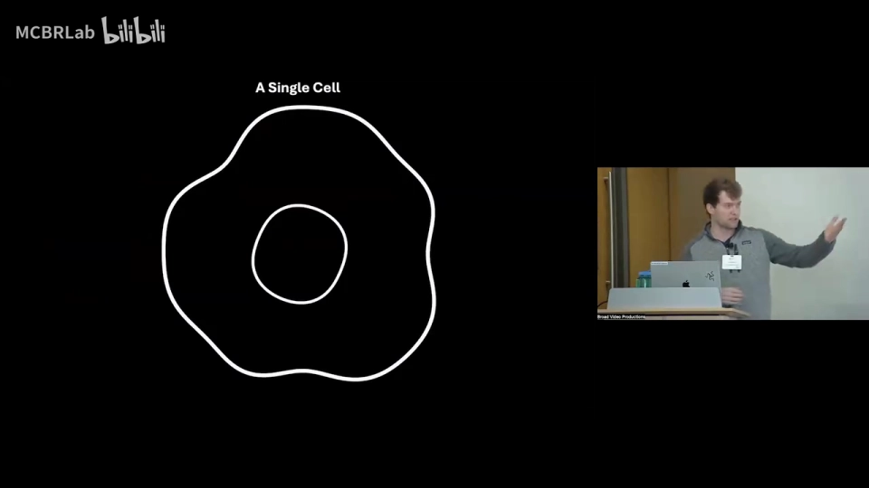

这一步是成像路线特有的误差来源：分子位置是测出来的，但「这个分子属于哪个细胞」是分割算法判出来的。分割错了，分子本身没错，归属错了。

### 2.2 捕获路线：不需要分割，因为格子本来就不等于细胞

捕获路线没有分割这一步，原因不是它做得更好，而是它的测量单位本来就不是细胞：一个格子里的分子被一起收集、一起计数，所以不需要判断「谁属于谁」[【跳转到 06:53】](https://www.bilibili.com/video/BV1vqQfBXEFB/?t=413)。

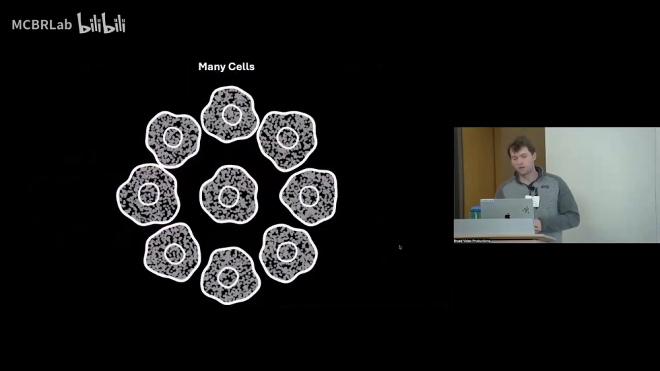

代价是：格子里的高表达有两种解释——「这类细胞表达高」或「这个位置这类细胞多」，数据上无法区分。这个混合问题在 [空间转录组怎么把表达放回组织：位置条码、斑点分辨率与样本误差](../1.2.3_空间组学：空间坐标、测量分辨率与误差来源/空间转录组怎么把表达放回组织：位置条码、斑点分辨率与样本误差.md) 第三节已经按 Visium 的 spot 尺寸算过：一个 55 微米的 spot 压着 1–10 个细胞。本节不重复那套推导，只把它作为路线对照的一栏。

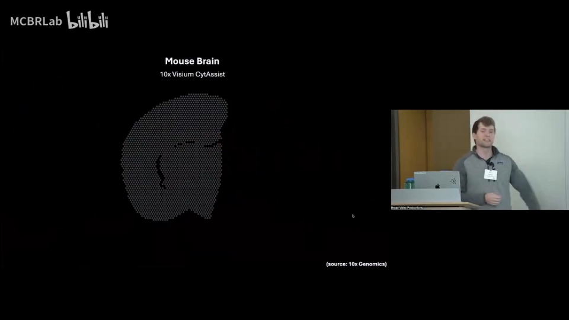

### 2.3 分辨率可以在分析时下调，但不能上调

两条路线的分辨率不是只能停在出厂设置上。成像路线的数据是「分子级」的，分析时可以把分子按方格汇总（栅格化），得到和捕获路线同尺度的矩阵；讲者解释这样做的两个理由：一是画图时单细胞点太密、趋势看不清，二是把海量单细胞数据汇总到区域后，数据量下降、后续计算更省 [【跳转到 04:40】](https://www.bilibili.com/video/BV1vqQfBXEFB/?t=280)。

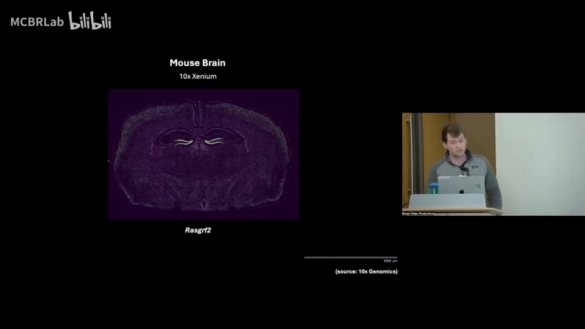

这条规则的方向很重要：**分辨率可以往下调（聚合），不能往上调（拆分）**。捕获路线的格子已经混过了，聚合只会更混；想从中拿回单细胞信息，只能借外部单细胞参考做反卷积，那是模型估计，不是测量。

## 三、覆盖：面板是实验前定死的，全转录组是开放但更浅

### 3.1 成像路线的覆盖在实验前就锁定了

成像路线靠探针识别基因，所以「能测哪些基因」在做实验之前就由面板决定：本例的 Xenium 面板约 5000–6000 个基因 [【跳转到 02:53】](https://www.bilibili.com/video/BV1vqQfBXEFB/?t=173)。面板之外的基因，无论表达多高，在这条路线上都不存在——不是「测得低」，是「根本没有对应的探针」。

这带来一个使用上的硬约束：**你必须在做实验前就知道自己要问哪些基因**。想做无偏发现（比如「这块组织里有什么异常表达」），面板路线先天不合适。

### 3.2 捕获路线的覆盖是全转录组，但每个基因更浅

捕获路线不靠逐个基因设计探针来识别，而是把格子里的 mRNA 整体捕获后再测序（具体的捕获化学与位置条码结构见 [1.2.3](../1.2.3_空间组学：空间坐标、测量分辨率与误差来源/空间转录组怎么把表达放回组织：位置条码、斑点分辨率与样本误差.md) 第二节），所以覆盖是开放的：本例的 Visium 能覆盖约 2 万个蛋白编码基因 [【跳转到 06:06】](https://www.bilibili.com/video/BV1vqQfBXEFB/?t=366)。

代价是**检测效率更低**：同样的组织、同样的基因，捕获路线能抓到的分子比例低于成像路线。讲者的说法是「相比成像技术，我们的检测效率稍低」[【跳转到 06:31】](https://www.bilibili.com/video/BV1vqQfBXEFB/?t=391)。这句话要按「本例、本面板、本组织」来读，不能升级成「捕获路线永远更差」：检测效率取决于面板设计、组织类型、透化条件与测序深度，其中透化与 RNA 质量的影响见 [1.2.3](../1.2.3_空间组学：空间坐标、测量分辨率与误差来源/空间转录组怎么把表达放回组织：位置条码、斑点分辨率与样本误差.md) 第四节。

### 3.3 三角权衡：三个量不能同时拉满

把前面两节合起来，两条路线的取舍可以写成一句话：

- 想要**单分子/亚细胞**的位置信息 → 必须用探针识别 → 覆盖被面板锁死；
- 想要**全转录组**的开放覆盖 → 必须用通用捕获（poly-dT）→ 测量单位变粗、检测效率下降；
- 想要**高检测效率** → 需要针对目标基因优化探针与成像 → 又回到面板路线。

这不是某家公司产品设计的缺陷，而是「靠什么识别基因」这个选择带来的结构性后果：**识别方式决定覆盖，覆盖方式决定测量单位**。

## 四、同一块组织的 A/B 对照：相似是常态，不一致才是信息

既然两条路线测的是同一件事，同一块组织用两种技术测，结果应该差不多——这是最自然的预期 [【跳转到 08:04】](https://www.bilibili.com/video/BV1vqQfBXEFB/?t=484)。

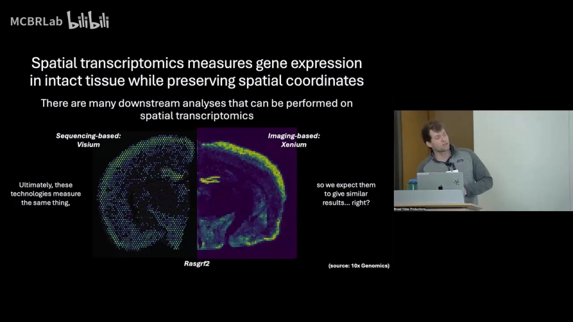

这一节就是检验这个预期。

### 4.1 对照怎么设计：连续切片 + 对齐 + 聚合到同一尺度

讲者用一份公开的乳腺癌数据做了对照：同一块组织连续切片，一张做 Xenium（成像），一张做 Visium（捕获），然后把两份数据对齐到同一组织区域、只保留共享区域，再把 Xenium 的分子聚合成与 Visium spot 同尺度的方格，让两边处在同一个测量单位上 [【跳转到 08:29】](https://www.bilibili.com/video/BV1vqQfBXEFB/?t=509)。

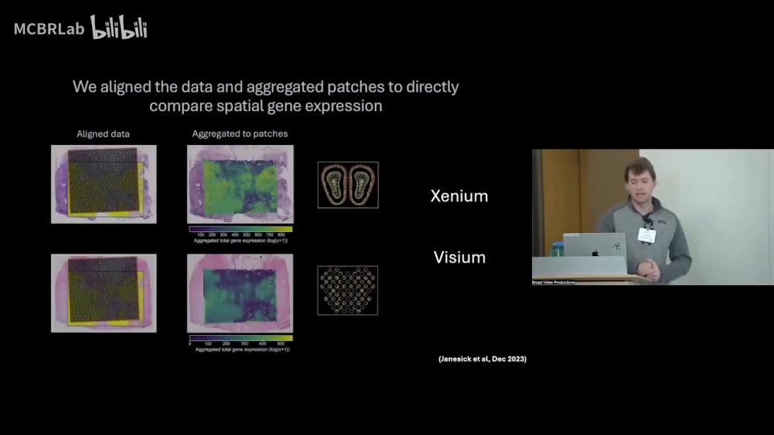

这一步是跨路线比较的前提。**不先统一测量单位，比较的就不是技术差异，而是分辨率差异。**

### 4.2 相似的部分：空间模式对得上

聚合到同一尺度后，讲者抽查的几个基因空间模式相似。他以 MS4A1 为例：两边都能看出同一片区域的高表达，只是成像路线的图更细、捕获路线的图更糊 [【跳转到 09:41】](https://www.bilibili.com/video/BV1vqQfBXEFB/?t=581)。

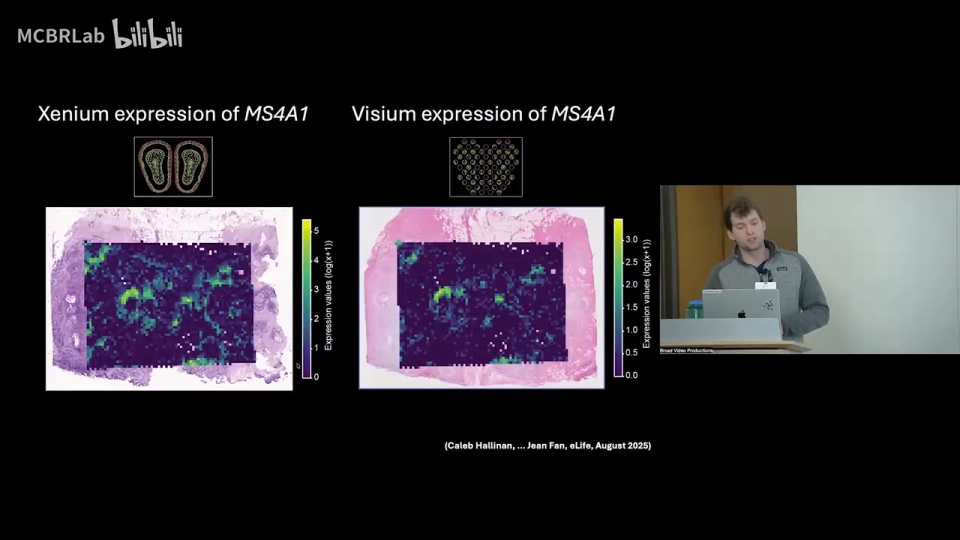

逐格做相关分析，讲者给出的数字是皮尔逊相关系数 0.382、RMSE 3.746，幻灯片上的结论是「两种技术之间中等程度一致」（moderate agreement）[【跳转到 10:05】](https://www.bilibili.com/video/BV1vqQfBXEFB/?t=605)。

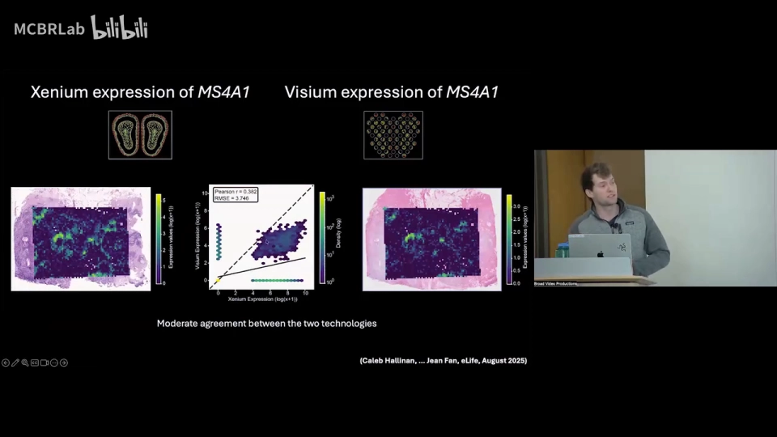

这两个数字要读成「中等一致」，不能读成「高度一致」：0.382 说明两边的逐格数值只共享一部分变异，剩下的差异来自检测效率、聚合方式、切片之间的组织差异等。**跨路线复现不是「相关系数大于某个阈值就算通过」，而是要看差异是否集中在特定基因、特定区域。**

### 4.3 不一致的部分：一方检出、一方未检出

讲者发现有些基因在 Xenium 数据里空间模式很明显，在 Visium 数据里却完全检不到 [【跳转到 10:16】](https://www.bilibili.com/video/BV1vqQfBXEFB/?t=616)。他没有把原因归给生物学，而是列了几种可能：批次效应、或其他技术因素，并决定回到两条路线的工作原理去找答案 [【跳转到 10:37】](https://www.bilibili.com/video/BV1vqQfBXEFB/?t=637)。

这个处理方式是本节最该学的一条判读规则：**「一方未检出」不能直接读成「另一方假阳性」，也不能读成「这个基因不表达」。** 未检出至少有三类来源（这三类来源是本节按两条路线的机制归纳的，不是视频原话）：

1. **覆盖不同**：如果这个基因不在面板内，成像路线根本测不到；反过来，捕获路线检测效率低，低表达基因容易掉到检出限以下；
2. **测量单位不同**：聚合方式改变了每个格子的有效深度，同一基因在两种聚合下检出概率不同；
3. **样本不同**：连续切片毕竟是两张片子，组织内容不完全相同。

讲者后续用探针序列比对去追查脱靶结合（13:20 之后的内容），那是「探针特异性」这条误差线，属于 [1.2.3](../1.2.3_空间组学：空间坐标、测量分辨率与误差来源/空间转录组怎么把表达放回组织：位置条码、斑点分辨率与样本误差.md) 第五节讨论的探针误差范畴，本文不展开。

## 五、怎么选：三条判据

把前面的对照转成选择判据，可以按「先问问题、再看约束」的顺序走：

1. **先问空间精度要求**。要判断「某个基因是不是只在一类细胞的亚细胞结构里」「两类细胞是不是真的挨着」，需要单分子/单细胞单位，选成像路线；只关心「这个区域整体表达偏高还是偏低」「不同区域之间的差异」，斑点级就够，选捕获路线。
2. **再问基因范围是否已知**。目标基因已经明确、且在面板内，成像路线的检测效率优势可以兑现；要做无偏发现、要覆盖新物种或没有现成面板的物种、要看不常见的转录本，捕获路线的开放覆盖不可替代。面板覆盖的物种限制在 [1.2.3](../1.2.3_空间组学：空间坐标、测量分辨率与误差来源/空间转录组怎么把表达放回组织：位置条码、斑点分辨率与样本误差.md) 第五节有具体例子。
3. **最后问是否需要跨路线合并**。要把两种数据放在一起用，必须先把它们聚合到共同测量单位，并接受「聚合后分辨率按粗的那一边算」；合并后仍不一致的基因，应当单独列出核查，而不是平均掉。

讲者的对照实验直接支撑前两条；第三条（跨路线合并）是从他的「对齐 + 聚合」做法里推出的判读要求，不是视频里的原话。

## 小结

- 空间转录组的两条主路线是**成像**与**测序捕获**，它们的差别收敛到三个量：观测对象、分辨率、覆盖。
- **成像路线**（Xenium 为例）的观测对象是单个 mRNA 分子的荧光信号，分辨率到单分子/亚细胞，覆盖被靶向面板锁死（本例约 5000–6000 个基因），检测效率较高；代价是需要细胞分割把分子归给细胞。
- **捕获路线**（Visium 为例）的观测对象是一个格子内全部 mRNA 的混合物，分辨率是斑点/像素级（一个 spot 压着多个细胞），覆盖是全转录组（本例约 2 万个蛋白编码基因），检测效率较低；好处是不需要分割，代价是格子内的混合无法拆开。
- 三者构成**三角权衡**：识别方式决定覆盖，覆盖方式决定测量单位；分辨率可以聚合下调，不能拆分上调。
- 跨路线比较的前提是**先聚合到同一测量单位**；即便如此，逐格相关也只是「中等一致」（本例皮尔逊 0.382）。
- **「一方未检出」不等于「不表达」**：先排查覆盖、测量单位与样本差异，再谈生物学。

## 关键术语速查

| 术语 | 一句话解释 |
| --- | --- |
| 成像路线（imaging-based） | 用带荧光的探针在切片上点亮 mRNA，逐轮成像、逐轮解码读出基因身份与位置 |
| 测序捕获路线（sequencing-based） | 用带位置条码的探针把 mRNA 抓到固定格子里，再靠高通量测序读出序列与位置 |
| 单分子分辨率 | 最小可分辨单位是一个 mRNA 分子，而不是一个格子 |
| 斑点/像素分辨率 | 最小可分辨单位是一个固定大小的格子，格子内的分子被合并计数 |
| 靶向基因面板 | 实验前设计好探针、因而能测到的基因集合；面板外的基因测不到 |
| 全转录组覆盖 | 不依赖基因特异探针，理论上覆盖所有带 poly-A 尾巴的 mRNA |
| 检测效率 | 组织中真实存在的分子，最终被成功检出计数的比例 |
| 细胞分割 | 在图像上划出细胞边界与细胞核，把分子归给细胞；成像路线特有的一步 |
| 栅格化 / 聚合 | 把更细的测量单位（分子、单细胞）汇总到更粗的方格，使两条路线可比 |