# 单细胞测序的必要性与三条并行化路线

> 视频来源：[Single Cell Sequencing - Eric Chow (UCSF)](https://www.youtube.com/watch?v=k9VFNLLQP8c)（YouTube · iBiology Techniques，讲者 Eric Chow，加州大学旧金山分校）｜时长约 25 分钟
> 导读：这是一支系统性很强的技术讲座，从「为什么要把样本拆成单个细胞」讲到板式分选、液滴微流控、微孔阵列、组合索引四条技术路线，最后交代多重标记与双细胞问题。本文只讲**测序技术本身怎么实现**，不展开比对定量与 cell calling 的细节（那属于 2.1.3 与 2.1.6），也不展开下游分析流程。

## 本讲要解决的核心问题（SCQA）

**背景**：测量基因表达最直接的办法是把一块组织或一管细胞磨碎、提取 RNA、反转录、测序——这就是 bulk RNA-seq。它便宜、成熟、一次就能拿到全转录组。

**冲突**：组织是多种细胞的混合物。bulk 测序把所有这些细胞的 RNA 倒进同一个管子，测出来的是**平均值**。如果真正发生变化的只是其中一小群细胞，这个平均会把信号稀释掉；如果两群细胞朝相反方向变化，甚至会在平均值里互相抵消，让你看到「没变化」。

**疑问**：既然平均值会掩盖信息，怎么才能拿到**每个细胞各自**的表达量？拿到之后，技术上又是怎么把「一个细胞一个样本」这件事从实验室手工操作变成可以处理几万、几十万细胞的高通量流程的？

**回答（中心思想）**：单细胞测序的本质，是**给每个细胞的转录本打上一个只属于这个细胞的条形码（barcode）**，从而把「一个细胞 = 一个测序样本」的物理隔离，转换成「一个 barcode = 一个样本」的信息隔离。围绕这一点，技术演化出三条并行化路线——板式分选、液滴/微孔的空间隔离、组合索引的条形码组合；三者都是在「通量」与「双细胞污染」之间做取舍。

## 一、单细胞的价值：把被平均掉的那一层重新拆开

### 1.1 果汁比喻：混在一起的样本尝不出单个水果的味道

讲者用一杯果汁来打比方。血液是多种细胞的混合物——B 细胞、T 细胞、巨噬细胞、中性粒细胞各有一套表达程序。就像你把树莓、橙子、菠萝、香蕉、草莓一起丢进搅拌机，喝到的是混合味道；这时候想知道「树莓本身是什么味道」已经不可能了。bulk 测序就是这杯果汁，单细胞测序则是**先把每种水果单独拿出来尝**。

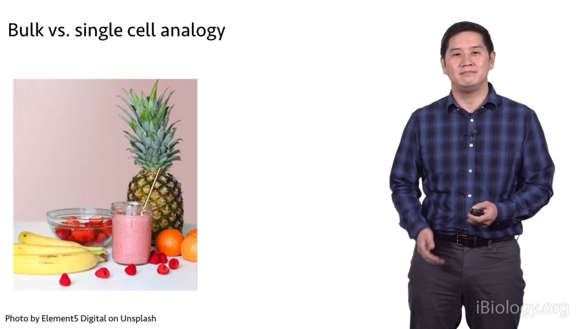

[【跳转到 00:32】](https://www.youtube.com/watch?v=k9VFNLLQP8c&t=32)

### 1.2 单细胞数据的读法：先降维聚类，再用差异基因给簇命名

单细胞测序一次能对成千上万个细胞并行处理，每个细胞都能检测到人类基因组里约 2 万个基因的表达。2 万维的数据没法直接看，常规做法是**降维到二维**，得到一个散点图：每个小点是一个细胞，靠得近的细胞表达谱相似，于是自然聚成若干团。

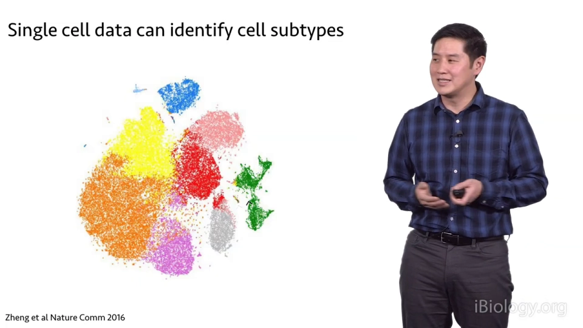

[【跳转到 02:12】](https://www.youtube.com/watch?v=k9VFNLLQP8c&t=132)

但聚类本身没有意义——你知道「这里有几群」，却不知道它们是什么。下一步是**问每一群相对其他群高表达哪些基因**，用这些差异基因反过来给簇命名：蓝色是 B 细胞，红色是活化的 CD8 T 细胞，紫色是树突状细胞，绿色是 CD14+ 单核细胞，灰色是 NK 细胞。

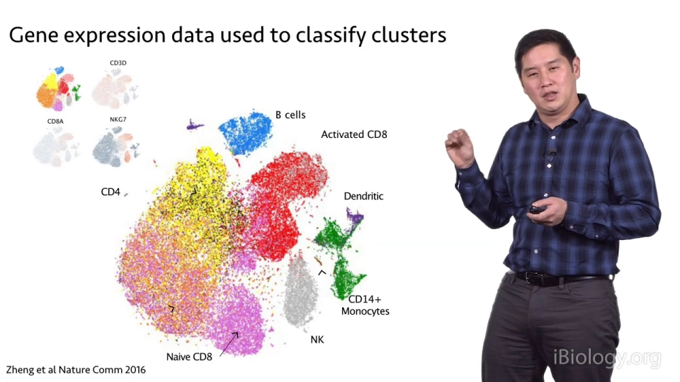

[【跳转到 03:11】](https://www.youtube.com/watch?v=k9VFNLLQP8c&t=191)

### 1.3 相对流式细胞术的关键优势：维度从几十个标记变成两万个基因

讲者特别强调：同样能区分细胞类型这件事，流式细胞术也能做到。单细胞测序的差别在于**维度和可下钻性**：

- 流式细胞术和质谱流式（CyTOF）受限于抗体panel，一次只能看几十个标记；单细胞 RNA 测序一次读出的是约 2 万个基因的表达量。
- 因为维度高，你可以**对某一群反复下钻**：先把绿色那群单独拎出来重新聚类，再问「是什么基因把这个亚群和那个亚群分开」，如此迭代。

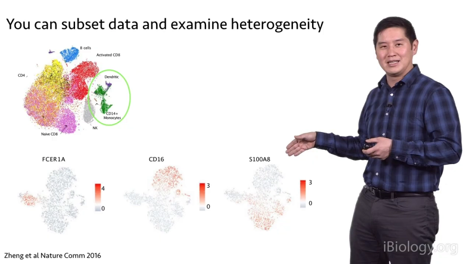

[【跳转到 03:39】](https://www.youtube.com/watch?v=k9VFNLLQP8c&t=219)

这就是讲者所说的「单细胞测序的力量」：它给的是一个高维读出，而高维读出才能暴露出低维方法看不见的生物学。

## 二、产出规模的十年指数增长，逼出了并行化技术

2009 年第一次有人测了**一个**细胞的转录组。此后每篇论文处理的细胞数逐年上升，到讲座录制时已有单篇研究处理超过一百万个细胞。这条曲线背后是技术的更替：早期靠把细胞一个个分到孔里，后来靠液滴、微孔和组合索引把「并行」这件事做到极致。

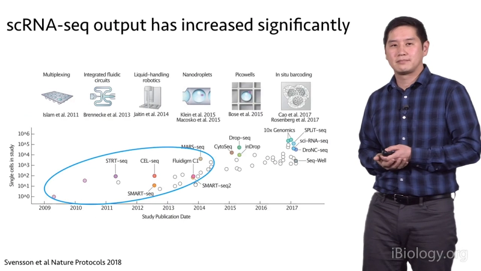

[【跳转到 04:18】](https://www.youtube.com/watch?v=k9VFNLLQP8c&t=258)

## 三、第一代做法：板式分选 + SMART-seq

最直接的做法是：用流式细胞仪把目标细胞**一个孔一个细胞**地分到 96 孔或 384 孔板里，裂解，然后每孔单独做一次反转录和建库。

SMART-seq 的分子细节是理解后面所有方法的钥匙：

1. 用 **oligo dT** 引物结合到 mRNA 的 poly(A) 尾巴上，起始反转录；这条引物末端带一段固定的接头序列（handle）。
2. 反转录酶合成第一链 DNA，某些逆转录酶会在 cDNA 3′ 端额外加上几个**非模板的 C 碱基**。
3. 一段末端带 G 的**模板转换寡核苷酸（template switch oligo）**与这些 C 配对，逆转录酶就以它为模板继续延伸。
4. 结果：cDNA 两端都带上了 PCR handle，可以整批扩增。
5. 扩增后的 cDNA 用 **Nextera 转座酶**打断并接上部分 Illumina 接头，再 PCR 补全，完成测序文库。

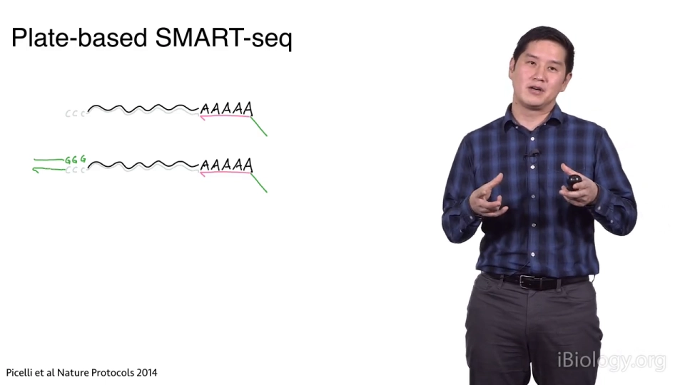

[【跳转到 05:04】](https://www.youtube.com/watch?v=k9VFNLLQP8c&t=304)

这条路线的天花板很清楚：每个细胞都要单独一次移液、单独一次建库，通量只有几百到几千个细胞，人工和试剂成本都很高。要上量，必须换思路。

## 四、并行化路线一：液滴微流控

### 4.1 Drop-seq：用油把水相剪成一滴滴微小反应器

Drop-seq 用一块微流控芯片：一侧流入带条形码的磁珠，另一侧流入细胞和裂解试剂，两者汇合后遇到油相，水相被剪切成乳浊液——也就是成千上万个皮升级液滴。每个液滴理论上是一个独立反应器。

关键在于珠子：每颗珠子表面挂着大量 **带条形码的 oligo dT**，而**每颗珠子的条形码都不一样**。当一滴水里同时装进一个细胞和一颗珠子时，这个细胞的所有 mRNA 都被珠子上的 oligo dT 抓走；因为同一颗珠子上所有 oligo 的条形码相同，这个细胞的所有 cDNA 就共享同一个条形码。之后破乳、反转录、PCR 扩增、建库测序，读序列时按条形码分组，就等于把混合测序数据**还原成一个个细胞**。

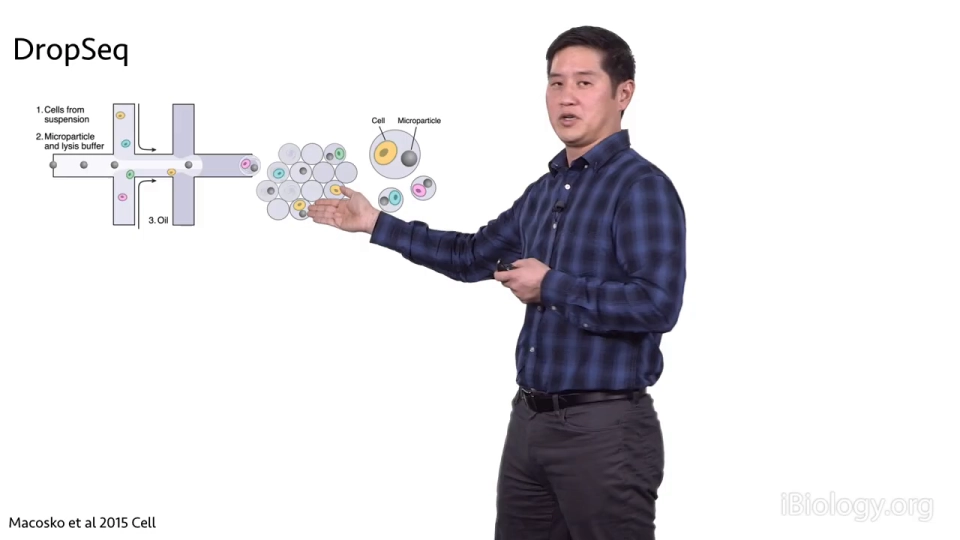

[【跳转到 07:40】](https://www.youtube.com/watch?v=k9VFNLLQP8c&t=460)

这一步的意义是数量级的：几万个细胞的文库可以在几个管子里完成，不需要三万个小孔。

### 4.2 泊松分布的代价：空滴与双细胞

液滴是随机分配的，结果必然服从泊松分布。低浓度上样时，绝大多数液滴是空的（讲者给出的示意是 82% 空、16% 单细胞、2% 双细胞），只有一小部分是「一个细胞 + 一颗珠子」。

$$
P(k) = \frac{\lambda^{k} e^{-\lambda}}{k!}
$$

这里 $\lambda$ 是每个液滴平均分到的细胞数；$P(k)$ 是这个液滴里恰好有 $k$ 个细胞的概率。上样浓度一提高，$\lambda$ 变大，空滴变少、单细胞滴变多，但**双细胞（doublet）也同步增多**；而双细胞在测序数据里看起来就像一个「表达了两套程序」的细胞，很难和真实存在的中间状态区分。所以 Drop-seq 只能把细胞和珠子都稀释到低浓度上样，用「浪费空滴」换「少出双细胞」。

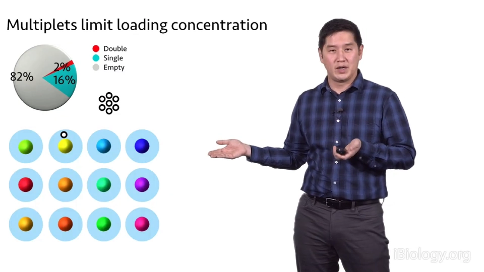

[【跳转到 19:01】](https://www.youtube.com/watch?v=k9VFNLLQP8c&t=1141)

### 4.3 10x Genomics：把珠子工程化，让 90% 以上的液滴恰好含一颗珠子

10x Genomics 的 Chromium 平台结构上与 Drop-seq 极其相似：条形码珠子、细胞与试剂、油相，三个入口生成乳浊液。差别在于**工程化**：

- 芯片和珠子都被设计成让**90% 以上的液滴恰好含一颗珠子**，因此珠子不必低浓度上样，效率大幅提高；
- **反转录直接在液滴内完成**，而不只是捕获；之后破乳、在单管里扩增 cDNA、在单管里建库。

通量上，芯片每条 lane 可上样约 2.5 万个细胞，一块芯片 8 条 lane，理论上一次可处理 20 万个细胞；芯片上的反应只要 15 分钟，后续步骤约半天——也就是一天之内可以处理 20 万个细胞。

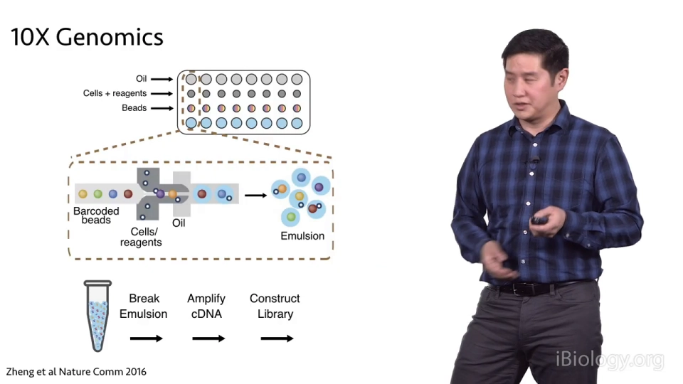

[【跳转到 10:33】](https://www.youtube.com/watch?v=k9VFNLLQP8c&t=633)

## 五、并行化路线二：微孔阵列

液滴不是唯一的隔离方式。微孔阵列把一块芯片做成几十万甚至上百万个直径几十到几百微米的小孔：先铺一层条形码磁珠（工程上保证大多数孔里恰好一颗），再把细胞悬液铺上去让细胞沉降进孔里，然后裂解、酶反应、加条形码、建库。

讲者列举的代表平台有 SeqWell、Celsee Genesis 和 Becton Dickinson 的 Rhapsody。相比液滴，微孔是「静态的孔」而不是「流动的滴」，孔位数可以做得非常多——有的芯片可达百万孔级别。

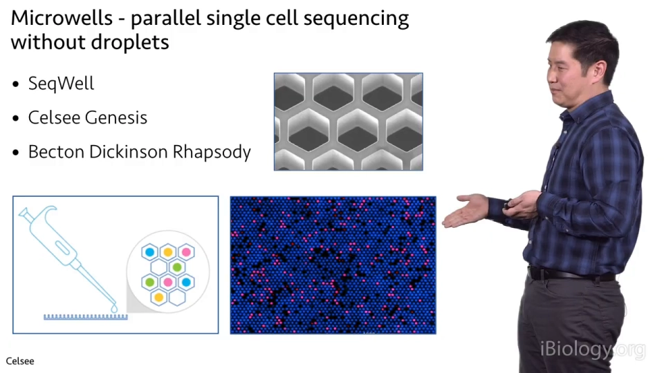

[【跳转到 13:05】](https://www.youtube.com/watch?v=k9VFNLLQP8c&t=785)

## 六、并行化路线三：组合索引（combinatorial indexing）

前两条路线都要求「在某个时刻把细胞物理分开」。组合索引换了个思路：**不分离细胞，而是用细胞自身当反应腔**，靠多轮条形码的**组合**来唯一标识一个细胞。

流程（来自华盛顿大学的方法）：

1. 细胞先固定并透化，试剂可以进出细胞，但细胞不再需要被单独分装。
2. 把**几十个细胞**一起分进 96 孔板的每个孔——注意这里不是单细胞分选，每孔有很多细胞。做带条形码 oligo dT 的原位反转录：**同一孔里所有细胞拿到相同的第一段条形码**。
3. 把所有孔的细胞合并、混匀，再随机重新分配到新的 96 孔板。做第二段条形码连接：同一孔里所有细胞拿到相同的第二段条形码——但由于重新分配是随机的，同一个孔里的细胞大概率来自**不同的**第一轮孔。
4. 于是「第一段条形码 × 第二段条形码」的组合就唯一标识了一个细胞。96 × 96 ≈ 1 万种组合；如果只测约 1000 个细胞，两个细胞撞到同一个组合的概率很低。

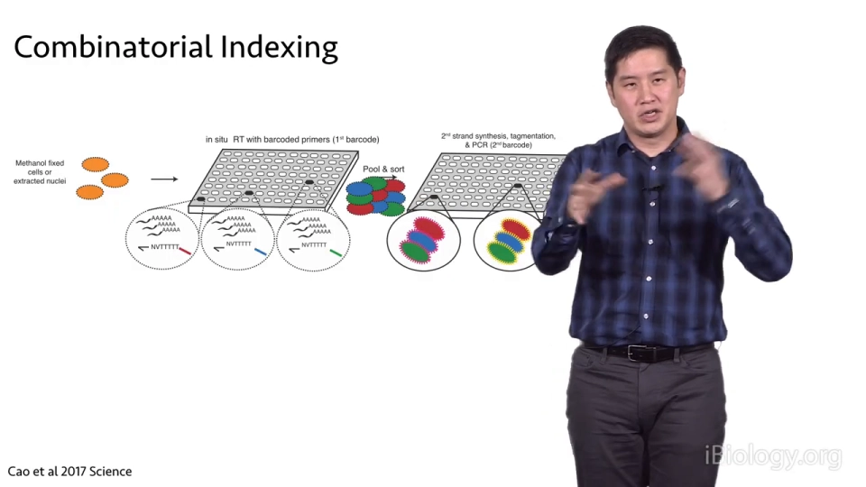

[【跳转到 15:07】](https://www.youtube.com/watch?v=k9VFNLLQP8c&t=907)

这套方法的威力在于**组合数随轮数非线性增长**：

| 每轮孔数 | 两轮组合数 | 三轮组合数 |
| --- | --- | --- |
| 96 | 9,216 | 约 88 万 |
| 384 | 147,456 | 约 5,660 万 |

讲者算过：两轮 384 × 384 就有约 15 万种组合；如果在每一步都用四块 384 孔板（1536 种），两轮就有约 240 万种组合；再加第三轮，96 × 96 × 96 约 100 万，384 × 384 × 384 接近 6000 万。这就是为什么已有研究能在单篇里处理超过一百万个细胞。

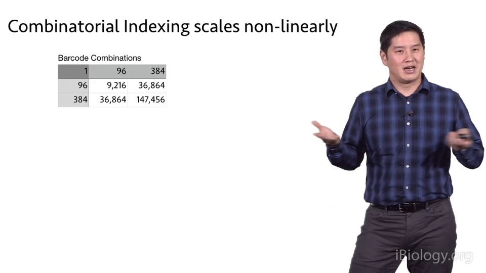

[【跳转到 16:23】](https://www.youtube.com/watch?v=k9VFNLLQP8c&t=983)

## 七、同一套平台还能读蛋白：CITE-seq

单细胞平台并不只能测 RNA。CITE-seq 的做法是：把原本用于流式的抗体，从「偶联荧光基团或同位素」改成**偶联一段 DNA 条形码**——这段序列包含 PCR handle、标识该抗体的条形码，以及一段 poly(A) 尾巴。poly(A) 尾巴让这条抗体标签能被单细胞流程里的 oligo dT 捕获，于是抗体条形码就作为一个「转录本」被一起测序，读出的计数反映该抗体在细胞上的结合量。

这样一来，同一个细胞上既有 RNA 表达谱，又有几十到上百种表面蛋白的丰度，形成**多组学**读出。讲者展示的人/鼠混合细胞数据说明：RNA 与抗体标签都能正确地把人和鼠细胞分开。

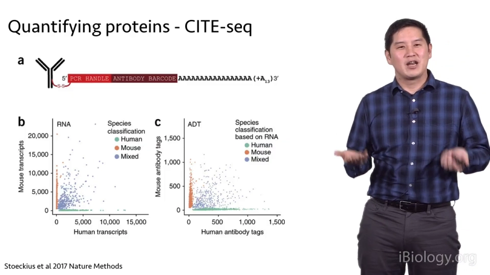

[【跳转到 17:23】](https://www.youtube.com/watch?v=k9VFNLLQP8c&t=1043)

## 八、双细胞问题怎么解：多重标记（multiplexing）

既然双细胞是限制通量的主要瓶颈，一个自然的想法是：**如果能识别出双细胞，就可以放心提高上样浓度，把双细胞在计算时剔除**，用同样的钱拿到更多单细胞。识别的前提是给不同来源的样本打上不同的标记。

### 8.1 按基因型区分：demuxlet

不同人的转录本里带有不同的 DNA 序列（SNP）。把 8 个供体的细胞混在一起上机测序后，每个细胞可以通过其转录本里的基因型被回溯到某个供体。更妙的是：如果一个液滴里装了两个来自不同供体的细胞，这个液滴里就会同时出现两套基因型——**这就是双细胞的判据**，可以直接剔除。

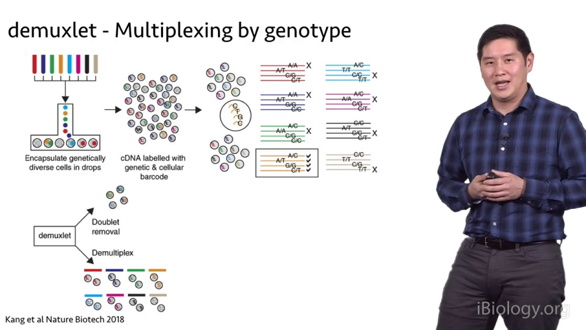

[【跳转到 20:02】](https://www.youtube.com/watch?v=k9VFNLLQP8c&t=1202)

### 8.2 不依赖基因型的两种做法

如果样本不是遗传上可区分的个体，demuxlet 就失效了。讲者给出两条替代路线：

- **基于抗体的 hashtag（HTO）**：选一个通用表面抗原的抗体，分成若干份，每份偶联不同的条形码；不同样本分别与不同条形码的抗体孵育，然后合并上机。测到哪个条形码，就知道细胞来自哪个样本；如果一个液滴里出现两个条形码，就是双细胞。
- **脂质 DNA 标记**：把带条形码的脂质化 DNA 嵌入细胞膜，不依赖任何表面抗原，只要求膜可及。讲者所在团队用这种方法标记了 96 个样本并合并上机，能同时识别单细胞与双细胞。

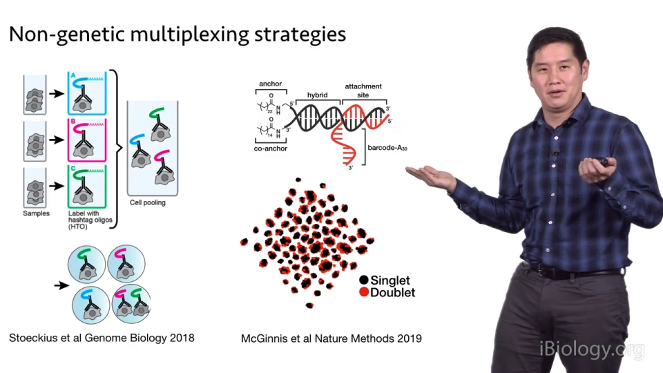

[【跳转到 22:32】](https://www.youtube.com/watch?v=k9VFNLLQP8c&t=1352)

## 九、结论：单细胞的优势与它明确的代价

- **类型多**：今天讲的只是 RNA，同样的思路可以做 DNA、蛋白、染色质可及性，新方法几乎每几周就出现一个。
- **高维读出**：单细胞 RNA 测序探测约 2 万个基因，能揭示低维技术看不到的生物学。
- **通量与成本不如流式**：流式与质谱流式一次可以轻松分析几十万到上百万个细胞，单细胞测序在通量上更低、成本更高。
- **丢失空间信息**：绝大多数单细胞测序方法要求先把组织**解离成单细胞悬液**，空间位置信息随之丢失。若空间关系对问题重要，可以考虑基于显微成像的方法（seqFISH、MERFISH、CODEX），它们通量更低但保留空间信息。

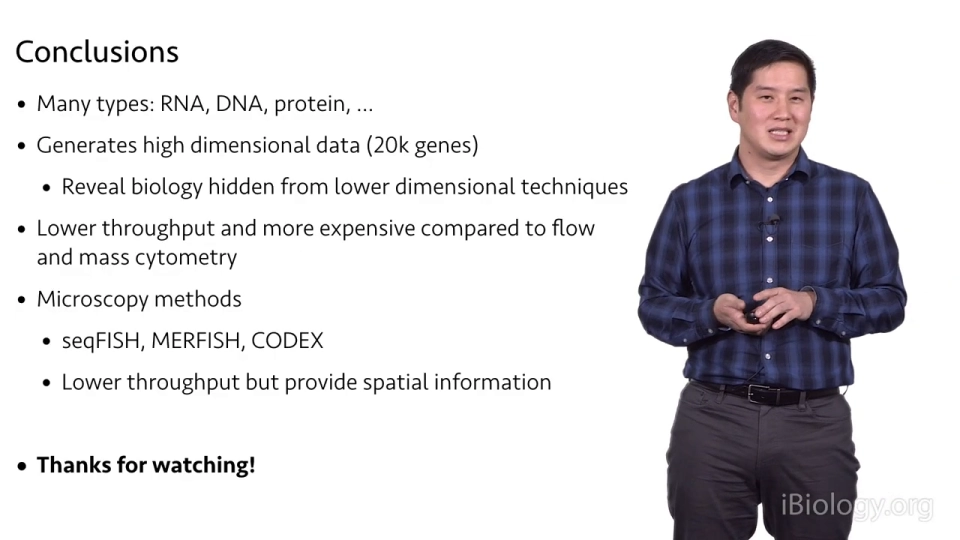

[【跳转到 23:29】](https://www.youtube.com/watch?v=k9VFNLLQP8c&t=1409)

## 小结

- bulk 测序测的是**一管细胞的平均表达**；单细胞测序测的是**每个细胞各自的表达**，前者会稀释甚至抵消掉只发生在少数细胞里的信号。
- 单细胞高维读出的价值在于两件事：能区分细胞类型/亚型，且能对某一群反复下钻看内部异质性；流式细胞术受限于几十个标记，做不到这个维度。
- 所有高通量单细胞方法的核心技巧是**给每个细胞的转录本打上细胞专属条形码**，把物理隔离换成信息隔离。
- 三条并行化路线：板式分选（SMART-seq，几百到几千细胞，但每个细胞都是独立文库）、液滴微流控（Drop-seq / 10x，几万到几十万细胞）、微孔阵列与组合索引（后者靠条形码组合，可上百万细胞）。
- 通量的天花板由**双细胞**决定：随机分配服从泊松分布，浓度越高双细胞越多；10x 靠工程化珠子提高单珠率，demuxlet / HTO / 脂质标记则靠多重标记把双细胞识别出来剔除。
- 单细胞的代价是通量、成本，以及解离组织带来的空间信息丢失。

## 关键术语速查

| 术语 | 一句话解释 |
| --- | --- |
| bulk RNA-seq | 对一管或一块组织提取的总 RNA 测序，得到的是样本内所有细胞表达量的平均 |
| scRNA-seq | 单细胞 RNA 测序，对每个细胞单独测量基因表达 |
| barcode（细胞条形码） | 一段短 DNA 序列，同一个细胞的所有转录本共享同一段，用于在混合测序数据里把细胞区分开 |
| oligo dT | 由一串胸腺嘧啶组成的引物，结合 mRNA 的 poly(A) 尾巴，用来特异性地捕获 mRNA |
| 模板转换（template switch） | 逆转录酶在 cDNA 末端加非模板 C，再由带 G 的寡核苷酸接上另一端接头的机制，使 cDNA 两端都带 PCR handle |
| SMART-seq | 板式单细胞建库方法，一个孔一个细胞，通量低但每个细胞数据完整 |
| Drop-seq | 用微流控把细胞和条形码微珠共封装进液滴的单细胞方法 |
| 泊松分布 | 随机分配下每个液滴分到 $k$ 个细胞的概率分布，决定了空滴与双细胞的比例 |
| doublet（双细胞） | 一个液滴或一个孔里进了两个细胞，测序结果看起来像一个「混合表达」的细胞 |
| 微孔阵列 | 用芯片上大量微小孔位替代液滴来隔离细胞与条形码磁珠的方案 |
| 组合索引 | 多轮条形码组合标识细胞，无需在任一步骤分离单细胞，可扩展到百万级 |
| CITE-seq | 用 DNA 条形码抗体把表面蛋白丰度与 RNA 表达在同一细胞上同时读出 |
| demuxlet | 按转录本中的基因型把细胞归属到供体，并借此识别双细胞 |
| HTO（hashtag） | 带条形码的抗体，用于给不同样本打标签，实现多样本混样上机 |