# 细胞怎么被分开，决定了数据的好坏：七种单细胞 RNA 测序方法的横向比较

> 视频来源：[【陈巍学基因】视频90：对几种单细胞测序方法的系统比较](https://www.bilibili.com/video/BV1tY411p7Cu/)（B 站 · UP 主「陈巍学基因」）｜时长约 16 分钟
> 导读：这支视频逐图解读 2020 年发表在 Nature Biotechnology 上的一篇基准测试论文——把 7 种单细胞 RNA 测序方法放进同一个实验中心、用同一套计算管道平行比较。它的价值在于把「细胞怎么被分开」这件事讲成了可对照的实验设计：板式、液滴、微孔芯片、组合索引四条隔离路线各自付出什么代价、换来什么好处。讲座由晶能（Genenergy）主办、陈巍主讲，内容是论文解读而非产品介绍。barcode 与 UMI 的分子结构、液滴里的逆转录反应属于本脉络 2.1.3 的内容，本文不重复，只把它们当作已知背景，专讲「分离细胞」这一层与平台之间的取舍。

## 本讲要解决的核心问题（SCQA）

**背景**：单细胞测序的分子机制——凝胶微珠上的寡核苷酸怎么用 poly(dT) 抓 mRNA、用 barcode 记细胞身份、用 UMI 记原始分子数——属于 barcode 与 UMI 的解析（2.1.3）。这些机制都发生在「一个细胞已经被单独关起来」之后。

**冲突**：可「把细胞单独关起来」这件事本身就有好几种做法。用流式细胞仪把细胞一个个分进 96 孔板，用微流控把细胞裹进油包水液滴，用微孔芯片把细胞沉降进纳升小孔，甚至干脆不隔离、靠两轮 barcode 组合给细胞编号。这些做法通量差几个数量级，成本差几倍，而且**同一份样本用不同方法测出来的数据并不一致**：有的方法每个细胞能测到几万个 UMI，有的只有几千；有的几乎不产生双细胞，有的双细胞率能到 8%。

**疑问**：这些方法在物理层面究竟怎么把细胞分开？分开之后，谁更灵敏、谁的双细胞更多、谁更容易混进别的细胞的 RNA？做实验时又该按什么标准选？

**回答（中心思想）**：**隔离方式与标识方式是两条独立的轴**——隔离方式（孔、液滴、微孔、组合）决定通量和双细胞率，标识方式（孔位、barcode 微珠、barcode 组合）决定细胞身份怎么被记录下来。这篇论文把 7 种方法放进同一实验中心、统一计算管道后得到的结论是：**板式低通量方法灵敏度最高但通量最低；高通量方法里 10x Chromium 的灵敏度、细胞类型识别能力和易用性都最好；组合索引能把规模放大到极大，但会漏掉部分细胞类型。**

## 一、七种方法、三种样本、三十六个文库

### 1.1 参与比较的七种方法，按「怎么隔离细胞」分成三组

作者一共分析了 7 种方法：Smart-seq2、CEL-Seq2、sci-RNA-seq、10x Chromium、Drop-seq、Seq-Well 和 inDrops。视频把它们按隔离方式归成三类：

1. **基于微孔板（plate-based）**：Smart-seq2 与 CEL-seq2。用流式细胞仪把单个细胞分到 96 孔板的每个孔里，一个孔就是一个细胞。**低通量**。
2. **基于组合索引（combinatorial indexing）**：sci-RNA-seq。也是微孔板，但用法完全不同——不追求「一个孔一个细胞」，而是靠多轮分池、加 barcode 的组合来标识细胞。**高通量**。
3. **基于微珠（bead-based）**：10x Chromium、Drop-seq、inDrops 用微流控产生的**油包水液滴**隔离细胞，再用带 barcode 序列的引物微珠标识细胞；Seq-Well 则是用**微孔芯片**隔离细胞，同样用微珠标识。**都是高通量**。

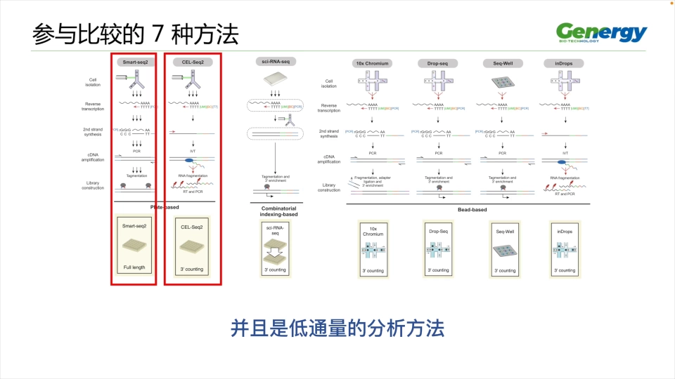

[【跳转到 02:00】](https://www.bilibili.com/video/BV1tY411p7Cu/?t=120)

这张图是整支视频的骨架，值得细看：纵向是五道工序（细胞隔离 → 逆转录 → 二链合成 → cDNA 扩增 → 文库构建），横向是七种方法。可以看到所有方法都走同一条流水线，差别集中在两处——**最上面一行的「细胞怎么被隔离」**，以及**逆转录时接上去的引物长什么样**。图底部还标出了每种方法的测序范围：只有 Smart-seq2 是全长（full length），其余六种都是 3′ 端计数（3′ counting）。

### 1.2 三种样本，各自考一道题

作者没有只用一种样本，而是选了三种，每一种都对应一个特定的检验目的：

- **人 HEK293 细胞 + 小鼠 NIH3T3 细胞的混合样本**。两种细胞系来自不同物种，测出来的 reads 天然带物种差异，因此可以精确判断「一个细胞 barcode 里有没有同时混进人和小鼠的序列」——这正是**双细胞率**和**细胞间交叉污染**的判据。
- **人的外周血单核细胞（PBMC）**。外周血里的细胞天然是分离的，细胞与细胞之间没有粘连，用它可以排除「用实体组织做实验时必须先消化、消化会引入偏差」这个干扰因素。
- **小鼠脑皮层细胞核**。脑皮层里相当大一部分细胞是细长的条型细胞，或者是星型、多角型的，形状不规则；改用圆球型的**细胞核**来做单细胞实验，是一种更方便的做法。这也顺带检验了「细胞核样本」与「完整细胞样本」的差别。

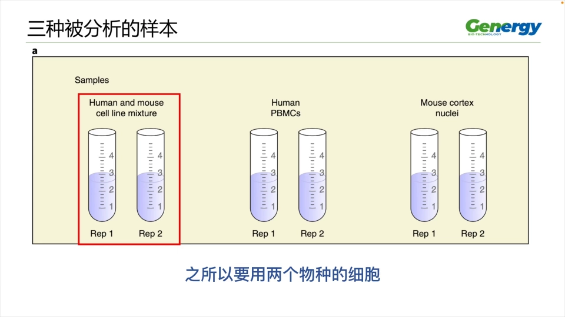

[【跳转到 02:50】](https://www.bilibili.com/video/BV1tY411p7Cu/?t=170)

用这三种样本，作者在**一个实验中心的六个独立实验室**里生成了 **36 个文库**。这个设计很关键：把方法之间的差异和实验室之间的差异分离开，才谈得上「平行比较」。

## 二、四条隔离路线：细胞到底是怎么被分开的

### 2.1 微孔板 + 流式分选：一个孔一个细胞

Smart-seq2 和 CEL-seq2 的做法最直白：用流式细胞仪（FACS）把细胞一个一个分进 96 孔板的孔里，每个孔单独裂解、单独逆转录、单独扩增。**隔离是确定性的**——分选仪看到几个细胞就落几个细胞，所以双细胞率天然很低；代价是通量：一块 96 孔板最多 96 个细胞，一天下来能处理的细胞数远达不到「几万个」。

正因为每个细胞独享一个反应孔、独享一次扩增，没有别的细胞来分走酶和引物，这类方法的**灵敏度最高**——后面第四节的数据会反复印证这一点。

### 2.2 油包水液滴：随机包裹，双细胞是概率事件

10x Chromium、Drop-seq、inDrops 走的是另一条路：在微流控芯片上让细胞悬液与带 barcode 的凝胶微珠、以及分相油在十字路口汇合，油把水相剪成一颗颗油包水液滴，理想情况下每颗液滴里装一个细胞、一颗微珠。细胞是被**随机**分配进液滴的，因此「一颗液滴里进了两个细胞」不是故障而是概率的必然结果——这就是**双细胞（doublet）**的来源。液滴里 barcode 与逆转录反应的分子细节属于 2.1.3，这里不再展开；本节只关心它带来的两个后果：**通量极高**（一次几万个液滴并行），以及**双细胞无法靠物理手段避免，只能事后识别**。

### 2.3 微孔芯片：Seq-Well 的纳升小孔

Seq-Well 介于两者之间：它不用油把水相剪开，而是在一块芯片上做出密密麻麻的微孔，让细胞沉降进去，每个微孔装一个细胞，再铺上一层带 barcode 的微珠把孔口封住。**隔离靠的是孔的物理边界**，标识仍然靠微珠上的 barcode。它的通量同样是高通量级别，成本却比液滴方案更低——这是它在这篇论文里的定位。

### 2.4 组合索引：sci-RNA-seq 用 barcode 组合代替物理隔离

sci-RNA-seq 的思路最「反直觉」：它并不追求把每个细胞关进独立的空间，而是把大量细胞先固定、再**反复分池**——第一轮把细胞分成若干池，每池加一种带 barcode 的引物；合并后再分成若干池，加第二种 barcode；如此几轮下来，一个细胞最终携带的 barcode 组合，就唯一地标识了它走过的路径。这就是**组合索引（combinatorial indexing）**，也叫 split-pool。

好处是规模可以做得极大（细胞数不受孔数或液滴数限制），代价是**每个细胞能分到的测序 reads 变少**，而且 barcode 组合存在碰撞的可能。后面会看到，sci-RNA-seq 在「找到稀有细胞类型」这一项上确实吃了亏。

> 把这四条路线并排看，会发现「隔离」和「标识」是两件可以拆开的事：板式用**孔位**标识细胞，微珠类用**barcode 微珠**标识，组合索引用**barcode 组合**标识。判断一个平台的能力，先看它用哪种隔离（决定通量与双细胞），再看它用哪种标识（决定身份如何记录）。

## 三、先统一计算管道，再比实验

在比实验之前，作者做了一件容易被忽略但至关重要的事：**开发一套统一的计算管道**。

原因是每种方法都有自己的标准分析流程，如果各用各的管道，比出来的差异里就混进了「软件差异」。所以作者用同一套「通用」管道处理所有数据，把计算引入的处理差异消掉。

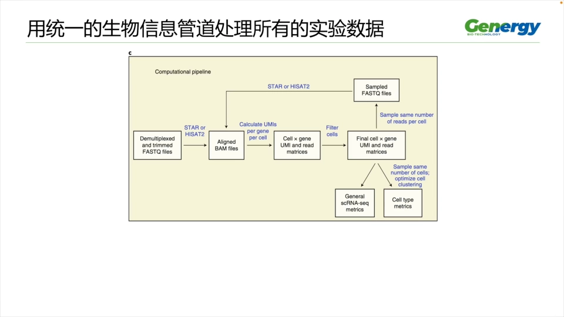

[【跳转到 04:12】](https://www.bilibili.com/video/BV1tY411p7Cu/?t=252)

管道本身很朴素：拆分与修剪后的 FASTQ 用 STAR 或 HISAT2 比对成 BAM → 按细胞统计 UMI，得到「细胞 × 基因」矩阵 → 过滤细胞 → **把每个细胞的 reads 数采样到同一水平、把细胞数也采样到同一水平** → 再算通用指标和细胞类型指标。最后这一步采样是公平比较的前提：不把测序深度拉平，灵敏度的高低就分不清是方法好还是钱多。

作者用五项关键指标评估这些方法：

1. reads 比对到核基因组和线粒体基因组的情况；
2. 捕捉 RNA 分子的**敏感性**；
3. 混合细胞实验中，一个细胞 barcode 对应到**多细胞**的出现比例；
4. 估计基因表达时的**技术精度与重现性**；
5. 在各种细胞类型之间找出**有意义的生物学差异**的能力。

接下来的八个小节，就是这五项指标逐项开出的成绩单。
## 四、成绩单：八项比较各自说明了什么

### 4.1 reads 落在哪里：外显子比例差出一倍

第一项比较的是 reads 的比对位置。三种样本各画一张堆叠柱状图，每根立柱是一个实验，相邻两根是同一份样本的两个重复；灰色是外显子 reads，土黄色是内含子 reads，此外还有基因间、比对模糊和无法比对的部分。

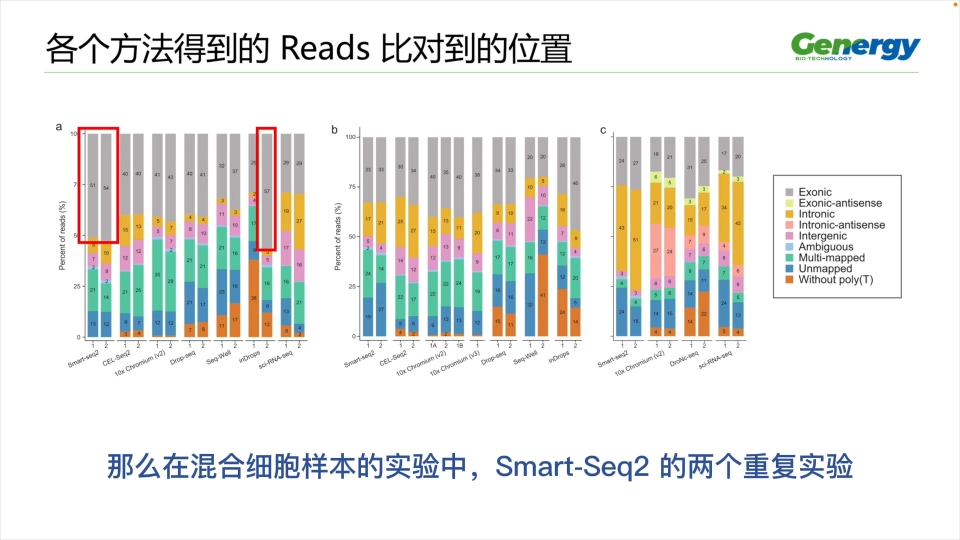

[【跳转到 05:26】](https://www.bilibili.com/video/BV1tY411p7Cu/?t=326)

对下游分析来说，最有用的首先是外显子 reads —— 大多数研究只用外显子 reads；其次是内含子 reads，在细胞核样本的研究中用得比较多。结果：

- 混合细胞样本里，**Smart-seq2 的两个重复实验和 inDrops 的一个实验外显子 reads 比例最高，都超过 50%**；
- **sci-RNA-seq 表现最差**，外显子比例只有 28.7% 和 29.4%；
- PBMC 样本的外显子比例整体偏低，只有 inDrops 的一个实验达到 46%；
- 脑皮层**细胞核**样本中，内含子相对于外显子的比例明显更高——这与预期一致，因为细胞核里包含了更多还没剪切的转录本。

最后一条对做核转录组的人特别重要：**用细胞核做样本时，内含子 reads 不是噪声，而是有效信号**，分析时不该像处理全细胞数据那样把它们丢掉。

### 4.2 灵敏度：板式最高，高通量里 10x 最高

灵敏度，或者说捕获 RNA 分子的能力，是 scRNA-seq 最核心的质量指标——因为每个细胞起始的 RNA 量极少，抓不到就等于没测到。作者用每个细胞检测到的 UMI 数或基因数来衡量。

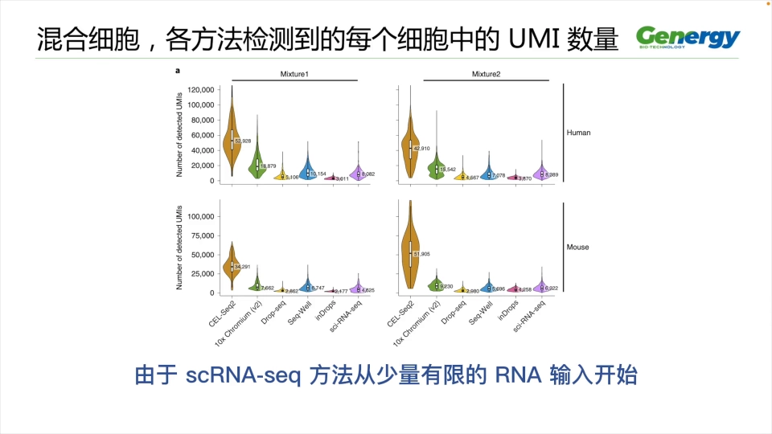

[【跳转到 07:03】](https://www.bilibili.com/video/BV1tY411p7Cu/?t=423)

图里没有 Smart-seq2，因为它本身不带 UMI。可以看到：**CEL-Seq2 因为一次处理的细胞数少，每个细胞得到的 UMI 数量明显多于其他方法**（人类细胞约 3.6 万），其次是 **10x Chromium（约 1.6 万）**；Drop-seq、inDrops、Seq-Well 都在几千的量级（Drop-seq 约 3000）。换成基因数看，结论一致：**两个低通量板式方法检出的基因数最多**，高通量方法中 10x Chromium 最多，inDrops 和 Drop-seq 最少。

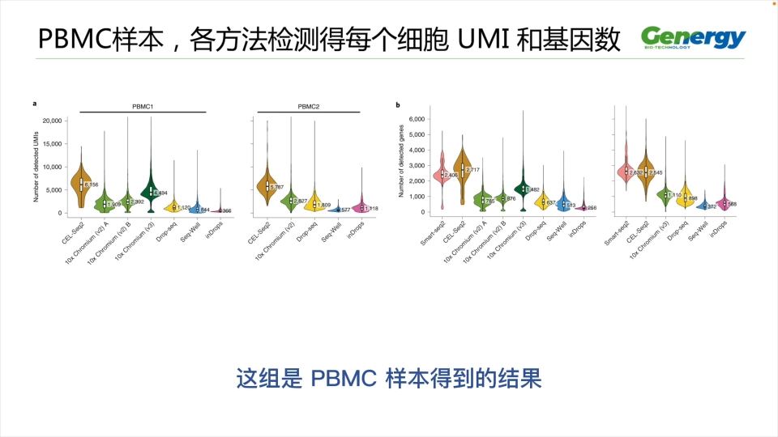

[【跳转到 07:53】](https://www.bilibili.com/video/BV1tY411p7Cu/?t=473)

PBMC 样本和脑皮层细胞核样本给出同样的排序：低通量的 Smart-seq2、CEL-Seq2 每个细胞测到的 UMI 和基因最多；高通量方法里 10x Chromium 的 UMI 数和基因数都最高。

### 4.3 同样的测序深度，能看到多少基因

UMI 总数会受测序深度影响，所以作者又做了一步更公平的比较：**把每个细胞的 reads 数拉平**，看同样深度下能检出多少基因。

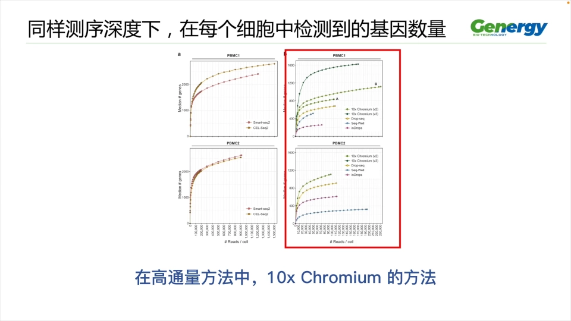

[【跳转到 08:43】](https://www.bilibili.com/video/BV1tY411p7Cu/?t=523)

左列是两个低通量方法，两条曲线差别不大；右列是高通量方法，**10x Chromium 的曲线明显更高，也就是同样的测序深度能测到更多基因**。换成「同样深度下的 UMI 数」看，结论不变：高通量方法中 10x Chromium 最高。

作者还画了每个细胞的 UMI 数与基因数的关系，发现两者呈**线性关系**——这其实很好理解：抓到的分子越多，覆盖到的基因种类自然越多。所以「基因数」和「UMI 数」这两个指标在很大程度上是同一件事的两种说法。

### 4.4 双细胞率：全部低于 3.5%，但有一个例外

第五项比较直指液滴法的软肋。用人鼠混合样本，只要一个细胞 barcode 里同时出现人和小鼠的序列，就说明这颗液滴（或这个孔）里进了两个细胞。

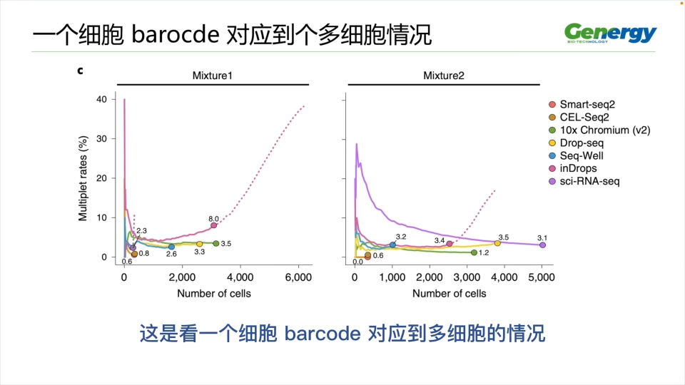

[【跳转到 09:56】](https://www.bilibili.com/video/BV1tY411p7Cu/?t=596)

结果：**几乎所有检测的双细胞比例都低于 3.5%，只有一个 inDrops 的实验达到 8.0%**。并且**两个低通量板式方法的双细胞率最低**——因为它们是用流式细胞仪把单个细胞逐个放进微孔，隔离是确定性的，不像液滴那样靠概率。

这条结果正好解释了液滴法的机制：液滴法的双细胞不是操作失误，而是「随机包裹」这一物理过程的内在生产物；提高细胞浓度能提升液滴利用率，同时也会推高双细胞率。**怎么检测和去除双细胞，属于 2.2.4 的内容，本节只交代它从哪来。**

### 4.5 交叉污染：混进来的「别人的 RNA」

双细胞是「两个细胞进了同一个隔间」，交叉污染则是「别的细胞的 RNA 分子飘进了自己的隔间」。作者用 7 张散点图来量化：横轴是一个细胞中来自人类的基因数，纵轴是来自小鼠的基因数。

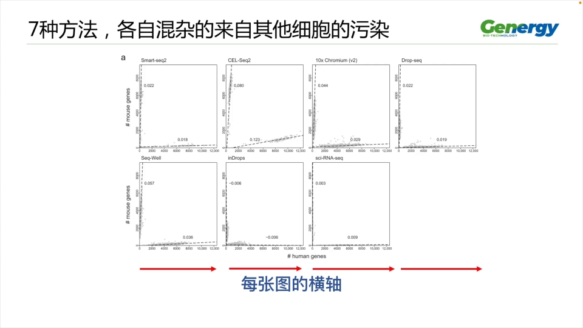

[【跳转到 10:46】](https://www.bilibili.com/video/BV1tY411p7Cu/?t=646)

判读方法很直观：如果细胞里的序列很纯粹，代表它的点就落在横轴或纵轴上；如果混进了另一物种的序列，点就会往图中央跑。换句话说，**两个物种各自的拟合线越贴近 X 轴和 Y 轴，这个方法被污染的 reads 就越少**。

结论：低通量方法里 **Smart-seq2 的拟合线坡度更平，表现优于 CEL-seq2**；高通量方法里 **inDrops 的拟合线最贴近两条坐标轴，这一项表现最好**。污染主要来自样本处理过程中游离的 RNA（例如裂解释放的转录本），液滴与微孔方案在这方面的差别，很大程度上取决于洗涤与封闭做得如何。

### 4.6 重现性：超出泊松分布的那部分变化

第六项比较技术精度：同一种样本做两次实验，两次结果之间的变化有多大。按统计规律，计数数据的随机波动通常服从泊松分布——如果两次实验的差异**只剩下**泊松抽样带来的那点波动，说明方法非常稳定；**超出泊松分布的变化越大，可重复性越差**。

一种常见的写法是把观测到的方差扣掉泊松噪声（泊松分布下方差等于均值）剩下的部分作为「额外变异」：

$$
\sigma^{2}_{\text{extra}} = \sigma^{2}_{\text{obs}} - \mu
$$

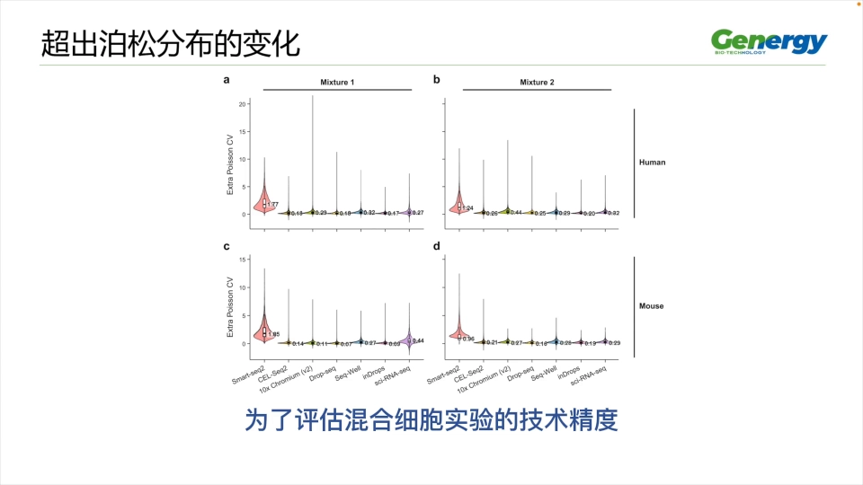

[【跳转到 11:46】](https://www.bilibili.com/video/BV1tY411p7Cu/?t=706)

结果显示：**CEL-Seq2、inDrops 和 Drop-seq 始终具有相对较低的超出泊松分布的变化，可重复性较高**；而 **Smart-seq2 的超出泊松变化很高，可重复性最低**。这一点有些反直觉——灵敏度最高的方法反而最不稳定。原因不难猜：板式方法每个细胞单独扩增，扩增效率在孔与孔之间的波动会被完整保留下来；而高通量方法共享同一批试剂与同一套流程，系统性的波动反而更一致。

### 4.7 细胞类型识别：能不能找到那 1% 的稀有细胞

单细胞 RNA 测序最突出的实际应用之一，就是通过聚类识别不同的细胞类型。这一项比的是「各方法分辨细胞簇的能力」。

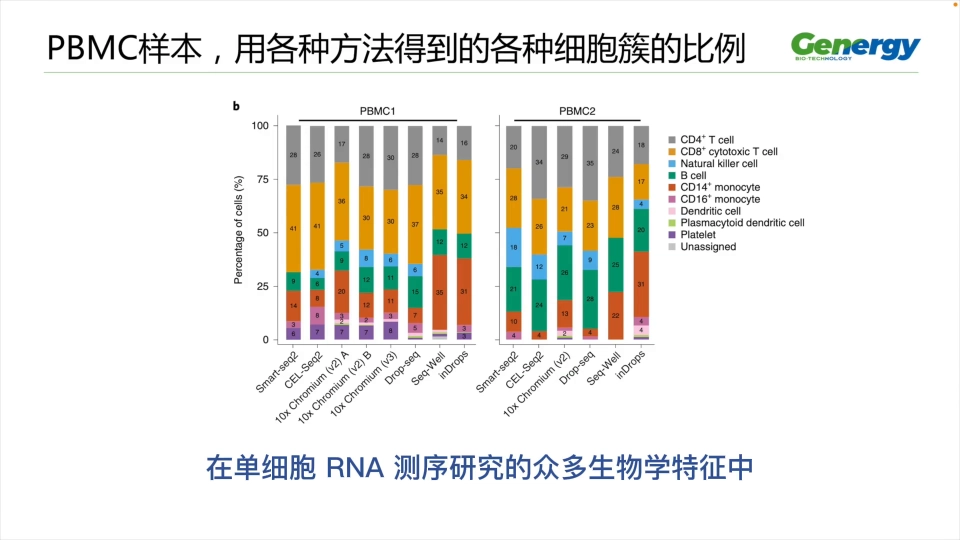

[【跳转到 12:30】](https://www.bilibili.com/video/BV1tY411p7Cu/?t=750)

在 PBMC 样本中，**10x Chromium 和 inDrops 的表现良好**。大多数方法都能成功找出 PBMC 中丰度高的细胞类型（比如 CD4+ T 细胞、CD14+ 单核细胞），差别出在**稀有细胞类型**上——例如浆细胞样树突细胞和血小板，它们在不同方法中被捕获的比例差别很大。低通量方法的问题很直接：**细胞总数不够，就找不到稀有类型**。

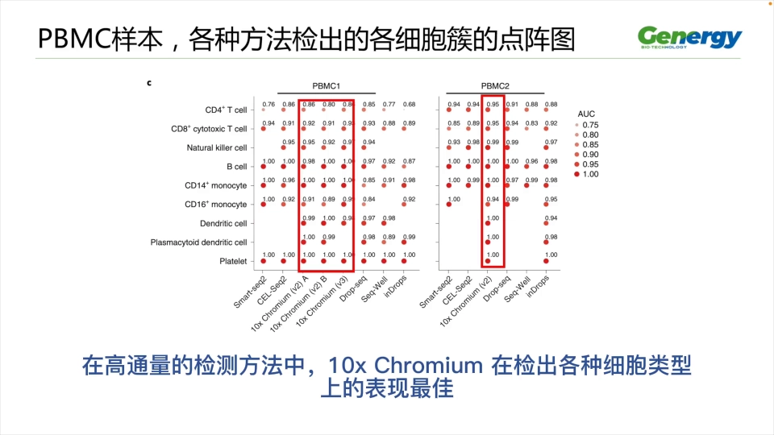

[【跳转到 12:55】](https://www.bilibili.com/video/BV1tY411p7Cu/?t=775)

用点阵图（颜色代表找到特定类型细胞的确信度）看，**高通量方法中 10x Chromium 在检出各种细胞类型上表现最佳**。小鼠脑皮层样本的结论类似：过去的研究已经明确定义了脑皮层的多种细胞类型，参与分析的 4 种方法里有 3 种找到了要找的全部类型，**只有 sci-RNA-seq 没找全——它既找不到少突胶质祖细胞，也找不到小胶质细胞**。

### 4.8 合并分析：把各方法的数据放在一起，信号更强

为什么有些方法会漏掉细胞类型？作者给出两种可能：一是实验本身的问题，文库中确实不包含来自某些细胞类型的 cDNA；二是测序深度和细胞数量不够，来自这些细胞的数据质量不足以把它们识别出来。

为验证第二种可能，作者把所有方法测到的细胞**合并起来**做聚类分析。

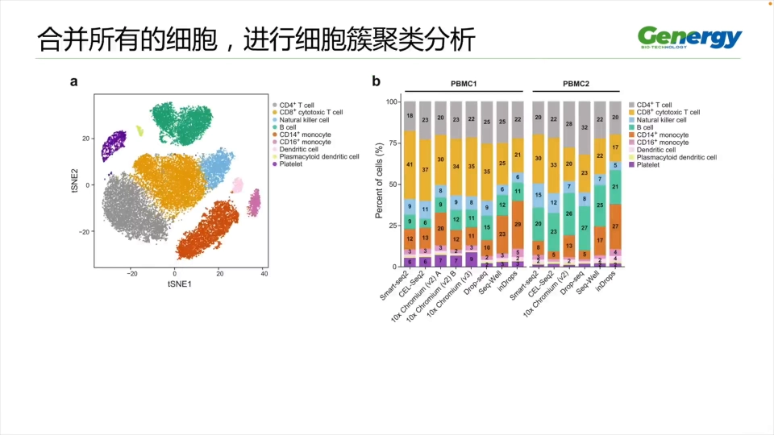

[【跳转到 13:55】](https://www.bilibili.com/video/BV1tY411p7Cu/?t=835)

合并之后，**各个方法都分析出了那些稀有细胞类型**——说明之前漏掉它们，很大程度上是「细胞数不够」而不是「方法测不到」。这也从侧面说明：单细胞数据的价值随细胞数量累积，多个数据集合并往往比单个数据集更深挖更有效。

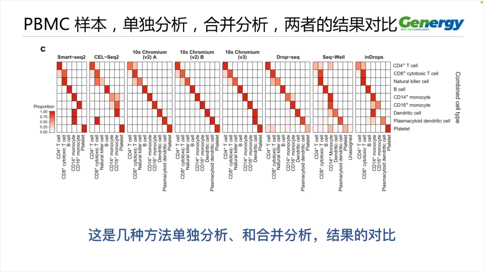

[【跳转到 14:28】](https://www.bilibili.com/video/BV1tY411p7Cu/?t=868)

接下来比较「单独分析」与「合并分析」的一致性：纵轴是合并分析的结果，横轴是 8 个实验单独分析的结果，格子越红表示一致性越高。**10x Chromium V2 的单独分析结果与合并分析一致性最好，其次是 10x Chromium V3**；对脑皮层细胞核做同样的分析，同样是 10x Chromium 的一致性最好。

## 五、结论表：七种方法该怎么选

最后，视频给出一张完整的评比表，把通量、方法类型、敏感性、细胞类型识别能力、好处与缺点并列在一起。

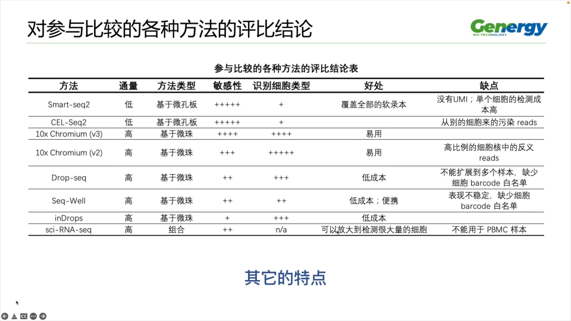

[【跳转到 15:03】](https://www.bilibili.com/video/BV1tY411p7Cu/?t=903)

把表整理成文字如下（「敏感性」与「识别细胞类型」两列的加号越多表示越强）：

| 方法 | 通量 | 隔离方式 | 敏感性 | 识别细胞类型 | 好处 | 缺点 |
| :--- | :--- | :--- | :--- | :--- | :--- | :--- |
| Smart-seq2 | 低 | 微孔板 | ++++++ | + | 覆盖全部转录本 | 没有 UMI；单细胞检测成本高 |
| CEL-Seq2 | 低 | 微孔板 | +++++ | + | 3′ 端计数、成本低于 Smart-seq2 | 混入来自其他细胞的污染 reads |
| 10x Chromium v3 | 高 | 微珠（液滴） | ++++ | ++++ | 易用 | 未列出 |
| 10x Chromium v2 | 高 | 微珠（液滴） | +++ | +++++ | 易用 | 细胞核样本中反义 reads 比例高 |
| Drop-seq | 高 | 微珠（液滴） | ++ | +++ | 低成本 | 不能扩展到多个样本，缺少细胞 barcode 白名单 |
| Seq-Well | 高 | 微珠（微孔） | ++ | ++ | 低成本、便携 | 表现不稳定，缺少细胞 barcode 白名单 |
| inDrops | 高 | 微珠（液滴） | + | +++ | 低成本 | 未列出 |
| sci-RNA-seq | 高 | 组合索引 | ++ | 不适用 | 可以放大到检测极大量细胞 | 不能用于 PBMC 样本 |

从这张表可以读出三条选型逻辑：

1. **要灵敏度、要全长转录本、细胞数不多** → 选板式（Smart-seq2、CEL-Seq2）。代价是成本高、通量低、Smart-seq2 还没有 UMI。
2. **要通量、要稳定、要少折腾** → 选 10x Chromium。它在高通量方法里灵敏度最好、细胞类型识别最好，而且**商业化整合包装做得最完整，易用性最好**——这一点在真实实验室里往往比参数表更重要。
3. **要极致规模、不在乎单细胞深度** → 组合索引（sci-RNA-seq）。它能放大到检测极大量细胞，但每个细胞的深度被摊薄，且不能用于 PBMC 这类样本。

## 小结

- **隔离方式与标识方式是两条独立的轴**：板式靠孔位隔离、靠孔位标识；液滴与微孔芯片靠物理隔间隔离、靠 barcode 微珠标识；组合索引干脆放弃物理隔离，用 barcode 组合标识细胞。
- **隔离方式决定通量和双细胞率**：流式分选进孔是确定性的，双细胞率最低；液滴是随机包裹，双细胞是概率事件，这篇论文里除一个 inDrops 实验达到 8.0% 外，其余都低于 3.5%。
- **灵敏度与通量是此消彼长的**：板式方法每个细胞的 UMI 数和基因数最高（CEL-Seq2 约 3.6 万 UMI），高通量方法只有几千到一万多，其中 10x Chromium 最高。
- **同样的测序深度下，10x Chromium 能看到更多基因**，这比「总 UMI 数」更能反映方法的捕获效率。
- **交叉污染与重现性各有胜负**：inDrops 的物种交叉污染最少；CEL-Seq2、inDrops、Drop-seq 的重现性最好，灵敏度最高的 Smart-seq2 反而最不稳定。
- **稀有细胞类型是低通量方法的死穴**：细胞数不够就找不到；合并多个方法/数据集之后，各方法都能找回这些类型，说明「细胞数」本身就是一种分辨率。
- **一张表的结论**：板式最灵敏、10x Chromium 最好用且高通量里最灵敏、组合索引规模最大但深度最浅。

## 关键术语速查

| 术语 | 一句话解释 |
| :--- | :--- |
| 微孔板法（plate-based） | 用流式细胞仪把单个细胞分进 96 孔板的孔里，一孔一细胞，通量低但灵敏度高 |
| 液滴法（droplet-based） | 用微流控让油把细胞悬液剪成油包水液滴，一滴一细胞，通量极高但双细胞靠概率 |
| 微孔芯片法 | 芯片上做出大量微孔，细胞沉降进孔、微珠封口，如 Seq-Well |
| 组合索引（combinatorial indexing） | 反复分池、多轮加 barcode，用 barcode 组合代替物理隔离来标识细胞，如 sci-RNA-seq |
| 双细胞（doublet） | 同一个 barcode 里混进了两个细胞的转录本，液滴法随机包裹的必然产物 |
| 交叉污染 | 别的细胞释放的游离 RNA 混进当前细胞的反应体系，表现为异物种 reads |
| UMI | 唯一分子标识符，用来把测序 reads 折算回原始 mRNA 分子数 |
| 超泊松变异（Extra Poisson CV） | 两次重复实验的差异中，扣掉泊松抽样噪声后剩下的技术波动，越小越可重复 |
| 3′ 端计数 | 只测转录本靠近 3′ 端的一小段，配合 UMI 做分子计数，是高通量方法的主流方案 |
