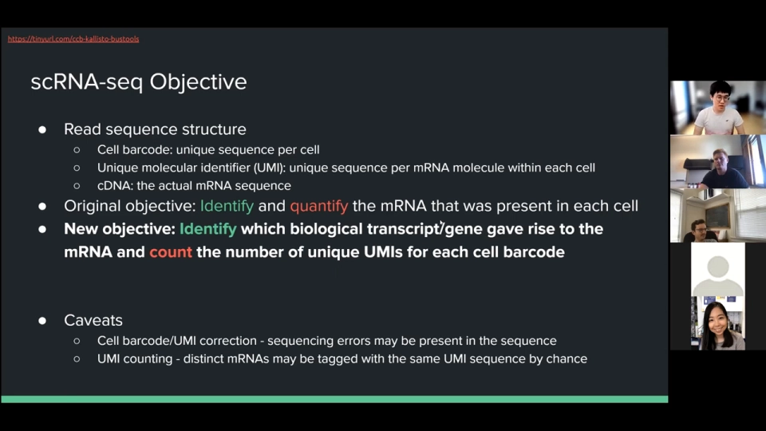
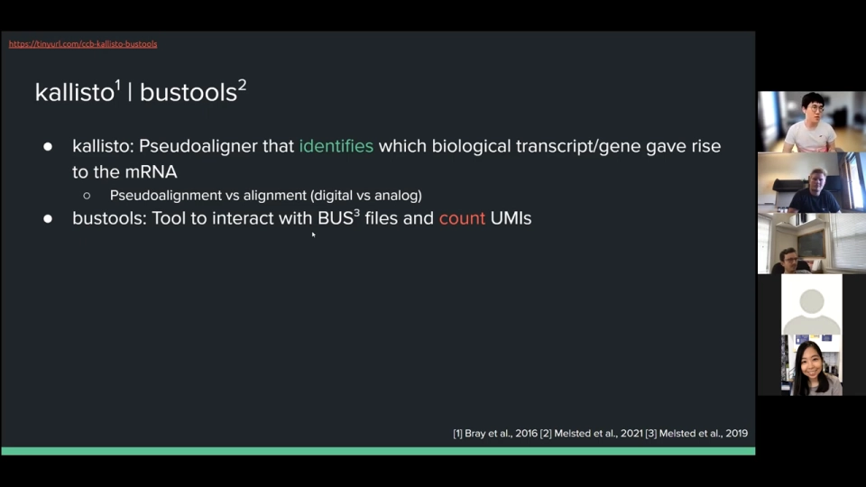
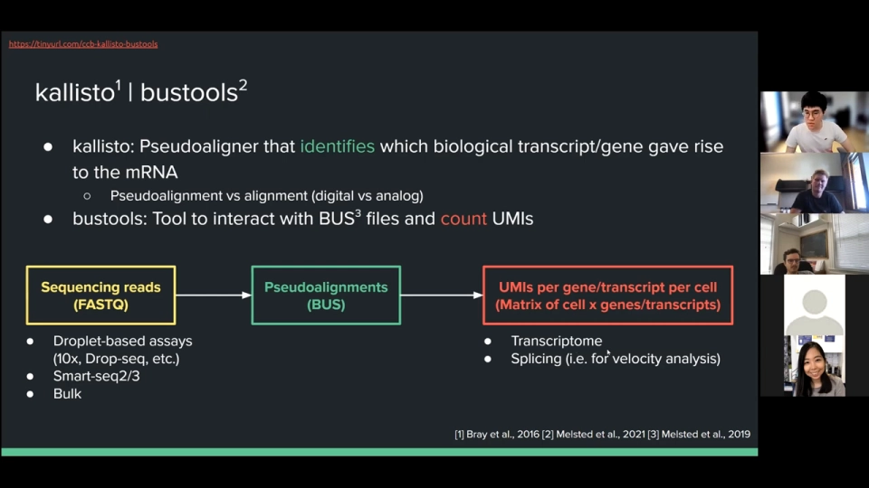
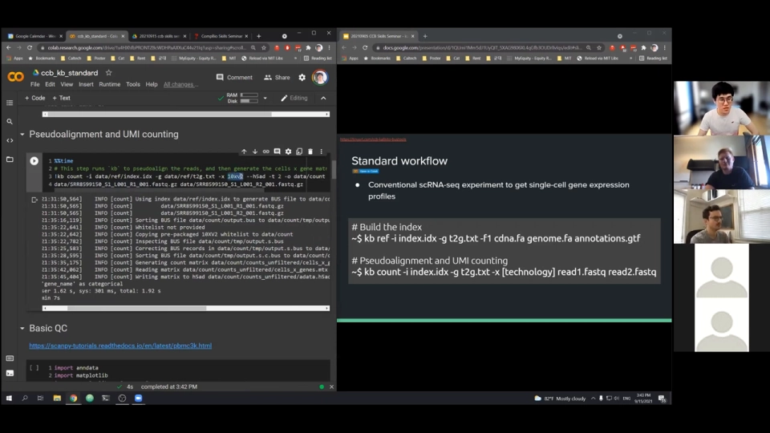
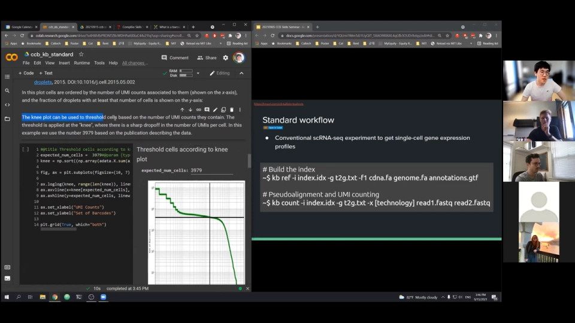
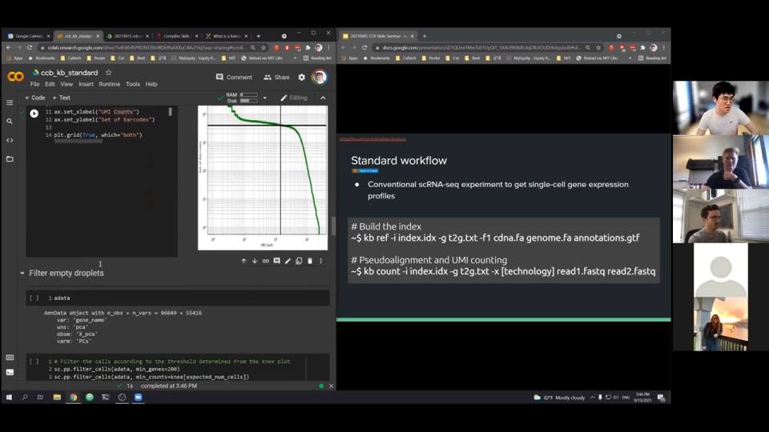
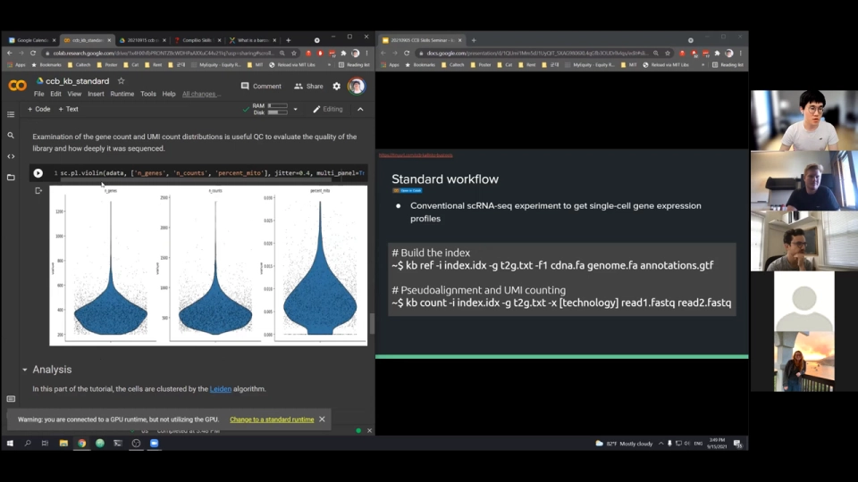
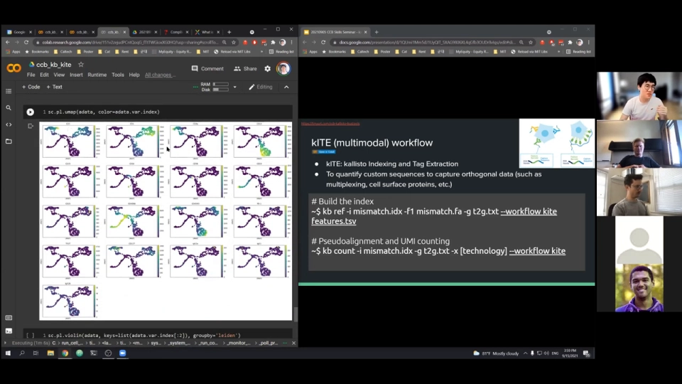

# kallisto bustools 预处理：UMI 去重与 knee plot 如何把 96,649 个 barcode 筛成 3,531 个细胞

> 视频来源：[Fast and efficient preprocessing of single-cell RNA-seq with kallisto|bustools](https://www.youtube.com/watch?v=veg7NU2Yz1E)（YouTube · UC Berkeley CompBio Skills Seminar，讲者 Joseph Min，MIT EECS / Pachter 实验室）｜时长约 58 分钟
> 导读：这是 kallisto|bustools 作者之一在伯克利 CompBio Skills Seminar 上的实战讲座，前半段把「为什么需要 UMI、UMI 会遇到哪两类误差」讲透，后半段在 Colab 里跑完整流程，用一份小鼠视网膜数据把 96,649 个 barcode 筛成 3,531 个细胞。本文聚焦其中与本节直接相关的一半——**UMI 去重与它要处理的两类误差**；barcode 与 UMI 的分子结构即本节内容，伪比对与基因定量的算法细节属于 2.1.6，count matrix 本身属于 2.2.1。后半段的 knee plot 与 cell calling、过滤后的质控属于本脉络 2.2 的范围，本文保留原讲座结构，但本节不把它们计入覆盖。

## 本讲要解决的核心问题（SCQA）

**背景**：液滴法单细胞测序跑完，你手上是一堆 FASTQ。每条 read 上除了 mRNA 序列本身，还有两段人工加上去的短序列：**细胞 barcode**（哪一颗凝胶珠，也就是哪个细胞）和 **UMI**（哪一分子 mRNA）。

**冲突**：这两段序列让「按细胞、按分子计数」成为可能，但中间隔着两道坎。第一道坎是**PCR**：一个细胞里的 mRNA 只有皮克级，必须扩增几十万倍才够测序，而扩增是有偏好的——有的分子被复制成 50 份，有的只有 2 份。如果直接数 reads，你数的是「扩增效率」而不是「原始分子数」。第二道坎是**空液滴**：一次运行里绝大多数液滴根本没装到细胞，只是把溶液里游离的 mRNA 包了进去，这些 barcode 也有一堆 reads。

**疑问**：怎么把一堆 reads 变成「每个细胞、每个基因、有多少个原始 mRNA 分子」？

**回答（中心思想）**：**两件事，一件管分子，一件管细胞。** 管分子靠 **UMI 去重**：同一个 (barcode, 基因, UMI) 组合下的所有 reads 都视为同一个原始分子的 PCR 拷贝，合并成 1 个 count——于是「数 reads」变成「数不同的 UMI」。管细胞靠 **knee plot**：把所有 barcode 按 UMI 总数降序排列，在曲线陡降的拐点（knee）处切一刀，左边算细胞、右边算空液滴。这两步都建立在同一个前提上——**barcode 和 UMI 序列本身可能带测序错误，必须先纠正再计数**，否则一个错一个碱基的假 UMI 会被当成一个新分子，计数直接被高估。



[【跳转到 13:05】](https://www.youtube.com/watch?v=veg7NU2Yz1E&t=785)

## 一、为什么必须有 UMI：PCR 让一个分子变成很多拷贝

### 1.1 从 bulk 到单细胞，多出来的三个问题

讲者用「拆解」的方式开场。bulk RNA-seq 是把组织消化开、整管测序，得到的是**所有细胞混在一起的平均表达**。要把它变成单细胞层面，得依次解决三件事：

1. **怎么把细胞分开**——主流做法是微流控，把单个细胞包进纳升级液滴，准确率很高，但偶尔会包进两个（doublet）。
2. **怎么知道每条 mRNA 来自哪个细胞**——给每颗凝胶珠一条**独一无二的细胞 barcode**，同一个液滴里所有 mRNA 都被打上同一个 barcode，测序时读出来就知道它属于哪个细胞。捕获靠 poly-dT 引物与 mRNA 的 poly-A 尾巴配对。
3. **怎么在扩增之后还数得清分子**——这才是 UMI 要解决的问题。

[【跳转到 05:30】](https://www.youtube.com/watch?v=veg7NU2Yz1E&t=330)

### 1.2 扩增偏好：数 reads 等于数扩增效率

单细胞里每个液滴的 mRNA 分子数远少于 bulk，所以必须做多轮 PCR 才能测到。问题在于**扩增不是等比的**：

- 有的转录本「更容易被扩增」，有的（比如特别长的）不容易；
- 结果是同一个原始分子可能变成 50 条 reads，另一个只变成 2 条。

如果直接统计 reads 数，你测到的是「谁更讨 PCR 喜欢」，而不是「细胞里原来有几个分子」。**UMI 的作用就是给每个原始分子发一个身份证，让这些拷贝能被认出来并合并。**

[【跳转到 09:20】](https://www.youtube.com/watch?v=veg7NU2Yz1E&t=560)

### 1.3 UMI 是一段随机序列

UMI（unique molecular identifier）是反转录时随机合成的一小段碱基。因为随机，两个不同的原始分子**大概率**抽到不同的 UMI；于是「同一 barcode + 同一基因 + 同一 UMI」的 reads 就可以判定为同一个原始分子的拷贝。

这里有个容易被忽略的量化事实：UMI 的空间是有限的。若 UMI 长度为 $n$ 个碱基，可能的序列共有

$$
N_{\text{UMI}} = 4^{n}
$$

种。取 $n = 12$ 时 $4^{12} \approx 1.7 \times 10^{7}$——看起来很大，但一个细胞里高表达基因的分子数可以到上万，**碰撞（collision）在小范围内是必然会发生的**，这正是讲者列出的第二个 caveat。

[【跳转到 10:35】](https://www.youtube.com/watch?v=veg7NU2Yz1E&t=635)

## 二、UMI 去重的目标：数「不同的 UMI」，而不是数 reads

### 2.1 把目标写成一句可执行的话

讲者把「单细胞 RNA 测序要干什么」重新表述成一句更技术的话：

> 第一，确定每条 mRNA 来自哪个**生物学转录本/基因**；第二，**数出每个 cell barcode 上有多少个不同的 UMI**。

第二句就是 UMI 去重的定义。用符号写出来，细胞 $b$、基因 $g$ 的计数是

$$
c_{b,g} = \left\lvert \{\, u : \text{存在 read 同时带有 barcode } b \text{、基因 } g \text{、UMI } u \,\} \right\rvert
$$

注意集合里装的是 **UMI 的取值**，不是 read 的条数。这就是「去重」两个字的全部含义：**同一个 $u$ 出现多少次都只算 1**。



[【跳转到 09:10】](https://www.youtube.com/watch?v=veg7NU2Yz1E&t=550)

### 2.2 为什么「去重」不是可选项

设想一个基因在某个细胞里只有 1 个 mRNA 分子，被扩增成 30 条 reads。不去重时它贡献 30 个 count；去重后贡献 1 个。这个差别在两类分析里是致命的：

- **差异表达**：扩增效率的差异会被当成生物学差异；
- **RNA velocity 之类的动力学分析**：它要求的是「有多少个新合成的分子」，数错分子数就全错了。

讲者在后面演示 RNA velocity 工作流时也强调，那条流程之所以要单独区分 spliced / unspliced reads，前提同样是「计数单位是分子，不是 reads」。
## 三、两个必须处理的误差：测序错误与 UMI 碰撞

讲者在同一页幻灯片上把两个 caveat 并列摆出来，它们对应两种完全不同的失效模式，处理手段也不同。

### 3.1 测序错误：会凭空造出「假 UMI」

测序仪不是 100% 准确的。假设一个真分子的 UMI 是 `ACGTACGTACGT`，测序时某条 read 在这个位置错了一个碱基，变成 `ACGTACGTACGA`。如果直接按「不同 UMI 就不同分子」来数，这一个分子就被数成了**两个**。

这个错误是系统性的：**测序深度越高、UMI 越长，出错的机会越多**；而且错误 UMI 的计数通常很低（往往只有 1 条 read），因为它只是真 UMI 的一次偶然误读。这就给了纠正的抓手——**把「只差一个碱基、且计数明显更低」的 UMI 合并到高计数的那个上**。

讲者没有在这支视频里展开具体的合并算法（那是 UMI-tools 等工具的主场），但他明确把这件事列为流水线必须完成的一步，并在 bustools 的功能列表里点名了 **barcode correction** 与 **UMI collapsing**。

### 3.2 UMI 碰撞：两个真分子抽到了同一个号

第二类误差与测序无关，纯粹是概率问题：UMI 只有 $4^n$ 种，分子数一多，就必然有两个不同的原始分子抽到同一个 UMI。这时它们会被**错误地合并成 1 个 count**——方向与上一种相反，是**低估**。

讲者的原话大意是：虽然我说每个 UMI 对每个 mRNA 分子都是唯一的，但这其实取决于 UMI 有多长、assay 是怎么设计的，**总会有不同 mRNA 纯靠运气被标上同一个 UMI 的情况**。

两类误差的方向刚好相反：

| 误差来源 | 计数会怎样 | 典型表现 | 应对 |
| --- | --- | --- | --- |
| 测序错误造出假 UMI | 偏高 | 真 UMI 旁边出现只差 1 个碱基、count 极低的邻居 | barcode/UMI 纠正，把低 count 邻居并回高 count 的那个 |
| UMI 碰撞 | 偏低 | 无法从数据里直接看出来 | 加长 UMI、控制单细胞内的分子数上限 |

**这两条放在一起看，就得到 UMI 去重的核心判据：不是「不同就算新分子」，而是「不同且不像错误才算新分子」。** 判断「像不像错误」靠的是计数高低与序列距离，而不是单看序列本身。

## 四、kallisto|bustools 的分工与整条流水线

### 4.1 kallisto 负责「是什么」，bustools 负责「有多少」

讲者把这条流水线拆成两个组件，分工非常清晰：

- **kallisto**：伪比对器（pseudoaligner）。它最初是为 bulk RNA-seq 写的，作用是判断「这条 mRNA 来自哪个转录本/基因」。讲者用了一个很好的类比——**伪比对是数字信号，传统比对是模拟信号**：伪比对只回答一个是非题（这条 read 是否来自这个基因），传统比对还要回答「比对得有多好、哪个碱基错配、哪里有 gap」。
- **bustools**：处理 **BUS 文件**（一种专为单细胞预处理设计的自定义格式）的工具，负责计数 UMI，另外还提供 barcode correction、UMI collapsing 等功能。



[【跳转到 09:35】](https://www.youtube.com/watch?v=veg7NU2Yz1E&t=575)

这条流水线的产物就是一张 **cell × gene 的矩阵**，每个格子是一个整数——**去重后的分子数**。这正是 2.2.1 要讲的 count matrix 的来源。

### 4.2 两步命令：`kb ref` 与 `kb count`

讲者把整套工具封装成 kb-python，只暴露两个命令：

1. **`kb ref`**：按转录本注释把基因组切开，构建伪比对索引。**每个参考基因组只需要跑一次**。输入是基因组 FASTA 与注释 GTF，输出包括 cDNA 序列、内含子序列（如果要做剪接分析）、伪比对索引、转录本到基因的映射。
2. **`kb count`**：做 UMI 计数。它内部依次完成**伪比对、细胞 barcode 纠正、可选过滤、UMI 计数**，最后输出过滤或未过滤的表达矩阵。

讲者顺带解释了一个设计选择：为什么不用 Ensembl 现成的 cDNA 序列，而要从基因组自己切？因为他们在逐个核对后发现，**Ensembl 提供的 cDNA 序列与它自己提供的 GTF 注释并不一致**——cDNA 里有 GTF 里没有的新转录本，GTF 里也有 cDNA 里没有的转录本。与其依赖这样一套对不上的注释，不如自己可控地切一遍。

[【跳转到 13:40】](https://www.youtube.com/watch?v=veg7NU2Yz1E&t=820)

### 4.3 日志里能看到的四个步骤

实际运行时，`kb count` 会打印出它做了什么。这段日志值得逐行看，因为它把「从 reads 到矩阵」的中间步骤全暴露出来了：



[【跳转到 32:51】](https://www.youtube.com/watch?v=veg7NU2Yz1E&t=1971)

其中两行和本节直接相关：

- **`Copying pre-packaged 10x whitelist`**：细胞 barcode 是**白名单**上的固定序列集合，只有命中白名单的 barcode 才可能是真细胞。讲者吐槽说，用 Cell Ranger 时你得自己去下载整个 Cell Ranger 安装包、翻到某个目录才能找到这份白名单；kb 直接把白名单打包进来了。
- **`Correcting BUS records`**：这一步就是 3.1 说的 barcode 纠正——把测序错误导致「差一个碱基」的 barcode 拉回到白名单上最接近的那个合法 barcode。**不纠正的话，一个真细胞可能被拆成好几个只出现一次的假 barcode，UMI 总数被摊薄，knee plot 上就看不到清晰的拐点。**

## 五、knee plot：把 96,649 个 barcode 筛成 3,531 个细胞

### 5.1 跑完 `kb count` 之后，先别急着分析

讲者用一份公开的小鼠视网膜数据（Ensembl release 104 参考）跑完流程，读进 AnnData 后第一句话是：

> 我们有 **96,649 个细胞**——这里要加引号，因为其中一些并不是真的细胞，它们通常只是噪音——以及 **55,416 个基因**。

96,649 是**所有出现在矩阵里的 barcode 数**，也就是「候选细胞」的总数。这个数字远大于实验里实际投入的细胞数，多出来的全是空液滴。所以下一步不是聚类，而是**把空液滴去掉**。

（顺带解释 55,416 这个偏高的基因数：kb 默认按**基因版本号**区分，所以同一个基因的不同 isoform 会被算成不同的行。要合并成真正的基因，得把点号之前前缀相同的行求和。）

[【跳转到 34:21】](https://www.youtube.com/watch?v=veg7NU2Yz1E&t=2061)

### 5.2 图怎么画：横轴 UMI 数，纵轴排名

讲者说，PCA 只能看出「有点分开」，信息量不大；真正有用的是 **knee plot**（也叫 barcode rank plot），最早由 Drop-seq 的论文提出。

它的画法很朴素：

- 把每个 barcode 的 **UMI 总数**算出来；
- 按 UMI 总数**从高到低排序**；
- 横轴是每个 barcode 的 UMI 数，纵轴是它的**排名**（rank）。

于是曲线从左上角（UMI 最高的那个 barcode）往右下角走。**真细胞集中在左上段，空液滴堆在右下段，两者之间有一个陡降——那个拐点就是 knee。**



[【跳转到 35:49】](https://www.youtube.com/watch?v=veg7NU2Yz1E&t=2149)

### 5.3 阈值定在哪里：3,979 的来历

讲者说得很实在：拐点大概在图上某个位置，但因为是对数坐标，肉眼并不精确；**这里直接用 3,979，是因为原文用的就是这个数**。

这句话背后是一个重要的现实：**knee plot 的阈值没有唯一正确答案**。它取决于你的样本里细胞浓度、空液滴里的环境 RNA 有多少、以及你更怕漏细胞还是更怕混进噪音。讲者的建议是——**做实验的时候你其实不知道应该有多少个细胞，所以这张图就是你唯一的依据**。

### 5.4 过滤的实际操作与结果

过滤在 Scanpy 里只要两行：

```python
# 按 knee plot 定出的阈值过滤
sc.pp.filter_cells(adata, min_genes=200)
sc.pp.filter_cells(adata, min_counts=expected_num_cells)
```

第一行按「每个细胞至少测到 200 个基因」过滤，第二行按「UMI 总数不低于 knee 阈值」过滤。结果：



[【跳转到 36:26】](https://www.youtube.com/watch?v=veg7NU2Yz1E&t=2186)

**96,649 → 3,531。** 也就是说，最初的矩阵里 **96.3% 的 barcode 是空液滴或噪音**。这个比例在液滴法数据里非常典型，它直观地说明了为什么 cell calling 是「从实验测序到表达矩阵」这条路上绕不过去的一步：**不做这一步，你拿到的「细胞数」会比真实值大三十倍。**

> 这里也能看出两种 cell calling 思路的差别：knee plot 是**全局阈值**——所有 barcode 用同一把尺子；而 EmptyDrops 那类方法是**逐 barcode 的统计检验**——用低 UMI 的那批 barcode 估计环境 RNA 的表达谱，再判断每个 barcode 是否显著偏离这个背景。后者能救回「UMI 总量不高、但表达谱明显不像空液滴」的细胞（比如 RNA 含量低的小细胞），代价是计算更重。knee plot 简单、快、可解释，是绝大多数流水线的默认选择。

## 六、过滤之后：还有两道质检

### 6.1 三个分布图

细胞筛出来不等于细胞都是好的。讲者用三个小提琴图做基本质控：

- 每个细胞**表达了多少个基因**；
- 每个细胞的 **UMI 总数**；
- 每个细胞的**线粒体基因占比**。



[【跳转到 39:03】](https://www.youtube.com/watch?v=veg7NU2Yz1E&t=2343)

线粒体占比这一项值得单独说：**线粒体基因占比高，通常意味着细胞凋亡或已经裂解**（细胞质 mRNA 漏掉了，只剩线粒体转录本）。但讲者提醒，**肿瘤样本天然就可能有较高的线粒体占比**，所以阈值不能照抄别人的。

### 6.2 聚类与注释

最后是常规流程：Leiden 聚类，然后对每个 cluster 找 marker 基因，和文献里已发表的 marker 比对，判断这一簇是哪种细胞群体。讲者强调这一步现在「几乎每一篇单细胞论文都会做」，但在这支视频里他只标了 cluster 编号，没有展开注释。

[【跳转到 39:56】](https://www.youtube.com/watch?v=veg7NU2Yz1E&t=2396)

## 七、kITE：同一套 UMI 机制用在 feature barcode 上

讲座的最后一个工作流叫 **kITE**（kallisto Indexing and Tag Extraction），用来量化「正交数据」——比如 10x 的 **feature barcoding**：给抗体接一段 DNA 标签，标签结合到细胞表面蛋白上，于是同一套 barcode + UMI 机制就能顺便测出蛋白丰度。

这里的实现细节和本节的主题直接呼应：


[【跳转到 28:00】](https://www.youtube.com/watch?v=veg7NU2Yz1E&t=1680)

`kb ref` 会为每条 antibody barcode 序列构建一个**允许一个 Hamming 距离错配**的索引。讲者解释得很直白：**因为序列里可能有测序错误，建一个容错索引才能仍然准确识别出它是哪一条 antibody 序列**。

这和 3.1 里说的 UMI 纠正是同一个思想：**在「合法的序列集合」附近留一圈容错空间，把落在这圈里的读段拉回到最近的合法值上。** 区别只在于，细胞 barcode 和 feature barcode 的合法集合是**预先已知的白名单**，而 UMI 的合法集合是**未知的、只能靠计数高低去猜**——这也正是 UMI 纠比比 barcode 纠正更难的原因。

跑完之后，矩阵的列从「基因」换成了「feature」，每个格子是「这个细胞上这条 antibody 被抓到多少个 UMI」。讲者把每个 antibody 的计数画到 t-SNE 上，可以看到 CD3 集中在某个区域——**用蛋白信息反过来验证细胞类型注释**，这就是 feature barcoding 的价值。



[【跳转到 49:34】](https://www.youtube.com/watch?v=veg7NU2Yz1E&t=2974)

## 八、这套流程的定位：快、省内存，但有一个明确的边界

问答环节有人直接问「和 Cell Ranger 比怎么样」，讲者的回答很干脆：

- **结果几乎一样**。论文里做过显式对比，差异基本是噪音。
- **差别在运行时间和内存**。伪比对比传统比对快得多（讲者说整体可快至 100 倍），全转录组定量可以压到 4 GB 内存以内，在普通笔记本上就能跑完，不必占集群。
- **有一个明确的能力边界**：Cell Ranger 内部用 STAR，是真正的比对器，**如果你关心具体的突变、错配、gap 这类信息，kallisto bustools 目前做不到**（他们在做）。但如果只是常规的细胞类型刻画，讲者说自己「再也没回头用过 Cell Ranger」。

这段回答其实给出了一个通用的选型原则：**先想清楚你要的是「计数」还是「比对细节」**。UMI 去重和 cell calling 只需要前者——你只需要知道每条 read 属于哪个基因、哪个分子、哪个细胞，不需要知道它在基因组上的精确坐标。

[【跳转到 52:00】](https://www.youtube.com/watch?v=veg7NU2Yz1E&t=3120)

## 小结

- **UMI 是给每个原始 mRNA 分子发的身份证**，用来抵消 PCR 扩增偏好；有了它，「数 reads」才能变成「数分子」。
- **UMI 去重的定义**：对每个 (barcode, 基因) 统计**不同 UMI 的个数**，同一个 UMI 下的多条 reads 只算 1 个 count。
- **两类误差方向相反**：测序错误会凭空造出假 UMI（计数偏高），UMI 碰撞会把两个分子并成一个（计数偏低）。前者可以靠「差一个碱基 + 计数明显更低」识别并合并，后者只能靠加长 UMI 或控制分子数来预防。
- **barcode 纠正与 UMI 纠正是同一个思想**：在合法序列附近留一圈容错空间；区别是 barcode 有白名单可依，UMI 没有。
- **knee plot 是 cell calling 的默认工具**：barcode 按 UMI 总数降序排列，在陡降的拐点切一刀，左边是细胞、右边是空液滴。
- **阈值没有唯一答案**：本讲用 3,979（沿用原文），因为实验前你并不知道该有多少个细胞；阈值高低直接决定丢真细胞还是混进空液滴。
- **量级感**：96,649 个 barcode 里只有 3,531 个是真细胞，**96% 以上是空液滴或噪音**——这就是为什么 cell calling 不能跳过。
- **流水线产物**就是一张 cell × gene 的整数矩阵，每个格子的含义是「这个细胞里这个基因有多少个原始 mRNA 分子」。

## 关键术语速查

| 术语 | 一句话解释 |
| --- | --- |
| UMI（unique molecular identifier） | 反转录时随机加上的一小段碱基，用来给每个原始 mRNA 分子发唯一编号 |
| UMI 去重 / collapsing | 同一 (barcode, 基因, UMI) 下的所有 reads 合并成 1 个 count，只数不同 UMI 的个数 |
| UMI 碰撞（collision） | 两个不同的原始分子碰巧抽到同一个 UMI，被错误合并，导致计数偏低 |
| Barcode correction | 把因测序错误而「差一个碱基」的细胞 barcode 拉回白名单上最接近的合法值 |
| Whitelist（白名单） | assay kit 里预先合成的那批合法 barcode 序列集合 |
| Knee plot / barcode rank plot | barcode 按 UMI 总数降序排列后作的曲线，在拐点处定阈值区分细胞与空液滴 |
| Empty droplet | 没装到细胞、只包进游离 mRNA 的液滴，占液滴总数绝大多数 |
| Ambient RNA | 建库溶液里游离的 mRNA，是空液滴里那些 reads 的来源 |
| BUS 文件 | kallisto 输出的、专为单细胞预处理设计的紧凑格式，记录每条 read 的 barcode、UMI、基因 |
| 伪比对（pseudoalignment） | 只判断 read 是否来自某个转录本、不关心具体比对位置与错配的快速比对方式 |
| kb-python（`kb ref` / `kb count`） | kallisto bustools 的封装，两条命令完成建索引与 UMI 计数 |
| feature barcoding / kITE | 给抗体接 DNA 标签，用同一套 barcode + UMI 机制同时测细胞表面蛋白 |
