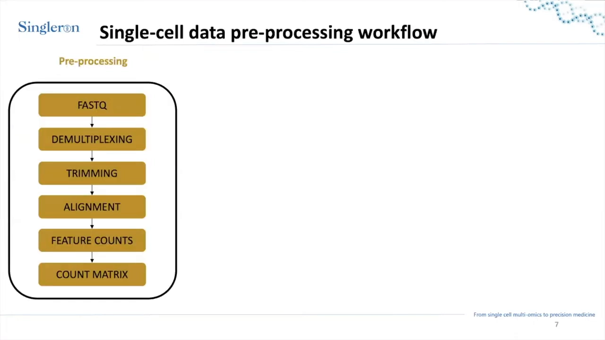
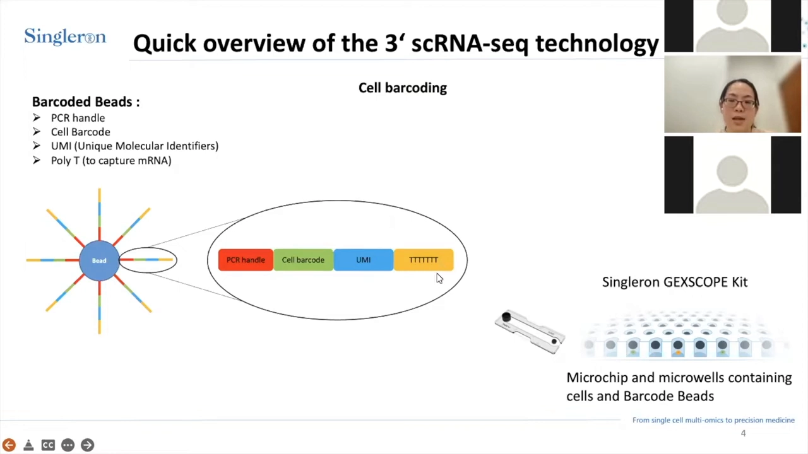
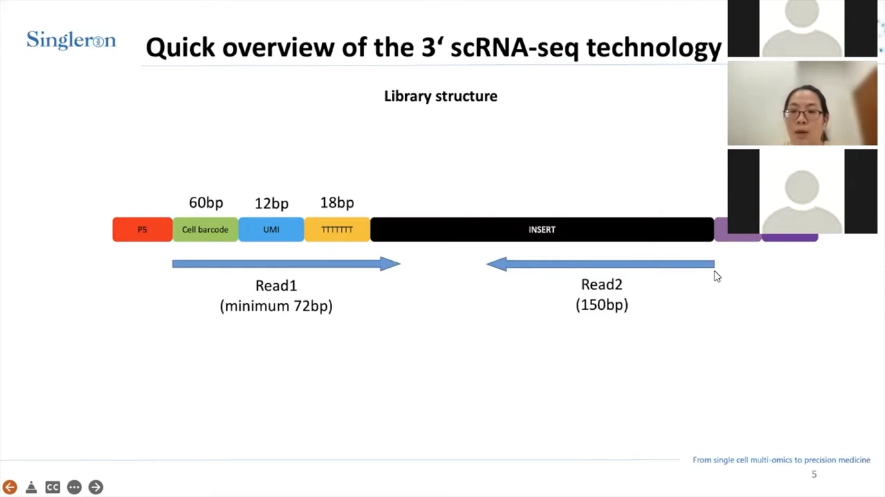
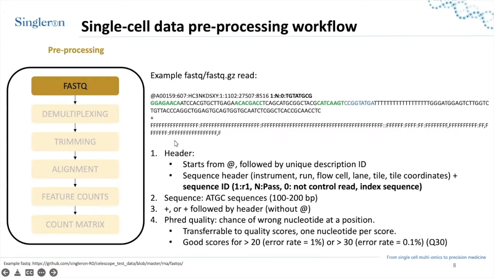
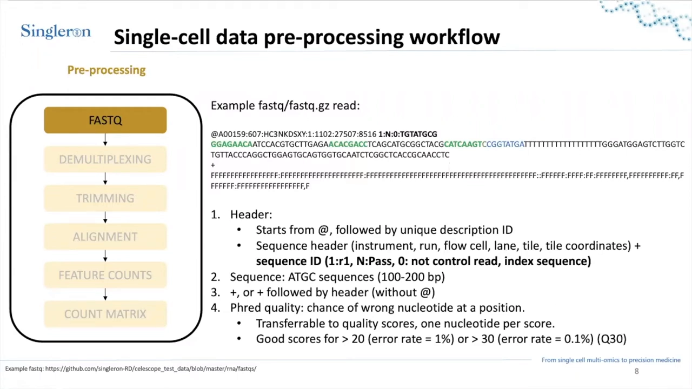
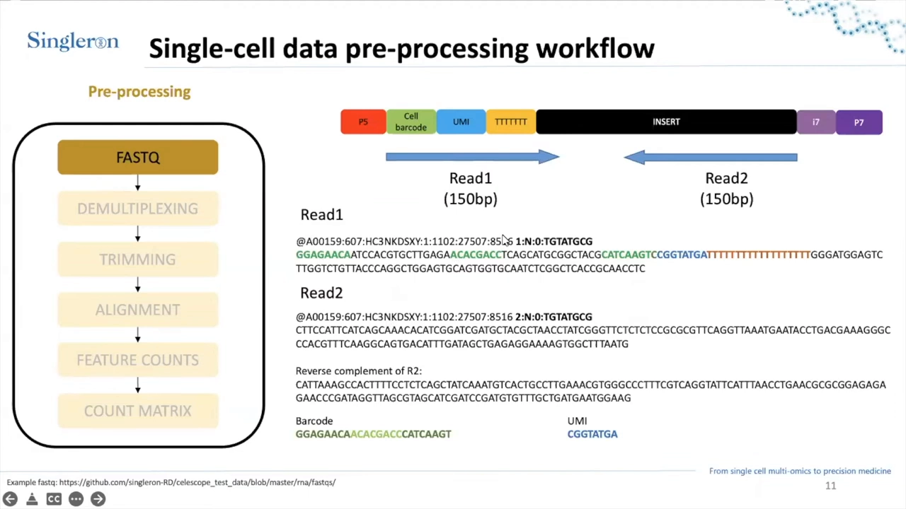
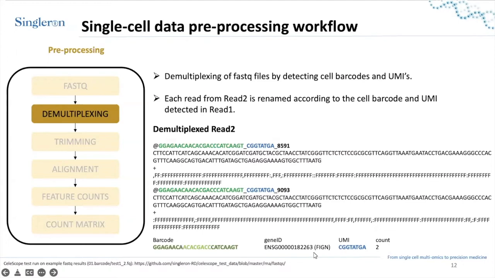
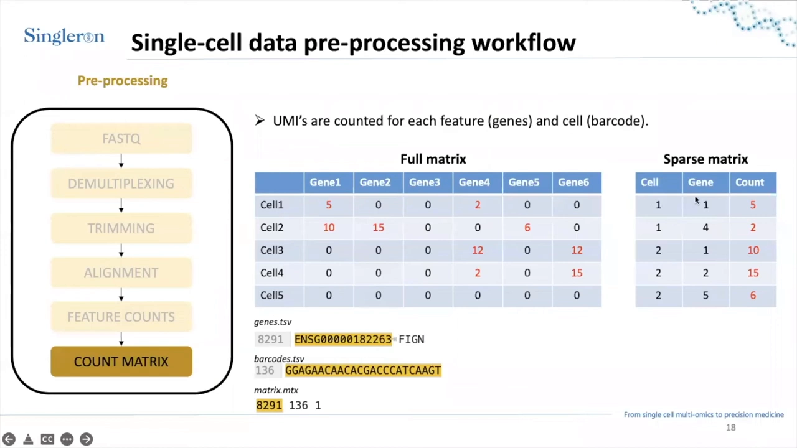
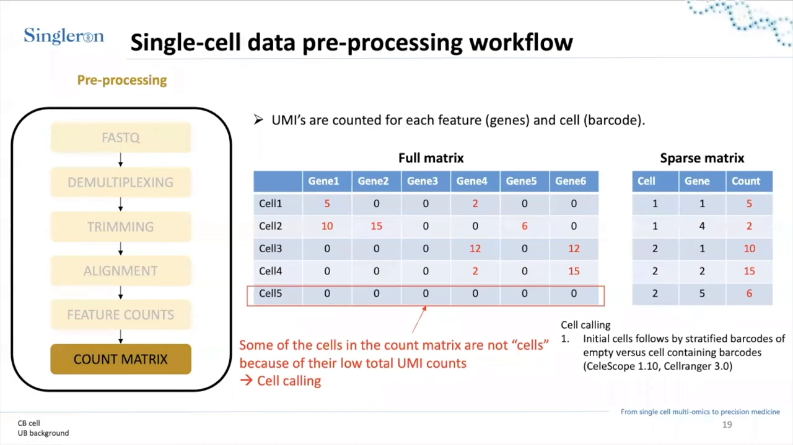
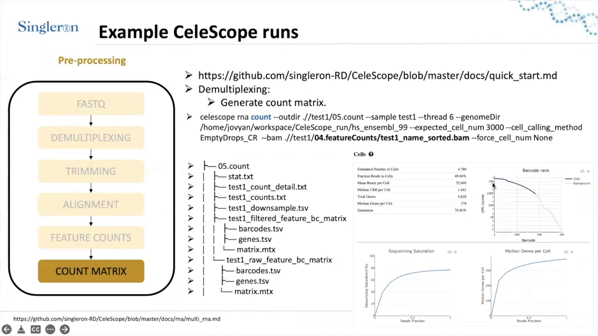

# 从一条 read 到 count matrix：barcode 与 UMI 是怎么被解析和计数的

> 视频来源：[Bioinformatic Analysis of Single Cell Data - Part 2](https://www.youtube.com/watch?v=EQLlJZhbono)（YouTube · Singleron Biotechnologies 网络研讨会，讲者 Stacy）｜时长约 58 分钟
> 导读：这是一场把「一条 read 从 FASTQ 走到 count matrix」的完整流程讲透的研讨会，配合 CeleScope（Singleron 的单细胞处理流程）的真实示例文件逐步演示。本文只取与本小节相关的部分：read 结构、barcode 与 UMI 怎么被切出来、怎么纠错、怎么折叠成分子计数、最后怎么落成矩阵；FASTQ 格式细节与修剪属于 2.1.4，比对算法与基因汇总属于 2.1.6，这里只讲到「R2 被比对到基因」这一层。视频里的示例数据来自 CeleScope 的公开测试数据。

## 本讲要解决的核心问题（SCQA）

**背景**：单细胞测序的原始产物是一堆 FASTQ 文件，最终产物是一张「基因 × 细胞」的计数矩阵。中间隔着一整条流水线。

**冲突**：这条流水线里最容易被当成黑箱的一步，恰恰是最关键的一步——从 read 1 里切出 barcode 和 UMI。如果 barcode 切错一个碱基，这条 read 就会被算到另一个细胞头上；如果 UMI 认错，一个分子就会被数成两个。这些错误不会报错，只会安静地改变矩阵里的数字。

**疑问**：一条 read 上到底哪一段是 barcode、哪一段是 UMI？软件凭什么把它们切对、纠错、再折叠成「几个分子」？

**回答（中心思想）**：3′ 端单细胞测序的读段结构是固定的——**read 1 携带「身份」（细胞条形码 + UMI + poly-T），read 2 携带「内容」（cDNA 插入片段）**。整条流水线因此可以拆成四件互不干扰的事：从 R1 切标签、给标签纠错（允许 1 个碱基的错配）、把 R2 比对到基因、最后按 `(barcode, gene)` 聚合**不同的 UMI**。矩阵里的数字就是这最后一步的产物：**UMI 计数，不是 read 计数**。

## 一、先看标签长在哪里：read 1 与 read 2 的分工

整条预处理流程是六步：FASTQ → DEMULTIPLEXING（拆标签）→ TRIMMING（修剪）→ ALIGNMENT（比对）→ FEATURE COUNTS（按基因计数）→ COUNT MATRIX（计数矩阵）。本文聚焦其中的 DEMULTIPLEXING 与 FEATURE COUNTS 两步，修剪与比对只讲到「R2 被比对到基因」这一层。

[【跳转到 03:32】](https://www.youtube.com/watch?v=EQLlJZhbono&t=212)

### 1.1 微珠上的四段结构

在 Singleron 的 3′ 端方案里，单细胞 RNA 测序在微流控芯片的微孔阵列上完成：每个微孔捕获一个细胞，一颗凝胶微珠（bead）占据同一个孔，微珠上连着大量寡核苷酸。

每条寡核苷酸由四段组成：**PCR handle、cell barcode、UMI、poly-T**。一颗微珠上所有分子共享同一个 cell barcode，而每条分子带着各自不同的 UMI；poly-T 负责去和 mRNA 的 poly-A 尾巴配对。

[【跳转到 01:40】](https://www.youtube.com/watch?v=EQLlJZhbono&t=100)

这段话的信息量其实很大：**「哪个细胞」和「第几个分子」这两条信息，是在建库时就写进分子序列里的**，不是测序之后分配的。所以后面无论怎么混合、怎么扩增，这两条信息都不会丢——只要解析时能正确读出来。

### 1.2 library structure：R1 短、R2 长

到了测序这一步，文库结构是这样的：P5 接头、cell barcode（60 bp 这一段里包含条形码本体）、UMI（12 bp）、poly-T（18 bp），然后是 cDNA 插入片段（insert），最右端是 i7 与 P7 接头。

[【跳转到 02:20】](https://www.youtube.com/watch?v=EQLlJZhbono&t=140)

双端测序于是从两端各读一次：**read 1 读的是标签那一侧，read 2 读的是插入片段那一侧**。讲者建议 read 1 至少 72 bp，有时可以长到 150 bp；read 2 大约 150 bp。

这里有个很自然的疑问（视频里现场也有人问）：为什么 read 1 要 72 bp 这么长？讲者的回答是：如果不用 poly-T 之后的那段序列，其实 60 加上 12 个碱基就够构成可用的 read 序列、支撑「barcode + UMI」的唯一性了；流程里也有参数可以在没有高质量序列时照样做比对。

[【跳转到 05:32】](https://www.youtube.com/watch?v=EQLlJZhbono&t=332)

## 二、一条 read 在 FASTQ 里长什么样

### 2.1 四行记录

FASTQ 里每条 read 永远是四行：

1. **header**：以 `@` 开头，后面是唯一的描述 ID（仪器、run、flow cell、lane、tile、x/y 坐标），再后面是测序标识——`1` 表示 read 1、`2` 表示 read 2，`N` 表示通过质控，`0` 表示不是 control read；
2. **序列**：A/T/G/C 组成的碱基串，长度约 100–200 bp（只截取标签段时可以是 60–72 bp）；
3. **加号**：`+`，有些文件里后面会再跟一遍描述 ID；
4. **质量字符串**：逐碱基的质量分。

[【跳转到 06:39】](https://www.youtube.com/watch?v=EQLlJZhbono&t=399)

### 2.2 Phred 质量分怎么读

质量分表示「这个位置上测到错误碱基的概率」。经验规则是：**分数大于 20 表示错误率约 1%，分数 30 表示错误率约 0.1%**，所以很多报告会给出 q30 指标。

[【跳转到 09:59】](https://www.youtube.com/watch?v=EQLlJZhbono&t=599)

用公式写就是 $Q = -10\log_{10} p$，$p$ 是该碱基被读错的概率。为什么单细胞数据要在意这个？因为 barcode 和 UMI 都是**短序列**，一个碱基读错就可能把这条 read 送到错误的细胞或错误的分子上——质量分低的位置，正是后面要纠错的地方。

## 三、把标签从 R1 里切出来

### 3.1 CB 与 UMI 的确切位置

在 R1 与 R2 两个 FASTQ 文件里，同一对 read 的描述 ID 完全相同，说明它们来自同一个片段、同一个样本 index，并且都通过了质量过滤。

[【跳转到 12:39】](https://www.youtube.com/watch?v=EQLlJZhbono&t=759)

在 Singleron 这套平台上，**UMI 紧挨着 poly-T 的左侧**；细胞条形码被拆成三段，每段 8 个核苷酸，合起来是 24 bp。

### 3.2 三段式 barcode 与 linker 的两种用途

条形码之间夹着 linker 序列。视频里现场有人问「为什么要分成三段」，讲者给了两个理由：

1. **让微珠能继续往下合成**：linker 给了合成过程一个「落脚点」，也让条形码的三个组成部分有更强的亲和力；
2. **当作质量控制的一部分**：如果没观察到 linker 序列，说明这条 read 1 没有正常生成，这条 read 1 就不会被用于后面的 feature counts。

[【跳转到 55:04】](https://www.youtube.com/watch?v=EQLlJZhbono&t=3304)

这是一个很值得记住的设计思路：**标签本身也可以携带「我是否完整」的证据**。解析时先看结构是否齐全，再谈纠错。

## 四、纠错：允许一个碱基的错配

切出 barcode 和 UMI 之后，下一步不是直接使用，而是**校正**。视频明确说：无论是 CeleScope 还是 Cell Ranger，这些常见的单细胞预处理流程里都有一步叫 cell barcode correction 以及 UMI correction。

规则很朴素：**通常允许 UMI 有一个碱基的编辑距离、细胞条形码也允许一个碱基的编辑距离**，也就是允许一个核苷酸的错配，从而把这条 read 正确地贴回应有的 UMI 和细胞条形码上。

[【跳转到 17:59】](https://www.youtube.com/watch?v=EQLlJZhbono&t=1079)

为什么必须纠错？因为 barcode 和 UMI 都是随机序列，测序错误会让它变成一个「合法但不存在」的标签。允许 1 bp 错配，相当于把读错的标签拉回它最可能属于的那个真实标签；而「只允许 1 bp」这个限制，也意味着**标签集合本身必须设计得足够稀疏**，否则一个错误标签可能同时接近两个真实标签，就无从判断了。

## 五、demultiplexing：给每条 read 改名

### 5.1 改名后的 read 2

有了 `(barcode, UMI)` 之后，流程做一件很机械但很关键的事：**把每条来自 read 2 的 read 按 read 1 决定的细胞条形码和 UMI 重新命名**，输出一个只含 read 2 的 FASTQ 文件。

[【跳转到 15:19】](https://www.youtube.com/watch?v=EQLlJZhbono&t=919)

这一步的产物是：一条 read 被标注成 `(barcode, UMI, cDNA 序列)` 三元组。此后 R2 的序列只需要回答「属于哪个基因」，身份问题已经解决了。

同时这一步也会做过滤：没有 linker 序列的 read、条形码不正确的 read、质量尾巴不合格或质量过低的 read 都会被去掉，对应的 read 2 也就不会出现在输出文件里。

### 5.2 同一个分子出现两次：UMI 计数的语义

视频里有一条 read 出现了两次：UMI 相同、条形码相同，**说明它本来只是一个分子，却出现了两次**。在汇总表里，这个 `(barcode, UMI)` 组合的 UMI 计数就是 2。

[【跳转到 16:39】](https://www.youtube.com/watch?v=EQLlJZhbono&t=999)

这个问题会在后面的 feature count 一步解决：**把重复的 UMI 计数去重（deduplicate）**。去重的语义很简单——同一个 `(barcode, gene)` 下，相同的 UMI 只算 1 个分子；具体算法（以及它如何与 cell calling 配合）属于本脉络 2.2 的数据对象与观测偏差范围，这里只需要记住结论：**矩阵里数的是不同的 UMI，不是 reads**。

## 六、count matrix：稀疏矩阵与完整矩阵

走到最后一步，UMI 是按每个特征（基因）和每个条形码（细胞）来计数的。同一个 `(cell, gene)` 组合下，前面出现两次的那条 read 只报告 1。

[【跳转到 34:39】](https://www.youtube.com/watch?v=EQLlJZhbono&t=2079)

两种格式表示的内容完全一样，区别只在呈现方式：

- **完整矩阵（full matrix）**：行是细胞、列是基因，每个格子都写出来，大量格子是 0；
- **稀疏矩阵（sparse matrix）**：三列——细胞、基因、计数，只记录非零的组合。

为什么单细胞要用稀疏格式？因为单细胞实验通常有三万多个基因，其中很多基因的计数是 0，稀疏矩阵能大幅减小数据体积，处理更快，也方便后续计算。真实文件里通常就是三件套：`genes.tsv`、`barcodes.tsv`、`matrix.mtx`。

## 七、barcode 只是候选：cell calling 与 barcode rank

拿到矩阵不等于拿到了细胞。视频里有一个很典型的例子：矩阵里的 Cell5 所有基因都是 0——它虽然是一个真实存在的条形码，但 UMI 总数太低，撑不起「一个细胞」的身份。

[【跳转到 37:59】](https://www.youtube.com/watch?v=EQLlJZhbono&t=2279)

于是 count matrix 之后还有一步 **cell calling**：判定哪些条形码是真细胞、哪些只是空液滴背景。视频提到两代做法：

- **较早版本**（CeleScope 与 Cell Ranger 的旧版）用 knee plot：把 UMI 计数按排序后的条形码画成 barcode rank 曲线，曲线通常有两次突然下降（两个「膝盖」），阈值取第一个膝盖的中点；
- **更晚的算法**用环境 RNA：先按 UMI 总数排在前 99 百分位以上取其中 10% 定义初始细胞，再用 UMI 很低的条形码构建背景表达谱，拟合多项式分布、用 Simple Good-Turing 之类的方法估计，判断每个条形码是更接近真细胞还是更接近背景。

[【跳转到 44:39】](https://www.youtube.com/watch?v=EQLlJZhbono&t=2679)

算法细节属于本脉络 2.2 的范围，这里只需要记住因果：**barcode 提供的是「候选」，cell calling 才把它变成「细胞」**。而 barcode rank 曲线、饱和度曲线这类图，仍然是检查 cell calling 是否合理的最直观工具。

[【跳转到 45:19】](https://www.youtube.com/watch?v=EQLlJZhbono&t=2719)

## 八、这些细节如何决定后面的所有分析

把整条链路收束成一句话：**矩阵里的每个数字，都是「哪个细胞 × 哪个基因 × 几个原始分子」的结果**。而这条链路上每一处细节，都会在矩阵上留下痕迹：

1. **标签切错或纠错失败** → 一条 read 被算到别的细胞头上，等于凭空制造了一个「混合」的细胞；
2. **UMI 折叠错误** → 一个分子被数成两个（或两个被数成一个），直接影响表达量；
3. **低 UMI 的条形码没有过滤** → 矩阵里混进大量「几乎全零」的列，让稀疏性进一步恶化；
4. **UMI 总数（depth）在不同细胞间差别很大** → 这不是生物学差异，而是捕获与测序深度的差异，后面的归一化就是为了处理它。

[【跳转到 34:39】](https://www.youtube.com/watch?v=EQLlJZhbono&t=2079)

也正因为如此，视频最后给了一个很实用的提醒：**cell calling 有时很受背景影响，所以有一个干净的文库往前走很重要**。

[【跳转到 46:19】](https://www.youtube.com/watch?v=EQLlJZhbono&t=2779)

## 小结

- 3′ 端单细胞的读段结构是固定的：**read 1 携带 barcode + UMI + poly-T，read 2 携带 cDNA 插入片段**；身份信息在建库时就写进了分子序列。
- FASTQ 里每条 read 是四行：header、序列、加号、质量字符串；Phred 分数 $Q = -10\log_{10} p$，Q20 约 1% 错误率、Q30 约 0.1%。
- 解析的第一步是从 R1 切出 CB 与 UMI；三段式 barcode 之间的 linker 既是合成所需，也是「这条 read 是否完整」的质控信号。
- 切出来之后必须纠错：barcode 与 UMI 通常各允许 1 个碱基的错配，把读错的标签拉回真实标签。
- demultiplexing 把每条 read 2 按 `(barcode, UMI)` 改名，产物是 `(barcode, UMI, cDNA)` 三元组；此后 R2 只负责回答「属于哪个基因」。
- 计数时同一个 `(barcode, gene)` 下相同的 UMI 只算 1 个分子，所以矩阵里是 **UMI 计数**，不是 read 计数。
- 矩阵有完整与稀疏两种形态，稀疏格式（`genes.tsv` + `barcodes.tsv` + `matrix.mtx`）是单细胞数据的常态。
- barcode 只是候选细胞：cell calling 才决定哪些条形码算真细胞，knee plot 与 barcode rank 曲线是判断它的直观工具。

## 关键术语速查

| 术语 | 一句话解释 |
| --- | --- |
| read 1 / read 2 | 双端测序的两条读段：R1 覆盖 barcode、UMI 与 poly-T，R2 覆盖 cDNA 插入片段 |
| cell barcode（CB） | 微珠上所有分子共享的短序列，标识「来自哪个细胞」；本讲示例中为三段共 24 bp |
| UMI | 每条分子各自的随机序列，标识「是第几个原始分子」；示例中紧挨 poly-T 左侧，12 bp |
| linker 序列 | 三段式 barcode 之间的间隔序列，既保证微珠合成，也用于判断 read 1 是否完整 |
| demultiplexing | 按 R1 检出的 barcode 与 UMI 给每条 read 2 改名，输出只含 read 2 的 FASTQ |
| barcode / UMI correction | 允许 1 个碱基错配，把测序读错的标签贴回真实标签 |
| deduplication | 同一个 `(barcode, gene)` 下相同 UMI 只计 1 个分子，即 UMI 折叠 |
| count matrix | 基因 × 细胞的计数表，格子值是不同 UMI 的个数；有完整与稀疏两种格式 |
| cell calling | 判定哪些 barcode 是真细胞、哪些是空液滴背景的步骤 |
| barcode rank plot | 排序后的 barcode 与其 UMI 总数的曲线，用于观察细胞阈值（knee）位置 |