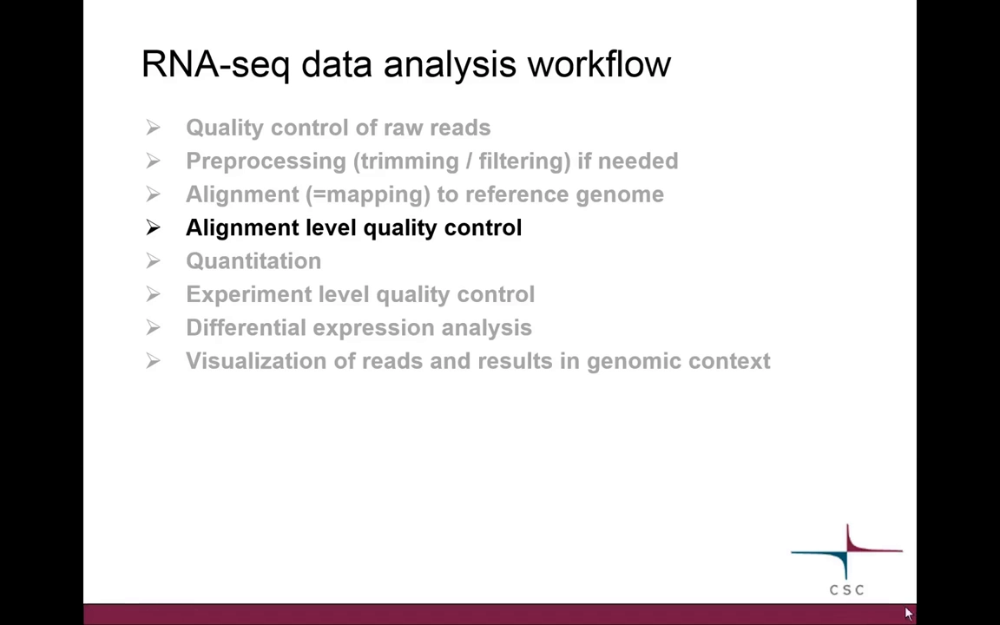
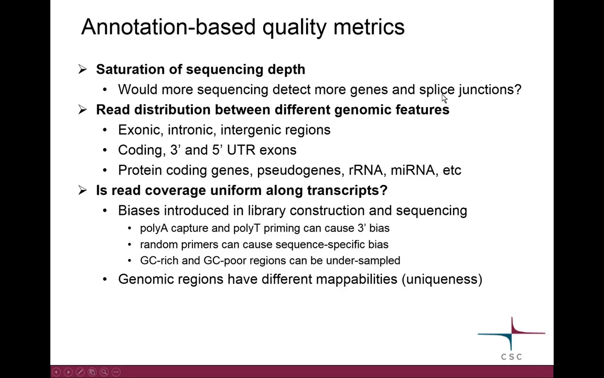
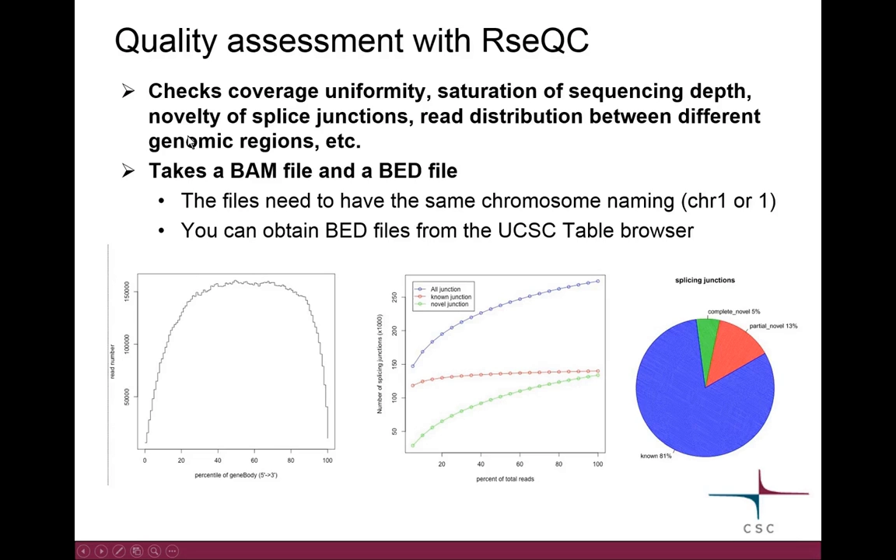
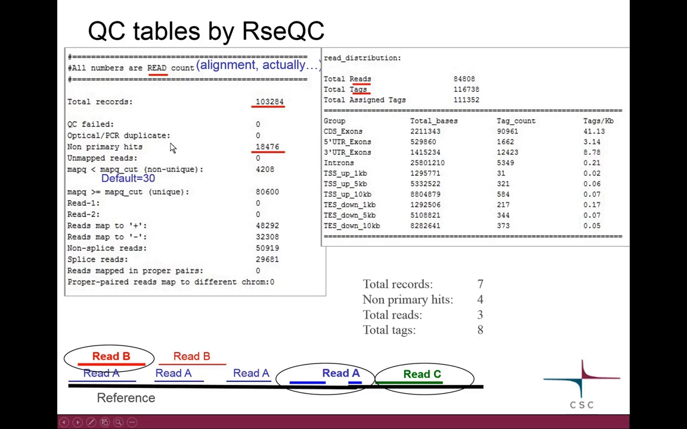

# 比对之后看什么：比对率、唯一比对与读段分布

> 视频来源：[RNA-seq course: Alignment level quality control](https://www.youtube.com/watch?v=SGO752Hkt7Y)（YouTube · Chipster Tutorials）｜时长约 12 分钟
> 这支视频是 RNA-seq 课程里“比对层面质控”的一节，用 RSeQC 的输出讲读段分布、饱和度和唯一比对。本文保留课程里的表格与例子，并把“reads、alignments、tags”这组容易混淆的计数拆开。

## 本讲要解决的核心问题（SCQA）

**背景**：原始 read 做过 FastQC、也修剪过了，下一步是把 read 比对回参考基因组。

**冲突**：比对软件会输出一个“比对率”，但这个数字背后混着好几件事：一条 read 可能比到多个位置，可能落在内含子或基因间区，也可能因为重复序列根本没法唯一确定位置。只看一个总比对率，无法判断问题出在参考基因组、文库还是样本本身。

**疑问**：比对之后应该看哪些指标？唯一比对、多重比对、模糊比对分别说明什么？读段落在外显子、内含子和基因间区的比例又该怎么解读？

**回答（中心思想）**：比对层面的质控要回答三个问题——测序深度是否饱和、读段是否落在该落的位置、比对是否唯一。RSeQC 一类工具把这三件事拆成覆盖率均匀性、饱和度曲线和读段分布表；判读时先确认外显子密度高于内含子，再看唯一比对占多数、模糊比对和基因间区比例是否异常，最后才决定是否需要调整比对参数或参考注释。

## 一、比对层面质控在流程中的位置

RNA-seq 的分析流程是：原始 read 质控 → 预处理（修剪/过滤，如有需要）→ 比对到参考基因组 → **比对层面质控** → 定量 → 实验层面质控 → 差异表达 → 基因组上下文可视化。[【跳转到 00:14】](https://www.youtube.com/watch?v=SGO752Hkt7Y&t=14)

这一步要检查的内容可以归成三类：[【跳转到 00:39】](https://www.youtube.com/watch?v=SGO752Hkt7Y&t=39)

1. **测序深度是否饱和**：如果继续测序，还能不能发现更多基因或剪接连接？
2. **读段在不同基因组特征上的分布**：读段落在外显子还是内含子，落在编码区、3′/5′ UTR，还是 rRNA、miRNA 等区域？
3. **读段覆盖是否均匀**：沿转录本的覆盖是否有偏好，哪些偏好来自建库，哪些来自基因组本身的可比对性？

视频把“覆盖不均匀”的原因分成两类。建库方面，poly-A 捕获和 poly-T 引物会造成 3′ 偏好，随机引物会造成序列特异性的偏好，GC 过高或过低的区域容易被欠采样；基因组方面，不同区域的可比对性不同，重复序列更难唯一比对。[【跳转到 01:04】](https://www.youtube.com/watch?v=SGO752Hkt7Y&t=64)

## 二、RSeQC：用 BAM 和 BED 检查覆盖与剪接

视频使用 RSeQC 做比对层面质控，它检查覆盖均匀性、测序深度饱和度、剪接连接的新颖性和不同基因组区域的读段分布。输入是一个 BAM 文件和一个 BED 文件；BED 可以从 UCSC Table Browser 获取，也可以使用 Chipster 内置的 Ensembl 注释。[【跳转到 01:40】](https://www.youtube.com/watch?v=SGO752Hkt7Y&t=100)

使用前有一个容易踩的坑：BAM 和 BED 的染色体命名必须一致，要么都用 `1`，要么都用 `chr1`。命名不一致时，读段会被当成落在染色体外，分布表会失真。[【跳转到 04:49】](https://www.youtube.com/watch?v=SGO752Hkt7Y&t=289)

### 2.1 覆盖均匀性：沿基因体的读段数

第一张图是覆盖均匀性：横轴是基因体从 5′ 到 3′ 的百分比位置，纵轴是该区域的 read 数。视频给的是一个不错的例子，覆盖大致均匀，只在基因体开头略有不足；如果存在明显偏好，曲线会向一端倾斜。[【跳转到 01:54】](https://www.youtube.com/watch?v=SGO752Hkt7Y&t=114)

读这张图时要把“建库偏好”和“可比对性”分开想：3′ 倾斜通常来自 poly-A 捕获，局部凹陷可能来自 GC 偏差或重复序列。

### 2.2 饱和度：再测序还能发现多少新东西

饱和度曲线回答“继续测序是否值得”。横轴是使用的 read 百分比，纵轴是发现的剪接连接数。红色是已知连接，绿色是新连接。[【跳转到 02:19】](https://www.youtube.com/watch?v=SGO752Hkt7Y&t=139)

视频的例子很典型：已知连接在使用约 30% 的 read 时就已经找全，之后曲线走平；新连接还在缓慢上升。这说明继续测序不会增加已知剪接连接，但可能发现少量新连接。[【跳转到 03:09】](https://www.youtube.com/watch?v=SGO752Hkt7Y&t=189)

旁边的饼图把连接分成已知、完全新和部分新三类：完全新指两端都是新的，部分新指一端已知、一端是新。[【跳转到 03:34】](https://www.youtube.com/watch?v=SGO752Hkt7Y&t=214)

## 三、先分清 reads、alignments 和 tags

RSeQC 的结果文件一打开全是数字，视频提醒：文件开头那些数不是 read 数，而是 alignment 数。一条 read 可以比到基因组上的多个位置，所以 alignment 数会大于 read 数。[【跳转到 05:27】](https://www.youtube.com/watch?v=SGO752Hkt7Y&t=327)

视频用一张示意图把三个计数讲清楚：[【跳转到 07:07】](https://www.youtube.com/watch?v=SGO752Hkt7Y&t=427)

- 有 3 条不同的 read（A、B、C），所以 **total reads = 3**；
- 蓝色 read 比到 4 个位置，红色 read 比到 2 个位置，多出来的命中就是 **non-primary hits = 4**；
- 一条跨越剪接位点的 read 会被拆成两段 tags，所以 **total tags** 可以大于 read 数（例子里是 8）。

同一张表里还有几类关键计数：total records（全部比对记录）、quality failed（质量不合格）、optical/PCR duplicate（光学或 PCR 重复）、unmapped reads（未比对）、`mapq < 30`（低于默认质量阈值的比对）和 `mapq >= 30`（高质量比对）。视频特别指出，默认的质量阈值是 30。[【跳转到 06:17】](https://www.youtube.com/watch?v=SGO752Hkt7Y&t=377)

这组数字就是“比对率”的原始材料：唯一比对、多重比对、未比对、低质量比对各占多少，决定了后续能有多少 read 进入定量。

## 四、读段分布：外显子密度应该高于内含子

结果文件的下半部分是 read distribution 表，按基因组特征分组统计 tags 数和每千碱基的 tag 密度（tags/kb）。分组包括 CDS 外显子、5′ UTR、3′ UTR、内含子，以及 TSS/TES 上下游不同距离的区域。[【跳转到 08:57】](https://www.youtube.com/watch?v=SGO752Hkt7Y&t=557)

判读的核心预期是：**外显子的密度应高于内含子**。视频的例子里，CDS 外显子的密度最高，内含子明显更低，说明文库和比对都没有大问题。[【跳转到 09:42】](https://www.youtube.com/watch?v=SGO752Hkt7Y&t=582)

如果内含子密度异常高，可能有两种解释：一是样本或建库时前体 RNA、基因组 DNA 残留较多；二是比对把一些本该落在外显子的 read 放到了内含子。若基因间区比例很高，则要怀疑参考基因组版本、污染或比对参数。

## 五、定量阶段：多少比对真正被数到基因上

比对之后进入定量。视频用 featureCounts 统计有多少 alignment 被分配到基因上：在视频口述的例子里，约 73.9% 的 alignment 被数到某个基因，其余没有被数到任何基因。[【跳转到 10:32】](https://www.youtube.com/watch?v=SGO752Hkt7Y&t=632)

未计入的原因被逐类列出：[【跳转到 10:57】](https://www.youtube.com/watch?v=SGO752Hkt7Y&t=657)

- **not aligned uniquely**：没有唯一比对到基因组，无法确定属于哪个基因；
- **ambiguous（约 3,000 条）**：比对到不同链上的两个基因，软件无法判断该记给谁；
- **no feature（约 3,600 条）**：落在任何基因注释区域之外。

这三类数字直接对应前面说的“唯一比对率”和“读段分布”。唯一比对比例高、ambiguous 和 no feature 比例低，说明注释与比对一致、定量结果可信；反过来，如果大量 read 落在 no feature 或 ambiguous，就要先检查参考注释版本、染色体命名和比对参数，而不是直接接受表达矩阵。

## 六、判读顺序：从饱和到分布，再到唯一性

把视频的检查项排成一条判断链：

1. **饱和度**：已知剪接连接是否早已走平？走平说明当前深度足够，继续测序收益有限。
2. **覆盖均匀性**：沿基因体是否一端倾斜或局部塌陷？倾斜提示建库偏好，塌陷提示 GC 或重复序列问题。
3. **读段分布**：外显子密度是否高于内含子？基因间区是否异常多？异常时先查注释和比对。
4. **唯一性**：唯一比对是否占多数？ambiguous 和 no feature 各占多少？这决定最终有多少 read 能进入基因计数。

这条链条也解释了“比对率”为什么不能单独当结论：一个 80% 的比对率，可能大部分是唯一比对落在外显子，也可能混着大量多重比对和基因间区读段，两者的下游含义完全不同。

## 小结

- 比对层面质控回答三件事：深度是否饱和、读段是否落在该落的位置、比对是否唯一。
- RSeQC 需要 BAM 和 BED，染色体命名必须一致（`1` 与 `chr1` 不能混用）。
- 饱和度曲线看已知/新剪接连接是否走平；走平意味着继续测序收益有限。
- 结果文件开头的数字是 alignment 数，不是 read 数；一条 read 可比对多次，一条跨剪接 read 可拆成两个 tags。
- 读段分布的核心预期是外显子密度高于内含子；基因间区异常多时先查注释版本和比对参数。
- 定量阶段要报告有多少 alignment 被数到基因上，以及 not unique、ambiguous、no feature 各占多少；这些比例决定表达矩阵的可信度。

## 关键术语速查

| 术语 | 一句话解释 |
| --- | --- |
| alignment-level QC | 比对完成后的质控，检查读段分布、覆盖均匀性和比对唯一性 |
| 唯一比对 | 一条 read 在参考基因组上只有一个最佳位置，基因归属明确 |
| 多重比对 | 一条 read 能比到多个位置，通常来自重复序列或旁系同源区域 |
| ambiguous | 比对到不同链上的多个基因，定量软件无法决定记给谁 |
| no feature | 读段落在所有基因注释区域之外 |
| tags/kb | 每千碱基的 tag 数，用于比较不同长度特征上的读段密度 |
| 饱和度 | 增加测序量还能发现多少新基因或新剪接连接；曲线走平表示接近饱和 |