# 上游方法决定矩阵：单细胞比对与定量中的取舍

> 视频来源：[Rob Patro - The Matrix Has You: The Importance of Accurate, Efficient and Open Methods Upstream of Single Cell Count Matrices](https://www.youtube.com/watch?v=fQD7JggiSl0)（YouTube · VanBUG 生信研讨会特邀报告）｜时长约 87 分钟
> 导读：讲者是马里兰大学的 Rob Patro，salmon、alevin、alevin-fry、simpleaf 的作者。这场报告不讲怎么跑命令，而是把「一条 read 如何变成一个计数」背后的算法逐个拆开：增广转录组参考、k-mer 索引、barcode 纠错、按细胞归拢、UMI 解析，并解释每一步的取舍如何改变最终矩阵。**注意**：视频前 18 分钟是另一位学生的短报告（k-mer 谱建模），与本节无关，本文只覆盖 17:52 之后的正讲。

## 本讲要解决的核心问题（SCQA）

**背景**：几乎所有单细胞分析都从一张「基因 × 细胞」的计数矩阵开始。拿到矩阵之后，降维、聚类、注释、差异表达，每一步都有成熟工具和成熟教程。

**冲突**：可是这张矩阵是怎么来的？同一批 FASTQ，用 Cell Ranger 的不同版本跑，得到的细胞集、基因表达、聚类结果、marker 基因都会变；用不同工具跑，变化更大。更麻烦的是，这些差异不会在矩阵里留下任何痕迹——你看到的只有数字。

**疑问**：从 FASTQ 到矩阵，上游到底做了哪些判断？这些判断为什么不能算「已经解决的问题」？当速度、内存、准确率互相冲突时，工具作者是怎么取舍的？

**回答（中心思想）**：上游是一条五段的流水线——**构建增广参考 → 索引与比对 → barcode 纠错 → 按细胞归拢 → UMI 解析**。每一段都在「准确 / 速度 / 内存」之间做取舍，而这些取舍会直接写进矩阵的数字里。因此**矩阵不是中性的中间产物，它是上游方法选择的产物**：要么知道它的来源（provenance），要么就得承认下游结论建立在一个未知的输入上。

## 一、为什么上游值得关心：三个能改变结论的例子

### 1.1 工具很多，但做上游的很少

单细胞领域的工具数量这些年涨得很快，可它们绝大多数集中在可视化、降维、聚类这些下游任务上。真正负责「把原始测序数据变成矩阵」的工具只占很小一部分——处理 UMI 的、做比对的、做定量的，加起来只是柱状图里最短的那几根。

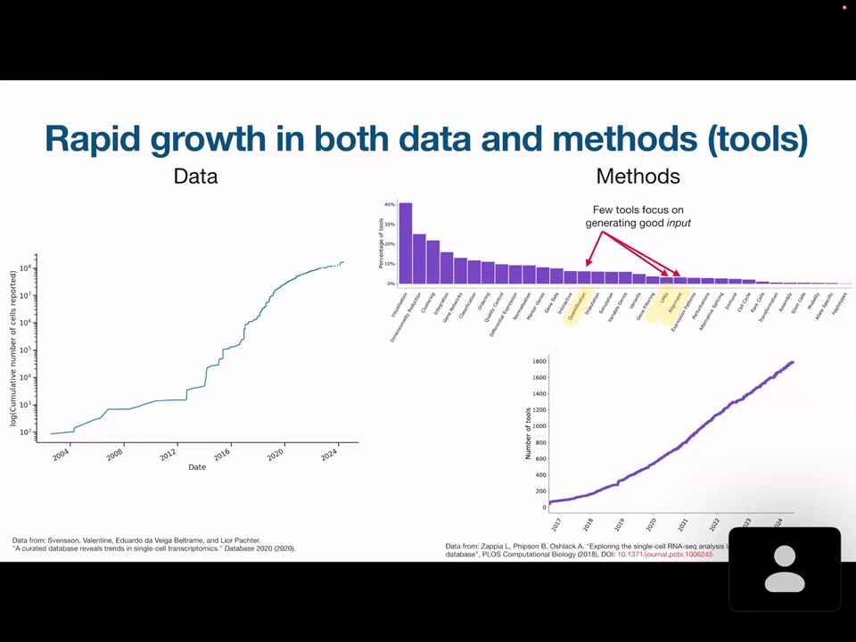

[【跳转到 20:58】](https://www.youtube.com/watch?v=fQD7JggiSl0&t=1258)

讲者用一句计算机科学的老话概括这件事：**garbage in, garbage out**。上游被当成「预处理」，被当成「已经解决了的问题」，但它恰恰决定了后面所有分析的地基。

### 1.2 同一个软件的不同版本，就能改变结论

最能说明问题的例子来自一篇专门评测上游的论文：作者把同一批数据用**同一个软件的不同版本**跑了一遍——Cell Ranger 2、3、4、5、6——然后比较结果。

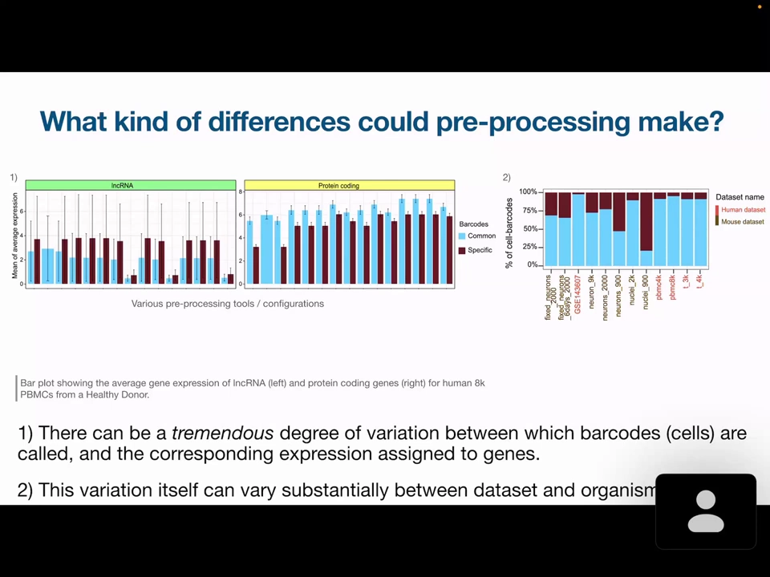

[【跳转到 22:43】](https://www.youtube.com/watch?v=fQD7JggiSl0&t=1363)

结论相当刺眼：不同版本之间，**被判为细胞的 barcode 集合差别很大**，这些细胞里各个基因的表达量差别也很大；而且这种差异的大小还随物种与数据集变化。

论文的原话被直接引用在幻灯片上：Cell Ranger 版本的选择会影响质量分数、平均基因表达、聚类结果、每个数据集的 top cluster marker 基因，并产生可量化的下游影响。同一张幻灯片右下角的 UMAP 也印证了这一点——每个版本聚出来的簇形状与 marker 表达都不一样。

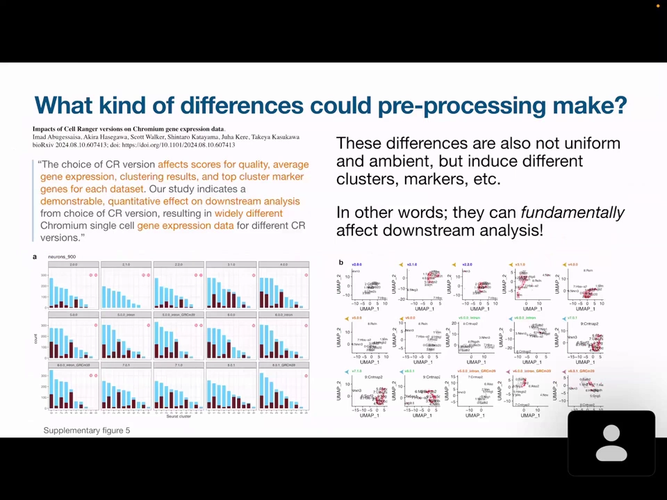

[【跳转到 24:36】](https://www.youtube.com/watch?v=fQD7JggiSl0&t=1476)

讲者点出了其中一个重要原因：**Cell Ranger 6 前后改变了「reads 如何被算作来自某个基因」的规则**——具体来说，是把未剪接转录本（内含子 reads）计入了基因总量。一个默认规则的改动，就足以让下游结论换个样子。

### 1.3 方向性错误：把 read 分给了反义链上的邻居

第二个例子来自 RNA 速率（RNA velocity）。有论文指出，常用的 velocyto 在 10x 5′ 数据上表现不好。原因不是它慢，而是它**不做方向判断**：一条来自基因 A 的 read，可能被错误地分配给反义链上与之重叠的基因 B。

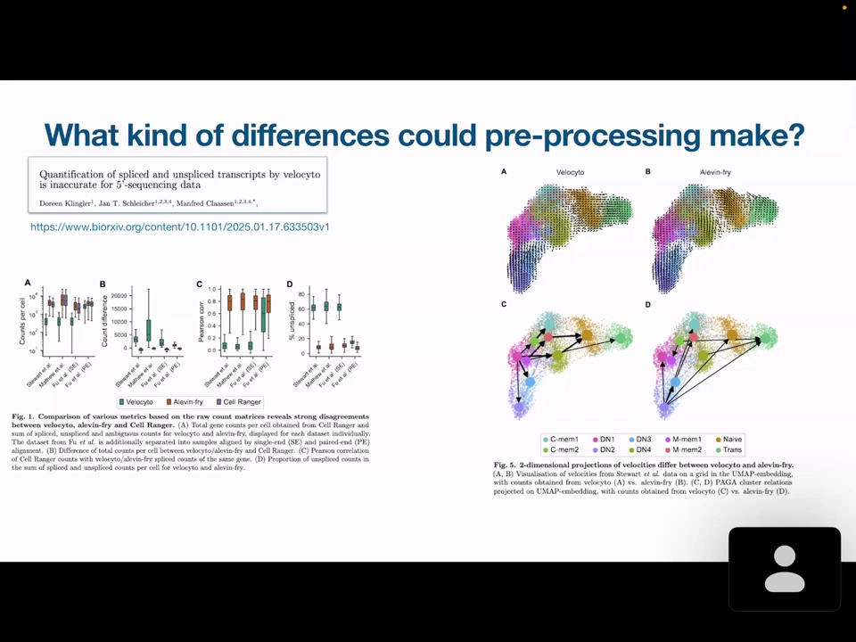

[【跳转到 25:51】](https://www.youtube.com/watch?v=fQD7JggiSl0&t=1551)

图上可以看到：alevin-fry 与 Cell Ranger 的总计数高度一致；而在 spliced 计数的相关性上，alevin-fry 整体很高，velocyto 在某些数据集上很低。更关键的是右侧的细胞状态转移图——同一个数据集，两个工具推断出的转移结构明显不同。**上游的一个方向判断，最后变成了生物学解释的差异。**

### 1.4 上游甚至决定了你能问什么问题

第三个例子更进一步：有一项工作要研究**差异剪接调控**，需要同时估计每个细胞里剪接与未剪接的分子数，并把计数的不确定性传递到模型里。这件事之所以可能，是因为上游工具（这里就是 alevin-fry）能输出**带剪接状态的转录本等价类计数**，而不只是一张总数矩阵。

[【跳转到 27:56】](https://www.youtube.com/watch?v=fQD7JggiSl0&t=1676)

换句话说：上游的输出形态，决定了下游能建什么模型。如果上游只给你一个整数，你就只能做整数能做的事。

## 二、把 reads 变成矩阵，本来该有多简单

### 2.1 两个标签：一个回答「哪个细胞」，一个回答「哪个分子」

10x Chromium 这类高通量方法把细胞和凝胶微珠（GEM）一起包进液滴，微珠上的核酸序列给每个 RNA 分子打上两个标签：

- **cell barcode**：同一个 GEM（也就是同一个细胞）里的所有分子共享同一个 barcode；
- **UMI**：每个分子一个，本质是一段短随机序列，用来区分「同一个基因的不同原始分子」。

测序时所有细胞的 reads 混在一起测，测完之后**在计算机里**按 barcode 把 reads 分回细胞，再按 UMI 把同一分子的 PCR 拷贝折叠成一个。

> barcode 与 UMI 的语义、白名单设计、碰撞问题属于 2.1.3，这里只引用结论：**barcode 标识细胞，UMI 标识分子**。

[【跳转到 32:38】](https://www.youtube.com/watch?v=fQD7JggiSl0&t=1958)

### 2.2 理想情况下，这就是几行代码

如果比对完美、barcode 与 UMI 都没错、每条 read 只属于一个基因，那么流程可以写成：给每条 read 按比对结果标上基因 → 按 barcode 分组 → 按 UMI 折叠 → 计数。用 pandas 或 polars 几行就能写完，输出就是一张「行是基因、列是细胞、格子是 UMI 个数」的矩阵。

[【跳转到 33:28】](https://www.youtube.com/watch?v=fQD7JggiSl0&t=2008)

### 2.3 现实中的三个麻烦

现实里没有一条成立：

1. **比对不完美**：一条 read 可能同时命中多个基因，或同一基因的多个转录本；
2. **标签会错**：barcode 和 UMI 在扩增与测序过程中都可能被改写；
3. **数据量巨大**：一个 PBMC 10K 数据集就有超过 6 亿条双端片段、44 GB 压缩后的原始 reads——方法必须能扩展，否则根本跑不动。

[【跳转到 35:08】](https://www.youtube.com/watch?v=fQD7JggiSl0&t=2108)

「能扩展」有两个维度：**时间**（能用上多线程）和**内存**（处理时的内存不随数据量线性增长，这样普通机器也能跑）。后面每一个模块的设计，都能看到这两条约束的影子。

## 三、第一步：参考怎么建——增广转录组

### 3.1 splici：剪接序列 + 内含子序列

传统转录组定量只用「剪接后的转录本」当参考，这样内含子 reads 就无处可去。alevin-fry 的做法是构建一个**增广转录组参考**（augmented transcriptome）：输入是基因组 FASTA 和 GTF，输出既包含每个基因的剪接转录本，也包含对未剪接序列的某种表示。

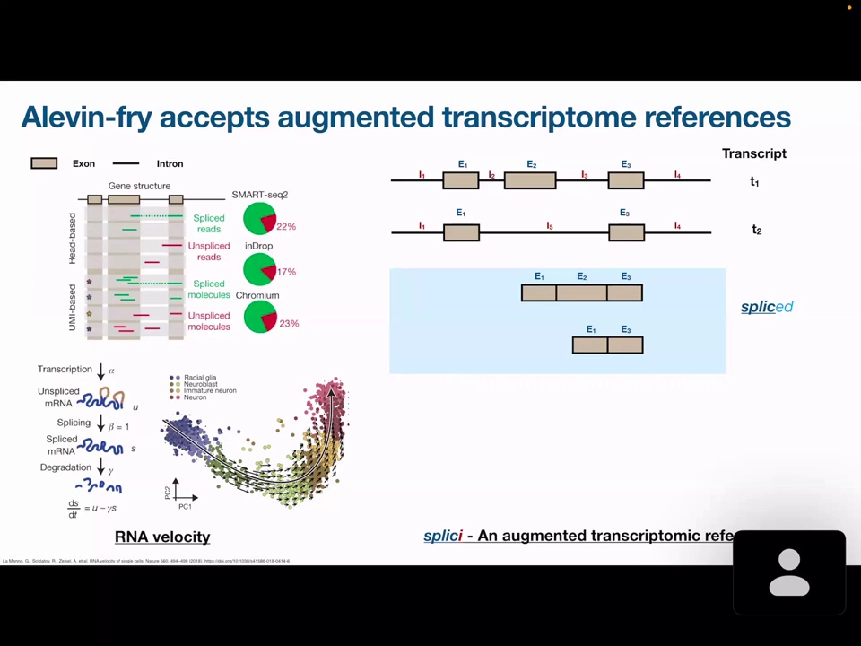

[【跳转到 38:53】](https://www.youtube.com/watch?v=fQD7JggiSl0&t=2333)

第一种构造叫 **splici**（spliced + intronic）：把每个基因所有内含子区域取并集，和剪接转录本一起索引。落在剪接序列上的 read 记为「剪接」，落在内含子上的记为「未剪接」。

### 3.2 spliceu：剪接序列 + 完整基因体

第二种叫 **spliceu**：不取内含子的并集，而是把整个基因体（从第一个外显子到最后一个外显子之间的完整序列）当作一条「未剪接转录本」来索引。

区别在于**跨界 read**：一条 read 可能横跨外显子与内含子的边界。splici 会把这种 read 归到某一边，spliceu 则能容纳它。这个区别不影响大局，但它决定了「这条 read 算剪接还是未剪接」的具体规则。

[【跳转到 40:58】](https://www.youtube.com/watch?v=fQD7JggiSl0&t=2458)

### 3.3 为什么要费这个劲

因为**剪接状态本身是信息**。RNA velocity 就是用每个基因的「未剪接 / 剪接」比例来推断表达变化的方向；单细胞核数据里，未剪接的 pre-mRNA 往往是主要信号。如果参考里没有未剪接序列，这些 reads 就只能被丢弃，或者被强行算到别处。

## 四、第二步：定位——索引决定速度与内存

### 4.1 piscem 与 SSHash：把 k-mer 压进很小的空间

比对的核心问题是「这条 read 来自哪个转录本」。alevin-fry 用的不是全基因组比对，而是基于 **k-mer 索引**的映射：把参考转录本的 k-mer 建成一个极省空间的索引（**piscem** 索引，底层是 **SSHash** 数据结构，用简洁数据结构表示 de Bruijn 图里的 k-mer）。

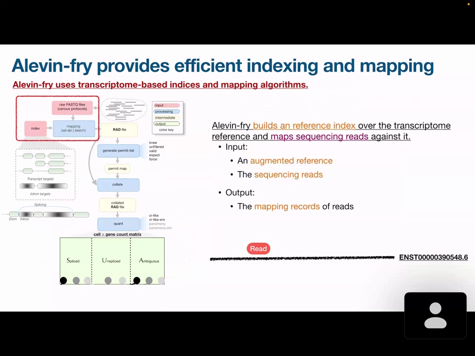

[【跳转到 41:23】](https://www.youtube.com/watch?v=fQD7JggiSl0&t=2483)

这个索引的代价很小：建索引占 2–4 GB 内存（取决于参考），映射时大约 4 GB，**而且不随样本量增长**。这就是前面说的「内存可扩展」：处理一亿条 read 和处理十亿条 read，峰值内存差不多。

### 4.2 转录组索引 vs 基因组索引：一条根本性的分岔

这里有一个值得单独记住的分岔。**比对到基因组**（如 STAR、STARsolo）能看到完整的基因结构，包括内含子、基因间区、反义链，因此可以精确判断一条 read 属于哪一类；代价是索引大（人类基因组索引动辄几十 GB）、比对慢。**比对到转录组**（如 alevin-fry、kallisto|bustools）索引小、速度快，但参考里只有你放进去的序列——**参考里没有的东西，工具就看不见**。

这也是为什么「增广参考」很重要：它相当于在转录组路线里，人为地把内含子信息补回去。

## 五、第三步：barcode 纠错——两遍扫描

### 5.1 一个编辑距离内的纠错

10x 会给出一份 permit list（白名单），列出这次实验里所有可能出现的 barcode。观测到的 barcode 如果精确命中，就直接采用；如果只差一个碱基，就可能是测序错误，可以纠回去。

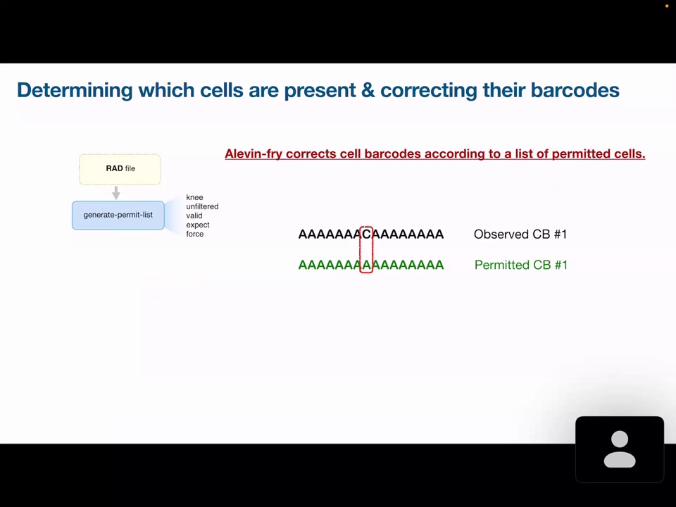

[【跳转到 43:03】](https://www.youtube.com/watch?v=fQD7JggiSl0&t=2583)

### 5.2 歧义怎么办：先找真细胞，再纠错

麻烦在于，一个观测到的 barcode 可能同时距离**两个**合法 barcode 只有一个编辑。alevin-fry 的解法是**两遍扫描**：

1. **第一遍**：只统计精确命中白名单的 barcode，并保留观测数超过阈值 K 的那些——这些才是「真的存在的细胞」；
2. **第二遍**：只拿这份缩小后的清单去做纠错，仍然歧义的 reads 直接丢弃。

[【跳转到 44:18】](https://www.youtube.com/watch?v=fQD7JggiSl0&t=2658)

阈值 K 的效果很直观：不做阈值时，纠错能救回约 260 万条 reads；把阈值调高、减少碰撞后，能救回大约两倍；再往上调，收益就不再增长了。

### 5.3 白名单本身在序列空间里并不「分得开」

讲者还做了一个有意思的实验：从白名单里取一个真实 barcode，随机改一个碱基，然后问「这个新序列有多少概率会同时距离两个以上合法 barcode 只有一个编辑」。结果随着 barcode 数量增加，这个概率上升得很快。

[【跳转到 45:33】](https://www.youtube.com/watch?v=fQD7JggiSl0&t=2733)

这说明 10x 的 barcode 集合在序列空间里**并不是为「抗歧义纠错」而优化的**——它更可能是为「便宜地合成」而优化的。这是一个设计层面的问题，不是算法能完全弥补的。

## 六、第四步：按细胞归拢——让内存有界

### 6.1 为什么要「归拢」

比对完、barcode 纠错完，数据还是按 reads 在文件里的原始顺序排列的。可是定量是**按细胞**进行的：要算某个细胞里每个基因有几个 UMI，就得把这个细胞的所有 reads 放在一起看。如果直接把所有 reads 读进内存，内存会随数据量爆炸。

### 6.2 两遍 scatter-gather

alevin-fry 的做法是经典的**外存排序**思路：

1. **scatter**：按 barcode 把每条 read 记录路由到某个「桶」（磁盘上的临时文件）。barcode 到桶的映射是确定性的，而且因为知道每个细胞大概有多少 reads，桶不会太大；
2. **gather**：逐桶读进内存，按 barcode 把 reads 排在一起，再追加到全局输出文件。

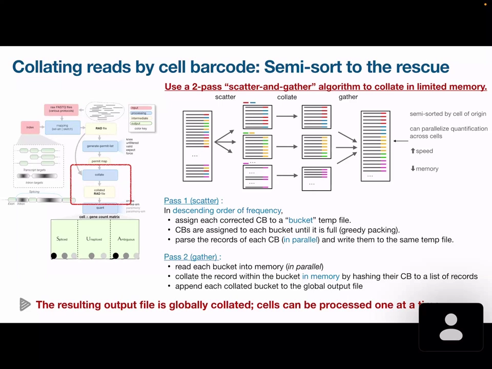

[【跳转到 48:03】](https://www.youtube.com/watch?v=fQD7JggiSl0&t=2883)

### 6.3 收益：可以一个细胞一个细胞地算

归拢之后，输出文件是**全局按 barcode 排好序**的。于是定量阶段可以「处理完第一个细胞的所有 reads，再处理第二个细胞」，内存只跟单个细胞的数据量有关；而且不同细胞之间天然可以并行——一个线程处理一个细胞。

讲者把这一步称为「半排序」（semi-sort）：不需要完整排序，只需要把同一细胞的记录聚在一起。

[【跳转到 49:18】](https://www.youtube.com/watch?v=fQD7JggiSl0&t=2958)

## 七、第五步：UMI 解析——一个 NP-hard 的图问题

### 7.1 三种情形，从简单到棘手

UMI 折叠在理论上很简单：同一个细胞里，同一个 UMI 落在同一个基因上，就是同一个分子，只算一次。但现实有三种情形：

1. **完全相同**：多个 read 的 UMI 一模一样、基因也一样 → 显然是 PCR 拷贝，算 1 个分子；
2. **差一个碱基**：如果某个 UMI 有大量精确拷贝，而另一个只差一个碱基且只有一两条 read，那多半是测序/扩增错误 → 应该折叠；
3. **多重比对**：reads 同时命中两个相似基因（比如旁系同源基因），此时「基因 A 有几个分子」和「基因 B 有几个分子」互相依赖——**这是一个鸡生蛋蛋生鸡的问题**。

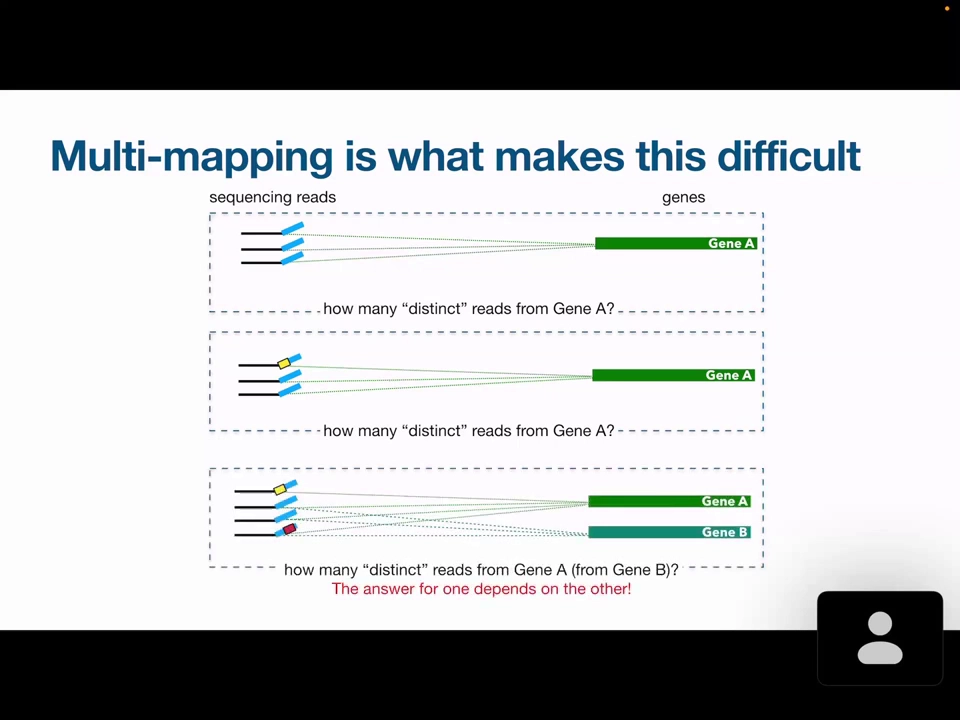

[【跳转到 51:48】](https://www.youtube.com/watch?v=fQD7JggiSl0&t=3108)

### 7.2 把问题画成图：PUG

解法是把 UMI 和它命中的转录本集合一起建成一张图——**parsimonious UMI graph（PUG）**：

- **顶点** = (转录本集合, UMI 序列)，同一个组合的多条 read 只贡献一个「重数」；
- **边** = 两个顶点「可能来自同一个 pre-PCR 分子」：转录本集合有交集且 UMI 相同（双向边）；或转录本集合有交集且 UMI 只差很小编辑距离（双向边）；或转录本集合有交集且一个顶点的计数至少是另一个的两倍（**有向边**——PCR 是几何扩增，出现这种分布更可能是扩增早期的错误）。

[【跳转到 53:28】](https://www.youtube.com/watch?v=fQD7JggiSl0&t=3208)

### 7.3 目标：用最少的分子解释所有 reads

有了图，问题就变成：**用最少数量的「单色树形结构」（monochromatic arborescence）覆盖整张图**。每棵树代表一个原始分子，树上所有顶点都是它的 reads（可能带错、可能多重比对）。

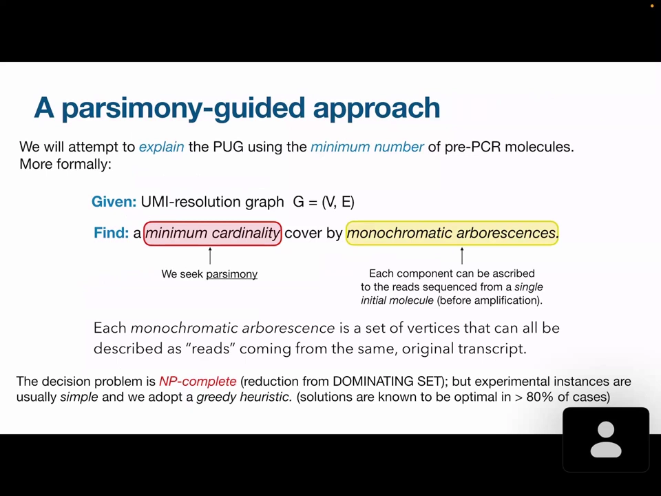

[【跳转到 55:58】](https://www.youtube.com/watch?v=fQD7JggiSl0&t=3358)

写成优化形式就是

$$
\min \left\lvert \mathcal{A} \right\rvert \quad \text{s.t.} \quad \bigcup_{A \in \mathcal{A}} V(A) = V(G),\ \ A \in \mathcal{A} \text{ 为单色树形结构}
$$

这个问题在最坏情况下是 **NP-complete**（讲者用支配集归约证明了这一点），但实际数据里的图通常很简单。alevin-fry 用贪心算法：每次找能覆盖最多顶点的最大连通结构，覆盖掉，再从剩下的图里继续找。

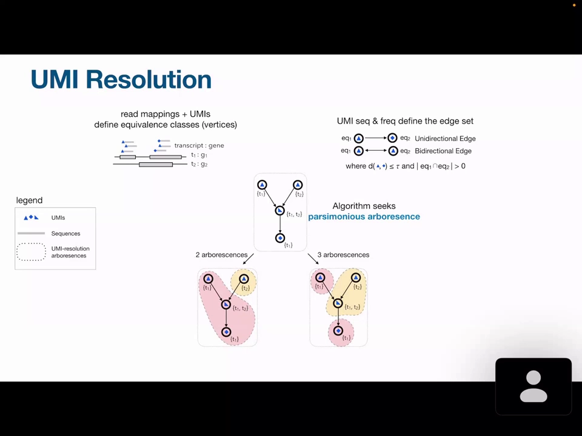

[【跳转到 58:53】](https://www.youtube.com/watch?v=fQD7JggiSl0&t=3533)

贪心只在「最优解是 1 棵或 2 棵树」时能保证全局最优；否则它只是启发式。讲者在提问环节补充了经验数据：**在真实数据里，超过 80% 的图能被分解成 1 到 2 个成分**，也就是大多数情况下结果是最优的；但理论上没有近似比保证。

[【跳转到 1:23:12】](https://www.youtube.com/watch?v=fQD7JggiSl0&t=4992)

### 7.4 歧义留给概率

如果某个结构本质上无法判定来自 T1 还是 T2（比如一条 UMI 同时兼容两个转录本），alevin-fry 不会硬猜：它把这个 UMI 标成「歧义」，最后用 EM 算法按比例分配。

讲者也提到，UMI 的「剪接状态」同样会有歧义，他们为此做了另一个工具 fertig，专门在歧义情况下更好地判定剪接状态；这部分本文不展开。

[【跳转到 59:18】](https://www.youtube.com/watch?v=fQD7JggiSl0&t=3558)

## 八、输出与代价：三张矩阵、14 分钟、4 GB

### 8.1 输出是 C × 3G，不是 C × G

因为每个计数都带剪接状态，alevin-fry 默认输出**三张**矩阵：spliced、unspliced、ambiguous。用户可以按需相加（当作总表达量做常规单细胞分析），也可以分开用（算比例做 RNA velocity）。

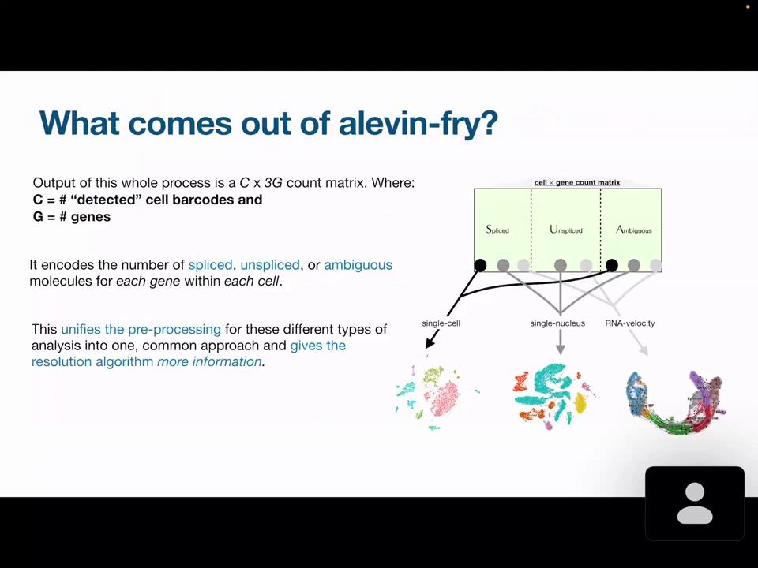

[【跳转到 1:01:20】](https://www.youtube.com/watch?v=fQD7JggiSl0&t=3680)

这个设计的意义在于**统一**：同一套上游处理，同时服务单细胞、单核与 RNA velocity 三种下游需求，不必为每种分析重跑一遍。

### 8.2 代价与精度

在 PBMC 10K（约 1 万个细胞、6 亿多条双端片段、44 GB 压缩数据）上，alevin-fry 用 32 线程从原始 reads 跑到最终矩阵不到 14 分钟，峰值内存 3.7 GB。

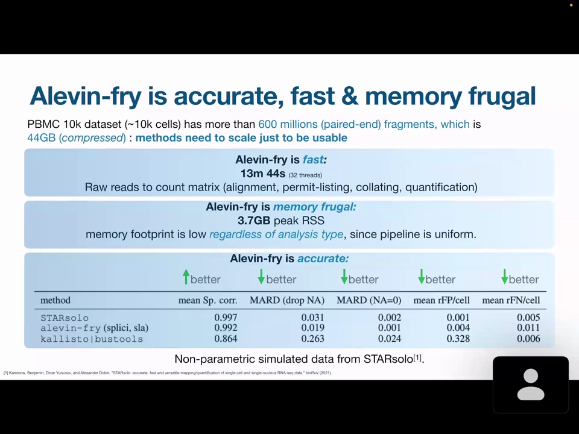

[【跳转到 1:02:23】](https://www.youtube.com/watch?v=fQD7JggiSl0&t=3743)

在 STARsolo 论文的非参数模拟数据上，三个工具的 Spearman 相关分别是 0.997（STARsolo）、0.992（alevin-fry）、0.864（kallisto|bustools）；MARD 等误差指标上 alevin-fry 与 STARsolo 接近，kallisto|bustools 明显更差。**这张表本身就是本文的论据**：同一批数据、同样「正确」的工具，给出的数字可以差出一个量级。

### 8.3 为什么「快」也是准确性问题

讲者强调效率不只是省钱：当新方法出现、或者你怀疑某个数据集的来源时，最彻底的做法是**从原始数据重跑一遍**。如果重跑要一周，你不会重跑；如果只要 14 分钟，你就会。所以速度直接决定了「能不能纠正过去的错误」。

[【跳转到 1:14:40】](https://www.youtube.com/watch?v=fQD7JggiSl0&t=4480)

## 九、矩阵的来源，为什么是分析的一部分

### 9.1 大多数人不知道自己的矩阵是怎么来的

讲者在 Twitter 上做过一个投票：用单细胞数据时，你是否用过「不知道来源」的矩阵？结果只有约 9% 的人说完全知道来源，其余是部分知道、完全不知道，或者干脆没用过。

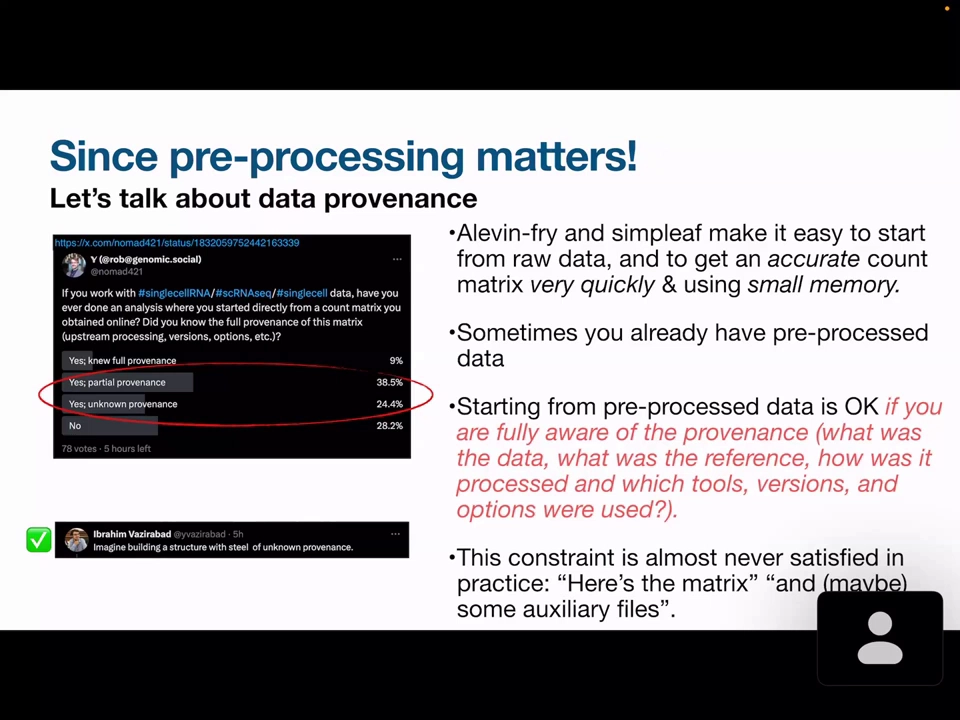

[【跳转到 1:04:39】](https://www.youtube.com/watch?v=fQD7JggiSl0&t=3879)

讲者并不反对直接用别人处理好的矩阵——有时候你必须保持一致以避免批次效应。他反对的是**不知道**：不知道用了什么工具、什么版本、什么参考注释。他用一个比喻：你不会用来源不明的钢材盖楼，而矩阵就是你分析的钢材。

### 9.2 tximeta：给参考注释打一个指纹

在 bulk RNA-seq 语境里，他和 Mike Love 等人做过一个工具 **tximeta**：在建立索引时，对参考转录本序列和转录本名字各算一个 SHA-256 哈希，作为这个注释的「签名」；定量结果里带上这个签名，下游工具就能自动认出「这份结果是用哪个版本的注释算出来的」，并自动挂上对应的基因模型。

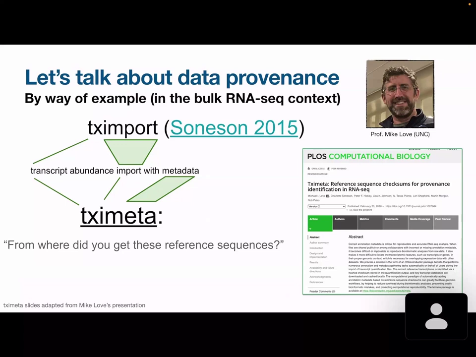

[【跳转到 1:05:24】](https://www.youtube.com/watch?v=fQD7JggiSl0&t=3924)

这件事的实际价值很具体：如果你不知道 RNA-seq 用的是哪个注释版本，就没法可靠地和 ChIP-seq 的 peak 做富集分析——两边的基因集合对不上，模型会被无声地丢掉。

### 9.3 simpleaf：把参数也带进输出

单细胞语境里对应的尝试是 **simpleaf**（simple alevin-fry）：把 alevin-fry 的多步流程收成两条命令（建索引、`quant` 一步完成映射+纠错+归拢+定量），并且因为它是「知道上下文」的包装器，**能把所有参数与元数据一路带到输出里**。

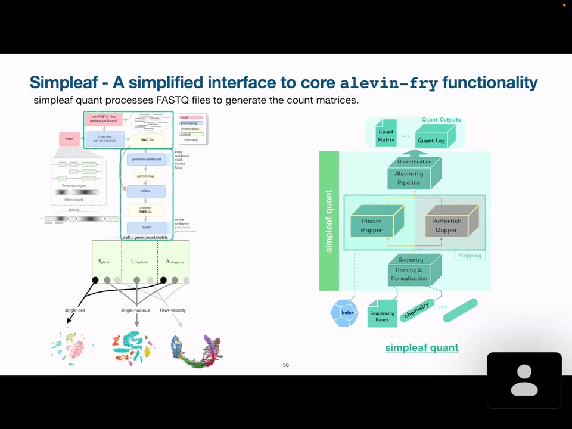

[【跳转到 1:12:10】](https://www.youtube.com/watch?v=fQD7JggiSl0&t=4330)

讲者把这称为「增广的执行上下文」（augmented execution context）：工具知道自己跑了什么，就能把 provenance 自动写进结果。他进一步设想，不同数据类型的「最佳实践参数组合」可以被程序化地编码进 simpleaf，用户只要说「我这是某个协议的数据」，参数就自动设好并记录在案。

### 9.4 一句呼吁

报告最后落到三点主张：上游方法应当**准确、透明、开放**。开放不只是免费，而是「如果别人想出更好的 UMI 解析算法，他能实现、能发表、能合并进来」——这一点在闭源工具上做不到。

[【跳转到 1:16:20】](https://www.youtube.com/watch?v=fQD7JggiSl0&t=4580)

## 小结

- 上游是五段流水线：**增广参考 → 索引与比对 → barcode 纠错 → 按细胞归拢 → UMI 解析**，每段都在准确、速度、内存之间取舍。
- 同一个软件的不同版本就能改变细胞集与表达量；Cell Ranger 6 前后把内含子 reads 计入基因总量，就是一个典型例子。
- 不做方向判断会把 read 分给反义链上的邻居基因，这个错误会一路传导到 RNA velocity 的细胞状态转移图。
- 增广转录组（splici / spliceu）让转录组路线也能处理未剪接 reads；k-mer 索引（piscem / SSHash）把内存压到 2–4 GB 且不随样本量增长。
- barcode 纠错用两遍扫描：先靠阈值找出「真的存在的细胞」，再在缩小后的清单里纠错，歧义直接丢弃；10x 白名单本身在序列空间里并不特别「分得开」。
- 按细胞归拢用外存 scatter-gather 实现，换来「一个细胞一个细胞地算」和按细胞并行。
- UMI 解析被建模成图问题（PUG）：用最少数量的单色树形结构覆盖全图，判定问题 NP-complete，实践中用贪心，超过 80% 的实例可解到最优。
- 输出是 C × 3G（spliced / unspliced / ambiguous），同一套上游同时服务单细胞、单核与 RNA velocity。
- 矩阵的来源（工具、版本、参考注释、参数）是分析的一部分；tximeta 与 simpleaf 的思路都是让 provenance 自动随数据流动。

## 关键术语速查

| 术语 | 一句话解释 |
| --- | --- |
| 增广转录组参考 | 在剪接转录本之外，额外索引内含子或基因体序列的参考，用于区分剪接与未剪接 reads |
| splici | spliced + intronic：剪接转录本与内含子并集一起索引的参考构造 |
| spliceu | 剪接转录本加完整基因体（unspliced body）的参考构造，能容纳跨外显子-内含子边界的 read |
| piscem | alevin-fry 使用的 k-mer 索引，基于 SSHash 简洁数据结构，内存占用小且不随样本量增长 |
| RAD 文件 | reduced alignment data，alevin-fry 中间产物，二进制存放 read 的比对信息 |
| permit list | 允许出现的 cell barcode 清单（白名单），用于校验与纠错 |
| 两遍纠错 | 先统计精确命中并设阈值找出真细胞，再在缩小后的清单内做单编辑纠错 |
| collate（归拢） | 把同一 barcode 的 reads 排到一起，用外存 scatter-gather 实现，使内存有界 |
| PUG | parsimonious UMI graph：顶点为 (转录本集合, UMI)、边表示可能同源分子的图 |
| 单色树形结构 | monochromatic arborescence，有向树，代表一个 pre-PCR 分子的所有 reads |
| UMI 解析 | 用最少数量的分子解释所有 reads 的过程，本质是最小基数覆盖问题 |
| 多重比对 | 一条 read 同时命中多个基因或转录本，导致基因间计数互相依赖 |
| C × 3G 矩阵 | alevin-fry 的输出形态：细胞 ×（基因 × 3 种剪接状态） |
| provenance | 数据来源信息：用了什么工具、什么版本、什么参考注释、什么参数 |
| tximeta | bulk RNA-seq 工具，用 SHA-256 哈希给参考注释打签名，随定量结果传递 |
| simpleaf | alevin-fry 的简化包装器，两条命令完成建索引与定量，并自动记录元数据 |