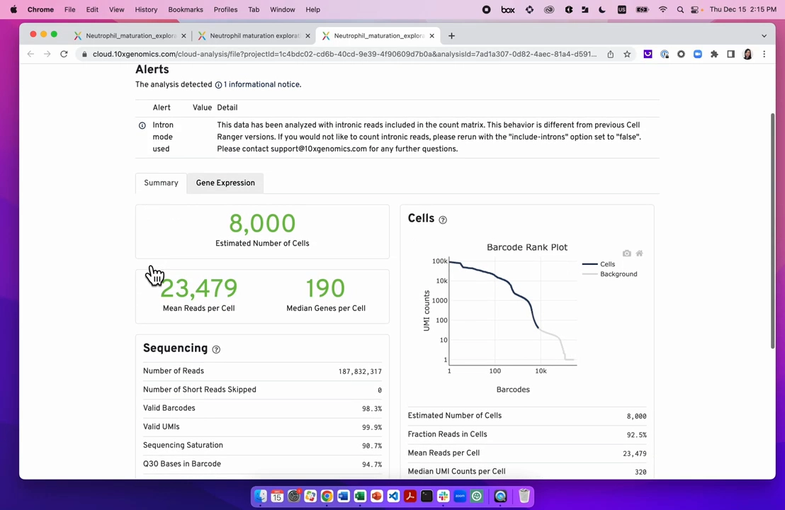
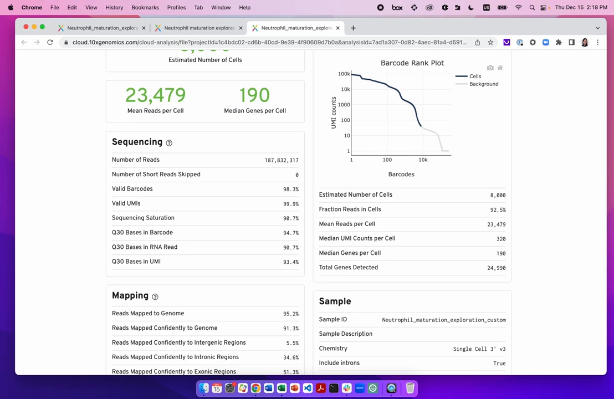
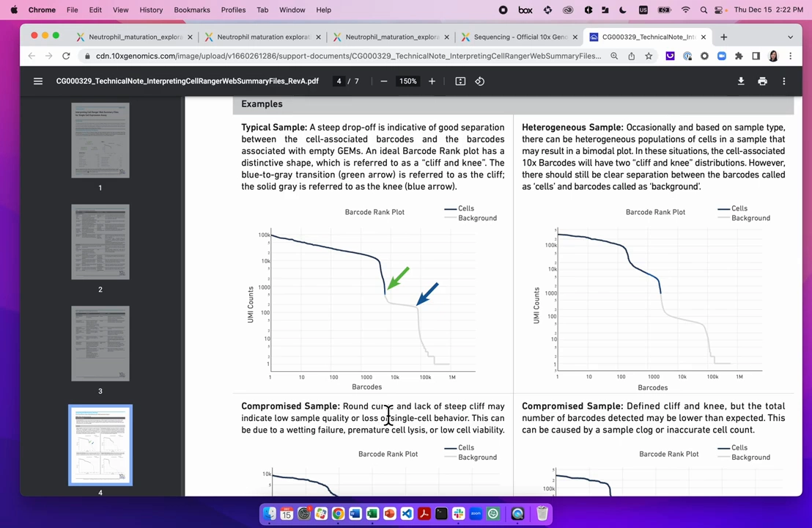
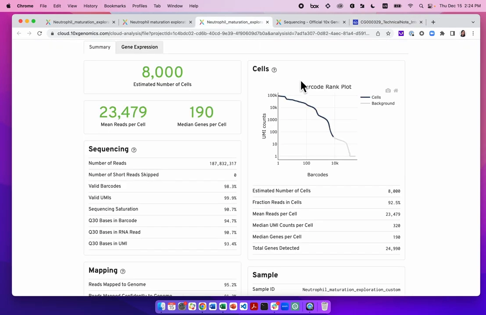
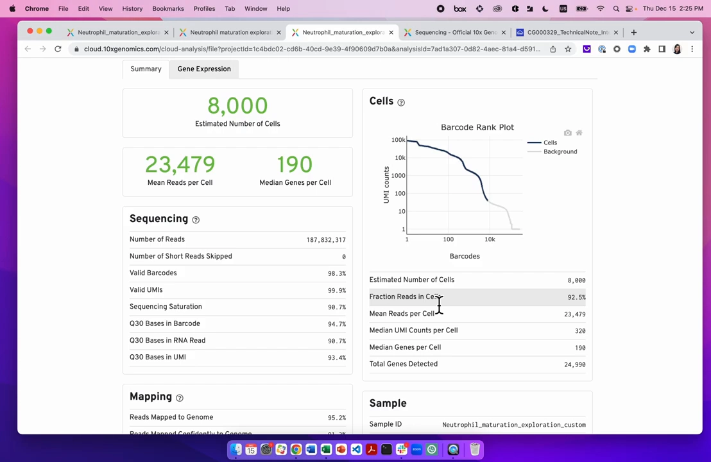
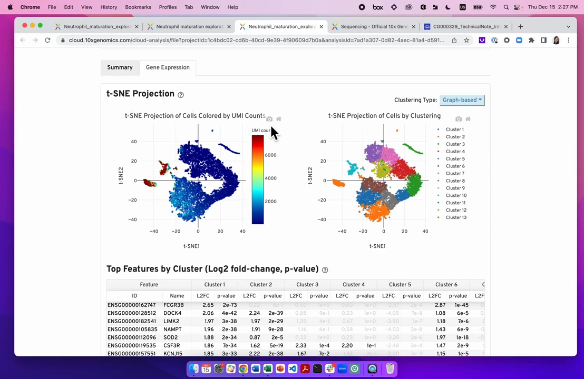
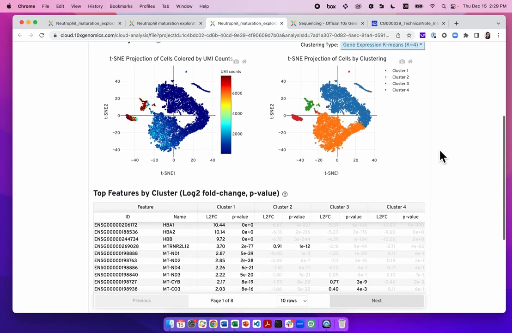
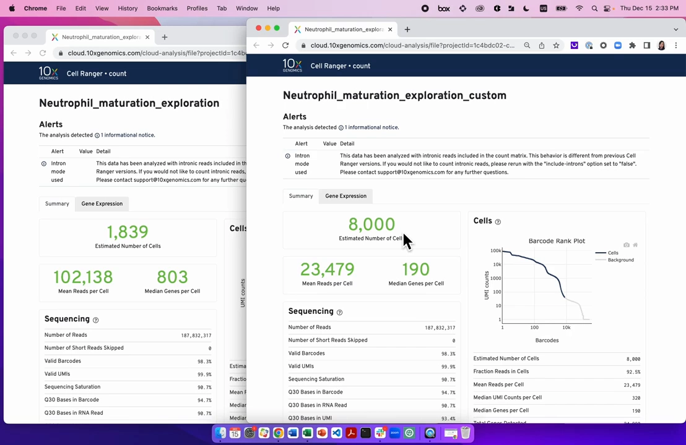

# Cell Ranger Web Summary 怎么读：用 Barcode Rank Plot 判断哪些 barcode 是细胞

> 视频来源：[Quality Assessment Using the Cell Ranger Web Summary](https://www.youtube.com/watch?v=L3mc7zj1DLg)（YouTube · 10x Genomics 官方频道，Hands-On Tour of the Single Cell Analysis Journey 系列）｜时长约 22 分钟
> 导读：这是 10x Genomics 官方的手把手教程，讲者打开一份真实的中性粒细胞数据集的 web summary，把「Estimated Number of Cells / Mean Reads per Cell / Median Genes per Cell」三个关键指标、测序与比对各栏、以及最关键的 **Barcode Rank Plot** 逐个讲一遍，最后把「默认参数」与「`--force-cells` 手动指定细胞数」两次运行的结果并排对比。本文放在「测序深度与捕获效率」这一节，用的是它 Summary tab 的 Sequencing 与 Cells 栏：**Mean Reads per Cell**（测序投入）、**Sequencing Saturation**（文库复杂度被读完了多少）、**Median Genes per Cell**（检出基因数）与 **Fraction Reads in Cells**（捕获效率）；Barcode Rank Plot 与 `--force-cells` 那部分只作背景。barcode 与 UMI 的结构、UMI 去重算法见 [2.1.3 细胞条形码与 UMI](../2.1.3_细胞条形码与%20UMI：细胞归属、分子去重与碰撞/Barcode%20与%20UMI：一锅细胞汤如何被还原成计数矩阵.md)，比对与基因定量见 [2.1.6 RNA 读段量化](../../../README.md#b04-2-1-6)，count matrix 本身见 [2.2.1](../../../README.md#b04-2-2-1)。

## 本讲要解决的核心问题（SCQA）

**背景**：液滴法单细胞测序一次能包出几十万到上百万个液滴（GEM，gel bead in emulsion），每个液滴里都有一条带细胞 barcode 的凝胶珠。测序完成后，每个 barcode 都对应一堆 reads，barcode 总数动辄几十万。

**冲突**：这几十万个 barcode 里，绝大多数是**空液滴**——里面没有细胞，只有建库溶液里游离的 mRNA（环境 RNA，ambient RNA）。Cell Ranger 交给你的 `filtered_feature_bc_matrix` 只保留了它**判定为细胞**的那部分 barcode，其余全部丢掉。也就是说，你拿到矩阵时，一个「哪些 barcode 算细胞」的决定已经替你做完了，而且这个决定通常没人复核。

**疑问**：怎么知道这个决定做得对不对？如果它把真细胞漏掉了，或者把空液滴算了进来，从 web summary 的哪一栏能看出来？

**回答（中心思想）**：**看 Barcode Rank Plot 的形状，再用一组配套指标交叉验证。** 把 barcode 按 UMI 总数从高到低排序、取对数作图，细胞与背景之间会出现一段陡降（cliff）；cliff 断在哪里、断得够不够陡，直接反映 cell calling 的质量。这一张图配三个数——**Estimated Number of Cells**（判了多少个细胞）、**Fraction Reads in Cells**（有多少比例的 reads 落在这些细胞里）、**Median Genes per Cell**（每个细胞测到多少基因）——就足以判断这次运行是「分得很干净」还是「阈值定错了」。当样本里存在表达量特别低的细胞类型（本讲的中性粒细胞就是典型）时，自动阈值会系统性漏掉它们，此时应该用 `--force-cells` 手动指定细胞数，并接受「多抓一些背景」的代价。

[【跳转到 03:15】](https://www.youtube.com/watch?v=L3mc7zj1DLg&t=195)

## 一、Web Summary 是一份「体检报告」，不是一个结果文件

### 1.1 两个入口，同一份 HTML

分析跑完之后，从 Cloud Analysis 进到某个 analysis，有两条路拿到 web summary：点页面上的 **See Results Summary** 按钮直接看，或者把 `summary.html` 这个文件下载下来，用任意浏览器打开。两者内容完全一样——它就是一份静态 HTML 报告，不依赖服务器。

[【跳转到 01:22】](https://www.youtube.com/watch?v=L3mc7zj1DLg&t=82)

### 1.2 先看 Alerts，再看 tab

报告最上面三样东西值得先确认：

1. **用的哪条 pipeline**。本次是 `Cell Ranger count`（讲者口误说成 "Cell Ranger cut"）。同一份 web summary 可能来自 `count`、`multi`、`vdj` 等不同 pipeline，指标含义不完全通用。
2. **analysis ID**，方便回溯这次跑的是哪一版参数。
3. **Alerts**。本次只有一条 informational notice：*"This data has been analyzed with intronic reads included in the count matrix."* —— 新版 Cell Ranger 默认把内含子（intron）里的 reads 也算进 UMI 计数，这对核内 pre-mRNA 含量高的样本（中性粒细胞、心肌细胞等）是好事，但和旧版结果不可直接比较。如果结果异常，这一栏会出现 warning 或 error，**这是排查问题的第一站**。

再往下是 tab。tab 的数量取决于这次分析里包含哪些文库类型；这里只跑了一个基因表达文库，所以只有 **Summary** 和 **Gene Expression** 两个 tab。Summary 放的是「测序质量 + 细胞基本特征」，Gene Expression 放的是「二级分析结果」，后者是用来**用生物学常识反查数据质量**的，不是给你做下游分析的——下游请用 Loupe Browser、Seurat 或其它社区工具。

[【跳转到 02:39】](https://www.youtube.com/watch?v=L3mc7zj1DLg&t=159)

## 二、三个关键指标：细胞数、每细胞 reads、每细胞基因数

10x 在 Summary tab 顶部特意只突出三个数，理由是「凭经验这三个数最快让人对一次实验有概念」。

### 2.1 Estimated Number of Cells：cell calling 的结论

这个数就是本次分析**判定为细胞**的 barcode 个数。它有两种来源，区别非常重要：

- 让 Cell Ranger 自己按算法定（默认行为）；
- 用 `--force-cells` 手动指定。

本次运行用的是后者，指定了 **8,000**，所以这里显示 8,000。**注意：这个数不是「测到了 8,000 个细胞」，而是「我要求它交出 8,000 个 barcode 当作细胞」**——这两件事在数据质量差的时候可以差得很远。

[【跳转到 03:40】](https://www.youtube.com/watch?v=L3mc7zj1DLg&t=220)

### 2.2 Mean Reads per Cell：测序深度够不够

$$
\text{Mean Reads per Cell} = \frac{\text{文库总 reads 数}}{\text{Estimated Number of Cells}}
$$

10x 的建议下限是**每细胞 20,000 条 reads**。低于这个数通常意味着测序深度不够，每个细胞里能测到的基因数会明显下降。本次是 23,479，刚过线。

这个指标有个容易踩的坑：**分母是 cell calling 判出来的细胞数**。细胞判得越少，这个数就越大，看起来「测得更深」——其实只是同一个文库被摊到了更少的分母上。

[【跳转到 04:05】](https://www.youtube.com/watch?v=L3mc7zj1DLg&t=245)

### 2.3 Median Genes per Cell：190 这个数为什么偏低

本次的每细胞基因数中位数只有 **190**，明显低于常规样本（一般期望在千级）。讲者给了两个解释，两个都指向 cell calling：

1. **样本里有中性粒细胞**。文献上中性粒细胞只表达几百个基因，转录组本身极浅，所以整体中位数被拉低是预期内的。
2. **用了 `--force-cells`**。强行要 8,000 个 barcode，就必然有一部分「背景 barcode」被算成细胞，而背景本来就没什么基因，进一步压低中位数。

**这是本讲最值得记住的一处联动**：Median Genes per Cell 偏低，未必是测序失败，可能只是 cell calling 把背景一起收了进来。判断时要和 Estimated Number of Cells、Barcode Rank Plot 一起看。

[【跳转到 04:55】](https://www.youtube.com/watch?v=L3mc7zj1DLg&t=295)

> 阅读提示：web summary 里每个指标旁边都有一个小问号，点开会展开该指标的定义框。讲者建议不必背指标，遇到不认识的点开看定义即可——本讲只挑对本样本最有诊断价值的那些。
## 三、测序与比对指标：先确认「读得对不对」，再谈「细胞判得准不准」

Summary tab 往下依次是 Sequencing、Mapping、Cells、Sample 四块。讲者只挑了对本样本有诊断价值的几项。

[【跳转到 06:10】](https://www.youtube.com/watch?v=L3mc7zj1DLg&t=370)

### 3.1 Valid Barcodes：白名单命中率

这一项是「reads 里的 barcode 序列能对上**白名单**（whitelist，assay kit 里预先合成的那一批已知 barcode）的比例」。本次 **98.3%**，非常好。

判据：**低于 75% 就要怀疑**测序质量或建库出问题。原因是 barcode 是一段固定长度的已知序列，如果大量 reads 的 barcode 对不上白名单，通常意味着测序错误率高、或者样本里混进了别的文库。

### 3.2 Sequencing Saturation：文库复杂度被读完了多少

测序饱和度衡量的是「文库里的分子有多少比例已经被读到过至少一次」。本次 **90.7%**，讲者认为对本实验目标（识别中性粒细胞、看中性粒细胞成熟过程）已经绰绰有余。

这一项没有绝对的好坏：饱和度低说明「再加测序量还能挖出新信息」，饱和度高说明「再测也只是重复读到同样的分子」。是否要追加测序，取决于你的实验目标。

[【跳转到 07:00】](https://www.youtube.com/watch?v=L3mc7zj1DLg&t=420)

### 3.3 Mapping：物种、注释质量决定基线

Mapping 这一栏的数值在不同物种、不同基因组组装与注释版本之间差异很大，不能拿别人的数直接套。本次（人）的读数：

| 指标 | 本次数值 | 怎么读 |
| --- | --- | --- |
| Reads Mapped to Genome | 95.2% | 整体比对率，人和小鼠一般到 85% 以上算正常 |
| Reads Mapped Confidently to Genome | 91.3% | 唯一比对、可信的 reads 占比 |
| Reads Mapped Confidently to Intergenic Regions | 5.5% | 落在基因间区，偏高可能提示基因组污染或注释不全 |
| Reads Mapped Confidently to Intronic Regions | 34.6% | 内含子 reads，用细胞核建库或内含子保留高时会偏高 |
| Reads Mapped Confidently to Exonic Regions | 51.3% | 外显子 reads |
| Reads Mapped Confidently to Transcriptome | 76% | **真正进入 UMI 计数的那部分**，本次 76% 很好 |

内含子那 34.6% 值得单独说一句：文献上中性粒细胞的内含子保留（intron retention）水平偏高，讲者认为这个略高的数字可以由样本本身的生物学解释，而不是建库问题。**同一个数值，在不同细胞类型下可以有完全不同的解释**——这也是为什么 web summary 必须结合样本背景读。

[【跳转到 08:40】](https://www.youtube.com/watch?v=L3mc7zj1DLg&t=520)

## 四、Barcode Rank Plot：cell calling 的全部秘密都在这一张图

### 4.1 这张图在画什么

Cells 栏最上面就是 **Barcode Rank Plot**（也叫 barcode rank plot / knee plot）。讲者称它是整份 web summary 里**信息量最大的一张图**。它的坐标轴是：

- **纵轴**：每个 barcode 的 **UMI 总数**，取对数刻度（1、10、100、1,000、10,000、100,000）；
- **横轴**：barcode 的**排名**，按 UMI 总数从高到低排，同样取对数刻度（1、100、10,000…）。

所以这条曲线本质上是「所有 barcode 的 UMI 计数的排序分布」。蓝色是 Cell Ranger 判为细胞的 barcode，灰色是判为背景（background）的 barcode。

[【跳转到 09:04】](https://www.youtube.com/watch?v=L3mc7zj1DLg&t=544)

### 4.2 理想形态：cliff 与 knee

讲者专门跳到 10x 的技术文档 *Interpreting Cell Ranger Web Summary Files*（CG000329）第 4 页看范例。理想情况下曲线长这样：

[【跳转到 10:44】](https://www.youtube.com/watch?v=L3mc7zj1DLg&t=644)

- **cliff（悬崖）**：曲线从「细胞水平」（UMI 上千到上万）陡然掉到「背景水平」（UMI 个位数到几十）的那一段。cliff 越陡，细胞与空液滴分得越干净。
- **knee（膝盖）**：cliff 之后曲线走平的那一段，代表大量空液滴。

一个理想的 barcode rank plot 应该同时具备陡峭的 cliff 和清晰的 knee。文档里给了四种形态：

| 形态 | 图形特征 | 说明什么 |
| --- | --- | --- |
| 典型样本 | 陡降 + 清晰的 cliff 与 knee | 细胞与空液滴分离良好 |
| 异质样本 | 出现**两个** cliff 与 knee 结构 | 样本里存在表达量差异很大的细胞群体，但两组之间仍有清晰分离 |
| 受损样本（一） | 曲线圆滑、没有陡降 | 建库失败、细胞过早裂解、活力低，或「单细胞行为」丢失 |
| 受损样本（二） | 有 cliff 和 knee，但细胞总数远低于预期 | 样本堵塞，或细胞计数不准 |

### 4.3 本样本为什么有多个 cliff

回到自己的数据，本样本的 barcode rank plot 明显是「异质样本」那一类——曲线上有好几个台阶。

[【跳转到 12:17】](https://www.youtube.com/watch?v=L3mc7zj1DLg&t=737)

讲者解释说这完全合理：样本里同时有 **PBMC**（外周血单个核细胞）和**中性粒细胞**。PBMC 的转录组丰富、UMI 高，中性粒细胞的转录组极浅、UMI 低，两者在排序曲线上自然形成两级台阶。再加上 `--force-cells` 指定了 8,000，会有一小段背景被划进「细胞」，但整体上细胞与背景之间仍有清晰的分离。

**这就是读 knee plot 的核心技巧：先问「这个样本应该长什么样」，再看它实际长什么样。** 一个纯 PBMC 样本出现多个 cliff 才需要警惕（可能是双细胞或污染）；一个 PBMC + 中性粒细胞的样本出现多个 cliff 反而是正常的。

### 4.4 阈值定高定低，各自丢什么

把 4.2 的四种形态翻译成「阈值」的语言：

- **阈值定高**（只保留 UMI 最高的那一批）：曲线只截到第一个 cliff 就停手 → **系统性丢掉低 RNA 含量的细胞类型**。中性粒细胞、红细胞、部分终末分化细胞都会整类消失，而它们在 t-SNE 上往往是独立的一簇，丢掉之后你根本不知道自己丢了。
- **阈值定低**（多收一些）：空液滴被算成细胞 → **细胞数虚高**、矩阵里出现大量几乎全零的「细胞」、中位基因数被拉低，下游聚类可能出现一个由环境 RNA 主导的假细胞群。

本讲最后一段的对比实验，就是把这两种极端各跑了一遍。

## 五、Fraction Reads in Cells：环境 RNA 的体温计

Cells 栏里除了 barcode rank plot，还有一个常被忽略但极有用的指标：**Fraction Reads in Cells**（落在细胞里的 reads 比例）。

$$
\text{Fraction Reads in Cells} = \frac{\text{落在被判为细胞的 barcode 上的可信比对 reads}}{\text{全部有效 barcode 的可信比对 reads}}
$$

它的含义是：**你测到的所有 mRNA reads 里，有多大比例真的来自细胞，而不是来自那锅游离的环境 RNA。**

[【跳转到 13:32】](https://www.youtube.com/watch?v=L3mc7zj1DLg&t=812)

判据很简单：**低于 70% 就要怀疑环境 RNA 污染严重**。本次 92.5%，讲者认为很好。

为什么这个指标和 cell calling 绑在一起？因为它和 barcode rank plot 是**同一件事的两种读法**：

- 如果 cell calling 判得太严，大量真细胞被当成背景，它们的 reads 就被算进「不在细胞里」→ 这个比例被压低；
- 如果样本本身组织消化过度、死细胞多，游离 RNA 多 → 空液滴里的 UMI 整体抬高 → barcode rank plot 的 cliff 变缓、这个比例也变低。

所以 **cliff 不陡 + Fraction Reads in Cells 偏低**，通常一起出现，指向同一个病因：环境 RNA 太多。

## 六、Gene Expression tab：用生物学常识反查 cell calling

Summary tab 讲的是「测得好不好」，Gene Expression tab 讲的是「结果像不像真的」。它包含两块：t-SNE 投影，以及按 cluster 列出的 top features（差异表达基因）。讲者强调：**这一页不是给你做下游分析的**，它只是让你用 30 秒判断「这批细胞是不是活得好好的」。

[【跳转到 15:37】](https://www.youtube.com/watch?v=L3mc7zj1DLg&t=937)

### 6.1 t-SNE 要看「有没有结构」

两张 t-SNE 并排：左边按 UMI counts 着色（红=高、蓝=低），右边按聚类着色（默认 graph-based，可切换成 k-means）。

判据是**结构**：好的样本里，不同 cluster 彼此分开、边界清楚；如果整张图糊成一团、只有一个大 cluster，往往说明样本质量差，或者「单细胞行为」丢失了（比如细胞在液滴里互相黏连，测到的其实是混合转录组）。

### 6.2 把 cluster 数调到 4，看最差的那一簇

cluster 太多不好读，讲者直接把 k-means 的 k 设成 4。这时最值得看的是 **cluster 1**：

[【跳转到 17:35】](https://www.youtube.com/watch?v=L3mc7zj1DLg&t=1055)

- 在按 UMI 着色的 t-SNE 上，这一簇正是 **UMI 最低**的那一群；
- 它的 top 差异基因里，一串以 `MT-` 开头的是**线粒体基因**——线粒体转录本占比高是细胞濒死或已死的经典标志；
- 同时还有 `HBA1 / HBA2 / HBB` 三个血红蛋白基因，说明这一簇里混着红细胞（红细胞没有核，转录组只剩血红蛋白 mRNA 和线粒体转录本）。

讲者的态度很务实：**这一簇有问题，但不影响结论**——因为后面还要做细胞过滤，把这类低质量细胞去掉。web summary 的作用是让你**提前知道要过滤什么**，而不是替你过滤。

### 6.3 反查 cell calling 的用法

把 6.2 和第四章连起来看，就得到一个可操作的自检回路：

1. barcode rank plot 上 cliff 不陡 → 怀疑背景混入；
2. Gene Expression tab 上如果出现一个「UMI 极低 + 全是 MT- 基因」的簇 → 证实了背景/死细胞确实被算进了细胞；
3. 回到 cell calling 参数，决定是收紧阈值还是接受它、留到下游过滤。

## 七、默认参数 vs `--force-cells`：同一个样本，1,839 还是 8,000

讲者最后把两次分析的 web summary 并排放在一起：左边是**默认参数**（让 Cell Ranger 自己定细胞数），右边是 **`--force-cells 8000`**。

[【跳转到 21:46】](https://www.youtube.com/watch?v=L3mc7zj1DLg&t=1306)

| 指标 | 默认参数 | `--force-cells 8000` |
| --- | --- | --- |
| Estimated Number of Cells | 1,839 | 8,000 |
| Mean Reads per Cell | 102,138 | 23,479 |
| Median Genes per Cell | 803 | 190 |
| Fraction Reads in Cells | 78.5% | 92.5% |
| Barcode Rank Plot | 只截到第一个 cliff | 覆盖多个 cliff |

逐条读这张表：

1. **细胞数差了 4 倍多**。默认参数只抓到了第一个 cliff 上的细胞，也就是表达量高的 PBMC；后面几级台阶上的中性粒细胞**整类被漏掉**。
2. **Mean Reads per Cell 从 23,479 涨到 102,138**，看起来「测得更深了」，其实只是分母从 8,000 缩到 1,839——同一个文库，换个分母而已。
3. **Median Genes per Cell 从 190 涨到 803**，同理：只剩高表达的 PBMC，中位数当然高。**这个数变好看，恰恰说明你丢了东西。**
4. **Fraction Reads in Cells 反而从 92.5% 降到 78.5%**，这一条最容易被误读。原因是：中性粒细胞虽然 UMI 低，但它们确实是细胞，它们的 reads 本来应该算进「细胞里」；默认参数把它们判成背景后，这部分 reads 就被归到了「不在细胞里」，比例自然掉下来。**所以这个指标低，不一定代表环境 RNA 多，也可能代表 cell calling 漏了细胞。**

### 7.1 讲者给出的操作建议

1. **先跑默认参数**，让 Cell Ranger 自己决定细胞数；
2. 如果不满意，或者像本例这样**明确知道样本里有低表达细胞类型想保住**，再上 `--force-cells`；
3. 用 `--force-cells` 时，填**你预期实验里有多少个细胞**，而不是随便填个大数；
4. **拿不准就往上估**。这一步多收一些背景是可以接受的——背景会在下游过滤（按 UMI 数、按线粒体比例）时被清掉；但漏掉的真细胞是**找不回来**的。

这条建议背后的不对称性值得记住：**多收的噪音可以后处理，漏掉的信号不能。**

[【跳转到 21:21】](https://www.youtube.com/watch?v=L3mc7zj1DLg&t=1281)

## 八、把这套判据用到自己的数据上

把整讲的判据压缩成一张检查清单，按顺序过一遍：

1. **Alerts 有没有 warning/error**？有就先解决，别急着看指标。
2. **Valid Barcodes 是否高于 75%**？低于这个数说明建库或测序有问题，后面的指标都不可信。
3. **Barcode Rank Plot 的 cliff 陡不陡**？陡 → 分离好；圆滑 → 建库失败或环境 RNA 过多。
4. **cliff 的数量和样本预期是否一致**？纯 PBMC 出现多级台阶要警惕；PBMC + 中性粒细胞出现多级台阶是正常的。
5. **Fraction Reads in Cells 是否高于 70%**？低了要么环境 RNA 多，要么 cell calling 漏了细胞——用第 4 步区分。
6. **Median Genes per Cell 是否和细胞类型相符**？中性粒细胞、红细胞为主的样本本来就低，不要拿 PBMC 的基准去套。
7. **Gene Expression tab 里有没有「UMI 极低 + MT- 基因主导」的簇**？有，说明背景或死细胞混进来了，记下来留到下游过滤。
8. **细胞数是否够用**？如果关键细胞类型只占 1%，而总数只有 1,839，那这个类型可能只剩十几个细胞，统计上没法用——这时候 `--force-cells` 就是必要的。

## 小结

- **Cell calling 是「把 barcode 分成细胞与背景」的一步**，它的产物就是你拿到的 filtered matrix；这一步做错，后面所有分析都在错误的细胞集合上进行。
- **Barcode Rank Plot 是这一步的 X 光片**：纵轴 UMI 总数（对数）、横轴 barcode 排名（对数），理想的形态是陡峭的 cliff 加清晰的 knee。
- **cliff 的数量要和样本预期对得上**：异质样本（表达量差异大的细胞类型共存）本来就会出现多个 cliff。
- **三个指标要一起读**：Estimated Number of Cells 告诉你判了多少，Mean Reads per Cell 的分母就是它，Median Genes per Cell 偏低可能只是背景被收了进来。
- **Fraction Reads in Cells 低有两种病因**：环境 RNA 多，或者 cell calling 漏了细胞；配合 barcode rank plot 可以区分。
- **默认参数会系统性漏掉低表达细胞类型**；`--force-cells` 是对策，代价是多收背景，但背景可以下游过滤，漏掉的真细胞找不回来。
- **Gene Expression tab 不是给下游分析用的**，它是用生物学常识反查数据质量：UMI 最低、top 基因全是 `MT-` 和血红蛋白的那一簇，就是该被过滤掉的那批。

## 关键术语速查

| 术语 | 一句话解释 |
| --- | --- |
| Cell calling | 从几十万个 barcode 里判定哪些是真正装过细胞的液滴，其余视为空液滴背景 |
| Barcode Rank Plot（knee plot） | 把 barcode 按 UMI 总数降序排列后取对数作的曲线，用来看细胞与背景的分界 |
| cliff / knee | cliff 是曲线上细胞掉到背景的陡降段，knee 是其后走平的空液滴段 |
| Empty droplet | 没装到细胞、只含游离 mRNA 的液滴，占液滴总数的绝大多数 |
| Ambient RNA | 建库溶液里游离的 mRNA，会污染空液滴，也会渗进真细胞 |
| Fraction Reads in Cells | 落在被判为细胞的 barcode 上的 reads 占全部有效 reads 的比例，低于 70% 提示环境 RNA 严重或 cell calling 漏细胞 |
| Estimated Number of Cells | 本次分析判定（或手动指定）的细胞数，是 Mean Reads per Cell 的分母 |
| `--force-cells` | Cell Ranger 参数，跳过自动判定、直接指定细胞数，用于保住低表达细胞类型 |
| Whitelist | assay kit 里预先合成的那批已知 barcode 序列，用于校验 reads 上的 barcode 是否合法 |
| Sequencing Saturation | 文库复杂度中已被测序覆盖的比例，高说明再测也挖不出新分子 |
| Median Genes per Cell | 每个细胞测到的基因数的中位数，受细胞类型与测序深度共同影响 |
| GEM | Gel Bead in Emulsion，10x 的液滴，一个液滴内含一条凝胶珠 |
