# Ensembl ID 与 gene symbol：基因元数据怎么对齐与转换

> 视频来源：[Converting Gene IDs into Gene Symbols in your analysed Seurat Object](https://www.youtube.com/watch?v=MQt6s6st1dw)（YouTube · Single Cell Genomics, Transcriptomics & Proteomics）｜时长约 16 分钟
> 导读：一支纯实操的短讲，用同一份人肺 10x 数据演示两条把「基因行名」从 Ensembl ID 换成 gene symbol 的路径——有 feature 文件时的无损替换，和没有 feature 文件时靠 Ensembl 注释库的有损映射。本文只讲**基因元数据这一侧**（`var` / 行名）的语义、对齐与代价；细胞元数据（`obs` / `meta.data`）见同目录的 [细胞元数据：obs 每一列都在决定你能问出什么问题](细胞元数据：obs%20每一列都在决定你能问出什么问题.md)。

## 本讲要解决的核心问题（SCQA）

**背景**：单细胞表达矩阵本身只有两样东西——行名（基因）和列名（细胞 barcode），矩阵格子里的数字只回答"这个基因在这个细胞里被测到多少"。至于"这个基因叫什么、属于哪条染色体、是不是蛋白编码"，这些信息不在矩阵里，而在**贴在行上的第二张表**：基因元数据（AnnData 里叫 `var`，Seurat 里是 assay 的行名加一份 feature 表）。

**冲突**：同一个基因有好几个名字。Ensembl 数据库给它一个稳定的编号 `ENSG00000279457`，人类读起来却只认 `FOSB57.2` 这样的 gene symbol。10x Genomics 的原始输出默认用 symbol 当行名，但很多上游流程和公共数据集用 Ensembl ID。于是你从 GEO 下载一份数据、跑完标准流程、准备做细胞通讯分析时，CellChat 报错说找不到基因——因为它的基因库里全是 symbol，而你的对象里全是 `ENSG...`。

**疑问**：基因元数据到底包含什么？把行名从 ID 换成 symbol 有几种做法？换的过程中会不会丢东西？

**回答（中心思想）**：基因元数据是"一行一个基因"的属性表，**Ensembl ID 是主键、gene symbol 是别名**；转换有两条路——有 feature 文件时按 ID 做**无损对齐**（本例把 33,694 行的 feature 表裁到与对象一致的 12,355 行再写回行名），没有 feature 文件时靠 Ensembl 注释库做**有损映射**（本例 12,355 个 ID 里有 10 个映射不出来）。转换本身只有几行代码，真正的风险全在"行有没有对齐"和"注释版本对不对"上。

## 一、矩阵只有行列名，基因元数据是贴在行上的第二张表

### 1.1 一份 10x 数据其实是四个文件

视频里打开的数据目录很典型：`barcodes.tsv`（细胞 barcode 清单）、`features.tsv`（基因清单）、`matrix.mtx`（稀疏矩阵），外加解压出来的 feature 文件 [【跳转到 01:50】](https://www.youtube.com/watch?v=MQt6s6st1dw&t=110)。

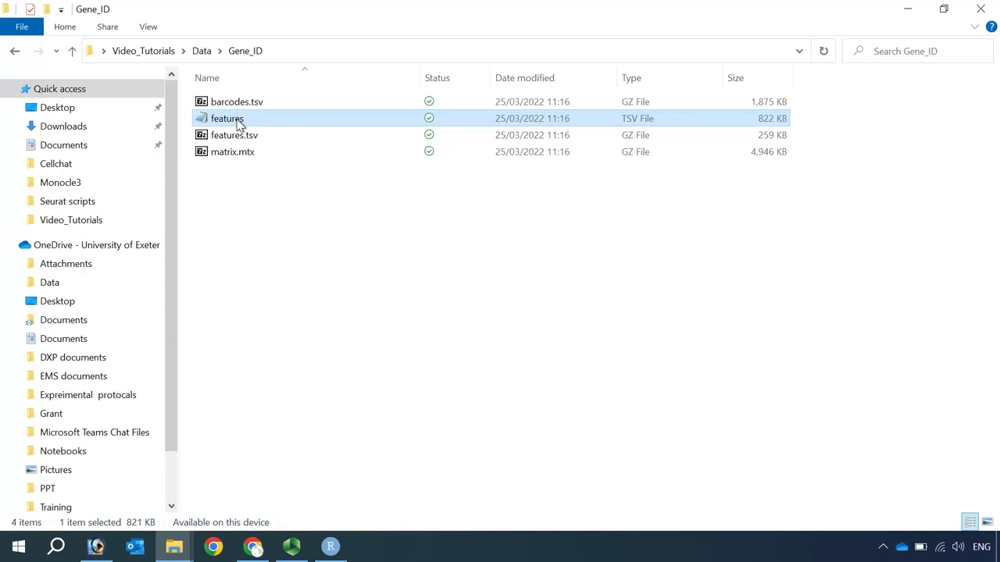

这三个文件正好对应"矩阵 + 两张元数据表"的结构：

| 文件 | 内容 | 对应 AnnData | 对应 Seurat |
| --- | --- | --- | --- |
| `barcodes.tsv` | 一列细胞 barcode | `obs_names` | 列名（细胞） |
| `features.tsv` | 基因 ID + symbol + 类型 | `var` | assay 行名 + feature 表 |
| `matrix.mtx` | 非零计数值 | `X` | `counts` |

**关键点**：`matrix.mtx` 里只有"第几行、第几列、值是多少"，行号和列号是**位置**，不是身份。身份完全由另外两个文件按顺序给出——这就是为什么后面所有的坑都出在"顺序对齐"上。

### 1.2 用 Read10X 读进来之后，行名是基因名而不是 ID

视频用 `Read10X()` 把目录读成一个 `dgCMatrix`（稀疏矩阵），然后在 RStudio 的 Environment 里展开它的结构 [【跳转到 02:40】](https://www.youtube.com/watch?v=MQt6s6st1dw&t=160)：

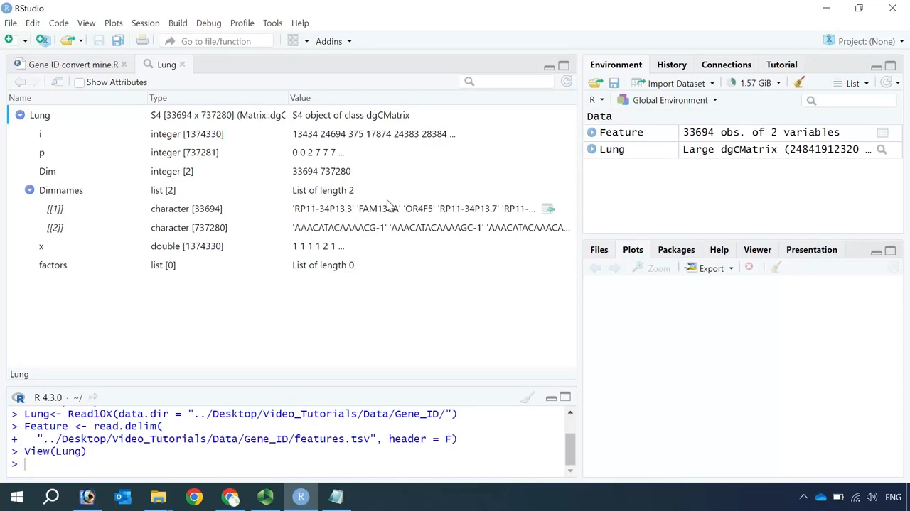

这张截图值得逐行看：

- `Dim` 是 `33694 737280`——33,694 个基因 × 737,280 个 barcode（注意这是**所有**捕获到的液滴，远多于真实细胞数，细胞筛选是后面 Cell Calling 的事）；
- `Dimnames` 是一个长度为 2 的 list，`[[1]]` 是 `RP11-34P13.3`、`FAM138A`、`OR4F5` 这类 **gene symbol**，`[[2]]` 是 `AAACATACAAAAACG-1` 这类 **barcode**；
- `x` 是 137 万个非零值——33,694 × 737,280 约 248 亿个格子里只有 137 万个非零，稀疏度 99.99%。

也就是说：**矩阵的行名就是一份最简的基因元数据**。它只有一个字段（基因标识符），但已经足够决定下游工具能不能认出这些基因。

### 1.3 feature 表里通常有两列：ID 和 symbol

视频里 `features.tsv` 用 `read.delim(..., header = F)` 读进来，得到一个 33,694 行、2 列的 `Feature` 数据框 [【跳转到 08:05】](https://www.youtube.com/watch?v=MQt6s6st1dw&t=485)：

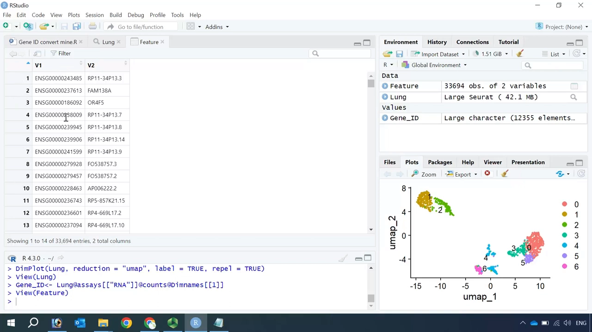

- `V1`：`ENSG00000279457`、`ENSG00000228463`……**Ensembl ID**；
- `V2`：`FOSB57.2`、`AP006222.2`、`RP11-206L10.9`……**gene symbol**；
- 标准的 10x `features.tsv` 还有第三列 `gene biotype`（`Gene Expression` / `Antibody Capture` 等），用来区分这张矩阵里哪些行是 mRNA、哪些是 CITE-seq 的抗体标签。

**为什么 ID 是主键、symbol 只是别名**：

- Ensembl ID 由数据库分配，**一个基因一个号，不会因为命名习惯改变而变**；它还可能带版本号（`ENSG00000279457.4`），版本号变化意味着注释内容更新过；
- gene symbol 是"人起的名字"，会改名（`FAM138A` 这类 ORF 编号就是历史遗留）、有别名（同一个基因在不同文献里两种写法）、甚至**多个 Ensembl ID 共用一个 symbol**；
- 所以跨数据集合并时用 ID 最安全，给人看、给只认 symbol 的工具用时才换成 symbol。

## 二、行名是 ID 还是 symbol，直接决定下游工具能不能跑

### 2.1 一个具体触发点：CellChat 只认 symbol

视频开头的动机来自一条观众留言：他要把 Seurat 对象里的 Ensembl ID 换成 gene symbol，因为**要拿这个对象去建 CellChat 对象** [【跳转到 00:25】](https://www.youtube.com/watch?v=MQt6s6st1dw&t=25)。

这不是 CellChat 的怪癖，而是这类"基于先验知识库"的工具的通病：细胞通讯数据库里存的是 `CD3D`、`IL7R` 这样的 symbol 对，工具拿你的行名去和数据库做字符串匹配，匹配不上就当成"这个基因不存在"。同理，做基因集富集、做转录因子注释、画 marker 基因热图，都会遇到同一堵墙。

**结论**：行名不是内部实现细节，它是**对外接口**。什么时候换、换成什么，取决于你下一步要接哪个工具。

### 2.2 先统一成 ID，再统一换成 symbol

视频里有一个容易被忽略的细节：作者拿到数据后做的第一件事，不是直接换成 symbol，而是**先把行名从 symbol 换成 Ensembl ID** [【跳转到 04:45】](https://www.youtube.com/watch?v=MQt6s6st1dw&t=285)：

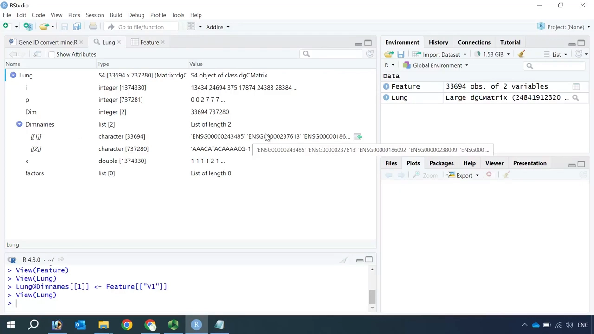

对照 1.2 节那张图看：同一份数据的 `Dimnames[[1]]` 从 `RP11-34P13.3` 变成了 `ENSG00000243485`，`Dim`、`x` 一个都没动——**换行名只改标签，不改数据**。

为什么绕这一圈？因为后面的对齐要靠 ID 做"主键匹配"。symbol 可能有歧义（两个基因同名），ID 不会。这个"先归一到主键、再做任何连接"的习惯，是所有元数据操作的通用套路。

## 三、路径一：有 feature 文件时，按 ID 做无损替换

这是视频的主线，也是**推荐做法**：feature 文件里 ID 和 symbol 一一对应，你只需要把两张表按 ID 对齐，然后拿 symbol 覆盖行名。整个过程分五步。

### 3.1 第一步：把 feature 表读进来，行数先对上

```r
library(Seurat)
Lung    <- Read10X(data.dir = "…/Data/Gene_ID/")            # 行名是 symbol
Feature <- read.delim("…/Data/Gene_ID/features.tsv", header = F)  # V1=ID, V2=symbol
Lung@Dimnames[[1]] <- Feature[["V1"]]                        # 行名换成 Ensembl ID
```

这几行代码对应视频 02:15 到 04:45 的整段操作 [【跳转到 02:15】](https://www.youtube.com/watch?v=MQt6s6st1dw&t=135)。整个脚本在 RStudio 里就是下面这一屏 [【跳转到 02:40】](https://www.youtube.com/watch?v=MQt6s6st1dw&t=160)：

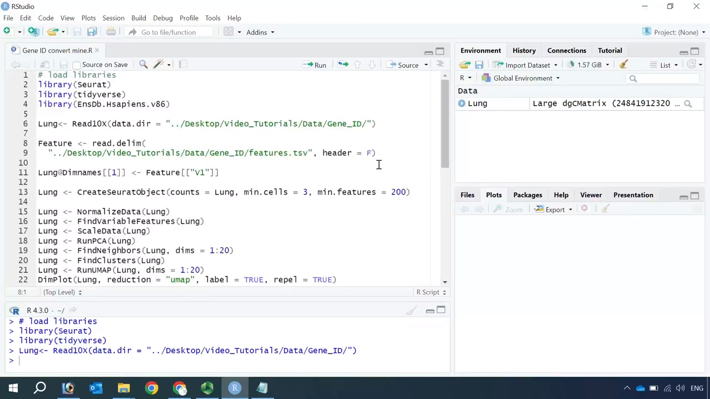

读完之后先做一次**行数核对**：矩阵有 33,694 行，feature 表也正好是 33,694 行 [【跳转到 03:55】](https://www.youtube.com/watch?v=MQt6s6st1dw&t=235)。行数相等，才说明"第 i 行 feature 就是第 i 行基因"，可以直接按位置赋值。

**这一步的隐含假设**：`Read10X` 是按 feature 文件的顺序建矩阵的，所以位置一一对应。如果中间有人筛过基因、或者你手上的矩阵是从别处来的（比如已过滤的 h5ad），这个假设就不成立了——那就必须按 ID 做 join，而不是按位置。

### 3.2 第二步：建 Seurat 对象、跑标准流程，确认行名一路带着走

```r
Lung <- CreateSeuratObject(counts = Lung, min.cells = 3, min.features = 200)
Lung <- NormalizeData(Lung)
Lung <- FindVariableFeatures(Lung)
Lung <- ScaleData(Lung)
Lung <- RunPCA(Lung)
Lung <- FindNeighbors(Lung, dims = 1:20)
Lung <- FindClusters(Lung)
Lung <- RunUMAP(Lung, dims = 1:20)
DimPlot(Lung, reduction = "umap", label = TRUE, repel = TRUE)
```

`min.cells = 3`（至少在 3 个细胞里被测到）和 `min.features = 200`（一个细胞至少测到 200 个基因）是两次过滤：前者删基因行，后者删细胞列。33,694 个基因过滤后剩 **12,355** 个——这就是后面所有对齐工作的目标行数 [【跳转到 05:10】](https://www.youtube.com/watch?v=MQt6s6st1dw&t=310)。

跑完标准流程，控制台打印出来的行名是一串 Ensembl ID [【跳转到 06:00】](https://www.youtube.com/watch?v=MQt6s6st1dw&t=360)：

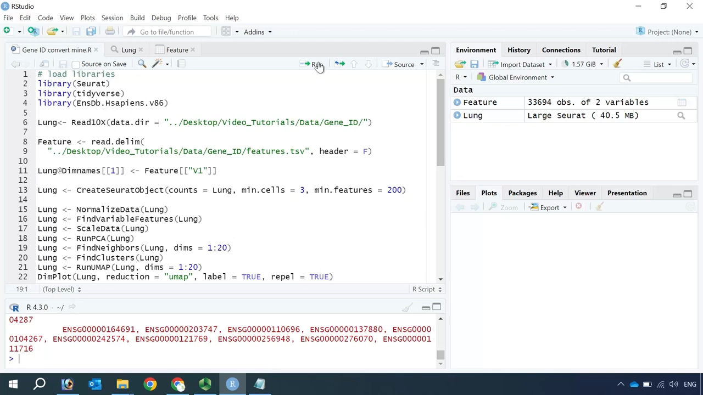

UMAP 上分出 7 个 cluster [【跳转到 07:15】](https://www.youtube.com/watch?v=MQt6s6st1dw&t=435)：

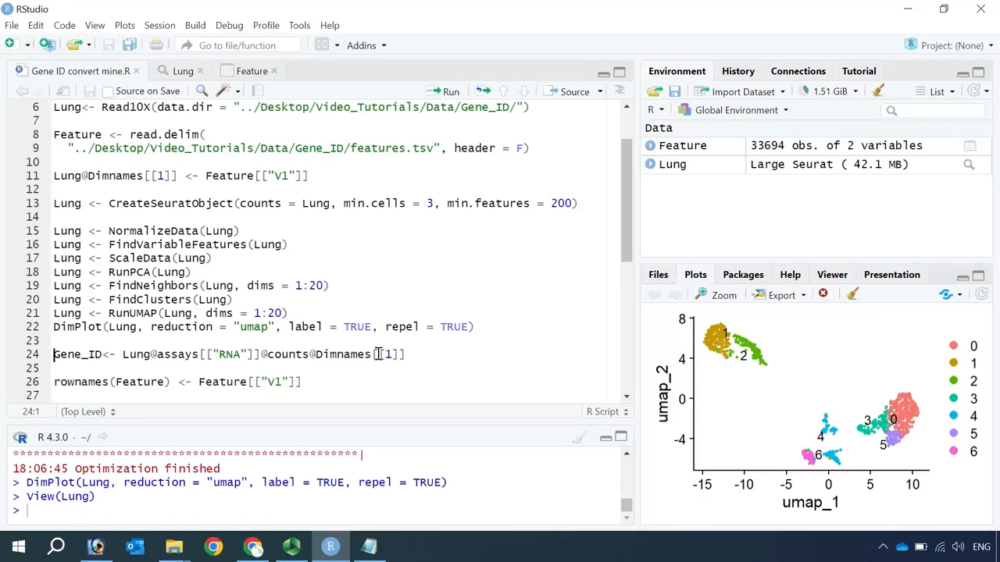

**这里有个重要的观察**：换行名这件事，放在建对象之前做、还是聚类之后做，结果一样——因为聚类、降维只用到数值，不用标签。真正受影响的只有"人读起来顺不顺"和"下游工具认不认"。

### 3.3 第三步：从对象里取出基因 ID 清单，用它去裁 feature 表

```r
Gene_ID <- Lung@assays[["RNA"]]@counts@Dimnames[[1]]   # 12,355 个 Ensembl ID
rownames(Feature) <- Feature[["V1"]]                    # feature 表也以 ID 为行名
Feature <- Feature[Gene_ID, ]                           # 按对象的基因集合取子集
Feature$V3 <- Gene_ID                                   # 加一列原文 ID 用于校验
```

这段是整支视频最关键的一步 [【跳转到 08:55】](https://www.youtube.com/watch?v=MQt6s6st1dw&t=535)：

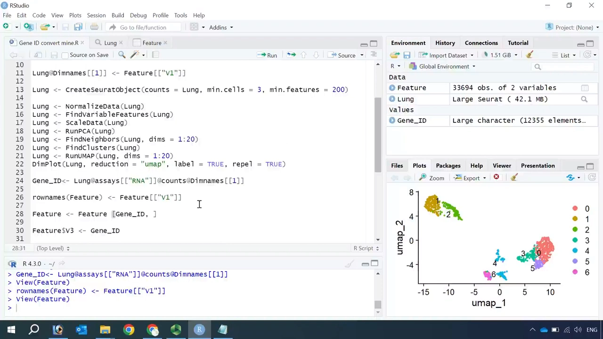

为什么必须裁？因为 feature 表有 33,694 行，对象里只剩 12,355 个基因。如果直接把 33,694 个 symbol 赋给 12,355 行的矩阵，**行名长度和行数对不上，R 会报错；就算不报错，基因也会整体错位**——第 5 行的 symbol 被贴到第 5 个残留基因上，从此所有 marker 基因的解释都是错的。

裁完之后，feature 表变成 12,355 行、3 列 [【跳转到 09:45】](https://www.youtube.com/watch?v=MQt6s6st1dw&t=585)：

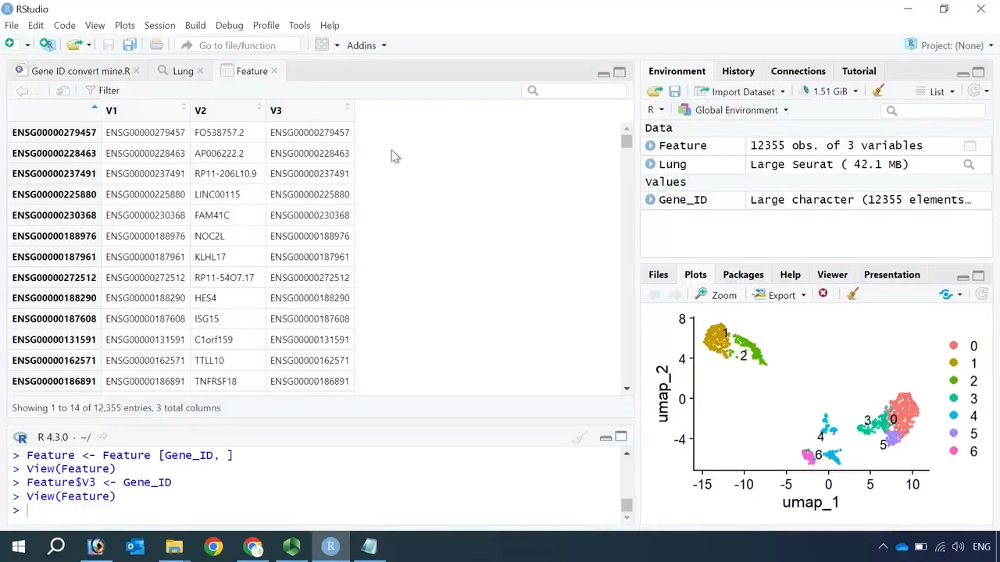

第三列 `V3` 是作者加的**校验列**：它和 `V1` 应该逐行相等。相等就证明"对象里的第 i 个基因"和"feature 表第 i 行的 symbol"确实是同一个基因。这一步看起来多余，但它是唯一能证明"没有错位"的证据——元数据操作最怕的就是静默错位，程序不报错，结果全错。

### 3.4 第四步：把 symbol 写回行名

```r
Lung@assays[["RNA"]]@counts@Dimnames[[1]] <- Feature[["V2"]]
```

再展开对象看一次结构 [【跳转到 11:00】](https://www.youtube.com/watch?v=MQt6s6st1dw&t=660)：

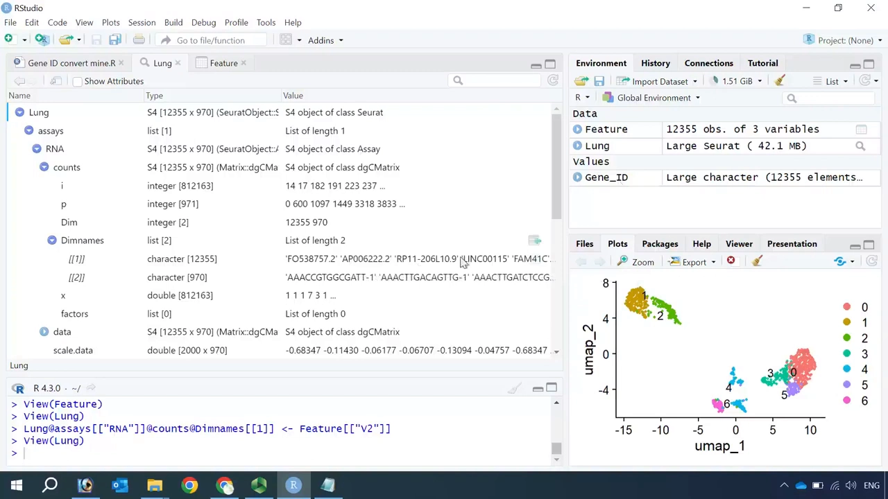

对比 1.2 节那张图：`Dim` 还是 `12355 970`，`x` 还是 812,163 个非零值，**只有 `Dimnames[[1]]` 变了**。这就是"改元数据不改数据"的最直观证据。

顺带注意 `Dimnames[[2]]` 里的 barcode 形如 `AAACCGTGGCGATT-1`——末尾的 `-1` 是 10x 给样本加的**后缀**。单样本时它没用，多样本合并时它就是防止 barcode 撞车的唯一手段（两个不同样本里出现同一个 barcode 是完全正常的）。这一点在细胞元数据那一侧还会再遇到。

### 3.5 第五步：换成 symbol 之后，CellChat 才认

作者的收尾说明很直白：现在可以把 Seurat 对象转成 CellChat 对象了，因为基因名对了 [【跳转到 10:35】](https://www.youtube.com/watch?v=MQt6s6st1dw&t=635)。

**这条路径的性质**：feature 文件是**随数据一起下发的官方映射表**，ID 与 symbol 一一对应、不依赖任何外部数据库，所以是**无损**的——除了改名，什么信息都没丢。只要 feature 文件在，永远优先走这条路。

## 四、路径二：没有 feature 文件时，用 Ensembl 注释库做有损映射

现实里经常拿不到 feature 文件，或者拿到的 feature 文件只有 ID 一列。这时只能查注释库：把 Ensembl ID 交给 `EnsDb` 或 `org.Hs.eg.db`，让它返回 symbol。

### 4.1 先把对象恢复成 ID 行名，再查库

视频的第二段演示先把行名改回 Ensembl ID [【跳转到 13:05】](https://www.youtube.com/watch?v=MQt6s6st1dw&t=785)：

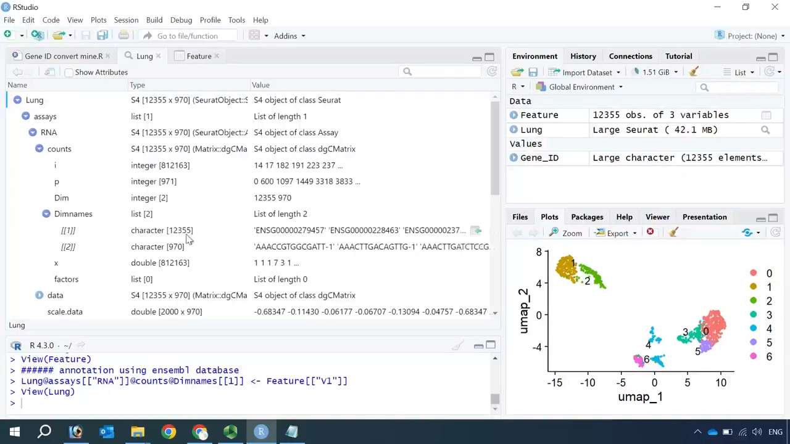

然后调用 `mapIds`：

```r
library(EnsDb.Hsapiens.v86)
Gene_ID   <- as.data.frame(Gene_ID)
gene_name <- mapIds(EnsDb.Hsapiens.v86,
                    keys    = Gene_ID$Gene_ID,
                    keytype = "GENEID",
                    column  = "SYMBOL")
gene_name <- as.data.frame(gene_name)
gene_name$gene_ids <- Gene_ID[["Gene_ID"]]              # 加回 ID 列做对照
Lung@assays[["RNA"]]@counts@Dimnames[[1]] <- gene_name[["gene_name"]]
```

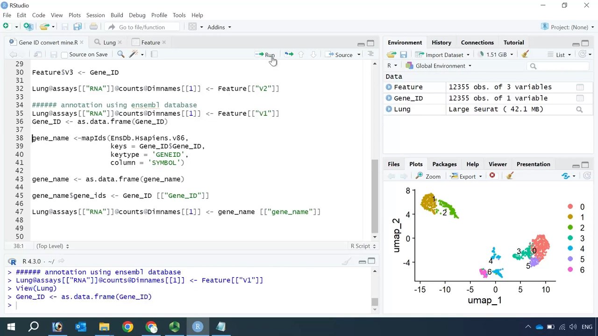

三个参数的含义：

| 参数 | 本例取值 | 说明 |
| --- | --- | --- |
| `keys` | 12,355 个 Ensembl ID | 你要查的"主键"清单 |
| `keytype` | `GENEID` | 说明这些 key 是 Ensembl 基因 ID，不是 symbol、不是转录本 ID |
| `column` | `SYMBOL` | 你要它返回的字段 |

`keytype` 写错是这类操作最常见的报错来源：同一个注释库里 `GENEID`（基因）、`TXID`（转录本）、`ENTREZID`、`UNIPROTID` 是不同命名空间，拿基因 ID 去查转录本表必然全军覆没。

### 4.2 物种必须对上

视频里作者特意交代：这份数据来自**人肺组织**，所以用人的注释库 `EnsDb.Hsapiens.v86`；如果数据来自小鼠，就要换成小鼠的库 [【跳转到 15:35】](https://www.youtube.com/watch?v=MQt6s6st1dw&t=935)。

听起来是废话，但它属于"元数据缺失就没人能救"的典型：注释库的选择依赖**样本的物种**这一条元数据。数据里没有物种字段，你就只能靠记忆或翻实验记录。用错物种的后果不是报错，而是**部分 ID 恰好能映射到同名基因**，生成一份看起来正常、实际全错的 symbol 表。

### 4.3 映射是有损的：12,355 个里 10 个没映射出来

查完之后控制台给了一条警告 [【跳转到 14:20】](https://www.youtube.com/watch?v=MQt6s6st1dw&t=860)：

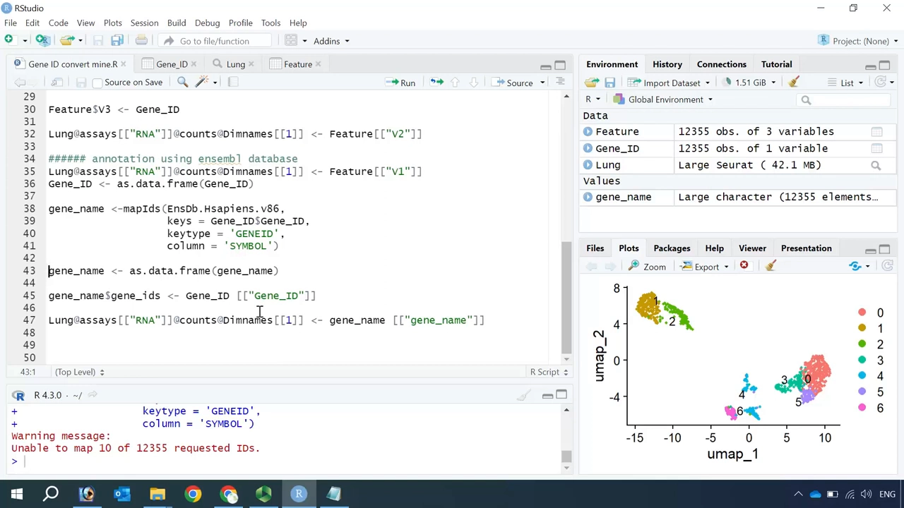

`Unable to map 10 of 12355 requested IDs.`——12,355 个 Ensembl ID 里有 10 个在 v86 版注释库里找不到 symbol。

这 10 个 ID 通常是：新版本数据库才收录的新基因、已废弃的旧 ID、或者注释库版本比数据生成时间更早导致的"未来基因"。它们不会被删掉，而是**变成 `NA`**：

- 行数不变（还是 12,355 行），所以矩阵和元数据依然对齐；
- 但行名里会出现 10 个 `NA`——而 R 不允许重复行名，多个 `NA` 会直接引发"duplicate row.names"错误，或者被自动改名成 `NA`、`NA.1`、`NA.2`……；
- 更隐蔽的后果是：**这 10 个基因从此在任何按 symbol 查询的地方都查不到**，做富集分析时它们悄悄消失。

视频里作者的处理是保留 ID 列做对照 [【跳转到 15:10】](https://www.youtube.com/watch?v=MQt6s6st1dw&t=910)：

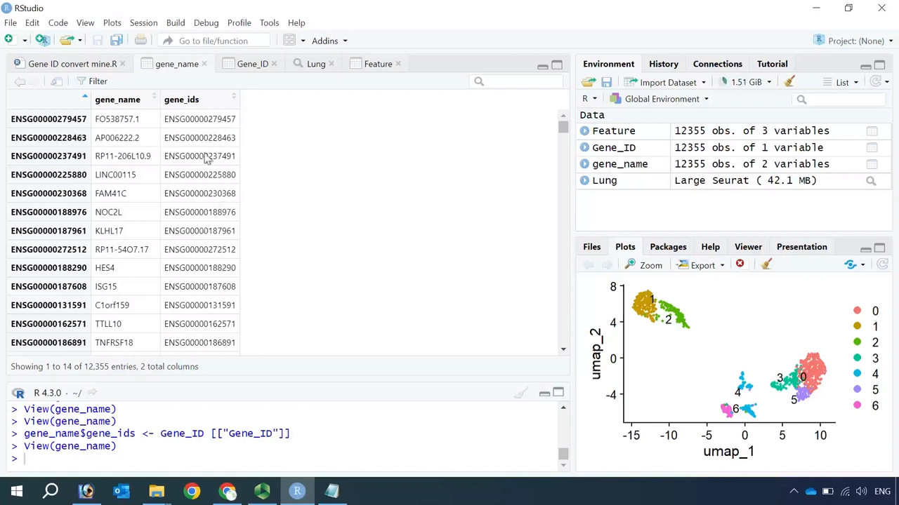

这张两列对照表就是"可追溯"的最小实现：任何时候你都能回答"这个 symbol 是从哪个 ID 来的"。

### 4.4 两条路径的取舍

| 维度 | feature 文件 | Ensembl 注释库 |
| --- | --- | --- |
| 数据来源 | 随数据下发的官方映射 | 外部数据库，需自己选版本 |
| 是否无损 | 无损，一一对应 | 有损，本例 10/12355 失败 |
| 版本依赖 | 与数据同版本 | 取决于你装的 EnsDb 版本 |
| 适用场景 | 有原始 10x 输出 | 只有矩阵、或只有 ID 行名 |

**结论**：有 feature 文件就别查库。查库是"没有官方映射时的兜底"，代价是要自己承担版本与物种两个不确定性。

## 五、基因元数据的四个坑，全在"对齐"和"版本"上

### 5.1 行名是唯一键，重复的 symbol 会撞车

Ensembl ID 保证唯一，gene symbol **不保证**。人类基因组里有若干 symbol 对应多个 Ensembl ID（历史上不同位点被起了同一个名字），也有一些 symbol 是空值。把行名换成 symbol 的那一刻，唯一性就丢了：

- 两个不同的基因变成同一个行名 → R 报 `duplicate 'row.names' are not allowed`，或者悄悄给你加上 `.1` 后缀；
- 加了后缀的那个基因，之后在任何按 symbol 匹配的地方都对不上号。

所以视频里"先换成 ID、再换回 symbol"的顺序不只是洁癖：**ID 阶段做所有连接和过滤，symbol 只在最后一步贴上去**，这样中途永远有唯一键可用。

### 5.2 版本号会让跨数据集合并失败

Ensembl ID 可能带版本后缀（`ENSG00000279457.4`）。同一份数据从不同渠道下载，版本号可能不同——一个带 `.4`、一个不带，字符串比较就是"两个不同的基因"。跨数据集合并时这会导致大量"本该匹配却匹配不上"的基因。

处理办法是**统一去掉版本号再匹配**（截到小数点前），并把这个约定写进流程说明。视频里用的 ID 不带版本号，所以没遇到这问题，但只要你合并过两份来源不同的数据，就一定见过。

### 5.3 基因过滤本身就是元数据操作

`CreateSeuratObject(min.cells = 3, min.features = 200)` 看起来是"过滤"，本质上是在用元数据做筛选：`min.cells` 用的是每个基因在多少细胞里被测到（基因维度的统计量），`min.features` 用的是每个细胞测到多少基因（细胞维度的统计量，也就是 `nFeature_RNA`）。

更典型的例子是**只留蛋白编码基因**、**去掉线粒体与核糖体基因**：

```
# 概念示意：按 var 里的 biotype 列筛行
keep <- var$gene_biotype == "protein_coding"
adata <- adata[, keep]
```

这类操作全部依赖 `var` 里除行名之外的**附加列**——biotype、染色体位置、是否线粒体基因。如果 `var` 只有一行行名、没有这些列，你连"哪些是线粒体基因"都判断不了，而线粒体基因占比恰恰是质控的核心指标之一。

**这就是基因元数据的分量**：它不只是"给人看的名字"，它决定了你能对矩阵做哪些合法的筛选。

### 5.4 转换要留痕：保留原始 ID 列

视频里两次转换都保留了原始 ID（`Feature$V3`、`gene_name$gene_ids`），这不是多余的谨慎：

- 换错了可以回滚；
- 别人拿到你的对象，能验证"这个 symbol 对应哪个 ID"；
- 出问题时能定位到"是映射错了，还是数据本身有问题"。

**元数据一旦被覆盖就不可恢复**。矩阵可以从原始数据重算，但"当初用的是哪个注释版本、哪个物种、哪份 feature 文件"这些信息，只有你写下来的那份记录里有。

### 5.5 从基因元数据看细胞元数据

这一篇只讲了矩阵的**行**。同样的逻辑马上会用在**列**上：见 [细胞元数据：obs 每一列都在决定你能问出什么问题](细胞元数据：obs%20每一列都在决定你能问出什么问题.md)——细胞元数据也是一张"一行一个细胞"的表，也要求与矩阵列严格对齐，也一样分"技术层测量值 / 实验设计事实 / 计算层推断"三种可靠性。区别在于，细胞元数据的坑更多——因为它的很多列是**人手工填的**，而不是从文件里读出来的。

## 小结

- **表达矩阵只有行列名和数值**，基因元数据是贴在行上的第二张表：`var` / feature 表。它决定了下游工具认不认得出这些基因。
- **Ensembl ID 是主键，gene symbol 是别名**。ID 稳定、唯一、可能带版本号；symbol 会改名、有别名、可能重复。跨数据集连接用 ID，给人看和给只认 symbol 的工具用 symbol。
- **有 feature 文件时走无损路径**：把行名统一成 ID → 用对象里的基因集合裁 feature 表（33,694 → 12,355）→ 加校验列逐行核对 → 把 symbol 写回 `Dimnames[[1]]`。
- **没有 feature 文件时查注释库**：`mapIds(keytype = "GENEID", column = "SYMBOL")`，物种与注释版本都必须对上，本例 12,355 个 ID 里 10 个映射失败。
- **换行名只改标签，不改数值**。`Dim`、`x` 在转换前后完全一致——这正是"元数据"和"数据"的分界线。
- **最大的风险是静默错位**：行数不匹配、顺序错位、重复行名、NA 行名，程序可能不报错，但所有基因级结论都会错。校验列和原始 ID 列是最小成本的保险。
- **元数据缺失事后无法补救**：注释版本、物种、feature 文件来源，这些信息只能靠记录保留。

## 关键术语速查

| 术语 | 一句话解释 |
| --- | --- |
| 基因元数据（`var`） | 一行一个基因的属性表：标识符、biotype、染色体位置等，必须与矩阵行严格对齐 |
| `obs` / `meta.data` | 细胞元数据，一行一个细胞的属性表，与矩阵列对齐（见 [细胞元数据：obs 每一列都在决定你能问出什么问题](细胞元数据：obs%20每一列都在决定你能问出什么问题.md)） |
| Ensembl ID | Ensembl 数据库分配的基因主键，形如 `ENSG00000279457`，可能带版本号 `.4` |
| gene symbol | 基因的人读名称，形如 `FAM138A`、`RP11-34P13.3`，会改名、有别名、可能重复 |
| `features.tsv` | 10x 输出的基因清单，通常含 Ensembl ID、symbol、feature type 三列 |
| `barcodes.tsv` | 10x 输出的细胞 barcode 清单，对应矩阵的列 |
| `Dimnames[[1]]` | Seurat / R 矩阵的行名，即基因标识符；`[[2]]` 是列名即 barcode |
| `mapIds` | Bioconductor 的 ID 转换函数，需指定 `keys`、`keytype`、`column` |
| `EnsDb.Hsapiens.v86` | 人类 Ensembl 注释库的某个版本；版本决定能映射到哪些基因 |
| 无损 / 有损映射 | feature 文件是官方一一对应（无损）；查注释库可能失败（有损，本例 10/12355） |
