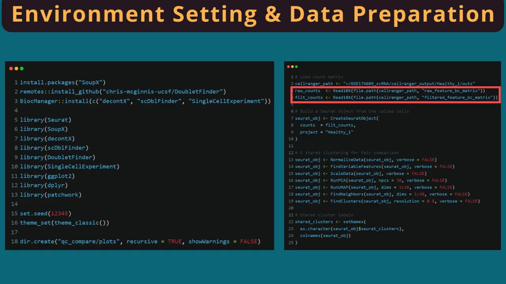
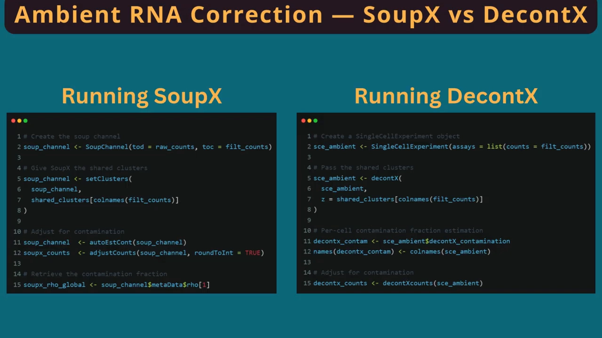
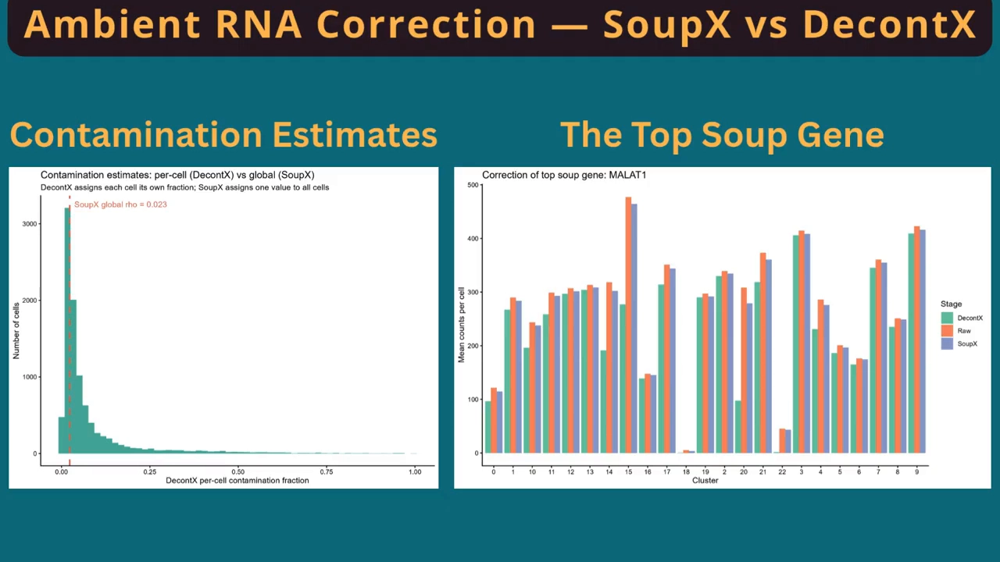
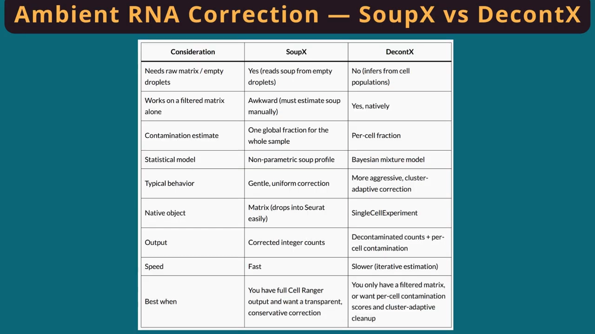

# SoupX 与 DecontX 对比：环境 RNA 校正的两种背景估计

> 视频来源：[scRNA-seq QC Tools Compared: SoupX vs DecontX & DoubletFinder vs scDblFinder](https://www.youtube.com/watch?v=txGuBwc0MRA)（YouTube · NGS101 / Dr. Lei Guo）｜时长约 16 分钟
> 简要导读：同一份 10x 数据上并排跑两套环境 RNA 校正工具。本文只整理与环境 RNA 有关的前半场（约 0:40–11:04）：污染从哪来、SoupX 为什么能靠空液滴估出「汤」、DecontX 为什么不需要原始矩阵，以及一个基因被扣到接近零时到底是扣对了还是扣过头了。视频后半场（约 11:04 之后）是 DoubletFinder 与 scDblFinder 的双细胞对比，属另一条机制，本文只在末尾交代边界。原片英文字幕接口限流，本文依据本地语音转写稿整理，术语按工具文档拼写订正。

## 本讲要解决的核心问题（SCQA）

**背景**：单细胞液滴测序在建库前要把组织或血液解离成单细胞悬液，细胞悬液里除了完整细胞，还漂着大量游离 mRNA。液滴在悬液里形成，于是每个液滴都会带进一点「不属于这个细胞」的转录本，这就是环境 RNA（ambient RNA），俗称「汤」（soup）。

**冲突**：这层背景污染不是随机噪声，它有固定成分——悬液里最丰富的那些转录本。结果是每个细胞都被同方向地抬高，一个只该在髓系细胞里表达的 marker，在内皮细胞里也显示微弱阳性。更麻烦的是，校正工具会把这层背景**减掉**，而减法一旦做过头，减掉的就是细胞真实的低表达。

**疑问**：既然污染源是悬液，我们怎么知道这锅汤里有什么、每个细胞被污染了多少？两种主流工具 SoupX 与 DecontX 对「背景」的定义有何不同，各自的假设在什么情况下会失效？扣完之后，怎么判断一个基因被扣到接近零是「读对了背景」还是「误伤了真表达」？

**回答（中心思想）**：两种工具的分野只有一句话——**SoupX 用空液滴直接测出汤的成分，给整个样本一个全局污染比例；DecontX 不用原始矩阵，从细胞群体本身反推每个细胞各自的污染比例**。前者透明、保守、均匀，后者自适应、更激进、能标出个别重度污染细胞。代价也对称：全局比例看不见污染长尾，逐细胞估计则可能把高表达基因误判成污染，所以校正后必须回到「被扣得最多的那个基因」上做人工判断。

---

## 一、环境 RNA 的来源：解离、裂解与那锅共享的汤

视频开篇用两句话交代了物理过程：把组织或血液样本解离成单细胞时，**总有一部分细胞会破开，把 mRNA 漏进周围的液体里**；这些游离 RNA 不会消失，而是和真正的细胞一起被扫进 10x 芯片上的液滴。[【跳转到 00:40】](https://www.youtube.com/watch?v=txGuBwc0MRA&t=40)

所以污染不是「某些液滴被污染了」，而是**每一个被测序的细胞都带着少量不属于自己的 RNA**，来源是这锅所有细胞共享的汤。[【跳转到 00:54】](https://www.youtube.com/watch?v=txGuBwc0MRA&t=54)

这条因果链里有两个容易被跳过的环节：

- **解离是污染的起点，不是建库的起点。** 组织越难解离（需要更长时间、更强酶解），破开的细胞越多，汤越浓。视频没有展开不同组织的差异，但把「解离 → 裂解 → 游离 mRNA」这一步明确放在最前面，意味着污染程度首先由实验处理决定。
- **汤的成分由悬液里最丰富的转录本决定。** 后面 Malat1 的例子会看到：排在汤谱第一位的基因，往往不是「最容易泄漏」的基因，而是「本来就在几乎所有细胞里表达量极高」的基因。这一点决定了校正工具最容易在哪些基因上出错。

### 1.1 它在数据里表现为「普遍抬高」与「marker 假阳性」

视频对后果的描述只有两句，但方向说得很清楚：不校正的话，污染会**悄悄抬高每一种细胞类型里常见基因的表达**，并且**给细胞从未表达过的 marker 制造假阳性信号**。[【跳转到 01:12】](https://www.youtube.com/watch?v=txGuBwc0MRA&t=72)

这两句对应两种不同的下游危害：

- **普遍抬高**是定量问题：所有细胞的同一批基因一起上浮，差异表达里的倍数变化被压缩，绝对值不可比。
- **marker 假阳性**是定性问题，也是更危险的那个：细胞注释依赖「某基因在某群里为阴性」，一旦阴性不再可信，稀有类型和边界类型最先被误判。

注意这与稀疏性造成的零值问题方向相反：零值（未检出）是**假阴性**，环境 RNA 是**假阳性**。视频没有讨论 dropout，但把两者的区别记住，才能理解为什么校正方法一律是「减」而不是「补」。

## 二、两种背景估计：一个从空液滴读，一个从细胞群体推

视频用同一份样本（代码里是 `GSE174609` 的 `Healthy_1`）并排跑两套工具。为了让比较公平，作者先做了一件关键的事：**只算一次聚类，四个工具共用同一份 `shared_clusters`**，否则后面看到的差异可能来自四套不同的聚类结果，而不是工具本身。[【跳转到 05:10】](https://www.youtube.com/watch?v=txGuBwc0MRA&t=310)

「共用聚类」不是工程洁癖，而是这两种方法共同的前提：**判断一个基因在某群里该不该出现，必须先知道细胞分了几群**。没有分组，就没有「本来不该表达」这个基准。

### 2.1 输入差异：SoupX 要空液滴，DecontX 只要 filtered 矩阵

两种工具的结构差异，直接来自它们对「背景是什么」的不同回答。[【跳转到 05:41】](https://www.youtube.com/watch?v=txGuBwc0MRA&t=341)

- **SoupX 需要两份矩阵**：`raw_feature_bc_matrix`（含全部液滴，包括没抓到细胞的空液滴）和 `filtered_feature_bc_matrix`（只含 Cell Ranger 判为细胞的 barcode）。它用空液滴里的 counts **直接拼出汤的表达谱**——空液滴里没有细胞，只有汤，这就是一次免费的背景测量。
- **DecontX 只需要 filtered 矩阵**：它不碰原始矩阵，而是**从细胞与细胞之间的计数结构反推污染**，用一个统计混合模型把每个细胞的观测拆成「自己的表达」与「汤的贡献」。

这条差异有一个很实际的后果：如果你拿到的是别人整理好的、只剩 filtered 矩阵的公开数据集，SoupX 要么用不了，要么得手工喂一个汤谱（视频的决策表把这种情况写成 "awkward"），而 DecontX 原生就能跑。

### 2.2 估计对象：一个全局比例，还是每个细胞一个比例

代码面板把两种结构并排放着，差别一目了然。[【跳转到 06:41】](https://www.youtube.com/watch?v=txGuBwc0MRA&t=401)

SoupX 一侧是四步：`SoupChannel(tod = raw_counts, toc = filt_counts)` 把汤与细胞绑在一起；`setClusters()` 传入共享聚类；`autoEstCont()` 自动估计污染水平；`adjustCounts(roundToInt = TRUE)` 把污染减回去并取整，让结果仍是一张普通的整数计数矩阵。

DecontX 一侧是另一种写法：`SingleCellExperiment(assays = list(counts = filt_counts))` 只用 filtered counts；`decontX(..., z = shared_clusters[...])` 把聚类作为 `z` 参数传入；输出是两样东西——**每个细胞各自的污染分数**（`decontX_contamination`）和一张去污染后的计数矩阵（`decontXcounts`）。

最关键的一句在视频里被反复强调：**SoupX 的 `autoEstCont` 只估一个数**，叫 $\rho$（rho），代表整个样本的污染比例，这个数被原样写进每个细胞的元数据，所以代码里可以直接取 `soup_channel$metaData$rho[1]`；**DecontX 给每个细胞一个数**。[【跳转到 06:19】](https://www.youtube.com/watch?v=txGuBwc0MRA&t=379)

这就是「全局 vs 逐细胞」的分野，也是后面所有行为差异的根源。

## 三、同一份数据上的两种结果：2.3% 的全局比例与一条看不见的长尾

视频把两种估计画在同一张图上。[【跳转到 07:21】](https://www.youtube.com/watch?v=txGuBwc0MRA&t=441)

左图是 DecontX 给出的每细胞污染分数分布，橙色虚线标出 SoupX 的全局估计，这个样本约为 **2.3%**。大部分细胞的分数确实聚在这条低值附近——两种方法在「典型细胞」上是一致的，这是个让人安心的结果。[【跳转到 07:27】](https://www.youtube.com/watch?v=txGuBwc0MRA&t=447)

但分布有一条**向右延伸的长尾**：少数细胞的污染分数远高于 2.3%。SoupX 结构上看不见这条长尾，因为它只报一个数；DecontX 则可以把这些细胞单独标出来。[【跳转到 07:52】](https://www.youtube.com/watch?v=txGuBwc0MRA&t=472)

这条长尾本身就是有用的质控信息：一个污染分数异常高的「细胞」，可能是一个破损细胞、一个几乎只剩汤的液滴，或者一个捕获了异常多背景的细胞。视频在决策表里也点明，DecontX 的每细胞污染分数可以**单独当质控指标用**。

### 3.1 同一个基因，两种削减幅度

右图换了一个视角：取汤谱里贡献最大的那个基因，看它在各簇的平均表达在校正前后的变化。这个基因是 **Malat1**。[【跳转到 08:17】](https://www.youtube.com/watch?v=txGuBwc0MRA&t=497)

- **SoupX（蓝柱）**只把它轻微、均匀地削低一点，几乎每个簇的削减幅度都差不多——这正是「一个低值全局比例 + 均匀扣除」的预期表现。
- **DecontX（绿柱）**激进得多，而且**因簇而异**：在有些簇里砍掉约三分之一，在一两个小簇里几乎归零，在另一些簇里却几乎没动。

为什么会有这种簇间差异？因为 DecontX 的污染分数是逐细胞估的，而细胞按簇分组，同一个簇里的细胞共享相似的估计，于是扣除量也带上了簇结构。视频用「cluster-adaptive」形容这种行为。

## 四、过度去污染：Malat1 归零是读对了背景，还是误伤了真表达

紧接着是整支视频最重要的一句提醒。[【跳转到 08:53】](https://www.youtube.com/watch?v=txGuBwc0MRA&t=533)

**Malat1 之所以排在汤谱第一位，是因为它本来就在几乎所有细胞里以极高水平表达，而不一定是因为它是污染。** 汤谱是「悬液里各基因的相对丰度」，而高表达基因天然在悬液里也多——这两件事在数据上无法只靠丰度区分开。

所以当 DecontX 把某些簇里的 Malat1 压到接近零时，存在两种完全不同的解释：

- **扣对了**：那些簇里确实没有 Malat1 的真表达，柱子里的 counts 全部来自汤，减掉是对的；
- **扣过头了**：那些细胞本来就在表达 Malat1，只是表达量不高，被模型误判成背景，于是真实信号被一起减掉。

视频没有给出自动判据（作者说完整的 sanity check 写在配套文字教程里），但把这个二义性明确摆了出来。这一段的推理值得完整保留，因为它解释了**过度去污染为什么是这类方法的内生风险，而不是调参失误**：

1. 校正的数学模型是「观测 = 真实 + 污染比例 × 汤谱」，减法作用在**每一个细胞、每一个基因**上；
2. 汤谱由悬液里最丰富的转录本主导，而这些转录本往往也是细胞里高表达的基因；
3. 因此**污染与真表达在数值上高度重叠**，模型只能靠「这个基因在这个簇里该不该表达」的群体结构去区分；
4. 一旦某个簇的估计偏高，被减掉的就是该簇真实的低表达——而低表达恰恰是最容易被减成零的部分。

这与校正前的危害正好对称：污染把阴性变成假阳性，过度校正把真阳性变成假阴性。两者都会改写 marker 的阴阳判断，只是方向相反。

## 五、决策表：什么时候用哪一个

视频给了一张九行的对照表，把两种方法的差别落在可操作的维度上。[【跳转到 09:26】](https://www.youtube.com/watch?v=txGuBwc0MRA&t=566)

把表读成三条判断依据：

- **先看手上有什么矩阵。** 有完整 Cell Ranger 输出（含 raw）→ SoupX 是快、透明、保守的默认；只有 filtered 矩阵 → DecontX 原生可用。
- **再看你要的是「一个数」还是「一张分数表」。** 只想去掉背景、让矩阵回到 Seurat 里继续跑 → SoupX 直接给整数矩阵；想顺带得到每细胞污染分数当质控指标、或需要簇级别的自适应 → DecontX。
- **最后接受相应的代价。** 全局比例均匀、温和，但看不见污染长尾；逐细胞估计自适应、更激进，但更容易在「高表达 + 群体结构」的基因上过度扣除。

速度差异也来自同一处：SoupX 一次估一个数，快；DecontX 要迭代估每个细胞，慢。[【跳转到 10:16】](https://www.youtube.com/watch?v=txGuBwc0MRA&t=616)

## 六、边界：本节不讨论的部分

- **双细胞是另一条机制。** 视频后半场（约 11:04 起）比较 DoubletFinder 与 scDblFinder：两个细胞被包进同一个液滴、共享一个 barcode，转录组是两种细胞的混合，会在 UMAP 上伪装成不存在的中间状态。它的处理对象是「整个观测单位该不该删」，而环境 RNA 的处理对象是「这个观测单位里的计数该扣多少」——一个删行，一个改值。双细胞的产生、同型/异型与检测假设见 [2.2.4 双细胞污染](../2.2.4_双细胞污染：混合转录组、同型与异型双细胞/DoubletFinder%20剔除双细胞：原理、参数与单样本实操.md)。
- **质控阈值与低质量细胞**：线粒体比例、检测基因数、固定阈值为何误伤特定细胞类型，属 [2.2.3 单细胞质控](../2.2.3_单细胞质控：检测基因数、线粒体比例与阈值/scRNA-seq%20质控阈值怎么定：Seurat%20中识别与剔除低质量细胞.md)。本节只在「DecontX 的每细胞污染分数可当质控指标」这一点上与它相接。
- **空液滴与 cell calling 的判定过程**：哪些 barcode 算细胞、knee plot 怎么读，属 [2.1.3 细胞条形码与 UMI](../../2.1_RNA%20测序的观测过程/2.1.3_细胞条形码与%20UMI：细胞归属、分子去重与碰撞/Barcode%20与%20UMI：一锅细胞汤如何被还原成计数矩阵.md)。本节只把空液滴当作「免费的背景测量」来用。

## 小结

- 环境 RNA 来自解离与裂解时漏进悬液的游离 mRNA；液滴在悬液里形成，所以每个细胞都带一点共享的汤，方向是**假阳性**：普遍抬高常见基因，并让 marker 的阴性判读不再可信。
- SoupX 的物理基础是**空液滴**：它们被 cell calling 滤掉，但 counts 还在 raw 矩阵里，正好用来拼出汤谱；DecontX 不用 raw 矩阵，从细胞群体结构反推污染。
- 两者的核心分野是**估计对象**：SoupX 给整个样本一个全局比例 $\rho$（本例 2.3%），DecontX 给每个细胞一个分数（本例大多数细胞也在 2.3% 附近，但有一条高污染长尾）。
- 全局比例均匀温和，看不见长尾；逐细胞估计自适应、更激进，会在某些簇里大幅削减甚至归零。
- **过度去污染是内生风险**：汤谱由高表达基因主导，污染与真表达在数值上重叠；Malat1 被扣到零，可能是读对了背景，也可能是误伤了真表达，必须回到具体基因与簇上人工判断。
- 实用规则：有 raw 矩阵、要透明保守 → SoupX；只有 filtered 矩阵、要每细胞污染分数 → DecontX。无论用哪个，都该保留校正前的矩阵以便回退与对照。

## 关键术语速查

| 术语 | 一句话解释 |
| --- | --- |
| 环境 RNA（ambient RNA / soup） | 解离与裂解时漏进悬液的游离 mRNA，会随液滴被一起测到 |
| 空液滴（empty droplet） | 没抓到细胞、只抓到游离转录本的液滴；被 cell calling 滤掉，但 counts 仍在 raw 矩阵里 |
| raw / filtered 矩阵 | raw 含全部 barcode（含空液滴），filtered 只含被判为细胞的 barcode |
| 汤谱（soup profile） | 悬液里各基因的相对丰度，SoupX 用空液滴的 counts 直接估出来 |
| 污染比例 $\rho$（rho） | 一个细胞的 counts 中来自汤的比例；SoupX 给全样本一个值，DecontX 给每个细胞一个值 |
| `autoEstCont` | SoupX 自动估全局 $\rho$ 的函数 |
| `adjustCounts` | SoupX 按「观测 − $\rho$ × 汤」反解出干净 counts，`roundToInt = TRUE` 取整 |
| `decontX` | DecontX 的主函数，输入 SingleCellExperiment 与聚类标签，输出每细胞污染分数与去污染矩阵 |
| 非参数汤谱 vs 贝叶斯混合模型 | 两种背景估计的统计假设：前者直接数空液滴，后者把每个细胞的计数拆成「自身 + 背景」两部分 |
| 过度去污染（overcorrection） | 扣除量超过真实污染，把细胞真实的低表达一起减掉；表现为某些基因在某些簇里被压到接近零 |