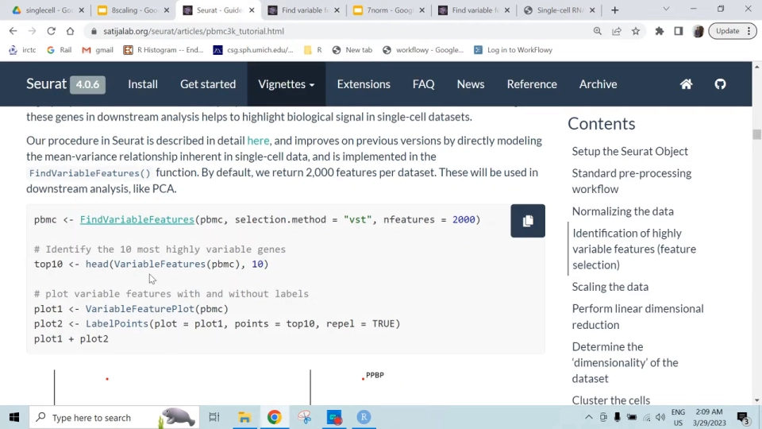
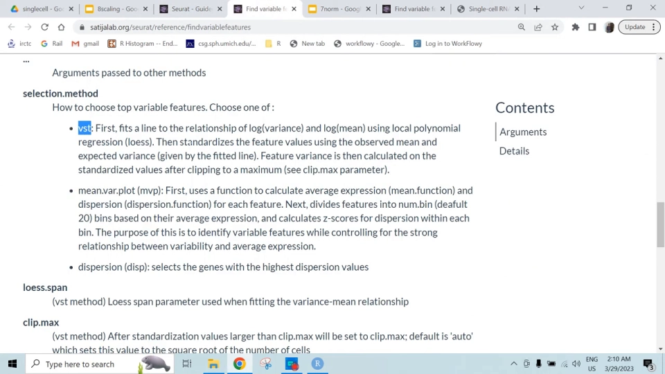
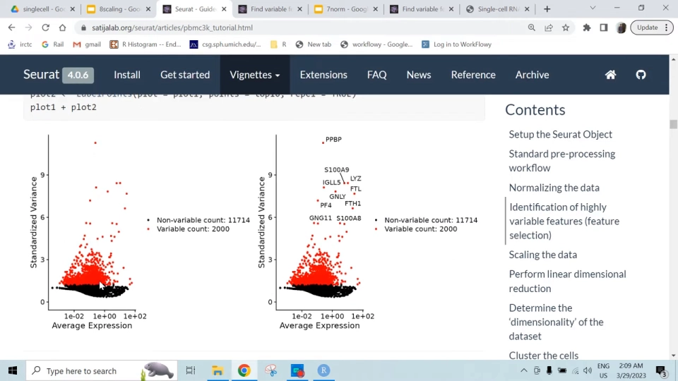
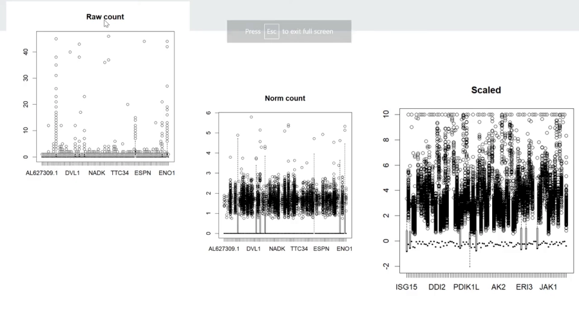

# Seurat 的高变基因选择与缩放：vst 的均值—方差拟合与三种选择方法

> 视频来源：[Feature Selection & Scaling in Single-Cell RNA-seq using Seurat | HVGs & ScaleData (Ep-4)](https://www.youtube.com/watch?v=AJm0B-stC7M)（YouTube · BioinfQuests，约 19 分钟）
> 导读：这支视频跟着 Seurat 官方 PBMC 3k 教程走一遍 `FindVariableFeatures` 与 `ScaleData`，重点不在代码，而在两个被默认参数遮住的判断：**vst 到底怎么把「均值带来的方差」扣掉**，以及**为什么缩放只作用在那 2000 个基因上**。视频里还展示了 Seurat 文档对三种选择方法（`vst`、`mean.var.plot`、`dispersion`）的原文定义，是理解「换一种方法会换一份名单」的直接材料。

## 本讲要解决的核心问题（SCQA）

**背景**：质控和归一化之后，PBMC 数据里还剩一万三千多个基因。下一步是缩放（`ScaleData`）和降维（PCA），但这两步都不会在全部基因上做。

**冲突**：教程里写的是「取变化最大的 2000 个基因」，可这句话藏着一个陷阱——**方差和均值是绑在一起的**。表达量高的基因天然方差大，如果直接按方差排序，排在前面的多半只是「表达得高」而不是「变化得有意思」。而且缩放本身是逐基因做的，对一万多个基因全做既慢又没必要。

**疑问**：`FindVariableFeatures` 里的 `vst` 在算什么？它和另外两种方法（`mean.var.plot`、`dispersion`）差在哪？2000 这个数改了会怎样？缩放为什么只对这 2000 个基因做？

**回答（中心思想）**：**vst 的核心是先把均值—方差关系拟合成一条趋势线，再用「观测方差 / 趋势线给出的期望方差」重新排序**。这样排出来的才是「超出同等表达水平应有变异的程度」，而不是绝对方差。名单一旦确定，缩放和 PCA 就都只在这份名单上进行——**高变基因不只是「选出来的」，它决定了后面所有降维结果的输入空间**。

## 一、为什么先选基因，再缩放

讲者先复述了缩放的理由：`ScaleData` 把每个基因的表达值减去该基因的均值、再除以标准差，让每个基因的均值为 0、标准差为 1，从而**给每个基因在下游分析中相同的权重**，使高表达基因不会在 PCA 或热图里压倒低表达基因 [【跳转到 06:11】](https://www.youtube.com/watch?v=AJm0B-stC7M&t=371)。

但紧接着他话锋一转：这份数据有一万三千个基因，逐个缩放「计算上很吃力」。于是问题变成——**为什么要把所有基因都分析一遍？** [【跳转到 06:36】](https://www.youtube.com/watch?v=AJm0B-stC7M&t=396)

讲者给的判据是「这个基因对分型有没有贡献」：

- 如果一个基因在所有细胞里表达得差不多，它的方差接近 0，**对区分细胞亚型没有贡献**；
- 我们感兴趣的是「在有些细胞里高、在另一些细胞里低」的基因。

所以流程改成：**先找出最可变的那批基因，再只对这批基因做缩放**，既省计算，也让 PCA 只在这批基因上进行 [【跳转到 07:51】](https://www.youtube.com/watch?v=AJm0B-stC7M&t=471)。讲者明确说，PCA 不会在一万三千个基因上做，而是用这些高变基因。

## 二、均值与方差在单细胞数据里是绑在一起的

这是全片最关键的一段。讲者打开 Seurat 文档，解释 `vst` 方法在做什么 [【跳转到 09:35】](https://www.youtube.com/watch?v=AJm0B-stC7M&t=575)：

> 它画的是「该基因在所有细胞里的平均表达」对「方差」的图。我们为每个基因算了均值和标准差，然后画出来。**这里每一个点不是一个细胞，而是一个基因**；x 轴是这个基因的平均表达，y 轴是标准化后的方差。[【跳转到 10:05】](https://www.youtube.com/watch?v=AJm0B-stC7M&t=605)

讲者点出了这张图最重要的特征：**在单细胞数据里，均值和方差是相互依赖的，所以图上有一条明显的趋势** [【跳转到 10:18】](https://www.youtube.com/watch?v=AJm0B-stC7M&t=618)。低表达基因的方差小、高表达基因的方差大，整片点云沿一条上升的带子排布。

`vst` 的做法就是**对这条带子拟合一条线**——具体是拟合 $\log(\text{variance})$ 与 $\log(\text{mean})$ 的关系——然后**用拟合方程去修正每个基因的值**，再在修正后的值上排序 [【跳转到 10:34】](https://www.youtube.com/watch?v=AJm0B-stC7M&t=634)。讲者强调这正是它「改进此前版本」的地方：**直接建模单细胞数据中固有的均值—方差关系** [【跳转到 11:29】](https://www.youtube.com/watch?v=AJm0B-stC7M&t=689)。

换句话说，`vst` 排的不是「方差有多大」，而是「**方差比同等表达水平下应有的值高出多少**」。这正是把均值效应扣掉的操作。

## 三、Seurat 的三种选择方法

视频里最有价值的一屏，是 Seurat 文档对 `selection.method` 三个取值的原文定义 [【跳转到 10:34】](https://www.youtube.com/watch?v=AJm0B-stC7M&t=634)：

- **`vst`**：先用局部多项式回归（loess）拟合 $\log(\text{variance})$ 与 $\log(\text{mean})$ 的关系；再用「观测均值」和「拟合线给出的期望方差」把特征值标准化；然后在标准化后的值上计算方差（并按 `clip.max` 截断）。
- **`mean.var.plot`（`mvp`）**：先对每个基因算平均表达与离散度；再按平均表达把基因分进 `num.bin` 个箱（默认 20 个）；然后在**每个箱内**对离散度算 z-score。文档写得很直白：这样做的目的是「在控制变异性与平均表达之间强关系的同时，识别可变特征」。
- **`dispersion`（`disp`）**：直接选离散度最高的基因。

三种方法对应三种处理均值效应的方式：**拟合曲线**（vst）、**分箱后组内比较**（mvp）、**直接按离散度排序**（disp）。前两种都在显式建模均值效应，只是粒度不同；第三种不做分箱或曲线拟合，名单里保留了多少均值效应取决于离散度本身的定义。

## 四、2000 个基因写进对象，以及它长什么样

`FindVariableFeatures` 默认返回 2000 个基因；讲者提醒这个参数可以改，但**保留的基因越多，计算越重** [【跳转到 11:53】](https://www.youtube.com/watch?v=AJm0B-stC7M&t=713)。

跑完之后，名单不是留在控制台里，而是写进了对象的一个槽位：`pbmc@assays$RNA@variable.features`。讲者特意展示了它在分析前后从空到填满 2000 个基因名的变化 [【跳转到 12:48】](https://www.youtube.com/watch?v=AJm0B-stC7M&t=768)。取名单可以用 `VariableFeatures()`，取前 10 个就是 `VariableFeatures(pbmc) %>% head()`。

这份 PBMC 数据里排在最前面的十个基因是 **PPBP、S100A9、IGLL5、LYZ、FTL、GNLY、PF4、FTH1、GNG11、S100A8** [【跳转到 13:13】](https://www.youtube.com/watch?v=AJm0B-stC7M&t=793)。它们大多是血小板（PPBP、PF4）与髓系（S100A8/A9、LYZ、FTL）的标记——这提示名单本身带有生物学倾向：**谁被选进来，取决于这份数据里哪些细胞群体差异最大**。

## 五、高变基因图怎么读

`VariableFeaturePlot(pbmc)` 画的还是那张均值—方差图，只是把入选的基因标红 [【跳转到 14:02】](https://www.youtube.com/watch?v=AJm0B-stC7M&t=842)：

读这张图要注意三件事：

- **横轴是对数刻度**（1e-02、1e+00、1e+02），所以点云在横向上被压缩过；低表达区挤在左侧。
- **红点的挑选依据不是纵轴的绝对值**，而是 vst 标准化后的方差（观测方差与拟合期望方差之比）。所以读红点要看它**相对同一表达水平的邻居是否偏高**，而不是看它在纵轴上排得多高。
- 图上标注了 `Variable count: 2000` 与 `Non-variable count: 11714`——**一万三千多个基因里，进入下游分析的只有这 2000 个**。

## 六、缩放只对这 2000 个基因做

最后一步 `ScaleData(pbmc)` 默认**只缩放高变基因**，不是全部基因 [【跳转到 15:20】](https://www.youtube.com/watch?v=AJm0B-stC7M&t=920)。讲者的解释很直接：反正后面也只分析这 2000 个基因。

为了让人看清这一步改变了什么，视频把**同一批基因**在三个阶段的分布画在一起 [【跳转到 16:35】](https://www.youtube.com/watch?v=AJm0B-stC7M&t=995)：

- **原始 count**：数值范围 0 到 40 以上，不同基因的中位数差别很大；
- **归一化后**：量级被压到 0 到 6 左右，但基因之间的中位数仍不一致；
- **缩放后**：每个基因的均值被拉到 0，值分布在正负之间——某个细胞里该基因高于均值就是正的，低于均值就是负的。

讲者的总结是：缩放之后**所有基因变得可比**，观测值可以读成「偏离该基因均值多少个标准差」[【跳转到 17:25】](https://www.youtube.com/watch?v=AJm0B-stC7M&t=1045)。代价是矩阵不再是「表达量」——这一点与 z-score 的一般性质有关，见 [3.1.3 表达预处理](../../../README.md#b04-3-1-3)，本节不重复。

## 七、这一节真正要记住的三件事

1. **vst 排的是「残差」，不是「方差」**：先拟合 $\log(\text{variance})$ 对 $\log(\text{mean})$ 的趋势，再用观测值与期望值的比值排序。所以它天然扣掉了「高表达基因方差大」这一层。
2. **三种方法都在处理同一个问题**：`vst` 用曲线拟合、`mean.var.plot` 用分箱后的组内 z-score、`dispersion` 直接用离散度。选哪种，等于选「用什么方式扣掉均值效应」。
3. **名单是下游的输入空间**：名单写进对象后，`ScaleData` 只缩放它，PCA 只用它。**没进名单的基因，在后面的降维、邻接图、聚类里都不存在**——哪怕它是某个细胞类型的经典标记。

## 关键术语速查

| 术语 | 一句话解释 |
| :--- | :--- |
| `FindVariableFeatures` | Seurat 里选高变基因的函数，默认返回 2000 个 |
| `vst` | 默认方法：loess 拟合 log(方差) 与 log(均值)，再用观测/期望的比值标准化 |
| `mean.var.plot`（`mvp`） | 按平均表达分箱（默认 20 箱），在箱内对离散度算 z-score |
| `dispersion`（`disp`） | 直接选离散度最高的基因，不额外扣均值效应 |
| `nfeatures` | 保留的高变基因数，默认 2000；调大更耗计算 |
| `variable.features` | 对象里存放高变基因名单的槽位，跑完 `FindVariableFeatures` 后被填入 |
| `VariableFeatures()` | 取出高变基因名单的函数 |
| `VariableFeaturePlot` | 画均值—方差图并把高变基因标红的函数 |
| `ScaleData` | 逐基因 z-score，默认只作用于高变基因 |
| 标准化方差 | 图上的纵轴：扣掉均值效应之后用于排序的方差 |