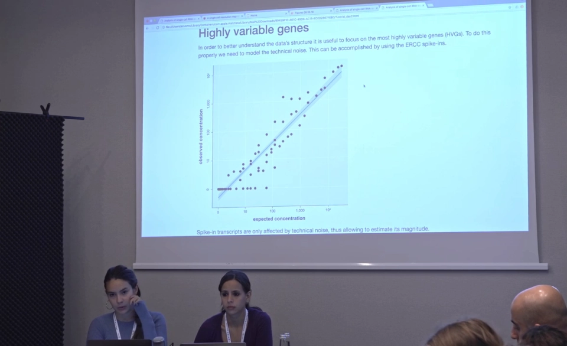
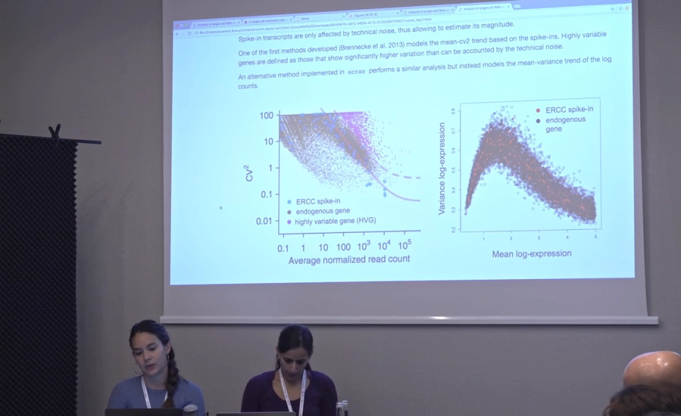
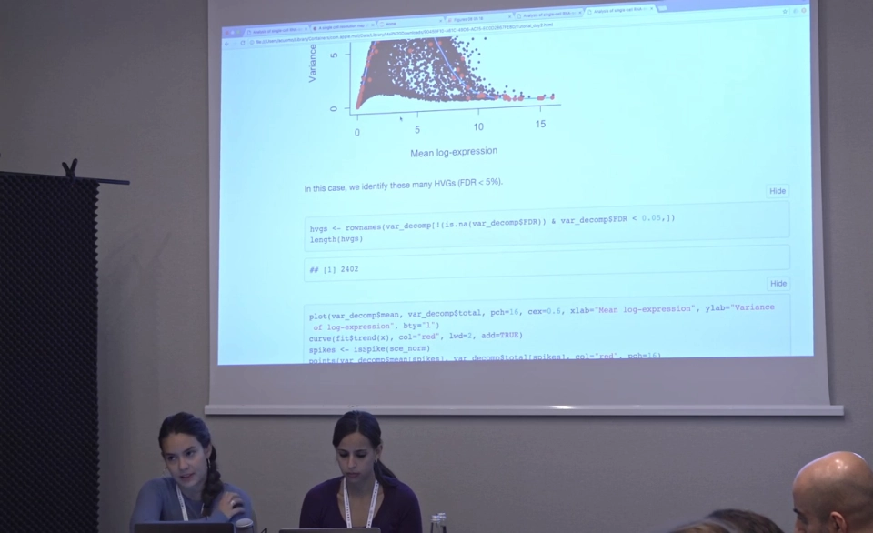
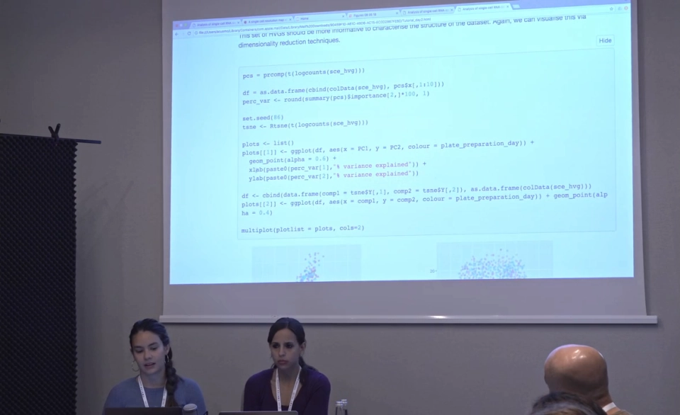

# 高变基因的两条趋势线：Brennecke 的 CV² 与 scran 的 log 方差

> 视频来源：[Single-cell tutorial [5/6]: scRNA-seq data analysis — clustering](https://www.youtube.com/watch?v=9LjfDCujkc4)（YouTube · Anna Cuomo & Ximena Ibarra 单细胞实操课，全长约 44 分钟）｜本文只整理 **29:42–44:00** 的高变基因段落
> 导读：这段实操课先承认「昨天我们用方差最大的基因做了 PCA，但没有正确地建模方差」，然后用 ERCC spike-in 把技术噪声量出来，再对照两种趋势模型——Brennecke 的 mean–CV² 与 scran 的 mean–log variance——看它们各自判出哪些基因、各自的盲区在哪。最后用 scran 的 `trendVar` 跑出 2402 个 HVG，并用这份名单重做 PCA 与 tSNE。

## 本讲要解决的核心问题（SCQA）

**背景**：前一天的分析里，数据已经被缩到「方差最大的一批基因」上做了 PCA。这在操作上没错，但讲者说得很直接：**我们并没有用正确的方式建模方差** [【跳转到 29:42】](https://www.youtube.com/watch?v=9LjfDCujkc4&t=1782)。

**冲突**：直接按方差排序，排在前面的往往是「表达得高」的基因，而不是「变化得有意思」的基因。要区分这两者，必须先知道「纯技术噪声能造成多大的变异」。可技术噪声不是能直接读出来的量——除非数据里有一组**只受技术噪声影响**的测量。

**疑问**：怎么把技术噪声量出来？Brennecke 和 scran 这两条路线差在哪？判出来的名单换了，降维结果会跟着变吗？

**回答（中心思想）**：**spike-in 是这段分析的锚**。它们浓度已知、只受技术噪声影响，因此可以用来拟合「平均表达 → 变异」的趋势线；线上方显著偏离的基因才判为高变。Brennecke 与 scran 的差别只在于**用哪个量画趋势**（CV² 还是 log 方差），这决定了它们各自对离群值和稀有群体更敏感还是更稳健。名单一旦换了，PCA 与 tSNE 的输入就换了。

## 一、用 spike-in 把技术噪声量出来

讲者先回到最根本的问题：技术噪声有多大？她的答案是看 ERCC 的**观测浓度 vs 期望浓度** [【跳转到 30:07】](https://www.youtube.com/watch?v=9LjfDCujkc4&t=1807)：



- 横轴是 ERCC 试剂盒里**已知的期望浓度**，纵轴是**实际观测到的浓度**；
- 如果测量完美，所有点都应落在对角线上；
- 实际情形是：中高浓度段大致贴住对角线，**低浓度段明显散开**，很多点直接掉到 0。

讲者把这与前一天看过的技术重复散点图联系起来：同一份样本测两次，当物质很少时，有时测到这个基因、有时测不到——**低表达区根本没有稳定的检出** [【跳转到 30:57】](https://www.youtube.com/watch?v=9LjfDCujkc4&t=1857)。所以低表达基因的「变异」里，绝大部分是噪声，不是生物学。

这段的结论可以写成一句：**spike-in 提供了一条「只有技术噪声时，变异应该是多少」的实测标尺**；没有它，这条标尺只能靠假设。

## 二、Brennecke 2013：在 mean–CV² 图上拟合趋势

第一种方法来自 Brennecke 等 2013 年的论文 [【跳转到 31:47】](https://www.youtube.com/watch?v=9LjfDCujkc4&t=1907)：

- 横轴：基因的平均 count；
- 纵轴：$\mathrm{CV}^2$，即「方差除以均值的平方」；
- 用 **spike-in（蓝点）** 拟合这条趋势——因为它们只受技术噪声影响；
- 然后在趋势线上方**抬高一个显著性阈值**（讲者的说法是「几个标准差」），超过它的基因判为高变。

讲者点明了这条路线的主假设：**只有少数基因是高变的** [【跳转到 33:02】](https://www.youtube.com/watch?v=9LjfDCujkc4&t=1982)。如果大多数基因都在剧烈变化，那么「趋势线代表技术噪声」这个前提就不成立了。

## 三、scran：换成 mean–log variance

scran 做的是同一件事，但**换了画趋势的纵轴** [【跳转到 33:27】](https://www.youtube.com/watch?v=9LjfDCujkc4&t=2007)：



- 横轴从「平均 count」变成「**平均 log 表达**」；
- 纵轴从「CV²」变成「**log 表达的方差**」；
- 同样用 spike-in 拟合趋势，**红线上方**的基因判为高变。

幻灯片上的文字把两者的关系说得很清楚：Brennecke 建模的是 mean–CV² 趋势，scran 建模的是 log counts 的 mean–variance 趋势；两者的判据都是「变异显著高于技术噪声能解释的部分」。

## 四、两条趋势线的差别：稳健 vs 敏感

讲者对两种方法的比较很具体 [【跳转到 33:52】](https://www.youtube.com/watch?v=9LjfDCujkc4&t=2032)：

- **scran 的 log 方差版本对离群值更稳健**。原因是它看的是 log count：一个「大部分细胞是 0、偶尔两次极高表达」的基因，取 log 之后方差不会显得特别大，于是不会被判为高变——讲者的判断是，这种模式**更可能是错误**而不是真实的生物学变异。
- **Brennecke 的 CV² 版本对稀有细胞群体更敏感**。讲者只给了这个结论，没有展开机制；一种读法是 CV² 把方差除以均值的平方，当一个基因只在极少数细胞里高表达时，均值被拉低、方差相对突出，这个比值就会被放大。

所以两种方法不是「谁更准」，而是**两种不同的错误倾向**：一个容易把噪声当信号，一个容易把稀有群体的信号漏掉。讲者的建议是：**看你的下游要什么，可以两种都跑、比较名单** [【跳转到 35:02】](https://www.youtube.com/watch?v=9LjfDCujkc4&t=2102)。

还有一条共同的限制：**极低表达的基因在两种方法里都被忽略**。讲者的解释很干脆——低表达基因的噪声水平高到「你根本没有能力区分技术还是生物学」 [【跳转到 37:12】](https://www.youtube.com/watch?v=9LjfDCujkc4&t=2232)。

## 五、没有 spike-in 时怎么办

讲者给的办法与 Brennecke 的原始设定一致：**假设大多数基因不是高变的**，于是可以直接用内源基因拟合这条趋势 [【跳转到 38:02】](https://www.youtube.com/watch?v=9LjfDCujkc4&t=2282)。

她的判断是：即使没有 spike-in，拟合出来的曲线大概也不会差太多；但**稳健性和可信度都会下降**——因为你失去了一条「只含技术噪声」的实测锚点，趋势线变成了假设。

## 六、在真实数据上跑一遍：FDR 5% 得到 2402 个 HVG

接下来是实操：用 scran 的 `trendVar` 拟合趋势（有 spike-in 就用 spike-in），再据此做检验 [【跳转到 39:12】](https://www.youtube.com/watch?v=9LjfDCujkc4&t=2352)。



```r
hvgs <- rownames(var_decomp)[!is.na(var_decomp$FDR) & var_decomp$FDR < 0.05, ]
length(hvgs)
## [1] 2402
```

讲者对检验的解读值得记下来：**零假设是「这个基因不是高变基因」**，所以 p 值衡量的是「在给定的平均表达水平下，它比预期更可变的可能性」 [【跳转到 40:57】](https://www.youtube.com/watch?v=9LjfDCujkc4&t=2457)。把 FDR 阈值调到 5%，得到 2402 个基因；她也提醒阈值可以调，调了名单会变。

最后她还做了一次直观核对：把这些基因的表达画出来，可以看到**在有些细胞里非常低、在另一些细胞里相当高** [【跳转到 42:12】](https://www.youtube.com/watch?v=9LjfDCujkc4&t=2532)——名单与「高变」这个直觉是对得上的。

## 七、用这份名单重做降维

有了「正确建模方差」得到的名单，就可以把之前那一步重做：**新建一个只含这些基因的对象**，再算 PCA 与 tSNE [【跳转到 42:57】](https://www.youtube.com/watch?v=9LjfDCujkc4&t=2577)。



讲者给出的判读方法很实用：**按实验批次（plate preparation day）上色**看降维图 [【跳转到 43:27】](https://www.youtube.com/watch?v=9LjfDCujkc4&t=2607)。

- 如果存在强批次效应，你会看到细胞**按 plate 聚成一团团**，而不是彼此混在一起；
- 用高变基因做降维，**更有可能看到真正的生物学结构**，因为它们应该捕捉到数据里的生物变异。

她也补充了一句限定：这份数据的实验设计本身比较好，所以批次效应并不强——**这个判读方法的前提是「先知道该看什么」**。

## 八、这一节真正要记住的三件事

1. **趋势线是判据，不是装饰**：HVG 名单完全由「拟合出的技术噪声趋势 + 阈值」决定；换趋势的纵轴（CV² 还是 log 方差），名单就换。
2. **两种趋势各有盲区**：CV² 对稀有群体敏感但容易被离群点带偏；log 方差对离群点稳健但可能漏掉稀有群体。选哪个取决于你怕哪种错误。
3. **名单换了，降维就换了**：用 HVG 子集重做 PCA/tSNE，是这段实操的最后一步——也是「特征子集决定下游看到什么」最直接的演示。

## 关键术语速查

| 术语 | 一句话解释 |
| :--- | :--- |
| ERCC / spike-in | 外源加入、浓度已知的转录本，只受技术噪声影响，用来估计噪声量级 |
| 观测浓度 vs 期望浓度 | 检验 spike-in 测量质量的对角线图；低浓度端偏离说明检出不稳定 |
| mean–CV² 趋势 | Brennecke 2013 的做法：横轴平均 count、纵轴方差除以均值平方 |
| mean–log variance 趋势 | scran 的做法：横轴平均 log 表达、纵轴 log 表达的方差 |
| `trendVar` | scran 里拟合均值—方差趋势的函数，有 spike-in 时优先用 spike-in |
| FDR 阈值 | 判定高变基因的显著性门槛，本例取 5%，得到 2402 个基因 |
| 零假设 | 「这个基因不是高变基因」；p 值衡量它在给定均值下比预期更可变的可能性 |
| 离群值稳健 | 对「大部分为 0、偶尔极高」这类模式不轻易判为高变 |
| 稀有群体敏感 | 对只在极少数细胞里高表达的基因更容易判为高变 |