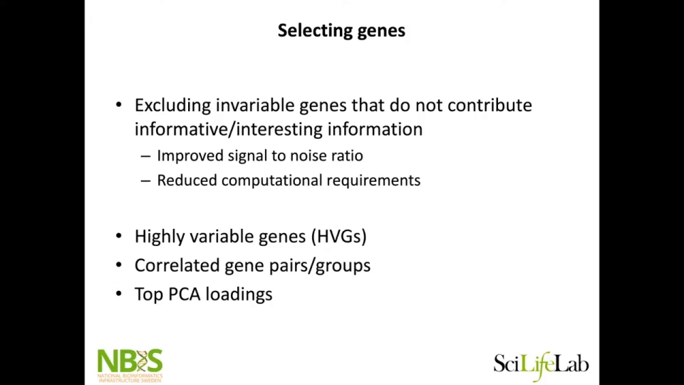
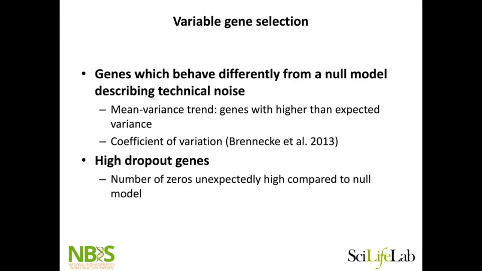
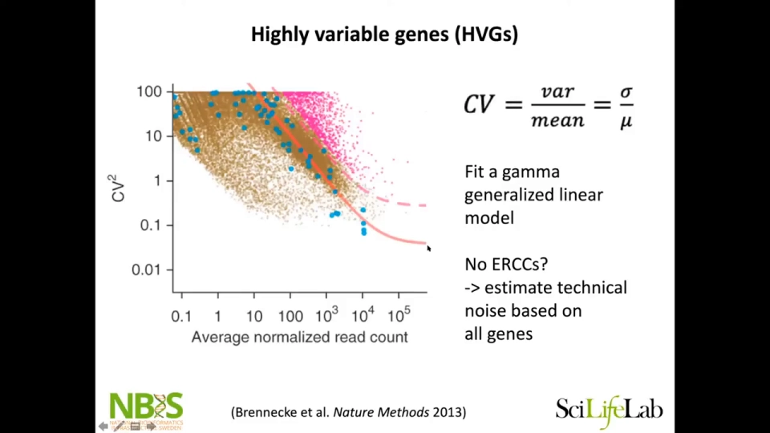
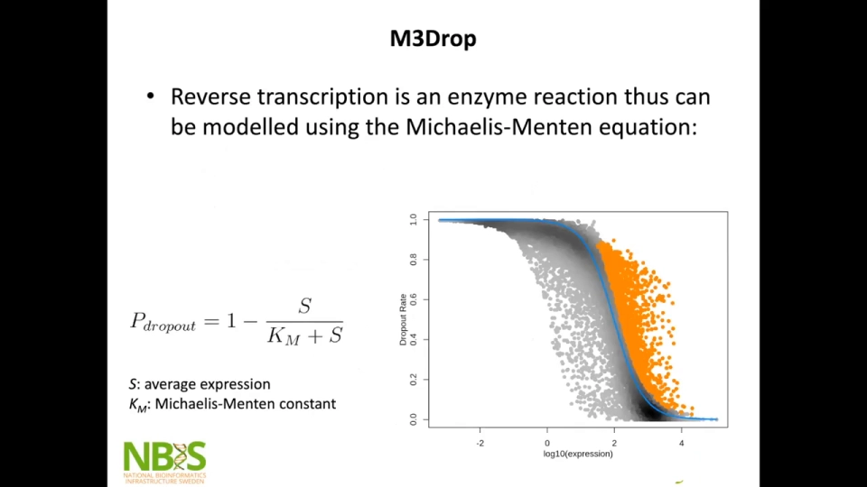

# 高变基因的零模型：均值—方差趋势、离散度阈值与筛选假设

> 视频来源：[Normalisation — Feature Selection](https://www.youtube.com/watch?v=CY4tKOM1lIw)（YouTube · NBIS / SciLifeLab 单细胞课程，约 4 分钟）｜讲者：单细胞数据分析培训课程讲师
> 导读：这支短片不讲代码，只回答一个问题——**凭什么说一个基因「高变」**。它的答案是一个零模型：先用只受技术噪声影响的测量（spike-in）拟合出「平均表达 → 变异」的趋势线，再把显著高于这条线的基因判为高变。短片还交代了没有 spike-in 时的替代假设、归一化对名单的影响，以及 M3Drop 这条换零模型的路线。

## 本讲要解决的核心问题（SCQA）

**背景**：单细胞矩阵里有两万多个基因，但下游的 PCA、聚类、可视化通常只用其中几千个。教程里的说法是「取变化最大的 2000 个基因」，代码只有一行。

**冲突**：可是「变化大」并不是一个自明的标准。同一个基因，换个归一化方法、换一批细胞，方差就变了；而且方差本身随平均表达增长，直接比方差等于在比表达量。更根本的问题是：**一个基因的变异要大到什么程度，才算「不只是技术噪声」？**

**疑问**：高变基因到底相对于什么而言是「高变」？没有 spike-in 的数据怎么办？换一种归一化，名单会不会变？

**回答（中心思想）**：**高变基因筛选是一个零模型问题**——先假设「如果这个基因只有技术噪声，它应该有多大的变异」，再把显著超出这条预期线的基因判为高变。这条预期线就是均值—方差趋势。所以 HVG 名单不是数据的固有属性，而是「零模型 + 阈值 + 归一化」三者共同的产物。

## 一、先选基因：信噪比与计算量

讲者开篇给出的理由很朴素 [【跳转到 00:00】](https://www.youtube.com/watch?v=CY4tKOM1lIw&t=0)：如果直接在全部基因空间上工作，噪声相当大；筛掉那些「不提供有用信息」的基因，能同时得到两个好处 [【跳转到 00:25】](https://www.youtube.com/watch?v=CY4tKOM1lIw&t=25)：

- **提高信噪比**：不变化的基因不贡献区分细胞类型的信息，只会稀释信号；
- **降低计算量**：选几千个基因去做 PCA 和后续一切，比在两万多个基因上跑快得多。

幻灯片同时点明：高变基因（HVG）只是最常用的一种，另外还有**相关基因对/组**和**取 PCA 载荷最大的基因**两条路线。讲者明确说这两条不展开——本节也只讨论 HVG。

## 二、高变基因的定义是一个零模型问题

讲者给出的定义值得逐字读 [【跳转到 00:50】](https://www.youtube.com/watch?v=CY4tKOM1lIw&t=50)：高变基因是**「行为与描述技术噪声的零模型不同的基因」** [【跳转到 01:15】](https://www.youtube.com/watch?v=CY4tKOM1lIw&t=75)。幻灯片列了两类判据：

- **均值—方差趋势**：方差高于同等平均表达下「应该」有的方差；
- **变异系数（CV）**：Brennecke 等 2013 年那篇论文用的量；
- **高 dropout 基因**：零的个数比零模型预期的多。

前两条其实是同一件事的两种写法——都要求先有一条「技术噪声能解释多少变异」的预期曲线。第三条换了一个观测对象（零的比例而不是方差），但零模型的思想一样。

## 三、Brennecke 的做法：用 spike-in 画出技术噪声的上限

这张图是理解 HVG 筛选的关键，横纵轴都是对数坐标 [【跳转到 01:40】](https://www.youtube.com/watch?v=CY4tKOM1lIw&t=100)：

- **横轴**：该基因在所有细胞里的平均归一化 read 数；
- **纵轴**：变异系数的平方 $\mathrm{CV}^2$，其中 $\mathrm{CV}=\dfrac{\mathrm{var}}{\mathrm{mean}}=\dfrac{\sigma}{\mu}$，所以 $\mathrm{CV}^2$ 是「方差除以均值平方」；
- **蓝点**：ERCC spike-in。它们是外源加入、浓度已知的转录本，**只受技术噪声影响**，因此可以当作「纯技术变异」的标尺；
- **橙色实线**：用 gamma 广义线性模型对蓝点拟合出的均值—变异趋势；
- **粉色点**：被判为高变基因的那些基因。

讲者描述的操作是：先对蓝点拟合一条线，再根据 spike-in 自身的离散程度，在这条线上方**再画一条线**作为技术噪声的上限 [【跳转到 01:40】](https://www.youtube.com/watch?v=CY4tKOM1lIw&t=100)。于是图被分成三块：

- 趋势线附近及以下：变异完全可以用技术噪声解释；
- 两条线之间：**无法确定**是技术还是生物学差异——讲者的原话是「在这个区域里我们没法确定」；
- 上限之上：变异超过 spike-in 能解释的程度，**大概率是生物学差异**，判为高变。

这张图还暴露了均值—方差关系本身：**低表达基因的 CV² 很大，高表达基因的 CV² 很小**，整片点云沿一条下降的曲线排布。所以「方差大」在低表达端几乎不值钱——那里的变异主要来自只有几个 count 的抽样噪声。这正是必须先建零模型、不能直接按方差排序的原因。

## 四、没有 spike-in 时的替代假设

大多数数据集里没有 ERCC。讲者给的办法是**把同样的假设换个对象**：假设大多数基因并不是生物学可变的，于是直接用全部基因拟合这条趋势线，再定一个 p 值阈值来决定「离这条线多远才算高变」 [【跳转到 02:05】](https://www.youtube.com/watch?v=CY4tKOM1lIw&t=125)。

代价需要说清楚：有 spike-in 时，那条线是**测量出来的**技术噪声；没有 spike-in 时，那条线是**假设出来的**——它的合法性完全依赖「大多数基因不变」这个前提。如果数据里存在一个很大的、由大量基因共同驱动的生物过程（比如强烈的细胞周期或分化梯度），这个前提就会被削弱，阈值的位置也随之变得可疑。

## 五、方法之间的差别很小，但归一化会改变名单

讲者对方法差异的评价很克制：估计离散度/变异的具体做法「各个包会略有不同，有好几种方法，但都很相似」 [【跳转到 02:55】](https://www.youtube.com/watch?v=CY4tKOM1lIw&t=175)。真正会大幅改变结果的是另一件事——**归一化**：

> 如果你有 spike-in 对照，就必须意识到：你做的归一化对「怎么定义高变基因」有很大影响。用 spike-in 时几乎必须做长度归一化，因为 spike-in 比普通基因短，count 会更少，整条曲线会向下移，于是你会**高估**高变基因的数目。[【跳转到 03:02】](https://www.youtube.com/watch?v=CY4tKOM1lIw&t=182)

这条提醒的机制值得展开一句：spike-in 的曲线是判据的锚点。如果归一化没有校正长度，spike-in 因为短而拿到偏低的 count，整条「技术噪声趋势」被压到真实位置之下；于是原本只算技术噪声的基因，看起来就「高于预期」了。**名单的变化不是来自生物学，而是来自预处理把标尺挪了位置。**

## 六、M3Drop：换一个零模型

短片最后介绍了一条替代路线 M3Drop [【跳转到 03:40】](https://www.youtube.com/watch?v=CY4tKOM1lIw&t=220)。它的思路是：逆转录是一个酶促反应，因此可以用米氏方程（Michaelis-Menten）来建模 dropout 概率：

$$
P_{\text{dropout}} = 1 - \frac{S}{K_M + S}
$$

其中 $S$ 是平均表达量，$K_M$ 是米氏常数。

于是判据从「方差高于期望」换成了「**零的个数高于期望**」。讲者的评价是：听起来很花哨，但已有评测论文显示，它**不如**前面这些常规的高变基因选择方法 [【跳转到 04:05】](https://www.youtube.com/watch?v=CY4tKOM1lIw&t=245)。

## 七、这一节真正要记住的三件事

1. **HVG 是相对零模型而言的**：不是「方差排名前 2000」，而是「变异显著超过技术噪声能解释的部分」。没有零模型，「高变」这个词没有意义。
2. **零模型可以从 spike-in 测出来，也可以从全部基因假设出来**：前者更可信但有前提（要有 ERCC、要做长度归一化），后者方便但依赖「大多数基因不变」。
3. **名单对预处理敏感**：归一化方式、是否做长度校正，都会移动那条趋势线，从而改变名单。HVG 名单是流程的产物，不是数据的固有属性。

## 关键术语速查

| 术语 | 一句话解释 |
| :--- | :--- |
| 高变基因（HVG） | 变异显著超过技术噪声零模型所能解释的基因，常取几千个进入降维 |
| 零模型（null model） | 「如果只有技术噪声，这个基因应该有多大的变异」这一预期 |
| 均值—方差趋势 | 平均表达越高、方差越大的系统性关系；低表达端由抽样噪声主导 |
| 变异系数（CV） | $\sigma/\mu$，无量纲的离散度；图里用的是它的平方 $\mathrm{CV}^2$ |
| spike-in / ERCC | 外源加入、浓度已知的转录本，只受技术噪声影响，可当技术变异的标尺 |
| 离散度（dispersion） | 扣掉均值效应之后剩下的变异，不同包估计方式略有差别 |
| gamma GLM | Brennecke 图里用来拟合 spike-in 均值—变异趋势的广义线性模型 |
| dropout | 表达量低到测不到、表现为零的现象；M3Drop 用它作为筛选判据 |
| M3Drop | 用米氏方程建模 dropout、按「零异常多」选基因的方法，评测中不如常规 HVG 方法 |