# 批次效应校正是一把双刃剑：从 ComBat 到 CellAnova，以及「过度整合」这个真正的风险

> 视频来源：[【中配】如何管理生物数据中的批次效应](https://www.bilibili.com/video/BV1K9GE6AEe1/)（B 站 · 一只小袋子 搬运的中配讲座，讲者 Kris Sankaran，威斯康星大学麦迪逊分校统计系）
> 时长约 27 分钟。导读：这是一场**方法论讲座**，不是某个工具的操作演示。它从一篇被撤稿的《自然》论文讲起，说明「批次校正用错会凭空造出生物学结论」，然后把 ComBat 与 CellAnova 两个方法拆到公式层面，最后给出三条可执行的健全性检查。本文按「批次从哪来 → 两条总路线 → 方法怎么比 → ComBat 怎么算 → 校正自己会制造什么假信号 → 过度整合 → 怎么做检查 → 单细胞专用的 CellAnova」组织，覆盖讲座全部要点。字幕为中配 AI 转写，术语已按上下文校正（如「P4 效应」→ 批次效应、「SANOVA」→ CellAnova）。

## 本讲要解决的核心问题（SCQA）

**背景**：任何真实合作项目里，数据都不是一次测完的——不同医院、不同时间、不同试剂盒、不同操作者。做 PCA 时，你看到的最大一团结构往往不是生物学，而是这些「谁在什么时候测的」。

**冲突**：批次效应必须处理，但处理手段本身会引入新的问题。讲座开篇的例子是一篇被大规模撤稿的《自然》论文：它声称找到了「与不同癌症相关的肠道微生物组特征」，**没有任何数据造假**，问题出在批次校正这一步——把「医院效应」减掉时，顺手把「癌症效应」也减了出来（或者说，减出了一个原本不存在的癌症效应）。

**疑问**：既然校正可能制造假信号，那批次效应到底该不该校正？如果校正，怎么判断一个方法「改对了」而不是「改过头了」？

**回答（中心思想）**：批次校正的目标是**让可比的东西可比**，而不是让所有东西看起来一样。要做到这一点，关键不在选哪个算法，而在三件事：**先确认批次和你要研究的条件是否正交**、**知道每个方法在哪一层动手术（改表达值 / 改坐标 / 改隐空间）**、**校正后做健全性检查**（分批次单独分析是否还一致、模拟数据上流程是否给出合理结果）。方法族谱里，ComBat 是位置-尺度变换 + 分层收缩的经典起点，CellAnova 则把「对照池」这一实验设计信息直接写进模型。

## 一、批次效应不是噪声，而是和生物学混在一起的技术信号

### 1.1 一个没有造假的撤稿案例

讲座的第一个案例值得每个做单细胞分析的人记住。研究团队用 TCGA 的微生物组数据，声称可以基于肠道微生物组区分不同癌症类型。**他们没有伪造数据**，甚至经历了多轮「信号是否真实」的公开辩论，同一批作者反复发表重新分析说「确实有信号」。但最终结论是：这个疾病特征是**人为的**，来自对批次校正方法的误用——只要在微生物组数据上跑一遍标准的批次校正流程，就会产生一个实际上并不存在的信号。

批次从哪来？在那个案例里是**医院之间的差异**：TCGA 的数据来自许多不同医院，合并在一起后，直接对原始数据做 PCA，你看到的最大效应就是医院效应。这不是大家想要的生物学，而是数据准备与测序流程的差异。

[【跳转到 01:37】](https://www.bilibili.com/video/BV1K9GE6AEe1/?t=97)

### 1.2 技术变异出现在流程的每一个环节

讲者列出的技术变异来源几乎覆盖了整个实验流程：

- **样本收集**（Sample Collection）
- **样本保存**（Sample Storage）——放在零下 80 度还是零下 30 度，会影响哪些 DNA 降解
- **文库制备**（Library Preparation）
- **DNA 合成 / 扩增**（DNA Synthesis、PCR Amplification）
- **测序**（Sequencing）
- **读段分配**（Read Assignment）

任何一步的差异，在样本量较大或涉及多个研究站点时，都会变成系统性的批次差异。用一家公司的提取试剂盒和另一家对比，最后拿到的 DNA 就会有明显不同。

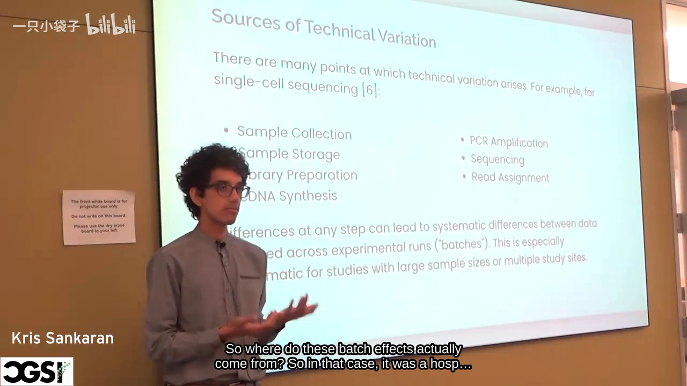

### 1.3 单细胞比 bulk 更麻烦：批次和细胞组成混在一起

讲座里那张经典的图来自最早的一篇批次效应校正论文：把样本**按测序时间排序**画热图，同一测序日期的样本形成一条条横向色块——差异不是采样时间造成的，而是「什么时候送去测序」造成的。

[【跳转到 05:39】](https://www.bilibili.com/video/BV1K9GE6AEe1/?t=339)

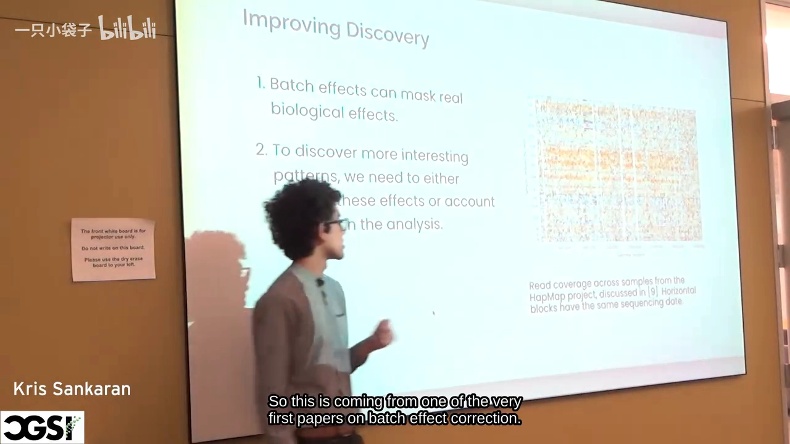

这一点在单细胞里会被放大：**不同样本的细胞类型比例本来就不一样**，所以「样本间差异」里既有技术批次，也有真实的组成差异，而这两者在降维图上混在一起，肉眼分不开。这正是本节要处理的核心困难——批次效应不是可以简单「减掉」的噪声，而是和生物学纠缠在一起的信号。

讲者给了一个很好的类比：把整个测序过程想象成一台**非常慢的相机**。花园里有真实的场景，但照片上会有眩光；我们知道眩光不是场景本身，所以能轻易区分。而在电子表格或表达矩阵里，同样的「眩光」我们很难察觉——光看表格，看不出「哦，那是技术效应」。但它确实存在。

[【跳转到 03:39】](https://www.bilibili.com/video/BV1K9GE6AEe1/?t=219)

## 二、两条总路线：先校正，还是把批次写进模型

处理批次效应有两大理念，讲座把它们并列成一张表：

1. **校正（Correct）**：在做任何下游分析之前，先减去批次效应，之后就可以用你原本计划的那套流程。
2. **建模（Account）**：不管下游要做什么，先把批次项写进模型，构建一个端到端的分析策略。

| 路线 | 优点 | 代价 |
| --- | --- | --- |
| 校正 Correct | 通用性好，可复用，一次校正多处使用 | 可能引入自己的伪影（artifacts） |
| 建模 Account | 内聚性好，一个问题一个模型，不需要额外方法 | 耗时，每个新问题都要定制开发 |

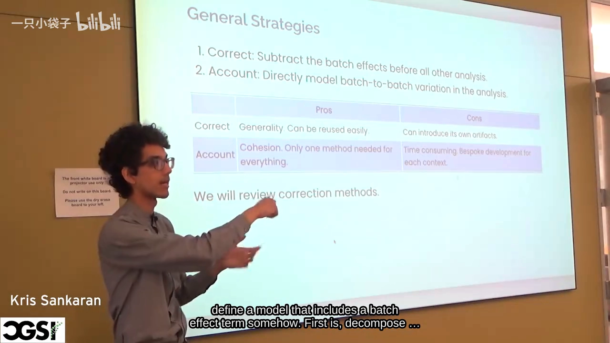

讲者的判断是：把批次纳入整个分析策略**更优雅，但更耗时**——因为每换一个下游分析，你可能都需要一个新模型。所以讲座的重点放在校正方法上，理由是「方法多、更受普遍关注，你需要知道如何在其中导航」。

[【跳转到 06:15】](https://www.bilibili.com/video/BV1K9GE6AEe1/?t=375)

**对单细胞实践的翻译**：做降维可视化与聚类，走「校正」路线通常省事；做**差异表达**，走「建模」路线更稳——把批次作为协变量放进模型（pseudobulk 层面的做法属 [4.1.5 伪 bulk 汇总](../../../README.md#b04-4-1-5) 与 [4.2.3 差异表达建模](../../../README.md#b04-4-2-3)，这里点到为止）。原因在第五节会看到：**先校正再比较，本身就会扭曲检验统计量的零分布**。

## 三、比较方法族谱的两个轴

面对几十种批次校正方法，讲者说先问两个问题就够了：

1. **它允许什么类型的变换？** 有的方法允许批次之间做非常复杂的变换，有的把变换限制得很简单。
2. **它怎么选择 / 优化这些变换？** 知道了变换家族之后，还要看它用什么准则去挑那组变换。

最简单的变换家族是**位置-尺度变换（location-scale）**：某个基因在一个批次里的分布是某个样子，换了提取试剂盒后可能整体平移一点、再缩放一点。校正方法要做的，就是把两家医院的分布「从看起来像这样」变成「看起来像这样」。

[【跳转到 08:13】](https://www.bilibili.com/video/BV1K9GE6AEe1/?t=493)

讲座挑了两个代表方法，正好代表两个时代：

- **ComBat（2007）**：线性模型，经典起点，很多现代方法都由它演化而来；
- **CellAnova（2024）**：嵌入（embeddings）+ 线性模型，专门为单细胞设计。

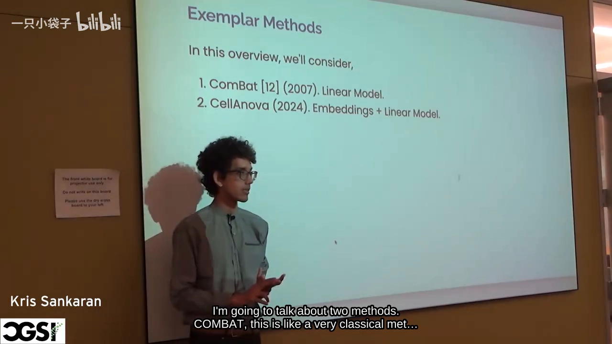

**对单细胞实践的翻译**：这个「两个轴」的框架可以套到你在单细胞里最常遇到的几个工具上——ComBat / limma 在**表达值**上做位置-尺度调整；Harmony / BBKNN / Scanorama 在**降维坐标**上对齐；scVI / scANVI 在**隐空间**里把批次当协变量建模；Seurat 的 anchor 方法在**互近邻/锚点**上找跨数据集对应关系。它们改的不是同一层东西，所以「校正后能不能直接拿去做差异表达」的答案也不同。

## 四、ComBat：位置-尺度变换 + 分层收缩

### 4.1 设定与符号

ComBat（**Com**bining **Bat**ches）最初是为**微阵列**数据提出的，动机很具体：每个批次的样本量很小（$n \approx 5\text{–}20$），直接按批次估计校正参数极不稳定。

- $y_i \in \mathbb{R}^G$：样本 $i$ 在 $G$ 个基因上的表达；
- $x_i \in \mathbb{R}^D$：已知的生物学因素（比如处理组、疾病/健康、时间点）；
- $b(i) \in \{1, \dots, M\}$：样本 $i$ 属于 $M$ 个批次中的哪一个（比如哪家医院）。

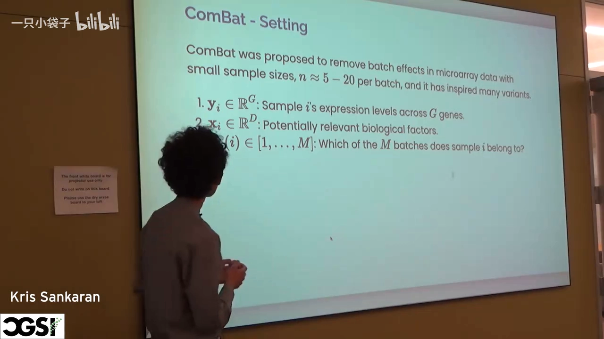

### 4.2 模型

样本 $i$ 被假设来自：

$$
y_i = \mu + W x_i + b_{m(i)} + \Lambda_{m(i)} \varepsilon_i
$$

其中 $\Lambda_m = \mathrm{diag}(\delta_{mg})$ 用来按基因重新缩放噪声，$\varepsilon_i \sim \mathcal{N}(0, \mathrm{diag}(\sigma^2_g))$。三项各司其职：

1. $W$ 刻画**共享的生物学效应**（比如处理组相对对照组沿某个方向的移动）；
2. 批次效应造成**系统性的位置-尺度偏移**——每个批次有自己的位置偏移 $b_m$，还能把噪声「拉宽或压窄」；
3. 一旦估出 $b_m$ 与 $\Lambda_m$，就可以从观测数据里减掉它们。

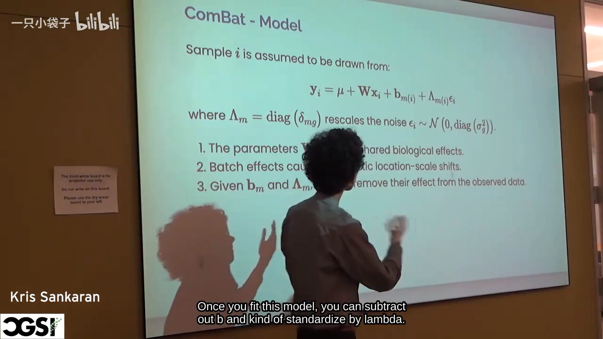

拟合之后，校正就是减去 $b$、再按 $\lambda$ 标准化：

$$
y_i^{\text{corrected}} = \frac{y_i - \hat{b}_{m(i)}}{\hat{\Lambda}_{m(i)}}
$$

[【跳转到 10:20】](https://www.bilibili.com/video/BV1K9GE6AEe1/?t=620)

### 4.3 关键在「分层」：跨基因借信息

ComBat 真正起作用的地方不是那个线性模型——线性模型本身很朴素——而是**它不逐基因单独估计，而是用分层模型在所有基因之间共享信息**。具体做法是对 $b$ 和方差项加正态先验、对方差加逆伽马先验，再用经验贝叶斯估出 $\hat{b}$ 与 $\hat{\lambda}$。

效果是：噪声特别大的基因，其方差估计会被**收缩（shrinkage）**到全体基因的典型水平，校正因此变得稳定。

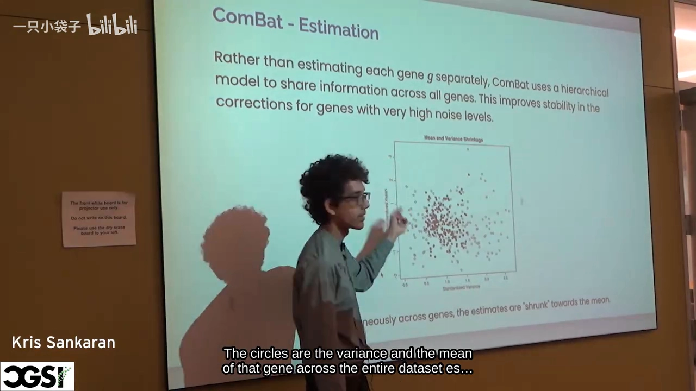

[【跳转到 12:36】](https://www.bilibili.com/video/BV1K9GE6AEe1/?t=756)

讲座现场有人追问：收缩不是会引入偏差吗？讲者的回答很实在：**确实会引入偏差，但你希望方差的改善是值得的**。他还补充了两点容易被忽略的前提：

- ComBat **假设你知道批次**。如果批次是「谁做的实验」而你已经不记得了，ComBat 帮不上忙；SVA 一类方法不假设事先知道批次，CellAnova 也不一定需要。
- ComBat **只管批次，不管归一化**。输入 $y$ 应当已经是标准化过的量；文库深度这类问题要在上游解决（属 [3.1.3 表达预处理](../../../README.md#b04-3-1-3)）。针对计数数据后来有 ComBat-seq，把模型换成负二项版本，但基本模型与估计方法相同。

[【跳转到 13:09】](https://www.bilibili.com/video/BV1K9GE6AEe1/?t=789)
## 五、校正方法自己也会制造假信号：批次不平衡时 P 值会失真

这是本讲最实用的一部分。讲者说：**不要盲目使用这些方法**。有一篇论文做了一个很漂亮的实验——他们照常跑 ComBat-seq 的教程（就是通常的 R Markdown），但**把真实数据换成了纯标准正态随机数**。也就是说，输入里根本没有信号。

结果呢？走完整个流程，得到的 P 值分布严重偏斜、F 统计量的 QQ 图明显偏离对角线，**看起来像是「发现了信号」**。

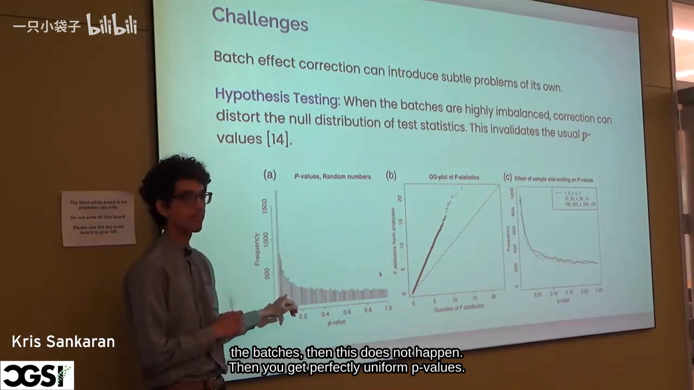

为什么会这样？讲者给出的解释是**批次内的处理组/对照组不平衡**：

- 如果处理组和对照组在每个批次里是**平衡**的（正交），校正不会引入额外的处理效应，P 值会完全均匀；
- 一旦批次与处理状态之间存在**相关性**，你试图减去批次效应时，就会**引入一个原本不存在的处理效应**。

[【跳转到 15:06】](https://www.bilibili.com/video/BV1K9GE6AEe1/?t=906)

这条结论对单细胞扰动实验尤其致命：**如果每个供体只做一种处理、每个 10x 通道只装一种条件，那么「批次」和「你关心的条件」就完全重合（confounded）**。这种情况下，没有任何算法能替你分开它们——算法会「成功地」把条件效应一起减掉，或者反过来，把批次差异变成你论文里的处理效应。

## 六、过度整合：当「对齐」变成「抹平」

第二种问题更隐蔽。有一篇论文主张：**在整合之前，先检验「整合这件事本身是否有意义」**。他们画了一组很直观的图：

- 情形一：两家医院各自测到了同样的三种细胞类型，只是坐标错开了。这时用位置-尺度变换对齐是**有意义的**。
- 情形二：两家医院测到的东西**根本不是同一批细胞类型**。这时还去对齐，就完全没有意义——你怎么能把「三种细胞」和「完全不同的另一组东西」强行重叠？

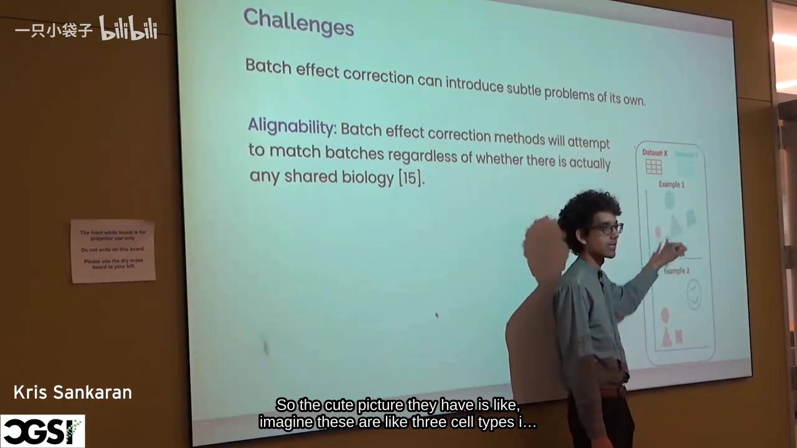

论文的论点是：如果你用一个**比 ComBat 更强大**的方法，它有能力让两组数据在图上「看起来完全重叠」——但那不是校正成功，而是**过度整合（over-correction）**。

[【跳转到 16:56】](https://www.bilibili.com/video/BV1K9GE6AEe1/?t=1016)

**对单细胞实践的翻译**：这就是本节的核心风险清单。过度校正的典型症状是：不同细胞类型之间的界限变模糊、已知 marker 分不开、不同条件下的同一细胞类型被硬拉到一起、UMAP 上出现「按样本均匀混合」的假象而丢掉了真实的组成差异。判断标准不是「图看起来混得好不好」，而是**同一细胞类型是否真的对齐了、不同细胞类型是否还分得开**。

## 七、三条可以马上做的健全性检查

讲座给的建议是「非正式的」，但非常好用：

**检查一：分批次单独分析，看结论是否还一致。** 在每个批次内部单独跑一遍分析，如果生物学确实跨批次共享，那么大部分结果应该重叠。更具体地说：比较「单个批次的原始数据」与「校正后的合并数据」，如果某些基因/物种在最大批次和校正数据之间**完全不同**，那就有点可疑。

**检查二：用模拟数据跑一遍流程。** 先生成一批你知道真相的数据，跑完整流程，看它是否给出合理结果。讲座给出的两条通用做法是：

1. 分批次单独分析，看结果是否重叠；
2. 用模拟（很多包可以基于初始数据学习一个模拟器）来理解你的流程。

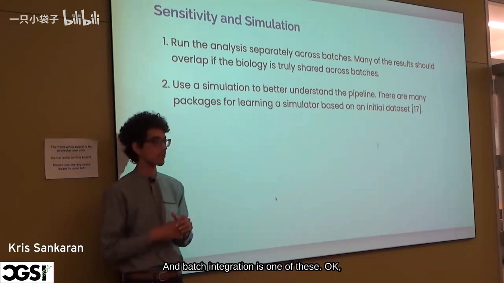

[【跳转到 17:57】](https://www.bilibili.com/video/BV1K9GE6AEe1/?t=1077)

**检查三（隐含但最重要）：先看批次与条件是否正交。** 这决定了校正有没有意义——正交才能校；混淆了就只能在下游结论里承认局限。

### 7.1 模拟演示：同样的流程，平衡时正确、不平衡时造假

讲者用一个高斯混合模拟复现了那篇《自然》论文的失败机制（这个例子来自 Gerry Tonkin-Hill 的重新分析）。四个组代表四家医院，两种颜色代表疾病和健康。

**情形一：平衡、无信号。** 每家医院里疾病与健康没有差异。跑有监督的批次校正后，四家医院的数据完全重叠，疾病与健康之间没有任何系统性差异——这正是我们想要的结果。

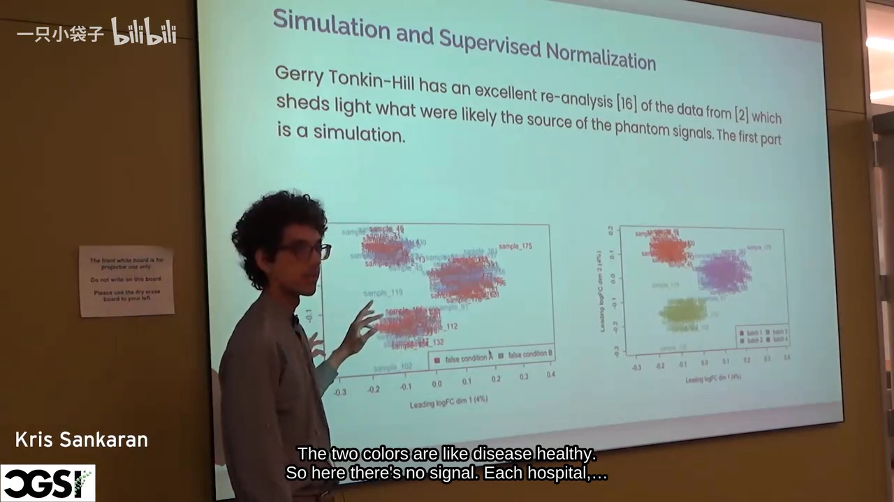

**情形二：不平衡。** 让某家医院完全没有疾病样本，其他医院里疾病样本比例严重偏高。这时再做校正，就会**引入虚假的疾病效应**。

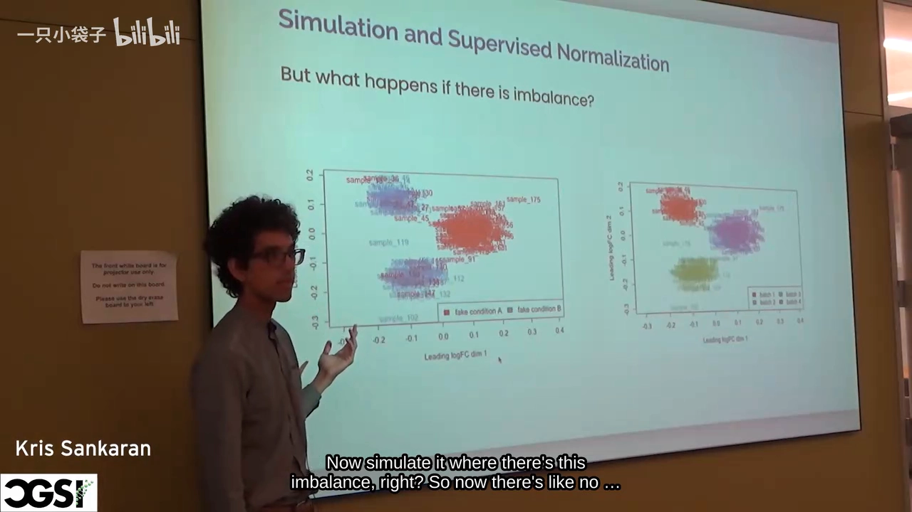

[【跳转到 19:38】](https://www.bilibili.com/video/BV1K9GE6AEe1/?t=1178)

这种不平衡在真实数据里一点也不罕见：TCGA 里有些医院专门收治某些类型的癌症，那些癌症在这些医院里就比其他医院多得多。当他们试图消除医院效应时，意外地引入了癌症效应，于是「看起来能预测不同癌症之间的差异」。讲者的评价很克制：这有点可惜，因为微生物组和癌症之间**可能确实存在**诊断潜力；但至少，你不能依赖那个分析来得出那个结论。

[【跳转到 20:19】](https://www.bilibili.com/video/BV1K9GE6AEe1/?t=1219)

## 八、CellAnova：把校正前置到实验设计

讲座后半段介绍了一个较新的单细胞专用方法 **CellAnova（2024）**。它的核心见解不是某个数学技巧，而是一个观念转变：**不要把批次校正看成「数据收集完之后才做的事」，而要在设计实验时就让它变得容易**。

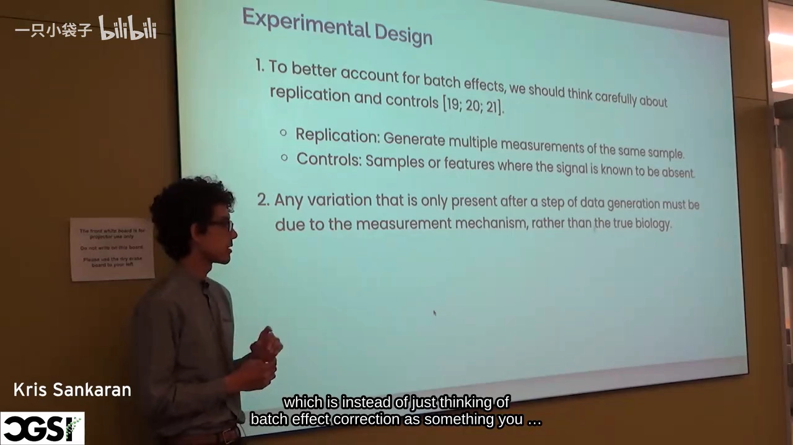

具体到设计层面，讲者强调两件事：

- **重复（Replication）**：对同一个样本做多次测量；
- **对照（Controls）**：信号已知不存在的样本或特征。

并给出一条判据：**任何只在某个数据生成步骤之后才出现的变异，都必须归因于测量机制，而不是真实生物学。**

[【跳转到 21:09】](https://www.bilibili.com/video/BV1K9GE6AEe1/?t=1269)

### 8.1 对照池（pool of controls）

CellAnova 的符号从「样本」换成了「人」：$Y^1, \dots, Y^M$ 是 $M$ 个生物学样本（比如 $M$ 个供体）的测量，每个 $Y^m \in \mathbb{R}^{N_m \times G}$ 是一个细胞 × 基因的矩阵。

它要求的关键假设——**ComBat 和大多数批次校正方法都没有的**——是：存在一个样本子集，讲者称之为**对照池（pool of controls）**，这些样本被假定在生物学上是相同的，因此会被**强制重叠**；它们之间的任何系统性变异都会被去掉，并作为估计批次效应的基础。

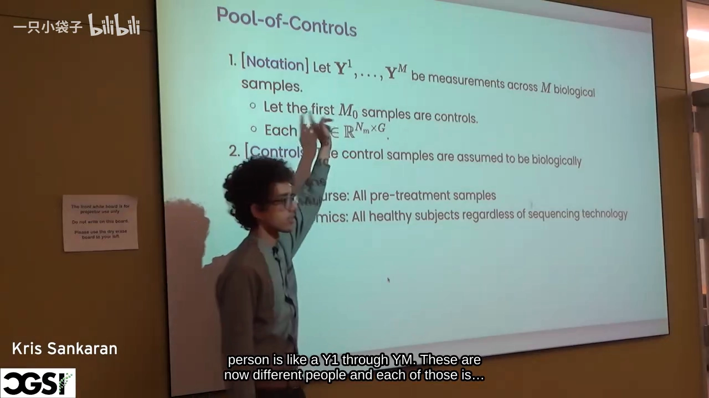

讲者给的对照片子很实用：所有**处理前**的样本；或者所有**健康受试者**，不管用的是哪种测序技术。

[【跳转到 21:48】](https://www.bilibili.com/video/BV1K9GE6AEe1/?t=1308)

### 8.2 直觉：用技术重复去「称」出批次

为什么对照池能估出批次？讲者的直觉解释是：如果你有完全相同的生物样本，并且对它做了很多次技术重复，那么这些重复之间的任何**系统性**差异，都只能来自测量过程。你把这些差异减掉，就得到了一个「批次变换」；再把这个变换应用到所有数据上。

### 8.3 模型与「不可识别性」

CellAnova 假设每个样本的测量来自：

$$
Y^m = C^m \left( \mu + B^m V^\top + X^m W^\top \right) + \text{noise} := C^m (R^m)^\top + \text{noise}
$$

- 输入 $C^m$：细胞层面的编码（比如每个细胞属于哪种细胞类型）；
- 要估计的量：$\mu$ 全局均值、$B^m V^\top$ 批次效应、$X^m W^\top$ 真实生物学变异。

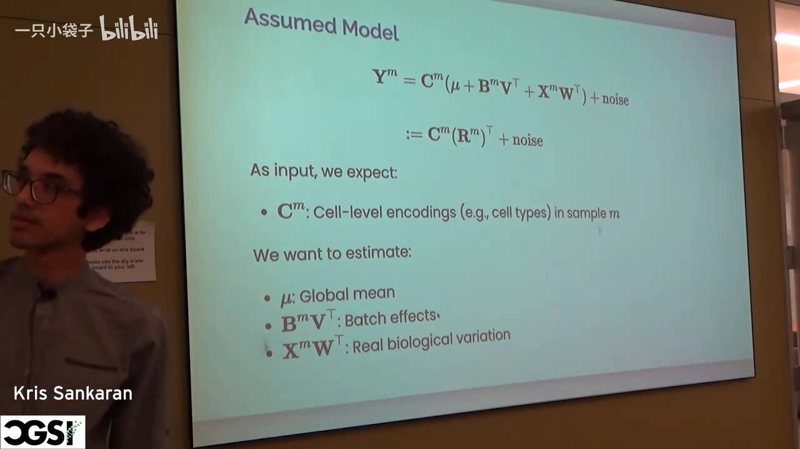

与 ComBat 最大的区别是：**这里的 $X$ 是未知的**——方法不假设你知道真正的生物子空间是什么。但这也带来一个麻烦：如果只是把两个低秩矩阵相加、没有实验设计结构，**这个模型是不可识别的**，你无法区分哪部分是批次、哪部分是生物学。

[【跳转到 24:47】](https://www.bilibili.com/video/BV1K9GE6AEe1/?t=1487)

对照池正是打破这个僵局的结构信息。讲者用一张手绘图讲清了流程（想象两种细胞类型、两个批次，批次效应把质心往某个方向推了）：

1. 因为对照池**没有生物变异**，先减去对照的均值 $\bar{R}$，剩下的变异就只剩批次；
2. 这个剩余子空间就是**批次效应子空间 $V$**；
3. 把 $V$ 投影掉，再对投影后的矩阵做 SVD，得到的就是**生物子空间 $W$**。

$$
\begin{bmatrix} R^1 - \bar{R} \\ \vdots \\ R^M - \bar{R} \end{bmatrix} (I - V V^\top) \xrightarrow{\ \mathrm{SVD}\ } W
$$

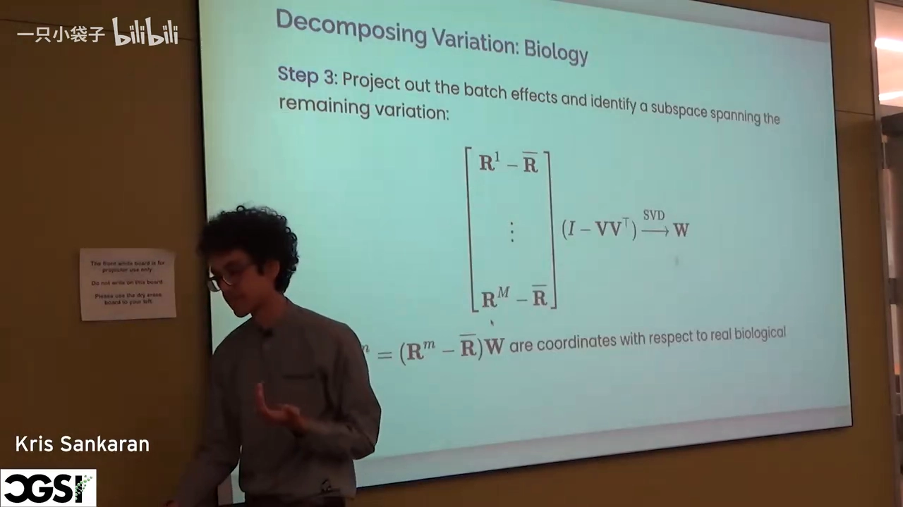

[【跳转到 26:12】](https://www.bilibili.com/video/BV1K9GE6AEe1/?t=1572)

讲者坦承自己「有点匆忙地略过了一些数学细节」，但主要点很清楚：**对照池这种实验设计信息，可以实质性地帮助批次校正**——它不是事后补救，而是事前设计。

## 九、落到单细胞实践：做不做、怎么做

把讲座的结论翻译成单细胞分析的操作判据：

**第一条：看下游要什么。**

- 做**降维可视化、聚类、细胞类型注释** → 整合通常有帮助（这是 [3.2 细胞关系与注释](../../../README.md#b04-3-2) 的范畴，这里只强调「整合强度要选对」）；
- 做**差异表达** → 优先用 **pseudobulk + 把批次作为协变量放进模型**，而不是「先校正再比较」。原因就是第五节：先校正会扭曲检验统计量的零分布，让 P 值失去意义（方法细节属 [4.2.3 差异表达建模](../../../README.md#b04-4-2-3)）。

**第二条：看批次与条件是否正交。** 这是决定「校正有没有意义」的前提。混淆了就不要假装能分开，在结论里写清局限。

**第三条：永远保留未校正的原始 counts。** 任何校正都应保留可回溯的原始矩阵，便于复算与换方法重跑。

**第四条：校正后必须做健全性检查。** 分批次单独分析看结论是否一致；用模拟数据验证流程；对照已知 marker 检查细胞类型是否还分得开。

讲座最后把 ComBat 与 CellAnova 并排放在一起，给了一个很有分量的判断：**即使 ComBat 已经大约 20 年了，两者的基本代数结构实际上非常相似**——所以仍然值得去读那些经典论文，而不是只记住一个函数名。

[【跳转到 26:33】](https://www.bilibili.com/video/BV1K9GE6AEe1/?t=1593)

## 小结

- **批次效应不是噪声，而是和生物学混在一起的技术信号**。它来自流程的每一步：样本收集、保存、建库、扩增、测序、读段分配。
- **两条总路线**：先校正（通用、可复用、但可能引入伪影）vs 把批次写进模型（内聚、但每个问题都要定制）。做差异表达优先走后者。
- **比较方法族谱先问两个问题**：允许什么变换、怎么优化这些变换。位置-尺度变换是最简单的一族。
- **ComBat 的威力不在线性模型，而在分层收缩**：跨基因借信息，把高噪声基因的方差估计拉向典型值。它假设你知道批次，也不负责归一化。
- **校正自己会制造假信号**：把数据换成纯随机数，ComBat 流程仍能产出「显著」结果——只要批次内处理/对照不平衡。批次与条件混淆时，没有算法能救你。
- **过度整合是更隐蔽的风险**：强方法能让「根本没有共同生物学」的数据看起来完全重叠。判断标准是细胞类型界限与 marker，而不是图好不好看。
- **三条检查**：分批次单独分析结果是否一致、模拟数据上流程是否合理、批次与条件是否正交。
- **CellAnova 的启示**：把校正前置到实验设计——技术重复 + 对照池，让「批次」可以被独立估计出来。
- 一句话收束：**校正的目的是让可比的东西可比，不是让所有东西看起来一样。**

## 关键术语速查

| 术语 | 一句话解释 |
| --- | --- |
| batch effect（批次效应） | 由样本处理、建库、测序等非生物学因素造成的系统性技术差异 |
| confounded（混淆） | 批次与研究条件完全或部分重合，导致两者在统计上无法分离 |
| location-scale transformation（位置-尺度变换） | 只允许对分布做整体平移与缩放的校正方式，ComBat 属于这一类 |
| ComBat | 2007 年提出的经典批次校正方法，用线性模型 + 分层经验贝叶斯收缩估计批次参数 |
| ComBat-seq | ComBat 的计数数据版本，把噪声模型换成负二项，基本模型与估计方法相同 |
| shrinkage（收缩） | 把不稳定的单基因估计拉向全体基因的典型值，用一点偏差换方差稳定 |
| SVA | 不假设事先知道批次的一类方法，通过估计「代理变量」来吸收未知的技术变异 |
| over-correction（过度校正 / 过度整合） | 校正力度过强，把真实的生物学差异当成批次抹掉 |
| alignability（可对齐性） | 判断两组数据是否共享足够生物学结构、值不值得整合的前提检验 |
| pool of controls（对照池） | 生物学上应相同的样本子集（如全部处理前样本），被强制重叠以估计批次效应 |
| CellAnova | 2024 年提出的单细胞批次校正方法，用细胞类型编码 + 低秩分解，靠对照池分离批次与生物子空间 |
| pseudobulk | 把同一样本同一细胞类型的细胞计数加总成「伪 bulk」，再做差异表达，便于把批次放进模型 |
