# 从距离矩阵到邻接图：kNN、SNN 与邻居数 k 的作用

> 视频来源：[kNN and SNN graphs, and Louvain clustering | How Seurat cluster single cells](https://www.youtube.com/watch?v=WWlNULeREnU)（YouTube · TileStats）｜时长约 15 分 37 秒
> 简要导读：单细胞流程里"降维之后、聚类之前"那一步到底做了什么？这支视频用六个二维点把整件事拆成可手算的环节：先算两两欧氏距离得到距离矩阵，再用邻居数 $k$ 把"最近"翻译成"连边"，得到邻接矩阵和有向 kNN 图；去掉箭头变成无向图，用距离倒数加权；再进一步用"共享了多少个邻居"替换"离得多近"，得到 SNN 图及其 Jaccard 权重。最后一段把这张图交给 Louvain 做社区划分。本文只负责**从距离到图**这一段，社区划分与分辨率选择另见 3.2.2。

## 本讲要解决的核心问题（SCQA）

**背景**：单细胞数据经过质控、归一化、高变基因筛选和 PCA 之后，每个细胞不再是几千个基因的表达值，而是几十个主成分上的坐标。接下来的聚类算法（Louvain/Leiden）并不直接读这些坐标，它读的是一张**图**。

**冲突**：从"一堆坐标"到"一张图"这一步经常被跳过。代码里只有一行 `FindNeighbors`，看起来像是个无参数的预处理。但实际上这里至少要做三个决定：**用什么度量算相似**、**每个点连几个邻居**、**连边时只看距离还是也看邻居的重合**。这三个决定直接改写了图的形状，而聚类只是在既定的图上找社区——图画错了，后面再调分辨率也救不回来。

**疑问**：距离矩阵、邻接矩阵、kNN 图、SNN 图这几样东西的先后关系和换算规则是什么？邻居数 $k$ 具体出现在哪一步、改变了什么？为什么 Seurat 要在 kNN 之上再加一层 SNN？

**回答（中心思想）**：这是一条**逐级收紧的建图链**——距离矩阵给出"谁离谁近"的全量信息；$k$ 把每个点裁剪成固定度数的有向 kNN 图；对称化把它变成无向图；SNN 再把"离得近"换成"共享邻居多"，用 Jaccard 权重压制稠密区域里的偶然邻近。$k$ 是这条链上唯一同时影响**边数**、**权重公式**和**剪枝阈值**的参数，所以它比 `resolution` 更早地决定了图能承载多少结构。

## 一、起点：每个点是一个细胞，图的边来自多维距离

视频用六个二维数据点作为演示对象（[【跳转到 00:18】](https://www.youtube.com/watch?v=WWlNULeREnU&t=18)）。每个点有一个 $x$、一个 $y$，画在平面上就是六个绿点。

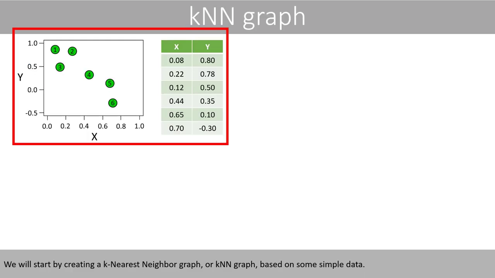

这里要先说明一件容易被二维示意图掩盖的事：**图的边是在多维空间里按距离连的**。视频的原话是"数据可能在若干维度上，因为图是建立在多维空间中数据点之间的距离上的"（[【跳转到 00:23】](https://www.youtube.com/watch?v=WWlNULeREnU&t=23)）。二维只是为了能画出来；在单细胞流程里，这个"多维空间"就是 PCA 坐标所在的空间，而视频明确说它的做法"与 R 包 Seurat 中识别单细胞 RNA-seq 细胞簇的做法类似"（[【跳转到 00:00】](https://www.youtube.com/watch?v=WWlNULeREnU&t=0)）。

也就是说：**节点是细胞，边是"相似"这个判断的产物，而这个判断由距离定义**。图里没有基因，只有细胞和细胞之间的关系——这正是 3.1.2 讲的"节点—边"结构在单细胞数据上的具体形态。

## 二、距离度量：欧氏距离与距离矩阵

### 2.1 两点之间的距离

视频选用的度量是**欧氏距离**（Euclidean distance）。以点 1 $(0.08, 0.80)$ 和点 6 $(0.70, -0.30)$ 为例，把两个坐标代进公式（[【跳转到 00:43】](https://www.youtube.com/watch?v=WWlNULeREnU&t=43)）：

$$
D = \sqrt{(x_1 - x_2)^2 + (y_1 - y_2)^2}
$$

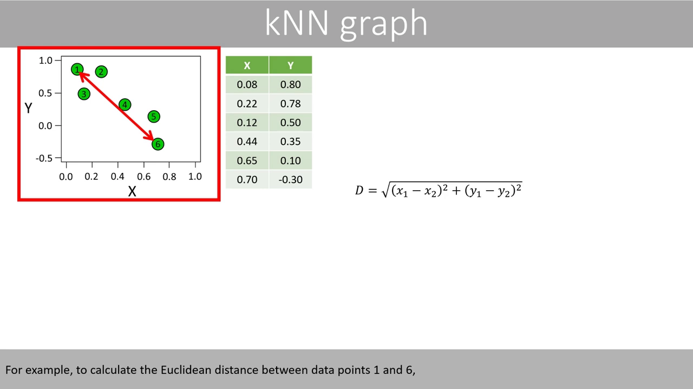

算出来的值是 $D_{1,6} = 1.26$。如果数据是三维的，就用同一个式子多开一项（[【跳转到 00:54】](https://www.youtube.com/watch?v=WWlNULeREnU&t=54)）——**维数增加只是让求和多几项，度量本身不变**。这一点在多维情形下很重要：不管 PCA 取了 20 个还是 40 个主成分，两个细胞之间的距离都是"逐维相减、平方、求和、开方"。

### 2.2 距离矩阵：把所有两两距离一次算完

把每对点都算一遍，就得到一张**距离矩阵**（[【跳转到 01:04】](https://www.youtube.com/watch?v=WWlNULeREnU&t=64)）。六个点对应 $6\times 6$ 的表，第 $i$ 行第 $j$ 列是点 $i$ 到点 $j$ 的距离。

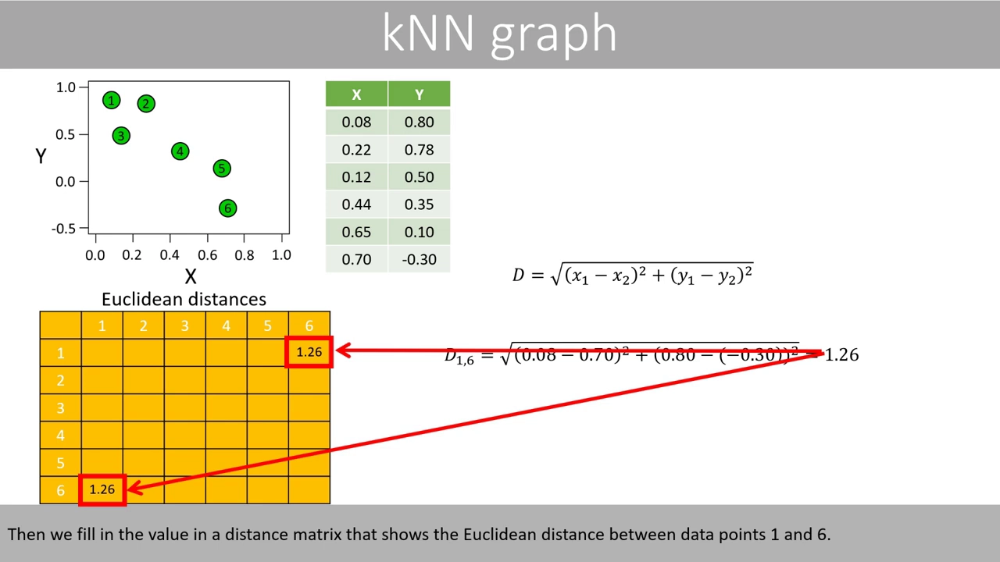

这张表有三个读法值得记住：

- **对角线是 0**：点到自己距离为零；
- **对称**：$D_{ij}=D_{ji}$，所以第 1 行第 6 列和第 6 行第 1 列是同一个数，信息重复了一半；
- **它已经是全量信息**：从这张表出发，后面所有的"最近邻""连边""加权"都只是对它的裁剪和改写，不再需要回到坐标。

### 2.3 度量选择是建模决定，不是技术细节

视频只演示了欧氏距离，没有比较其他度量。这里需要明确边界：**度量是建图之前就要定下的选择，它决定了距离矩阵的每一个格子**，因此也就决定了后面所有"最近邻"的名单。本节不展开度量比较，也不写"哪种度量更好"的结论；只需记住这一步发生在 $k$ 之前，改度量等于换一张图。

## 三、邻居数 $k$：把"最近"翻译成"连边"

### 3.1 $k$ 是每个点要连的邻居个数

有了距离矩阵，下一步是**决定一个点应该连几个最近邻**（[【跳转到 01:13】](https://www.youtube.com/watch?v=WWlNULeREnU&t=73)）。视频把这个值设为 $k=2$，然后逐行读出每一行里最小的两个非零值。

以点 1 为例，它在距离矩阵第 1 行里的值是 $0, 0.14, 0.30, 0.58, 0.90, 1.26$。去掉对角线上的 0，最小的两个是 $0.14$（点 2）和 $0.30$（点 3），所以点 1 的邻居是点 2 和点 3（[【跳转到 01:25】](https://www.youtube.com/watch?v=WWlNULeREnU&t=85)）。

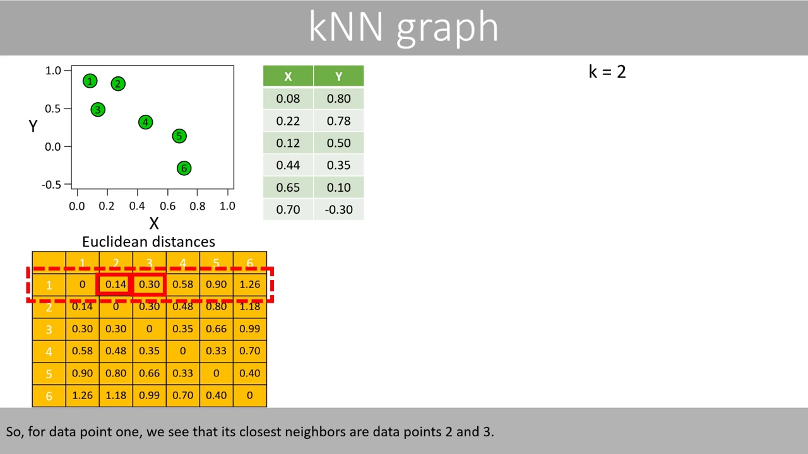

这一步就是"**k 近邻**"这个名称的全部含义：对每个点，在它的距离行里取前 $k$ 小的项，把对应的点记为邻居。**$k$ 决定了每个节点的出度**——$k=2$ 时每个点最多往外连两条边，$k=20$ 时每个点连二十条。

### 3.2 邻接矩阵与有向图

把"谁连谁"写进一张 $0/1$ 表，就是**邻接矩阵**：第 $i$ 行第 $j$ 列是 1 表示点 $i$ 把点 $j$ 当作最近邻，否则是 0（[【跳转到 01:31】](https://www.youtube.com/watch?v=WWlNULeREnU&t=91)）。

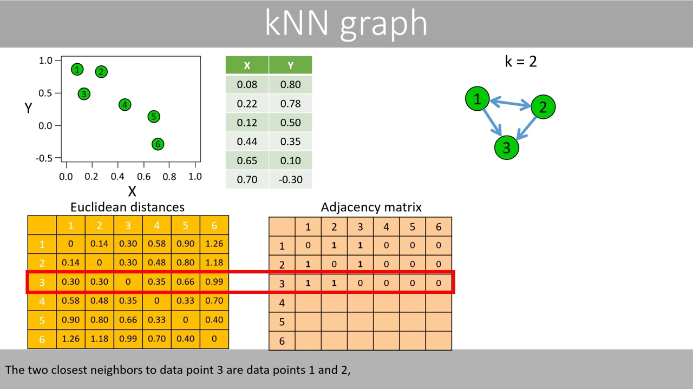

这张表对应的图形叫**有向 kNN 图**：数据点叫**节点**（node），两个节点之间的连线叫**边**（edge），箭头表示"这个点把那个点算作自己的最近邻"（[【跳转到 02:34】](https://www.youtube.com/watch?v=WWlNULeREnU&t=154)）。视频特别提醒：有时会给节点加一条指向自己的边，表示"点到自己距离最近"，效果是邻接矩阵主对角线上出现 1；但这个演示不使用自连接（[【跳转到 02:46】](https://www.youtube.com/watch?v=WWlNULeREnU&t=166)）。

这里有一个必须抓住的性质：**有向**。点 4 把点 3 和点 5 当作最近邻，并不代表点 3 也把点 4 算进自己的两个最近邻里。邻接矩阵因此**不对称**——这正是下一步要处理的问题。

## 四、对称化：从有向 kNN 图到无向图

去掉所有箭头，就得到**无向 kNN 图**（[【跳转到 03:27】](https://www.youtube.com/watch?v=WWlNULeREnU&t=207)）。代价是丢信息：一条边现在只说明"这两点之间有连接"，不再说明"是谁把谁算作最近邻"。

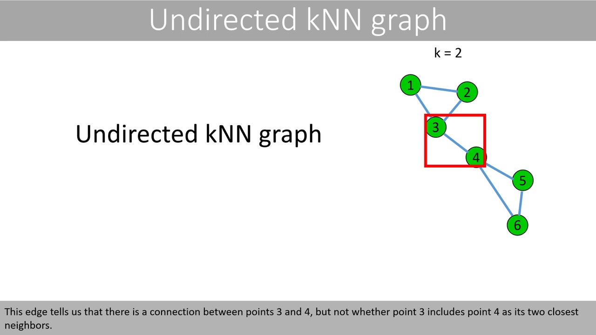

邻接矩阵也要跟着改：只要任一方向有边，两个位置都置 1，矩阵变成**对称矩阵**（[【跳转到 03:51】](https://www.youtube.com/watch?v=WWlNULeREnU&t=231)）。这一步在实现上常常就是"取矩阵或它的转置"。对称化之后，每个节点的度数不再固定等于 $k$——原本没被谁选中的点可能因为被别人选而度数变大，**图的度数分布开始不均匀**。

## 五、加权 kNN 图：用距离的倒数当边权

无向图只记"连没连"，还可以再记"连得多紧"。视频给的最简单做法是取**欧氏距离的倒数**作为权重（[【跳转到 04:34】](https://www.youtube.com/watch?v=WWlNULeREnU&t=274)）：点 1 与点 2 的距离是 $0.14$，权重就是 $1/0.14 = 7.14$。

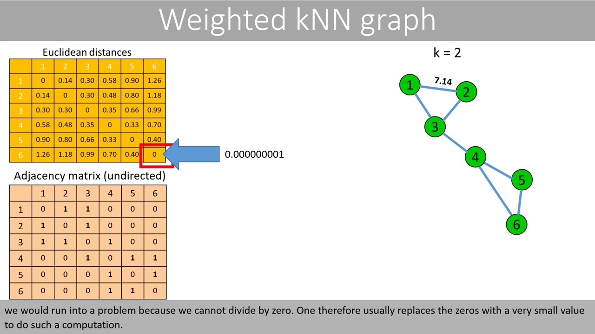

这里有个工程细节：**不能除以零**，所以通常把 0 换成一个极小的数（视频里写的是 `0.000000001`）再取倒数，然后把倒数矩阵与邻接矩阵**逐元素相乘**，得到加权邻接矩阵（[【跳转到 05:02】](https://www.youtube.com/watch?v=WWlNULeREnU&t=302)）。权重越大，表示这条连接在解释图时越重要。

但倒数距离加权有个隐含问题：它只看两点之间的绝对距离。在两个细胞都非常密集的区域里，一对"其实不属于同一类"的细胞也可能因为挨得近而拿到高权重。下一节就是针对这一点。

## 六、SNN：把"离得近"换成"共享邻居多"

### 6.1 建边规则：共享至少一个邻居就连

**共享最近邻图**（shared nearest neighbor graph，SNN 图）的起点是一张**有向 kNN 图**。做法是：先把它复制成无向 kNN 图，然后**对所有"至少共享一个邻居"的点对加一条边**（[【跳转到 05:45】](https://www.youtube.com/watch?v=WWlNULeREnU&t=345)）。

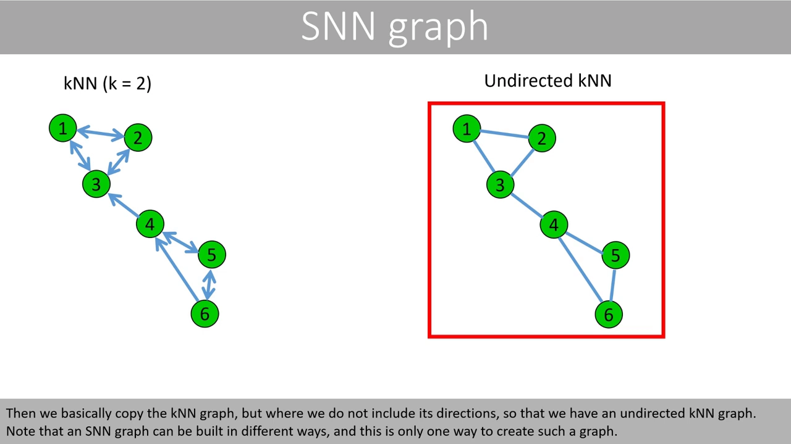

在六个点的例子里：点 1 和点 4 共享邻居点 3，于是加一条 1–4 的边；点 2 和点 4 也共享邻居，同样加边；而点 5 和点 1、2、3 不共享任何邻居，所以它们之间不加边（[【跳转到 06:16】](https://www.youtube.com/watch?v=WWlNULeREnU&t=376)）。视频明确说 SNN 图可以有多种建法，这只是其中一种（[【跳转到 06:04】](https://www.youtube.com/watch?v=WWlNULeREnU&t=364)）。

与 kNN 图相比，SNN 图**可能多出原来没有的边**（比如 1–4），因为"共享邻居"是比"距离近"更宽的关系。这也意味着 SNN 的边集不是 kNN 边集的子集。

### 6.2 权重一：共享邻居的个数

SNN 的第一种权重直接数"共享了几个最近邻"。视频给出的取值范围是 $[0,\,k+1]$，理由是**节点本身也算在自己的最近邻集合里**；在 $k=2$ 的例子中，权重因此落在 0 到 3 之间（[【跳转到 07:06】](https://www.youtube.com/watch?v=WWlNULeREnU&t=426)）。

具体的计数规则是：如果两个点在有向 kNN 图里**互相**都把对方算作最近邻，权重从 2 起算；如果只有**单向**的箭头，权重从 1 起算；然后再加上它们共享的邻居个数（[【跳转到 07:23】](https://www.youtube.com/watch?v=WWlNULeREnU&t=443)）。视频逐条算出：点 1–2 得 3（双向 + 共享 1 个），点 3–4 得 1（单向 + 不共享），点 1–4 得 1（kNN 里没有这条边，但共享 1 个），点 5–6 得 3（双向 + 共享点 4）。

![按共享邻居数加权：左边红框标出点 3 与点 4 只有单向箭头且不共享最近邻，权重 = 1 + 0 = 1；右边是完整的加权 SNN 图，权重范围标注为 [0, k+1]](assets/从距离矩阵到邻接图：kNN、SNN 与邻居数 k 的作用/00461.webp)

视频还指出，这套数字与 R 包 `bluster` 里 `makeSNNGraph(type = "number")` 的输出一致（[【跳转到 09:07】](https://www.youtube.com/watch?v=WWlNULeREnU&t=547)）。**"强权重"和"弱权重"的区别在这里第一次变得可见**：点 1–2 权重为 3，是因为它们互为最近邻且还共享一个邻居；点 2–4 权重为 1，是因为它们本来不在彼此的最近邻里，只是碰巧共享了一个邻居。

### 6.3 权重二：Jaccard 指数

把 `type` 从 `number` 换成 `jaccard`，权重会按下面的式子重新算（[【跳转到 09:18】](https://www.youtube.com/watch?v=WWlNULeREnU&t=558)）：

$$
\text{weight} = \frac{n}{2\cdot(k+1) - n}
$$

其中 $n$ 就是上一小节数出来的共享邻居个数，$k$ 仍是之前设定的邻居数。分母里的 $2(k+1)$ 是两个点各自最近邻集合的大小之和（各含自身），减去交集大小 $n$，得到的是并集大小——所以这就是**交集除以并集**。Jaccard 权重落在 $[0,1]$ 之间，$k=2$ 时前述四条边得 1，三条边得 0.22，两条边得 0.5（[【跳转到 09:34】](https://www.youtube.com/watch?v=WWlNULeREnU&t=574)）。

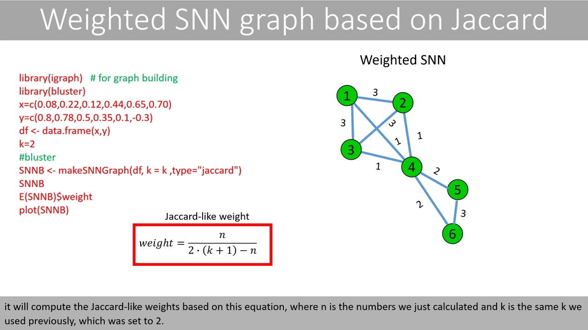

### 6.4 与 Seurat `FindNeighbors` 的对应关系

视频做了一次实现层面的核对（[【跳转到 09:47】](https://www.youtube.com/watch?v=WWlNULeREnU&t=587)）：用 Jaccard 权重得到的图，与 Seurat 5.3.0 里 `FindNeighbors` 的输出**权重完全一致**。作者同时说明，他没能查到该函数计算图与权重的确切内部细节，只是在测试了多组输入和多个 $k$ 值后得到一致结果，因此推测两者用的是同一套方法（[【跳转到 10:10】](https://www.youtube.com/watch?v=WWlNULeREnU&t=610)）。这条说明很重要：**它是实测一致，不是文档承诺**。

由此带出两个参数上的坑：

1. **Seurat 把节点自身算作最近邻**，所以要用 $k+1$ 作为 `k.param` 才能复现"$k$ 个邻居"的图，同时要把邻接矩阵主对角线上的 1 置零（[【跳转到 10:31】](https://www.youtube.com/watch?v=WWlNULeREnU&t=631)）。换句话说，**不同工具里同一个字母 $k$ 的含义可能差一**。
2. **Seurat 还有一个剪枝参数 `prune.SNN`，默认 $1/15$**；把它设成 $0.25$，权重低于 0.25 的边就会被删掉（[【跳转到 10:48】](https://www.youtube.com/watch?v=WWlNULeREnU&t=648)）。

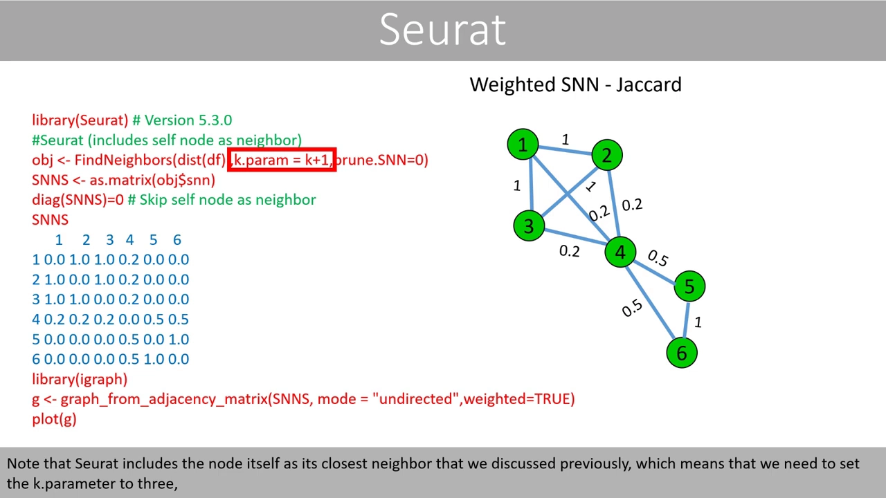

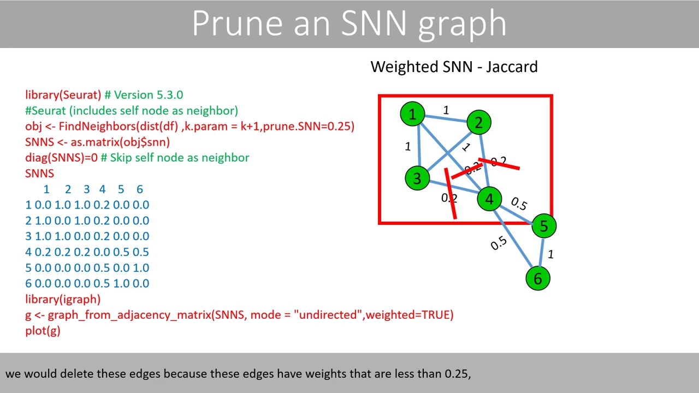

剪枝这一步值得单独看一眼：**它删掉的正是 Jaccard 权重最低的那些边，也就是"只勉强共享一个邻居"的连接**。删完之后，点 1、2、3 之间和点 4、5、6 之间的边界变得干净——这已经是社区结构的雏形。

## 七、$k$ 在整条链上改变了什么

把前面几节串起来，可以看到 $k$ 不是"建图时随便填的一个数"，它在三个位置同时起作用：

| 位置 | $k$ 的作用 | 后果 |
| :--- | :--- | :--- |
| 取最近邻 | 每个节点保留前 $k$ 小的距离项 | 决定有向 kNN 图的**出度**，即每个细胞最多连几条边 |
| SNN 权重公式 | Jaccard 的分母含 $2(k+1)$，`number` 权重的上界是 $k+1$ | 同一个共享邻居数 $n$，在不同 $k$ 下换算出的权重不同 |
| 剪枝阈值 | `prune.SNN` 是权重的绝对阈值 | $k$ 变了，权重分布跟着变，同一阈值删掉的边也变了 |

由此可以读出一条**单向的影响链**：

```
距离矩阵 → (k) 有向 kNN 图 → 对称化 → 无向 kNN 图 → (k, 权重公式) 加权 SNN 图 → (prune) 剪枝后的图 → 社区划分
```

$k$ 越靠前，影响越根本：它先决定图的**连通程度**（每个点连出去几条边），再通过权重公式决定边的**强弱分布**，最后通过剪枝决定哪些边能活到聚类那一步。而 `resolution` 是在这张**已经定型的图**上做划分的参数——两者不在同一层，不能互相替代。

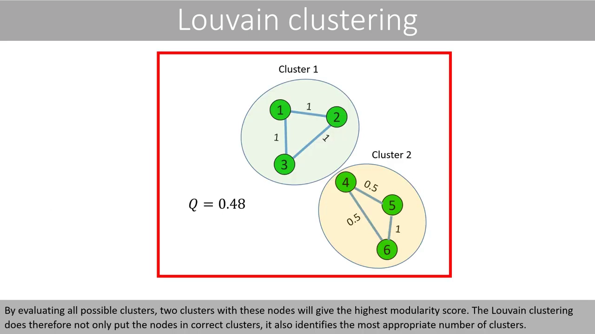

视频最后一段用模块度 $Q$ 演示了 Louvain 如何在图上找社区：$Q$ 在"簇内边多、簇间边少于随机期望"时高，把点 1、2、3 和 4、5、6 分成两簇得到 $Q=0.48$，换成 1–2 / 3–6 的划分 $Q$ 明显下降，分成三簇时单点簇会拿到负分，只分一簇时 $Q=0$（[【跳转到 11:05】](https://www.youtube.com/watch?v=WWlNULeREnU&t=665)）。他还指出，公式里可以再乘一个**分辨率参数** $\gamma$，值越大簇越多、越小簇越少（[【跳转到 15:05】](https://www.youtube.com/watch?v=WWlNULeREnU&t=905)）。

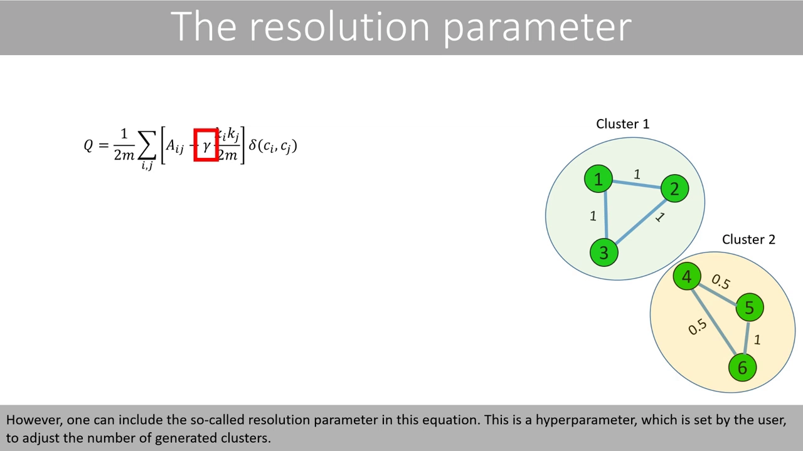

**这一段的展开属于 3.2.2**（细胞图聚类：社区结构、分辨率与群体稳定性）。本节只取它的一句结论：**聚类算法的输入是这张图，不是坐标本身**；图的性质（度数、权重、剪枝）会一路传导到分群结果。

## 八、这条链在单细胞流程里的位置

把本节和相邻小节接起来，完整的链条是这样的：

```
计数矩阵
  → 归一化、对数变换              （3.1.3）
  → 高变基因子集                   （3.1.4）
  → PCA：细胞 × 主成分坐标         （3.1.1 / M01 §2.3.9）
  → 距离矩阵（欧氏，在 PCA 空间）    ← 本节
  → kNN 图 / SNN 图（k、权重、剪枝） ← 本节
  → 社区划分（resolution）          （3.2.2）
  → 二维嵌入（UMAP/tSNE，只用于展示）（3.2.3）
```

其中每一段都在**减少信息、增加结构**：HVG 丢掉不携带变异的基因，PCA 把几千维压成几十维，距离把坐标压成一个标量，$k$ 把全量距离压成固定度数的边，SNN 把"距离"换成"邻居重合度"，剪枝再删掉弱边。**每一步都是可追溯的取舍，而不是无损转换**。所以当后面的聚类结果不如预期时，往回查的顺序应该是：图对不对（本节）→ PCA 空间对不对（3.1.1）→ 输入基因对不对（3.1.4）→ 归一化对不对（3.1.3）。

## 小结

- **图的边来自距离**：节点是数据点（细胞），边由多维空间中的距离定义；视频用二维点演示，但明确说数据可以在多维空间，做法与 Seurat 一致。
- **距离矩阵是全量信息**：对称、对角线为 0，后面所有操作都只是对它的裁剪与改写。
- **$k$ 决定出度**：对每个点取距离前 $k$ 小者连边，得到有向 kNN 图；邻接矩阵不对称。
- **对称化会改变度数**：去掉箭头后，任一方向有边即置 1，矩阵变对称，节点度数不再都等于 $k$。
- **加权 kNN 用距离倒数**：注意对角线上的 0 要替换成极小值才能取倒数。
- **SNN 换了相似的定义**：从"离得近"变成"共享邻居多"，可能新增 kNN 里没有的边。
- **两种 SNN 权重**：`number` 权重数共享邻居个数，范围 $[0, k+1]$（因为含自身）；Jaccard 权重是 $\dfrac{n}{2(k+1)-n}$，范围 $[0,1]$。
- **实现细节会咬人**：Seurat 把自身算作最近邻，所以 `k.param = k+1`；`prune.SNN` 默认 $1/15$，删掉低权重边。视频的"与 Seurat 权重一致"是实测结论，不是文档承诺。
- **$k$ 与 `resolution` 不在同一层**：$k$ 决定图长什么样，`resolution` 在既定图上决定切几刀。

## 关键术语速查

| 术语 | 一句话解释 |
| :--- | :--- |
| 欧氏距离 | $\sqrt{\sum_i (x_i-y_i)^2}$，逐维相减、平方、求和、开方 |
| 距离矩阵 | $n\times n$ 表，第 $i$ 行第 $j$ 列是点 $i$ 到点 $j$ 的距离；对称、对角线为 0 |
| 邻居数 $k$ | 每个点保留的最近邻个数，决定 kNN 图每个节点的出度 |
| 邻接矩阵 | $0/1$（或带权重）表，记录哪些节点之间有边；有向图下不对称 |
| 有向 kNN 图 | 箭头表示"这个点把那个点算作最近邻"；对称化后成为无向 kNN 图 |
| 加权 kNN 图 | 用距离的倒数（或类似变换）作为边权，表示连接的紧密程度 |
| SNN 图 | 共享最近邻图：对共享至少一个邻居的点对加边，权重按共享邻居数或 Jaccard 指数计算 |
| Jaccard 权重 | $\dfrac{n}{2(k+1)-n}$，即两个最近邻集合的交集除以并集，落在 $[0,1]$ |
| `k.param` | Seurat `FindNeighbors` 的邻居数参数；因含自连接，复现"$k$ 个邻居"需设成 $k+1$ |
| `prune.SNN` | Seurat 的 SNN 剪枝阈值，默认 $1/15$；权重低于阈值的边被删除 |
| 模块度 $Q$ | 社区划分的评分：簇内边多、簇间边少于随机期望时高（展开见 3.2.2） |

## 边界与延伸说明

- **本节不展开社区划分**：Louvain 的模块度推导、`resolution` 的选择与 clustree 判读属于 3.2.2；UMAP/tSNE 的邻域保持与参数属于 3.2.3。
- **度量比较未展开**：视频只用了欧氏距离，没有比较相关距离、余弦相似度等其他度量；本节据此不写"哪种度量更好"的结论。
- **$k$ 的取值没有在视频里做扫描**：视频只演示 $k=2$ 与 Seurat 的 $k+1$ 对应关系，没有跑"$k$ 从小变大会怎样"的对比实验。因此本节只写 $k$ 在**建图规则上**的作用（出度、权重公式、剪枝阈值），不写"$k$ 太大会合并细胞类型"这类未经该视频验证的结论；需要这个判断时应另找材料或自行实测。
- **权重与 Seurat 的一致性属实测**：视频作者明确说他没查到 `FindNeighbors` 的内部细节，是在多组输入、多个 $k$ 下测出一致后作出的推测；本文保留这一限定，不升级为"Seurat 文档保证"。