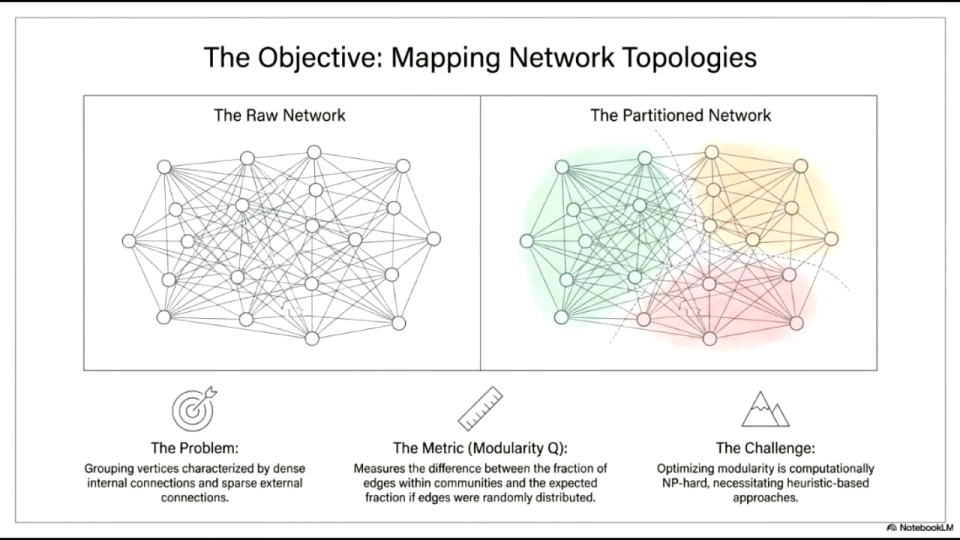
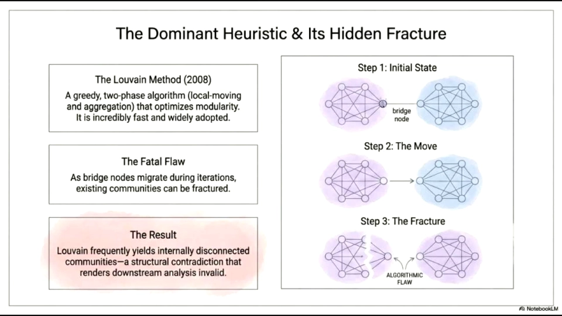
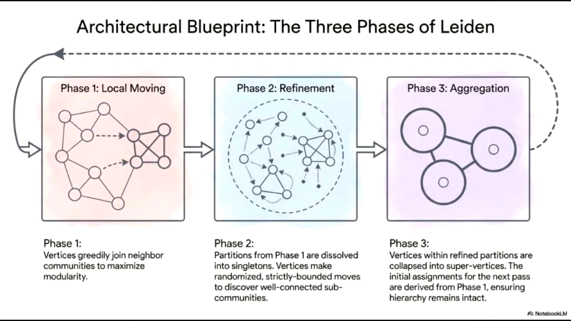
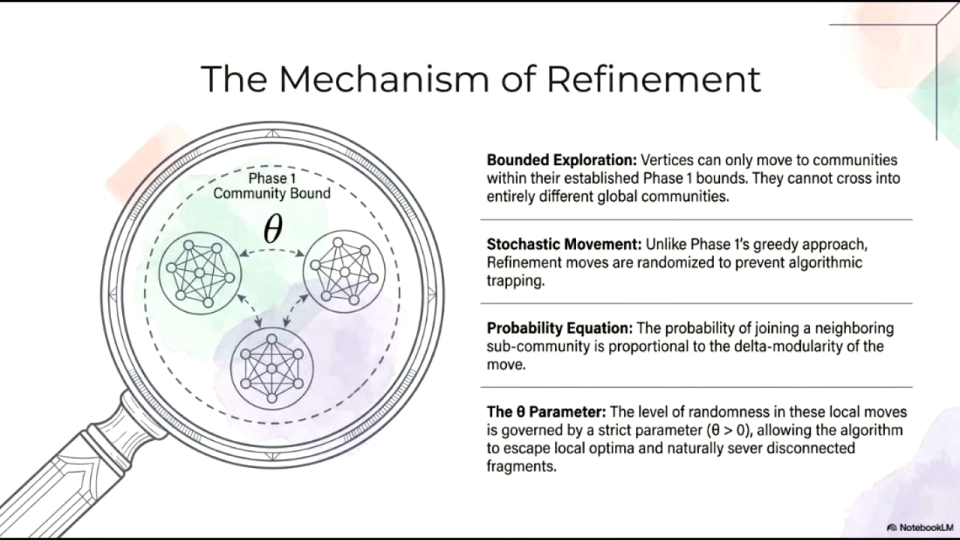
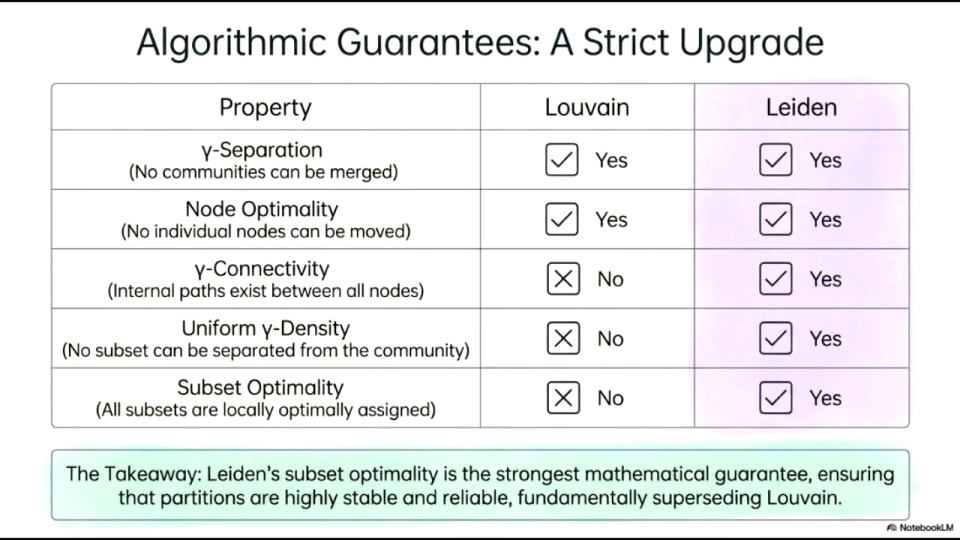
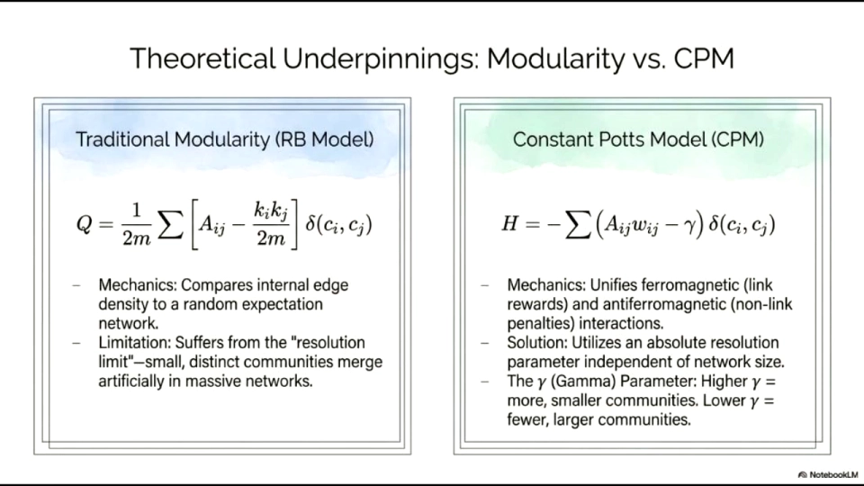
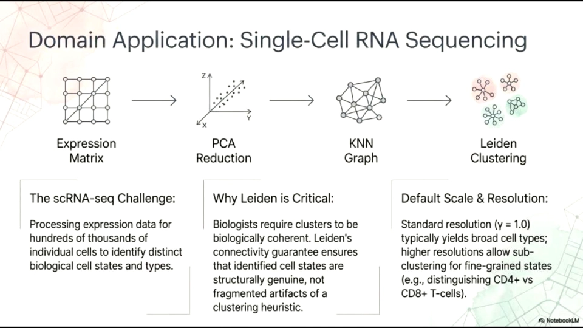

# 图上的社区发现：模块度、Louvain 的断连缺陷与 Leiden 的分辨率

> 视频来源：[From Louvain to Leiden](https://www.youtube.com/watch?v=BQ4wab0UtLg)（YouTube · 幻灯片讲解，约 17 分钟）
> 简要导读：这是一支按论文《From Louvain to Leiden: guaranteeing well-connected communities》（Traag, Waltman & van Eck, 2019）逐页讲解的幻灯片视频，讲的是"把一张邻接图切成若干社区"这件事本身：切分好坏用什么量衡量、Louvain 为什么会产生内部断连的群、Leiden 多出的"细化"一步解决了什么、分辨率参数到底在调什么。本文只取与单细胞聚类判读有关的部分，跳过并行实现与工程性能；机制与公式已按原论文核对。

## 本讲要解决的核心问题（SCQA）

**背景**：单细胞流程走到聚类这一步时，手上已经有一张图——每个细胞是一个节点，和它最相似的若干细胞之间连边。所谓"聚类"，就是把这张图切成若干块，使块内连接密、块间连接稀。软件里通常只有一行 `FindClusters` 或 `sc.tl.leiden`。

**冲突**：这一行背后其实是一个**没有唯一正确答案**的问题。切分好坏需要一个目标函数（模块度），而这个目标函数的全局最优解算不出来，只能贪心近似；不同的近似算法会给出不同的切法，早期常用的 Louvain 甚至会切出"内部根本不连通"的群。再加上一个分辨率参数，同一张图可以被切成 8 群，也可以被切成 30 群。

**疑问**：图上的"社区"到底按什么标准定义？Louvain 和 Leiden 的差别只是快慢，还是切出来的东西不一样？分辨率参数改的到底是什么？

**回答（中心思想）**：图聚类是**在一个显式目标函数（模块度或 CPM）上做启发式搜索**，因此它给出的是一份"在某个分辨率下的划分"，而不是数据里客观存在的分组清单。Louvain 的两阶段搜索会留下内部断连的社区，Leiden 用"细化"这一步把它修掉并给出更强的数学保证；分辨率参数则直接决定"多大的内部连接密度才算一个群"，调大就切得更碎。理解这两件事，才知道后面为什么要用 marker 和多分辨率、重复分析去核对聚类结果。

## 一、把聚类看成图划分：社区是什么，模块度在量什么

### 1.1 社区：块内密、块间稀

视频先把问题画成一张图：左边是原始网络，右边是同一张网络被划成几块（[【跳转到 00:48】](https://www.youtube.com/watch?v=BQ4wab0UtLg&t=48)）。要划分的对象满足一个直观特征——**同一社区内部的节点之间连接密集，不同社区之间连接稀疏**。这个定义不依赖节点的坐标，也不假设群是球形的，只用到"谁和谁相连"这一份信息；这正是图聚类能用在单细胞上的原因：邻接图已经把表达相似性编码成了边。

### 1.2 模块度 Q：实际内部边数减去随机情况下的期望

有了"社区"的直观定义，还需要一个能算的数，才能比较两种切法谁更好。视频给出的量是**模块度（modularity）$Q$**：它衡量社区内部的边所占比例，比"如果边随机分布时的期望比例"高出多少（[【跳转到 00:53】](https://www.youtube.com/watch?v=BQ4wab0UtLg&t=53)）。



用公式写出来就是经典的模块度形式（视频中称为 RB 模型）：

$$
Q = \frac{1}{2m}\sum_{ij}\left[A_{ij} - \frac{k_i k_j}{2m}\right]\delta(c_i, c_j)
$$

其中 $A_{ij}$ 是邻接矩阵（两节点相连为 1），$k_i$、$k_j$ 是节点的度，$m$ 是总边数，$\delta(c_i,c_j)$ 在两点属于同一社区时取 1、否则取 0。括号里第二项 $\frac{k_i k_j}{2m}$ 就是"随机连边时这两点之间应有的边数"——**模块度奖励"比随机更密"的内部连接，惩罚"本来就会连上"的边**。

这个定义带来两个直接后果，也是本节的伏笔：

1. **度大的节点更难被分开**。一个连接很多的细胞，其 $k_i$ 很大，随机期望项也大，把它单独切出去对 $Q$ 的贡献往往不划算。
2. **分母里有总边数 $m$**。这意味着"什么算一个社区"会随整张图的规模漂移——后面讲的"分辨率极限"就出在这里。

### 1.3 为什么只能贪心：模块度最优是 NP 难问题

模块度有了，接下来的想法自然是"找使 $Q$ 最大的划分"。视频明确指出：**精确优化模块度是 NP 难（NP-hard）问题**，因此实际算法只能走启发式路线，在巨大的划分空间里做局部搜索（[【跳转到 01:18】](https://www.youtube.com/watch?v=BQ4wab0UtLg&t=78)）。

这一点值得在单细胞语境里说透：**聚类结果不是"这张图的最优划分"，而是"某个启发式算法在某个参数下停下来的那个划分"**。算法、随机种子、参数、甚至节点遍历顺序，都会影响最后停在哪里。

## 二、Louvain 的两阶段，以及它留下的断连社区

### 2.1 局部移动 + 聚合

2008 年提出的 **Louvain** 方法长期是社区发现的主力。它是贪心的两阶段算法（[【跳转到 01:40】](https://www.youtube.com/watch?v=BQ4wab0UtLg&t=100)）：

1. **局部移动（local moving）**：每个节点先各自成一个社区，然后逐个尝试把节点挪到邻居所在的社区，只要能让模块度上升就挪，直到没有单个节点可以再改善。
2. **聚合（aggregation）**：把每个社区压成一个"超级节点"，社区之间的边变成超级节点之间的边，然后在这张更小的图上重复第 1 步。

两阶段交替，直到模块度不再上升。它的优点是快，所以被大量流程默认采用。

### 2.2 缺陷：桥节点一走，社区就断成两半

视频用三步图说明了 Louvain 的结构性缺陷（[【跳转到 01:45】](https://www.youtube.com/watch?v=BQ4wab0UtLg&t=105)）：

- **第一步**：一个社区由两个子块组成，它们之间只靠**一个桥节点**相连；
- **第二步**：算法发现把这个桥节点挪到相邻社区能让模块度上升，于是挪走；
- **第三步**：桥节点走了，原来的社区失去了唯一的内部通路，**变成两个互不相连的碎片，却仍然被算作同一个社区**。



这不是实现 bug，而是"只优化模块度、不检查连通性"的必然结果。视频强调后果很实际：**绝大多数下游分析都默认一个社区是一个内聚的整体**——在一个群里算平均表达、找差异基因、做富集，前提都是这群细胞彼此可比。如果群内部已经断开，这些统计的对象就名不副实（[【跳转到 02:10】](https://www.youtube.com/watch?v=BQ4wab0UtLg&t=130)）。

在单细胞数据上，这种碎片化的典型表现是：某个"群"其实是两个相距很远的小群被一个过渡细胞串起来；或者一个群在 UMAP 上明显是两坨，但标签只有一个。

## 三、Leiden 的三阶段：细化这一步改变了什么

### 3.1 多出来的第三阶段

2019 年提出的 **Leiden** 算法针对的正是"内部断连的社区"。它把 Louvain 的两阶段扩成三阶段（[【跳转到 04:08】](https://www.youtube.com/watch?v=BQ4wab0UtLg&t=248)）：

1. **局部移动**：与 Louvain 相同，节点贪心地加入邻居社区以提升模块度，得到初始划分；
2. **细化（refinement）**：把上一步的每个社区**打散回单点**，再在这些社区的**边界之内**重新聚成"连接良好的子社区"；
3. **聚合**：按细化后的子社区（而不是第一步的社区）压成超级节点，再回到第 1 步，循环直到不再改善。



关键差别在**聚合时用哪套边界**：Louvain 用第一步的社区边界压缩，断开的碎片会被一起压进同一个超级节点，缺陷被带进下一轮；Leiden 用细化后的子社区边界压缩，碎片在这一步就被拆开。视频的说法是：细化让"可能被忽略的断连碎片被自然切断"。

### 3.2 细化是随机且有界的

细化阶段有两个设计细节，都影响结果的可复现性（[【跳转到 05:14】](https://www.youtube.com/watch?v=BQ4wab0UtLg&t=314)）：

- **有界探索（bounded exploration）**：节点只能在**第一步已确定的社区边界内**移动，不能跨到别的社区去。这保住了宏观结构，只让局部重新洗牌。
- **随机移动（stochastic movement）**：与第一步的贪心不同，细化按概率接受移动，**加入某个子社区的概率与这次移动带来的模块度增量成正比**；随机强度由参数 $\theta$ 控制，$\theta > 0$ 时算法才有机会跳出局部最优。



这里有一个对判读很重要的推论：**细化带随机性，所以同一份数据、同一组参数，两次运行的划分可以不完全相同**。这不是程序出错，而是算法定义的一部分。后面要讲的"重复分析核对"，正是从这一点长出来的。

### 3.3 三类保证：为什么说 Leiden 不只是"更快"

视频用一张表比较两种算法给出的数学保证（[【跳转到 09:10】](https://www.youtube.com/watch?v=BQ4wab0UtLg&t=550)）：

| 性质 | 含义 | Louvain | Leiden |
| :--- | :--- | :--- | :--- |
| $\gamma$-分离 | 没有两个社区可以再合并而提升目标函数 | 有 | 有 |
| 节点最优 | 没有单个节点可以再移动而提升目标函数 | 有 | 有 |
| $\gamma$-连通 | 社区内部任意两点之间存在通路 | **无** | 有 |
| 均匀 $\gamma$-密度 | 社区内没有子集可以被单独分出去 | **无** | 有 |
| 子集最优 | 所有子集都已被局部最优地分配 | **无** | 有 |



"子集最优"是这张表里最强的一条：它意味着不只是单个节点、而是**任取一个子集**都无法通过重新分配来改善目标函数。视频据此把 Leiden 称为对 Louvain 的严格升级。

不过视频也留了一个诚实的注脚：在超大规模图上，标准 Leiden 实现仍有约 $1.3\times10^{-4}$ 的社区是内部断连的（[【跳转到 10:05】](https://www.youtube.com/watch?v=BQ4wab0UtLg&t=605)）。所以"有保证"不等于"逐例无瑕疵"——对单细胞数据来说，这个量级可以忽略，但"看到可疑的群就回去查连通性和 marker"这个习惯仍然成立。

## 四、分辨率：模块度的分辨率极限与 CPM 的 gamma

### 4.1 模块度自带的"分辨率极限"

第一节提到模块度分母里有总边数 $m$，后果就是**分辨率极限（resolution limit）**：在很大的网络里，两个本来独立的小社区会因为"合并起来对整体 $Q$ 更有利"而被强行并成一群（[【跳转到 06:30】](https://www.youtube.com/watch?v=BQ4wab0UtLg&t=390)）。

换成单细胞的场景：数据规模越大、图越大，**用标准模块度时小群体越容易被并进邻近的大群体**。这不是"数据里没有这个小群"，而是目标函数在整体尺度上不奖励把它单独切出来。

### 4.2 CPM：把"分辨率"变成与网络规模无关的绝对参数

为了解决分辨率极限，视频介绍了 **CPM（constant Potts model，常数 Pots 模型）**。它不再拿"整张图的随机期望"作参照，而是直接给每条边一个奖励、给每对非边一个惩罚：

$$
H = -\sum_{ij}\left(A_{ij}w_{ij} - \gamma\right)\delta(c_i,c_j)
$$

其中 $\gamma$ 就是**分辨率参数**。与模块度不同，这里的 $\gamma$ 是**绝对阈值**，不随网络规模变化（[【跳转到 07:20】](https://www.youtube.com/watch?v=BQ4wab0UtLg&t=440)）。它的读法很直接：

- **$\gamma$ 调大** → 只有内部连接非常密的子图才值得单独成社区 → **群更多、更小、更碎**；
- **$\gamma$ 调小** → 连接稀疏一些的群也划算 → **群更少、更大、更粗**。



### 4.3 gamma 的直觉：一个节点在"多交朋友"和"少遇陌生人"之间的权衡

视频还给了一个博弈论式的直觉（[【跳转到 07:50】](https://www.youtube.com/watch?v=BQ4wab0UtLg&t=470)）：把每个节点想成一个自主决策的个体，加入某个社区既带来"多几个朋友"的收益（内部连接 $\Delta D$），也带来"多几个陌生人"的代价（与非成员的连接 $\Delta \hat{d}$）。定义"熟悉度指数" $f_i$ 为朋友数占总连接数的比例，那么决策规则就是：

- 若 $\gamma < f_i$，节点优先"多交朋友"，倾向于加入；
- 若 $\gamma > f_i$，节点优先"避开陌生人"，倾向于留在外面。

于是 $\gamma$ 可以被读成**"一个群至少要多'纯'才配独立存在"的门槛**。这也解释了为什么分辨率没有"正确值"：门槛高低取决于你想问的问题——想看大类细胞，门槛放低；想找亚群或过渡态，门槛抬高。

## 五、回到单细胞：这条流水线里每一步在做什么

视频最后把算法放回 scRNA-seq 的流程里（[【跳转到 14:09】](https://www.youtube.com/watch?v=BQ4wab0UtLg&t=849)）：

```
表达矩阵 → PCA 降维 → KNN 邻接图 → Leiden 社区发现
```



视频对这条链路的三个说法值得记住：

1. **聚类发生在图上，图建在 PCA 坐标上**。所以 PC 数、邻居数 $k$ 这些"上游"参数会改变图，从而改变社区——它们和分辨率一样是结论的一部分。
2. **连通性保证对生物学判读有意义**：如果一个"细胞状态"只是启发式切出来的碎片，那么在这个群里做的差异表达、marker 打分都建立在不内聚的对象上。Leiden 的连通性保证让"一个群"至少是一个结构上说得通的整体。
3. **分辨率决定粒度的默认刻度**：$\gamma = 1.0$ 通常给出较粗的细胞大类；调高分辨率才能把 CD4+ 与 CD8+ T 细胞这类细分状态分开（[【跳转到 14:59】](https://www.youtube.com/watch?v=BQ4wab0UtLg&t=899)）。

注意这里的因果关系：**不是"数据里本来有 15 个群，算法把它找出来"，而是"你选了某个分辨率，算法按这个门槛给出了一份划分"**。同一份数据在 $\gamma=0.5$ 和 $\gamma=2$ 下都是"正确执行"的结果，差别只在门槛。

## 六、这些机制对判读意味着什么

把上面的内容收成几条可以直接用在分析里的判断：

1. **聚类结果是一份"参数化划分"，不是细胞类型清单**。它回答的是"在这张图、这个目标函数、这个分辨率下，哪些细胞被归到一起"，而不是"这些细胞是什么"。
2. **断连的群要当异常处理**。如果某个群在邻接图上不连通、或在嵌入图上分成互不相连的几坨，先怀疑切分，再谈生物学。
3. **分辨率要当成一个区间来选，而不是一个点**。既然 $\gamma$ 是门槛，合理做法是跑一串分辨率，看哪些群在相邻档位上稳定存在、哪些在某一档突然裂开。
4. **随机性要显式对待**。细化阶段的随机移动意味着重跑会得到略有差异的划分；把"换种子/换参数后划分是否还成立"作为常规检查，比盯着一张图更可靠。
5. **图上的"群"只是候选**。它需要通过独立证据（marker 表达、跨样本/跨重复的一致性）来确认——这正是本脉络后续小节要处理的问题。

## 小结

- 图聚类是在**邻接图**上找"块内密、块间稀"的社区，用**模块度 $Q$** 或 **CPM** 这样的目标函数衡量切分好坏。
- 模块度最优是 **NP 难**问题，实际算法都是启发式搜索，因此结果是"算法停下来的划分"，不是唯一最优解。
- **Louvain** 用局部移动 + 聚合两阶段贪心优化模块度，速度快，但会把桥节点挪走，留下**内部断连的社区**，而下游分析默认社区是内聚整体。
- **Leiden** 在中间插入**细化**阶段：在社区边界内按与模块度增量成正比的概率随机重组子社区，再按细化边界聚合，从而保证社区**连通、密度均匀、子集最优**。
- 标准模块度有**分辨率极限**：图越大，小社区越容易被并进大社区；**CPM** 用与网络规模无关的绝对参数 $\gamma$ 取代这一相对比较。
- **$\gamma$ 越大群越多越小，越小群越少越大**；$\gamma=1.0$ 通常对应大类，更高分辨率用于亚群。分辨率没有唯一正确值，只有与问题匹配的取值。
- 细化阶段的随机性意味着**重跑会得到不同划分**，因此聚类结论需要多分辨率、重复运行与独立 marker 证据共同支撑。

## 关键术语速查

| 术语 | 一句话解释 |
| :--- | :--- |
| 社区（community） | 图上内部连接密集、对外连接稀疏的一组节点，对应单细胞里的一个候选细胞群 |
| 模块度 $Q$ | 社区内部边占比相对随机期望的超出量；越大表示切分越"出乎随机" |
| NP 难 | 不存在已知的多项式时间精确算法；模块度最优属于此类，只能近似 |
| Louvain | 2008 年的贪心两阶段社区发现算法（局部移动 + 聚合），快但不保证社区连通 |
| Leiden | 2019 年的改进算法，在局部移动与聚合之间加入细化阶段，保证社区连通与子集最优 |
| 细化（refinement） | Leiden 的第二阶段：把社区打散成单点，在社区边界内随机重组出连接良好的子社区 |
| $\theta$ | 细化阶段随机移动的强度参数，$\theta>0$ 才有跳出局部最优的机会 |
| 分辨率极限 | 标准模块度的缺陷：大图中小社区容易被强行合并 |
| CPM | 常数 Pots 模型，用绝对分辨率参数 $\gamma$ 替代模块度的随机期望项 |
| $\gamma$（resolution） | 分辨率参数，越大社区越多越小；单细胞软件里的 `resolution` 即对应它 |
| $\gamma$-连通 | 保证社区内部任意两点存在通路，Louvain 不具备 |
| 子集最优 | 任取社区的一个子集都无法通过重新分配改善目标函数，Leiden 独有的最强保证 |